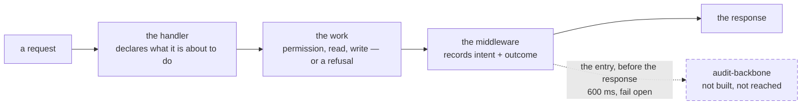

# The activity log: intended, and not built

> **Written** 2026-11-09, carried whole out of [`architecture.md`](architecture.md) when that page
> was rearranged so a person could read it ([open item 202](open-items.md)). **Nothing was
> shortened in the move:** every paragraph below is a measured fact, a decision with the
> alternative it beat, or a hazard no gate catches. What changed is only that it no longer sits
> inside the page every session opens.
>
> **Nothing below the first paragraph is in the code.** Read every line of it as **what was
> decided**, never as what is there. What permits it as a document is the documentation
> convention's own line — docs describe *absent* code: a plan, or a rejected option
> ([documentation](conventions/documentation.md#what-earns-a-line)).
>
> **This page is one of the citation check's living documents** (`scripts/src/citations.ts`'s
> `LIVING`), so every name it cites is greped in the file that is named and the gate reds when one
> stops resolving. That it describes code not yet written is no reason to leave it out: the check
> only verifies what *is* cited, and the names below that already exist — the store, the writer, the
> gate's `Makefile`, the package's own rules — are exactly the ones that will rot when this work
> lands.

**What exists, and it is the only fact on this page.** `audit-backbone/` holds a finished Go
service: 22 Go files, nine internal packages and `cmd/server`, its own SQLite file, its own gate,
five rules `AB1` to `AB5`. **Nothing in this repository calls it** — the BFF does not reach it,
`ops/` ships nothing of it, and the CI workflow has no job for it
(`audit-backbone/CLAUDE.md`'s `Nothing in this repository calls this package yet`). Its single write
path is `Writer.Do` in `audit-backbone/internal/batch/writer.go` and its store is `Store` in
`audit-backbone/internal/activity/store.go`. What was changed on the way in and what was left
behind is its recap, [`recaps/2026-11-09-audit-backbone-move.md`](recaps/2026-11-09-audit-backbone-move.md).

**Its store, which is the second one in the repository and the only one on no machine.**
`audit-backbone` opens its own SQLite file at its own `DB_PATH`, with its own schema and its own
single writer: `Store` in `audit-backbone/internal/activity/store.go`, every write funnelled through
`Writer.Do` in `audit-backbone/internal/batch/writer.go`, which blocks until the commit
(`audit-backbone/CLAUDE.md`'s `AB3`). Nothing writes to it and nothing deploys it, so
[`architecture.md`](architecture.md)'s one sentence about storage is still the whole truth of every
deployment: **one SQLite file, and it is the only copy.**

**Its gate, which is its own and reaches no further.** `make check`, run from inside the package
(`audit-backbone/CLAUDE.md`'s `Gate: make check`), cross-compiling for the box's `arm64` so a
dependency quietly needing cgo fails here rather than at ship time
([`audit-backbone/Makefile`](../audit-backbone/Makefile)), and holding 100 % of statements outside
`cmd/server` (`audit-backbone/CLAUDE.md`'s `AB1`). **`pnpm check` reaches none of it:** the package
has no `package.json`, and the root's two ignore lists name it so the root formatter and the
unused-code step do not claim files a Go gate owns ([`.prettierignore`](../.prettierignore),
[`knip.json`](../knip.json)). Those two lines are all the root knows about it, and nothing makes a
newcomer add them for the next such package: that is [open item 200](open-items.md).

**Nothing ships it.** There is no systemd unit for it, no release step and no CI job: `ci.yml` does
not mention it at all — zero hits, against a control of `c-storage`, which the same file names in
its path filters and its Go version — and its `Makefile`'s own first line says nothing there calls
`make dist` yet.

### The intended path

**Drawn from the decisions in this section and from no code.** The first sketch of it was
`request → controller → audit-backbone-logger-middleware → response`, with the handler handing its
intent on *after* doing the work. **The decision to log attempts as well as successes is what moves
the declaration in front of the work:** a handler that threw never reaches the line that would have
handed anything over, so a refused or failed change could not be logged at all. The shape above is
that decision carried through, not a correction of it.

**One middleware ships the entry; the handler decides what is in it.** A handler that declares
nothing is never logged, which is this design's strongest property — see the hot paths below.

### The two prerequisites, and why the middleware cannot come first

1. **The actor is not on the request** ([who may do what](architecture-detail.md#who-may-do-what)): of 39 deliberate write
   sites, 11 have the identity in scope and 28 do not, and the customer and product writes carry no
   actor at all. A middleware built before that would record 28 of 39 deliberate acts as having been
   done by nobody. **So the actor is the first piece of work and the middleware is the second.**
2. **Fifteen write sites must never be logged**, and this design excludes them by construction
   rather than by a list. The hottest is `spendTouch` in `bff/src/routes/operator-auth.ts`, which rewrites
   an operator's whole account — a passkey counter, a `lastUsedAt` stamp and the pruning of the
   spent-challenge list at once — on **every** passkey sign-in and every confirm touch. Next is the
   session renewal inside `resolve` in `bff/src/calling/sessions.ts`, a side effect of *reading* a session on
   the authenticated path of every request. Then the two numbering counters, the sign-in and link
   bookkeeping, the client-deletion sweep, and the two photo writes whose base64 bytes must never
   enter an entry. **A handler that declares no intent is never logged, so none of the fifteen needs
   an exemption.**

**A mutating route that declares no audit intent is a test failure.** A route therefore either names
what it logs or declares itself exempt on the record. *Why:* a check that passes by staying silent is
exactly what this repository spent 2026-11-09 removing. *Price:* one line on every new mutating
route, and a named reason on every exemption.

### Where it runs: open, and cheap to leave open

The box is a `t4g.nano` (`ops/env.yml`'s `Default: t4g.nano`, and `ops/stack.sh`'s
`offers t4g.nano` refuses a region with no zone that offers one). AWS's published spec for that type
is 512 MB of memory — **AWS's number, not a measurement of ours** — and this project's own build adds
2 GiB of swap, which a release holds a floor under (`ops/lib.sh`'s `FLOOR_SWAP_MB`) and whose comment
there says a `t4g.nano` needs it.

**Whether a second Go service, with a second SQLite file and a second WAL, fits beside `c-storage` is
unmeasured in this project's own records.** `docs/open-items.md`'s `The nano is read on the first box`
has been parked since 2026-10-27 on exactly that reading — its memory and any OOM kill — and the
measurement needs the environment running, which is the human's hand.

**So it is not decided here, and deferring it costs nothing: the middleware points at a URL.** The
same box or a box of its own is then a configuration value and a deploy, not a rewrite. Build against
a URL, measure once the environment is back, and decide then; [open item 2](open-items.md) is the
thing that decides it.

### What is guaranteed, and what cannot be

**A failed audit write must not fail the user's request.** That is decided, and it bounds everything
else, because the back end is a Lambda: `createLambdaHandler` in `bff/src/lambda.ts` is the entry API
Gateway calls, and a release ships that one function (`ops/lib.sh`'s `lambda_wait`). **A Lambda's
execution environment freezes once the response is returned**, so an in-process queue that ships the
entry afterwards has nowhere to live and no guarantee of ever running. *Never fails the request* and
*never loses an entry* therefore cannot both be had in-process, and the first was chosen.

**Decided: the entry is written before the response, under a 600 ms timeout, and a failure to write
it is swallowed.** The mechanism is already in this repository and is to be copied rather than
invented: the storage client passes an abort signal to its fetch
(`shared/src/c-storage.ts`'s `signal: AbortSignal.timeout(timeoutMs)`) under a declared bound
(`shared/src/c-storage.ts`'s `DEFAULT_TIMEOUT_MS`, 5,000 ms). The audit call is that same mechanism
with a tighter bound, and the tightness is deliberate: **a write nobody is waiting on gets a fraction
of the budget of a read the answer depends on.**

**Why 600 ms.** A comparable key-value store's observed latency profile is a sub-millisecond median
with a long tail: a p99 near 110 ms and a worst observed call near 545 ms. A bound of 600 ms sits
above that worst case, which is the property that matters — a timeout then means the service is
*unavailable* rather than merely slow, and no entry is discarded during ordinary operation. A round
500 ms would have cut off the worst call in that profile.

**The one implementation note this page owes whoever builds it: a `try`/`catch` alone is not
enough.** Without the abort signal the catch does not fire at 600 ms; it waits for the socket's own
default, which can be far longer. **The timeout is what makes the `try`/`catch` honest.** And the
bound is a named `UPPER_SNAKE` constant declared once beside its client, never a number typed where
it is used — one decision, one home (`docs/conventions/code.md`'s `One decision, one home`) — which
is why the storage bounds already sit together (`shared/CLAUDE.md`'s `SH2`).

**What it costs when the audit service is slow or down, and the two states of knowledge here are not
the same.** Lambda is billed by duration, so a deliberate change then pays **up to 600 ms more**, in
latency and in billed time. **What that is a multiple of is unknown:** this project's own per-call
duration has never been measured, and the figure the plan costs on — about 100 ms of Lambda a call —
is a planning assumption whose own item opens by saying so
(`docs/open-items.md`'s `The plan's assumptions are unmeasured`, [open item 2](open-items.md), parked
2026-10-27). So the timeout has a measured basis and its cost does not, and this page keeps the two
apart rather than blurring them into one confident paragraph. *The mitigation, and it is not built:*
a Lambda keeps module-level state while its container is warm, so one "last failure" timestamp would
let the middleware stop trying for a while after a run of failures. **Build it only if the service is
ever actually seen to be down** — this project builds when something needs it, and either way the
failures are visible in the request log.

**Where a lost entry shows up, which the guarantee must not gloss.** If the audit service cannot be
reached, that failure cannot be recorded *in* the audit log; it goes to the back end's own request
log, the one the function has written a line per request to all along. So **the guarantee, in one
sentence: an entry is attempted before the response, a failure to write it is recorded in the request
log, and the user's request succeeds either way** — and a lost entry is then findable only by someone
reading that log. Not "nothing is lost".

### The alternative that was not taken

**Writing the entries as records through `c-storage`, which the BFF already calls on every request.**
No second service, no second port, no second database file, no new secret and no second network hop:
the entries would be records under the tenant's own prefix, two keys each, because c-storage lists
one literal prefix and holds no secondary index. **An earlier costing of this very question
recommended it**, on the reasoning that the nano's headroom is unmeasured and that the separate
service's one real gain — its own write lock, so that audit writes do not queue behind the app's own
data — is far from being needed at this project's write rate. Its price: every entry written twice,
and every activity write behind the single SQLite write lock the app's data already queues on.
**The human chose the separate service, and that decision stands;** the alternative is recorded here
so that nobody re-derives it from scratch in six weeks. That costing is not in this repository — see
[what `architecture-detail.md` did not read](architecture-detail.md#what-this-page-did-not-read).

## What this page did not read

- **The service's 22 Go files were not read.** Everything here about its behaviour comes from its own
  guideline, `audit-backbone/CLAUDE.md`, read whole, its `Makefile` whole,
  `audit-backbone/internal/config/config.go`, and the declarations of `Writer.Do` and `Store` and
  nothing else of their files.
- **The counts are relayed, not re-derived** — the 39 deliberate write sites, the 11 with the actor
  in scope and the 28 without, and the 15 that must never be logged come from an earlier costing of
  this question that is **not in this repository**. The one negative re-checked directly is
  `request.user`: zero hits in `bff/src/`, against a control that hits. **The latency profile behind
  the 600 ms bound is likewise an observation from elsewhere, not a measurement of this project.**
- **The memory figure for a `t4g.nano` is AWS's published spec, not a measurement**, and no reading
  of the box's own memory exists anywhere in this repository ([open item 2](open-items.md)).
- **The costing this page's last section argues against is not in this repository either.** It is
  recorded here from the decision it lost, not from the document.
- **Nothing live was checked**, and nothing was run for this page.
