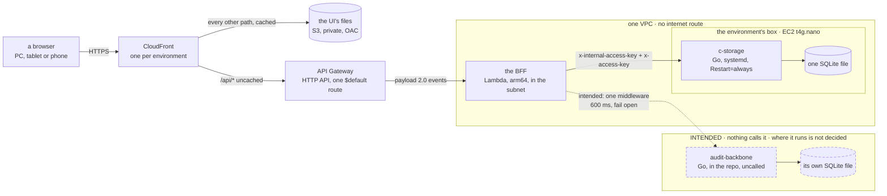
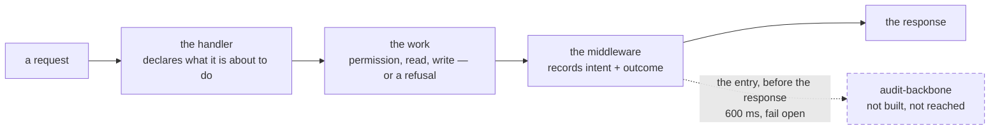

# How credo is built

> **Written** 2026-11-07, for an engineer new to this codebase — which includes a fresh session of
> the machine's own. It is the pair of [`products.md`](products.md): **products says what each part
> does for whom, this page says how it is put together.** Every structural claim names the file
> that makes it true, so any sentence here can be followed to the code; what was not read is named
> at the end. The first-day plan, [`plans/2026-10-27-architecture.md`](plans/2026-10-27-architecture.md),
> keeps the cost reasoning and the rejected alternatives, and is stale on several facts — see
> [what the day-one plan gets wrong](#what-the-day-one-plan-now-gets-wrong).
> **Last amended** 2026-11-09, by the piece that put the audit backbone on this page: a ninth
> package, and the decided-but-unbuilt path to it, which is marked as such in
> [its own section](#the-activity-log-intended-and-not-built).

## At a glance

One React app, one back end, one key-value store. A browser reaches CloudFront; files come from a
private S3 bucket and every `/api/*` call goes uncached to an HTTP API, then to the BFF on Lambda
inside a VPC with no internet route, which calls c-storage over the private network. c-storage is a
small Go service on one EC2 box, holding **one SQLite file**. Locally the same path runs with
`scripts/src/front.ts` standing where CloudFront and the HTTP API stand, so the app the walks
picture is the app that deploys.

A ninth package, `audit-backbone/`, is in the repository and **nothing calls it**: a second Go
service with its own SQLite file, meant to become this project's activity log. The dashed path
below is the only thing that would ever reach it, and it is not built —
[the activity log](#the-activity-log-intended-and-not-built) says what was decided and what has to
come first.

Drawn from [`ops/env.yml`](../ops/env.yml) (the distribution at `#L361`, its `/api/*` behaviour at
`#L397`, the HTTP API at `#L245`, the function at `#L216`, the box at `#L95`),
[`bff/src/lambda.ts`](../bff/src/lambda.ts), [`shared/src/c-storage.ts#L100`](../shared/src/c-storage.ts#L100)
and [`c-storage/internal/server/server.go#L39`](../c-storage/internal/server/server.go#L39). The
dashed part is drawn from the decisions in
[the activity log](#the-activity-log-intended-and-not-built) and from no code: nothing in this
repository implements it.

## The parts, and what each would break

Six packages are in the pnpm workspace ([`pnpm-workspace.yaml`](../pnpm-workspace.yaml));
`c-storage/`, `audit-backbone/` and `ops/` are deliberately outside it. Nine parts in all, and the
ninth is in the repository with no caller. The last column is the point of the list: a part is only
understood once you know what stops without it.

| Part | What it is | Runs | Gone, this breaks |
| --- | --- | --- | --- |
| `ui/` | The React 19 app, built by Vite: both the client app and the operator console, split by path in [`ui/src/App.tsx#L28`](../ui/src/App.tsx#L28) | a browser; files on S3 | everything a person sees. It is also the source the walks and the visual report draw screens from, so both go with it |
| `bff/` | One Fastify app ([`bff/src/app.ts#L85`](../bff/src/app.ts#L85)) behind two entries: a listener ([`bff/src/server.ts#L29`](../bff/src/server.ts#L29)) and a Lambda handler ([`bff/src/lambda.ts`](../bff/src/lambda.ts)) | Lambda on arm64; a local process | every rule. It is the only thing that authenticates, resolves permissions and builds a record key; c-storage enforces none of that |
| `shared/` | The wire contract and the record layout, one package, extended generically rather than split per service ([`CLAUDE.md`](../CLAUDE.md), [the app frame](plans/2026-10-27-app-frame.md#the-stack)) | imported by all of the above | the two halves drift. The key layout ([`shared/src/records.ts#L7`](../shared/src/records.ts#L7)) and the permission catalogue ([`shared/src/permissions.ts#L9`](../shared/src/permissions.ts#L9)) each have exactly one home here |
| `c-storage/` | A standalone Go service: six HTTP routes over one SQLite file, no framework, no router library ([`c-storage/go.mod`](../c-storage/go.mod), [`c-storage/internal/server/server.go#L39`](../c-storage/internal/server/server.go#L39)) | a systemd unit on the box | all data. It is the only durable store, and its file is the only copy: the nightly backup is designed but deferred to a signed client ([open item 6](open-items.md)) |
| `audit-backbone/` | A second standalone Go service, **in the repository and called by nothing**: 22 Go files, nine internal packages of one job each plus `cmd/server` wiring, its own SQLite file, its own gate (`audit-backbone/CLAUDE.md`'s `Gate: make check`) | nowhere. No systemd unit, no ship step, no CI job | nothing today. It is the intended home of the activity log ([below](#the-activity-log-intended-and-not-built)), and the recap of its move is [`recaps/2026-11-09-audit-backbone-move.md`](recaps/2026-11-09-audit-backbone-move.md) |
| `scripts/` | The local lanes: `pnpm stack` (c-storage + BFF + UI on one machine, [`scripts/src/stack.ts`](../scripts/src/stack.ts)), `pnpm fake`, `pnpm demo`, and the ridge CLI the ops scripts drive ([`scripts/src/ridge.ts#L36`](../scripts/src/ridge.ts#L36)) | a developer's machine; the ops scripts | the ability to run or seed anything locally — and the BFF's route tests, which build the real c-storage through [`bff/tests/build.ts`](../bff/tests/build.ts) |
| `visual/` | Builds the walks page: the app's own components drawn on jsdom through a Vite server's module loader, since CSS modules and TSX do not import in plain Node ([`visual/run.mjs#L1`](../visual/run.mjs#L1)) | `pnpm report`, in a sandbox, no browser | the visual report — the one artefact a non-coder judges a screen from |
| `walk/` | Twelve Playwright specs plus [`walk/run.sh`](../walk/run.sh), whose walk table at [`#L7`](../walk/run.sh#L7) names all twelve, with each screen's committed base image beside the spec | a real browser, in a terminal only | the end-to-end check. `pnpm check` typechecks and lints this package but never runs it |
| `ops/` | Three hand-written CloudFormation templates and about twenty shell scripts, outside the workspace | a terminal with an AWS session; CI | every way to a machine. Every AWS call in the repository is made by a script in here — CI reaches AWS only by assuming the role and then running them ([`.github/workflows/ci.yml#L284`](../.github/workflows/ci.yml#L284)) |

Two shapes are worth naming because they are easy to miss. The BFF is **one app with two
entries**, not two back ends: `buildBff` is shared and only the listener differs
([`bff/src/server.ts#L6`](../bff/src/server.ts#L6)). And the UI is **one bundle with two apps in
it** — the operator console is not a separate deployment, only the path `/operator`
([`ui/src/App.tsx#L26`](../ui/src/App.tsx#L26)).

## The data

**Where it lives.** One SQLite file per deployment, at `DB_PATH` on the box
([`ops/c-storage.service#L20`](../ops/c-storage.service#L20)), opened in WAL with
`_txlock=immediate` ([`c-storage/internal/sqlitedb/open.go#L33`](../c-storage/internal/sqlitedb/open.go#L33)).
The whole schema is two `STRICT` tables — `services(code, hashed_access_key)` and
`records(service_code, key, data)` — in
[`c-storage/internal/store/schema.sql#L4`](../c-storage/internal/store/schema.sql#L4). There are no
timestamps, no indexes beyond the primary keys and no migration chain: the schema is applied only
to a file with no tables, stamped `user_version = 1`, and a file at any other version stops the
process at start-up ([`open.go#L56`](../c-storage/internal/sqlitedb/open.go#L56)).

**A second store exists in the repository and on no machine.** `audit-backbone` opens its own SQLite
file at its own `DB_PATH`, with its own schema and its own single writer: `Store` in
`audit-backbone/internal/activity/store.go`, every write funnelled through `Writer.Do` in
`audit-backbone/internal/batch/writer.go`, which blocks until the commit
(`audit-backbone/CLAUDE.md`'s `AB3`). Nothing writes to it and nothing deploys it, so the paragraph
above is still the whole truth of every deployment: **one SQLite file, and it is the only copy.**

**What a tenant is — and where it is not.** A client is a tenant. Its records sit under its minted
id, and its human-readable code reaches that id through one index record; the layout has one home,
[`shared/src/records.ts#L7`](../shared/src/records.ts#L7), so no other file builds a key. Every
client-facing route runs `resolveTenant` first, which reads the code from a header, finds the index
record and sets `request.tenantId` — it *scopes and never authenticates*
([`bff/src/app.ts#L98`](../bff/src/app.ts#L98)).

The part a newcomer must not get wrong: **c-storage has no concept of a tenant at all.** Its only
isolation unit is the *service*, and the BFF is a single service holding every tenant
([`bff/src/app.ts#L69`](../bff/src/app.ts#L69)). Tenant separation is a string-prefix convention
held entirely by the BFF; c-storage would serve one tenant's key to another tenant's request if the
BFF built the wrong key. This is a deliberate design, not an oversight: `records.ts` says in its
own opening lines that it is the layout's one home, "so no other file builds a key"
([`shared/src/records.ts#L3`](../shared/src/records.ts#L3)). **Isolation itself is tested, at the
route level** — "serves the call of the client the code names, and no other"
([`bff/src/tenants.route.test.ts#L96`](../bff/src/tenants.route.test.ts#L96)), and "reaches one
client only" in both
[`clients-delete.route.test.ts#L248`](../bff/src/clients-delete.route.test.ts#L248) and
[`operator-root-password.route.test.ts#L245`](../bff/src/operator-root-password.route.test.ts#L245).
What is narrower than it looks is the *structural* guard: **no lint rule and no test forces every
key through `records.ts`**, so the one-home property is held by convention and review rather than
by the gate. No hand-built key exists outside that file today.

One home holds for the key *layout*, not for resolving a tenant: `resolveTenant` covers the
client-facing routes, while the operator's routes resolve a code to an id themselves
([`bff/src/root-password.ts#L44`](../bff/src/root-password.ts#L44), and `bff/src/clients.ts`).
Key design does real work here — a person's photo and a delivery's photo
deliberately sit outside their list's prefix so a list read never drags them in
([`records.ts#L47`](../shared/src/records.ts#L47), [`#L65`](../shared/src/records.ts#L65)), and
orders and deliveries are keyed by day because a prefix read answers at most 1,000 records
([`records.ts#L41`](../shared/src/records.ts#L41),
[`c-storage/internal/store/store.go#L132`](../c-storage/internal/store/store.go#L132)).

**How a record is written safely.** The version token is a `tag`: the hex SHA-256 of the record's
stored text, computed fresh on every read and stored nowhere
([`store.go#L54`](../c-storage/internal/store/store.go#L54)). A writer sends it back as `If-Match`
(or `If-None-Match: *` to claim a key that must not exist); c-storage compares inside the write's
own transaction and answers **412** if the record moved
([`store.go#L68`](../c-storage/internal/store/store.go#L68),
[`c-storage/internal/server/handlers.go#L132`](../c-storage/internal/server/handlers.go#L132)). A precondition
it cannot parse is a 400, never ignored — but a request sending *no* precondition overwrites
whatever is there, so the guard holds only where the BFF sends the tag.

The BFF's client turns 412 into the value `'moved'` rather than an error
([`shared/src/c-storage.ts#L133`](../shared/src/c-storage.ts#L133)), and **each route decides for
itself — there is no single shared recovery.** The fullest version, settled on 2026-11-07, is in
[`bff/src/lists.ts#L176`](../bff/src/lists.ts#L176): read the record for its tag, write over that
version, and on either a lost answer or a `moved` outcome **re-read once** — a record that already
holds exactly what was asked is our own write having landed, and counts as saved; anything else is
a genuine conflict, answered 409 with the record as it is now. The version is never skipped, which
is the project's standing rule: recover, never bypass, a concurrency token
([`CLAUDE.md`](../CLAUDE.md)).

That identity compare is load-bearing and conditional, and the comment at
[`bff/src/lists.ts#L192`](../bff/src/lists.ts#L192) is the one home of what it assumes: it holds
only while the record has no mutable field other than the ones being written. The day a
`changeCode`, an `archived` flag or an order's status joins a record saved this way, another
writer's record could pass as our own save. Read that comment before copying this pattern.

The other routes do not share it. [`bff/src/reconciliations.ts#L37`](../bff/src/reconciliations.ts#L37)
recovers a lost answer in its own narrower way — it claims the key with `If-None-Match` and, if the
write throws, re-reads and compares to tell its own landed write from another close already there —
while the staff setup's save answers 409 at once on a `moved`
([`bff/src/staff.ts#L171`](../bff/src/staff.ts#L171)) and the staff numbering instead **retries a
bounded number of times** and fails 503 if the record moved on every attempt
([`bff/src/staff.ts#L264`](../bff/src/staff.ts#L264)). Four writers, four behaviours — all of them
keeping the token, which is the rule; none of them a shared helper. Read the route you are changing
rather than assume `lists.ts`.

## Who may do what

**Two doors, two session kinds, one store.**

A client's person signs in with a code and a password; a root-given email and a 15-minute QR code
are second sign-in names for the same records
([`shared/src/signins.ts#L64`](../shared/src/signins.ts#L64)). Sessions are a handle the device
keeps: only the SHA-256 of its secret is stored, beside the device it was issued to and the
sign-in record's `generation` at issue, so giving a password invalidates every older session
([`shared/src/records.ts#L185`](../shared/src/records.ts#L185)). They slide over seven days
([`bff/src/sessions.ts#L13`](../bff/src/sessions.ts#L13)).

An **operator** — the people who run credo — signs in at `/operator` by passkey only, joining
through a one-time link, with `@simplewebauthn` on both sides. Every ceremony is checked against
`APP_ORIGIN`, the address the operator opens, **never the request's host**
([`bff/src/env.ts#L13`](../bff/src/env.ts#L13),
[`bff/src/operator-auth.ts#L57`](../bff/src/operator-auth.ts#L57)); spent challenges are kept so an
answer cannot be replayed, and an account's `generation` moves when a new-passkey link replaces the
keys held, refusing the sessions issued before it
([`shared/src/records.ts#L131`](../shared/src/records.ts#L131)). An operator session is capped at 12
hours from issue ([`bff/src/sessions.ts#L18`](../bff/src/sessions.ts#L18)). Sensitive acts ask for a
fresh passkey touch rather than trusting the session
([`shared/src/wire.ts#L322`](../shared/src/wire.ts#L322)).

**Permissions.** Eight named permissions, catalogued once
([`shared/src/permissions.ts#L9`](../shared/src/permissions.ts#L9)), resolved in three sparse layers
— department, then position, then the person's own, each winning where it names a permission; the
root holds no layer and may do everything
([`permissions.ts#L36`](../shared/src/permissions.ts#L36),
[`#L48`](../shared/src/permissions.ts#L48)). The layers are read on **every** call, so a change by
the root holds at the person's next step, and a set that cannot be read answers 503 rather than a
partial one ([`bff/src/app.ts#L116`](../bff/src/app.ts#L116)). The menu asks the same question to
decide what it shows, and says so in its own comment: it is a view of the guard, never the guard
([`ui/src/nav.ts#L24`](../ui/src/nav.ts#L24), checked server-side at
[`bff/src/app.ts#L184`](../bff/src/app.ts#L184)).

**And nobody is recorded as the actor.** The identity is resolved and then consumed: `signedIn` in
`bff/src/app.ts` returns who is calling and `mustCan` in `bff/src/app.ts` asks one boolean of it,
and neither binds it to the request — there is no `request.user` anywhere in `bff/src/` (zero hits,
against `request.tenantId`, which hits in `app.ts`, `lists.ts` and `orders.ts`). Measured over the
BFF's **39 deliberate write sites: 11 have the identity in scope at the write and 28 do not**, and
the two that write customers and products — the highest-value history there is — carry no actor at
all. **Nothing in this repository records who changed a record**, and that half of the gap is in no
open item ([the docs index](README.md)).

**Keys, and who holds which.** c-storage has three: `x-internal-access-key`, which gates every
route but `/health` including the 404 fallback, so an unknown path answers 401 exactly like a real
one; a per-service `x-access-key`, stored only as a SHA-256 and compared in constant time; and
`x-super-admin-key`, whose sole power is creating a service
([`c-storage/internal/auth/auth.go#L17`](../c-storage/internal/auth/auth.go#L17),
[`c-storage/internal/server/server.go#L59`](../c-storage/internal/server/server.go#L59),
[`c-storage/internal/store/store.go#L93`](../c-storage/internal/store/store.go#L93)). **The BFF never holds
the super-admin key** — registration is the stack's own step, done once
([`bff/src/env.ts#L39`](../bff/src/env.ts#L39),
[`scripts/src/register.ts#L10`](../scripts/src/register.ts#L10)). The rule, in `env.ts`'s own
words, is that the variables the BFF reads are "the only ones it is given": as a listener that is
seven — `PORT`, `HOST`, the four for c-storage and `APP_ORIGIN`, all supplied by the local stack
([`bff/src/env.ts#L21`](../bff/src/env.ts#L21),
[`scripts/src/stack.ts#L79`](../scripts/src/stack.ts#L79)) — and as a Lambda five, the same set
without the listener's two, since API Gateway is the listener
([`bff/src/env.ts#L48`](../bff/src/env.ts#L48)).

## How it reaches a machine

| Lane | How | What it is for |
| --- | --- | --- |
| Local | `pnpm stack` builds c-storage with `go build` and the UI with Vite, then runs both behind the local front; `pnpm stack -- <command>` is one invocation, up-command-down, because the sandbox cannot signal a process an earlier command started ([`scripts/src/stack.ts`](../scripts/src/stack.ts), [`CLAUDE.md`](../CLAUDE.md)) | the real stack, data gone on Ctrl-C |
| Local, no server | `pnpm fake` — the UI alone over invented data, the one build that holds `?fake` and the fake `Api`; the bundle that deploys contains none of it ([`ui/src/main.tsx#L10`](../ui/src/main.tsx#L10)) | a screen's look before its back end exists |
| ridge | the shared pre-production environment, and the only deployed one | others check a piece without the code |
| a client's own stack | **not built.** `ops/env.yml` is parameterised by `Env` and ridge is one instance of it; several scripts hard-refuse any environment but ridge ([`ops/seed.sh#L36`](../ops/seed.sh#L36)) | — |

**Stack shape is the human's; code is CI's.** Only [`ops/stack.sh`](../ops/stack.sh) touches
CloudFormation, and only through change sets — `create-change-set`, print every change, then
`execute-change-set` (`#L204`, `#L242`) — run by a human from a terminal, never by CI (`#L8`). A
change set that removes or replaces anything is **refused by default** and needs the human to name
the logical id, because a replaced box deletes its disk and the database with it
([`ops/unsafe-changes.jq#L5`](../ops/unsafe-changes.jq#L5), [`ops/stack.sh#L225`](../ops/stack.sh#L225)).
Templates are read from `origin/main`, not the working copy (`#L140`). There is no CDK, SAM or
Terraform anywhere.

**What CI does.** [`.github/workflows/ci.yml`](../.github/workflows/ci.yml) holds five jobs: four
check jobs that run on every push and pull request — `check` (`make check` in c-storage, `#L56`),
`e2e` (its Bruno collection against the built binary, `#L73`), `app` (`pnpm check`, `#L115`) and
`ops` (ShellCheck at a pinned SHA-256 plus cfn-lint over the three templates, `#L153`) — and then,
on a push to `main` only, `deploy` (`#L215`) in the `ridge` GitHub environment. That job ships **code, never stack
shape** (`#L212`): c-storage's arm64 binary to the box over an Instance Connect tunnel
([`ops/release.sh`](../ops/release.sh)), the BFF bundle to the one Lambda and the UI files to the one
bucket ([`ops/app.sh`](../ops/app.sh)), then [`ops/check.sh`](../ops/check.sh) verifies it. All
third-party code builds *before* the AWS role is assumed (`#L254`), and the role itself is narrow
to the point of naming the one function and the one instance
([`ops/env.yml#L444`](../ops/env.yml#L444)). Two other workflows:
[`seed.yml`](../.github/workflows/seed.yml) brings ridge's demo copies up to yesterday when somebody runs it (it has no schedule), and
[`walks.yml`](../.github/workflows/walks.yml) deploys the walks page to Cloudflare Pages behind
Access — the only deploy target that is not AWS.

**Nothing ships the audit backbone.** There is no systemd unit for it, no release step and no CI
job: `ci.yml` does not mention it at all — zero hits, against a control of `c-storage`, which the
same file names in its path filters and its Go version — and its `Makefile`'s own first line says
nothing there calls `make dist` yet. Where it would run is not decided; see
[the activity log](#the-activity-log-intended-and-not-built).

One hazard the split creates: a change set that updates the `Bff` resource can restore its inline
503 stub and empty environment, so the human re-runs the latest deploy afterwards
([`ops/env.yml#L218`](../ops/env.yml#L218), [`ops/README.md`](../ops/README.md)).

## How it is checked

Four things, and a newcomer meeting the third without warning will not know what it is. The rules
behind them are [QA](conventions/qa.md) and the whole list of gate commands is
[`CLAUDE.md`](../CLAUDE.md#the-gate); this is only what each *is*.

1. **The gate.** `pnpm check` is one command with five steps — typecheck, ESLint, Prettier,
   every package's tests at 100 % statement coverage, and knip for unused code
   ([`package.json`](../package.json)). A gate reported without naming its five steps has not been
   reported ([QA rule 6](conventions/qa.md)). **Both Go packages have a gate of their own:
   `make check`, run from inside the package** — c-storage's (`c-storage/CLAUDE.md`'s
   `Gate: make check`) and audit-backbone's (`audit-backbone/CLAUDE.md`'s `Gate: make check`), each
   cross-compiling in the gate so a dependency quietly needing cgo fails here rather than at ship
   time; audit-backbone's also holds 100 % of statements outside `cmd/server`
   (`audit-backbone/CLAUDE.md`'s `AB1`). **Both cross-compiles target `arm64`, the box's
   architecture** ([`c-storage/Makefile`](../c-storage/Makefile),
   [`audit-backbone/Makefile`](../audit-backbone/Makefile)). **`pnpm check` reaches neither**: neither package has a
   `package.json`, and the root's two ignore lists name both, so the root formatter and the
   unused-code step do not claim files a Go gate owns ([`.prettierignore`](../.prettierignore),
   [`knip.json`](../knip.json)). Those two lines are all the root knows about either package, and
   nothing makes a newcomer add them for the next one: that is
   [open item 200](open-items.md). Note that `pnpm check` needs Go and
   loopback ports: the BFF's route tests build the real c-storage and run it per test file, so the
   product's own client meets the real server ([`bff/tests/`](../bff/tests)).
2. **The walks.** Twelve Playwright specs take every screen in Vietnamese and English at three widths,
   first on the fake UI, then on a real stack, then on fresh stacks again, and count **every moved
   pixel raw — no threshold, no tolerance** against base images committed beside each spec. Green
   means fake = stack = stack again, and nothing moved against the bases except the screens named
   in `--moved` ([`walk/run.sh#L7`](../walk/run.sh#L7)). It needs a real browser, so it runs in a
   terminal and never in the agent's sandbox, where Chromium cannot start; `pnpm check` only
   typechecks and lints it. Bases are rewritten with `--write`, by a human's run, once a piece.
   [`ops/full-run.sh`](../ops/full-run.sh) is **a piece's** full run, not every walk: two
   `walk/run.sh` invocations over the walk list it is given — the first with `--write`, which takes
   the pictures and writes the new and moved bases, the second a `--bytes` compare of those
   pictures against the committed bases with no browser at all — and one local commit of the base
   pictures alone between them, since `walk/run.sh` refuses a dirty tree. Nothing is pushed
   ([`ops/full-run.sh#L4`](../ops/full-run.sh#L4)).
3. **The visual report.** `pnpm report` builds the walks page without a browser at all, drawing the
   app's own components on jsdom ([`visual/run.mjs`](../visual/run.mjs)). It is the artefact a
   non-coder judges: each screen asked yes or no, a no becoming a case. The deployed copy is behind
   a sign-in for partners.
4. **ridge.** The last stage: others check a piece in the shared environment without reading code.

A note for anyone reporting a check on this page: [`.prettierignore`](../.prettierignore) excludes
`*.md`, so Prettier inspects nothing here and a green from it means nothing.

## The activity log: intended, and not built

> **Nothing below the first paragraph is in the code.** It is a set of decisions about work not yet
> started, written on this page because [`CLAUDE.md`](../CLAUDE.md) makes the page part of every
> session's opening: a session sent at this work should read its destination rather than invent one.
> Read every line of it as **what was decided**, never as what is there. What permits it here is the
> documentation convention's own line — docs describe *absent* code: a plan, or a rejected
> option ([documentation](conventions/documentation.md#what-earns-a-line)) — and what earns each line
> below is a decision with the alternative it beat, or a hazard no gate catches.

**What exists, and it is the only fact in this section.** `audit-backbone/` holds a finished Go
service: 22 Go files, nine internal packages and `cmd/server`, its own SQLite file, its own gate,
five rules `AB1` to `AB5`. **Nothing in this repository calls it** — the BFF does not reach it,
`ops/` ships nothing of it, and the CI workflow has no job for it
(`audit-backbone/CLAUDE.md`'s `Nothing in this repository calls this package yet`). Its single write
path is `Writer.Do` in `audit-backbone/internal/batch/writer.go` and its store is `Store` in
`audit-backbone/internal/activity/store.go`. What was changed on the way in and what was left
behind is its recap, [`recaps/2026-11-09-audit-backbone-move.md`](recaps/2026-11-09-audit-backbone-move.md).

### The intended path

**Drawn from the decisions in this section and from no code.** The first sketch of it was
`request → controller → audit-backbone-logger-middleware → response`, with the handler handing its
intent on *after* doing the work. **The decision to log attempts as well as successes is what moves
the declaration in front of the work:** a handler that threw never reaches the line that would have
handed anything over, so a refused or failed change could not be logged at all. The shape above is
that decision carried through, not a correction of it.

**One middleware ships the entry; the handler decides what is in it.** A handler that declares
nothing is never logged, which is this design's strongest property — see the hot paths below.

### The two prerequisites, and why the middleware cannot come first

1. **The actor is not on the request** ([who may do what](#who-may-do-what)): of 39 deliberate write
   sites, 11 have the identity in scope and 28 do not, and the customer and product writes carry no
   actor at all. A middleware built before that would record 28 of 39 deliberate acts as having been
   done by nobody. **So the actor is the first piece of work and the middleware is the second.**
2. **Fifteen write sites must never be logged**, and this design excludes them by construction
   rather than by a list. The hottest is `spendTouch` in `bff/src/operator-auth.ts`, which rewrites
   an operator's whole account — a passkey counter, a `lastUsedAt` stamp and the pruning of the
   spent-challenge list at once — on **every** passkey sign-in and every confirm touch. Next is the
   session renewal inside `resolve` in `bff/src/sessions.ts`, a side effect of *reading* a session on
   the authenticated path of every request. Then the two numbering counters, the sign-in and link
   bookkeeping, the client-deletion sweep, and the two photo writes whose base64 bytes must never
   enter an entry. **A handler that declares no intent is never logged, so none of the fifteen needs
   an exemption.**

**A mutating route that declares no audit intent is a test failure.** A route therefore either names
what it logs or declares itself exempt on the record. *Why:* a check that passes by staying silent is
exactly what this repository spent 2026-11-09 removing. *Price:* one line on every new mutating
route, and a named reason on every exemption.

### Where it runs: open, and cheap to leave open

The box is a `t4g.nano` (`ops/env.yml`'s `Default: t4g.nano`, and `ops/stack.sh`'s
`offers t4g.nano` refuses a region with no zone that offers one). AWS's published spec for that type
is 512 MB of memory — **AWS's number, not a measurement of ours** — and this project's own build adds
2 GiB of swap, which a release holds a floor under (`ops/lib.sh`'s `FLOOR_SWAP_MB`) and whose comment
there says a `t4g.nano` needs it.

**Whether a second Go service, with a second SQLite file and a second WAL, fits beside `c-storage` is
unmeasured in this project's own records.** `docs/open-items.md`'s `The nano is read on the first box`
has been parked since 2026-10-27 on exactly that reading — its memory and any OOM kill — and the
measurement needs the environment running, which is the human's hand.

**So it is not decided here, and deferring it costs nothing: the middleware points at a URL.** The
same box or a box of its own is then a configuration value and a deploy, not a rewrite. Build against
a URL, measure once the environment is back, and decide then; [open item 2](open-items.md) is the
thing that decides it.

### What is guaranteed, and what cannot be

**A failed audit write must not fail the user's request.** That is decided, and it bounds everything
else, because the back end is a Lambda: `createLambdaHandler` in `bff/src/lambda.ts` is the entry API
Gateway calls, and a release ships that one function (`ops/lib.sh`'s `lambda_wait`). **A Lambda's
execution environment freezes once the response is returned**, so an in-process queue that ships the
entry afterwards has nowhere to live and no guarantee of ever running. *Never fails the request* and
*never loses an entry* therefore cannot both be had in-process, and the first was chosen.

**Decided: the entry is written before the response, under a 600 ms timeout, and a failure to write
it is swallowed.** The mechanism is already in this repository and is to be copied rather than
invented: the storage client passes an abort signal to its fetch
(`shared/src/c-storage.ts`'s `signal: AbortSignal.timeout(timeoutMs)`) under a declared bound
(`shared/src/c-storage.ts`'s `DEFAULT_TIMEOUT_MS`, 5,000 ms). The audit call is that same mechanism
with a tighter bound, and the tightness is deliberate: **a write nobody is waiting on gets a fraction
of the budget of a read the answer depends on.**

**Why 600 ms.** A comparable key-value store's observed latency profile is a sub-millisecond median
with a long tail: a p99 near 110 ms and a worst observed call near 545 ms. A bound of 600 ms sits
above that worst case, which is the property that matters — a timeout then means the service is
*unavailable* rather than merely slow, and no entry is discarded during ordinary operation. A round
500 ms would have cut off the worst call in that profile.

**The one implementation note this page owes whoever builds it: a `try`/`catch` alone is not
enough.** Without the abort signal the catch does not fire at 600 ms; it waits for the socket's own
default, which can be far longer. **The timeout is what makes the `try`/`catch` honest.** And the
bound is a named `UPPER_SNAKE` constant declared once beside its client, never a number typed where
it is used — one decision, one home (`docs/conventions/code.md`'s `One decision, one home`) — which
is why the storage bounds already sit together (`shared/CLAUDE.md`'s `SH2`).

**What it costs when the audit service is slow or down, and the two states of knowledge here are not
the same.** Lambda is billed by duration, so a deliberate change then pays **up to 600 ms more**, in
latency and in billed time. **What that is a multiple of is unknown:** this project's own per-call
duration has never been measured, and the figure the plan costs on — about 100 ms of Lambda a call —
is a planning assumption whose own item opens by saying so
(`docs/open-items.md`'s `The plan's assumptions are unmeasured`, [open item 2](open-items.md), parked
2026-10-27). So the timeout has a measured basis and its cost does not, and this page keeps the two
apart rather than blurring them into one confident paragraph. *The mitigation, and it is not built:*
a Lambda keeps module-level state while its container is warm, so one "last failure" timestamp would
let the middleware stop trying for a while after a run of failures. **Build it only if the service is
ever actually seen to be down** — this project builds when something needs it, and either way the
failures are visible in the request log.

**Where a lost entry shows up, which the guarantee must not gloss.** If the audit service cannot be
reached, that failure cannot be recorded *in* the audit log; it goes to the back end's own request
log, the one the function has written a line per request to all along. So **the guarantee, in one
sentence: an entry is attempted before the response, a failure to write it is recorded in the request
log, and the user's request succeeds either way** — and a lost entry is then findable only by someone
reading that log. Not "nothing is lost".

### The alternative that was not taken

**Writing the entries as records through `c-storage`, which the BFF already calls on every request.**
No second service, no second port, no second database file, no new secret and no second network hop:
the entries would be records under the tenant's own prefix, two keys each, because c-storage lists
one literal prefix and holds no secondary index. **An earlier costing of this very question
recommended it**, on the reasoning that the nano's headroom is unmeasured and that the separate
service's one real gain — its own write lock, so that audit writes do not queue behind the app's own
data — is far from being needed at this project's write rate. Its price: every entry written twice,
and every activity write behind the single SQLite write lock the app's data already queues on.
**The human chose the separate service, and that decision stands;** the alternative is recorded here
so that nobody re-derives it from scratch in six weeks. That costing is not in this repository — see
[what this page did not read](#what-this-page-did-not-read).

## What the day-one plan now gets wrong

[`plans/2026-10-27-architecture.md`](plans/2026-10-27-architecture.md) is still worth reading for
its costs and its rejected alternatives. These parts of it are no longer true, and will mislead:

- **"CloudFront → the BFF's function URL, signed by origin access control", and the API client
  hashing each write into `x-amz-content-sha256`** (its `#L74`, `#L130`, the body hash at `#L133`).
  CloudFront reaches an API
  Gateway HTTP API ([`ops/env.yml#L388`](../ops/env.yml#L388)); function URLs are not offered in the
  Region. The body hash is gone from the codebase. The plan carries an amendment note at `#L137`
  but its own table still says otherwise.
- **"Only CloudFront calls the back end"** (`#L41`). The HTTP API's own address answers anyone; a
  request throttle, not a signature, is what bounds the cost
  ([`ops/env.yml#L250-L252`](../ops/env.yml#L250)). Read "answers anyone" as *reachable*, not as
  *unauthenticated*: a call arriving that way still meets the BFF's own checks — the client header,
  the session, the permission — so what was lost is the network wall in front of them, not the
  wall itself. It is the one property of the day-one design that
  was given up without anyone deciding to — it followed from the Region's limit when function URLs
  turned out not to be offered there — and until 2026-11-07 that template comment was the only
  place it was written down. It is now [open item 121](open-items.md), parked for the human until a
  client signs or real client data reaches a deployment. Two logs record a call, and they are not
  the same age. The function has written a line per request to its own group all along: nothing in
  `bff/src/lambda-main.ts#L3` turns the logger off, so `server.ts#L9`'s default stands
  (`app.ts#L86`), and the function's `LoggingConfig` names that group
  ([`ops/env.yml#L232-L233`](../ops/env.yml#L232)). The stage's own access log, `ApiLogs`
  ([`#L176-L181`](../ops/env.yml#L176), [`#L284-L286`](../ops/env.yml#L284)), is in the template
  and runs on a stack only once the change set for it has been applied. Neither names the client
  whose records were read ([open item 152](open-items.md)).
- **"A name under our domain per client, in Cloudflare, with an ACM certificate in `us-east-1`"**
  (`#L181`). There is no Route53, ACM or custom domain anywhere in the repository; the distribution
  uses CloudFront's own certificate and name
  ([`ops/env.yml#L380`](../ops/env.yml#L380)).
- **"Left behind from the old app, until something calls it: … audit-backbone"**
  (`docs/plans/2026-10-27-architecture.md`'s `Left behind from the old app`, its decision 7). Half of
  that is now wrong: the service is in this repository, with its own gate, as of 2026-11-09
  ([its recap](recaps/2026-11-09-audit-backbone-move.md)). The other half still holds — **nothing
  calls it** — and the rest of that decision's list (credo-sso, the upload, Caddy, the
  `x-origin-key`) is unchanged.
- **"Nothing is built before a client signs"** and **"no code holds it yet"** (`#L5`, `#L68`).
  ridge is built and deploys on every push to `main`. What is still unbuilt is a *client's* stack.

**Not in that list: the nightly backup.** The plan's diagram shows a nightly copy to S3 through an
S3 gateway endpoint, under a put-only role on the box (`#L28`, `#L76`, `#L97`), and none of those
three resources exists — but that is a **deliberate deferral the project recorded the same day**,
not something lost. [Open item 6](open-items.md) gates the backup and its restore on a signed
client, on the reasoning that ridge, the first box, holds no real data, and it says plainly that
"the S3 gateway endpoint and the box's put-only role come with it". So the right reading is: the
backup is designed and postponed, and until a client signs, **the one SQLite file is the only copy
of a deployment's data** — which is a known, accepted position for an environment holding only demo
data, and the thing to build first for one that does not.

One inconsistency inside that to be aware of when it *is* built: item 6's own first line says "the
box's role may only put, so it cannot restore itself", in the present tense, while
[`ops/env.yml#L93`](../ops/env.yml#L93) says "no instance role". The item describes the design; the
template describes the machine. When the backup is built, item 6's description of the role is what
has to be built — not a description of what is already there.

## What this page did not read

Stated plainly so the next reader knows which parts to trust.

- **Read closely and first-hand:** `pnpm-workspace.yaml`, the root and per-package `package.json`
  files, `CLAUDE.md`, `bff/src/app.ts` (the first ~220 lines), `bff/src/env.ts`, `server.ts`,
  `lambda.ts`, `main.ts`, `bff/src/lists.ts`, `shared/src/records.ts`, `permissions.ts`,
  `c-storage.ts`, `index.ts`, `wire.ts` (the routes and headers), `signins.ts` (the first ~70
  lines), `ui/src/main.tsx`, `App.tsx`, `visual/run.mjs`, `walk/run.sh`'s header and walk table,
  `scripts/src/stack.ts` (the first ~90 lines), `front.ts`'s header, `docs/products.md`,
  `docs/conventions/documentation.md`, `docs/conventions/qa.md`'s headings, the day-one plan whole,
  `docs/open-items.md`'s item 6, and the parts of `ops/env.yml` and `ops/network.yml` cited above.
  The rest of `docs/open-items.md` — over 500 lines — was searched, not read.
- **Read on this page's behalf by two other agents, not line by line by its author:** all of
  `c-storage/` and all of `ops/` and `.github/workflows/`. Every claim this page makes about those
  files was then checked directly against the file — the resource types in both templates, the
  CloudFront behaviours, the Lambda's stub and runtime, the absence of a gateway endpoint and an
  instance role, the change-set calls and their guard, the "never by CI" line, the two CI comments,
  the seed's refusal, the systemd unit's `DB_PATH`, and `c-storage/CLAUDE.md`'s gate line. **What
  was not checked a second time is everything this page does not cite:** in particular all of
  `c-storage/`'s Go sources beyond the lines quoted here, [`ops/test.sh`](../ops/test.sh) (about
  2,500 lines), `ops/lib.sh` whole, and the bodies of `check.sh`, `drill.sh`, `release.sh` and
  `pages-preview.sh`. The c-storage section in particular rests on one agent's reading of the Go
  code plus the cited lines, not on a full reading of it by this page's author.
- `scripts/src/ridge.ts` and `scripts/src/register.ts` were read only at the lines cited.
- **Barely opened or not at all:** most of `ui/src/` beyond the two entry files — about 80
  components, their routing and their data flow are summarised here from `products.md` and file
  names, not from reading them. `bff/src/app.ts` past line 220 and the other route modules
  (`orders.ts`, `staff.ts`, `operators.ts`, `reconciliations.ts`, `clients-delete.ts`) were not
  read beyond the write paths cited above; `lists.ts` was read whole. **No test file in any
  language was read**, so any sentence here about what is or is not tested comes from a reviewer's
  reading, not this page's — the first draft claimed cross-tenant key building was untested, and a
  reviewer disproved it from three route tests now cited above. `shared/src/demo.ts`,
  `scripts/src/demo/` and the seeding path were read only through `CLAUDE.md` and `products.md`.
- **A caution from this page's own review**, worth knowing when you rely on it: of 52 citations
  checked, 50 held — and every claim that was wrong was a *count or a summary with no line
  attached* ("ten specs", "five variables", a script characterised without being opened), never a
  cited line. Trust a sentence here in proportion to the specificity of what follows it.
- **For the 2026-11-09 amendment** (the ninth package and the activity-log section), read
  first-hand: `audit-backbone/CLAUDE.md` and its `Makefile` whole,
  `audit-backbone/internal/config/config.go`, and
  the declarations of `Writer.Do` and `Store` and nothing else of their files; `pnpm-workspace.yaml`,
  `.prettierignore`, `knip.json`, `ci.yml`'s job names and path filters, `ops/env.yml`'s instance-type
  parameter, `ops/lib.sh`'s floors and `lambda_wait`, `ops/app.sh`'s Lambda calls,
  `shared/src/c-storage.ts`'s timeout lines, `shared/CLAUDE.md`'s `SH2`, `docs/open-items.md` items 2
  and 200, the audit backbone's recap whole, and `docs/conventions/documentation.md` whole. **The
  service's 22 Go files were not read:** everything here about its behaviour comes from its own
  guideline and the two declarations cited.
- **The counts in the activity-log section are relayed, not re-derived** — the 39 deliberate write
  sites, the 11 with the actor in scope and the 28 without, and the 15 that must never be logged come
  from an earlier costing of this question that is **not in this repository**. The one negative
  re-checked directly here is `request.user`: zero hits in `bff/src/`, against a control that hits.
  The latency profile behind the 600 ms bound is likewise an observation from elsewhere, not a
  measurement of this project.
- **The memory figure for a `t4g.nano` is AWS's published spec, not a measurement**, and no reading of
  the box's own memory exists anywhere in this repository ([open item 2](open-items.md)).
- **Not checked at all:** anything live. Nothing was run for this page beyond this repository's own
  citation check and `pnpm counts`, both of which read committed files and nothing live, and no
  AWS or Cloudflare state was queried — so what *actually* exists in the account today is outside
  what this page can say.
