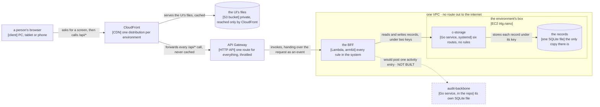

# How credo is built

## At a glance

**credo works by turning everything a person does on screen into one call to a single back end,
which decides who is calling and what they may do, and then saves the result as one record under one
key in a store that knows none of those rules.**

That back end is the only part that decides anything: **the React app only draws what it is given,
and the store only keeps what it is handed** — which is why the picture below has so few arrows,
and why the walk under it is short.

**The system, and what passes between its parts.**

**Key.** Each box names a thing that runs and, in square brackets, what it runs on. A rounded box is
a store. A box drawn inside a frame runs inside it. **Every arrow is one way, from the caller to the
thing it calls, and says what passes.** A **dashed** box and arrow are **decided and not built**:
`audit-backbone/` is in this repository, nothing calls it, and where it would run is not decided —
the whole of that is [`docs/activity-log.md`](activity-log.md).

**On this machine the picture is the same.** `scripts/src/front.ts` stands where CloudFront and the
HTTP API stand, so the app the walks picture is the app that deploys.

## One request, end to end

**A person changes a customer's phone number.** Every other action a person takes travels the same
path; what differs between them is the permission asked at step 6, the key built at step 8 and the
record written at step 9 — never the shape.

1. **The screen.** The form is `ui/src/pages/client/CustomerPage.tsx`. It was handed one object to reach the back
   end with, and holds no rule of its own. The version it read the customer at goes back with the
   change.
2. **The call.** That object is `ui/src/api.ts`. It sends one `PUT` to the customer's own address,
   carrying three headers that identify the call: the device, the client's code, and the session
   handle the device keeps. No cookie, and nothing in the body says who is calling.
3. **The door.** CloudFront matches the call's path, passes it on uncached to the HTTP API, and the
   HTTP API invokes the BFF's one Lambda function.
4. **The company.** The BFF's first hook reads the client's code from its header, finds the one index
   record that maps that code to the client's minted id, and puts the id on the request. **It scopes
   and never authenticates.**
5. **Who is calling.** The route asks for the signed-in person: the session handle is hashed, its
   record read, checked against the device it was issued to and against the sign-in's generation,
   then slid forward.
6. **What they may do.** One boolean — may this person edit orders? The three permission layers are
   read on **every** call, department then position then the person's own. A no is a 403 here, before
   the body is read. **This is the only place the question is asked.** The menu asks the same
   question, but only to decide what to draw.
7. **The body.** Only now is the request's JSON parsed, against the schema `shared/` declares and
   both halves use. A refusal is a 400 naming the field that failed, which is what the form shows.
8. **The key.** The customer's key is built in one place, `shared/src/records.ts`: `tenant.`, the
   client's minted id, `customer.`, then the customer's id. **Nothing else in the repository builds a
   key** — which is why the store can be told apart from the rules at all.
9. **The write.** `bff/src/lists.ts` reads the record, lays the new values over it, and writes it with
   the version it read as a precondition. `shared/src/c-storage.ts` turns that into one `PUT` over the
   private network, carrying the internal key and the BFF's own service key, under a five-second
   bound.
10. **The store.** c-storage hashes the stored text to a tag, compares that tag with the precondition
    inside the write's own transaction, and either writes or answers 412. **It knows nothing about
    customers, clients or permissions:** a key, some JSON, and which service asked.
11. **And back.** A 412 is not an error to the BFF. It reads the record once more; a record that
    already holds exactly what was asked is its own write having landed, and counts as saved.
    Anything else is a 409 carrying the record as it is now, and the screen offers the conflict. **The
    version is never skipped.**

## The codemap

Nine parts, and this is where to look for the thing that does X. **One line each on purpose: each
part's own internals — what belongs in it, the file to copy, its own rules — are in that part's own
`CLAUDE.md`, and are not restated here.** The last column is the point of the list: a part is only
understood once you know what stops without it.

| Part | The thing it does | Gone, this breaks |
| --- | --- | --- |
| `ui/` | every screen a person sees: the client app and the operator console, one bundle split by address | everything anyone sees, and the walks and the visual report with it |
| `bff/` | one Fastify app behind two entries, holding every rule: who is calling, what they may do, what a record's key is | every rule. c-storage enforces none of them |
| `shared/` | what the two halves agree on: the wire contract, the record layout, the permission catalogue, the bounds | the halves drift apart in silence |
| `c-storage/` | six HTTP routes over one SQLite file, in Go, with no framework and no router library | all data. Its file is the only copy |
| `audit-backbone/` | a second Go service, in this repository and called by nothing | nothing today ([the activity log](activity-log.md)) |
| `scripts/` | the local lanes — `pnpm stack`, `pnpm fake`, `pnpm demo` — and the steps the ops scripts hand to the product's own code | any way to run or seed anything locally, and the BFF's route tests |
| `visual/` | the walks page: the app's own screens drawn without a browser | the one artefact a non-coder judges a screen from |
| `walk/` | the browser walks: one spec a walk, every screen counted pixel by pixel | the end-to-end check |
| `ops/` | three hand-written CloudFormation templates and the shell scripts; every AWS call in the repository is made here | every way to a machine |

Six of the nine are in the pnpm workspace ([`pnpm-workspace.yaml`](../pnpm-workspace.yaml));
`c-storage/`, `audit-backbone/` and `ops/` are deliberately outside it. Two shapes are easy to miss:
the BFF is **one app with two entries**, not two back ends (`bff/src/server.ts`'s `buildBff` is
shared and only the listener differs), and the UI is **one bundle with two apps in it** — the
operator console is not a separate deployment, only the path it is opened at (`ui/src/App.tsx`'s
`isOperatorPath`).

## What is never there

The most useful thing to know about a system is often what it never does. Each row below is an
absence this codebase holds today — **and the second column says, honestly, whether anything stops a
breach.** Most are held by a reader of the diff, which is worth knowing before relying on one.

| What is never there | What stops a breach |
| --- | --- |
| **No `fetch` in `bff/src`.** The back end reaches storage only through the one client built for it | nothing. A reviewer reading the diff. Verified by search: no non-test file in `bff/src` holds the word |
| **No screen decides what a person may do.** The menu asks the permission question only to decide what to draw | nothing. The server asks the question again on every call, so a breach is a wrong screen, never a wrong act |
| **No clock, no randomness and no `node:` import in `shared/`.** A day arrives as text and `fetch` as a parameter | nothing. Verified by search: one test file in the package names `node:` and no other file does |
| **No second file builds a record key.** The layout has one home | nothing — and this is the one absence worth the most, because tenant separation is a string prefix and nothing else |
| **No concept of a tenant in c-storage.** Its one isolation unit is the *service*, and the BFF is a single service holding every client | nothing structural, and it is the design rather than a slip. Isolation itself is tested, at the route level |
| **No record carries who changed it, or what it held before** | nothing, and **this one is a gap and not a property** — it is the first thing [the activity log](activity-log.md) has to fix |
| **No directory named for a layer** anywhere: no `utils/`, no `helpers/`, no `constants/` | nothing. Verified by search over every tracked path |
| **No untested statement, branch, function or line** in the five TypeScript packages that have tests — `ui`, `bff`, `shared`, `scripts`, `visual` — nor outside `cmd/server` in either Go service. `walk/` is typechecked and linted and runs no test of its own | **the gate.** Each of the five declares all four thresholds at 100 % (`ui/vitest.config.ts`'s `thresholds`, and the same line in the other four), run as a step of `pnpm check`; the Go services' own `make check` holds theirs |
| **No citation in a living document naming a file that is not there** | **the gate.** The citation check greps the named file for the named symbol |
| **No dependency that quietly needs cgo** | **the gate.** Both Go gates cross-compile for the box's `arm64`, so it fails here rather than at ship time |
| **No change set that removes or replaces a resource** | **a script.** `ops/stack.sh` refuses one by default; the human must name the logical id, because a replaced box deletes its disk |
| **No route out of the VPC to the internet** | **the template.** `ops/network.yml` declares no NAT gateway and no internet gateway at all; its one route table has no route out |

## Where the rest is

**The detail a session reads while changing something** — what the data is, who may do what, how it
reaches a machine and how it is checked — is
[`architecture-detail.md`](architecture-detail.md), opened by whoever is about to change the code
rather than by whoever is reading what it does.

It is the pair of [`products.md`](products.md): **products says what each part does for whom, this
page says how it is put together.**
