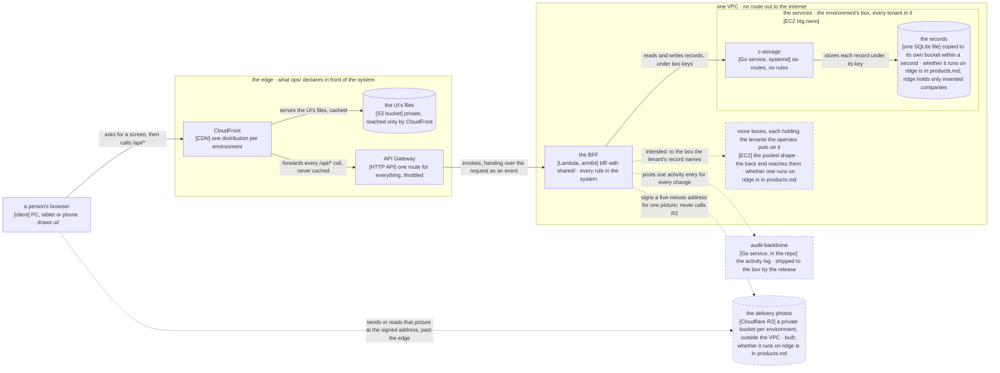

# How credo is built

This page is for a new developer. After it you can follow one click on a screen to the record it saves, say which part makes each decision, and know where a change to a rule belongs.

## At a glance

Everything a person does on screen becomes one call to a single back end, the [BFF](partners/words.md#bff). The back end decides who is calling and what they may do. It then saves the result as one record, under one key, in a store, [c-storage](partners/words.md#c-storage), that knows none of those rules.

So only the back end decides anything. The React app only draws what it is given, and the store only keeps what it is handed. That is why the picture below has so few arrows, and why the path under it is short.

Each [tenant](partners/words.md#tenant), one client's company inside the app, shares that back end. Today every tenant of an environment also shares one [box](partners/words.md#box), one machine. The shape built for production keeps the one back end and spreads the tenants over several boxes, all in one [stack](partners/words.md#stack): everything one environment is made of, made and removed together. [Where a tenant's records live](#where-a-tenants-records-live) says which part is which. What runs on [ridge](partners/words.md#ridge), our shared test copy, is on [the products page](products.md).

**The system, and what passes between its parts.**

What the names in the picture mean:

- **CloudFront** is the front door. It serves the screens' files and passes every call on to the back end.
- **API Gateway** is the one route that hands each call to the back end.
- **VPC** is a private network with no way out to the internet.
- **Lambda** is the kind of program the back end is: it starts when a call arrives.
- **The box** is a machine; the storage runs on it.
- **S3 and R2 buckets** hold files: the screens' files, and the delivery photos.

**Key.** Each box names a thing that runs and, in square brackets, what it runs on. A rounded box is
a store. **A frame is a group of boxes that belong together.** Where that group is also a place, what it holds
runs inside it. The edge is the three things `ops/` declares in front of the system, the VPC is a network
with no way out of it, and the box is one small server carrying the services.
**Every arrow is one way, from the caller to the thing it calls, and says what passes.** A **dashed**
box and arrow are built and mark what an ordinary read does not touch: an entry written for a change, a
further box, a picture. What runs on ridge is in [`products.md`](products.md).

The first dashed box is the activity log. The back end writes an entry to `services/audit-backbone/` for
every change a person makes, in the local copy, and the release carries it to the box beside c-storage.
The whole of that is [`docs/activity-log.md`](activity-log.md).

The second is **built in the back end**, and whether it runs on ridge is in [`products.md`](products.md). It is
the further boxes of the pooled shape, each holding the tenants the operator puts on it, which [where a
tenant's records live](#where-a-tenants-records-live) describes. The back end and the local stack reach a
second box today. The operator can move a company from one box to another, and a box is added to an
environment by command (`ops/README.md`, "Adding a box"). Whether either has run on ridge is in
[`products.md`](products.md).

The third is **built**, and its run on ridge is in [`products.md`](products.md). It is the photo store, where a
delivery's picture lives so that records hold only its object's name. The back end holds the bucket's key
and signs, but the VPC has no way out to R2, so the phone and the office's page carry the picture
themselves. The back end writes the photo's record and refuses to mark a request delivered without it
(`bff/src/routes/delivery-photo.ts`, `bff/src/photo-store.ts`'s `photoAddress`).
Where no photo store is set, asking an address is a 503, so no driver can deliver, and the environment
check is red.

**On this machine the picture is the same.** `scripts/src/running/front.ts` stands where CloudFront and the
HTTP API stand, so the app the walks picture is the app that deploys.

## One request, end to end

A person changes a customer's phone number. Every other action travels the same path. What differs is the permission asked at step 6, the key built at step 8 and the record written at step 9, never the shape.

| Step | What happens | Where in the code |
| --- | --- | --- |
| 1. The screen | The page draws the form and holds no rule of its own. It was handed one object to reach the back end with. The version it read goes back with the change. | `ui/src/pages/client/RecordPage.tsx`, `ui/src/parts/CustomerForm.tsx` |
| 2. The call | That object sends one `PUT` to the customer's own address, with three headers: the device, the client's code and the session handle the device keeps. No cookie, and nothing in the body says who is calling. | `ui/src/api.ts` |
| 3. The door | The front door passes the call on uncached, and the back end's one function starts. CloudFront matches the call's path and hands it to the HTTP API, which invokes the BFF's one Lambda function. | none |
| 4. The company | The BFF's first hook reads the client's code from its header. It finds the one index record that maps that code to the client's minted id, and puts the id on the request. **It scopes and never authenticates.** That record also names the tenant's box, none meaning the first box, and the call goes there ([below](#where-a-tenants-records-live)). A record naming a box the back end was not handed is a 503. | none |
| 5. Who is calling | The route asks for the signed-in person. The session handle is hashed and its record read. The record is checked against the device it was issued to and against the sign-in's generation, then slid forward. | none |
| 6. What they may do | One boolean: may this person edit orders? The three permission layers are read on **every** call, department then position then the person's own, from two records, the person's and the staff setup. That is five reads in all for a staff call, with the company, the session and the sign-in. A no is a 403 here, before the body is read. **This is the only place the question is asked.** The menu asks the same question, but only to decide what to draw. | none |
| 7. The body | Only now is the request's JSON parsed, against the schema `shared/` declares and both halves use. A refusal is a 400 naming the field that failed, which is what the form shows. | none |
| 8. The key | The customer's key is built in one place: `tenant.`, the client's minted id, `customer.`, then the customer's id. **Nothing else in the repository builds a key**, which is why the store can be told apart from the rules at all. | `shared/src/records.ts` |
| 9. The write | The route reads the record, lays the new values over it, and writes it with the version it read as a precondition. The client turns that into one `PUT` over the private network. The `PUT` carries the internal key and the BFF's own service key, under a five-second bound. | `bff/src/routes/lists.ts`, `shared/src/c-storage.ts` |
| 10. The store | c-storage hashes the stored text to a tag and compares that tag with the precondition inside the write's own transaction. It either writes or answers 412. **It knows nothing about customers, clients or permissions:** a key, some JSON, and which service asked. | none |
| 11. And back | A 412 is not an error to the BFF. It reads the record once more. A record that already holds exactly what was asked is its own write having landed, and counts as saved. Anything else is a 409 carrying the record as it is now, and the screen offers the conflict. **The version is never skipped.** | none |

## What each part is for

Nine parts make the system, four of them on the path that request took. **Each has one role, and
the role is what this page says.** What belongs inside a part, and the file to copy, are that part's own
`CLAUDE.md`.

**The screens are `ui/`.** Everything a browser draws: the client app and the operator console, one
bundle chosen by the address it is opened at, so the console is not a second deployment
(`ui/src/App.tsx`'s `isOperatorPath`). Its only door to the back end is the one object
`ui/src/api.ts`'s `createApi` makes, and **a screen never guards**: a rule the server must hold
belongs in `bff/`. What that costs a person at a screen is [its memo](memo/ui.md), one section per promise. It says what a 401 ends,
what a slow network looks like and what a page they may not open does.

**The rules are `bff/`.** One back end for the UI: it resolves the company, then who is calling,
then what they may do, and only then reads or writes a record. It holds no state of its own, and it
is **one app with two entries rather than two back ends** (`bff/src/server.ts`'s `buildBff`, with
only the listener differing) — a local listener and Lambda are two ways of running the same rules,
and a rule has one home
([one home for one decision](conventions/code.md#one-home-for-one-decision)). What a caller can be
surprised by is [its memo](memo/bff.md), one section per promise. It says the order the back end decides in, what a 401
means against a 403, the bound it retries under, and what an unreachable store answers.

**What the two halves agree on is `shared/`.** The wire contract, the record layout, the permission
catalogue, the bounds both sides check. A thing enters it when a second package reads it and not
before (`shared/CLAUDE.md`'s rule SH1), and nothing in it needs a runtime beyond the web's — no
`node:` import, no clock, no randomness — so one declaration serves a browser, a Lambda and a script
alike.

**The store is `services/c-storage/`.** One Go binary, one SQLite file, one listener, six routes, and a
record whose meaning is the BFF's and not its own. A list is a prefix read in pages. Each page ends at 1,000 records or about 4 MiB, and the next starts after its last key.
The back end reads every page, so a list is never short. Orders and deliveries are still filed by day, which
keeps a day's list to a page. Its promises are a store's: a save over a record
changed since it was read is refused, one save happens at a time, and every path but the health
check needs a key ([its memo](../services/c-storage/docs/memo/c-storage.md), one section per decision). **Its one isolation
unit is the service, not the client** — which is why tenant separation is a prefix the BFF builds
and nothing the store enforces, and why a box holds one tenant or twenty with no change to it.

**The second service is `services/audit-backbone/`.** The activity log: a keyed writer and a token-gated
reader over its own SQLite file, in this repository with a gate of its own, called by the back end
on every change a person makes, in the local copy, and shipped to the box by the release; whether it runs on ridge is in [`products.md`](products.md) ([the activity log](activity-log.md)). The back end finds it by two settings, `AUDIT_URL` and `AUDIT_KEY`, both or neither.

**Running it on this Mac is `scripts/`, and reaching a machine is `ops/`.** A step belongs to
`scripts/` when it must run the product's own code, so every product rule holds on the way through;
a step that is only `aws`, `ssh`, `gh` or `curl` is a shell script in `ops/`, where every AWS call
in the repository is made. Stacks ship as hand-written CloudFormation through change sets, because
the template is what the human reads and diffs — which is why CDK, with a package manager and a
synth step in ops, was rejected on day one
([the day-one plan's decision 8](plans/2026-10-27-architecture.md#decisions--the-machines)).

**What a person judges it by is `visual/` and `walk/`.** `visual/` draws every screen of every walk
from the app itself, with no browser, into one page a non-coder answers yes or no; `walk/`
photographs the same screens in a real browser and counts every moved pixel raw against committed
bases. Two parts, because one needs a browser and the other does not.

Six of the nine are one pnpm workspace ([`pnpm-workspace.yaml`](../pnpm-workspace.yaml));
`services/c-storage/`, `services/audit-backbone/` and `ops/` stand outside it, each gated on its own terms. **No part
has a directory named for a layer**, because a directory earns its name only where "everything in
here is a ___" finishes in a word the product itself uses
([the shape of a package](conventions/code.md#the-shape-of-a-package)).

## Where a tenant's records live

**Today an environment is one stack with one box, and every tenant of it lives in that box.**
`ops/env.yml` makes everything an environment has in one stack: its box, the back end's function,
the HTTP API, the bucket of screens, the distribution in front of them and the role its deploys
take. The back end is given that one box's address and keys (`bff/src/env.ts`'s `storageShape`).
When the environment has more boxes, it is given the others in `STORAGE_BOXES`. On ridge there is the one. The network under every environment
and the account's GitHub provider are stacks of their own, for reasons that are not about tenants.

**Built: the tenants pooled on boxes, in the same one stack.** For companies of the size the human
gave, under ten thousand calls and five hundred records a day each, one small box holds several. Its disk
runs out before its requests, writes or memory do. So production is to stay one stack per
environment, holding several boxes. This is the human's own shape, from 2026-11-10 and 2026-11-11.
What is built is the back end's reach to a second box, the operator's choice of box, the local
stack with two boxes, the move of a company between boxes and a box added to an environment by command.
What is not built is
[the detail page's](architecture-detail.md#pooled-on-boxes-in-the-same-one-stack-what-is-built-and-what-is-not)
to say; what has run on ridge is in [`products.md`](products.md).

- **What is pooled.** The back end, the HTTP API and the distribution are shared by every tenant.
  The first box is the home box: it keeps the list of companies and the operator's records, and any
  company with no box named is on it. The operator puts each new company on a box from the form,
  which lists each box with its free disk and the companies it holds, and the code holds no rule
  for which and no number of companies a box. A tenant who pays for it is a group of one, on a box
  of its own.
- **How a call finds its box.** The code, then the one record that maps it, read from the home box
  at every call with no memory kept: the record names the company's id and its box, and the back end
  makes that company's client over the box. A record naming a box the back end was not handed
  answers 503, as a store that does not answer does.
- **Moving a company.** The operator moves one from the clients list, a press at a time, and the
  company is closed (its calls answer 503, so its people are told to try again) for two waits of 15
  seconds and the copy between: the line is marked, the company's records are copied to the new box
  and compared at no difference, the line is switched to the new box, and after a wait the old
  box's copy is swept away. A stop before the switch leaves the company whole on its old box. While
  it is marked, the operator's delete and the terminal's acts on the company are refused. The
  activity entries and the photos stay where they are, since each is under the company's id and one
  log and one bucket serve every box (`bff/src/env.ts`'s `auditShape` and `photoStoreShape`). The steps, with the files they rest on, are
  [the detail page's](architecture-detail.md#pooled-on-boxes-in-the-same-one-stack-what-is-built-and-what-is-not).
- **Where the one config lives.** The line names a box and never a key: the keys of the other boxes
  are in the back end's own environment (`STORAGE_BOXES`), set at each deploy. It is not a file,
  because a file in the bucket can be read by anyone and a file in the build is public with the
  repository. The screens read only their own tenant's settings, through the back end, and a box
  reads nothing about tenants at all.
- **The address.** Each tenant at `<tenant-code>.<credo-domain>`, through the distribution that
  already serves the screens, under one wildcard certificate, and the operator at one name of its
  own (`operator.<credo-domain>`): built in the code and the template (what runs on ridge is in [`products.md`](products.md)). The domain
  is a setting of the stack, never written into the code.
- **What it costs.** The one back end holds every box's key, and on a shared box the back end's own
  check is the only wall between that box's tenants: one box down stops all of them, and a restore
  rolls all of them back. A tenant whose contract needs its keys or its code kept apart takes a stack
  of its own from the same template, and the rest stay pooled.

No cache service, no server of its own for the addresses, and no config file are part of it. Which
file holds each of today's facts, and what each intended part rests on, is
[the detail page's](architecture-detail.md#how-a-call-finds-its-tenants-box).

## What is never there

The most useful thing to know about a system is often what it never does. Each row below is an
absence this codebase holds today — **and the second column says, honestly, whether anything stops a
breach.** Most are held by a reader of the diff, which is worth knowing before relying on one.

| What is never there | What stops a breach |
| --- | --- |
| **No call reaches the back end but through the front door.** The API's own address answers a 403 to a call without the door's key | **a test.** The hook in `bff/src/server.ts`'s `buildBff` is the first on every route and on the not-found handler, and the case "refuses a call without the key, or with a wrong one" in `bff/src/server.test.ts` fails if a call without it is answered |
| **No `fetch` in the back end.** It reaches storage only through the one client built for it | nothing. A reviewer reading the diff |
| **No screen decides what a person may do.** The menu asks the permission question only to decide what to draw | nothing. The server asks the question again on every call, so a breach is a wrong screen, never a wrong act |
| **No clock, no randomness and no runtime beyond the web's in `shared/`.** A day arrives as text and `fetch` as a parameter | nothing. A reviewer reading the diff |
| **No second file builds a record key.** The layout has one home | the company's client (`bff/src/records/records.ts`'s `tenantStorage`), which refuses any key outside the company's prefix before it is sent; no lint rule forces a key through `recordKeys`, and `buildApp` still holds the whole client for the code's index, the deletions' marks, the operator's records and `/health` |
| **No concept of a tenant in c-storage.** Its one isolation unit is the *service*, and the BFF is a single service holding every client | nothing structural, and it is the design rather than a slip. Isolation itself is tested at the route level; the list below says where. The cross-company file covers some of the orders and deliveries routes; the rest are listed in open item 227 |
| **No record itself carries who changed it, or what it held before** | nothing on the record. The history is in the activity log's own entries, written by the back end for every change in the local copy; whether they are written on ridge is in [`products.md`](products.md) ([the activity log](activity-log.md)) |
| **No untested statement, branch, function or line** in the five TypeScript packages that have tests, nor outside the entry point of either Go service. `walk/` is typechecked and linted and runs no test of its own | **the gate.** Each of the five declares all four thresholds at 100 %, a step of `pnpm check`; each Go service's own `make check` holds its own |
| **No citation in a living document naming a file that is not there** | **the gate.** The citation check greps the named file for the named symbol |
| **No dependency that quietly needs cgo** | **the gate.** Both Go gates cross-compile for the box's `arm64`, so it fails here rather than at ship time |
| **No change set that removes or replaces a resource** | **a script.** `ops/stack.sh` refuses one by default; the human must name the logical id, because a replaced box deletes its disk |
| **No route out of the VPC to the internet** | **the template.** `ops/network.yml` declares no NAT gateway and no internet gateway at all; its one route table has no route out |

**Where isolation between companies is tested.**

- The sign-in and settings routes: `bff/src/tenants.route.test.ts`.
- The two operator routes that reach one client only: `bff/src/routes/clients-delete.route.test.ts` and `bff/src/routes/operator-root-password.route.test.ts`.
- With two companies in one service: the customer and product lists, orders, deliveries and their photo, people (read, save, archive, password set), the drivers list and closed days, in `bff/src/routes/cross-tenant.route.test.ts`.
- `bff/src/routes/lists.route.test.ts` proves only that each company sees its own list, across services.

## Where the rest is

**The detail a session reads while changing something** is [`architecture-detail.md`](architecture-detail.md).
It says where to look for the thing that does X, what the data is, who may do what, how it reaches a
machine and how it is checked. It is opened by whoever is about to change the code, rather than by
whoever is reading what it does.

It is the pair of [`products.md`](products.md): **products says what each part does for whom, this
page says how it is put together.**
