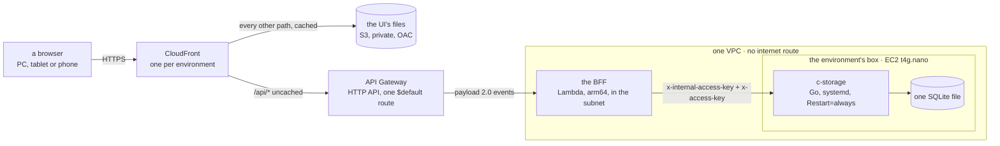

# How credo is built

> **Written** 2026-11-07, for an engineer new to this codebase — which includes a fresh session of
> the machine's own. It is the pair of [`products.md`](products.md): **products says what each part
> does for whom, this page says how it is put together.** Every structural claim names the file
> that makes it true, so any sentence here can be followed to the code; what was not read is named
> at the end. The first-day plan, [`plans/2026-10-27-architecture.md`](plans/2026-10-27-architecture.md),
> keeps the cost reasoning and the rejected alternatives, and is stale on several facts — see
> [what the day-one plan gets wrong](#what-the-day-one-plan-now-gets-wrong).

## At a glance

One React app, one back end, one key-value store. A browser reaches CloudFront; files come from a
private S3 bucket and every `/api/*` call goes uncached to an HTTP API, then to the BFF on Lambda
inside a VPC with no internet route, which calls c-storage over the private network. c-storage is a
small Go service on one EC2 box, holding **one SQLite file**. Locally the same path runs with
`scripts/src/front.ts` standing where CloudFront and the HTTP API stand, so the app the walks
picture is the app that deploys.

Drawn from [`ops/env.yml`](../ops/env.yml) (the distribution at `#L361`, its `/api/*` behaviour at
`#L397`, the HTTP API at `#L245`, the function at `#L216`, the box at `#L95`),
[`bff/src/lambda.ts`](../bff/src/lambda.ts), [`shared/src/c-storage.ts#L100`](../shared/src/c-storage.ts#L100)
and [`c-storage/internal/server/server.go#L39`](../c-storage/internal/server/server.go#L39).

## The parts, and what each would break

Six packages are in the pnpm workspace ([`pnpm-workspace.yaml`](../pnpm-workspace.yaml)); `c-storage/`
and `ops/` are deliberately outside it. The last column is the point of the list: a part is only
understood once you know what stops without it.

| Part | What it is | Runs | Gone, this breaks |
| --- | --- | --- | --- |
| `ui/` | The React 19 app, built by Vite: both the client app and the operator console, split by path in [`ui/src/App.tsx#L28`](../ui/src/App.tsx#L28) | a browser; files on S3 | everything a person sees. It is also the source the walks and the visual report draw screens from, so both go with it |
| `bff/` | One Fastify app ([`bff/src/app.ts#L85`](../bff/src/app.ts#L85)) behind two entries: a listener ([`bff/src/server.ts#L29`](../bff/src/server.ts#L29)) and a Lambda handler ([`bff/src/lambda.ts`](../bff/src/lambda.ts)) | Lambda on arm64; a local process | every rule. It is the only thing that authenticates, resolves permissions and builds a record key; c-storage enforces none of that |
| `shared/` | The wire contract and the record layout, one package, extended generically rather than split per service ([`CLAUDE.md`](../CLAUDE.md), [the app frame](plans/2026-10-27-app-frame.md#the-stack)) | imported by all of the above | the two halves drift. The key layout ([`shared/src/records.ts#L7`](../shared/src/records.ts#L7)) and the permission catalogue ([`shared/src/permissions.ts#L9`](../shared/src/permissions.ts#L9)) each have exactly one home here |
| `c-storage/` | A standalone Go service: six HTTP routes over one SQLite file, no framework, no router library ([`c-storage/go.mod`](../c-storage/go.mod), [`internal/server/server.go#L39`](../c-storage/internal/server/server.go#L39)) | a systemd unit on the box | all data. It is the only durable store, and its file is the only copy: the nightly backup is designed but deferred to a signed client ([open item 6](open-items.md)) |
| `scripts/` | The local lanes: `pnpm stack` (c-storage + BFF + UI on one machine, [`scripts/src/stack.ts`](../scripts/src/stack.ts)), `pnpm fake`, `pnpm demo`, and the ridge CLI the ops scripts drive ([`scripts/src/ridge.ts#L36`](../scripts/src/ridge.ts#L36)) | a developer's machine; the ops scripts | the ability to run or seed anything locally — and the BFF's route tests, which build the real c-storage through [`bff/tests/build.ts`](../bff/tests/build.ts) |
| `visual/` | Builds the walks page: the app's own components drawn on jsdom through a Vite server's module loader, since CSS modules and TSX do not import in plain Node ([`visual/run.mjs#L1`](../visual/run.mjs#L1)) | `pnpm report`, in a sandbox, no browser | the visual report — the one artefact a non-coder judges a screen from |
| `walk/` | Ten Playwright specs plus [`walk/run.sh`](../walk/run.sh), with each screen's committed base image beside the spec | a real browser, in a terminal only | the end-to-end check. `pnpm check` typechecks and lints this package but never runs it |
| `ops/` | Three hand-written CloudFormation templates and about twenty shell scripts, outside the workspace | a terminal with an AWS session; CI | every way to a machine. Nothing else in the repo talks to AWS |

Two shapes are worth naming because they are easy to miss. The BFF is **one app with two
entries**, not two back ends: `buildBff` is shared and only the listener differs
([`bff/src/server.ts#L6`](../bff/src/server.ts#L6)). And the UI is **one bundle with two apps in
it** — the operator console is not a separate deployment, only the path `/operator`
([`ui/src/App.tsx#L26`](../ui/src/App.tsx#L26)).

## The data

**Where it lives.** One SQLite file per deployment, at `DB_PATH` on the box
([`ops/c-storage.service#L20`](../ops/c-storage.service#L20)), opened in WAL with
`_txlock=immediate` ([`c-storage/internal/sqlitedb/open.go#L33`](../c-storage/internal/sqlitedb/open.go#L33)).
The whole schema is two `STRICT` tables — `services(code, hashed_access_key)` and
`records(service_code, key, data)` — in
[`c-storage/internal/store/schema.sql#L4`](../c-storage/internal/store/schema.sql#L4). There are no
timestamps, no indexes beyond the primary keys and no migration chain: the schema is applied only
to a file with no tables, stamped `user_version = 1`, and a file at any other version stops the
process at start-up ([`open.go#L56`](../c-storage/internal/sqlitedb/open.go#L56)).

**What a tenant is — and where it is not.** A client is a tenant. Its records sit under its minted
id, and its human-readable code reaches that id through one index record; the layout has one home,
[`shared/src/records.ts#L7`](../shared/src/records.ts#L7), so no other file builds a key. Every
client-facing route runs `resolveTenant` first, which reads the code from a header, finds the index
record and sets `request.tenantId` — it *scopes and never authenticates*
([`bff/src/app.ts#L98`](../bff/src/app.ts#L98)).

The part a newcomer must not get wrong: **c-storage has no concept of a tenant at all.** Its only
isolation unit is the *service*, and the BFF is a single service holding every tenant
([`bff/src/app.ts#L69`](../bff/src/app.ts#L69)). Tenant separation is a string-prefix convention
held entirely by the BFF; c-storage would serve one tenant's key to another tenant's request if the
BFF built the wrong key. This is a deliberate design with **one enforcement point**, not an
oversight: `records.ts` says in its own opening lines that it is the layout's one home, "so no
other file builds a key" ([`shared/src/records.ts#L3`](../shared/src/records.ts#L3)). The risk
worth naming is therefore not the design but its guard — **nothing tests that a cross-tenant key
cannot be built.** The convention holds exactly as long as every key keeps coming from that file,
and no gate would notice a route that built one by hand. Key design does real work here — a person's photo and a delivery's photo
deliberately sit outside their list's prefix so a list read never drags them in
([`records.ts#L47`](../shared/src/records.ts#L47), [`#L65`](../shared/src/records.ts#L65)), and
orders and deliveries are keyed by day because a prefix read answers at most 1,000 records
([`records.ts#L41`](../shared/src/records.ts#L41),
[`c-storage/internal/store/store.go#L132`](../c-storage/internal/store/store.go#L132)).

**How a record is written safely.** The version token is a `tag`: the hex SHA-256 of the record's
stored text, computed fresh on every read and stored nowhere
([`store.go#L54`](../c-storage/internal/store/store.go#L54)). A writer sends it back as `If-Match`
(or `If-None-Match: *` to claim a key that must not exist); c-storage compares inside the write's
own transaction and answers **412** if the record moved
([`store.go#L68`](../c-storage/internal/store/store.go#L68),
[`internal/server/handlers.go#L132`](../c-storage/internal/server/handlers.go#L132)). A precondition
it cannot parse is a 400, never ignored — but a request sending *no* precondition overwrites
whatever is there, so the guard holds only where the BFF sends the tag.

The BFF's client turns 412 into the value `'moved'` rather than an error
([`shared/src/c-storage.ts#L133`](../shared/src/c-storage.ts#L133)), and the route decides. The
shape settled on 2026-11-07 is in
[`bff/src/lists.ts#L176`](../bff/src/lists.ts#L176): read the record for its tag, write over that
version, and on either a lost answer or a `moved` outcome **re-read once** — a record that already
holds exactly what was asked is our own write having landed, and counts as saved; anything else is
a genuine conflict, answered 409 with the record as it is now. The version is never skipped, which
is the project's standing rule: recover, never bypass, a concurrency token
([`CLAUDE.md`](../CLAUDE.md)).

That identity compare is load-bearing and conditional, and the comment at
[`bff/src/lists.ts#L192`](../bff/src/lists.ts#L192) is the one home of what it assumes: it holds
only while the record has no mutable field other than the ones being written. The day a
`changeCode`, an `archived` flag or an order's status joins a record saved this way, another
writer's record could pass as our own save. Read that comment before copying this pattern.

## Who may do what

**Two doors, two session kinds, one store.**

A client's person signs in with a code and a password; a root-given email and a 15-minute QR code
are second sign-in names for the same records
([`shared/src/signins.ts#L64`](../shared/src/signins.ts#L64)). Sessions are a handle the device
keeps: only the SHA-256 of its secret is stored, beside the device it was issued to and the
sign-in record's `generation` at issue, so giving a password invalidates every older session
([`shared/src/records.ts#L185`](../shared/src/records.ts#L185)). They slide over seven days
([`bff/src/sessions.ts#L13`](../bff/src/sessions.ts#L13)).

An **operator** — the people who run credo — signs in at `/operator` by passkey only, joining
through a one-time link, with `@simplewebauthn` on both sides. Every ceremony is checked against
`APP_ORIGIN`, the address the operator opens, **never the request's host**
([`bff/src/env.ts#L13`](../bff/src/env.ts#L13),
[`bff/src/operator-auth.ts#L57`](../bff/src/operator-auth.ts#L57)); spent challenges are kept so an
answer cannot be replayed, and an account's `generation` moves when a new-passkey link replaces the
keys held, refusing the sessions issued before it
([`shared/src/records.ts#L131`](../shared/src/records.ts#L131)). An operator session is capped at 12
hours from issue ([`bff/src/sessions.ts#L18`](../bff/src/sessions.ts#L18)). Sensitive acts ask for a
fresh passkey touch rather than trusting the session
([`shared/src/wire.ts#L322`](../shared/src/wire.ts#L322)).

**Permissions.** Eight named permissions, catalogued once
([`shared/src/permissions.ts#L9`](../shared/src/permissions.ts#L9)), resolved in three sparse layers
— department, then position, then the person's own, each winning where it names a permission; the
root holds no layer and may do everything
([`permissions.ts#L36`](../shared/src/permissions.ts#L36),
[`#L48`](../shared/src/permissions.ts#L48)). The layers are read on **every** call, so a change by
the root holds at the person's next step, and a set that cannot be read answers 503 rather than a
partial one ([`bff/src/app.ts#L116`](../bff/src/app.ts#L116)). The menu asks the same question to
decide what it shows, and says so in its own comment: it is a view of the guard, never the guard
([`ui/src/nav.ts#L24`](../ui/src/nav.ts#L24), checked server-side at
[`bff/src/app.ts#L184`](../bff/src/app.ts#L184)).

**Keys, and who holds which.** c-storage has three: `x-internal-access-key`, which gates every
route but `/health` including the 404 fallback, so an unknown path answers 401 exactly like a real
one; a per-service `x-access-key`, stored only as a SHA-256 and compared in constant time; and
`x-super-admin-key`, whose sole power is creating a service
([`c-storage/internal/auth/auth.go#L17`](../c-storage/internal/auth/auth.go#L17),
[`internal/server/server.go#L59`](../c-storage/internal/server/server.go#L59),
[`internal/store/store.go#L93`](../c-storage/internal/store/store.go#L93)). **The BFF never holds
the super-admin key** — registration is the stack's own step, done once
([`bff/src/env.ts#L39`](../bff/src/env.ts#L39),
[`scripts/src/register.ts#L10`](../scripts/src/register.ts#L10)). The BFF reads exactly five
variables and is given exactly those ([`bff/src/env.ts#L21`](../bff/src/env.ts#L21),
[`scripts/src/stack.ts#L79`](../scripts/src/stack.ts#L79)).

## How it reaches a machine

| Lane | How | What it is for |
| --- | --- | --- |
| Local | `pnpm stack` builds c-storage with `go build` and the UI with Vite, then runs both behind the local front; `pnpm stack -- <command>` is one invocation, up-command-down, because the sandbox cannot signal a process an earlier command started ([`scripts/src/stack.ts`](../scripts/src/stack.ts), [`CLAUDE.md`](../CLAUDE.md)) | the real stack, data gone on Ctrl-C |
| Local, no server | `pnpm fake` — the UI alone over invented data, the one build that holds `?fake` and the fake `Api`; the bundle that deploys contains none of it ([`ui/src/main.tsx#L10`](../ui/src/main.tsx#L10)) | a screen's look before its back end exists |
| ridge | the shared pre-production environment, and the only deployed one | others check a piece without the code |
| a client's own stack | **not built.** `ops/env.yml` is parameterised by `Env` and ridge is one instance of it; several scripts hard-refuse any environment but ridge ([`ops/seed.sh#L36`](../ops/seed.sh#L36)) | — |

**Stack shape is the human's; code is CI's.** Only [`ops/stack.sh`](../ops/stack.sh) touches
CloudFormation, and only through change sets — `create-change-set`, print every change, then
`execute-change-set` (`#L204`, `#L242`) — run by a human from a terminal, never by CI (`#L8`). A
change set that removes or replaces anything is **refused by default** and needs the human to name
the logical id, because a replaced box deletes its disk and the database with it
([`ops/unsafe-changes.jq#L5`](../ops/unsafe-changes.jq#L5), [`ops/stack.sh#L225`](../ops/stack.sh#L225)).
Templates are read from `origin/main`, not the working copy (`#L140`). There is no CDK, SAM or
Terraform anywhere.

**What CI does.** [`.github/workflows/ci.yml`](../.github/workflows/ci.yml) runs four check jobs on
every push and pull request — `make check` in c-storage, its Bruno e2e, `pnpm check`, and the ops
job (ShellCheck at a pinned SHA-256 plus cfn-lint over the three templates) — and then, on a push to
`main` only, a `deploy` job in the `ridge` GitHub environment. That job ships **code, never stack
shape** (`#L212`): c-storage's arm64 binary to the box over an Instance Connect tunnel
([`ops/release.sh`](../ops/release.sh)), the BFF bundle to the one Lambda and the UI files to the one
bucket ([`ops/app.sh`](../ops/app.sh)), then [`ops/check.sh`](../ops/check.sh) verifies it. All
third-party code builds *before* the AWS role is assumed (`#L254`), and the role itself is narrow
to the point of naming the one function and the one instance
([`ops/env.yml#L433`](../ops/env.yml#L433)). Two other workflows:
[`seed.yml`](../.github/workflows/seed.yml) adds a day to ridge's demo copies nightly, and
[`walks.yml`](../.github/workflows/walks.yml) deploys the walks page to Cloudflare Pages behind
Access — the only deploy target that is not AWS.

One hazard the split creates: a change set that updates the `Bff` resource can restore its inline
503 stub and empty environment, so the human re-runs the latest deploy afterwards
([`ops/env.yml#L211`](../ops/env.yml#L211), [`ops/README.md`](../ops/README.md)).

## How it is checked

Four things, and a newcomer meeting the third without warning will not know what it is. The rules
behind them are [QA](conventions/qa.md); this is only what each *is*.

1. **The gate.** `pnpm check` is one command with five steps — typecheck, ESLint, Prettier,
   every package's tests at 100 % statement coverage, and knip for unused code
   ([`package.json`](../package.json)). A gate reported without naming its five steps has not been
   reported ([QA rule 6](conventions/qa.md)). c-storage has its own, separate gate: `make check`
   in `c-storage/`, which also cross-compiles to linux/arm64 so a dependency quietly needing cgo
   fails here rather than on the box. **`pnpm check` never reaches `c-storage/`**
   ([`c-storage/CLAUDE.md#L11`](../c-storage/CLAUDE.md#L11)). Note that `pnpm check` needs Go and
   loopback ports: the BFF's route tests build the real c-storage and run it per test file, so the
   product's own client meets the real server ([`bff/tests/`](../bff/tests)).
2. **The walks.** Ten Playwright specs take every screen in Vietnamese and English at three widths,
   first on the fake UI, then on a real stack, then on fresh stacks again, and count **every moved
   pixel raw — no threshold, no tolerance** against base images committed beside each spec. Green
   means fake = stack = stack again, and nothing moved against the bases except the screens named
   in `--moved` ([`walk/run.sh#L7`](../walk/run.sh#L7)). It needs a real browser, so it runs in a
   terminal and never in the agent's sandbox, where Chromium cannot start; `pnpm check` only
   typechecks and lints it. Bases are rewritten with `--write`, by a human's run, once a piece.
   [`ops/full-run.sh`](../ops/full-run.sh) is all walks in three lanes, about 16 minutes.
3. **The visual report.** `pnpm report` builds the walks page without a browser at all, drawing the
   app's own components on jsdom ([`visual/run.mjs`](../visual/run.mjs)). It is the artefact a
   non-coder judges: each screen asked yes or no, a no becoming a case. The deployed copy is behind
   a sign-in for partners.
4. **ridge.** The last stage: others check a piece in the shared environment without reading code.

A note for anyone reporting a check on this page: [`.prettierignore`](../.prettierignore) excludes
`*.md`, so Prettier inspects nothing here and a green from it means nothing.

## What the day-one plan now gets wrong

[`plans/2026-10-27-architecture.md`](plans/2026-10-27-architecture.md) is still worth reading for
its costs and its rejected alternatives. These parts of it are no longer true, and will mislead:

- **"CloudFront → the BFF's function URL, signed by origin access control", and the API client
  hashing each write into `x-amz-content-sha256`** (its `#L74`, `#L130`). CloudFront reaches an API
  Gateway HTTP API ([`ops/env.yml#L377`](../ops/env.yml#L377)); function URLs are not offered in the
  Region. The body hash is gone from the codebase. The plan carries an amendment note at `#L137`
  but its own table still says otherwise.
- **"Only CloudFront calls the back end"** (`#L41`). The HTTP API's own address answers anyone; a
  request throttle, not a signature, is what bounds the cost
  ([`ops/env.yml#L244`](../ops/env.yml#L244)). It is the one property of the day-one design that
  was given up without anyone deciding to — it followed from the Region's limit when function URLs
  turned out not to be offered there — and until 2026-11-07 that template comment was the only
  place it was written down. It is now [open item 121](open-items.md), parked for the human until a
  client signs or real client data reaches a deployment.
- **"A name under our domain per client, in Cloudflare, with an ACM certificate in `us-east-1`"**
  (`#L181`). There is no Route53, ACM or custom domain anywhere in the repository; the distribution
  uses CloudFront's own certificate and name
  ([`ops/env.yml#L369`](../ops/env.yml#L369)).
- **"Nothing is built before a client signs"** and **"no code holds it yet"** (`#L5`, `#L68`).
  ridge is built and deploys on every push to `main`. What is still unbuilt is a *client's* stack.

**Not in that list: the nightly backup.** The plan's diagram shows a nightly copy to S3 through an
S3 gateway endpoint, under a put-only role on the box (`#L28`, `#L76`, `#L97`), and none of those
three resources exists — but that is a **deliberate deferral the project recorded the same day**,
not something lost. [Open item 6](open-items.md) gates the backup and its restore on a signed
client, on the reasoning that ridge, the first box, holds no real data, and it says plainly that
"the S3 gateway endpoint and the box's put-only role come with it". So the right reading is: the
backup is designed and postponed, and until a client signs, **the one SQLite file is the only copy
of a deployment's data** — which is a known, accepted position for an environment holding only demo
data, and the thing to build first for one that does not.

One inconsistency inside that to be aware of when it *is* built: item 6's own first line says "the
box's role may only put, so it cannot restore itself", in the present tense, while
[`ops/env.yml#L93`](../ops/env.yml#L93) says "no instance role". The item describes the design; the
template describes the machine. When the backup is built, item 6's description of the role is what
has to be built — not a description of what is already there.

## What this page did not read

Stated plainly so the next reader knows which parts to trust.

- **Read closely and first-hand:** `pnpm-workspace.yaml`, the root and per-package `package.json`
  files, `CLAUDE.md`, `bff/src/app.ts` (the first ~220 lines), `bff/src/env.ts`, `server.ts`,
  `lambda.ts`, `main.ts`, `bff/src/lists.ts`, `shared/src/records.ts`, `permissions.ts`,
  `c-storage.ts`, `index.ts`, `wire.ts` (the routes and headers), `signins.ts` (the first ~70
  lines), `ui/src/main.tsx`, `App.tsx`, `visual/run.mjs`, `walk/run.sh`'s header and walk table,
  `scripts/src/stack.ts` (the first ~90 lines), `front.ts`'s header, `docs/products.md`,
  `docs/conventions/documentation.md`, `docs/conventions/qa.md`'s headings, the day-one plan whole,
  `docs/open-items.md`'s item 6, and the parts of `ops/env.yml` and `ops/network.yml` cited above.
  The rest of `docs/open-items.md` — over 500 lines — was searched, not read.
- **Read on this page's behalf by two other agents, not line by line by its author:** all of
  `c-storage/` and all of `ops/` and `.github/workflows/`. Every claim this page makes about those
  files was then checked directly against the file — the resource types in both templates, the
  CloudFront behaviours, the Lambda's stub and runtime, the absence of a gateway endpoint and an
  instance role, the change-set calls and their guard, the "never by CI" line, the two CI comments,
  the seed's refusal, the systemd unit's `DB_PATH`, and `c-storage/CLAUDE.md`'s gate line. **What
  was not checked a second time is everything this page does not cite:** in particular all of
  `c-storage/`'s Go sources beyond the lines quoted here, [`ops/test.sh`](../ops/test.sh) (about
  2,500 lines), `ops/lib.sh` whole, and the bodies of `check.sh`, `drill.sh`, `release.sh` and
  `pages-preview.sh`. The c-storage section in particular rests on one agent's reading of the Go
  code plus the cited lines, not on a full reading of it by this page's author.
- `scripts/src/ridge.ts` and `scripts/src/register.ts` were read only at the lines cited.
- **Barely opened or not at all:** most of `ui/src/` beyond the two entry files — about 80
  components, their routing and their data flow are summarised here from `products.md` and file
  names, not from reading them. `bff/src/app.ts` past line 220 and the other route modules
  (`orders.ts`, `staff.ts`, `operators.ts`, `reconciliations.ts`, `clients-delete.ts`) were not
  read; `lists.ts` was read whole and is treated here as the pattern the others follow, which is
  an inference. No test file in any language was read. `shared/src/demo.ts`, `scripts/src/demo/`
  and the seeding path were read only through `CLAUDE.md` and `products.md`.
- **Not checked at all:** anything live. No build, test or server was run for this page, and no
  AWS or Cloudflare state was queried — so what *actually* exists in the account today is outside
  what this page can say.
