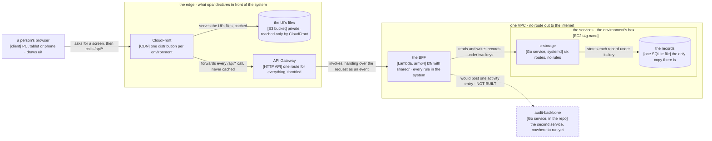

# How credo is built

## At a glance

**credo works by turning everything a person does on screen into one call to a single back end,
which decides who is calling and what they may do, and then saves the result as one record under one
key in a store that knows none of those rules.**

That back end is the only part that decides anything: **the React app only draws what it is given,
and the store only keeps what it is handed** — which is why the picture below has so few arrows,
and why the walk under it is short.

**The system, and what passes between its parts.**

**Key.** Each box names a thing that runs and, in square brackets, what it runs on. A rounded box is
a store. **A frame is a group of boxes that belong together, and where that group is also a place,
what it holds runs inside it:** the edge is the three things `ops/` declares in front of the system,
the VPC is a network with no way out of it, and the box is one small server carrying the services.
**Every arrow is one way, from the caller to the thing it calls, and says what passes.** A **dashed**
box and arrow are **decided and not built**: `services/audit-backbone/` is in this repository, nothing calls
it, and where it would run is not decided — the whole of that is
[`docs/activity-log.md`](activity-log.md).

**On this machine the picture is the same.** `scripts/src/running/front.ts` stands where CloudFront and the
HTTP API stand, so the app the walks picture is the app that deploys.

## One request, end to end

**A person changes a customer's phone number.** Every other action a person takes travels the same
path; what differs between them is the permission asked at step 6, the key built at step 8 and the
record written at step 9 — never the shape.

1. **The screen.** The page is `ui/src/pages/client/RecordPage.tsx`, drawing the form in
   `ui/src/parts/CustomerForm.tsx`. The page was handed one object to reach the back
   end with, and holds no rule of its own. The version it read the customer at goes back with the
   change.
2. **The call.** That object is `ui/src/api.ts`. It sends one `PUT` to the customer's own address,
   carrying three headers that identify the call: the device, the client's code, and the session
   handle the device keeps. No cookie, and nothing in the body says who is calling.
3. **The door.** CloudFront matches the call's path, passes it on uncached to the HTTP API, and the
   HTTP API invokes the BFF's one Lambda function.
4. **The company.** The BFF's first hook reads the client's code from its header, finds the one index
   record that maps that code to the client's minted id, and puts the id on the request. **It scopes
   and never authenticates.**
5. **Who is calling.** The route asks for the signed-in person: the session handle is hashed, its
   record read, checked against the device it was issued to and against the sign-in's generation,
   then slid forward.
6. **What they may do.** One boolean — may this person edit orders? The three permission layers are
   read on **every** call, department then position then the person's own. A no is a 403 here, before
   the body is read. **This is the only place the question is asked.** The menu asks the same
   question, but only to decide what to draw.
7. **The body.** Only now is the request's JSON parsed, against the schema `shared/` declares and
   both halves use. A refusal is a 400 naming the field that failed, which is what the form shows.
8. **The key.** The customer's key is built in one place, `shared/src/records.ts`: `tenant.`, the
   client's minted id, `customer.`, then the customer's id. **Nothing else in the repository builds a
   key** — which is why the store can be told apart from the rules at all.
9. **The write.** `bff/src/routes/lists.ts` reads the record, lays the new values over it, and writes it with
   the version it read as a precondition. `shared/src/c-storage.ts` turns that into one `PUT` over the
   private network, carrying the internal key and the BFF's own service key, under a five-second
   bound.
10. **The store.** c-storage hashes the stored text to a tag, compares that tag with the precondition
    inside the write's own transaction, and either writes or answers 412. **It knows nothing about
    customers, clients or permissions:** a key, some JSON, and which service asked.
11. **And back.** A 412 is not an error to the BFF. It reads the record once more; a record that
    already holds exactly what was asked is its own write having landed, and counts as saved.
    Anything else is a 409 carrying the record as it is now, and the screen offers the conflict. **The
    version is never skipped.**

## What each part is for

Nine parts make the system, four of them on the path that request took. **Each has one role, and
the role is what this page says; what belongs inside a part and the file to copy are that part's own
`CLAUDE.md`.**

**The screens are `ui/`.** Everything a browser draws: the client app and the operator console, one
bundle chosen by the address it is opened at, so the console is not a second deployment
(`ui/src/App.tsx`'s `isOperatorPath`). Its only door to the back end is the one object
`ui/src/api.ts`'s `createApi` makes, and **a screen never guards**: a rule the server must hold
belongs in `bff/`. What that costs a person at a screen — what a 401 ends, what a slow network
looks like, what a page they may not open does — is [its memo](memo/ui.md), one section per promise.

**The rules are `bff/`.** One back end for the UI: it resolves the company, then who is calling,
then what they may do, and only then reads or writes a record. It holds no state of its own, and it
is **one app with two entries rather than two back ends** (`bff/src/server.ts`'s `buildBff`, with
only the listener differing) — a local listener and Lambda are two ways of running the same rules,
and a rule has one home
([one home for one decision](conventions/code.md#one-home-for-one-decision)). What a caller can be
surprised by — the order it decides in, what a 401 means against a 403, the bound it retries under,
and what an unreachable store answers — is [its memo](memo/bff.md), one section per promise.

**What the two halves agree on is `shared/`.** The wire contract, the record layout, the permission
catalogue, the bounds both sides check. A thing enters it when a second package reads it and not
before (`shared/CLAUDE.md`'s rule SH1), and nothing in it needs a runtime beyond the web's — no
`node:` import, no clock, no randomness — so one declaration serves a browser, a Lambda and a script
alike.

**The store is `services/c-storage/`.** One Go binary, one SQLite file, one listener, six routes, and a
record whose meaning is the BFF's and not its own. Its promises are a store's: a save over a record
changed since it was read is refused, one save happens at a time, and every path but the health
check needs a key ([its memo](memo/c-storage.md), one section per decision). **Its one isolation
unit is the service, not the client** — which is why tenant separation is a prefix the BFF builds
and nothing the store enforces.

**The second service is `services/audit-backbone/`.** The activity log: a keyed writer and a token-gated
reader over its own SQLite file, in this repository with a gate of its own, called by nothing
([the activity log](activity-log.md)).

**Running it on this Mac is `scripts/`, and reaching a machine is `ops/`.** A step belongs to
`scripts/` when it must run the product's own code, so every product rule holds on the way through;
a step that is only `aws`, `ssh`, `gh` or `curl` is a shell script in `ops/`, where every AWS call
in the repository is made. Stacks ship as hand-written CloudFormation through change sets, because
the template is what the human reads and diffs — which is why CDK, with a package manager and a
synth step in ops, was rejected on day one
([the day-one plan's decision 8](plans/2026-10-27-architecture.md#decisions--the-machines)).

**What a person judges it by is `visual/` and `walk/`.** `visual/` draws every screen of every walk
from the app itself, with no browser, into one page a non-coder answers yes or no; `walk/`
photographs the same screens in a real browser and counts every moved pixel raw against committed
bases. Two parts, because one needs a browser and the other does not.

Six of the nine are one pnpm workspace ([`pnpm-workspace.yaml`](../pnpm-workspace.yaml));
`services/c-storage/`, `services/audit-backbone/` and `ops/` stand outside it, each gated on its own terms. **No part
has a directory named for a layer**, because a directory earns its name only where "everything in
here is a ___" finishes in a word the product itself uses
([the shape of a package](conventions/code.md#the-shape-of-a-package)).

## What is never there

The most useful thing to know about a system is often what it never does. Each row below is an
absence this codebase holds today — **and the second column says, honestly, whether anything stops a
breach.** Most are held by a reader of the diff, which is worth knowing before relying on one.

| What is never there | What stops a breach |
| --- | --- |
| **No `fetch` in the back end.** It reaches storage only through the one client built for it | nothing. A reviewer reading the diff |
| **No screen decides what a person may do.** The menu asks the permission question only to decide what to draw | nothing. The server asks the question again on every call, so a breach is a wrong screen, never a wrong act |
| **No clock, no randomness and no runtime beyond the web's in `shared/`.** A day arrives as text and `fetch` as a parameter | nothing. A reviewer reading the diff |
| **No second file builds a record key.** The layout has one home | nothing — and this is the one absence worth the most, because tenant separation is a string prefix and nothing else |
| **No concept of a tenant in c-storage.** Its one isolation unit is the *service*, and the BFF is a single service holding every client | nothing structural, and it is the design rather than a slip. Isolation itself is tested, at the route level |
| **No record carries who changed it, or what it held before** | nothing, and **this one is a gap and not a property** — it is the first thing [the activity log](activity-log.md) has to fix |
| **No untested statement, branch, function or line** in the five TypeScript packages that have tests, nor outside the entry point of either Go service. `walk/` is typechecked and linted and runs no test of its own | **the gate.** Each of the five declares all four thresholds at 100 %, a step of `pnpm check`; each Go service's own `make check` holds its own |
| **No citation in a living document naming a file that is not there** | **the gate.** The citation check greps the named file for the named symbol |
| **No dependency that quietly needs cgo** | **the gate.** Both Go gates cross-compile for the box's `arm64`, so it fails here rather than at ship time |
| **No change set that removes or replaces a resource** | **a script.** `ops/stack.sh` refuses one by default; the human must name the logical id, because a replaced box deletes its disk |
| **No route out of the VPC to the internet** | **the template.** `ops/network.yml` declares no NAT gateway and no internet gateway at all; its one route table has no route out |

## Where the rest is

**The detail a session reads while changing something** — where to look for the thing that does X,
what the data is, who may do what, how it reaches a machine and how it is checked — is
[`architecture-detail.md`](architecture-detail.md), opened by whoever is about to change the code
rather than by whoever is reading what it does.

It is the pair of [`products.md`](products.md): **products says what each part does for whom, this
page says how it is put together.**
