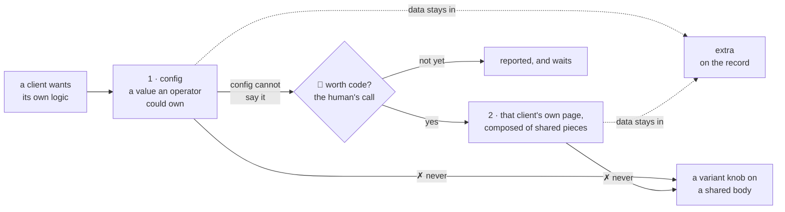

# Code

> **Decided** 2026-11-09, from the whole-code-base structure review of 2026-11-08 and the human's
> two answers to it. Binds every session that adds or changes code here. It names the one way where
> the repo already holds two, and the file to copy where it already holds the shape; it does not
> inventory what the code does consistently. This file holds the rules as they stand; their history
> is in `git log`.

## At a glance

**A decision has one home, and the rule is held by the code that does the work, not by whoever
reads the diff.** The review's cost sits in one habit — a decision written out by hand in three to
eleven places, with nothing failing when one copy is missed.

| The next change | The one way | Copy |
| --- | --- | --- |
| reaching the back end, or storage | one object, handed down, never imported into a screen | `ui/src/api.ts`, `bff/src/server.ts#L11` |
| a name, a bound, a width, a status's meaning | one exported declaration, imported | `shared/` |
| a new route | its own module: resolve, authorise, parse, then storage | `bff/src/staff.ts#L417` |
| a second kind of record | a parameter on the one body | `ui/src/ListPage.tsx#L14` |
| a refused save | the message on the field | `ui/src/ProductPage.tsx#L180-L198` |
| a client's own difference | config; else that client's own page, on the human's call | `shared/src/fields.ts` |
| reading server data | `useLoad` and `<Loaded>`: no cache, no store | `ui/src/page.ts#L31` |

- **One decision, one home**, and the best home is one the working code appends to
  ([one home](#one-home-for-one-decision)).
- **Where two patterns compete the winner is named**, and the loser is not copied again
  ([the winner](#the-winner-named)).
- **A client's difference is a value an operator could own, or that client's own page once the
  human has priced it** — never a knob on a shared body
  ([a client's difference](#where-a-clients-difference-lands)).
- **No cache and no store for server data**, with the lines that re-open the question
  ([server data](#server-data-and-client-state)).

## One home for one decision

**A name, a bound, a width, a status's meaning or a path derivation is declared once and
imported; no file reads another file's source text to check that two copies agree.** *Why:* a
missed copy fails nothing — `walk/run.sh#L296` still hands out `CREDO_OPERATOR_PASSWORD`, a name
dropped when the operator console replaced it with `CREDO_OPERATOR_LINK`, and a wrong name reads as
`undefined` and fails at some later assertion in another file.

The review's worst instances, as the shape to recognise: eleven environment names minted at
`scripts/src/cli.ts#L132-L141` and read as string literals in twelve `walk/specs/*.spec.ts`; the
retry bound as four constants all `3` (`bff/src/staff-records.ts#L58`, `operators.ts#L21`,
`orders.ts#L48`, `sessions.ts#L27`), so whoever finds one believes they have found the bound; what a
403 means re-decided in six screens (`ui/src/AddCustomerPage.tsx#L41`, `CustomerPage.tsx#L49`,
`ProductPage.tsx#L69`, `PersonPage.tsx#L660`, and `SettingsPage.tsx#L32`, which re-implements the
helper rather than calling it); "list under a prefix, refuse a truncated answer, parse each one"
written four times (`bff/src/clients.ts#L95`, `lists.ts#L105`, `orders.ts#L68`, `staff.ts#L179`)
while `bff/src/orders.ts#L66` is already the general version; and the three screen widths declared
four times (`visual/src/walks.ts#L26`, `walk/support.ts#L9`, `ui/src/mock/MockPage.tsx#L16`,
`ui/src/mock/Frame.tsx#L8`), held level only by a regex in `visual/src/walks.test.ts` that reads one
of them as source text, so a reformat breaks the check and a fifth copy would not trip it.

**Where the one home can be a list the working code appends to, make it one**, so a missed edit is
a red and not a green — the model is the registration in [the patterns to
copy](#the-patterns-to-copy).

**Parameterise a second kind rather than copy its screens.** `ui/src/CustomerPage.tsx#L23` and
`ui/src/ProductPage.tsx#L43` are the same 89-line shell written twice, and their add screens the
same 56 lines twice (`AddCustomerPage.tsx#L21`, `AddProductPage.tsx#L24`); a third kind pays it a
third time, and changing how a conflict is offered is an edit in two files nothing makes you find.
*Why:* the lists already prove the cheaper shape — `bff/src/lists.ts` serves both from one 169-line
body registered twice and `ui/src/ListPage.tsx#L14` draws both from one table.

## The winner, named

**Where two patterns do one job, the one below is the one to write; the other is not copied
again.** *Why:* the next piece copies whichever it meets first, so import order is currently making
design decisions — and for the first row the human's principle decides it outright: "don't make
user surprise or confuse", and two behaviours in one app is itself the surprise.

| The job | The one way | Copy | What the review counted |
| --- | --- | --- | --- |
| a form reports a refusal | per field against the shared schema, the message on the field; one alert above the card only for a whole-form refusal | `ui/src/ProductPage.tsx#L180-L198` | 6 of 13 forms draw a field error, 3 use a `tried` flag, 10 use a guard clause and one alert (`ui/src/OwnPasswordPage.tsx#L26-L52`) |
| storage is reached in the back end | a record kind's reads and writes in a module of its own, never in the route closure | `bff/src/staff-records.ts#L22` | 34 of 98 calls, against 64 inline in `staff.ts`, `orders.ts`, `lists.ts`, `reconciliations.ts` |
| a screen gets its data | handed down in `PageProps`, never the API client imported into the screen | `ui/src/page.ts#L6`, built at `ui/src/ClientApp.tsx#L249` | 24 of 62 screens import it directly, 38 take what they need |
| an error becomes a response | thrown, and the one handler writes the reply | `bff/src/app.ts#L92` | two routes write it themselves (`bff/src/app.ts#L226-L228`, `operator-auth.ts#L435`), and the conflict reply has four spellings while `shared/src/wire.ts#L151` declares the schema all of them mean to meet |
| a command dispatches and fails | one dispatch with one catch, the exit codes stated once | — | `scripts/src/ridge.ts#L51-L205` is a seven-arm chain under one catch that turns a new failure into exit 1; `walks.ts#L160-L193` is three arms each with its own catch and prefix. `scripts/src/cli.ts` is outside this rule: its three commands are a lifecycle, not a verb table |

**A handler's steps run in this order — resolve the caller, authorise, parse the body, then touch
storage** (`bff/src/staff.ts#L417`). *Why:* all 63 route registrations keep it and nothing holds
them to it, so a route that parses before it authorises passes every check in the repo.

**The next route added to `bff/src/staff.ts` or `bff/src/orders.ts` goes in its own module**, as the
five smaller modules already do. *Why:* those two are single closures of 629 and 453 lines, 42 and
40 branches, and nobody can judge either in one read.

## The patterns to copy

Naming the model is the rule; these are the shapes a new piece follows rather than inventing a
second one.

| The shape | Where it is |
| --- | --- |
| one object makes every call to the back end, taking `fetch` as a parameter; storage is reached only through the client declared once and built once | `ui/src/api.ts`, `shared/src/c-storage.ts#L86`, `bff/src/server.ts#L11` (no `fetch` anywhere in `bff/src`) |
| a contract declared once and passed down, never resolved by hand per caller | `ui/src/page.ts#L6`; authorisation at `bff/src/app.ts#L157-L188`; loading and failure drawn by `ui/src/Loaded.tsx#L12` |
| entry points hold wiring and no logic | `scripts/src/*-main.ts` (4–23 lines each), `c-storage/cmd/server/main.go` (35 lines, the process in `internal/lifecycle`) |
| one body serving every kind, the kind as data | `LISTS` in `ui/src/listSheet.ts#L29`, drawn by `ui/src/ListPage.tsx#L14-L19`, served by `bff/src/lists.ts` |
| **a rule held by code rather than by a reviewer**: the function that registers a route also appends its pattern to a list, and a test fails when one is added without an entry | `c-storage/internal/server/server.go#L51-L54`, held by `TestEveryRegisteredRouteIsListed` (`c-storage/internal/server/server_test.go#L106`) |

## Where a client's difference lands

**Two tiers and a refusal, in this order.** *Why:* the human's own experience — "when we start
custom for a client, request keep comming and the origin code become a melting pot" — measured in
the legacy's sales-order pages, where `salesOrderListVariant.ts` went from 9 knobs in 34 lines at
its birth to 33 knobs in 123 lines, while the body it steers (`SalesOrderList.tsx`) grew from 765
to 1,168 lines; eleven variant files there carry 194 knobs.

- **Tier 1, config, and it is the default: every difference that is a *value* an operator or the
  root could own** — a label, a logo, a colour, a declared field, a switch over an existing
  affordance. A common pattern belongs here whichever client asked. **The test:** could an operator
  be handed this switch and get it right? What carries it: `TenantConfig`
  (`shared/src/config.ts#L7-L22`), and a company's declared fields (`shared/src/fields.ts#L4-L6`)
  whose values live in `extra`. *The honest limit:* `TenantConfig` holds eight presentation fields
  and no `features` object, so no screen reads a per-tenant switch today; the smallest honest
  extension is one defaulted `features` record on it, each key named for the behaviour and never for
  the client, defaulted on read as `extraSchema` is ([extra](../memo/extra.md#the-rules)). That is a
  code change, and it belongs to the first piece that needs it.
- **Tier 2, that client's own page, and the gate is commercial: the human decides whether a
  difference is worth code, and the machine never decides it.** The machine says which tier a
  request falls in and what the code change would be, with its files; a request config cannot
  express is reported and waits, not begun. **The test:** name what the default screen and the
  client's would share; if the answer is "the route", it is a page.
- **Refused: a client's difference never enters a shared body, not even behind a knob, and no
  client is named in shared code.** *Why:* the
  knobs arrive and never leave, in the body everyone depends on. The legacy's variant did keep its
  own promise — its bodies stayed client-agnostic, the only client-named symbol across the three
  being a comment restating that rule — so this is a refusal on where the mechanism ended, not a
  judgement of that code.
- **A client's own page is composed of the shared pieces, never a copy of the default page's
  body.** *Why:* otherwise one melting pot becomes N drifting copies, which is this review's top
  finding. What makes it possible: one `Api` passed in (`ui/src/page.ts#L6-L16`), one load hook
  carrying refusal handling (`useLoad`, `refusal`, `ui/src/page.ts#L31`, `#L25`), one
  loading/failed/retry component (`ui/src/Loaded.tsx`) and a kind-driven list.
- **Three extractions come before the first client page exists** — a piece, not a line: the page
  shell (title, action row, `Loaded` wrapper), written by hand twice today
  (`ui/src/ListPage.tsx#L22-L39`, `ui/src/StaffListPage.tsx#L156-L170`), as one component a client
  page takes; a list kind as the entry point, so a client's list is a new `LISTS` entry and not a
  copy of `ListPage`; and the row and detail pieces a client page would re-lay out, named and
  exported. *Why:* until they exist a client page can only be a copy, so the commercial gate holds
  on that ground alone.

**A tier changes what a screen offers, never how it behaves when it refuses, confirms or saves.**
*Why:* one behaviour everywhere, so no client's screen surprises an operator who learned another.

## Server data and client state

**Server data is read through `useLoad` (`ui/src/page.ts#L31`) and rendered through `<Loaded>`
(`ui/src/Loaded.tsx#L12`); there is no cache and no store for it, so a screen reads the server on
every mount and a write is followed by `reload()`. Client state has two homes and no third — how a
list is filtered or paged goes in the URL (`ui/src/StaffListPage.tsx#L86`), what the device keeps
between visits in `ui/src/device.ts#L19`. No component calls `fetch`.** *Why:* no cache means no
staleness, every screen correct by construction, and the cost today is spinners on five screens; a
store would be a third home for what has two, and a query library beside `useLoad` would be two
mechanisms for one job, which this review ranked its second-worst shape.

**A cache is adopted only when one of these is true and named in the piece adopting it:** one read
is made by three or more screens *and* answers a list too large to re-read each visit; a screen
refetches accumulating data it already holds; or a wait is measured and attributed to a repeated
read. Then the library is TanStack Query and it **replaces** `useLoad` — 24 call sites today,
roughly 44 after another twenty screens, mechanical either way, while `<Loaded>` survives unchanged.
**Filters stay out of it whenever it comes:** the legacy moved them out to plain storage after a
debounce lost a write and a date window picked yesterday hid today's rows.

## Before a new screen

**Work the list of places one screen touches, because at least seven exist and nothing lists
them:** the page, the fake (`ui/src/fake.ts`), its route in the app shell, both dictionaries, its
test, a walk scene and a base image before the visual report can show it. *Why:* a screen that
reaches the walks page without its scene and base is a screen the human cannot judge, and the
project is about to add screens faster than it has.
