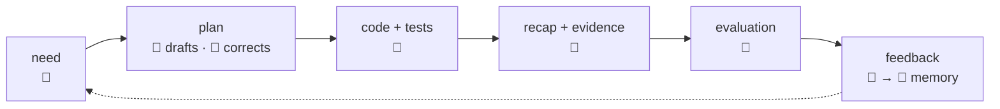
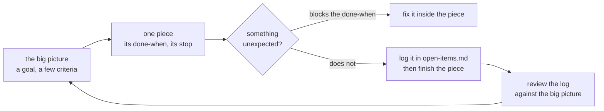

# Collaboration

> **Decided** 2026-10-27. Binds every person and every agent working here.
> **Amended** 2026-10-27 by the human: rules picked from the old repo's standing preferences.
> **Amended** 2026-10-28 by the human: the old repo's standing preferences whose step came with
> ridge.

## At a glance

**The human brings the business need, the sense and the final evaluation. The machine brings
knowledge, measurement and the code.** Several humans work here, each directing their own
sessions under these same rules.

- **Who decides** ([who owns what](#who-owns-what)): the human, what is worth building and
  anything touching money, a client, personal data or production. The machine decides the
  rest, and says why.
- **The five hand-offs** ([the loop](#the-loop)): 1. the plan is made right before any code; 2. the
  machine stops only for the human's decisions; 3. nothing is claimed that was not checked, and a
  step the human runs is one command whose log the machine reads; 4. the recap is written for the
  human; 5. a correction given twice becomes a rule.
- **One piece at a time** ([pacing](#pacing-one-piece-at-a-time)): one piece per session, kept to
  its own worktree; a surprise is logged, not chased; nothing is built before something needs it;
  small changes ship every day; the machine commits, the human pushes.

## Who owns what

| | 👤 Human | 🤖 Machine |
| --- | --- | --- |
| **decides** | what is worth building, for whom and at what price; anything touching money, a client, personal data or production | anything derivable from the code, a convention or a measurement, and says why in one line |
| **holds** | every credential, production, releases, the deploy state, the browser | what one task needs, for as long as it needs it |
| **evaluates** | the result, in the UI, against the business | the gate: typecheck, lint, tests, all of them commands it ran |
| **writes** | corrections, at the level of principle | plans, code, tests, recaps, all in git |

## The loop

The loop is drawn [at a glance](#at-a-glance). Five hand-offs, each with its rule:

1. **A plan is made true before it is made fast.** The machine drafts it from measurement: who
   calls what, and what the wire carries. The human corrects it at the level of principle, not
   line by line. No code is written while the plan is still being made true. *Rejected:* code
   first and a plan afterwards. That builds a work-around in the shape of the old thing. Every "after X" in a plan names what
   the step consumes from X; with none, it takes the first free slot. A UI's next version starts with
   its frame as a static mock (page map, URLs, one navigation, one state system, light and dark,
   phone and desktop widths, empty, loading and failed states) before app code; content may stay
   thin. Before new code, open the nearest similar code and follow it, naming that model file in
   the recap; never copy a shape a memo calls a defect.
2. **The machine decides, says why, and stops only for the human's decisions.** Those are the
   ones that need business sense or carry a price a human pays: a client, money, data or
   production. Each is asked at the step that needs it, never ahead of it, as one recommendation
   and never a menu. *Rejected:* asking the human to confirm each section, which hands back a
   task already delegated.

   **An act on production, a client's own stack, sits at the latest point its done-when needs
   it**, its price said in days ("up to N days"), never moved earlier to save calendar time. A
   script that changes a box, ridge's included, reads the box's disk and memory first and refuses
   below a floor, never only printing them. *Why:* an early act on production takes its risk
   before it buys anything. It is no reason to wait otherwise: a finished change with nothing to
   consume takes the first free slot, as hand-off 1 says.
3. **Every claim is something read back.** A gate is a command the machine ran; "verified" is a
   value it read. What it cannot run (the browser, production, a release) it does not claim.
   "Cannot run" means a credential or eyes it must not hold. A limit of the session's sandbox
   does not count: for that, the machine asks for the capability, naming the setting. Before a
   step is called done, the machine reads the whole log, warnings included; a warning is a
   finding, never "known noise". A needed settings or sandbox change is given to the human as the
   whole resulting file, never a fragment, and the machine does not edit its own settings.

   **Logic is verified on the local stack.** A whole environment is stood up only when a piece
   changes what ships: a new resource, hop or key. *Rejected:* an environment for each piece. It
   re-proves hops nothing changed, at the price of a stack's build, the human's minutes and money.

   **When a symptom outlives a fix, the first read is which build serves it**: the sha the
   service's `/health` names, before the source is read again. A gap between that sha and the fix
   is reported, and the work stops there. *Why:* a diagnosis read from the source can be true and
   still not the cause, when the fix never reached what runs.

   **A step the human runs is one command, and the machine reads its log.** More than one command,
   or one with a branch ("if red, re-run"), becomes a script the machine writes, under `ops/` or as
   a one-off in `$ROOT_DIR/one-off/`, outside git. Every line a script prints, refusals included,
   goes to its log in `$ROOT_DIR/logs/`; the human says it ran, and the machine never asks for
   output pasted. A run longer than a minute prints each n/N step with the time elapsed, since a
   run silent for minutes looks hung and is stopped. It writes its results as it goes, and its
   first comment says its expected length. *Rejected:* a list of commands to paste, and their
   output pasted back. The human then relays by hand what a file can carry.

   **While the human's script runs, the machine answers in words alone** and changes nothing the
   script reads, until the human says it has ended; then it reads the log first. *Why:* bash reads
   a script as it runs, so an edit changes what runs next, and the log then matches no file anyone
   reviewed.
4. **A recap is written for the evaluator.** It says what shipped, what was rejected and at what
   price, and what remains the human's. It is never a log of commands. Anything the human must look up is named with a few words of
   what it is and a `path#Lnn` link, never a bare label. Reviewing a recap is reading it for sense and
   for what would make someone act wrongly; the reviewer re-runs only what it claims without
   evidence.
5. **A correction becomes memory. Given twice, it becomes a convention here**, on the human's
   yes. *Rejected:* a new rule after the first correction. The rules then grow faster than a
   session can read them.

## Pacing: one piece at a time

This is the human's method. The machine's default runs against it: it perfects the piece in
front of it and grows the scope from inside.

- **A piece works inside its plan step and stops where the step says.** The "then stop" lives in
  the plan, not in the prompt. Scope grows only at a review, and only on the human's yes.
- **One piece per session.** The machine ends the piece when its step reaches "then stop", or
  when a new piece arrives: another plan, or a new deliverable even on the same theme. It does
  this unasked, and does not start the new work:
  1. It says so in one line.
  2. It parks the new piece in `open-items.md`.
  3. It offers the next session's opening line: the worktree, what to read first, the first action.

  A short follow-up on the session's own output stays: a decision its step just raised, or a
  correction to its recap. A session keeps to its own piece and worktree: it does not read sibling
  branches to report on them or advise on their timing; cross-worktree questions go to the
  orchestrator. If the human insists on going on, the human's call wins; the machine
  says once what that costs. *Why:* a session's context can be thrown away only because the plan
  and the recap are kept. A second piece makes the session long, mixes two pieces' state, and
  leaves the next session to re-derive both from scrollback.
- **Nothing enters unless something calls it now**, whether a route, a package, a page or a memo.
  *Rejected:* building for a caller still to come. Code nothing calls is still read, carried and
  kept compiling, all for nothing.
- **Small changes ship every day.** No plan waits for a release, and nothing is sized for one: a
  script, a tracker or a page stays one short page, cheap to rewrite. *Rejected:* structure sized
  for weekly releases, such as ledgers, receipts or a file per thread. At daily size it costs more
  to keep than it catches, and it goes on describing a system that has moved on.
- **Rebuilding a piece from the old app** reads its memos, keeps what earns a place, takes a
  tenant's differences from its config, and turns each kept rule a gate can hold into a lint rule
  or a test. "Keep X's behavior, drop Y" keeps the full observable UX (auto-triggers, timing,
  entry points); the machine confirms before changing a trigger.
- **Commits** follow `git log`: `type(scope): subject` in lowercase, a short body of plain prose
  that says why, then the model trailer. The machine commits each coherent unit without asking;
  pushing, deploying and releasing stay the human's. It commits with explicit paths after
  checking the staged column, and prints the branch in the confirmation, since a branch can move
  under a session.
