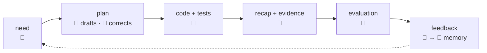
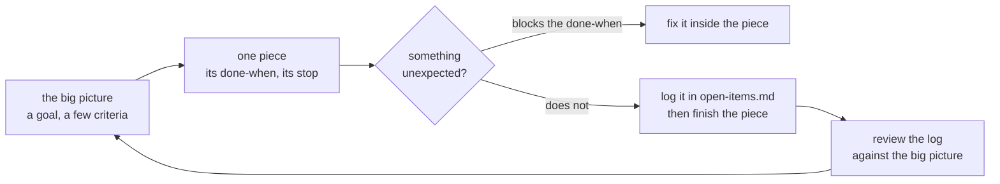

# Collaboration

> **Decided** 2026-10-27. Binds every person and every agent working here.

**The human brings the business need, the sense and the final evaluation. The machine brings
knowledge, measurement and the code.** Several humans work here, each directing their own
sessions under these same rules.

## Who owns what

| | 👤 Human | 🤖 Machine |
| --- | --- | --- |
| **decides** | what is worth building, for whom and at what price; anything touching money, a client, personal data or production | anything derivable from the code, a convention or a measurement, and says why in one line |
| **holds** | every credential, production, releases, the deploy state, the browser | what one task needs, for as long as it needs it |
| **evaluates** | the result, in the UI, against the business | the gate: typecheck, lint, tests, all of them commands it ran |
| **writes** | corrections, at the level of principle | plans, code, tests, recaps, all in git |

## The loop

Five hand-offs, each with its rule:

1. **A plan is made true before it is made fast.** The machine drafts it from measurement: who
   calls what, and what the wire carries. The human corrects it at the level of principle, not
   line by line. No code is written while the plan is still being made true. *Rejected:* code
   first and a plan afterwards. That builds a work-around in the shape of the old thing.
2. **The machine decides, says why, and stops only for the human's decisions.** Those are the
   ones that need business sense or carry a price a human pays: a client, money, data or
   production. Each is asked at the step that needs it, never ahead of it, as one recommendation
   and never a menu. *Rejected:* asking the human to confirm each section, which hands back a
   task already delegated.
3. **Every claim is something read back.** A gate is a command the machine ran; "verified" is a
   value it read. What it cannot run (the browser, production, a release) it does not claim.
   "Cannot run" means a credential or eyes it must not hold. A limit of the session's sandbox
   does not count: for that, the machine asks for the capability, naming the setting.
4. **A recap is written for the evaluator.** It says what shipped, what was rejected and at what
   price, and what remains the human's. It is never a log of commands.
5. **A correction becomes memory. Given twice, it becomes a convention here**, on the human's
   yes. *Rejected:* a new rule after the first correction. The rules then grow faster than a
   session can read them.

## Pacing: one piece at a time

This is the human's method. The machine's default runs against it: it perfects the piece in
front of it and grows the scope from inside.

- **A piece works inside its plan step and stops where the step says.** The "then stop" lives in
  the plan, not in the prompt. Scope grows only at a review, and only on the human's yes.
- **Nothing enters unless something calls it now**, whether a route, a package, a page or a memo.
  *Rejected:* building for a caller still to come. Code nothing calls is still read, carried and
  kept compiling, all for nothing.
