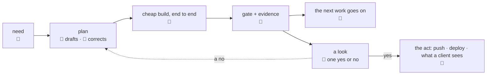
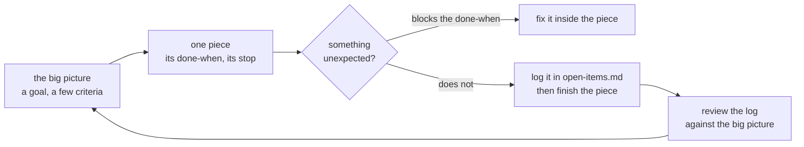

# Collaboration

> **Decided** 2026-10-27. Binds every person and every agent working here. This file holds the rules
> and the reason each exists; their history is in `git log`.
> **Last amended** 2026-11-08, by piece 89's cut of the rules that were being said twice.

## At a glance

**The human brings the business need, the sense and the final evaluation. The machine brings
knowledge, measurement and the code.** Several humans work here, each directing their own
sessions under these same rules.

- **Who decides** ([who owns what](#who-owns-what)): the human, what is worth building and
  anything touching money, a client, personal data or production. Every other choice, how the
  machine works among them, is the machine's: one line, its reason, written down.
- **The five hand-offs** ([the loop](#the-loop)): 1. the plan is made right before any code; 2. the
  machine decides and stops only for what only the human knows; 3. nothing is claimed that was not
  read back; 4. every text the human reads stands alone, in plain words; 5. a correction given
  twice becomes a rule.
- **A look is not a gate** ([confirmation points](#confirmation-points)): the work goes on past it,
  the point open; a no reopens the piece; the human's yes gates only the act.
- **One slice at a time, several at once** ([pacing](#pacing-one-piece-at-a-time)): each piece a
  vertical slice through [four stages](#every-piece-a-slice-through-four-stages), in its own
  worktree; nothing is built before something calls it; the machine commits, the human pushes.

## Who owns what

| | 👤 Human | 🤖 Machine |
| --- | --- | --- |
| **decides** | what is worth building, for whom and at what price; anything touching money, a client, personal data or production | anything derivable from the code, a convention or a measurement, and how the machine itself works — process, order, sizing, tooling, ceremony; says why in one line and writes it where the next session finds it |
| **holds** | every credential, production, releases, the deploy state, the browser | what one task needs, for as long as it needs it |
| **evaluates** | the result, in the UI, against the business | the gate: typecheck, lint, tests, all of them commands it ran |
| **writes** | corrections, at the level of principle | plans, code, tests, recaps, all in git |

## The loop

The loop is drawn [at a glance](#at-a-glance). Five hand-offs, each with its rule:

1. **A plan is made true before it is made fast.** The machine drafts it from measurement: who
   calls what, and what the wire carries. The human corrects it at the level of principle, not
   line by line. No code is written while the plan is still being made true. *Rejected:* code
   first and a plan afterwards. That builds a work-around in the shape of the old thing. Every "after X" in a plan names what
   the step consumes from X; with none, it takes the first free slot. A UI's next version starts with
   its frame as a static mock (page map, URLs, one navigation, one state system, light and dark,
   phone and desktop widths, empty, loading and failed states) before app code; content may stay
   thin. Before new code, open the nearest similar code and follow it, naming that model file in
   the recap; never copy a shape a memo calls a defect.
2. **The machine decides, says why, and stops only for the human's decisions.** A choice about
   how the machine works — process, order, sizing, tooling, ceremony — and a business detail of
   work built for a demo are the machine's own: it decides, says it in one line with its reason,
   writes it where the next session will find it, and goes on; the human vetoes on sight. The
   human is asked only what only the human knows: a piece's purpose, a business rule for a real
   client, a partner's need, a credential, a push or a deploy. Each is asked at the step that
   needs it, never ahead of it, as one recommendation and never a menu. *Rejected:* asking
   between two workable ways, and asking the human to confirm each section, which hands back a
   task already delegated. *Why:* each question spends the attention the work needs.

   **An act on production, a client's own stack, sits at the latest point its done-when needs
   it**, its price said in days ("up to N days"), never moved earlier to save calendar time. A
   script that changes a box, ridge's included, reads the box's disk and memory first and refuses
   below a floor, never only printing them. *Why:* an early act on production takes its risk
   before it buys anything. It is no reason to wait otherwise: a finished change with nothing to
   consume takes the first free slot, as hand-off 1 says.
3. **Every claim is something read back.** A gate is a command the machine ran; "verified" is a
   value it read. What it cannot run (the browser, production, a release) it does not claim.
   "Cannot run" means a credential or eyes it must not hold. A limit of the session's sandbox
   does not count: for that, the machine asks for the capability, naming the setting. Before a
   step is called done, the machine reads the whole log, warnings included; a warning is a
   finding, never "known noise". A needed settings or sandbox change is given to the human as the
   whole resulting file, never a fragment, and the machine does not edit its own settings.

   **Logic is verified on the local stack.** A whole environment is stood up only when a piece
   changes what ships: a new resource, hop or key. *Rejected:* an environment for each piece. It
   re-proves hops nothing changed, at the price of a stack's build, the human's minutes and money.

   **When a symptom outlives a fix, the first read is which build serves it**: the sha the
   service's `/health` names, before the source is read again. A gap between that sha and the fix
   is reported, and the work stops there. *Why:* a diagnosis read from the source can be true and
   still not the cause, when the fix never reached what runs.

   **A step the human runs is one command, and the machine reads its log.** More than one command,
   or one with a branch ("if red, re-run"), becomes a script the machine writes, under `ops/` or as
   a one-off in `$ROOT_DIR/one-off/`, outside git. Every line a script prints, refusals included,
   goes to its log in `$ROOT_DIR/logs/`; the human says it ran, and the machine never asks for
   output pasted. A run longer than a minute prints each n/N step with the time elapsed, since a
   run silent for minutes looks hung and is stopped. It writes its results as it goes, and its
   first comment says its expected length. *Rejected:* a list of commands to paste, and their
   output pasted back. The human then relays by hand what a file can carry.

   **While the human's script runs, the machine answers in words alone** and changes nothing the
   script reads, until the human says it has ended; then it reads the log first. *Why:* bash reads
   a script as it runs, so an edit changes what runs next, and the log then matches no file anyone
   reviewed.

   **A gate is the touched package's**, and [QA](qa.md#the-rules)'s rule 6 says what that gate
   is, step by step. The check a step runs is the one that can change its
   conclusion: the package the step wrote in, and the whole workspace's check only where the step
   crossed packages or before a merge. A brief that names a wider gate than the step's own done
   check is answered with the touched package's and the reason, not obeyed. *Why:* a step gated
   on the whole project stalls on reds in files it was not allowed to touch, none of them its own.

   **A fix starts from the red, not from a guess.** A brief for a fix names the one red, its
   error, its lines and the rule that decides between fixes, and asks for the root cause before
   any code; it never carries a candidate fix of the briefer's own. *Why:* a named candidate
   sends the agent to defend someone else's guess.

   **Three limits have no capability to ask for, so they are the human's hand, named as such.**
   No browser starts in the agent's sandbox, so every walk and every picture run is the human's
   own terminal, and a screenshot is read from there, never described from memory. A credentialed
   cloud CLI is never run here; the machine hands the exact command instead. The human's
   `experiment` worktree is never read, written, merged, pruned or cleaned — by a brief, a script
   or a session, not even a `git status`. *Why:* the first two cannot authenticate or start at
   all, and the third is the human's own place to try things, which any naming or cleanup rule
   would sweep.
4. **A recap is written for the evaluator, and so is every other text the human reads.** The
   recap says what shipped, what was rejected and at what price, and what remains the human's;
   it is never a log of commands. Every other text the human reads — a relayed stop, a status
   line, a day-list line, a question — obeys the same rule: it stands alone, in plain words, and
   says what the human saw or asked, what was found and what to open; for a look, what a yes and
   a no each start. A sha, a path or a line number follows the words and never stands for them,
   and a thing to look at is named as its page shows it — the walk's title, the screen's number
   and its sentence, what changed on it, where the page marks it, and whether the human's own
   answers already hold it — never as an id or an agent's phrase. Anything the human must look up
   is named with a few words of what it is and a `path#Lnn` link, never a bare label. Nothing
   written for the human is written in the machine's terms: a step number, a model's name, minutes
   against sized tell the reader how the machine spent itself, not what
   changed for anyone, and belong in the machine's own record. Reviewing a recap is reading it
   for sense and for what would make someone act wrongly; the reviewer re-runs only what it
   claims without evidence. *Why:* a compact line sends the human hunting for what it means,
   which is the attention it was written to save.
5. **A correction becomes memory. Given twice, it becomes a convention here**, on the human's
   yes. *Rejected:* a new rule after the first correction. The rules then grow faster than a
   session can read them.

## Confirmation points

**A confirmation point is where the human looks, and it gates the act, not the work.** Few, and
visual or one screen: the walk or a picture page for a screen, a diagram for a structure, a
verdict line with its evidence for a run — one yes or no each.

- **The work goes on past the point.** It stays open in the piece's record while the next work
  starts, and a no reopens its piece. *Why:* a look comes when the human is free, often hours
  after the minutes of work it judges; work held for it stands idle all that time.
- **A look is not a yes, and silence is not a yes.** An unanswered point stays open, and a
  decision only the human can make waits there as one line; the machine never reads its own
  progress into the gap.
- **The human's yes gates the act**: a push, a deploy, anything a partner or a client sees,
  anything that cannot be undone. Everything else the machine checks itself and records.
- **A piece asks for few points, up to five, each told in a few sentences** (QA's rule 7), and
  each asks one yes-or-no question. *Rejected:* a page or a gallery that asks nothing. It makes
  the human read and finds nothing missing, since a picture shows only what was built.

## Every piece: a slice through four stages

**A piece is a vertical slice, end to end and walkable when it ends.** No layer is built ahead of
its caller, the cheap build comes first, and hardening is a later piece only if the stake asks for
it. *Why:* a slice can be judged the day it ends; a layer cannot, because nothing calls it yet.
A piece too big to walk at the end of a day is cut again, never stretched.

| | The stage | Read by |
| --- | --- | --- |
| 1 | the cheap build, end to end, on invented data wherever that is cheaper | 🤖 its own check |
| 2 | verified locally: the touched package's gate and tests, the log read whole | 🤖 the log |
| 3 | a visual a non-coder judges: the walk, a picture page or a diagram | 👤 one yes or no |
| 4 | ridge, the shared pre-production environment, where others check it without reading the code | 👤 and others |

**A plan that leaves out a stage names the gap and says why.** Stage 4 is stood up only for a
piece that changes what ships (hand-off 3); for every other piece stage 2 stands in its place, and
the plan says so. *Why:* the confidence to deliver comes from every piece being checked the same
way before anyone reads its code.

## Pacing: one piece at a time

This is the human's method. The machine's default runs against it: it perfects the piece in
front of it and grows the scope from inside.

- **A piece works inside its plan step and stops where the step says.** The "then stop" lives in
  the plan, not in the prompt. Scope grows only at a review, and only on the human's yes.
- **One piece per session.** The machine ends the piece when its step reaches "then stop", or
  when a new piece arrives: another plan, or a new deliverable even on the same theme. It does
  this unasked, and does not start the new work:
  1. It says so in one line.
  2. It parks the new piece in `open-items.md`.
  3. It offers the next session's opening line: the worktree, what to read first, the first action.

  A short follow-up on the session's own output stays: a decision its step just raised, or a
  correction to its recap. A session keeps to its own piece and worktree: it does not read sibling
  branches to report on them or advise on their timing; cross-worktree questions go to the
  orchestrator. If the human insists on going on, the human's call wins; the machine
  says once what that costs. *Why:* a session's context can be thrown away only because the plan
  and the recap are kept. A second piece makes the session long, mixes two pieces' state, and
  leaves the next session to re-derive both from scrollback.
- **Several pieces run at once, each in its own subagent and its own worktree.** The rule above
  binds the session that holds a piece; the orchestrating session holds none of them in its own
  hands, so independent pieces run in parallel from it, each with its own plan, gate and recap,
  bounded only by that session's context and by the Mac's one test run at a time. Three rules
  make two lanes safe together, each of them a cost already paid: **neither lane moves or
  renumbers the other's walk screens** — a screen moved under a look wastes the human's yes, so
  each brief says "append, never insert"; **each lane takes `main` in before its gate**, not
  after, since both will meet the other's lines in the files they share; **the gate and the
  picture run queue**, one whole run at a time on this Mac, its lock read before every run
  ([running a check on this machine](qa.md#running-a-check-on-this-machine), which holds the lock,
  the load and the log's shape for every kind of session). That queue, not the work, is the real
  limit when two lanes are open.
- **A task's size is the minutes of the last run of the same shape**, never of its kind, a
  default, a budget or a planner's estimate. A step that must find its own evidence — code in a
  worktree with its own gate — runs about its size; a step transcribed from a design already
  settled on paper, or a remake, runs at a fifth or less. A first run of a shape is about five
  minutes a step. The budget is a different number and only a stuck task's stop: three times the
  size and at least 15 minutes, or the same red met on two tries. *Why:* the kind's mean mixes
  the two shapes and is wrong both ways, and a guessed size plans the day around minutes the work
  never takes.
- **A remake of what already works is a copy plus its changes, in minutes:** a one-off kept, a
  script or a page for one more case. The original's checks are rerun, and there is no new test
  suite, no lock and no review for an act that can be undone. A script for one more case is a
  parameter on its helper in `ops/`, never a copy of its body. *Why:* the original's checks
  already hold what a new suite would test, and a copy briefed as new work costs several times
  its minutes.
- **A piece's record is its own file and its row in the runs log**, never a paragraph rewritten
  each morning: what the piece will mean when done and for whom, what is true now, what is left,
  all in plain words. The machine's own numbers live in the runs log alone (hand-off 4). *Why:* one
  record a piece can be read by whoever opens it, while a narrative paragraph goes stale within the
  hour and costs its rewrite every day.
- **Nothing enters unless something calls it now**, whether a route, a package, a page or a memo.
  *Rejected:* building for a caller still to come. Code nothing calls is still read, carried and
  kept compiling, all for nothing.
- **Small changes ship every day.** No plan waits for a release, and nothing is sized for one: a
  script, a tracker or a page stays one short page, cheap to rewrite. *Rejected:* structure sized
  for weekly releases, such as ledgers, receipts or a file per thread. At daily size it costs more
  to keep than it catches, and it goes on describing a system that has moved on.
- **Rebuilding a piece from the old app** reads its memos, keeps what earns a place, takes a
  tenant's differences from its config, and turns each kept rule a gate can hold into a lint rule
  or a test. "Keep X's behavior, drop Y" keeps the full observable UX (auto-triggers, timing,
  entry points); the machine confirms before changing a trigger.
- **Commits** follow `git log`: `type(scope): subject` in lowercase, a short body of plain prose
  that says why, then the model trailer. The machine commits each coherent unit without asking;
  pushing, deploying and releasing stay the human's. It commits with explicit paths after
  checking the staged column, and prints the branch in the confirmation, since a branch can move
  under a session.
- **A push is handed only when something needs it now:** a remote run that is the verdict a
  branch waits on, a deploy, or a commit someone else needs. Everything else stays local until
  the human's own next push, and push state — a count, an unpushed branch — is never written on a
  status line. *Why:* the human pushes on their own schedule, so the count is noise in every
  status read.
