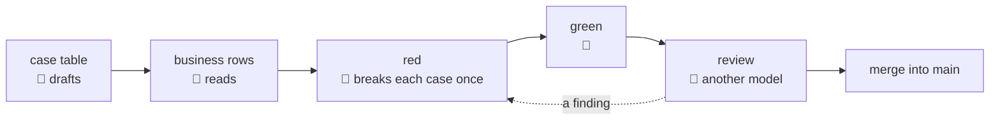

# QA

> **Decided** 2026-10-27, after reading the old app's QA process. Binds every feature's plan,
> every test and every merge into `main`.

**A behaviour counts as tested only when a test fails without it.** The human says what a
feature must do. The machine proves each behaviour is held, and a second model checks the proof.

## The flow of a feature

## The case table's shape

From an invented feature, before any code:

| # | 👤 | The case: one behaviour, one sentence | Held by |
| --- | --- | --- | --- |
| 1 | 👤 | A name already in the list is refused, and the list stays as it was | BFF route, `items.route.test.ts` |
| 2 | | A name is stored without the spaces around it | unit, `item-name.test.ts` |

👤 marks a business row. *Held by* names the layer and the file. The test's name is the sentence
itself (rule 4).

## The six rules

1. **A feature's plan carries a case table.** Each case is one behaviour in one sentence, beside
   the test that holds it. The table marks its business rows: what the feature must do for its
   user, and what it is missing, a behaviour a user will need that nobody has asked for yet. The
   human reads those rows before any code. Every other row is the machine's, as
   [collaboration](collaboration.md)'s hand-off 2 draws the line. *Rejected:* the human reading
   every row. Most rows are technical. Read without the code's facts, they come back as guesses,
   and the work waits on each one.
2. **A case is held only when breaking its rule turns its test red.** So each case is broken
   once before it passes. Either the test is written first and run red, or the rule's line is
   changed in the code, the test run red and the line put back. The red must come from the
   test's assertion on that rule. A red from a missing import, or a crash before the assertion,
   holds nothing. *Rejected:* line coverage as the measure. A line can run without anything
   checking its outcome: the old app sat at 100 % of lines beside 41 behaviours no test held.
   *Rejected:* a mutation tool. It adds a dependency and hundreds of mutants on labels and sizes
   to sort, when the question is behaviours.
3. **Each case is tested at the lowest layer that can hold it**: a unit test where its rule lives
   in one package; the BFF's route where it crosses to c-storage; the browser only where the
   browser meets the stack. The lower the test, the faster it runs and the closer its red sits to
   the line that broke. *Rejected:* a browser test per case. Each needs the whole stack up, and
   its red says that a page failed, not which line.
4. **The test names are the cases.** Once built, each test's name is its case's sentence. The
   table stays in the plan as it was at its commit and is not kept in step afterwards. A later
   case is a new test, named by its sentence. *Rejected:* a test-case file beside the tests. It
   says what the names already say, and goes stale at the first test nobody copies into it.
5. **A model other than the author's reviews the code before it merges into `main`.** It reads
   the code, its tests and the case table, so it can ask of each test whether breaking its case
   would turn it red. The author's model is the one named in the commits' `Co-Authored-By` line.
   *Rejected:* the author's model reviewing its own code. It shares the blind spots that wrote the
   code, and reads its own assumptions back as facts.
6. **A flaky red is a defect: never retried until green.** A rerun may reproduce it, but its
   green is never the verdict. The cause is found and fixed, in the test, the code or what runs
   them. A rerun gone green teaches a session to rerun past a real red. Several worktrees run at
   once here, so a loaded machine is the normal case, not an excuse. *Rejected:* a retry setting
   in the test runner, which greens the real red too. *Rejected:* a longer timeout, which hides
   the cause.
