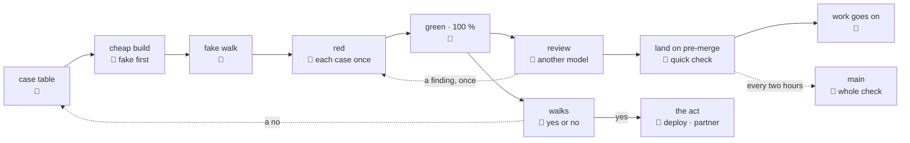

# QA

> **Decided** 2026-10-27, after reading the old app's QA process.
> **Last amended** 2026-11-11, from the human's proposal that the whole check stop gating each merge:
> a finished piece lands on `pre-merge`, the whole check runs there at most every two hours, and
> `main` holds only checked trees. This file holds the rules as they stand; their history is in
> `git log`.
> Binds every feature's plan, every test, every check run here and every landing on `pre-merge`.

## At a glance

**The human has up to five points in a feature, each a look:** its walk, a page or a diagram,
answered yes or no. **A look is not a gate**
([confirmation points](collaboration.md#confirmation-points)): the work goes on past it; a no
reopens the piece.

The eight rules, [below](#the-rules):

1. Each feature starts with a case table, one behaviour a line.
2. A test counts only if it fails when its behaviour breaks: each is seen red once; a route
   only a test calls is dead.
3. Each case is tested as near its code as it can be.
4. Each test is named after its case; no second list.
5. Another model reviews the code before it merges; one review, one fix pass; each finding
   fixed, rejected or deferred, with its reason.
6. A flaky red is a bug, never rerun; only the gate that can change a conclusion is run, and a
   package's gate is one command; the whole check runs on `pre-merge` at most every two hours.
7. The screens are the end-to-end check: each person's day on their device, yes or no a screen
   until its look changes; pixels counted raw.
8. Every line is tested, or says why not.

## The shapes, from an invented feature

The case table, before any code, the machine's alone; the test's name is the sentence.

| # | The case: one behaviour, one sentence | Held by |
| --- | --- | --- |
| 1 | A name already in the list is refused, and the list stays as it was | BFF route, `items.route.test.ts` |
| 2 | A name is stored without the spaces around it | unit, `item-name.test.ts` |

The map of walks. A dash is a part of the day not built yet.

| | set up | the daily work | the month's close |
| --- | --- | --- | --- |
| **manager**, PC | a walk | a walk | — |
| **staff**, phone | — | a walk | — |

## The rules

1. **A feature's plan carries a case table, and every row is the machine's.** Each case is one
   behaviour in one sentence, beside the test that holds it. The machine drafts and holds them all,
   among them those that say what the feature must do for its user, or what it lacks that a user
   will need. **The human's points are looks, up to five:** the walk of rule 7, a page or a
   diagram, each told in a few sentences the human can picture and answered yes or no at the step
   that needs it. A product choice with a stake (a client, money, data or production) is asked
   there as one recommendation, as [collaboration](collaboration.md)'s hand-off 2 draws the line;
   an ask the human makes on their own becomes a case. *Rejected:* the human reading the business
   rows before any code. Of the 85 the human read in the plans up to 2026-11-02, none came back
   corrected, while every real change came from the human's own asks. A kind of row that never
   comes back corrected is the machine's. *Rejected:* the human reading every row. Technical rows,
   read without the code's facts, come back as guesses. *Rejected:* two points at most, each in
   one line. The human's cost was never the count but a point too thin to picture: on 2026-11-02
   the human set five as still fine, and asked for each to be explained, not given in one line.
2. **A case is held only when breaking its rule turns its test red**, so each case is broken
   once before it passes: run red before its code exists, or with its rule's line changed and
   then put back. The red must come from the assertion on that rule; a missing import or an
   earlier crash holds nothing. This is not rule 8's gate: the table says which behaviours are
   held, coverage that no line is left undecided. *Rejected:* coverage as the measure of a case.
   A line can run with nothing checking its outcome: the old app sat at 100 % of lines beside 41
   behaviours no test held. *Rejected:* a mutation tool, hundreds of mutants to sort for a
   question about behaviours. A route only a test calls is dead: move the test onto the path the
   product uses, or retire it; a negative test must fail if the feature vanishes.
3. **Each case is tested at the lowest layer that can hold it**: a unit test where its rule lives
   in one package; the BFF's route where it crosses to c-storage; the browser only where the
   browser meets the stack. A lower test runs faster, and its red sits nearer the line that
   broke. *Rejected:* a browser test per case. Each needs the whole stack up, and its red names
   a page, not a line.
4. **The test names are the cases.** Once built, each test's name is its case's sentence; the
   plan's table stays as it was at its commit, never kept in step. *Rejected:* a test-case file
   beside the tests. It repeats the names, and goes stale at the first test nobody copies in.
5. **A model other than the author's reviews the code before it lands on `pre-merge`**, with its
   tests and the case table, asking of each test whether breaking its case would turn it red.
   The author's model is the one in the commits' `Co-Authored-By` line. *Rejected:* the
   author's model reviewing its own code. It shares the blind spots that wrote it. Each finding is
   listed in the recap and tagged `[FIXED]`, `[REJECTED]` or `[DEFERRED]`, with its reason; a
   deferred one names where it went.
   **One review, one fix pass, and that pass's own gate is the re-check.** The reviewer may be
   asked to reread the fixed lines; nothing else reads the piece again. What a second round would
   raise is deferred by the tagging above, never handed to a third reviewer — with one exception,
   deferred in no round: a finding whose text, acted on, would cost something that cannot be
   undone. A fix that meets the same red twice stops there
   ([pacing](collaboration.md#pacing-one-piece-at-a-time)'s budget), and the stop is reported as a
   diagnosis the human hears. *Rejected:* rounds until the reviewer has nothing left to say. A
   second reviewing model costs a whole read of the piece to confirm what the fix pass's own gate
   has already read back, and rounds with no cap have no end a session can name.
   A finding made without context that a memo or the plan
   already holds is rejected, naming that home. *Why:* treating every finding as a bug erodes
   trust in the memos, and treating none as one misses real defects.
6. **A flaky red is a defect: never retried until green.** A rerun may reproduce it, but its
   green is no verdict. A rerun gone green teaches a session to rerun past a real red, and with
   several worktrees running at once, load is the normal case. *Rejected:* a retry setting,
   which greens the real red too; a longer timeout, which hides the cause.

   **Run what can change a conclusion:** nothing for a read-only task; while iterating, whatever
   answers the session's question (a typecheck, one test), which is not the gate and is never
   reported as one; the gate, one command, before a stop or a commit: the touched package's at a
   commit, plus the citation test ([below](#the-whole-check-on-pre-merge)); the whole check on
   `pre-merge`, at most every two hours, never on each merge result. *Rejected:* the whole gate
   at every step or every merge. Several worktrees run at once, and a full run's minutes buy no
   verdict a smaller gate does not already give.

   **The gate is one command: `pnpm check` for all six TypeScript packages, on `pre-merge`,
   and `pnpm --filter @credo/<pkg> check` for one package.** The root's is `package.json`'s
   `scripts.check` (`bash ops/gate.sh`), each package's is its own `scripts.check`
   (`bash ../ops/gate.sh <pkg>`), and both run [`ops/gate.sh`](../../ops/gate.sh), which runs
   typecheck and test through `run_each` and eslint, prettier and knip through `run_step`, each
   whatever any other did, waits for the load and the gate lock, and writes one log ending
   `== exit <code>`. **A session reports the gate by running that command and citing its log; it
   builds no gate from steps.** A step the package lacks is named in the log's `== steps:` line as
   skipped, and a skip is not a pass, but the standing skip is not a red: `walk` has no `test`
   script, so every whole gate, green ones included, ends `0+1skipped` for tests. A new skip is
   the one to question. A `<pkg>` that does not exist aborts before three of the steps and writes
   no `== steps:` line, so a log without that line is itself the signal.
   *Why:* two sessions on 2026-11-07 each assembled a package gate by hand, one of the five steps
   missing from the second; the two lint errors it let through reached `main` and would have
   failed the deploy's own job whatever else was fixed. **What the command does not do:** it does
   not cover c-storage, whose gate is `make check` in `services/c-storage/`; a bare `walk/run.sh` takes no
   lock, so a gate started during one still reddens it; and `pnpm -r run check` exists and is the
   wrong command (six gates on one lock, with eslint, prettier and knip run six times). Its
   details are in `ops/README.md`'s "The gate". **A plan in `docs/plans/` written before
   2026-11-09 may spell a hand-assembled chain of the five steps: it was true when written and is
   a dated record, not a living document, so it is never read as the current way and never
   edited to match.** **A branch's green describes the branch, not the tree the
   deploy will check**, so the whole check belongs on `pre-merge`, where the pieces meet, and
   `main` is moved only to a tree it has checked
   ([below](#the-whole-check-on-pre-merge)); a piece takes `pre-merge` in before its own checks, as
   [pacing](collaboration.md#pacing-one-piece-at-a-time) says.
7. **The screens are the end-to-end check.** Each person's part of the business's day is walked
   screen by screen, on that person's device. The map places each walk: the day's stages
   across, its people down; an empty cell shows what is missing. A walk shows the main path and
   each kind of failure once; the variations stay in the machine's tests. Each screen has two
   readers. The machine compares its look with its committed base image, raw: a moved pixel is any
   pixel whose colour moved by any amount, a softened edge's included, and one is a red. The same
   input gives the same picture: a date, a name or anything random is fixed at its source (the data
   set, the fake, the stack's seed); a mask, a box of one colour, covers only what a unit test holds
   and the human need not judge, and names that test. The run script prints the raw count of moved
   pixels for every comparison it makes. *Rejected:* a tolerance, a threshold or a comparator that
   skips anti-aliased pixels: it hides a picture that is not steady, and the next real move of one
   shade inside it. *Rejected:* a mask over what moves, such as a card's frame: the human judges the
   frame. The human answers yes or no for the business, from the picture and one short question,
   one answer a screen; a yes holds until the screen's version moves. The version is computed
   from the screen's own markup, in both languages, and the style rules that match it; its one
   home is `versionOf` in `visual/src/capture.ts`. The answers are kept in the answerer's browser,
   under the name typed there, and reach the machine as the block the answerer copies into the
   chat. A "no" becomes a case in the table and reopens its piece; the walk holds neither the work
   nor the merge, and a point not yet answered stays open in the piece's record while the next
   work goes on ([confirmation points](collaboration.md#confirmation-points)). A feature is done
   for the business when none of its walks holds an open "no". *Rejected:* a gallery of every
   screen that asks nothing. It makes the human read,
   and finds nothing missing: a picture shows only what was built. *Rejected:* a base image per
   captured case, hundreds of them, rewritten by any layout change. *Rejected:* keying a yes to
   the screen's words, this rule before 2026-11-03. Its price: a screen whose look changed under
   the same words kept its yes, unseen, and each screen was asked once a language. It rested on
   an earlier rejection, keying a yes to the pixels, as a new value would re-ask an answered
   screen; that no longer holds: a date or a name is fixed at its source (above), and two builds
   of one commit give every screen the same version, as `visual/src/capture.test.ts` holds.
8. **Coverage is 100 %, and every line left out says why.** The gate is 100 % of statements,
   lines, functions and branches. A line the tests do not run is tested, or carries the coverage
   tool's ignore hint, its reason starting with one of three words: `unreachable`, no input in
   any environment runs it; `elsewhere`, another gated layer checks it, named; `untested`,
   reachable and nothing checks it: we choose not to cover it, and say why that is accepted.
   Under a v8-based runner: `/* v8 ignore next -- untested: a timeout, rethrown */`. The
   `untested` hints, found by one grep, are the risk list a review reads, not the percentage. A
   whole file another layer owns, such as an entry point, is excluded in the coverage config,
   its word and reason beside the exclude. *Rejected:* only tested or deleted, with no hint, the
   old app's later rule. Real defensive code then gets a test that exists only to cover it, or
   is deleted, and "we choose not to cover" has nowhere to be said. *Rejected:* a threshold
   below 100, where a new untested line gets in while the number holds.

## The whole check on `pre-merge`

Rule 6 says what a gate is; this says where each runs. **A finished piece merges into a branch
named `pre-merge`, never straight into `main`, and a piece's branch starts from `pre-merge`'s tip.**
*Why:* `main` lags `pre-merge`, so a piece started from `main` would miss the work landed since,
and a collision between two pieces' files (a page citing a file another piece moved) would meet
only on the shared branch; the one-second citation test shows it before the landing once the piece
has taken `pre-merge` in.

- **A piece's own check at each commit, its quick check, is the touched package's whole check
  (`pnpm --filter @credo/<pkg> check`) plus the citation test,
  `pnpm --filter @credo/scripts exec vitest run src/citations.test.ts`**, about one second, for
  every piece and not only for a page. *Why:* "its touched tests" alone lets format, lint,
  unused-code and coverage faults, and pages citing a file a code change moved, onto the branch
  everyone shares, where each holds back all work until the next run. A code piece that moves a
  file adds `scripts/src/counts.test.ts` to the same command (`vitest run src/citations.test.ts src/counts.test.ts`), whose rules name code files.
- **For a change to `.md` files only, the citation test is the whole check.** No formatter
  governs markdown here (`.prettierignore` excludes `*.md`), and no typecheck, lint or knip step
  reads a `.md` file; a "prettier exit 0" on a documents change read no file and is not reported
  as evidence. The citation test reads every living document's citations, and a conflict marker
  in `docs/open-items.md` or a link to a heading that moved is read by a person, not by a step.
- **The whole check (`pnpm check`) runs on `pre-merge` at most once every two hours, and only
  when `pre-merge` has moved past the last commit it checked.** The orchestrator starts it at its
  first stop after two hours have passed, and once more before the day's push. It reads
  `git rev-parse HEAD` in `pre-merge`'s worktree as it starts, since the gate's log does not name
  the commit it checked, and nothing lands on `pre-merge` while the check runs: the tree would
  change under it.
- **A green moves `main` to the commit that run checked, not to `pre-merge`'s tip:** from
  `main`'s worktree, `git merge --ff-only <that commit>`. So `main` holds only checked trees;
  pushes and deploys stay as they were, the human's.
- **A red names its step and is fixed forward on the piece's branch, which lands again, or the
  piece is taken out by a revert of its landing on `pre-merge`, never by rewriting `pre-merge`:**
  branches started from the tip hold its commits. Landing a reverted branch again is a no-op:
  after `git revert -m 1` of a landing, merging the same branch with nothing new on it says
  "Already up to date." and its work stays out; only reverting the revert brings it back. New
  work never waits on a red. A red made of this machine's stalls is read by
  [the load rules](#the-load-and-what-a-red-means-under-it), and a rerun is diagnosis, not a
  verdict.
- **A piece counts as merged when `main` holds it**, at the fast-forward, not at the landing.
- **Flips:** the orchestrator's start becomes a timer if work ever lands on `pre-merge` while no
  orchestrator session is running, or if its stops come more than two hours apart while the branch
  has moved; the piece's start moves back to `main` if pieces are taken out of `pre-merge` more
  than rarely; the check gets a second, detached checkout if landings waiting on a run pass ten
  minutes a day.

*Rejected:* the whole check at every merge result: a whole run per landing, for a collision the
one-second test shows first. *Rejected:* a scheduled job in the
human's terminal, which runs with the human's full rights outside the sandbox and takes the shared
lock unannounced.

## Running a check on this machine

A gate is a command and a log ([rule 6](#the-rules)), and both are shaped by the one machine every
session shares. **These rules belong to no single kind of work:** a build, a review, a diagnosis, a
one-off script and a log read are each held to them. *Why:* they were learned over seventeen runs of
one kind and then learned again, wrongly, by the others — two sessions on 2026-11-07 wrote a gate
log whose own exit marker could not be read, within an hour of each other, each having worked it out
alone.

### The load, and what a red means under it

- **Read the load right before a whole check and wait for it under 8; once the run starts, its own
  load tells nothing.** The test step drives the load past 8 alone: on a quiet Mac, 1.88 at the
  start, 8.07 a minute in, 35.42 in the middle, 12.53 near the end, from the vitest workers.
  A solo run reaches 35, so load during a run cannot tell a contended run from an uncontended one.
  Runs went red at load 10 to 45 on files the piece never touched, each one green on a rerun;
  the next rule's different-failing-set test is what decides, not the load.
- **A red made of timeouts in files the change cannot reach, with a different set of files failing
  each time, is this machine stalling, not a red.** One red met twice is the same files twice; the
  two are told apart only by whether the failing set changes, so the report says which it is.
  *Guard:* run those files alone, then rerun the whole check, and **name the first red in the
  evidence rather than hide it** — a green rerun does not unmake it, and [rule 6](#the-rules)
  refuses a rerun as a verdict.
- **Read each red's actual message before calling it load.** A five-second timeout and a failed
  assertion are different findings, and a go-ahead names the non-timeout case in advance.
- **A log ending `Failed` with no assertion line, or `exit 137` with no output, is a kill from
  outside, not a red:** read where the log stops before calling it one.
- **A chain of steps hides everything after the first failure, and `&&` never reaches knip**, so a
  chain's red has told less than it looks. The gate command does not chain: it runs every step
  whatever another did, and a red names its step with the others still shown. Where load is the
  cause, rerun the one command by package (`pnpm --filter @credo/<pkg> check`), not a hand-built
  chain.
- **`ui`'s tests have failed in whole checks in files the change did not touch**, and passed on a
  rerun at lower load (`docs/open-items.md`, item 56, which names `SignIns.test.tsx` and
  `MyDeliveries.test.tsx` and holds the later sightings; it records the cause as not known for
  `ui`, so load is a suspect there, not a finding). The one command passes no worker flag, so the
  old `--maxWorkers=4` is not available through it: a `ui` red is run alone and then
  the command rerun, per the failing-set test above, and the first red is named in the evidence,
  never tuned away.

### The gate lock

**One whole run at a time on this machine,** held by a lock directory at the credo root's
`.gate-lock` (`ops/full-run.sh`'s default), never held at a stop.

- **Take it in one loop that also waits for the load,** rather than a bare `mkdir` that fails and
  leaves the session deciding what to do next. That wait refuses an empty or non-numeric `uptime`
  reading and logs each wait, or the loop takes the lock above the ceiling.
- **Release it from a `trap` on EXIT, not as a last line, and delete the lock's `owner` file before
  `rmdir`.** A red exit skips a last line but not a trap, and a lock left held costs the next
  session its whole budget waiting on a run that is not there.
- **The report says whether the lock was free at the end.**

*Why:* two whole runs at once share the cores and the ports, so one's red can be the other's doing;
`mkdir` is atomic, and there is no `flock` here. *Rejected:* a bare `mkdir` with the decision left
to the caller, and a release on the script's last line.

### The log is the receipt

- **A log's name carries the date and time it was made, and the stamp is written by `date` inside
  the script that creates the log** — never typed, never remembered. `ops/lib.sh`'s `log_start`
  does it (`<date>-<time>-<script>-<env>.log` in the credo root's `logs/`); a log a session writes
  by hand follows `<YYYYMMDD-HHMM>-<stem>.log`, from `$(date +%Y%m%d-%H%M)` in that same script, in
  the same folder
  ([the loop](collaboration.md#the-loop)). Every log a report cites is then pasted from `ls`: five
  reports in five days sent a reader to a log that did not exist.
- **A `== exit` line is never written by hand, and it is never read through a pipe.** Put it in a
  small bash script that runs the check, saves `$?` into a variable, releases the lock, then appends
  `== exit $rc` itself (that is for a one-off script; a gate is the one command, which writes it). A step piped through `tail` reports the `tail`'s exit and loses its own; zsh
  leaves `PIPESTATUS` empty (it is `pipestatus`), which is how a hard-coded `== exit 0` once stood
  in for a status nobody had read; and unquoted, the line ends `== exit` with no code.
  **[`ops/lib.sh`](../../ops/lib.sh) prints it correctly — call that rather than hand-roll the
  line**, since every one of these faults was in a gate assembled by hand. *Why:* a receipt whose
  own marker cannot be read is the same class of fault as a check that cannot fail. Five runs in
  five days wrote one, the last two printing `== exit done`, which looks like a terminator and tells
  a reader nothing.
- **A rerun does not reuse its log's name.** Reruns that kept one stamped name overwrote the red
  runs, and that evidence no longer exists: stamp each run, or suffix the rerun.
- **A suite rerun after a fix is not one whole green run.** A one-file run's `== exit 1` may be the
  package-wide coverage threshold rather than a failing test: say which it is, since the exit line
  alone reads as a red.
- **Cite which log proved which part of the stop,** since a resumed session's report is read against
  the files on disk. A build handed for a look keeps its own log. A watcher armed with
  `ls -t | head -1` right after a launch picks the previous log, so name the new log's path.
- **A green measured before a later fix does not cover that fix.** Lint, prettier and knip only ever
  saw the sha they ran on, and knip is the one that objects to a newly exported symbol: re-run over
  the final tree, taken in with `pre-merge`, before calling it done ([rule 6](#the-rules)).

## Hazards no gate catches

Rule 8's hints carry two, the reasons the old app refused hints:

- **A hint's range wraps only what its reason names.** Code added inside a range, or after one
  never closed, hides while the gate stays at 100: the old app hid an access check that way,
  and 95 lines behind one unclosed range. *Guard:* a diff touching a hinted range is reviewed as
  new code, and rule 5's reviewer reads each new hint against its reason.
- **A hint over code that runs is a claim no gate checks.** *Guard:* in a scratch run, remove
  the hints, re-run coverage and read what ran inside each range. A body that ran is a hint to
  delete.
