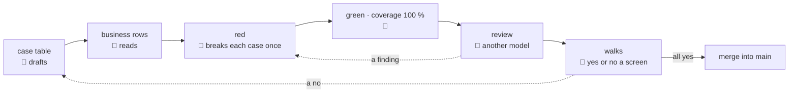

# QA

> **Decided** 2026-10-27, after reading the old app's QA process. **Amended** 2026-10-27 by the
> human: rules 7 and 8. **Amended** 2026-10-27 by the
> human: rules picked from the old repo's standing preferences. **Amended** 2026-10-27 by the
> human: the gate's scope and cadence, in rule 6. **Amended** 2026-10-28 by the human: a review's
> findings tagged, in rule 5. **Amended** 2026-10-31 by the human: rule 7, a moved pixel counted
> raw. Binds every feature's plan, every test and every merge into `main`.

## At a glance

**The human does two steps of each feature:** reads its business cases before any code, and
walks its screens, yes or no. The machine does the rest.

The eight rules, numbered as [below](#the-rules):

1. Each feature starts with a table of cases, one behaviour a line.
2. A test counts only if it fails when its behaviour breaks, so each is seen failing once; a
   route only a test calls is dead.
3. Each case is tested as close to its code as it can be.
4. Each test is named after its case; there is no second list.
5. A different AI model reviews the code before it merges; each finding is fixed, rejected or
   deferred, with its reason.
6. A test that fails only sometimes is a bug, never rerun until it passes; and only the gate that
   can change a conclusion is run.
7. The screens are the final check: each person's day, on their device, yes or no; the machine
   counts every moved pixel, raw.
8. Every line is tested, or says why not, as in "we choose not to test this".

## The shapes, from an invented feature

The case table, before any code. 👤 marks a business row; the test's name is the sentence.

| # | 👤 | The case: one behaviour, one sentence | Held by |
| --- | --- | --- | --- |
| 1 | 👤 | A name already in the list is refused, and the list stays as it was | BFF route, `items.route.test.ts` |
| 2 | | A name is stored without the spaces around it | unit, `item-name.test.ts` |

The map of walks. A dash is a part of the day not built yet.

| | set up | the daily work | the month's close |
| --- | --- | --- | --- |
| **manager**, PC | a walk | a walk | — |
| **staff**, phone | — | a walk | — |

## The rules

1. **A feature's plan carries a case table.** Each case is one behaviour in one sentence, beside
   the test that holds it. Its business rows say what the feature must do for its user, or what
   it is missing that a user will need; the human reads them before any code. Every other row
   is the machine's, as [collaboration](collaboration.md)'s hand-off 2 draws the line.
   *Rejected:* the human reading every row. Technical rows, read without the code's facts, come
   back as guesses.
2. **A case is held only when breaking its rule turns its test red**, so each case is broken
   once before it passes: run red before its code exists, or with its rule's line changed and
   then put back. The red must come from the assertion on that rule; a missing import or an
   earlier crash holds nothing. This is not rule 8's gate: the table says which behaviours are
   held, coverage that no line is left undecided. *Rejected:* coverage as the measure of a case.
   A line can run with nothing checking its outcome: the old app sat at 100 % of lines beside 41
   behaviours no test held. *Rejected:* a mutation tool, hundreds of mutants to sort for a
   question about behaviours. A route only a test calls is dead: move the test onto the path the
   product uses, or retire it; a negative test must fail if the feature vanishes.
3. **Each case is tested at the lowest layer that can hold it**: a unit test where its rule lives
   in one package; the BFF's route where it crosses to c-storage; the browser only where the
   browser meets the stack. A lower test runs faster, and its red sits nearer the line that
   broke. *Rejected:* a browser test per case. Each needs the whole stack up, and its red names
   a page, not a line.
4. **The test names are the cases.** Once built, each test's name is its case's sentence; the
   plan's table stays as it was at its commit, never kept in step. *Rejected:* a test-case file
   beside the tests. It repeats the names, and goes stale at the first test nobody copies in.
5. **A model other than the author's reviews the code before it merges into `main`**, with its
   tests and the case table, asking of each test whether breaking its case would turn it red.
   The author's model is the one in the commits' `Co-Authored-By` line. *Rejected:* the
   author's model reviewing its own code. It shares the blind spots that wrote it. Each finding is
   listed in the recap and tagged `[FIXED]`, `[REJECTED]` or `[DEFERRED]`, with its reason; a
   deferred one names where it went. A finding made without context that a memo or the plan
   already holds is rejected, naming that home. *Why:* treating every finding as a bug erodes
   trust in the memos, and treating none as one misses real defects.
6. **A flaky red is a defect: never retried until green.** A rerun may reproduce it, but its
   green is no verdict. A rerun gone green teaches a session to rerun past a real red, and with
   several worktrees running at once, load is the normal case. *Rejected:* a retry setting,
   which greens the real red too; a longer timeout, which hides the cause.

   **Run the gate that can change a conclusion:** nothing for a read-only task, typecheck and one
   test while iterating, the touched package's gate at a commit, the whole only before shipping.
   *Rejected:* the whole gate at every step. Several worktrees run at once, and a full run's
   minutes buy no verdict a smaller gate does not already give.
7. **The screens are the end-to-end check.** Each person's part of the business's day is walked
   screen by screen, on that person's device. The map places each walk: the day's stages
   across, its people down; an empty cell shows what is missing. A walk shows the main path and
   each kind of failure once; the variations stay in the machine's tests. Each screen has two
   readers. The machine compares its look with its committed base image, raw: a moved pixel is any
   pixel whose colour moved by any amount, a softened edge's included, and one is a red. The same
   input gives the same picture: a date, a name or anything random is fixed at its source (the data
   set, the fake, the stack's seed); a mask, a box of one colour, covers only what a unit test holds
   and the human need not judge, and names that test. The run script prints the raw count of moved
   pixels for every comparison it makes. *Rejected:* a tolerance, a threshold or a comparator that
   skips anti-aliased pixels: it hides a picture that is not steady, and the next real move of one
   shade inside it. *Rejected:* a mask over what moves, such as a card's frame: the human judges the
   frame. The human answers yes or no for the business, from the picture and one short question;
   a yes holds until the screen's words change. A "no" becomes a case in the table, and a
   feature is done when none of its walks holds an open "no". *Rejected:* a gallery of every
   screen that asks nothing. It makes the human read, and finds nothing missing: a picture shows
   only what was built. *Rejected:* a base image per captured case, hundreds of them, rewritten
   by any layout change. *Rejected:* keying a yes to the pixels. A new value would re-ask an
   answered screen; its words re-ask only on a changed label or rule.
8. **Coverage is 100 %, and every line left out says why.** The gate is 100 % of statements,
   lines, functions and branches. A line the tests do not run is tested, or carries the coverage
   tool's ignore hint, its reason starting with one of three words: `unreachable`, no input in
   any environment runs it; `elsewhere`, another gated layer checks it, named; `untested`,
   reachable and nothing checks it: we choose not to cover it, and say why that is accepted.
   Under a v8-based runner: `/* v8 ignore next -- untested: a timeout, rethrown */`. The
   `untested` hints, found by one grep, are the risk list a review reads, not the percentage. A
   whole file another layer owns, such as an entry point, is excluded in the coverage config,
   its word and reason beside the exclude. *Rejected:* only tested or deleted, with no hint, the
   old app's later rule. Real defensive code then gets a test that exists only to cover it, or
   is deleted, and "we choose not to cover" has nowhere to be said. *Rejected:* a threshold
   below 100, where a new untested line gets in while the number holds.

## Hazards no gate catches

Rule 8's hints carry two, the reasons the old app refused hints:

- **A hint's range wraps only what its reason names.** Code added inside a range, or after one
  never closed, hides while the gate stays at 100: the old app hid an access check that way,
  and 95 lines behind one unclosed range. *Guard:* a diff touching a hinted range is reviewed as
  new code, and rule 5's reviewer reads each new hint against its reason.
- **A hint over code that runs is a claim no gate checks.** *Guard:* in a scratch run, remove
  the hints, re-run coverage and read what ran inside each range. A body that ran is a hint to
  delete.
