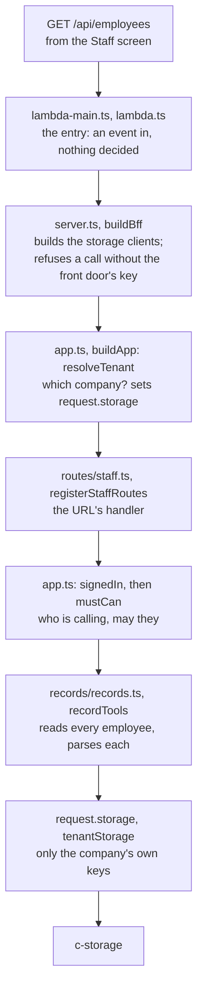

# bff code

> **Last amended** 2026-11-16, written from a person's note that the BFF's folders and files were hard to follow. What the BFF promises a caller is in [the behaviour memo](bff.md); this page is only where the code sits and the road one call takes through it.

## At a glance

**One call goes down one road, and each file on it does one job: the entry hands the call to the app, the app finds the company and the person, a route file holds the URL and its permission, a records file reads or writes, and c-storage answers.** The call below is the office's staff list, a person opening the Staff screen.

Drawn from [`server.ts`](../../bff/src/server.ts), [`app.ts`](../../bff/src/app.ts), [`staff.ts`](../../bff/src/routes/staff.ts) and [`records.ts`](../../bff/src/records/records.ts). A running process starts at `bff/src/main.ts` instead of the Lambda entry; both then call `buildBff`.

| Where | What lives there | Biggest example |
| --- | --- | --- |
| `bff/src/routes/` (9 files) | A URL, its schema and who may call it. Most files are one kind of record's routes; four are the operator's (sign-in, team, root password, deleting a client) | `bff/src/routes/staff.ts`'s `registerStaffRoutes` |
| `bff/src/records/` (6 files) | Reads and writes of records, never a URL; the guard that keeps a call to its own company's keys | `bff/src/records/records.ts`'s `tenantStorage` |
| `bff/src/calling/` (4 files) | How a caller proves who they are: session, challenge, password, constant-time compare | `bff/src/calling/sessions.ts`'s `createSessions` |
| `bff/src/app.ts` | The app: the company, the person and the permission checks, and the routes that belong to no one kind (sign-in, config, "me", the operator's lists) | `buildApp` |
| `bff/src/server.ts`, `main.ts`, `lambda.ts`, `lambda-main.ts` | How the app is run: from a storage setting to an app (`buildBff`), then a listener or a Lambda handler | `bff/src/server.ts`'s `startBff` |
| `bff/src/bundle.ts`, `bundle-main.ts`, `build.ts` | How it is shipped: one file for Lambda, stamped with its commit | `bff/src/bundle.ts`'s `bundleBff` |
| `bff/src/env.ts`, `errors.ts`, `audit.ts`, `photo-store.ts` | One concern each: the settings read at start, the answer a caller gets for a fault, the audit entry a change declares, the signed photo address | `bff/src/errors.ts`'s `replyFor` |
| `bff/tests/` | Helpers the tests share: a c-storage to start, a signed-in person; also checks over the whole app | `bff/tests/c-storage.ts`'s `startCStorage` |

A test sits beside what it tests, so `routes/` holds 18 test files beside its 9, and the top level holds the tests of the routes `app.ts` declares itself.

## Where a call goes, in order

1. **The entry** (`bff/src/lambda-main.ts`, or `bff/src/main.ts` for a plain process) only binds the environment. Nothing is decided there.
2. **`bff/src/server.ts`'s `buildBff`** makes the storage clients, then the app, and last adds the first hook: a call without the front door's key is a 403 before any company is looked up.
3. **`bff/src/app.ts`'s `buildApp`** is one long function that sets up every check and then registers every route. The company is found by `resolveTenant` (it runs for a route that says `...forClient`), and that authenticates nobody. The person is found by `signedIn`, and `mustCan` or `mustBeRoot` answers whether they may.
4. **A route file** is handed those three as `deps` and calls them in that order inside each handler.
5. **A records file or `recordTools`** does the reading and writing through `request.storage`, the company's own client. A key outside the company is refused there, before anything is sent.
6. **`bff/src/errors.ts`'s `replyFor`** turns any fault along the road into the answer the caller sees; a route throws `HttpError` and writes no reply itself.

## Where a new route goes

Copy `bff/src/routes/staff.ts`'s `registerStaffRoutes`, for a kind of record that has none yet.

1. The URL goes in `shared/src/wire.ts`'s `ROUTES`, never typed here ([the package's rules](../../bff/CLAUDE.md)).
2. A new file `bff/src/routes/<kind>.ts` with one `register<Kind>Routes(app, deps)`. A new route is not added to `staff.ts` or `orders.ts`.
3. The reads and writes of the kind go in `bff/src/records/<kind>-records.ts`, one function a read.
4. Register it from `buildApp`, beside `registerStaffRoutes`, with the same `deps`.
5. A route that changes something carries an `audit` name in its config and calls `declare`, or says why not with `exempt`; `bff/tests/route-list.test.ts` fails otherwise.
6. Its test sits beside it; copy `bff/src/routes/employees.route.test.ts`.

An operator's route takes no company: it is registered without `forClient` and checks `operatorSignedIn`, which `registerOperatorAuth` hands back.

## What looks wrong but is not

- **Operator files in `routes/`.** Most files are one kind of record's routes, but the operator's four (`operator-auth.ts`, `operator-team.ts`, `root-password.ts`, `clients-delete.ts`) sit there too, because they register URLs.
- **Routes in `app.ts`.** Sign-in, config, "me" and the operator's lists are declared inside `buildApp` because they use its inner functions (`signedIn`, `viewOf`, `endKept`); a route file is handed only `signedIn`, `mustBeRoot` and `mustCan`.
- **No `index.ts`, no `middleware/` or `config/` folder.** Each was measured and held one file or two ([the package's directories](../../bff/CLAUDE.md)).
- **Tiny entry files outside the coverage count.** `main.ts`, `lambda-main.ts` and `bundle-main.ts` hold wiring only; their logic is tested through `server.ts`, `lambda.ts` and `bundle.ts`.
- **The front door's key is checked in `server.ts`, not `app.ts`.** A test that builds the app alone is never refused for the key.
- **The staff list's handler calls no function of `bff/src/records/staff-records.ts`.** The list is read through `recordTools`; the file's functions serve the sign-in and the person's own record, and `signedIn` calls one of them.

## What this page did not read

Read whole: `bff/CLAUDE.md`, `bff/src/server.ts`, `main.ts`, `lambda.ts`, `lambda-main.ts`, `bundle.ts`, `build.ts` and `bff/src/records/records.ts`. Read in part: `bff/src/app.ts` (the company, session, permission code, the inline route list and the registrations), `bff/src/routes/staff.ts` (its first handlers). Counted by listing the folders at write time: the file counts, so a file added later is not in them. Not read: `bff/src/routes/` other than `staff.ts`, `bff/src/records/` other than `records.ts`, `audit.ts`, `photo-store.ts`, `env.ts` beyond their exports, and the tests. A tour of the inside of `app.ts` is a later section, written only when asked.
