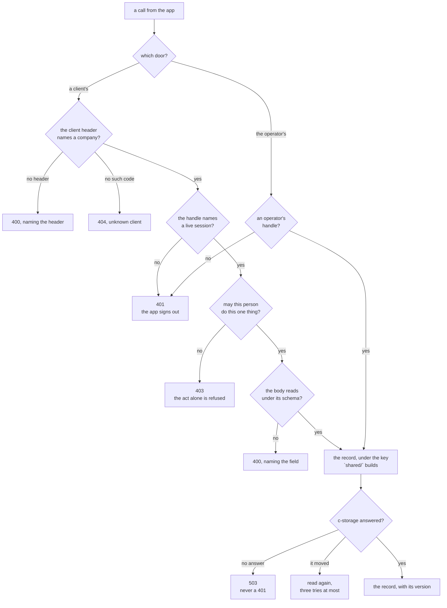

# bff

> **Decided** 2026-11-10: the promises the BFF makes to whoever calls it, gathered into one memo
> because they were spread over the detail page and the code. Each section below is one claim a
> caller can be surprised by, read from the code rather than from the design. The back-end claims
> that stood under `architecture-detail.md`'s *Who may do what* and *The data* were **moved** here,
> not copied.

## At a glance

**The BFF is the one part that decides anything, and it decides in a fixed order: which company,
then who is calling, then whether they may, then the record.** A call that fails at one step never
reaches the next, so the status it gets back says how far it travelled.

Drawn from [`app.ts`](../../bff/src/app.ts), [`errors.ts`](../../bff/src/errors.ts),
[`sessions.ts`](../../bff/src/calling/sessions.ts) and
[`c-storage.ts`](../../shared/src/c-storage.ts).

| It promises | Protects against | Why |
| --- | --- | --- |
| The company is read first, and reading it authenticates nobody | a caller taking a resolved company for a signed-in person | [the company](#the-company-is-resolved-first-and-that-authenticates-nobody) |
| A session lasts a week; an operator's ends an hour unused, twelve from issue | a console left open all day | [the session](#a-session-lasts-a-week-and-an-operators-an-hour-unused) |
| A 401 means the session is over; a 403 means only this act is refused | an outage signing everyone out | [401 against 403](#a-401-ends-the-session-a-403-ends-only-the-act) |
| Permissions are resolved on **every** call, in three layers | a right taken away still working | [the layers](#the-permission-layers-are-read-on-every-call) |
| A refusal carries a status, a short message, and nothing of its cause | a caller learning why from an error body | [the wire](#a-refusal-says-its-status-and-nothing-of-its-cause) |
| A c-storage that cannot answer is 503, never 401 | an outage read as a lapsed session | [503](#a-c-storage-that-cannot-answer-is-a-503-never-a-401) |
| One call to storage waits five seconds and is sent once | a request hanging on a silent store | [five seconds](#one-call-to-storage-waits-five-seconds-and-is-sent-once) |
| A write over a record that moved is tried three times, then 503 | a save lost to another writer | [three tries](#a-write-over-a-moved-record-is-tried-three-times) |
| A record already holding what was asked counts as our own write | a conflict reported for a write that landed | [the identity compare](#a-record-that-already-holds-what-was-asked-counts-as-our-own-write) |
| Every client's records sit under a prefix this package builds | nothing. The store does not enforce it | [the prefix](#the-tenant-prefix-is-this-packages-alone-and-the-store-does-not-enforce-it) |

**No test catches** a key built outside `shared/`, nor the two cases below that depend on a record's
shape rather than on a branch: the identity compare once a record gains a second mutable field, and
a write path copied without its re-read
([the identity compare](#a-record-that-already-holds-what-was-asked-counts-as-our-own-write),
[each write path](#each-write-path-recovers-in-its-own-way-and-there-is-no-shared-helper)).
**And no record says who changed it** ([the actor](#no-record-says-who-changed-it)).

## The company is resolved first, and that authenticates nobody

`bff/src/app.ts`'s `resolveTenant` runs as an `onRequest` hook on every client-facing route, before
the body is read and before any session: it reads the client's code from the header
`shared/src/wire.ts`'s `CLIENT_HEADER` names (`x-client-code`), reads the one index record that maps
that code to the company's minted id, and puts the id on the request. A header that is missing or
malformed is a **400** naming the header; a code no index record matches is a **404**, `Unknown
client`. Nothing about the caller has been established at that point.

- *The surprise for a caller:* a 404 here is about the **address**, not about the record asked for.
  The UI reads a 404 during its boot as "we do not know this address" and shows an unknown-company
  screen ([the UI's memo](ui.md)), so a 404 from any call made while booting reads that way.
- *Rejected:* resolving the company inside each route. It is the one step every client route needs
  first, and a route that forgot it would read another company's records under a key built from an
  empty id. *Price of the choice:* the hook has no way to say "this route needs no company", so the
  operator's routes are registered outside it entirely
  ([the operator's door](#the-operators-door-resolves-no-company-and-reads-no-permission)).
- *Hazard no gate catches:* `resolveTenant` covers the routes registered with the shared
  `forClient` option. The operator's routes that act on one client resolve a code to an id
  themselves (`bff/src/routes/root-password.ts`, `bff/src/records/clients.ts`), so "one home" holds
  for the key *layout* and not for resolving a company. *Trigger:* each operator route that names a
  client.

## A session lasts a week, and an operator's an hour unused

A handle is `<session id>.<secret>`, minted by `bff/src/calling/sessions.ts`'s `createSessions`: the
id locates the record and the 32 random bytes of the secret are the proof, of which only a SHA-256
is stored. Beside it sit the device the handle was issued to and the sign-in record's `generation`
at issue, so giving a person a password ends every session issued before it. A client's session
lasts **seven days** and is renewed on use only in its **last three** — the four-day gap is what
keeps every request from writing. An operator's session, under that file's `OPERATOR_SESSION`, ends
**an hour** after its last use, renews at most once in **five minutes**, and never runs past
**twelve hours** from issue.

- *Rejected:* renewing on every use. At the full lifetime every request would write a record, and
  every write queues behind the one before it in c-storage.
- *Price of the choice:* a client's handle that was used six days ago is still valid and will be
  renewed; there is no "signed in elsewhere" list and no way to end one person's other sessions
  short of giving them a password, which ends all of them.
- *Hazard for a caller:* the expiry is the store's, not the app's. Nothing in the UI holds a clock
  ([the UI's memo](ui.md#the-handle-lives-in-the-browsers-localstorage-with-no-clock-of-its-own)),
  so a device learns its session has lapsed only from the 401 on its next call.
- *Hazard no gate catches:* a session record that no longer parses stops resolving and is left
  where it is. Nothing sweeps expired sessions, so a company's session records grow with every
  sign-in. *Trigger:* the first prefix read that meets c-storage's thousand-record bound.

## A 401 ends the session; a 403 ends only the act

`bff/src/app.ts`'s `signedIn` throws **401** for a handle that names no live session, a sign-in
record that is gone, one whose generation has moved since the session was issued, or a person who
has left or been archived. its `mustCan` and `mustBeRoot` throw **403** when the person is there and
may not do this one thing. The two mean different things to the app: a 401 signs the device out, a
403 does not.

- *The surprise for a caller:* **two routes answer 403 for something other than a permission.**
  Changing one's own password answers 403 when the *current* password is wrong, and the operator's
  new-passkey link answers 403 for oneself. A caller that treats every 403 as "you may not" will
  tell the person the wrong thing, which is why the UI keeps one predicate for the permission
  reading and those two call sites do not use it (`ui/src/page.ts`'s `isForbidden`).
- *Rejected:* one status for every refusal. The app must tell "sign in again" from "ask the person
  who runs the staff list", and only the status carries that.
- *Price of the choice:* a sign-in answers one 401 for an unknown name, a wrong password and a
  person who has left alike — which part was wrong is never said. The same holds for every refusal
  of a QR code: a wrong secret, one already spent, one past its time, a company with QR sign-in
  off, and a person who left are one answer.
- *Hazard no gate catches:* nothing forces a new route to ask `mustCan` before it reads the body.
  The order is the pattern of every route written so far, not a structural property, and a route
  that parses first leaks which fields a record has to someone who may not read it. *Trigger:* each
  new route.

## The permission layers are read on every call

Eight named permissions are catalogued once, in `shared/src/permissions.ts`'s `PERMISSIONS`. A
person's set is resolved by `shared/src/permissions.ts`'s `resolvePermissions` from three **sparse**
layers in a fixed order — the department's, then the position's, then the person's own — each
winning where it names a permission and the base allowing nothing (the order itself is
`shared/src/permissions.ts`'s `layersOf`). The root holds no layer and may do everything. The layers
are read inside `bff/src/app.ts`'s `viewOf` on **every** call, so a change the root makes holds at
the person's next step without anyone signing out.

- *Price of the choice:* a staff call reads five records. The person's record and the staff setup
  are read once and handed on so a route does not read them again, which is why that number is five
  and not more.
- *Rejected:* a resolved set stored on the session. It would be a second copy of the answer, stale
  from the moment the root edits a position.
- - *Hazard for a caller:* a set that cannot be read is a **503**, never a partial set —
  `bff/src/records/staff-records.ts`'s `readSetup` throws and the error handler maps it. A caller
  must not read 503 as "no permissions".
- *Hazard no gate catches:* a unit that is not in the setup, or has been removed from it,
  contributes an empty layer rather than failing. So a person whose department was deleted keeps
  exactly their own layer, silently. *Trigger:* the first report of a person losing rights after a
  setup edit.

## A refusal says its status and nothing of its cause

Every refusal goes through one error handler, `bff/src/errors.ts`'s `replyFor`. The body is `{
error: <a short message> }`, with named extras only where the caller needs them: a 400 carries
`details` naming the field or header that failed, and a 409 carries `current`, the record as it now
stands. Nothing of an exception's own text, stack or cause reaches the caller; a 500 is logged with
its error and answers `Internal error`.

- *Rejected:* a route writing its own error reply. One home means one shape, and
  `docs/conventions/code.md`'s C7 counts the breaches: two of 58 route registrations still write
  one, which `pnpm counts` prints.
- *Price of the choice:* a caller cannot tell two 500s apart, and a 400's `details` is the only
  machine-readable part of any refusal.
- *Hazard for a caller:* a **409 is not an error** in this repository's own client. The UI turns it
  into a result a screen shows — a conflict, a taken code, a day that moved — so a caller that
  treats "the call threw" as the only failure will miss every conflict
  ([the UI's memo](ui.md)).

## A c-storage that cannot answer is a 503, never a 401

The rule, in `bff/src/errors.ts`'s `replyFor`'s own words: *only a 401 signs the UI out, so an
outage must never read as one.* Any `shared/src/c-storage.ts`'s `CStorageError` other than a 400
becomes **503**, `Service unavailable`. A c-storage **400** is treated as this package's own bug — a
request it should have refused or formed better — so it becomes a **500** and is logged. A
framework-raised 4xx answers that status with `Bad request` and nothing of its cause, and anything
else is 500.

- *Held by:* `bff/src/errors.test.ts`, whose four cases are the status a route chose, 503 for a
  c-storage that did not answer or refused, 500 for a c-storage 400, and the framework's own.
- *The surprise for a caller:* a record that does not **parse** is not a 503. It is a 500 naming
  the record's kind and never its key, which may be a sign-in name and would land in a log.
- *One route degrades instead of failing.* The root's import reads each row's own result: a row the
  store could not answer for is `busy`, to be sent again, and the call goes on with the rows before
  it already written (`bff/src/routes/lists.ts`'s `registerListRoutes`). Every other route fails
  the whole call.

## One call to storage waits five seconds and is sent once

`shared/src/c-storage.ts`'s `createCStorageClient` bounds every call with `AbortSignal.timeout`, at
that file's `DEFAULT_TIMEOUT_MS`'s **5,000 ms** unless the caller names its own; the services status
reads `/health` under its `HEALTH_TIMEOUT_MS`'s **3,000 ms**, which is the one route that sends no
key. A call that times out, is refused or returns an answer in no known shape throws a
`CStorageError` whose status is `null`, and **nothing re-sends it**.

- *The surprise, and it is the one worth reading this section for:* **the retry bound and the
  timeout are unrelated.** `ATTEMPTS` is not a transport retry: a store that does not answer is
  given exactly one chance per call.
- *Price of the choice:* a Lambda call that meets a slow store waits five seconds per record read,
  and a staff call reads five records, so a slow store is felt as a 25-second worst case rather
  than as a failure.
- *Hazard no gate catches:* a write whose **answer** was lost is indistinguishable from a write
  that never landed. Only a route that re-reads can tell, and that is per route
  ([the identity compare](#a-record-that-already-holds-what-was-asked-counts-as-our-own-write)).

## A write over a moved record is tried three times

`shared/src/c-storage.ts`'s `ATTEMPTS` is **3**: the one bound every retry loop in
this package reads. The loop is always the same shape — read the record for its tag, write over
that version, and on `moved` read again — and after three tries the save fails, as a **503**. There
are **nineteen** such loops across six files, counted by `attempt < ATTEMPTS`: six in
`bff/src/routes/staff.ts`, four in `bff/src/records/operators.ts`, three each in
`bff/src/routes/orders.ts` and `bff/src/routes/operator-auth.ts`, two in
`bff/src/calling/sessions.ts` and one in `bff/src/records/staff-records.ts`.

- *Rejected:* a bound per call site. `pnpm counts` tracks exactly this as a counted decision, so a
  local `const ATTEMPTS` in any of the named files is reported.
- *Price of the choice:* three is enough for two writers and not for a burst. A numbered staff code
  under contention fails 503 rather than waiting, because the number must be raised in its own
  record before it is claimed: a number lost to a refused claim is never given again, so the codes
  have gaps.
- *Hazard for a caller:* a 503 from a write means "try again", not "the store is down". The two are
  the same status.

## A record that already holds what was asked counts as our own write

The fullest recovery is the customer and product save in `bff/src/routes/lists.ts`: read the record
for its version, write over it, and on either a lost answer or a `moved` outcome **re-read once** —
a record that already holds exactly what was asked is our own write having landed, and counts as
saved; anything else is a genuine conflict, answered **409** with the record as it now stands. The
version is never skipped, which is this repository's standing rule: recover, never bypass, a
concurrency token.

- *The condition the whole compare rests on, and it is written in the code beside it:* it holds only
  while a record has no mutable field other than the ones being written. The saved value spreads
  the record read now — perhaps after another writer — and overwrites every other field with the
  body's, so only the id and the code come from the read. **The day a `changeCode`, an `archived`
  flag or an order's status joins a record saved this way, another writer's record could pass as our
  own save.** Read that comment before copying the pattern.
- *Hazard no gate catches:* this is a property of a record's shape, not of a branch. Every branch of
  the compare is covered at 100 %, and adding a field to the record breaks the claim without
  touching a line of this route. *Trigger:* each field added to a record saved this way.

## Each write path recovers in its own way, and there is no shared helper

Four writers, four behaviours, all of them keeping the token: the list save re-reads once and
answers 409 with the record as it is; `bff/src/routes/reconciliations.ts` claims the key with
`If-None-Match` and, if the write throws, re-reads to tell its own landed write from another close
already there; the staff setup's save answers 409 at once on a `moved`; and the staff numbering
retries `ATTEMPTS` times and fails 503. **Read the route you are changing rather than assume the
list save's shape.**

- *Rejected:* one shared recovery helper. The four differ in what a conflict *means* to the person
  looking at the screen, not in mechanism, and a helper would have to take the meaning as a
  parameter.
- *Hazard no gate catches:* a fifth write path written without any recovery passes every test, since
  a `moved` outcome needs two writers to produce. *Trigger:* each new write path.

## The tenant prefix is this package's alone, and the store does not enforce it

A company is a tenant. Its records sit under its minted id and its human-readable code reaches that
id through one index record; the layout has one home, `shared/src/records.ts`'s `recordKeys`, so no
other file builds a key. **c-storage has no concept of a tenant at all** — its one isolation unit is
the *service*, and this BFF is a single service holding every company. Tenant separation is a
string prefix built here, and c-storage would serve one company's key to another company's request
if this package built the wrong key.

- *This is the design, not a slip,* and it is the absence worth the most in the whole repository
  ([what is never there](../architecture.md#what-is-never-there)).
- *What stops a breach:* isolation is tested at the route level — a call is served for the company
  its code names and no other (`bff/src/tenants.route.test.ts`, and "reaches one client only" in
  `bff/src/routes/clients-delete.route.test.ts` and
  `bff/src/routes/operator-root-password.route.test.ts`). What is narrower than it looks is the
  *structural* guard: **no lint rule and no test forces every key through `recordKeys`.** No
  hand-built key exists outside that file today.
- *Price of the choice:* one SQLite file holds every company's records, so one company's write rate
  is every company's ceiling ([c-storage's memo](c-storage.md#one-writer-at-a-time)).

## No record says who changed it

The identity is resolved and then consumed: `signedIn` returns who is calling and `mustCan` asks
one boolean of it, and neither binds it to the request. There is no `request.user` anywhere in
`bff/src`. So **nothing this package writes carries an actor** — not the customer and product
records, which are the highest-value history there is.

- *This is a gap and not a property.* It is the first thing the activity log has to fix
  ([the activity log](../activity-log.md)), and half of it is in no open item: that no record knows
  what it held before was never written down anywhere until the architecture pages said it.
- *Price of the choice:* a record restored from a backup cannot be told from one a person saved, and
  a wrong value in a record has no history to read it out of.

## The operator's door resolves no company and reads no permission

The operator's routes are registered **outside** `forClient`: they resolve no company, and the
operator's own records sit under their own keys rather than under any tenant's.
`bff/src/routes/operator-auth.ts`'s `operatorSignedIn` is the only check, and there is **no
permission model on that side at all** — whoever holds an operator handle may do everything the
console offers. Sensitive acts ask for a fresh passkey touch rather than trusting the session, which
is the one gradation there is.

- *Held by:* `bff/src/operator.route.test.ts` and `bff/src/routes/operator-team.route.test.ts`.
- *Rejected:* permissions for operators. There are a handful of them and they are the people who run
  credo; a catalogue for them would be a second permission system with no second set of roles to
  justify it. *Trigger to revisit:* the first operator who should not be able to delete a client.
- *Hazard for a caller:* the services status is the one route that answers from c-storage's
  `/health` rather than from a record, under a three-second bound, with `cache-control: no-store`.
  A 503 from it is the store, not the console.

## Where the rest is

- What belongs in this package and the file to copy: [`bff/CLAUDE.md`](../../bff/CLAUDE.md).
- - What the package is **for**, in one paragraph:
  [`architecture.md`](../architecture.md#what-each-part-is-for).
- The other half of the same wire: [the UI's memo](ui.md).
- The store's own promises: [c-storage's memo](c-storage.md).

## What this memo did not read

Every claim above was read from the file named beside it. Read whole for this memo:
`bff/src/app.ts`, `bff/src/errors.ts`, `bff/src/env.ts`, `bff/src/server.ts`,
`bff/src/calling/sessions.ts`, `shared/src/c-storage.ts`, `shared/src/permissions.ts`, and
`shared/src/records.ts`'s key layout. Read only at their write paths:
`bff/src/routes/lists.ts`, `bff/src/routes/staff.ts`. **Not opened:**
`bff/src/routes/orders.ts`, `operator-auth.ts`, `reconciliations.ts`, `clients-delete.ts`,
`operator-team.ts`, `root-password.ts` and every `records/` module — what this memo says about them
comes from `git grep` for `ATTEMPTS` and from the detail page it moved these claims out of, so the
nineteen retry loops are counted and their routes are not described. **No test file was read**: the
tests named are named by their path, and `bff/src/errors.test.ts`'s four cases were read from its
`it(` lines alone.
