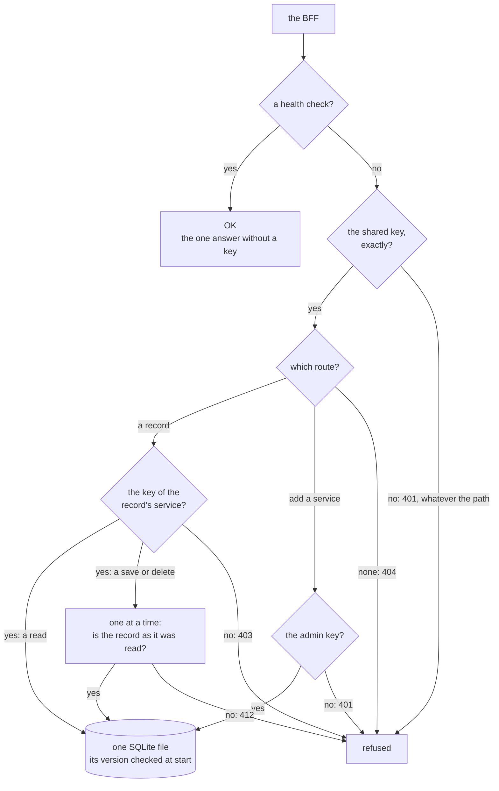

# c-storage

> **Decided** 2026-10-27: the machine's decisions on the service as built, written at the human's
> request for one memo for it, so each section below holds one decision or one hazard in place of
> a memo each. Arguments kept from the old service's memos where they still hold.

## At a glance

**c-storage keeps one client's records in one SQLite file, and answers only the BFF, the app's
back end.** Every request passes these checks:

Drawn from [`server.go`](../../c-storage/internal/server/server.go),
[`auth.go`](../../c-storage/internal/auth/auth.go),
[`store.go`](../../c-storage/internal/store/store.go) and
[`open.go`](../../c-storage/internal/sqlitedb/open.go).

| It promises | Protects against | Why |
| --- | --- | --- |
| Every path but the health check needs the shared key | a stranger learning which paths exist | [the gate](#the-internal-key-gates-every-path) |
| No record is public | the shared key alone reading a record | [public](#no-record-is-public) |
| Keys match exactly; a service's key is stored only as a hash | a nearly right key; a copied file giving a key away | [keys](#keys-are-compared-exactly-and-stored-hashed) |
| A save over a record changed since it was read is refused, 412 | one person's save erasing another's | [412](#a-write-on-a-moved-record-is-refused) |
| One save at a time | two saves at once losing one | [one writer](#one-writer-at-a-time) |
| The file's version is checked at start | running on a file it cannot read | [the schema](#the-schema-version-is-checked-at-open) |
| It listens on its own machine only, for now | other machines reaching it; the first server needs this changed | [loopback](#loopback-only-for-now) |

**No test catches** a save that does not name what it read, which still overwrites, or a backup
copied mid-write ([412](#a-write-on-a-moved-record-is-refused),
[the only copy](#the-file-is-the-only-copy)).

## The internal key gates every path

`x-internal-access-key` wraps the whole mux, its 404 fallback included, and only `GET /health`
answers before it. Without the key a real path and an unknown one answer alike, 401, and no path
ever answers 405 (`TestUnknownPathsRevealNothingWithoutTheInternalKey`,
`TestThisServiceNeverAnswers405`).

- *Rejected:* a key check on each route, with net/http's own 404 and 405 around them. An unknown
  path then answers 404 beside a real one's 401, and a wrong verb 405: a caller with no key maps
  the surface. *Price of the choice:* a wrong verb on a real route reads as 404 even with every
  key, so a caller's mistaken method looks like a missing route.
- *Rejected:* one internal key per caller. Every caller is ours and runs in the client's own stack
  (the BFF, and on the local stack the demo generator), and a key per caller adds a table and a
  rotation for no boundary each service's access key does not already draw. *Trigger to revisit:*
  a caller that must be cut off without rotating the others' key.
- *Hazard no gate catches:* a route put on the mux directly, not through `s.handle`, is missing
  from the list `TestEveryRegisteredRouteIsListed` reads, so every gate test that walks
  `everyRoute` passes without it. It still sits behind the internal key, but nothing checks which
  key it needs past that. *Trigger:* each new route.

## No record is public

Every record route needs `x-access-key`, the key of the service named in its path. A missing key,
a wrong one and an unknown service answer alike, 403, so the gate never says which services exist
(`TestEveryRecordRouteRefusesAMissingOrWrongAccessKeyOrAnUnknownService`).

- *Rejected:* a record readable with the internal key alone. That key is the stack's, held by
  every caller, so a public record is open to all of them and to anyone who learns that one key. A
  public read is a new decision with its own route, never a flag on a record.
- *Price of the choice:* a BFF configured with the wrong service code gets the same 403 as one
  with the wrong key; the answer does not say which to fix.

## Keys are compared exactly and stored hashed

Every key is compared whole, in constant time (`TestRequireAcceptsOnlyTheExactKey`). A service's
access key is stored as its SHA-256 (`TestAccessKeysAreStoredHashed`), so a copy of the file, a
backup included, holds no service key. The internal and super-admin keys are not in the file at all: they sit in the process's environment.

- *Rejected:* comparing a short digest of the key. A digest one byte wide lets one random key in
  256 through, and the internal key is the only gate before every route. The exact compare costs
  nothing: every caller holds the whole key.
- *Rejected:* a slow password hash, such as the scrypt the app frame gives passwords. Every record
  request checks its service's key, so a slow hash would spend the small box's CPU and memory on
  the gate, request after request. A slow hash only slows guessing, and guessing a long random key
  fails at any speed. *Price of the choice:* that holds only while each access key is long and
  random. Registering takes any non-empty key, so no gate refuses a short one, which a copy of the
  file would then give up to guessing. *Trigger to revisit:* the first access key a person
  chooses.
- *Hazard no gate catches:* a lost access key cannot be read back, and nothing changes or removes
  a service. Registering a code a second time answers 409 and keeps the first key
  (`TestRegisteringACodeTwiceIsAConflict`), so a lost key strands its records: the way out is a new
  service code, with the records carried over from the file by hand. A caller that reads the 409
  as "registered" learns that the code exists, not that its key is the one stored; a mismatch
  first shows as every record call answering 403. *Trigger to revisit:* the first lost or leaked
  key, when a route that replaces a key becomes a decision of its own, behind the admin key.

## A write on a moved record is refused

A record's tag is the SHA-256 of its stored text, and a read returns it. A push or a remove may
name it in `If-Match`, or name no record with `If-None-Match: *`; where the record is not as
named, the write answers 412 and changes nothing, checked inside the write's own transaction
(`TestAWriteNamingAMovedRecordIsRefused`). A precondition the service cannot read, or one sent to
register, which cannot honour it, answers 400 (`TestNoWriteIgnoresAPrecondition`): ignored, it
would run a guarded write unguarded while its caller believes otherwise.

- *Rejected:* the last write wins. Two people save the same record, and the earlier save is gone
  without a word to either.
- *Rejected:* a version number stored beside each record. It is a new column, so a schema change
  ([below](#the-schema-version-is-checked-at-open)), and a counter every write must remember to
  raise; the tag of the stored text needs neither. *Price of the choice, accepted:* a record
  changed and changed back carries its old tag again, so a writer holding that tag succeeds. It
  loses nothing: it replaces exactly the text it read.
- *Hazard for a caller:* the tag is of the bytes stored, not of the data parsed from them. A
  record parsed and encoded again does not reproduce them (key order, spacing, number forms), so a
  caller keeps the tag a read returned and never computes one.
- *Hazard no gate catches:* the precondition is optional. A write that names none replaces the
  record whatever it holds, so the guard holds only on the BFF's write paths that send the tag.
  This service cannot tell a careless write from a deliberate overwrite; the BFF's tests must
  (piece 1's row 16, a save over a newer one refused, in
  [the app frame](../plans/2026-10-27-app-frame.md#piece-1s-case-table); the root
  [`CLAUDE.md`](../../CLAUDE.md)'s rule to recover, never bypass, a concurrency token).
  *Trigger:* each write path the BFF adds.

## One writer at a time

Every transaction begins IMMEDIATE (`_txlock=immediate`): it takes SQLite's write lock at BEGIN,
before its first read, and a second writer waits there for up to `busy_timeout`'s 5 s, while WAL
lets plain reads go on. The tag check and the write are one transaction, so of writers that all
read a record as absent, exactly one lands (`TestOfWritesNamingNoRecordOneLands`,
`TestEveryTransactionTakesTheWriteLockAtBegin`).

- *Rejected:* the check and the write as two statements outside a transaction. Two writers both
  pass the check, and the later write lands over the earlier one without a word.
- *Rejected:* SQLite's default, a deferred BEGIN, which takes the write lock only at the first
  write. Two writers both read, then the second fails busy at its write, since what it read is
  already stale and waiting cannot cure that: a 500 for a write that should have waited its turn,
  or answered 412.
- *Price of the choice:* every write in a client waits behind the one before, so the one file is
  the client's ceiling, as [the architecture](../plans/2026-10-27-architecture.md#what-it-costs)
  says, and a write that waits past 5 s answers 500. At under 1,000 writes a working hour, that is
  far off. *Trigger to revisit:* SQLite's busy error as the logged cause of a 500.
- *Hazard no gate catches:* the IMMEDIATE setting is the whole pool's, so a read wrapped in a
  transaction, for one consistent view across two queries, takes the write lock too and queues
  behind every write. No read uses one today. *Trigger:* the first read that needs a transaction.

## The schema version is checked at open

[`schema.sql`](../../c-storage/internal/store/schema.sql) is the database's whole shape. Opening
applies it, in one transaction, only to a file with no table, and stamps `user_version` 1. A file
at 1 opens; any other version, or a file at 0 that already holds a table, stops the process at
start-up (`TestOpenRefusesWhatItCannotUse`), so a file this binary did not make fails before
anything answers, never on a caller's request.

- *Rejected:* a chain of numbered migrations from an empty file. It earns its keep only once a
  database holds data in an earlier shape; until then it is code nobody has run, on the path to
  every new file. Starting from the end state keeps the first start the same as every later one.
- *Hazard no gate catches:* editing `schema.sql` changes no existing database. The file is read
  only for a new one, so an edit with the version left at 1 passes every test, each on a fresh
  file, and does nothing to a database that already holds data. A schema change then needs the
  version raised in `internal/sqlitedb` and a step that carries a version-1 file to it, written
  with that change. *Trigger:* the first schema change once a box holds a client's data. Until
  then every database is new: the local stack starts each run on a fresh one
  ([the app frame](../plans/2026-10-27-app-frame.md#the-frame)), and no box exists yet.

## Loopback only, for now

The listener binds `127.0.0.1` (`TestListenBindsLoopbackOnly`), so no other host reaches the port,
whatever a firewall or a security group says.

- *Rejected:* every interface. The security group would then be the one thing between the network
  and the port.
- *Hazard no gate catches:* the architecture's BFF runs in Lambda and calls the box's private
  address, which a loopback listener never answers, while every test runs on one host and passes.
  *Trigger:* layer four of ridge, when the BFF first calls the private address
  ([the ridge plan](../plans/2026-10-28-ridge.md#the-listener-open-item-7)); [open item 7](../open-items.md)
  holds the change: the private address, never every interface.

## The file is the only copy

The database file (`DB_PATH`) holds the only copy of what was written since its last backup. The
backup is not this service's: the human accepted losing up to a day
([the architecture's call 2](../plans/2026-10-27-architecture.md#the-humans-calls)), and the
restore is [open item 6](../open-items.md).

- **A commit is synced to disk at the WAL's checkpoints, not one by one** (`synchronous(NORMAL)`).
  *Rejected, for now:* `FULL`, a sync on every commit, held under the one write lock. Its price is
  small at this write rate, but what it buys, no write lost to a power cut, is more than the human
  asked for: a lost disk already loses up to a day. *Price of the choice:* a power loss or a crash
  of the box, not of the process, can undo the last writes not yet on disk, each already answered
  201; the file stays whole. *Trigger to revisit:* a client that must never lose a write it was
  told was saved.
- *Hazard no gate catches:* while the service runs, recent commits live in the `-wal` file beside
  the database, so a plain copy of the files taken mid-write, a nightly tarball included, can miss
  them or hold a torn database. *Trigger:* the nightly backup's script, when it is written: it
  copies through SQLite's own backup (`VACUUM INTO`, or the `sqlite3` shell's `.backup`), or with
  the service stopped, when the database is one file.
