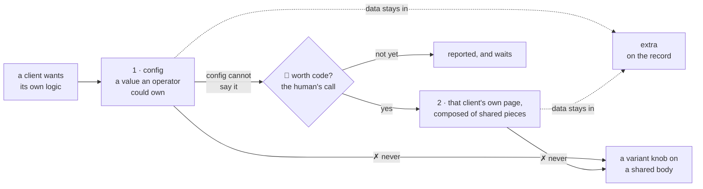

# A client's own difference, a screen's behaviour, and server data

> **For the human to read once and answer**, drafted 2026-11-09 from the whole-code-base structure
> review of 2026-11-08. Three decisions about what the system should be — not about how its code is
> written, which is the machine's own and lives in [the code
> convention](../conventions/code.md). Each one says what a yes commits to, what it does not, and
> whether any code has to change for it to be true. Nothing here is begun before the answer: the
> code stays as it is, and a request that needs one of these is reported and waits. This file holds
> the decisions as they stand; their history is in `git log`.

## At a glance

| The decision | What a yes commits to | Does code have to change? |
| --- | --- | --- |
| **1 · A client's own difference** goes in config, or else in that client's own page on the human's commercial call — never a knob on a shared body | a policy and an ordering: the three extractions come before the first client page exists. No code today | **Yes, when the first difference arrives.** Config holds presentation fields only and there is no `features` object, so no screen reads a per-client behaviour switch today |
| **2 · A tier changes what a screen offers**, never how it behaves when it refuses, confirms or saves | one behaviour everywhere, whatever a client's screen offers | **No.** The decision is true of the product the day it is said; what brings today's forms into line is the house style, one screen at a time |
| **3 · Server data has no cache and no store** | keeping what already holds, and three named conditions as the only ones that may end it | **No.** The code holds it today: every server read goes through `useLoad`, there is no cache and no store, and no component calls `fetch` |

Each decision below ends with what a yes and a no each start.

## 1. Where a client's difference lands

**Two tiers and a refusal, in this order.** *Why:* the human's own experience — "when we start
custom for a client, request keep comming and the origin code become a melting pot" — measured in
the legacy's sales-order pages, where `salesOrderListVariant.ts` went from 9 knobs in 34 lines at
its birth to 33 knobs in 123 lines, while the body it steers (`SalesOrderList.tsx`) grew from 765
to 1,168 lines; eleven variant files there carry 194 knobs. Those are the 2026-11-08 review's
counts, read in the legacy app, which is not in this repository.

- **Tier 1, config, and it is the default: every difference that is a *value* an operator or the
  root could own** — a label, a logo, a colour, a declared field, a switch over an existing
  affordance. A common pattern belongs here whichever client asked. **The test:** could an operator
  be handed this switch and get it right? What carries it: `TenantConfig`
  (`shared/src/config.ts#L7-L22`), and a company's declared fields (`shared/src/fields.ts#L4-L6`)
  whose values live in `extra`. *The honest limit:* `TenantConfig` holds eight presentation fields
  and no `features` object, so no screen reads a per-tenant switch today; the smallest honest
  extension is one defaulted `features` record on it, each key named for the behaviour and never for
  the client, defaulted on read as `extraSchema` is ([extra](extra.md#the-rules)). That is a
  code change, and it belongs to the first piece that needs it.
- **Tier 2, that client's own page, and the gate is commercial: the human decides whether a
  difference is worth code, and the machine never decides it.** The machine says which tier a
  request falls in and what the code change would be, with its files; a request config cannot
  express is reported and waits, not begun. **The test:** name what the default screen and the
  client's would share; if the answer is "the route", it is a page.
- **Refused: a client's difference never enters a shared body, not even behind a knob, and no
  client is named in shared code.** *Why:* the
  knobs arrive and never leave, in the body everyone depends on. The legacy's variant did keep its
  own promise — its bodies stayed client-agnostic, the only client-named symbol across the three
  being a comment restating that rule — so this is a refusal on where the mechanism ended, not a
  judgement of that code.
- **A client's own page is composed of the shared pieces, never a copy of the default page's
  body.** *Why:* otherwise one melting pot becomes N drifting copies, which is this review's top
  finding. What makes it possible: one `Api` passed in (`ui/src/page.ts#L6-L16`), one load hook
  carrying refusal handling (`useLoad`, `refusal`, `ui/src/page.ts#L31`, `#L25`), one
  loading/failed/retry component (`ui/src/Loaded.tsx`) and a kind-driven list.
- **Three extractions come before the first client page exists** — a piece, not a line: the page
  shell (title, action row, `Loaded` wrapper), written by hand twice today
  (`ui/src/ListPage.tsx#L22-L39`, `ui/src/StaffListPage.tsx#L156-L170`), as one component a client
  page takes; a list kind as the entry point, so a client's list is a new `LISTS` entry and not a
  copy of `ListPage`; and the row and detail pieces a client page would re-lay out, named and
  exported. *Why:* until they exist a client page can only be a copy, so the commercial gate holds
  on that ground alone.

**A yes** commits to the policy and to that ordering, and to nothing being built today: the machine
answers every such request with its tier and its price, and waits. **It does not** commit a
`features` object, a client page, or any client's name, and it rewrites none of the code that
exists. The one code change it makes certain is the `features` record above, and it arrives with
the first piece that needs it, priced then.

**A no** reopens the question of tier 2 only: the machine would need another answer for a
difference config cannot express, and the three extractions would lose the ground they stand on.

## 2. A tier changes what a screen offers, never how it behaves

**A tier changes what a screen offers, never how it behaves when it refuses, confirms or saves.**
*Why:* one behaviour everywhere, so no client's screen surprises an operator who learned another.
It is the human's "don't make user surprise or confuse" as a rule about the product: a client may
be offered different fields, lists, labels and screens, and a refusal, a confirmation and a save
must still look and act the same wherever the operator meets them.

**A yes** commits to that as the test a client page is judged against, and to the one shape for a
refused save ([the code convention](../conventions/code.md#the-winner-named)'s first row) being the
one every new form is written to. **It does not** freeze the behaviour itself: the repo may change
how a refusal reads, for every screen at once, and it does not ask any existing form to be rewritten
ahead of a piece that touches it.

**A no** means a client page may carry its own behaviour as well as its own content, and the
refusal shape in the code convention becomes a preference rather than a rule.

## 3. Server data and client state

**Server data is read through `useLoad` (`ui/src/page.ts#L31`) and rendered through `<Loaded>`
(`ui/src/Loaded.tsx#L12`); there is no cache and no store for it, so a screen reads the server on
every mount and a write is followed by `reload()`. Client state has two homes and no third — how a
list is filtered or paged goes in the URL (`ui/src/StaffListPage.tsx#L86`), what the device keeps
between visits in `ui/src/device.ts#L19`. No component calls `fetch`.** *Why:* no cache means no
staleness, every screen correct by construction, and the cost today is a spinner wherever a screen
reads the server — 25 files draw `<Loaded>`, whose loading state is a `Loader`
(`ui/src/Loaded.tsx#L14-L19`), and four more draw one of their own (`ui/src/Boot.tsx#L24`,
`JoinPage.tsx#L87`, `QrLanding.tsx#L38`, `ServicesPage.tsx#L117`); a
store would be a third home for what has two, and a query library beside `useLoad` would be two
mechanisms for one job, which this review ranked its second-worst shape.

**A cache is adopted only when one of these is true and named in the piece adopting it:** one read
is made by three or more screens *and* answers a list too large to re-read each visit; a screen
refetches accumulating data it already holds; or a wait is measured and attributed to a repeated
read. Then the library is TanStack Query and it **replaces** `useLoad` — 26 call sites today,
roughly 46 after another twenty screens, mechanical either way, while `<Loaded>` survives unchanged.
**Filters stay out of it whenever it comes:** the legacy moved them out to plain storage after a
debounce lost a write and a date window picked yesterday hid today's rows.

**A yes** keeps what already holds and commits no code: it makes those three the only grounds on
which a cache may be proposed, and each must be named in the piece that proposes one. **It does
not** rule the library out, promise the replacement will be done when a condition is met, or commit
a spinner to stay on any particular screen.

**A no** means a cache may be adopted on a judgement call instead, and the second home for client
state (the URL and the device) stops being the whole list.
