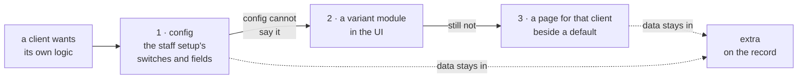

# extra

> **Decided** 2026-10-29: the machine's decision for every record a client's UI shows, written with
> the employee list's first group ([the plan](../plans/2026-10-29-employee-list.md#extra)). The
> human asked that a client's own logic customise the UI without breaking the BFF.

## At a glance

**Data a client's own logic owns goes in `extra`; anything the server must trust gets a typed field.**
A client's request changes the UI first and the BFF never.

- **What `extra` is:** a JSON object on a person, a department, a position and the staff setup.
- **Its bound:** 8 KB as JSON, five levels, no key `__proto__`, `constructor` or `prototype`.
- **What leaves it:** a field the BFF or c-storage reasons about.

## The rules

- **The schema is `extraSchema` in `shared/src/extra.ts`**, the one home of the bound. The BFF
  checks nothing else about `extra`, stores it and returns it as it came. Each reader defaults it to
  `{}`, so a record written before the field existed still parses.
- **A save replaces `extra` whole.** The form starts from the stored object, so a key it does not
  show survives, and an emptied field removes its own key. `extra` is part of the record, so its
  bytes are in the record's tag: a save over a changed one is a 409. *Rejected:* a merge on the BFF,
  which would need to know which keys are the form's.
- **The check runs on the input as it came.** A parse that copied the object first would drop a key
  named `__proto__` instead of refusing it.
- **A field the server must trust leaves `extra` in a change of its own:** the code, the name, the
  links to a department and a position, the permissions and the archive are typed. *Why:* a value in
  `extra` is whatever the browser sent.
- **The ladder for a client's own logic, each rung tried before the next:** config (the staff
  setup's switches and the company's own fields), then a variant module in the UI, then a page for
  that client beside a default one. Data stays in `extra`, behaviour in the display layer; the store
  and the BFF are never forked, and no client is named in shared code. The second and third rungs
  enter with the first client whose logic config cannot say: nothing calls them yet.
- **Piece 1's settings take no `extra`.** It enters with the first client whose own setting no typed
  field holds.
