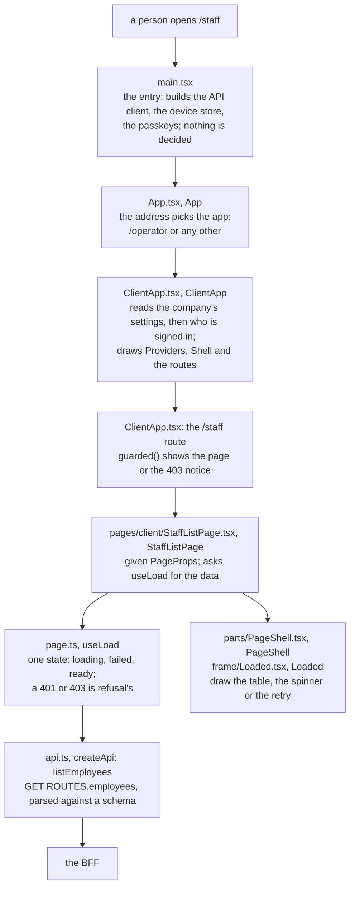

# ui code

> **Last amended** 2026-11-16, written from a person's request for a page like the BFF's, to follow the UI's files and folders. What the UI promises a person at a screen is in [the behaviour memo](ui.md); this page is only where the code sits and the road one screen's call takes through it.

## At a glance

**One screen's call goes down one road, and each file on it does one job: the entry builds the pieces, one app is chosen by the address, a route in the app mounts the page, the page asks `useLoad`, and `createApi` is the only file that talks to the BFF.** The call below is the office's staff list, a person opening the Staff screen.

Drawn from [`main.tsx`](../../ui/src/main.tsx), [`App.tsx`](../../ui/src/App.tsx), [`ClientApp.tsx`](../../ui/src/ClientApp.tsx), [`StaffListPage.tsx`](../../ui/src/pages/client/StaffListPage.tsx), [`page.ts`](../../ui/src/page.ts) and [`api.ts`](../../ui/src/api.ts). The fake build and the walks page start at the same `App` with a different set of pieces; see the road below.

| Where | What lives there | Biggest example |
| --- | --- | --- |
| `ui/src/pages/client/` (21 files) | A screen the client app mounts at a path, with the tests that walk it | `ui/src/pages/client/ListPage.tsx`'s `ListPage` |
| `ui/src/pages/operator/` (13 files) | A screen the operator console mounts at a path | `ui/src/pages/operator/ClientsPage.tsx`'s `ClientsPage` |
| `ui/src/pages/`, loose (3 files) | A screen both apps mount, and the sign-in's own frame | `ui/src/pages/MorePage.tsx`'s `MorePage` |
| `ui/src/frame/` (5 files) | What a screen is drawn inside: the shell and menu, the providers, the boot, the loading state | `ui/src/frame/Shell.tsx`'s `Shell` |
| `ui/src/parts/` (20 files) | A piece a screen is built from that no route mounts: a form, a table, a panel | `ui/src/parts/PageShell.tsx`'s `PageShell` |
| `ui/src/components/` (three levels, 2 files each) | The design system's pieces: `atoms/`, `molecules/`, `organisms/`, each with a gallery entry | `ui/src/components/atoms/StatusBadge.tsx`'s `StatusBadge` |
| `ui/src/design-system/` (7 files) | The app's theme, its palettes and the tokens, and the gallery page that shows the parts, served at `/gallery.html` | `ui/src/design-system/Gallery.tsx`'s `Gallery` |
| `ui/src/i18n/` (3 files) | The words, English first and Vietnamese after | `ui/src/i18n/en.ts`'s `en` |
| `ui/src/mock/` (6 files) | The standalone harness that draws one screen on fake data | `ui/src/mock/MockPage.tsx`'s `MockPage` |
| `ui/src/` top level (26 files) | The entries and the route tables, the API client, the fake, and modules with no screen in them: a filter, a sheet, a device store | `ui/src/api.ts`'s `createApi` |
| `ui/tests/` | Helpers the tests share: one that opens the whole app on a signed-in person, one that draws it | `ui/tests/open.tsx`'s `openApp` |

A test sits beside what it tests, so `ui/src/pages/client/` holds 14 test files beside its 21, and the top level holds the tests of the app, the API client and the modules. The file counts leave tests, styles and snapshots out. [The package's own page](../../ui/CLAUDE.md) holds the rule for a directory of one's own making: there is none.

## Where a call goes, in order

1. **The entry** (`ui/src/main.tsx`) builds the three things every page rests on: `createApi` (the only door to the BFF), the device store (what this browser remembers) and the passkeys. In the fake build it takes the fake's versions instead, and `?fake` in the address chooses them. It then draws `App` and decides nothing more.
2. **`ui/src/App.tsx`'s `App`** reads the address. `/operator` and what is below it goes to `OperatorApp`; every other address goes to `ClientApp`. The operator's door is drawn outside the client's boot, which asks a company's settings first.
3. **`ui/src/ClientApp.tsx`'s `ClientApp`** is one long function, like the BFF's `buildApp`. It reads the company's settings, then who is signed in, and draws `Providers` and `Shell` around a `Routes` list. A route is one `Route` with a path and an element; `guarded` shows the page only when `ui/src/nav.ts`'s menu lists it for that person, and the 403 notice otherwise. A page is given `pageFor(user)`, a `PageProps` of the API client, the person and two answers, `onSignedOut` and `onForbidden`.
4. **A page file** (`ui/src/pages/client/StaffListPage.tsx`) calls `useLoad` with a function that reads through `api`, and draws the answer through `PageShell`.
5. **`ui/src/page.ts`'s `useLoad`** runs the read, keeps it as `loading`, `failed` or `ready`, and hands a 401 or a 403 to `refusal`, which signs the person out or has the app read who they are again. The page never answers a refusal itself ([what the UI promises](ui.md)).
6. **`ui/src/api.ts`'s `createApi`** sends the call with the device, company and session headers, and checks the answer against the shared schema; anything it cannot read is an `ApiError`. The URL is `ROUTES.employees` from `shared/src/wire.ts`, never typed here.
7. **`ui/src/frame/Loaded.tsx`'s `Loaded`** draws the state: a spinner, "could not be loaded" with a retry, or the page's own table.

## Where a new screen goes

Copy `ui/src/pages/client/ListPage.tsx`'s `ListPage`, for a screen the client app mounts. [The package's rules](../../ui/CLAUDE.md) name the other cases (a second kind of record, a form).

1. The file goes in `ui/src/pages/client/<Name>Page.tsx` (`pages/operator/` for the console); it takes `PageProps` and reads through `useLoad`.
2. A call it needs is a method on `createApi` in `ui/src/api.ts`, with its twin in `ui/src/fake.ts`'s `createFakeApi`; the two answer the same shape.
3. Its route is one route element in `ui/src/ClientApp.tsx`, beside the `/staff` one, wrapped by `guarded`; the menu's entry, if it has one, goes in `ui/src/nav.ts`'s `PAGES`.
4. Its words go in `ui/src/i18n/en.ts` first, then `vi.ts`.
5. A piece that no route mounts goes in `ui/src/parts/`; a piece drawn a third time goes into `ui/src/components/` with its gallery entry.
6. Its test sits beside it and opens the whole app with `ui/tests/open.tsx`'s `openApp`; copy `ui/src/pages/client/ListPage.test.tsx`.

## What looks wrong but is not

- **The routes are in `ClientApp.tsx` and `OperatorApp.tsx`, not in each page's folder.** There is no route table file: the app that serves an address mounts the screen, and what both apps import is common.
- **`pages/` and `parts/` look alike.** A page is mounted by a route at a path; a part never is, only a page draws it.
- **Three files named `main.tsx`.** `ui/src/main.tsx` is the app's entry; `ui/src/mock/main.tsx` is the mock's and `ui/src/design-system/main.tsx` the gallery's. The first two hold wiring only and are outside the 100 % coverage, held by tests elsewhere ([the package's facts](../../ui/CLAUDE.md)).
- **`useLoad` reads again only when its `deps` change, and the caller names them.** The lint rule is switched off at that line; a missing name shows an old page and fails nothing.
- **The fake sits in the source but not in the build.** `ui/src/main.tsx` imports `ui/src/fake.ts` only in the fake build; the real bundle drops it ([the behaviour memo](ui.md)).
- **The menu is a view, not a guard.** A screen never guards; the BFF asks again on every call.
- **`ui/src/frame/` is not where a screen's own frame goes.** The sign-in's frame sits beside it in `pages/` because only that screen uses it.

## What this page did not read

Read whole: `ui/CLAUDE.md`, `ui/src/main.tsx`, `ui/src/App.tsx`, `ui/src/page.ts` and `ui/src/frame/Loaded.tsx`. Read in part: `ui/src/ClientApp.tsx` (the boot, the routes' head and the `/staff` route), `ui/src/pages/client/StaffListPage.tsx` (its read and its first lines), `ui/src/api.ts` (`createApi`'s `send` and `read`, `listEmployees`), `ui/src/nav.ts` (the start of `PAGES`), `ui/src/parts/PageShell.tsx`. Counted by listing the folders at write time: the file counts, so a file added later is not in them. Not read: `ui/src/OperatorApp.tsx` beyond its address, `ui/src/frame/Shell.tsx`, `ui/src/frame/Providers.tsx`, `ui/src/frame/Boot.tsx`, `ui/src/fake.ts`, `ui/src/scene.ts`, `ui/src/mock/MockPage.tsx`, `ui/src/design-system/main.tsx`, every other page and part, and every test. The design system's colour files have moved into `ui/src/design-system/` on this branch, and the counts of that folder and of the top level were recounted after the move; this page names none of them. A tour of the inside of `ClientApp.tsx` is a later section, written only when asked.
