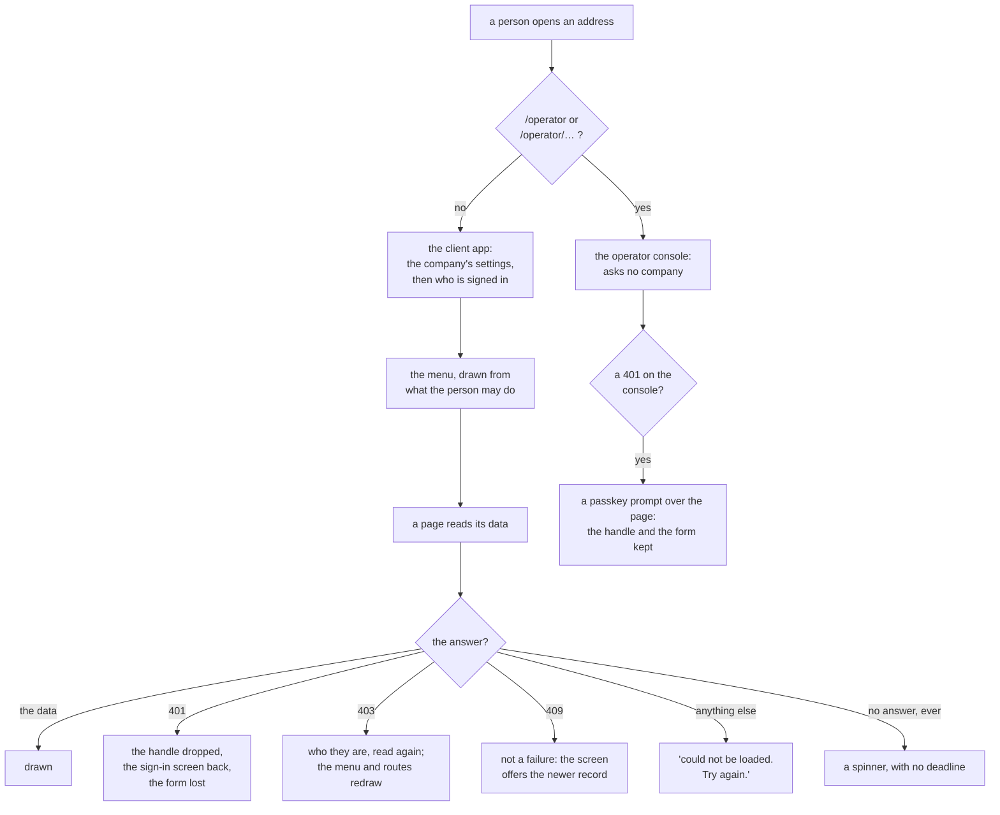

# ui

> **Decided** 2026-11-10: the promises the screens make to whoever uses them and whoever ships them,
> gathered into one memo because they were written nowhere. Each section below is one claim a caller
> can be surprised by, read from the code rather than from the design. The menu's half of
> `architecture-detail.md`'s *Who may do what* was **moved** here, not copied.

## At a glance

**The UI decides nothing; it only reacts, and what it does with a refusal is the whole of its
behaviour.** Follow one person: they open an address, which picks one of the two apps; the client
app reads the company's settings and then who is signed in; the menu is drawn from what that person
may do; a page reads its data; and then the answer decides what they see.

Drawn from [`App.tsx`](../../ui/src/App.tsx), [`ClientApp.tsx`](../../ui/src/ClientApp.tsx),
[`OperatorApp.tsx`](../../ui/src/OperatorApp.tsx), [`page.ts`](../../ui/src/page.ts),
[`api.ts`](../../ui/src/api.ts) and [`Loaded.tsx`](../../ui/src/frame/Loaded.tsx).

| It promises | Protects against | Why |
| --- | --- | --- |
| A 401 signs a client's person out of the device | a lapsed session reading on | [401](#a-401-signs-a-clients-person-out-and-an-operators-only-asks-for-the-passkey-again) |
| An operator's 401 keeps the handle and the form | a half-typed client lost to an idle hour | [the operator's 401](#a-401-signs-a-clients-person-out-and-an-operators-only-asks-for-the-passkey-again) |
| A 403 makes the app read who the person is again | a right taken away still drawn in the menu | [403](#a-403-makes-the-app-read-who-the-person-is-again) |
| One bundle, two apps, chosen by the address | a second deployment for the console | [one bundle](#one-bundle-serves-both-apps-and-the-operators-console-ships-to-every-clients-browser) |
| A page a person may not open is never drawn, and makes no call | nothing structural. The server asks again on every call | [the guard](#a-screen-never-guards-so-a-page-the-person-may-not-open-is-never-drawn) |
| A failed load says so and offers another try | a blank screen | [a failed load](#a-failed-load-offers-another-try-a-load-that-never-answers-does-not) |
| A save is never re-sent by the app | a save applied twice | [a save](#a-save-is-never-re-sent-and-only-a-new-order-can-be-filed-twice) |
| The fake and its demo company are not in the app's build | a client's browser holding invented data | [the fake](#the-fake-is-compiled-out-of-the-apps-build-and-fake-on-a-deployed-address-does-nothing) |

**No deadline anywhere.** No call in this package has a timeout, a retry or a check that the device
is online, so a request that never answers is a spinner for as long as the browser allows
([no deadline](#no-call-has-a-timeout-a-retry-or-a-check-that-the-device-is-online)). **And the
menu is only as fresh as the last time the app read who the person is** — a right newly *granted*
is never discovered without a reload
([the menu](#the-menu-changes-only-when-the-app-reads-who-the-person-is-again)).

## A 401 signs a client's person out, and an operator's only asks for the passkey again

`ui/src/page.ts`'s `refusal` is the whole rule, and it is three lines: a 401 calls the page's
`onSignedOut`, a 403 calls its `onForbidden` where it has one, and **anything else — any other
status, and a transport failure — does neither** and is the page's own failure. What `onSignedOut`
*does* is then the app's, and the two apps do opposite things.

- **A client's person is signed out of the device.** `ui/src/ClientApp.tsx`'s `signedOut` clears the
  kept handle and sets the signed-in person to none, which makes the app draw the sign-in screen in
  place of the shell. Every mounted page unmounts, so **a half-typed form is gone.**
- **An operator keeps the handle and the page.** Every route on `ui/src/OperatorApp.tsx`'s console
  answers a 401 by opening `ui/src/parts/SessionEnded.tsx`'s `SessionEnded` over the page: a modal
  with no close button, no escape and no click-outside, whose two ways out are a fresh passkey touch
  and signing out. The page keeps what was typed, and **the refused request is not sent again by
  itself.** The one 401 that does drop an operator's handle is the console's own boot.
- *The surprise, and it is this package's largest:* **"a 401 signs you out" is true for a client's
  staff and false for an operator.** A reader who learns the rule from one app will get the other
  wrong.
- *Held by:* `ui/src/page.test.ts` for the rule, `ui/src/App.test.tsx` for the client's side and
  `ui/src/OperatorApp.test.tsx` for the operator's, which asserts in its own words that the page
  stays with what was typed and the make is not sent again.
- *Hazard no gate catches:* `useLoad` calls `refusal` **before** it checks whether the page is still
  mounted, so a read that ends after its page has left still fires the refusal. On a client's side
  that is harmless — signing out twice is signing out. On the console a late 401 can re-open the
  passkey modal over a console that has just signed in again, and only another touch or a sign-out
  closes it. Every branch of this is covered; the interleaving is not. *Trigger:* the first report
  of a passkey prompt that will not go away.
- *Hazard no test catches:* that the client's half-typed form is lost. The inverse is asserted — a
  400 keeps what was typed — and the 401 case is not.

## The handle lives in the browser's localStorage, with no clock of its own

`ui/src/device.ts`'s `createDeviceStore` keeps the session handle, the operator's handle, the
device's id, the client's code, the chosen language and some menu state in `localStorage`, in the
clear, and the app sends the handle as a header on every call — never as a cookie. **There is no
expiry timer in this package at all.** The week a session lasts is the back end's
([the BFF's memo](bff.md#a-session-lasts-a-week-and-an-operators-an-hour-unused)), and a device
learns its session has lapsed only from the 401 on its next call.

- *The surprise for a caller:* one device can hold a client's sign-in and an operator's at once —
  they are separate keys, and a call picks one by which app asked.
- *And:* **signing out does not unlink the device.** Only the handle is removed; the client's code,
  the chosen language and the operator's handle survive, so the next visit boots the same company.
  The device is signed out whether or not the service heard, deliberately: the call's failure is
  swallowed.
- *Price of the choice:* a device that once followed a client's link boots that client forever from
  the bare address, and following a second client's link replaces the first — whereupon the first
  company's handle is refused at the second and dropped.
- *Hazard no gate catches:* every read and write of browser storage is unguarded. A browser with
  site data blocked, or a private window that throws on access, is untested territory.

## A 403 makes the app read who the person is again

On a client's page a 403 reads `me` again and redraws from the answer: if the right is gone the
route wrapper replaces the page with a "you cannot open this page" notice; if the right is still
there the page shows its own refusal and the person can try again. **On the operator console
nothing supplies that callback at all**, so a 403 there falls through to the page's generic failure.

- *What the person is shown is the page's wording, never the back end's.* The refusal's body is not
  read for anything but a 409, so every page shows its own string — five pages have a dedicated one
  for a 403, and the rest show "…was not saved. What you typed is still here: try again."
- *The surprise:* **two call sites read a 403 as something else entirely** — changing one's own
  password reads it as "the current password is wrong", and an operator's new-passkey link as "that
  is yourself". `ui/src/page.ts`'s `isForbidden` is the one home of the permission reading, and its
  own comment admits what holds it: *a predicate is a value, so nothing but review stops another
  copy of this check.* `pnpm counts` counts the copies.
- *Hazard no test catches:* the re-read swallows every failure but a 401. A 503, a transport failure
  or a reply in the wrong shape does **nothing at all** — no message, no retry — and the person
  keeps the permissions they had. The only trace is the page's own 403 message.

## One bundle serves both apps, and the operator's console ships to every client's browser

`ui/src/App.tsx`'s `isOperatorPath` picks the console or the client app from the address, so the
console is not a second deployment. Neither app's boot runs for the other: the client app reads a
company's settings before anything and an operator belongs to no company. The split is reactive
rather than decided at boot, because the predicate reads the router's location.

- **The consequence a shipper can be surprised by:** there is no route splitting. No `React.lazy`,
  no `Suspense`, no route-level dynamic import, and `ui/vite.config.ts` declares no manual chunks.
  A build of this package emits **four** JavaScript files: one entry of **997.05 kB** raw (293.10 kB
  gzipped) and three spreadsheet readers, fetched the first time an import or export page is used.
  **The console's code, its routes and its words are all in the entry file a client's phone
  downloads on first load** — grep that file for `/operator/clients` and it is there sixteen times.
- *Two corrections to what the code says about itself:* `ui/vite.config.ts`'s own comment reads
  "about 650 kB", and the entry is 997 kB — half again as large, and 3 kB under the warning limit
  that same file raises, so the build prints no warning. And "one bundle" is a fair description of
  the apps and not of the files: there are four.
- *Rejected, and the reason still holds:* splitting a route off. That comment's own condition is
  "until a page is heavy", and the heavy pages — the spreadsheet import and export — are the three
  that **are** split, by their own dynamic imports.
- *Hazard no gate catches:* nothing fails when the entry passes the warning limit, because the limit
  was raised above it. *Trigger:* the entry reaching 1,000 kB, when the build starts warning again.

## The operator's address is matched exactly, and a near miss is a client's app

`isOperatorPath` is two string tests: the path is exactly `/operator`, or it starts with
`/operator/`. Both are case-sensitive and neither is fuzzy. So `/operator`, `/operator/`,
`/operator/clients` and `/operator?x=1` reach the console, and **`/operators`, `/operatorsomething`,
`/OPERATOR` and `//operator` reach the client app**, with no hint that the operator's address was
meant: on an unlinked device that is the "we do not know this address" screen, and on a linked and
signed-in one the person is silently sent to the first page of their own menu.

- *Hazard no test catches:* no test covers a near-miss address. The console's own test named "opens
  at every address under `/operator`, and nowhere else" renders only addresses *under* `/operator`;
  the second half of its name is not asserted.

## No call has a timeout, a retry or a check that the device is online

`ui/src/api.ts`'s `createApi` sends one request and awaits it. There is **no `AbortController`, no
`AbortSignal` and no reading of the browser's online state anywhere in `ui/src`.** A request that
never answers hangs for as long as the browser's own connection timeout allows, with no deadline of
the app's; nothing is ever re-sent automatically; and the app never knows the device is offline.

- *The surprise for a caller:* a transport failure, a reply the schema cannot read and an answer
  with no JSON in it are **one error** — `ApiError` with no status — and so indistinguishable from
  each other.
- *And the hop is named for the operator only.* `ui/src/api.ts`'s `hopOf` calls a failure the
  store's when the answer came back in the back end's own error shape as a 503, and the back end's
  otherwise; the console's unavailable screen says which. A client's staff are never told: they get
  "The service is unavailable. Try again in a moment."
- *Rejected, by the code's own arrangement:* a deadline in this package. The back end already bounds
  its own call to storage at five seconds
  ([the BFF's memo](bff.md#one-call-to-storage-waits-five-seconds-and-is-sent-once)), so the one
  case a UI deadline would catch is an edge or a network that accepts a connection and never
  answers. *Trigger to revisit:* the first report of a screen that spun forever.

## A failed load offers another try; a load that never answers does not

`ui/src/frame/Loaded.tsx`'s `Loaded` has exactly three states, and twenty-six reads in twenty-four
files go through `ui/src/page.ts`'s `useLoad` into it: a spinner while loading, an alert reading
"This page could not be loaded. Try again." with a button wired to the reload, and the page itself
when ready. **So a slow request is distinguishable from a failed one** — a spinner against a red
alert. There is no third "this is taking long" state, so a request that never answers is a spinner
with the retry button out of reach. The menu, the language switch and sign-out are siblings of the
page body, so the person can navigate away.

- *Except at the boot.* `ui/src/frame/Boot.tsx`'s `Boot` draws a retry button only in its
  unavailable state; while loading it is a bare spinner filling the window, with no frame, no menu
  and nothing to click. Since the settings read has no deadline, a back end that accepts the
  connection and never answers leaves a dead screen whose only escape is the browser's own reload.
- *And a sign-in that fails on the network loses what was typed.* A 401 keeps the form and says
  "Wrong username or password"; **any other failure replaces the whole app with the unavailable
  screen**, and its retry re-boots, so the typed name and password are gone. The same happens to a
  QR landing whose sign-in fails for any reason but a 401.

## A screen never guards, so a page the person may not open is never drawn

The rule is `ui/CLAUDE.md`'s — a rule the server must hold belongs in the back end — and what it
means for behaviour is this: the **screen** does not guard, but the **route wrapper** does, from the
same predicate the menu uses. `ui/src/nav.ts` holds one test per menu page; the client app's route
table replaces a page the person may not open with a "you cannot open this page" notice. So a person
who types the address of a page their menu lacks **gets no screen and makes no call** — there is no
403 round trip, because nothing is sent.

- *What stops a breach:* nothing here, and nothing here needs to. The back end asks the same
  question on every call ([the BFF's memo](bff.md#the-permission-layers-are-read-on-every-call)), so
  a breach of this check is a wrong screen and never a wrong act. `ui/src/nav.ts` says so in its own
  comment: this is a view of the guard, never the guard.
- *The surprise:* **not every route asks the menu's question.** A new order asks whether the person
  may edit orders; a new person asks whether they may create staff; a new customer or product asks
  both the menu's question and the orders one; and the three **import** addresses ask only whether
  the person is the root — no permission grants an import. One's own password and the More page are
  outside every check, so every signed-in person has them, and a person whose menu is empty has
  those two and a "nothing for you here yet" notice.

## The menu changes only when the app reads who the person is again

`me` is called from exactly two places, both in the client app's shell: the boot, and the re-read a
403 triggers. So the signed-in person — and with them the menu and every route check — changes on
four events only: a reload or first open, a successful sign-in, a 403 from a page that asks for the
re-read, and one's own password change. **There is no polling, no interval and nothing on
navigation.**

- *The asymmetry, and it is what a reader would not assume:* a right **taken away** is
  self-correcting, because the page the person is on keeps drawing from the stale answer, its next
  call is refused 403, the re-read fires and the redraw replaces the page with the forbidden notice.
  A right **newly granted** produces no 403 at all, so **nothing in the app will ever discover it**:
  the new page stays out of the menu until the person reloads the tab.
- *Hazard no test catches:* the granted case. Every branch of the re-read is covered; the event that
  never happens is not a branch.

## A save is never re-sent, and only a new order can be filed twice

Nothing in this package re-sends a mutation. What keeps a hand-retry safe is the request's own
content rather than anything the client does: a save carries the version it was read at, so a
retry of a save that silently landed is answered 409, which `ui/src/api.ts` turns into a
**result** — the screen says the record moved and offers the newer one. An add is keyed by a code,
so a retry is answered 409 and read as "that code is taken". Closing a day names the requests the
screen showed.

- *The one exception, and it is a real one:* `ui/src/api.ts`'s `createOrder` sends a plain post with
  **no version and no idempotency key**, and the order's number is minted by the back end. The order
  screen shows "The order was not saved. What you typed is still here: try again." on *any* failure,
  including a request that never answered. **If the first post in fact landed, that message is
  false, and pressing Save again files a second order.** A double click on one attempt is guarded; a
  retry after a reported failure is not.
- *Hazard no test catches:* exactly that. Whether the back end would accept two identical creates is
  the back end's claim and is not checked here.
- *The surprise for a caller of this package:* **a 409 is never an error.** `ui/src/api.ts` declares
  **twenty** result types whose names end in `Result`, each a union of an outcome and a refusal the
  screen reads — a conflict, a taken code, a day that moved — so a caller that treats "the call
  threw" as the only failure will miss every one of them.

## The fake is compiled out of the app's build, and `?fake` on a deployed address does nothing

`ui/src/main.tsx` loads the fake only when the build's mode is the fake one. Vite replaces that mode
with a string literal at build time, so in the app's build the test is a constant false, the branch
is eliminated, the dynamic import is never reachable and no fake chunk is emitted. A build of this
package and a grep of every file it emits finds **no occurrence** of the demo company's code, the
fake's own storage key or the fake client's name. There is one entry for both builds; they differ
only in the mode and the output folder.

- *Held by:* `scripts/src/fake.test.ts`, which runs both builds and asserts the markers are in the
  fake's bundle and absent from the one that is served. That is the assertion to point a shipper at.
- **So `?fake` on a deployed address is silently ignored**: the parameter is never read in that
  build, and the app boots against the real back end as if nothing had been asked.
- *The surprise:* **`?fake` is sticky for the tab, and the fake keeps its state somewhere else.* The
  first `?fake` writes a flag, so every later navigation in that tab stays on the fake even without
  the parameter. The fake is handed `sessionStorage` where the app is handed `localStorage`, so
  nothing the fake keeps survives the tab, and the two never see each other's store. The fake also
  pins the pages to the data set's own day, whatever day it is opened on.
- *And the strip holds for this package's own build only.* `ui/src/scene.ts` imports the fake
  **statically**, and it is a published entry point of this package, which the walks page builds
  from. Any bundle built from that export carries the whole fake and the demo company's data, with
  no condition and no elimination. The claim is "the fake is absent from the app's build", never
  "the fake is absent from everything we ship".

## Where the rest is

- What belongs in this package and the file to copy: [`ui/CLAUDE.md`](../../ui/CLAUDE.md).
- - What the package is **for**, in one paragraph:
  [`architecture.md`](../architecture.md#what-each-part-is-for).
- The other half of the same wire: [the BFF's memo](bff.md).

## What this memo did not read

Read first-hand for this memo, whole: `ui/src/App.tsx`, `ui/src/page.ts`, `ui/src/main.tsx`, and
`ui/src/scene.ts`'s imports. **Measured first-hand:** the app's build, whose four emitted files and
their sizes are this memo's own run of `vite build`, and the greps of those files for the console's
words and the fake's. **Established by search with a control:** that no `AbortController`,
`AbortSignal` or online check exists in `ui/src`.

**Read on this memo's behalf by another agent, not line by line by its author:**
`ui/src/ClientApp.tsx`, `ui/src/OperatorApp.tsx`, `ui/src/api.ts`, `ui/src/device.ts`,
`ui/src/fake.ts`, `ui/src/nav.ts`, `ui/src/frame/Loaded.tsx`, `ui/src/frame/Boot.tsx`,
`ui/src/parts/SessionEnded.tsx` and the page modules. The claims above about the two apps' opposite
answers to a 401 were then re-checked directly against `ui/src/OperatorApp.tsx`'s own
`onSignedOut` calls and against `ui/src/page.ts`; the near-miss addresses were re-derived from
`isOperatorPath`'s expression. **The rest of that reading was not re-verified line by line**, in
particular the route table's permission tests — a summary, which is the shape of claim this
repository's own review found wrong most often. **Every numeral above was counted first-hand**: the
four emitted files and their sizes, the sixteen occurrences of the console's address in the entry
file, the twenty-six reads through `useLoad` in twenty-four files, the five pages that read a 403 as
a permission, and the twenty `Result` types.

**No test file was read.** Every test named above is named by its path, from a listing of the
package's test files and from the other agent's reading of their `it(` lines, so a sentence here
about what a test asserts is that agent's reading and not this memo's. **Nothing live was run** but
the one build.
