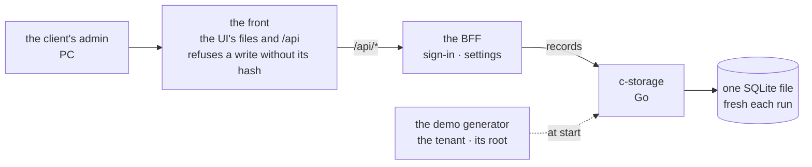

# The app frame and piece 1: client config and login

**Where it stands — 2026-10-27:** re-planned on the human's change of 21:07 +07: six pieces, each
end to end, each with its walk. Nothing is built. It waits on the human's read of piece 1's
business rows and the calls, on 10-28 ([the human's calls](#the-humans-calls)).

> **Drafted** 2026-10-27 by the machine, from [the big picture](2026-10-27-big-picture.md),
> [the architecture](2026-10-27-architecture.md) and the old app. **Amended** 2026-10-27 21:07 +07 by the human: "piece by piece; each should cover end-to-end,
> incrementally … each step should have a walk", in both languages. The sales-order plan of
> `9b85586` becomes piece 5's starting draft.

## At a glance



The local stack, drawn from this plan; no code holds it yet ([the frame](#the-frame)).

| Piece, each end to end with its walk ([the pieces](#the-pieces)) | Proposed walk |
| --- | --- |
| **1. Client config and login (the root account)**, with the frame | 10-30 |
| 2. The employee list | 11-01 |
| 3. The product list and inventory | 11-03 |
| 4. Goods receipts | 11-05 |
| 5. Sales orders | 11-07 |
| 6. Delivery notes | 11-10 |

| Piece 1's walk, the client's admin on a PC | The one question |
| --- | --- |
| 1. Sign in, in the company's name and colours | Would the admin know this is their app, and how to sign in? |
| 2. Sign-in refused | Does this say what to do? |
| 3. Settings: name, logo, colour, languages | Is this what an admin sets up first? |
| 4. Saved: the app shows the new name and colour | Does the change show where the admin expects? |
| 5. The language switched | Is the switch where a user would look? |
| 6. The service down at start | Would the admin know it is not their fault, and to try again? |

**The human's calls:** the dates (sales-ready moves from 11-04 to about 11-11); who the root is and
who edits the settings; how both languages are walked; four places where the pieces and the big
picture disagree.

## The stack

Decided by the machine.

| Piece | Decided | Why | *Rejected* |
| --- | --- | --- | --- |
| Language | TypeScript on Node 26; c-storage stays Go 1.25 | one language across the wire: the contract typed once | Go for the BFF: the contract twice |
| Packages | pnpm 11, one workspace, versions pinned in its catalog | the old app's; pnpm 12 failed TLS in the machine's sandbox | pnpm 12, until it works; npm, no catalog |
| UI | React 19, Vite, Mantine 9, react-router, Tabler icons | the look's kept rules are Mantine's | another kit: the look rehomed |
| Words | i18next, one typed dictionary per language, a test that both hold the same keys | the old app's, both languages at once | a hand-made lookup: plurals and placeholders redone; a build per language: two bundles to ship |
| BFF | Fastify 5, one app, on a listener in the local stack | the old BFFs to follow; `inject` tests bind no port | Hono: no model to follow |
| Wire checks | zod at the BFF's edge, its types in `shared/` | one schema: the check and the type | ajv beside zod |
| Tests | Vitest, v8 coverage at 100 % (QA rule 8); Testing Library on jsdom; Playwright, Chromium, for the walk | the old app's; rule 8's hint syntax | Jest: no native ESM; WebKit before 11-04 |
| c-storage | the old Go service, cut to the five routes piece 1 calls, with its `make check` | gated, already written | a rewrite in TypeScript |

**The gate:** `pnpm check` (typecheck, typed ESLint, Prettier, each package's tests at 100 %,
knip) and `make check` in `c-storage/`, run as [QA](../conventions/qa.md) rule 6 paces it.

```text
ui/          @credo/ui      sign-in, the shell, settings
bff/         @credo/bff     one Fastify app, one route group under /api
shared/      @credo/shared  the wire contract, the c-storage client, the body hash
c-storage/   Go             five routes, one SQLite file
scripts/                    the local stack, the demo generator
```

## The frame

Built with piece 1, carrying what it calls and nothing else; each later piece adds its own slice.
The code to follow: the old UI's sign-in, shell and settings page; the old credo-sme's sign-in,
session and config routes.

- **Sign-in:** a sign-in name and password give an opaque handle, sent in `x-auth-id`; the session
  is a c-storage record per device, its secret hashed, a week long, as in the old app. *Rejected:* a
  cookie: CloudFront must forward it, and cross-site requests ride it. Passwords: scrypt, a salt
  each, compared in constant time; not the old shared salt and `===`.
- **The shell:** the company's name, logo and colour; a menu of the pieces built (piece 1:
  Settings); a user menu with the language and sign-out; light and dark as the system says; PC and
  phone widths; each page's data one state: loading, failed or ready.
- **The settings** are the tenant's config, one record: name, logo, brand colour, the languages
  offered and the default. A config that does not parse stops the boot, never falls back to
  another tenant's (the old rule). Keys arrive with the piece that reads them: departments with
  piece 2, status flows with piece 4.
- **One route group:**

  | Route | Its caller |
  | --- | --- |
  | `GET /api/config` | the boot, before sign-in: name, logo, colour, languages |
  | `PUT /api/config` | Settings' save |
  | `POST /api/auth/sign-in`, `POST /api/auth/sign-out` | the sign-in page, the user menu |
  | `GET /api/auth/me` | the boot: who is signed in |

- **The body hash:** the UI's API client puts each write's SHA-256 in `x-amz-content-sha256`, as
  CloudFront's origin access control requires, through one WebCrypto function in `shared/` that
  Node runs too. The local front refuses a write without the right hash, 403, as the Lambda URL
  would: a client that forgets it fails in the walk, not in production.
- **The tenant is the deployment** (one stack per client, the architecture's call 4): the BFF's
  environment names it; the wire carries no client code.
- **`pnpm stack`** starts c-storage on a fresh database, writes the demo data, starts the BFF and the
  front, and prints the root's sign-in; Ctrl-C removes it all.
- **The demo generator:** a fixed seed, invented data, never a real client's. Piece 1 writes the
  tenant and its root; each piece adds its own rows.

**The mock first** ([collaboration](../conventions/collaboration.md#the-loop), hand-off 1): before
any BFF call, `ui/` renders each screen of the walk from fixtures, empty, loading, failed and
filled, light and dark, 390 and 1280 pixels wide, in both languages, as one static page opened from
disk. Its components are the app's: nothing is thrown away.

## Piece 1's case table

👤 marks a business row, for the human's read ([QA](../conventions/qa.md) rule 1).

| # | 👤 | The case | Held by |
| --- | --- | --- | --- |
| 1 | 👤 | The root is the tenant's first user, made with the tenant: it may do everything and needs no employee row | BFF route |
| 2 | 👤 | `pnpm stack` makes the demo tenant and prints the root's sign-in once; the password is stored nowhere readable | unit, scripts |
| 3 | 👤 | The root signs in with a name and password and lands on the menu's first page | the walk |
| 4 | 👤 | A session lasts a week; a reload keeps it; signing out ends it on that device | BFF route; unit, ui |
| 5 | 👤 | The root sets the company's name, logo and brand colour; every screen shows them, sign-in too | BFF route; unit, ui |
| 6 | 👤 | The root picks the languages offered, Vietnamese, English or both, and the default; with both, each user switches in their menu, kept on that device | unit, ui |
| 7 | 👤 | Every screen reads fully in each language | unit, ui; the walk |
| 8 | 👤 | A failed save says so and keeps what was typed | unit, ui; the walk |
| 9 | 👤 | Not yet: staff sign-ins (piece 2), the QR sign-in, a password reset, an operator's page | none: the human's to move |
| 10 | | A wrong name or password gets one message that does not say which | BFF route |
| 11 | | A password is scrypt with its own salt, compared in constant time | unit, bff |
| 12 | | A session's secret is stored hashed, one session per device | BFF route |
| 13 | | Only the BFF's 401 signs out; any other failure says the service is unavailable | unit, ui |
| 14 | | A config that does not parse is refused on save and stops the boot | BFF route; unit, ui |
| 15 | | A logo is an image of at most 200 KB; anything else is refused | BFF route |
| 16 | | A save over a newer one is refused, 409, and the page offers the newer one | BFF route; unit, ui |
| 17 | | Both dictionaries hold the same keys | unit, ui |
| 18 | | Every write carries its body's SHA-256; the front refuses one without it | unit, shared; the front's test; the walk |
| 19 | | c-storage's routes keep their key gates; a write on a moved tag answers 412 | c-storage's Go tests |

## Piece 1's walk

The map ([QA](../conventions/qa.md) rule 7); a dash is a part of the day not built yet.

| | set up | staff | stock | orders | delivery |
| --- | --- | --- | --- | --- | --- |
| **the client's admin**, PC | ⭐ piece 1 | — | — | — | — |
| **office staff**, PC | — | — | — | — | — |
| **driver**, phone | — | — | — | — | — |

The screens are [at a glance](#at-a-glance). The answers, dated, written here by the machine from
the human's reply:

| Screen | 1 | 2 | 3 | 4 | 5 | 6 |
| --- | --- | --- | --- | --- | --- | --- |
| Vietnamese | | | | | | |
| English | | | | | | |

**With the least tooling:** one Playwright spec per piece drives the main path and each failure once
on the local stack, in Chromium at 1280 pixels, per language, saving each screen with Playwright's
own screenshot check: the committed base images are the machine's reader. The human walks live
after `pnpm stack`, or reads the images. **Not built:** a walks page or answers file, a gallery, a
script to rewrite bases, a nightly run, Bruno, WebKit.

**Needs:** the code session's sandbox to bind local ports (`sandbox.network.allowLocalBinding`).
Without it the machine asks for that setting, and the human runs the walk meanwhile.

## The pieces

The human's order. Each is a vertical slice, walkable when it ends, with its own plan and case
table when reached. A size is machine days, weekends included: plan, read, code, review, walk.

| # | End to end | From the old app | Size | Walk |
| --- | --- | --- | --- | --- |
| 1 | Settings and the root's sign-in, with the frame | the old UI's shell, sign-in and settings page | 3 | 10-30 |
| 2 | The root adds staff, each given a sign-in; archiving revokes it; a department sets what each may do | employees, the old app's furthest piece, both generations | 2 | 11-01 |
| 3 | The product list, and each product's stock on hand, set by a count | the product register, and the stock beside it | 2 | 11-03 |
| 4 | Goods in from a vendor; received adds stock | the second-generation receipt and its status flow | 2 | 11-05 |
| 5 | An order for a customer; confirming locks its stock | the second-generation order; the rows drafted at `9b85586` | 2 | 11-07 |
| 6 | A note issued from a confirmed order to a driver or a carrier; delivered, with a photo, takes stock out | the second-generation delivery note | 3 | 11-10 |

Piece 6's photos need a file store, which the architecture left behind with the old upload; piece
6's plan decides it.

## The human's calls

1. **The dates.** *Recommended:* the walks as [at a glance](#at-a-glance); sales-ready, the whole
   list walked, moves from 11-04 to 11-11, a day's slack after piece 6, and outreach with it. By
   10-30: piece 1. By 11-04: pieces 1 to 3. *Price:* the launch week slips a week, and the flow's
   video comes last.
2. **The root account.** In the old app it was the tenant's first user, made with the tenant by the
   operator's setup, holding the whole grant without an employee row; the settings were the
   operator's, behind an admin key. *Recommended:* the root as there, the settings the root's,
   inside the app (rows 1 and 5). *For:* one fewer secret; the client sets itself up. *Against:*
   the root can break its own settings; the operator's page returns if that bites.
3. **Both languages' price.** Every screen's words are written twice, each walk asked twice, each
   base image kept twice: about a fifth more per piece, already in the sizes. *Recommended:* the
   Vietnamese walked live, the English read from the images, each screen answered in both.
4. **Where the pieces and the big picture disagree.** Not resolved here; each is the human's.
   - **The goal's flow** runs to dispatch, the driver, delivered and đối soát; the pieces stop at
     delivery notes and add staff, settings, stock and receipts. *Recommended:* the flow becomes
     sales order → delivery note (dispatch, the driver, delivered with a photo), with stock in
     beside it; đối soát moves to "not yet".
   - **Criterion 2, the driver as simple as Zalo:** no piece names the driver's phone.
     *Recommended:* piece 6 carries the driver's phone screens, read at its walk.
   - **"Nothing past the core flow"** excludes staff, settings, stock and receipts. *Recommended:*
     "not yet" names what lies past the six pieces instead.
   - **Customers and vendors** have no piece, yet orders need one and receipts the other.
     *Recommended:* the generator writes them, with no page, until the import.

## Steps

- [ ] **1. This plan.** Who: 🤖, 10-27. Done when: committed on `app-frame`, the checks clean.
- [ ] **2. The human's read.** Who: 👤, 10-28 morning, 30 minutes. Done when: each call answered
  under it, dated; each 👤 row kept or corrected.
- [ ] **3. c-storage in.** Who: 🤖, the first free slot (it takes nothing from step 2), 2 hours. Done
  when: `c-storage/` is the old service cut to five routes and their tests; `make check` green;
  open item 7 logs that the first box needs its listener on the private address, not loopback.
- [ ] **4. The workspace and the mock.** Who: 🤖, 10-28 after step 2 (the root's settings, the
  languages), 5 hours. Done when: `pnpm check` green; the mock's page built, every screen and state,
  both themes, widths and languages.
- [ ] **5. The BFF and `shared/`.** Who: 🤖, 10-29 after steps 2 (the rows) and 3 (the routes it
  calls), 4 hours. Done when: each of their rows seen red once, then green; `pnpm check` at 100 %.
- [ ] **6. The UI wired, the generator, the stack, the walk spec.** Who: 🤖, 10-29 into 10-30 after
  steps 4 and 5, 5 hours. Done when: every row held; `pnpm stack` up; the walk spec green in both
  languages, its base images committed.
- [ ] **7. The review.** Who: 🤖, a model other than the author's (QA rule 5), 10-30 morning, an
  hour. Done when: each finding fixed or answered; both gates green.
- [ ] **8. The walk.** Who: 👤, 10-30, 30 minutes. Done when: each screen's answers are in the table
  above, dated, and none is an open "no".

**10-30 holds, narrowly:** three machine days from no code. If step 5 is not green by 10-29
evening, the machine says so then. The trim, first to last: the logo (row 5), the mock's phone
width, row 4's reload.

**Then stop.** Piece 1 ends walked, its recap written, the branch ready to merge. Piece 2's plan is
next.

## Left behind

Each until something calls it.

- **credo-sso as a service:** sign-in is a route group of the one BFF.
- **The operator's settings page and admin key:** the root edits the settings (call 2).
- **The BFF's Lambda entry and bundle:** nothing is built for AWS before a client signs (open
  item 5).
- **`x-client-code`:** one stack per client.
- **c-storage's series, prefix-delete and service-read routes, the session sweep:** a session
  expires when read.
- **The old base, ops and kits packages:** a utility lives beside its one caller.
- **The old visual suite's gallery, walks page, Bruno and nightly run:** the walk spec does.
