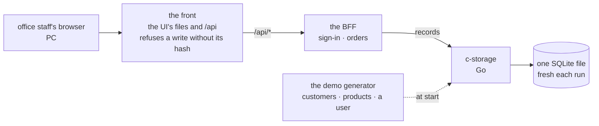

# The app frame and the first feature: sign in, then enter a sales order

**Where it stands — 2026-10-27:** drafted; nothing is built. It waits on the human's read of the
business rows and the demo's language, on 10-28 ([the human's calls](#the-humans-calls)).

> **Drafted** 2026-10-27 by the machine, from [the big picture](2026-10-27-big-picture.md),
> [the architecture](2026-10-27-architecture.md), and the old app: its UI, BFFs, c-storage, local
> stack and sales orders.

## At a glance



The local stack, drawn from this plan; no code holds it yet ([the frame](#the-frame)).

| The walk, office staff on a PC | The one question |
| --- | --- |
| 1. Sign in | Would your staff know how to sign in here? |
| 2. Today's orders, none yet | Is it clear there are none, and where to start one? |
| 3. New order: the customer picked | Is this the customer's information an order needs? |
| 4. New order: three lines, one price changed | Can staff enter a real order and trust its total? |
| 5. Saved: the list shows its number | Is the order where staff expect it? |
| 6. Sign-in refused | Does this tell staff what to do? |
| 7. Save failed, the service down | Would staff know it was NOT saved, and that their typing is kept? |

| Date | What |
| --- | --- |
| 10-28 | 👤 the human reads the business rows and picks the language; the mock |
| 10-29 | the BFF, then the UI wired to it |
| 10-30 | the review, then 👤 the walk: seven screens, yes or no |

**The human's calls:** the demo's language (recommended: Vietnamese alone), and the 👤 rows of the
case table, one of which lists what waits for a later stage.

## The stack

Decided by the machine.

| Piece | Decided | Why | *Rejected* |
| --- | --- | --- | --- |
| Language | TypeScript on Node 26; c-storage stays Go 1.25 | one language across the wire: the contract typed once | Go for the BFF: the contract twice |
| Packages | pnpm 11, one workspace, versions pinned in its catalog | the old app's; pnpm 12 failed TLS in the machine's sandbox | pnpm 12, until it works; npm, no catalog |
| UI | React 19, Vite, Mantine 9, react-router, Tabler icons | the look's kept rules are Mantine's | another kit: the look rehomed |
| BFF | Fastify 5, one app, on a listener in the local stack | the old BFFs to follow; `inject` tests bind no port | Hono: no model to follow |
| Wire checks | zod at the BFF's edge, its types in `shared/` | one schema: the check and the type | ajv beside zod |
| Tests | Vitest, v8 coverage at 100 % (QA rule 8); Testing Library on jsdom; Playwright, Chromium, for the walk | the old app's; rule 8's hint syntax | Jest: no native ESM; WebKit before 11-04 |
| c-storage | the old Go service, cut to the four routes the frame calls, with its `make check` | gated, already written | a rewrite in TypeScript |

**The gate:** `pnpm check` (typecheck, typed ESLint, Prettier, each package's tests at 100 %,
knip) and `make check` in `c-storage/`, run as [QA](../conventions/qa.md) rule 6 paces it.

```text
ui/          @credo/ui      sign-in, the shell, the orders page
bff/         @credo/bff     one Fastify app, one route group under /api
shared/      @credo/shared  the wire contract, the c-storage client, the body hash
c-storage/   Go             four routes, one SQLite file
scripts/                    the local stack, the demo generator
```

## The frame

What the first feature calls, and nothing else. The code to follow: the old credo-sme's
master-data route and records module; the old UI's sign-in, shell and register page; the old
second-generation order form.

- **Sign-in:** a sign-in name and password give an opaque handle, sent in `x-auth-id`; the session
  is a c-storage record per device, its secret hashed, a week long, as in the old app. *Rejected:* a
  cookie: CloudFront must forward it, and cross-site requests ride it. Passwords: scrypt, a salt
  each, compared in constant time; not the old shared salt and `===`.
- **The shell:** the tenant's name, the user, one entry (Orders); light and dark as the system says;
  PC and phone widths; each page's data one state: loading, failed or ready.
- **One route group:**

  | Route | Its caller |
  | --- | --- |
  | `POST /api/auth/sign-in` | the sign-in page |
  | `GET /api/auth/me` | the boot: the user, the tenant's name |
  | `GET /api/customers`, `GET /api/products` | the order form's pickers |
  | `GET /api/orders?day=` | the orders page |
  | `POST /api/orders` | the order form's save |

- **Records:** the users, a session per device, one per register, one per day of orders, the old
  app's split. Each write sends the tag it read; a 412 re-reads and retries, three times at most.
- **The body hash:** the UI's API client puts each write's SHA-256 in `x-amz-content-sha256`, as
  CloudFront's origin access control requires, through one WebCrypto function in `shared/` that
  Node runs too. The local front refuses a write without the right hash, 403, as the Lambda URL
  would: a client that forgets it fails in the walk, not in production.
- **The tenant is the deployment** (one stack per client, the architecture's call 4): the BFF's
  environment names it; the wire carries no client code.
- **`pnpm stack`** starts c-storage on a fresh database, writes the demo data, starts the BFF and the
  front, and prints the address and the sign-in; Ctrl-C removes it all.
- **The demo generator:** a fixed seed, invented Vietnamese names, some products unpriced, one staff
  user; never real data.

**The mock first** ([collaboration](../conventions/collaboration.md#the-loop), hand-off 1): before
any BFF call, `ui/` renders each walk screen from fixtures, empty, loading, failed and filled, light
and dark, 390 and 1280 pixels wide, as one static page opened from disk. Its components are the
app's: nothing is thrown away.

## The case table

👤 marks a business row, for the human's read ([QA](../conventions/qa.md) rule 1). The order's
rules are the old app's second generation, kept.

| # | 👤 | The case | Held by |
| --- | --- | --- | --- |
| 1 | 👤 | Staff sign in with a name and password and land on today's orders | the walk |
| 2 | | A wrong name or password gets one message that does not say which | BFF route |
| 3 | 👤 | A session lasts a week; a reload keeps it | BFF route; unit, ui |
| 4 | | Only the BFF's 401 signs out; any other failure says the service is unavailable | unit, ui |
| 5 | | A password is stored as scrypt with its own salt, compared in constant time | unit, bff |
| 6 | 👤 | Anyone signed in may enter orders; roles come with staff, later | BFF route |
| 7 | 👤 | The orders page shows today's, newest first: number, customer, lines, total | BFF route; unit, ui |
| 8 | 👤 | The customer is picked from the list, searched by name, code or phone | unit, ui |
| 9 | 👤 | Phone and delivery address start as the customer's and may change for this order alone | BFF route; unit, ui |
| 10 | 👤 | A line is a product searched by name or code; its quantity is above zero, decimals allowed | BFF route |
| 11 | 👤 | A line's price starts at the product's and may change, zero included (a free sample); an unpriced product starts blank, not zero | unit, ui |
| 12 | 👤 | The total sums quantity × price over priced lines; with none priced, no total, not zero | unit, bff |
| 13 | 👤 | Amounts are whole đồng, grouped with dots: 1.250.000 ₫ | unit, ui |
| 14 | 👤 | The number, `SO-YYMMDD-NNN`, is given on save, counting up within the day in Vietnam's time, never reused | unit, bff |
| 15 | 👤 | An order may carry a requested delivery date and a note | BFF route |
| 16 | 👤 | Not yet: a walk-in customer, editing or cancelling an order, an order date other than today, a status past "new" | none: the human's to move |
| 17 | | No line, a quantity of zero or less, or a price below zero is refused at its field | BFF route |
| 18 | | An unlisted customer or product is refused; a line keeps the product's code, name and unit as saved | BFF route |
| 19 | | Two saves at once both land with two numbers; past three retries, a 503 | BFF route |
| 20 | 👤 | A failed save says so and keeps what was typed; a double click sends once | unit, ui; the walk |
| 21 | | A list that fails to load says so, never "no orders" | unit, ui |
| 22 | | Every write carries its body's SHA-256; the front refuses one without it | unit, shared; the front's test; the walk |
| 23 | 👤 | The demo shows 30 customers and 40 products, invented, in Vietnamese, the same each run | unit, scripts |

## The walks

The map ([QA](../conventions/qa.md) rule 7); a dash is a part of the day not built yet.

| | set up | sales order | dispatch | the driver | delivered | đối soát |
| --- | --- | --- | --- | --- | --- | --- |
| **office staff**, PC | — | ⭐ the walk [at a glance](#at-a-glance) | — | — | — | — |
| **driver**, phone | — | — | — | — | — | — |

The answers, dated, written here by the machine from the human's reply:

| Screen | 1 | 2 | 3 | 4 | 5 | 6 | 7 |
| --- | --- | --- | --- | --- | --- | --- | --- |
| Yes or no | | | | | | | |

**10-30's walk, with the least tooling:** one Playwright spec drives the main path and each failure
once on the local stack, in Chromium at 1280 pixels, and saves each screen with Playwright's own
screenshot check: its committed base images are the machine's reader, a moved pixel a red. The
human walks the same screens live after `pnpm stack`, or reads the committed images.

**Not built yet:** a walks page or answers file, a gallery, a script to rewrite bases, a nightly
run, Bruno collections, WebKit, the phone's walk.

**Needs:** the code session's sandbox to bind local ports (`sandbox.network.allowLocalBinding`).
Without it the machine asks for that setting, and the human runs the walk meanwhile.

## The human's calls

1. **The demo's language** (open item 3). *Recommended:* Vietnamese alone, its words picked from
   the old app's Vietnamese, in one file. *For:* the screenshots, video and one-pager go to
   Vietnamese SMEs; one set of words to walk. *Against:* a reader without Vietnamese cannot read the
   demo; English later is a second file and a switch, about half a day. English alone reads worse to
   the staff who buy; both doubles every screen's words and walk, and 10-30 does not hold.
2. **The 👤 rows**, kept or corrected. *Recommended:* as drafted. *The price of row 16:* a demo order
   is always for a listed customer, and a mistyped order is entered again, the wrong one standing
   until editing comes with dispatch.

## Steps

- [ ] **1. This plan.** Who: 🤖, 10-27. Done when: committed on `app-frame`, the checks clean.
- [ ] **2. The human's read.** Who: 👤, 10-28 morning, 30 minutes. Done when: call 1 answered under
  it, dated; each 👤 row kept or corrected.
- [ ] **3. c-storage in.** Who: 🤖, the first free slot (it takes nothing from step 2), 2 hours. Done
  when: `c-storage/` is the old service cut to four routes and their tests; `make check` green;
  open item 7 logs that the first box needs its listener on the private address, not loopback.
- [ ] **4. The workspace and the mock.** Who: 🤖, 10-28 after step 2 (the language, the fields), 4
  hours. Done when: `pnpm check` green; the mock's page built, every screen and state, both themes
  and widths.
- [ ] **5. The BFF and `shared/`.** Who: 🤖, 10-29 after steps 2 (the rows) and 3 (the routes it
  calls), 4 hours. Done when: each of their rows seen red once, then green; `pnpm check` at 100 %.
- [ ] **6. The UI wired, the generator, the stack, the walk spec.** Who: 🤖, 10-29 into 10-30 after
  steps 4 and 5, 4 hours. Done when: every row held; `pnpm stack` up; the walk spec green, its base
  images committed.
- [ ] **7. The review.** Who: 🤖, a model other than the author's (QA rule 5), 10-30 morning, an
  hour. Done when: each finding fixed or answered; both gates green.
- [ ] **8. The walk.** Who: 👤, 10-30, 20 minutes. Done when: each screen's answer is in the table
  above, dated; a "no" becomes a row.

**10-30 holds, narrowly:** three machine days from no code, with no slack. If step 5 is not green
by 10-29 evening, the machine says so then. The trim, first to last: rows 9 and 15, row 3's reload,
the mock's phone width. On 10-30 the human trims the flow for 11-04, as the big picture says.

**Then stop.** The piece ends at a walked first feature, its recap written, the branch ready to
merge. Dispatch is the next plan.

## Left behind

Each until something calls it.

- **credo-sso as a service:** sign-in is a route group of the one BFF.
- **The BFF's Lambda entry and bundle:** nothing is built for AWS before a client signs (open
  item 5).
- **QR sign-in, staff and permissions, the operator's tenant settings:** off the first feature.
- **The customer and product pages:** the generator writes the rows; the import comes after 11-04.
- **`x-client-code`, the tenant's logo and colours:** one stack per client; criterion 4 brings them
  back.
- **c-storage's series, delete and service-read routes, the session sweep:** a session expires when
  read.
- **The old base, ops and kits packages:** a utility lives beside its one caller.
- **The visual suite, the walks page, Bruno, the nightly run:** the walk spec does for 10-30.
- **i18next:** one language, one file of words.
- **The order's status flow, stock holds, delivery notes, payments, copying, custom fields:** later
  stages.
