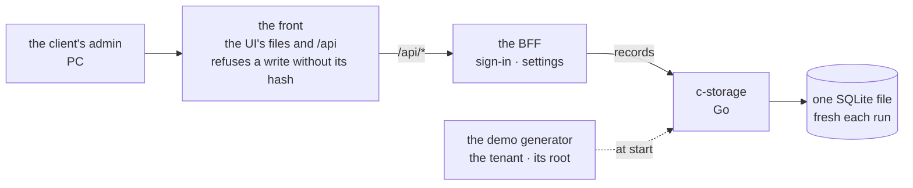

# The app frame and piece 1: client config and login

**Where it stands — 2026-10-28 10:56 +07:** planned and decided; steps 2 to 7 are done. The review's
17 findings are each fixed or answered ([the recap](../recaps/2026-10-28-app-frame.md), rounds 1
and 2). The walk is eight screens at PC, tablet and phone widths, its 48 base images are committed
from the human's run (the second run green), and `main` and the visual report's branch are merged
in. `pnpm check` is green with every package at 100 % and knip silent. **Next:** step 8, the human's
walk on the walks page, Fri 10-30.

> **Drafted** 2026-10-27 by the machine, from [the big picture](2026-10-27-big-picture.md),
> [the architecture](2026-10-27-architecture.md) and the old app. **Amended** 2026-10-27 21:07 +07
> by the human: "piece by piece; each should cover end-to-end, incrementally … each step should have
> a walk", in both languages; the sales-order plan of `9b85586` becomes piece 5's starting draft.
> **Decided** 2026-10-27 23:05 +07: the human's answers. **Amended** 2026-10-28 01:47 +07 by the
> human: the walks page and its answers file, and a seventh walk screen, from
> [the visual report](2026-10-28-visual-report.md#where-it-conflicts-and-the-amendments).
> **Amended** 2026-10-28 03:04 +07 by the machine, in step 7's first round: two statements the code
> had outgrown, the diagram's "no code holds it yet" and the generator's "fixed seed".
> **Amended** 2026-10-28 10:45 +07 by the human, in step 7's second round: an eighth walk screen,
> the save conflict ("someone else saved first"), and the walk shot at PC 1280, tablet 768 and phone
> 390 ("cover PC, Tablet and Mobile").

## At a glance



The local stack, drawn from this plan and held by `scripts/src/stack.ts`, `front.ts` and
`generator.ts` ([the frame](#the-frame)).

| Piece, each end to end with its walk ([the pieces](#the-pieces)) | Walk, the human's date |
| --- | --- |
| **1. Client config and login (the root account)**, with the frame | 10-30 |
| 2. The employee list | 11-01 |
| 3. The product list and inventory | 11-03 |
| 4. Goods receipts | 11-05 |
| 5. Sales orders | 11-07 |
| 6. Delivery notes | 11-10 |

| Piece 1's walk, the client's admin on a PC | The one question |
| --- | --- |
| 1. Sign in, in the company's name and colours | Would the admin know this is their app, and how to sign in? |
| 2. Sign-in refused | Does this say what to do? |
| 3. Settings: name, logo, colour, languages | Is this what an admin sets up first? |
| 4. Saved: the app shows the new name and colour | Does the change show where the admin expects? |
| 5. The language switched | Is the switch where a user would look? |
| 6. The service down at start | Would the admin know it is not their fault, and to try again? |
| 7. A save that failed, what was typed kept | Would the admin know the save did not happen, and that nothing typed is lost? |
| 8. Someone else saved first, what was typed kept | Would the admin know someone else saved first, and how to see what they saved? |

*Amended 2026-10-28 01:47 +07 by the human: screen 7, B6 of the visual report. Amended 2026-10-28 10:45 +07 by the human: screen 8, the save conflict; the mock draws it as the settings screen's `conflict` state.*

**The human's calls, answered 10-27 23:05 +07, each as recommended:** sales-ready on 11-11, the
walks as above; the root, the tenant's first user, edits the settings in the app; Vietnamese walked
live, English read from the images; the flow ends at delivery notes with stock beside it, the
driver read at piece 6's walk, customers and vendors from the generator.

## The stack

Decided by the machine.

| Piece | Decided | Why | *Rejected* |
| --- | --- | --- | --- |
| Language | TypeScript on Node 26; c-storage stays Go 1.26 | one language across the wire: the contract typed once | Go for the BFF: the contract twice |
| Packages | pnpm 12, pinned exactly in `packageManager`, one workspace, versions pinned in its catalog | the old app's shape; on 10-28 pnpm 12.10.1 installed and answered from the sandbox, while pnpm 11 cannot switch versions there; Node 26 ships no corepack, so nothing else selects the version | pnpm 11; npm, no catalog |
| UI | React 19, Vite, Mantine 9, react-router, Tabler icons | the look's kept rules are Mantine's | another kit: the look rehomed |
| Words | i18next, one typed dictionary per language, a test that both hold the same keys | the old app's, both languages at once | a hand-made lookup: plurals and placeholders redone; a build per language: two bundles to ship |
| BFF | Fastify 5, one app, on a listener in the local stack | the old BFFs to follow; `inject` tests bind no port | Hono: no model to follow |
| Wire checks | zod at the BFF's edge, its types in `shared/` | one schema: the check and the type | ajv beside zod |
| Tests | Vitest, v8 coverage at 100 % (QA rule 8); Testing Library on jsdom; Playwright, Chromium, for the walk | the old app's; rule 8's hint syntax | Jest: no native ESM; WebKit before sales-ready |
| c-storage | the old Go service, cut to the five routes piece 1 calls, with its `make check` | gated, already written | a rewrite in TypeScript |

*Amended 2026-10-28 02:04 +07: the stack row says Go 1.26, as `c-storage/go.mod`'s `toolchain go1.26.7` does (F6 of
[c-storage's recap](../recaps/2026-10-28-c-storage.md)).*

**The gate:** `pnpm check` (typecheck, typed ESLint, Prettier, each package's tests at 100 %,
knip) and `make check` in `c-storage/`, run as [QA](../conventions/qa.md) rule 6 paces it.

```text
ui/          @credo/ui      sign-in, the shell, settings
bff/         @credo/bff     one Fastify app, one route group under /api
shared/      @credo/shared  the wire contract, the c-storage client, the body hash
c-storage/   Go             five routes, one SQLite file
scripts/                    the local stack, the demo generator
```

## The frame

Built with piece 1, carrying what it calls and nothing else; each later piece adds its own slice.
The code to follow: the old UI's sign-in, shell and settings page; the old credo-sme's sign-in,
session and config routes.

- **Sign-in:** a sign-in name and password give an opaque handle, sent in `x-auth-id`; the session
  is a c-storage record per device, its secret hashed, a week long, as in the old app. *Rejected:* a
  cookie: CloudFront must forward it, and cross-site requests ride it. Passwords: scrypt, a salt
  each, compared in constant time; not the old shared salt and `===`.
- **Record keys and ids:** the layout is named once, `recordKeys` in `shared/src/records.ts`:
  `config`, `user.<name>`, `session.<device>`. A user is keyed by the normalised sign-in name, never
  by a secret, so rotating a secret signs no one out. *Rejected:* the old key, an HMAC of the address
  under a secret. *Price, accepted:* the name is the id; piece 2, where a name can change, adds a
  minted id and a name index. A session carries no client code, since the tenant is the deployment.
- **The device id** comes from the `x-device-id` header, minted by the UI once and kept on the
  device; a handle is `<device id>.<secret>`.
- **The settings carry their version**, c-storage's tag: `GET /api/config` answers
  `{config, version}`, a save sends the version back, and a save over a moved one answers 409 with
  the newer settings. Renewing a session writes with its tag too, re-reads on a 412 and tries 3
  times; sign-in is the one blind write, which replaces its device's session.
- **The BFF never holds c-storage's super-admin key.** Registering its service at stack start is
  `pnpm stack`'s, in step 6, which holds that key; a 409 there is read by status, never by message.
- **The BFF's route tests run against the real c-storage binary**, built by `go build` and started
  on a fresh database per test file, so `pnpm check` needs Go and loopback ports.
- **A `shared/` test holds that each c-storage client method sends what its Bruno request sends**
  (`shared/src/c-storage.bruno.test.ts`, reading `c-storage/bruno/`), so a request that changes
  there turns the client red here.
- **The shell:** the company's name, logo and colour; a menu of the pieces built (piece 1:
  Settings); a user menu with the language and sign-out; light and dark as the system says; PC and
  phone widths; each page's data one state: loading, failed or ready.
- **The settings** are the tenant's config, one record: name, logo, brand colour, the languages
  offered and the default. A config that does not parse stops the boot, never falls back to
  another tenant's (the old rule). Keys arrive with the piece that reads them: departments with
  piece 2, status flows with piece 4.
- **One route group:**

  | Route | Its caller |
  | --- | --- |
  | `GET /api/config` | the boot, before sign-in: name, logo, colour, languages |
  | `PUT /api/config` | Settings' save |
  | `POST /api/auth/sign-in`, `POST /api/auth/sign-out` | the sign-in page, the user menu |
  | `GET /api/auth/me` | the boot: who is signed in |

- **The body hash:** the UI's API client puts each write's SHA-256 in `x-amz-content-sha256`, as
  CloudFront's origin access control requires, through one WebCrypto function in `shared/` that
  Node runs too. The local front refuses a write without the right hash, 403, as the Lambda URL
  would: a client that forgets it fails in the walk, not in production.
- **The tenant is the deployment** (one stack per client, the architecture's call 4): the BFF's
  environment names it; the wire carries no client code.
- **`pnpm stack`** starts c-storage on a fresh database, registers the BFF's service, writes the demo
  data, starts the BFF and the front, and prints the root's sign-in once; Ctrl-C removes it all.
  `pnpm stack -- <command>` runs the command against it, with the address and the root's sign-in in
  its environment, and always takes it down: the sandbox cannot signal a process an earlier command
  started, so the walk spec's run needs the stack up in the same command.
- **The demo generator:** invented data, fixed constants, never a real client's; the root's
  password is random for each stack. Piece 1 writes the
  tenant and its root; each piece adds its own rows.

**The mock first** ([collaboration](../conventions/collaboration.md#the-loop), hand-off 1): before
any BFF call, `ui/` renders each screen of the walk from fixtures, empty, loading, failed and
filled, light and dark, 390 and 1280 pixels wide, in both languages, as one static page opened from
disk. Its components are the app's: nothing is thrown away.

## Piece 1's case table

👤 marks a business row, for the human's read ([QA](../conventions/qa.md) rule 1).

| # | 👤 | The case | Held by |
| --- | --- | --- | --- |
| 1 | 👤 | The root is the tenant's first user, made with the tenant: it may do everything and needs no employee row | BFF route |
| 2 | 👤 | `pnpm stack` makes the demo tenant and prints the root's sign-in once; the password is stored nowhere readable | unit, scripts |
| 3 | 👤 | The root signs in with a name and password and lands on the menu's first page | the walk |
| 4 | 👤 | A session lasts a week; a reload keeps it; signing out ends it on that device | BFF route; unit, ui |
| 5 | 👤 | The root sets the company's name, logo and brand colour; every screen shows them, sign-in too | BFF route; unit, ui |
| 6 | 👤 | The root picks the languages offered, Vietnamese, English or both, and the default; with both, each user switches in their menu, kept on that device | unit, ui |
| 7 | 👤 | Every screen reads fully in each language | unit, ui; the walk |
| 8 | 👤 | A failed save says so and keeps what was typed | unit, ui; the walk |
| 9 | 👤 | Not yet: staff sign-ins (piece 2), the QR sign-in, a password reset, an operator's page | none: the human's to move |
| 10 | | A wrong name or password gets one message that does not say which | BFF route |
| 11 | | A password is scrypt with its own salt, compared in constant time | unit, bff |
| 12 | | A session's secret is stored hashed, one session per device | BFF route |
| 13 | | Only the BFF's 401 signs out; any other failure says the service is unavailable | unit, ui |
| 14 | | A config that does not parse is refused on save and stops the boot | BFF route; unit, ui |
| 15 | | A logo is an image of at most 200 KB; anything else is refused | BFF route |
| 16 | | A save over a newer one is refused, 409, and the page offers the newer one | BFF route; unit, ui |
| 17 | | Both dictionaries hold the same keys | unit, ui |
| 18 | | Every write carries its body's SHA-256; the front refuses one without it | unit, shared; the front's test; the walk |
| 19 | | c-storage's routes keep their key gates; a write on a moved tag answers 412 | c-storage's Go tests |
| 20 | | A session that cannot be read (c-storage down or erroring) answers 503, never 401 | BFF route; unit, ui (row 13) |

## Piece 1's walk

The map ([QA](../conventions/qa.md) rule 7); a dash is a part of the day not built yet.

| | set up | staff | stock | orders | delivery |
| --- | --- | --- | --- | --- | --- |
| **the client's admin**, PC | ⭐ piece 1 | — | — | — | — |
| **office staff**, PC | — | — | — | — | — |
| **driver**, phone | — | — | — | — | — |

The screens are [at a glance](#at-a-glance). Their answers, dated, are written by the machine from
the human's reply into `visual/answers.json`, each with the words it was given on, and the walks
page shows them ([the visual report](2026-10-28-visual-report.md#the-answers)). *Amended
2026-10-28 01:47 +07 by the human: B1 of the visual report.*

**With the least tooling:** one Playwright spec per piece drives the main path and each failure once
on the local stack, in Chromium at 1280, 768 and 390 pixels, per language, saving each screen with
Playwright's own screenshot check (8 screens × 2 languages × 3 widths = 48 bases, the width in each
image's name; screen 8's conflict is provoked by a second save through the real API, not a stub): the committed base images, made in the human's terminal, are the machine's
reader. The human walks live after `pnpm stack`, or reads the walks page the machine builds
([the visual report](2026-10-28-visual-report.md)). **Not built:** a gallery, a script to rewrite
bases, a nightly run, WebKit, and a Bruno collection for the app: c-storage has its own, with its
e2e (`c-storage/bruno/`, `c-storage/scripts/e2e.sh`), and the app's walk uses none. *Amended
2026-10-28 01:47 +07 by the human: B2 of the visual report. Amended 2026-10-28 02:04 +07: Bruno,
F9 of c-storage's recap.*

**Needs:** a browser, which the code session's sandbox cannot start: it refuses Chromium's
registration of a Mach service, and no sandbox setting allows one. The human runs the spec in the
terminal; the walks page needs no browser
([where it runs](2026-10-28-visual-report.md#where-it-runs)). *Amended 2026-10-28 01:47 +07 by the
human: B3 of the visual report.*

## The pieces

The human's order. Each is a vertical slice, walkable when it ends, with its own plan and case
table when reached. A size is machine days, weekends included: plan, read, code, review, walk.

| # | End to end | From the old app | Size | Walk |
| --- | --- | --- | --- | --- |
| 1 | Settings and the root's sign-in, with the frame | the old UI's shell, sign-in and settings page | 3 | 10-30 |
| 2 | The root adds staff, each given a sign-in; archiving revokes it; a department sets what each may do | employees, the old app's furthest piece, both generations | 2 | 11-01 |
| 3 | The product list, and each product's stock on hand, set by a count | the product register, and the stock beside it | 2 | 11-03 |
| 4 | Goods in from a vendor; received adds stock | the second-generation receipt and its status flow | 2 | 11-05 |
| 5 | An order for a customer; confirming locks its stock | the second-generation order; the rows drafted at `9b85586` | 2 | 11-07 |
| 6 | A note issued from a confirmed order to a driver or a carrier; delivered, with a photo, takes stock out | the second-generation delivery note | 3 | 11-10 |

Piece 6's photos need a file store, which the architecture left behind with the old upload; piece
6's plan decides it.

## The human's calls

1. **The dates.** *Recommended:* the walks as [at a glance](#at-a-glance); sales-ready, the whole
   list walked, moves from 11-04 to 11-11, a day's slack after piece 6, and outreach with it. By
   10-30: piece 1. By 11-04: pieces 1 to 3. *Price:* the launch week slips a week, and the flow's
   video comes last.
   **Answered** 2026-10-27 23:05 +07 by the human: as recommended.
2. **The root account.** In the old app it was the tenant's first user, made with the tenant by the
   operator's setup, holding the whole grant without an employee row; the settings were the
   operator's, behind an admin key. *Recommended:* the root as there, the settings the root's,
   inside the app (rows 1 and 5). *For:* one fewer secret; the client sets itself up. *Against:*
   the root can break its own settings; the operator's page returns if that bites.
   **Answered** 2026-10-27 23:05 +07 by the human: as recommended.
3. **Both languages' price.** Every screen's words are written twice, each walk asked twice, each
   base image kept twice: about a fifth more per piece, already in the sizes. *Recommended:* the
   Vietnamese walked live, the English read from the images, each screen answered in both.
   **Answered** 2026-10-27 23:05 +07 by the human: as recommended.
4. **Where the pieces and the big picture disagree**, each the human's; the big picture takes each
   answer. **Answered** 2026-10-27 23:05 +07 by the human: as recommended.
   - **The goal's flow** runs to dispatch, the driver, delivered and đối soát; the pieces stop at
     delivery notes and add staff, settings, stock and receipts. *Recommended:* the flow becomes
     sales order → delivery note (dispatch, the driver, delivered with a photo), with stock in
     beside it; đối soát moves to "not yet".
   - **Criterion 2, the driver as simple as Zalo:** no piece names the driver's phone.
     *Recommended:* piece 6 carries the driver's phone screens, read at its walk.
   - **"Nothing past the core flow"** excludes staff, settings, stock and receipts. *Recommended:*
     "not yet" names what lies past the six pieces instead.
   - **Customers and vendors** have no piece, yet orders need one and receipts the other.
     *Recommended:* the generator writes them, with no page, until the import.

## Steps

- [x] **1. This plan.** Who: 🤖, 10-27. Done when: committed on `app-frame`, the checks clean.
  *Evidence:* `9b85586`, re-planned at `d6fe8eb`, decided in the commit after it; the path, name
  and link greps clean on each.
- [x] **2. The human's read.** Who: 👤, 10-28 morning, 30 minutes. Done when: each call answered
  under it, dated; each 👤 row kept or corrected. *The calls:* answered 10-27 23:05 +07. *The
  rows:* kept as written, the human, 2026-10-28 00:15 +07 ("YES, agree with 9 cases of piece 1").
- [x] **3. c-storage in.** Who: 🤖, the first free slot (it takes nothing from step 2), 2 hours. Done
  when: `c-storage/` is the old service cut to five routes and their tests; `make check` green;
  open item 7 logs the listener's move to the private address, which is ridge's fourth layer
  ([the ridge plan](2026-10-28-ridge.md#the-listener-open-item-7)).
  *Evidence:* `566a003`; `make check` in `c-storage/` ends `coverage: 100 % of statements outside
  cmd/server` then the `GOOS=linux GOARCH=arm64` build, no warning. Seen red once, each by breaking
  its rule's line and putting it back: the internal key gate, an unknown service admitted, a wrong
  key admitted, a stored key not hashed, a moved tag not refused (412), the catch-all that stops
  405, a precondition it cannot read accepted (record routes and register), a registration twice
  not a 409, the IMMEDIATE transaction, the schema version, a table at version 0, a route missing
  from `everyRoute`, and `/health` answering any method. The box build is arm64, the architecture's
  `t4g.nano`; `/health` answers `{"status":"OK"}` alone, since no release yet stamps a version
  (open item 5). Open item 7 is logged.
- [x] **4. The workspace and the mock.** Who: 🤖, 10-28 after step 2 (the root's settings, the
  languages), 5 hours. Done when: `pnpm check` green; the mock's page built, every screen and state,
  both themes, widths and languages.
  *Evidence:* `b39e211`. `pnpm check` ends `Statements 100 % ( 125/125 )`, branches `46/46`, functions
  `60/60`, lines `111/111` in `ui/`, and `4/4`, `3/3`, `2/2`, `3/3` in `shared/`, then knip
  silent; no warning. The mock: `pnpm mock` builds `ui/dist/mock/mock.html`, one file of 785 kB
  that needs no server; open it from disk ([README](../../README.md#try-the-mock)). It holds the
  walk's six screens in 15 states, each in light and dark, 390 and 1280, Vietnamese and English
  (120 frames), with filters. Held now: row 17 (`Both dictionaries hold the same keys`), seen red
  by dropping a Vietnamese key. The unit halves of rows 7, 8 and 16 also hold (`Every screen reads
  fully in each language`, `A failed save says so and keeps what was typed`, and the conflict
  offering the newer settings), each seen red by breaking its rule; their other halves (the walk,
  the BFF route) wait for steps 5 and 6. Row 6's menu and form halves are tested; "kept on that
  device" waits for step 6. The model files followed: the old UI's sign-in, shell layout, theme and
  i18n setup, and its root `eslint.config.js`, `knip.json`, `pnpm-workspace.yaml` catalog and
  `vitest.config.mts`; nothing copied whole. **Not seen:** the page in a browser. The session's
  sandbox cannot start one, so the human's eyes are the check; `jsdom` tests render each state in
  both languages. Left behind: the old lint rule against colour literals in a page (nothing
  holds it yet), and `.github/` is outside Prettier, being c-storage's CI.
  *Matched to the old app's look, 10-28:* `458186a`: the sign-in's tinted head, title, underlined
  fields, gradient button and centred card; the old theme; the old words; frames as tall as their
  screen. Not seen in a browser; the human's eyes are the check.
- [x] **5. The BFF and `shared/`.** Who: 🤖, 10-29 after steps 2 (the rows) and 3 (the routes it
  calls), 4 hours. Done when: each of their rows seen red once, then green; `pnpm check` at 100 %.
  *Evidence:* `d1231e2`. `pnpm check` ends `Statements 100 % ( 86/86 )`, branches `42/42`, functions
  `18/18`, lines `72/72` in `shared/`; `145/145`, `88/88`, `27/27`, `121/121` in `bff/`; `125/125`,
  `46/46`, `60/60`, `111/111` in `ui/`; then knip silent; no warning. The route tests ran against the
  real c-storage, built once by `go build` and started per test file on a fresh database, a service
  of its own per test. *Held, each seen red by breaking its rule's line and putting it back:*
  row 1's BFF half (the root's record alone signs in, is root and saves the settings; a non-root
  is refused 403; red by dropping the gate and by forcing `root: false`); row 4's BFF half (a week,
  not 6 days; expiry; sign-out ends that device only; renewal inside the last three days; and
  that renewing writes with its tag, bounded at 3 reads, red by dropping the tag, by one attempt,
  and by a sign-out that ends nothing); row 5's BFF half (settings stored, served before sign-in;
  red by requiring a session on the read); row 10 (a different message for an unknown name); row 11
  (`===` for the constant-time compare; a fixed salt); row 12 (the secret stored plain; the
  session keyed by user, not device); row 14's BFF half (an unparsed save; an unparsed stored
  config passed on); row 15 in `shared/` and at the route (limit +1 byte; any `data:` type); row
  16's BFF half (a blind save); row 18's `shared/` half (SHA-1; a non-UTF-8 encoding); the new
  row 20 (503 turned 401, for c-storage down and for c-storage refusing the BFF). The client's own
  unit tests were also seen red (header names, the encoded key, 404 as null, 409 by status, keys
  per instance). *Half held:* rows 1 (the root "made with the tenant" is row 2's generator), 4
  (a reload keeps it: the UI's handle, step 6), 5 and 14 and 16 (their UI halves), 18 (the
  front's refusal and the walk), 20 (the UI's half is row 13). *Left for step 6:* the BFF's entry
  (env, `buildApp`, listen), which nothing calls yet. The model files followed: the old credo-sme's
  sign-in, session, config routes and its auth-session module and middleware, and its c-storage
  connector, all read, none copied whole; the shapes named defects (the shared salt and `===`, the
  blind renewal, a process-wide client, a user keyed by a secret) were not followed. *Found:* v8
  reported a negative count for an `if (…) throw` after two `await`s in one handler; moving the
  check into a helper made it exact. The test helper in `bff/tests/` is not under the coverage
  gate; every route test runs it.
- [x] **6. The UI wired, the BFF's entry, the generator, the stack, the walk spec.** Who: 🤖, 10-29
  into 10-30 after steps 4 and 5, 5 hours. It takes from step 5: the BFF's entry (env to
  `buildApp` to a listener); `pnpm stack` registers the BFF's service with the super-admin key
  and the generator writes the root through `recordKeys`; the front refuses a write without its
  hash. Done when: every row held; `pnpm stack` up; the walk spec green in both
  languages, its base images committed.
  *Done in the sandbox, 2026-10-28 02:24 +07:* `e20cecb` (the Bruno-parity test), `723a59e` (the
  BFF's entry), `b1d6d2b` (the UI wired), `fd1f84f` (the stack, the front, the generator, the walk
  spec). `pnpm check` ends `Statements 100 % ( 87/87 )`,
  branches `42/42`, functions `18/18`, lines `73/73` in `shared/`; `157/157`, `93/93`, `30/30`,
  `132/132` in `bff/`; `265/265`, `111/111`, `99/99`, `232/232` in `ui/`; `157/157`, `45/45`,
  `40/40`, `133/133` in `scripts/`; then knip silent; no warning. The one new hint is
  `untested` in `scripts/src/processes.ts`: the kill that runs as the process dies.
  *Held, each seen red once by breaking its rule's line and putting it back:* the Bruno-parity
  test (a header name, `If-None-Match`'s value, the verb, the register header, the body's field);
  row 2 (the password stored as its own hash; a fixed password); row 1 (the root written with
  `root: false`; signing in through the BFF's own route); row 4's UI half (the handle not read on a
  reload; sign-out not clearing it); row 5's UI half (the colour not following the saved
  settings); row 6's "kept on that device" (the language not stored); row 8 (the form remounting
  on a failed save); row 13 (any failure read as a sign-out; a 401 on a save not signing out); row
  14's UI half (a reply that does not parse accepted); row 16's UI half (a conflict read as a save;
  a blind version; the newer settings not read again); row 18 (the API client without the header;
  the front without its check; the front taking any hash); the 409 read as "registered" without
  the key checked; the stack not closing its front; a command's signal read as a different status;
  the BFF's environment holding a super-admin key or echoing a value. *Also seen live*, on the
  real stack in the sandbox, not as a test: `pnpm stack -- <command>` ran a command that read the
  settings, signed in as the root through the UI's own API client, saved over them, met a
  conflict on the stale version, signed out and met 401 on `me`, and an unhashed write answered
  403; `lsof` showed no listener afterwards. *Half held (the walk's half):* rows 3, 7 and 18 wait
  for the spec's run; row 20's UI half is row 13's. *Found:* the demo company's logo, written as
  the mock writes it (a URL-encoded SVG), is refused by the logo rule (`;base64` only); the
  generator writes base64. Playwright 1.64.0 and tsx 4.23.15 are pinned in the catalog, both at
  least two weeks old; tsx brings esbuild, whose postinstall stays off (`allowBuilds`), and the
  stack runs under `node --import tsx` because tsx's own CLI opens a socket the sandbox refuses.
  *The model files followed:* the old UI's `api.ts`, `session.ts`, `boot.ts`, its
  `playwright.config.ts` and `specs/sign-in.spec.ts`, and the old `scripts/local-stack.mjs` and
  `local-servers.mjs` (the front's handler, the health wait); none copied whole. The shapes named
  defects were not followed: the QR sign-in, "remember me", a client code on the wire, the
  operator's admin key. **Not seen:** the walk spec run, since it needs a browser, and the app in a
  browser; the spec's locators are written from the components and are the human's run to prove.
  *The walk spec's half, 2026-10-28 02:30 +07:* run in the human's terminal on the stack
  (`pnpm stack -- …`), its log read whole. The first run (`--update-snapshots=missing`) wrote all
  14 base images and reported `2 passed`; the second compared them and reported `2 passed`, no
  warning, nothing left listening. The 14 bases (seven screens, two languages) are committed in
  `walk/specs/piece-1.spec.ts-snapshots/`, each with `chromium-darwin` in its name: they are the
  human's Mac's, per call 7's answer A of the visual report. The log and the images were read by the
  orchestrator. The walk now holds rows 3, 7 and 18 (the front's refusal of a write without its hash,
  through the real UI).
- [x] **7. The review.** Who: 🤖, a model other than the author's (QA rule 5), 10-30 morning, an
  hour. Done when: each finding fixed or answered; both gates green.
  It reviews steps 4 to 6 only: c-storage was reviewed on its own branch before it merged into
  `main` ([its recap](../recaps/2026-10-28-c-storage.md)). *Amended 2026-10-28 02:04 +07.*
  *Evidence, 2026-10-28 10:52 +07:* round 1 `3883d4a` to `4c4305c`, round 2 after the merges of
  `main` (`751694b`) and `visual-report` (`4415a77`); every finding and its tag is in
  [the recap](../recaps/2026-10-28-app-frame.md). `pnpm check` green three runs in a row, `shared/`
  at 96, 42, 21 and 81, `bff/` 158, 95, 30 and 133, `ui/` 280, 128, 105 and 244, `scripts/` 189, 49,
  48 and 160, `visual/` 557, 235, 184 and 483 (statements, branches, functions, lines), all 100 %,
  knip silent. **Not seen:** the walk spec, which needs a browser. Its 14 old base images are
  deleted; the 48 new ones (8 screens × 2 languages × 3 widths) come from the human's run, which
  step 8 consumes, and the pointer (F9) and colour tolerance (F10) fixes are proved there only.
  *The walk spec's run, 2026-10-28 10:56 +07:* in the human's terminal on the stack, its log read
  whole. The first run (`--update-snapshots=missing`) wrote the 48 bases and reported `6 passed`;
  the second compared them at `threshold: 0` and reported `6 passed`, no warning, nothing left
  listening. F9 and F10 hold there. The 48 are committed in `walk/specs/piece-1.spec.ts-snapshots/`.
- [ ] **8. The walk.** Who: 👤, 10-30, 30 minutes. Done when: each screen's answers are in
  `visual/answers.json`, dated, and the walks page of the walk's commit shows none waiting and no
  open "no". It takes from step 7 the 48 base images, now committed, and from the visual report the walks page. *Amended 2026-10-28 01:47 +07 by
  the human: B4 of the visual report.*

**10-30 holds, narrowly:** three machine days from no code. If step 5 is not green by 10-29
evening, the machine says so then. The trim, first to last: the logo (row 5), the mock's phone
width, row 4's reload.

**Then stop.** Piece 1 ends walked, its recap written, the branch ready to merge. Piece 2's plan is
next.

## Left behind

Each until something calls it.

- **credo-sso as a service:** sign-in is a route group of the one BFF.
- **The operator's settings page and admin key:** the root edits the settings (call 2).
- **The BFF's Lambda entry and bundle:** nothing is built for AWS before a client signs (open
  item 5).
- **`x-client-code`:** one stack per client.
- **c-storage's series, prefix-delete and service-read routes, the session sweep:** a session
  expires when read.
- **The old base, ops and kits packages:** a utility lives beside its one caller.
- **The old visual suite's gallery, Bruno and nightly run:** the walk spec does. Bruno stays
  c-storage's alone (`c-storage/bruno/`, `c-storage/scripts/e2e.sh`); the app's walk uses none.
  Its walks page returns with [the visual report](2026-10-28-visual-report.md), on the human's ask
  of 10-28. *Amended 2026-10-28 01:47 +07 by the human: B5 of the visual report. Amended
  2026-10-28 02:04 +07: Bruno.*
