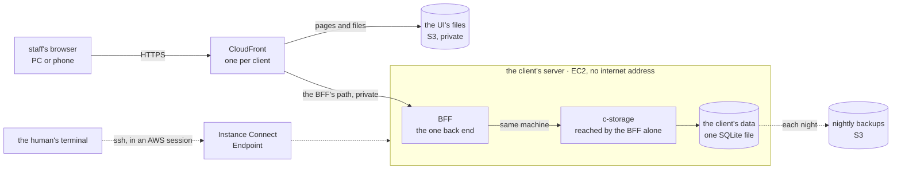

# The architecture: UI → CloudFront → one BFF → c-storage

**Where it stands — 2026-10-27:** planned, not yet decided. The machine's decisions are made; the
plan waits on the human's three calls (step 1). Nothing is built; no AWS call was made.

> **Drafted** 2026-10-27 by the machine, from the old app's diagrams, ops, plans and BFF cost memo,
> and AWS prices read back that day. The machine's decisions: **Decided** 2026-10-27.

## At a glance

Each client gets its own small server, which only CloudFront can reach
([decisions 1, 2, 5, 6](#decisions--the-machines)).

| A month | ([what it costs](#what-it-costs)) |
| --- | --- |
| one client of 50 staff | about $4.75 |
| each further client | the same; about $6 past the 10th, $8.80 past the 45th, as CloudFront's free allowance runs out |
| 10 clients · 50 clients | about $48 · about $303 |

The human's three questions ([the human's calls](#the-humans-calls)):

1. **Whose AWS account, and which region, holds each client's server?** Recommended: ours,
   Singapore.
2. **How much work may a client lose if its server's disk is lost?** Recommended: up to a day.
3. **What address do a client's staff open?** Recommended: a name of ours per client, fixed
   before its first day.

## The need

The human, 2026-10-27: "Suggest an architecture for the credo app — basically: User → CloudFront →
BFF → EC2 (where c-storage stands). Please consider traffic cost for AWS too." The app is UI → one
BFF → c-storage, for SMEs of at most 50 staff, mostly reading, in their daily operations.

## The architecture

The diagram above, drawn from this plan; no code holds it yet. "BFF → EC2" becomes a hop inside one
machine (decision 1).

| From → to | What crosses | Credential | Billed as |
| --- | --- | --- | --- |
| browser → CloudFront | HTTPS: files, the BFF's JSON | the session the BFF mints at sign-in | CloudFront out, requests |
| CloudFront → UI files | a file, on a cache miss | origin access control, this distribution alone | free; S3 reads |
| CloudFront → BFF | each BFF call, uncached; HTTP inside the VPC | none: the VPC origin is the lock (decision 3) | CloudFront to origin; the answer free |
| BFF → c-storage | record reads and writes | c-storage's `x-internal-access-key`, `x-access-key` | loopback, free |
| box → backups | a tarball a night | the box's role, put-only, its own prefix | free via the S3 gateway endpoint; storage |
| the human → box | ssh, deploys | the human's AWS session via Instance Connect, the box's key | free |

## What it costs

**Assumption, one client:** 50 staff × 26 working days × about 750 BFF calls a day ≈ 1 M calls a
month, answers averaging 20 KB → 20 GB; the UI's files, 2 MB a person a day → 3 GB, 0.04 M
requests; 1 KB sent per call → 1 GB to the origin; two c-storage calls per BFF call → 40 GB on
loopback. **Region:** Singapore (`ap-southeast-1`), where the old app ran every box and stack.

| Component | Price | Source | One client |
| --- | --- | --- | --- |
| EC2 `t4g.nano`, 2 vCPU, 0.5 GiB, swap on its disk | $0.0053/h × 730 h | EC2 | $3.87 |
| EBS gp3, 8 GB | $0.096/GB-month | EC2 | $0.77 |
| CloudFront out, 23 GB; requests, 1.04 M | free to 1 TB and 10 M a month; then $0.120/GB, $0.0120 per 10,000 | CF | $0 |
| CloudFront to the origin, 1 GB | $0.060/GB | CF | $0.06 |
| S3: the UI's files, 14 nightly backups | $0.025/GB-month; $0.005 per 1,000 puts | S3 | $0.05 |
| free: box → CloudFront; the page-routes function (2 M free); the S3 gateway and Instance Connect endpoints; no public IPv4 ($0.005/h) | | CF, DT, VPC, EICE | $0 |
| **Total** | | | **≈ $4.75** |

**Sources**, read 2026-10-27: **EC2**, **VPC**, **S3**, **DT**: AWS's public Price List files for
Singapore, published 2026-10-23, 10-16, 10-15, 09-16; **CF**: CloudFront's pay-as-you-go page;
**EICE**: the EC2 guide's Instance Connect Endpoint page. For rejected options: the Lambda and ELB
files, Lightsail's pricing page, CloudFront's flat-rate guide. **Not read back**, pricing only
rejected options: whether Lambda's origin fetches are free, and Lambda's side of reaching a public
address.

**How it grows.** Each client adds its box, ≈ $4.64 fixed, and its traffic. CloudFront's free
allowance is the account's, shared by every client and anything else there: its requests run out
near the 10th client, each then adding $1.25; its bytes near the 45th, each then adding $2.76.

| Clients | 1 | 10 | 25 | 50 |
| --- | --- | --- | --- | --- |
| A month | $4.75 | $48 | $138 | $303 |

## Decisions — the machine's

1. **The BFF runs on the box, beside c-storage, as a long-running server.** c-storage is one box
   already, so a BFF elsewhere adds a hop and no availability. Beside it, its calls are loopback:
   free, off the internet, no cold start; production runs the shape the local stack and the QA
   convention's route tests run. *Price:* the two share the nano's memory (decision 6).
   *Rejected:* Lambda outside a VPC, the old shape: ≈ $9.52 a client with the box's public IPv4,
   c-storage on it behind its keys, cold starts (old p95 333 ms cold, 199 ms warm), a second way to
   deploy. *Rejected:* Lambda inside the VPC: ≈ $5.45 a client, and its first call outside AWS
   needs a NAT gateway, $43.07 a month plus $0.059/GB.
2. **CloudFront reaches the BFF through a VPC origin; the box holds no public IPv4.** Its fetches
   are free, and the port admits CloudFront's VPC-origin security group alone, which "restricts
   the traffic only to your CloudFront distributions" (CloudFront's guide). *Rejected:* the
   public IPv4 as origin: $3.65 a month, TLS on the box, a door on the internet. *Rejected:* an
   ALB: $18.40 a month plus capacity units, balancing one box.
3. **No origin key.** The old `x-origin-key` locked a public Function URL; decision 2 locks this
   door. *Rejected:* keeping it: a secret in two places, guarding nothing more.
4. **The UI's files from a private S3 bucket, on the BFF's distribution.** One origin, so no CORS;
   with the box down, the UI still loads and shows its own failure, never a "nothing there" that
   gets a record entered twice. *Price:* ≈ $0.01 a month. *Rejected:* the BFF serving them: a blank
   page whenever the box is down.
5. **One stack per client: a distribution, a bucket, a box.** A client's outage, release or restore
   touches no other. *Rejected:* one shared box, ≈ $1.74 a client with ten on a `t4g.small`: the
   BFF's tenant check becomes the only wall between clients' records, and one box down stops all.
6. **The smallest box that holds, measured: EC2 `t4g.nano` (Arm) with swap, gp3 8 GB.** Cost and
   correct logic come before speed: swap may slow the BFF. The old nano held one Go service at
   237 MiB free at its least; Node beside c-storage is unmeasured, so the first box is read for
   memory and OOM kills (open item 2). *Price:* a nano that does not hold becomes a `t4g.micro`,
   $3.87 a month more. *Rejected:* a micro up front, on an estimate; `t3.nano`, x86, $0.95 more;
   Lightsail, which no VPC origin takes: its $3.50 IPv6-only bundle is $1.14 less, its door on the
   internet.
7. **CloudFront pay-as-you-go.** In flat-rate plans private origins start at Business, $200 a
   month a distribution; the Free plan has none, and an account holds three.
8. **Nothing on the box calls out of AWS.** Packages and backups pass the S3 gateway endpoint, ssh
   passes Instance Connect, as on the old app's EC2 box. *Trigger:* the first call to a third
   party; a public IPv4, $3.65 a month, is then the cheap way out, a NAT the dear one.
9. **Left behind from the old app**, until something calls it: credo-sso (sign-in becomes a route
   group of the one BFF); audit-backbone (no credo screen calls it); dolga's upload; Caddy, which
   routed two doors through one VPC origin, while one door routes nothing; the Lambda stack and its
   keys (decision 1); the 5xx alerts to chat (open item 1).
10. **The stack is hand-written CloudFormation YAML, shipped through change sets**, the human's
    standing rule: the template is what the human reads and diffs. *Rejected:* CDK, a package
    manager and a synth step in ops. *Price:* every resource and grant written by hand.

## The human's calls

1. **Account and region.** *Recommended:* ours, Singapore, as the old app hosted its client.
   *Price:* the client's AWS bill, ≈ $4.75 a month, is ours to carry and pass on, and its data sits
   in our account; moving it to the client's account later is a restore onto a new box, untested.
   Malaysia, the old client's region, prices the nano $0.37 less (the same EC2 file).
2. **Work a client may lose.** *Recommended:* up to a day: the database copied to S3 each night,
   the old app's drilled path, ≈ $0.03 a month. *Price:* a lost disk means that day's entries
   typed again. A continuous copy loses minutes, for about $0.40 a month of S3 writes (one each
   10 s over 8 hours a day) and a new tool to run and drill.
3. **The address.** *Recommended:* a name under our domain, one per client, fixed before its
   first day. *Price:* a DNS record each (its host's price not read) and an ACM certificate, free
   for CloudFront (ACM's pricing page). A later change signs every device out and strands what
   each browser stored for the app. CloudFront's own name is free and unreadable.

## Steps

- [ ] **1. The human's calls answered.** Who: 👤. Done when: each answer is written under its call,
  dated.
- [ ] **2. This plan decided.** Who: 🤖. Done when: "Where it stands" reads decided, costs are
  re-read where an answer moves a price, and the path and name checks read clean on the commit.
- [ ] **3. The pieces that build it, logged.** Who: 🤖. Done when: `docs/open-items.md` holds the
  infrastructure plan (the YAML template and its deploy) and the app frame's BFF shape (a
  long-running server, c-storage beside it on loopback), each naming who does it.

**Then stop.** This plan ends at a decided architecture. No template, box or AWS call is made
under it; each is a plan of its own.
