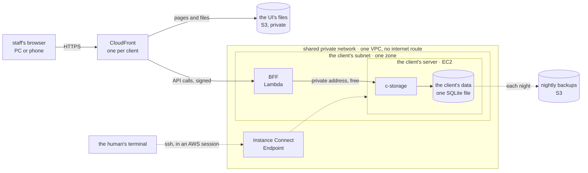

# The architecture: UI → CloudFront → one BFF → c-storage

**Where it stands — 2026-10-27:** revised after review; the BFF moved to Lambda on the human's word.
The machine's decisions are made; the plan waits on the human's four calls (step 1). Nothing is
built: the demo runs on the local stack, and the first server waits for a signed client.

> **Drafted** 2026-10-27 by the machine, from the old app's diagrams, ops, plans and BFF cost memo,
> and AWS prices read back that day. The machine's decisions: **Decided** 2026-10-27.
> review 2026-10-27 (Fable 5.1): 11 findings, all taken.

## At a glance

Each client gets its own back end, on Lambda, and its own small server for its data. Neither is on
the internet: only CloudFront calls the back end, and only the back end reaches the server
([decisions 1, 2, 4](#decisions--the-machines)).

| A month, Malaysia ([what it costs](#what-it-costs)) | |
| --- | --- |
| one client of 50 staff | about $5.20 (Singapore: $5.90) |
| each further client | the same; about $6.40 past the 10th, $9.20 past the 45th, as CloudFront's free allowance runs out |
| 10 · 25 · 50 clients | about $52 · $149 · $325 |

The human's four questions ([the human's calls](#the-humans-calls)):

1. **Whose AWS account, and which region?** Recommended: ours, Malaysia.
2. **How much work may a client lose if its server's disk is lost?** Recommended: up to a day.
3. **What address do a client's staff open?** Recommended: a name of ours per client, fixed
   before its first day.
4. **Does each client get its own server, or share one?** Recommended: its own.

## The need

The human, 2026-10-27: "Suggest an architecture for the credo app — basically: User → CloudFront →
BFF → EC2 (where c-storage stands). Please consider traffic cost for AWS too." Then: "Lambda will
help us keep the performance and scalability, while EC2 is cheap enough for the SQLite instance."
Clients: SMEs of about 50 staff, heavy on reads, under 1,000 writes a working hour. The new app
replaces the old one; no client's server is built before a client signs.

## The architecture

The diagram above, drawn from this plan; no code holds it yet.

| From → to | What crosses | Credential | Billed as |
| --- | --- | --- | --- |
| browser → CloudFront | HTTPS: files, the BFF's JSON | the session the BFF mints at sign-in | CloudFront out and requests, by where the staff are |
| CloudFront → UI files | a file, on a cache miss | origin access control (S3), this distribution alone | free; S3 reads |
| CloudFront → BFF | each call, uncached, to the function URL | origin access control (Lambda): CloudFront signs; the URL takes signed calls alone | CloudFront to origin; the answer not read back |
| BFF → c-storage | record reads and writes, HTTP to the box's private address | c-storage's `x-internal-access-key`, `x-access-key` | free within one zone |
| box → backups | a tarball a night | the box's role, put-only | free via the S3 gateway endpoint; storage |
| the human → box | ssh: c-storage's releases, restores | the human's AWS session via Instance Connect; the box's key | free |

## What it costs

**Assumption, one client:** 50 staff × 26 days × about 750 BFF calls a day ≈ 1 M calls a month,
answers of 20 KB → 20 GB; the UI's files, 2 MB a person a day → 3 GB; 1 KB per call to the origin
→ 1 GB; two c-storage calls per BFF call → 42 GB inside one zone. Lambda: arm64, 256 MB, 100 ms
billed a call; logs 0.8 KB a call. **Staff in Vietnam**, for the human to confirm: CloudFront
prices by the viewer's place, and Vietnam shares a price group with Singapore and Malaysia.

| Component | Malaysia | Singapore | Source |
| --- | --- | --- | --- |
| EC2 `t4g.nano`, 0.5 GiB, swap on its disk | $3.50 ($0.0048/h) | $3.87 ($0.0053/h) | EC2 |
| EBS gp3, 8 GB | $0.69 | $0.77 | EC2 |
| Lambda arm64: 1 M requests · 25,000 GB-s | $0.18 · $0.30 | $0.20 · $0.33 | λ |
| CloudWatch Logs, 0.8 GB, 30 days | $0.42 ($0.50/GB) | $0.58 ($0.70/GB) | CW |
| CloudFront to the origin, 1 GB at $0.060 | $0.06 | $0.06 | CF |
| CloudFront out, 23 GB, 1.04 M requests: free to 1 TB and 10 M a month, then $0.120/GB, $0.0120 per 10,000 | $0 | $0 | CF |
| S3: the UI's files, 14 nightly backups | $0.04 | $0.05 | S3 |
| free: Lambda ↔ box in one zone; the VPC, its S3 gateway endpoint, Instance Connect; no public IPv4 ($0.005/h) | $0 | $0 | DT, AZ, VPC, EICE |
| **Total** | **≈ $5.19** | **≈ $5.86** | |

**Sources**, read 2026-10-27: **EC2**, **λ**, **CW**, **S3**, **VPC**, **DT**, AWS's public Price
List files per Region (published 09-16 to 10-23); **CF**, CloudFront's pay-as-you-go page; **AZ**,
"Data transfer within the same Availability Zone is free" (AWS's architecture blog, 2021-06-30),
and $0.01/GB across zones (DT file, VPC page); **EICE**, the EC2 guide. **Not read back:** whether
CloudFront's fetches from a function URL are free (at the internet rate, up to $2.16 a client;
$2.40 in Singapore); whether Lambda's free tier lasts, so it is not counted.

**How it grows.** Each client adds its own stack. CloudFront's free allowance is the account's:
its requests run out near the 10th client, each then adding $1.25; its bytes near the 45th, each
then adding $2.76. The ceiling is each client's box: every call lands on one SQLite file.

| Clients | 1 | 10 | 25 | 50 |
| --- | --- | --- | --- | --- |
| Malaysia | $5.19 | $52 | $149 | $325 |
| Singapore | $5.86 | $59 | $166 | $359 |

## Decisions — the machine's

1. **The BFF runs on Lambda (arm64), attached to the shared VPC in the client's subnet, in the
   box's zone, calling c-storage on its private address**, on the human's principle. In one zone
   the hop is free; across zones, $0.01/GB each way. *Price:* the box stays the one ceiling; a
   cold start (the old app's first call took 333 ms, its warm p95 199 ms). With no internet route,
   the BFF reaches c-storage and S3 (via the gateway endpoint) alone; its keys sit in its
   environment, encrypted at rest by Lambda with an AWS-managed key, free. *Trigger to
   revisit:* a first call outside AWS, or to a service with no free endpoint: a NAT gateway, $36.61 a month in Malaysia ($43.07 in Singapore)
   plus per GB, or an interface endpoint, $8.54 ($9.49) each plus $0.01/GB. *Rejected:* the BFF on
   the box beside c-storage, the previous draft: $0.90 a client less, no cold start, but it scales
   only as far as the nano. *Rejected:* Lambda outside the VPC on the box's public IPv4: ≈ $4.07 a
   client more, c-storage on the internet. *Rejected:* the function in several zones: $0.84 a
   client across zones, for availability the one box lacks.
2. **CloudFront reaches the function URL through origin access control**, which signs for this
   distribution alone, with "no additional fees" (AWS's blog, 2024). *Price:* "If you use PUT or
   POST methods with your Lambda function URL, your users must compute the SHA256 of the body"
   (CloudFront's guide): the UI's API client hashes each write into `x-amz-content-sha256`, as must
   every test harness; the old app rejected the control for this. *Rejected:* a public URL behind
   the old `x-origin-key`: whoever finds it runs the function, on our bill. With no VPC origin, its
   gateway need, quota and security-group ordering fall away (findings 1, 2).
3. **The UI's files from a private S3 bucket, on the BFF's distribution.** One origin, so no CORS;
   with the back end down, the UI still loads and shows its own failure, never a "nothing there"
   that gets a record entered twice. *Price:* ≈ $0.01 a month. *Rejected:* files served by the
   back end: a blank page whenever it is down.
4. **One shared network under the clients' stacks**: one VPC with no internet gateway, one S3
   gateway endpoint, one Instance Connect Endpoint, a private subnet per client; each client's
   function, box, bucket and distribution on top. Instance Connect allows one endpoint per VPC,
   five per account and Region, not adjustable; VPCs default to five a Region. *Price:* clients
   share a network: the wall between them is each box's security group, admitting its own function's group alone on c-storage's port, then c-storage's
   keys. *Rejected:* a VPC per client, which stops at five; the default VPC, whose internet gateway
   puts a box given a public address on the internet.
5. **The box: EC2 `t4g.nano` (Arm), gp3 8 GB with swap, no public address, running c-storage alone
   as a systemd unit with `Restart=always`, as the old services ran.** The old nano ran one Go
   service with 237 MiB free at its least; c-storage alone is read on the first box (open item 2).
   Its arm64 binary reaches the box over the Instance Connect tunnel, as the old ops shipped its
   EC2 box; AWS throttles high-volume transfer there, and a binary passes. *Rejected:* `t3.nano`,
   x86, $0.81 more; a micro up front, $3.43 more, on an estimate; Lightsail, which peers only with
   a Region's default VPC (Lightsail's guide), outside the shared network.
6. **CloudFront pay-as-you-go.** *Rejected:* flat-rate plans: the Free plan holds 1 M requests and
   100 GB, three per account; Pro is $15 a month a distribution, against $1.25 to $4.01 a client
   of pay-as-you-go past the free allowance.
7. **Left behind from the old app**, until something calls it: credo-sso (sign-in becomes a route
   group of the one BFF); audit-backbone; dolga's upload; Caddy (one listener, nothing to route);
   the `x-origin-key` (decision 2); the 5xx alerts to chat (open item 1).
8. **The stack is hand-written CloudFormation YAML, shipped through change sets**, the human's
   preference, confirmed 2026-10-27: the template is what the human reads and diffs.
   *Rejected:* CDK, a package manager and a synth step in ops. *Price:* every grant by hand.

## The human's calls

1. **Account and region.** *Recommended:* ours, Malaysia (`ap-southeast-5`). *For:* every rate
   read is lower, ≈ $5.19 a client against $5.86; the old app's one client box ran there behind
   Instance Connect, with its backups; Lambda is offered there. *Against:* an opt-in Region,
   enabled once per account; Singapore, also a new choice, needs no step and ran the old
   showcases' web half. Either way the bill is ours to pass on, the data sits in our account, and
   a later move to the client's account is a restore onto a new box, untested.
2. **Work a client may lose.** *Recommended:* up to a day: the database copied to S3 each night,
   the old app's drilled path, ≈ $0.03 a month, restored from the human's terminal (step 3).
   *Price:* a lost disk means that day's entries typed again. A continuous copy loses minutes, for
   about $0.35 a month of S3 writes and a new tool to run and drill.
3. **The address.** *Recommended:* a name under our domain per client, fixed before its first day,
   in Cloudflare, the old app's DNS host, whose Free plan includes DNS at $0 a month; its ACM
   certificate free, requested in `us-east-1` as CloudFront requires. *Price:* a later change signs
   every device out and strands what each browser stored. CloudFront's own name is free and
   unreadable.
4. **One stack per client, or one shared.** *Recommended:* one per client, ≈ $5.19 a month each.
   *The alternative:* one shared box and BFF, ≈ $2.46 a client with ten on a `t4g.small`
   (unmeasured), $2.73 less, but the BFF's tenant check becomes the only wall between clients'
   records, one box down stops them all, and a restore rolls them all back.

## Steps

- [ ] **1. The human's calls answered.** Who: 👤. Done when: each answer is written under its call,
  dated.
- [ ] **2. This plan decided.** Who: 🤖. Done when: "Where it stands" reads decided, costs re-read
  where an answer moves a price, the checks clean on the commit.
- [ ] **3. The pieces that build it, logged.** Who: 🤖. Done when: `docs/open-items.md` names who
  does each, all waiting for a signed client: the network's and a client's YAML templates, with
  the ACM certificate in `us-east-1`; the arm64 builds (c-storage's binary, the BFF's function) and
  how each release lands; the nightly backup and its restore, run from the human's terminal, since
  the box can only put; the app frame's BFF, one app run by the local stack and a Lambda entry.

**Then stop.** This plan ends at a decided architecture. Nothing in it is built for the demo, which
runs on the local stack; the templates and the first box wait for a signed client.
