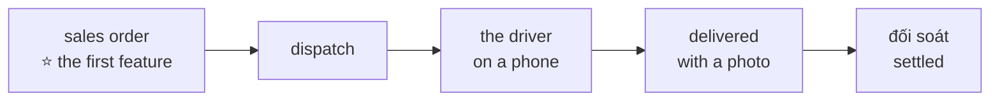

# The big picture: the new credo app

**Where it stands — 2026-10-27:** the starting point, drafted with the human; nothing is built.
**Next:** the app frame, serving [the first feature](#the-first-feature), walked by the 10-30
checkpoint.

> **Starting point** 2026-10-27, the human's answers to the machine's short questions. **Not
> fixed:** the human changes any line at a review, as
> [collaboration](../conventions/collaboration.md#pacing-one-piece-at-a-time) draws the loop:
> the big picture, one piece, the log, a review, then back to the big picture.

## At a glance

**An SME of about 50 staff that delivers goods takes each order from sale to settled, in one
app, set up in 30 minutes from its Excel, with no per-client code** ([the goal](#the-goal)).

| When | What must be true ([dates](#dates)) |
| --- | --- |
| 10-30 | the first feature, sign in and enter an order, walked; if not, the human trims the flow for 11-04 that day |
| 11-04 | sales-ready: the demo shows the whole flow, for the launch week's screenshots and video |
| a client signs | its server, its import, its first day |

Seven criteria, each a check someone runs ([criteria](#success-criteria)): setup in 30 minutes ·
the driver as simple as Zalo · the flow walked · no per-client code · 50 staff held · about $5 a
client · the first client's 100 orders.

The new app **replaces the old one** ([the old app](#the-old-app)). **Not yet:** anything past
the flow, a client's server, the import before 11-04 ([not yet](#not-yet)).

## The goal

**An SME of about 50 staff that delivers goods takes each order from sale to settled (sales
order → dispatch → driver → delivered → đối soát) in one app, set up in 30 minutes from its
Excel, with no per-client code.** *The human, 2026-10-27*, choosing the machine's draft of the
human's 2-week launch memo of 10-21, kept outside the repo.

For whom: SMEs of about 50 staff; heavy read, under 1,000 writes a working hour (the human,
10-27). *Rejected:* "the old credo's UI and concept on a simpler stack": it says why we rebuild,
not what a client gets.

## The old app

**The new app replaces it** (the human, 10-27). The old app takes no more launch work; it stays
a read-only reference to pick pieces from.

**11-04 means sales-ready** (the human, 10-27). The demo tenant shows the whole flow, real
enough for the launch week's screenshots and video. A first paying client goes live later, on a
date fixed when one signs: outreach starts only after 11-04.

**The human's time:** the product's share goes to the new app alone, never split between two
apps. The sales preparation stays the human's, in parallel, outside this repo.

*Rejected:* the machine's "follows it", the old app serving new clients from 11-04 while the
new one is built. The price of replacing: no client can go live on the old app meanwhile.
*Rejected:* "client-ready on 11-04", eight days from no code, which would cut the flow to one
stage.

*Hazard no gate catches:* a client signs before the flow is walked, and no other app can take
it. *Trigger to revisit:* a signed client whose first day falls before the flow's walks are
all yes.

## Success criteria

Seven at most; each is done when its check reads back (the human, 10-27).

- [ ] **1. Set up in 30 minutes.** Who: 🤖 the test, 👤 the timed run. Done when: a test imports
  the demo's workbook (customers, drivers, products) into an empty tenant and an order is
  entered; and the human's run, once, from an empty tenant to the first order, takes 30
  minutes or less.
- [ ] **2. The driver as simple as Zalo.** Who: 👤. Done when: from open to delivered with its
  photo takes three screens at most, and the driver's walk holds the human's yes on each, on a
  phone ([QA](../conventions/qa.md) rule 7).
- [ ] **3. The core flow walked.** Who: 👤. Done when: each stage, sales order to đối soát, has
  its walk on the map, and none holds an open "no".
- [ ] **4. No per-client code.** Who: 🤖. Done when: a grep of the source for every client's
  code finds nothing, and two tenants with different configs walk the same build.
- [ ] **5. A client's server holds 50 staff.** Who: 🤖. Done when: a load probe at twice the
  human's rate (heavy reads, 2,000 writes an hour) on the chosen server size reads a p95 under
  300 ms and no error. The 300 ms is the machine's proposal.
- [ ] **6. About $5 a client a month.** Who: 👤 (money). Done when: the month's AWS bill, by
  client tag, reads about $5; the architecture plan estimates $4.75.
- [ ] **7. The first client runs 100 orders in its first month.** Who: 👤 (production). Done
  when: that tenant's orders in its first month count 100 or more, the memo's line for a free
  second month.

*Rejected:* an eighth, "the demo holds no real data", moved to [never](#never) on the human's
choice: a limit, not a measure of success.

## The first feature

**Sign in, then enter a sales order** (the human, 10-27). Office staff sign in and enter an
order for a customer, choosing from its products: the flow's first stage, and the demo's first
screen. Customers and products come from the demo's generator until the import exists. The app
frame carries what this calls (sign-in, one page, one BFF route, c-storage) and nothing else.
Its plan brings its case table and its walks ([QA](../conventions/qa.md) rules 1 and 7).

*Rejected:* the Excel import first, an internal tool behind an upload, with no staff's screen
for the demo. *Rejected:* staff and sign-in first, the old app's finished piece: it is off the
flow, and the demo would still show no order.

## Not yet

Each comes back at a review (the human, 10-27).

- **Nothing past the core flow** until the first client has run its first month: "no polish, no
  extension", the memo's rule.
- **No more work on the old app.**
- **No client's server before a client signs.** The demo runs on the local stack for the
  screenshots and video.
- **The import after 11-04**, before the first client's setup. Criterion 1 is read then.

## Never

- **No real client's data in the demo** (the human, 10-27). Its data comes from a generator in
  the repo alone, and a review reads the seed.

## Dates

| Date | What | Who reads it |
| --- | --- | --- |
| 2026-10-30 | Checkpoint: the first feature walked. If not, the flow for 11-04 is trimmed that day | 👤 |
| 2026-11-04 | Sales-ready, as [the old app](#the-old-app) says | 👤 |
| when a client signs | its server, its import, its first day | 👤 |

*The human, 2026-10-27.* *Rejected:* 11-04 alone, where a slip shows only on 11-03.
*Hazard no gate catches:* five stages in eight days from no code. *Guard:* the 10-30
checkpoint.
