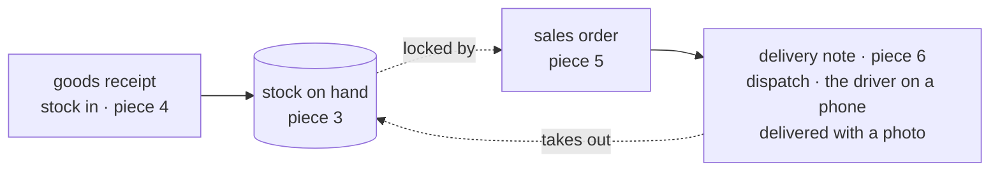

# The big picture: the new credo app

**Where it stands — 2026-10-27:** the starting point, drafted with the human, changed by the
human at 21:07 +07 to six pieces built end to end, and settled at 23:05 +07; nothing is built.
**Next:** [piece 1](#the-first-feature), client config and login, walked by the 10-30 checkpoint.

> **Starting point** 2026-10-27, the human's answers to the machine's short questions. **Not
> fixed:** the human changes any line at a review, as
> [collaboration](../conventions/collaboration.md#pacing-one-piece-at-a-time) draws the loop:
> the big picture, one piece, the log, a review, then back to the big picture.

## At a glance

**An SME of about 50 staff that delivers goods takes each order from sale to delivered, with its
stock, in one app, set up in 30 minutes from its Excel, with no per-client code**
([the goal](#the-goal)).

| When | What must be true ([dates](#dates)) |
| --- | --- |
| 10-30 | piece 1, client config and login, walked |
| 11-11 | sales-ready: the demo shows all six pieces, for the launch week's screenshots and video; outreach after it |
| a client signs | its server, its import, its first day |

Seven criteria, each a check someone runs ([criteria](#success-criteria)): setup in 30 minutes ·
the driver as simple as Zalo · the flow walked · no per-client code · 50 staff held · about $5 a
client · the first client's 100 orders.

**Built in six pieces**, each end to end with its walk (the human, 10-27 21:07 +07): client config
and login, the employee list, products and inventory, goods receipts, sales orders, delivery notes
([the first feature](#the-first-feature)).

The new app **replaces the old one** ([the old app](#the-old-app)). **Not yet:** anything past
the six pieces, đối soát, a client's server, the import right after the demo is sales-ready
([not yet](#not-yet)).

## The goal

**An SME of about 50 staff that delivers goods takes each order from sale to delivered (sales
order → delivery note: dispatch, the driver, delivered with a photo), with its stock beside it
(goods receipts in, stock on hand), in one app, set up in 30 minutes from its Excel, with no
per-client code.** *The human, 2026-10-27*, choosing the machine's draft of the human's 2-week
launch memo of 10-21, kept outside the repo; *changed by the human, 10-27 23:05 +07:* đối soát
moved to [not yet](#not-yet), the stock added.

For whom: SMEs of about 50 staff; heavy read, under 1,000 writes a working hour (the human,
10-27). *Rejected:* "the old credo's UI and concept on a simpler stack": it says why we rebuild,
not what a client gets.

## The old app

**The new app replaces it** (the human, 10-27). The old app takes no more launch work; it stays
a read-only reference to pick pieces from.

**11-11 means sales-ready** (the human, 10-27 23:05 +07, moved from 11-04). The demo tenant
shows all six pieces, real enough for the launch week's screenshots and video. A first paying
client goes live later, on a date fixed when one signs: outreach starts only after 11-11.
*Price:* the launch week a week later.
*The human, 2026-10-28:* no fixed date; the release is "when it is ready" ([ridge-app's call 3](2026-10-28-ridge-app.md#the-humans-calls)).

**The human's time:** the product's share goes to the new app alone, never split between two
apps. The sales preparation stays the human's, in parallel, outside this repo.

*Rejected:* the machine's "follows it", the old app serving new clients from 11-04 while the
new one is built. The price of replacing: no client can go live on the old app meanwhile.
*Rejected:* "client-ready" in place of sales-ready, a client's server and import on top, which
would cut the flow to one stage.

*Hazard no gate catches:* a client signs before the flow is walked, and no other app can take
it. *Trigger to revisit:* a signed client whose first day falls before the flow's walks are
all yes.

## Success criteria

Seven at most; each is done when its check reads back (the human, 10-27).

- [ ] **1. Set up in 30 minutes.** Who: 🤖 the test, 👤 the timed run. Done when: a test imports
  the demo's workbook (customers, drivers, products) into an empty tenant and an order is
  entered; and the human's run, once, from an empty tenant to the first order, takes 30
  minutes or less.
- [ ] **2. The driver as simple as Zalo.** Who: 👤. Done when: from open to delivered with its
  photo takes three screens at most, and the driver's walk holds the human's yes on each, on a
  phone ([QA](../conventions/qa.md) rule 7). Read at piece 6's walk (the human, 10-27 23:05 +07).
- [ ] **3. The core flow walked.** Who: 👤. Done when: each of the six pieces has its walk on the
  map, and none holds an open "no" (the human, 10-27 23:05 +07; it read "sales order to đối
  soát").
- [ ] **4. No per-client code.** Who: 🤖. Done when: a grep of the source for every client's
  code finds nothing, and two tenants with different configs walk the same build.
- [ ] **5. A client's server holds 50 staff.** Who: 🤖. Done when: a load probe at twice the
  human's rate (heavy reads, 2,000 writes an hour) on the chosen server size reads a p95 under
  300 ms and no error. The 300 ms is the machine's proposal.
- [ ] **6. About $5 a client a month.** Who: 👤 (money). Done when: the month's AWS bill, by
  client tag, reads about $5; the architecture plan estimates $4.75.
- [ ] **7. The first client runs 100 orders in its first month.** Who: 👤 (production). Done
  when: that tenant's orders in its first month count 100 or more, the memo's line for a free
  second month.

*Rejected:* an eighth, "the demo holds no real data", moved to [never](#never) on the human's
choice: a limit, not a measure of success.

## The first feature

**Piece 1: client config and login, with the root account** (the human, 2026-10-27 21:07 +07).
The human: "piece by piece; each should cover end-to-end, incrementally … each step should have a
walk", in Vietnamese and English. The pieces, in the human's order: 1. client config and login;
2. the employee list; 3. the product list and inventory; 4. goods receipts; 5. sales orders;
6. delivery notes. Each is a slice from the UI to c-storage, walkable on the local stack when it
ends; the frame is built with piece 1, never as a layer of its own. Each piece's plan brings its
case table and its walk ([QA](../conventions/qa.md) rules 1 and 7);
[the app frame](2026-10-27-app-frame.md) is piece 1's.

*Replaced* by the human, 10-27 21:07 +07: "sign in, then enter a sales order", now piece 5's
starting draft. *Rejected:* the Excel import first, an internal tool behind an upload, with no
staff's screen for the demo.

## Not yet

Each comes back at a review (the human, 10-27).

- **Nothing past the six pieces** until the first client has run its first month: "no polish, no
  extension", the memo's rule (the human, 10-27 23:05 +07; it read "the core flow").
- **Đối soát**, the settling, comes back at a review after the six pieces (the human, 10-27
  23:05 +07).
- **No page for vendors:** the demo's generator writes them until the import (the human, 10-27
  23:05 +07). *Amended 2026-10-31:* customers and products have their list pages and their Excel
  import now, as [slice 1 of the road to 11-04](2026-10-31-customers-products.md) builds them.
- **No more work on the old app.**
- **No client's server before a client signs.** The demo runs on the local stack for the
  screenshots and video.
- **The import right after the demo is sales-ready**, before the first client's setup. Criterion
  1 is read then.

## Never

- **No real client's data in the demo** (the human, 10-27). Its data comes from a generator in
  the repo alone, and a review reads the seed.

## Dates

*Amended 2026-10-31 (Decide 41, as the slice's plan cites it):* the demo on ridge is 11-04, and the
pieces' order below is the road to it, led by [customers and
products](2026-10-31-customers-products.md); the dated rows that follow are as they were written.

| Date | What | Who reads it |
| --- | --- | --- |
| 2026-10-30 | Checkpoint: piece 1 walked (the human, 10-27 21:07 +07) | 👤 |
| 2026-11-01 to 11-10 | Pieces 2 to 6, each walked on its date in [the app frame](2026-10-27-app-frame.md#the-pieces) | 👤 |
| 2026-11-11 | Sales-ready, as [the old app](#the-old-app) says (the human, 10-27 23:05 +07) | 👤 |
| when a client signs | its server, its import, its first day | 👤 |

*The human, 2026-10-27.* *Rejected:* sales-ready alone, where a slip shows only the day before.
*Hazard no gate catches:* six pieces in fifteen days from no code. *Guard:* each piece's walk on
its date, so a slip shows the day it happens.
