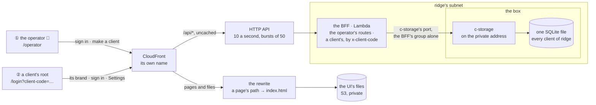

# ridge-app: the whole app on ridge, an operator who makes clients, a client's sign-in by its link

**Where it stands — 2026-10-28 20:10 +07:** planned; steps 1 to 12 are done. The edge is an HTTP API (the function-URL probe answered "not offered" in Malaysia), a client is a tenant, and there is no date (the human's three calls). Layer four's template and the deploy are built (steps 9 and 10) and read clean by cfn-lint, ShellCheck and `ops/test.sh` in CI; the review's F1 to F13 are tagged (step 11); act and GitHub are both green on `71ba915` (step 12). One finding is parked in [the log](../open-items.md) (item 14). **Next:** step 13, the human's walk in the terminal on the stack, 78 bases and the answers.

> **Drafted** 2026-10-28 by the machine, from the human's ask of 13:4x +07,
> [piece 1's plan](2026-10-27-app-frame.md), [the big picture](2026-10-27-big-picture.md), `bff/`,
> `ui/`, `shared/`, `scripts/`, `visual/` and `walk/` on this branch, and from `main`:
> [the architecture](2026-10-27-architecture.md), [ridge's plan](2026-10-28-ridge.md),
> [the parked URL plan](2026-10-28-ridge-url.md), [the c-storage memo](../memo/c-storage.md),
> [the open items](../open-items.md), `ops/` and c-storage's workflow. Also read, none copied: the old
> UI's boot and its client-config page, the old credo-sme's client-code middleware, provisioning
> controller, Lambda entry and build script. Links into `main`'s newer docs resolve once `main` is
> merged in (step 3).
>
> **This plan amends** the following. Each has a one-line pointer from step 3,
> since this branch holds older copies of those files. The memo's section is rewritten at step 4:
>
> - **The architecture's decision 2**, CloudFront to the BFF's function URL: it cannot be built in
>   Malaysia. An HTTP API in front of the function replaces it, about $1.25 a client a month
>   ([call 2](#the-humans-calls)).
> - **Piece 1's plan:**
>   - "the tenant is the deployment", "a session carries no client code" and `x-client-code` left
>     behind: a client is now named by its code ([call 1](#the-humans-calls));
>   - its left-behind "operator's settings page" returns as a page that makes clients and never edits
>     one;
>   - row 18, the body hash, retires with the function URL (call 2).
> - **Ridge's plan:**
>   - its fourth layer is planned here ([layer four](#layer-four));
>   - the check's "one rule" and "loopback alone" change;
>   - the deploy role gains code-only rights;
>   - one workflow ships c-storage, the BFF and the UI.
> - **The c-storage memo's** "loopback only, for now", rewritten at step 4.
> - **Open items 5** (its BFF half), **7** and **14**, each closed by a step here.
> - **The parked URL plan:** this plan takes its listener (item 1 of "what it pulls forward") and its
>   shape H, for the BFF. Its own public URL stays parked.

## At a glance

Drawn from this plan; no code holds it yet.

| | What it is ([below](#what-a-client-is)) |
| --- | --- |
| **a client on ridge** | a tenant inside ridge's one stack: its settings, root and sessions under a minted id, found by its code |
| **① the operator**, the human | signs in at `/operator` with its own password; makes a client from a code and a name; is shown its link and its root's first password, once ([the operator](#the-operator)) |
| **② a client** | opens `/login?client-code=<code>`, piece 1's sign-in in its colours; a code we do not know gets one screen, never another client ([a client's sign-in](#a-clients-sign-in)) |
| **the edge** | CloudFront's own name; the files from a private bucket; the BFF behind an HTTP API, as Malaysia has no function URLs ([the edge](#the-edge)) |
| **a month** | about $0.07 on top of ridge's $4.20; later, about $1.25 more on each signed client's stack ([cost](#what-it-costs)) |

**The human's three calls**, one recommendation each ([below](#the-humans-calls)): 1. a client on
ridge is a tenant in its one stack, and a signed client keeps its own stack; 2. an HTTP API replaces
the function URL, and the body hash goes; 3. no date: the human releases when it is ready.
All three are answered ([below](#the-humans-calls)).

The machine builds and checks it locally; the human walks it there. It enters `main` after piece 1.
The human makes layer four with one script; GitHub ships it; the human walks it on ridge
([steps](#steps)).

## The need

The human, 2026-10-28 13:4x +07: "Next, before the employee plan, let deploy the whole app with
- config UI for admin (me) to create new client
- login by the client

the url should be `<cloudfront-url>/login?client-code=<client-code>`".

The human's delivery method: an MVP end to end at low cost, verified locally, a generated report,
then ridge "so other partners can check without source code". ridge runs c-storage, deployed by
GitHub from `main` ([ridge's plan](2026-10-28-ridge.md)). Piece 1 is built and reviewed on
`app-frame`, and its walk is on 10-30. This branch carries piece 1.

**The callers:** the operator, who is the human alone; a client's root, given its link by the
operator; partners, each signing in as a client the operator made for them. Nothing is built for
any other caller.

**A word:** the ask's admin is called **the operator** here, the old app's word for us. Piece 1
already calls a client's root "the client's admin" (its walk; `visual/src/walks.ts`), and two
admins would be mixed up in every table.

## What a client is

**Call 1.** On ridge, a client is a tenant inside ridge's one stack. Its records sit under a
minted id in the BFF's one c-storage service, and its code finds it.

| Record | Holds | Written by |
| --- | --- | --- |
| `client.<code>` | the tenant's id; the name as made, for the reader | the operator's create, last, `If-None-Match: *` |
| `tenant.<id>.config` | piece 1's settings | create; then the root, in Settings |
| `tenant.<id>.user.<name>` | piece 1's user: the root, `root: true` | create |
| `tenant.<id>.session.<device>` | piece 1's session | a client's sign-in |
| `operator.user.<name>` | the operator's password hash | `pnpm stack`; `ops/operator.sh` on ridge |
| `operator.session.<device>` | the operator's session | the operator's sign-in |

`recordKeys` in `shared/src/records.ts` stays the layout's one home; each tenant key takes the id
first.

- **The id is minted, and the code is an index.** `CLAUDE.md`'s rule: records link by the
  server-minted id, and a code is a label. Every call that names a code reads `client.<code>`
  first, so each call makes one c-storage read more than in piece 1. No route renames a code yet;
  the index is what lets a rename come later without moving a record. *Rejected:* records keyed by
  the code itself. A rename would then move every record the client has.
- **A signed client's own stack keeps the architecture's call 4**. It runs the same build and the
  same layout, with one tenant, made by the operator on that stack's own address. Two things are
  decided with that stack and its name (the architecture's call 3): whether its address still
  needs `?client-code=`, and whether it serves the operator's page at all.
- **The BFF's key prefix is the only wall between ridge's tenants.** This is the price call 4's
  alternative named: a bug that reads under the wrong id shows one tenant another's records. It is
  accepted on ridge alone, which holds invented data (ridge's row 15; row 12 here). *Guard:*
  every tenant key is built by `recordKeys` from the id, and the route tests hold two tenants apart
  (rows 8, 14).
- *Rejected:* **a c-storage service per tenant.** c-storage's own 403 would then stand between
  tenants. But the BFF would hold the super-admin key to register each one, against `CLAUDE.md`'s
  "the stack, never the BFF, holds c-storage's super-admin key". It would also hold every tenant's
  access key, so a bug or a leak in the BFF would still cross tenants.
- *Rejected:* **a stack per client, made from the operator's page.** It costs about $4.20 a client
  a month on ridge and takes minutes per client. The page would also hold CloudFormation and IAM
  rights that only the human's change sets hold today.

**What it reverses:**

- piece 1's "the tenant is the deployment … the wire carries no client code"
  ([its frame](2026-10-27-app-frame.md#the-frame)) and "a session carries no client code";
- `x-client-code` returns. As in the old app, it scopes and never authenticates;
- piece 1's left-behind "operator's settings page and admin key" returns as a page that makes
  clients and never edits one, behind a password rather than a key.

**Not reversed:** the architecture's call 4, and piece 1's call 2 (the settings are the root's).

## The operator

- **Who:** the human, with one account. A second operator is *not yet* (row 11).
- **Sign-in:** at `/operator`, with a name and a password. The screen is piece 1's sign-in, drawn in
  credo's own name and colour. A session lasts a week per device, under
  `operator.session.<device>`, through piece 1's sessions module.
  - The operator's routes are its own: `/api/operator/sign-in`, `sign-out` and `me`. They are never
    piece 1's routes with the header missing. A client's UI that forgot its code must reach nothing,
    not the operator's door.
  - *How it differs from a root:* a root belongs to one tenant and is found through its code. The
    operator belongs to none, reads no tenant, and no header names it. A root's handle is no
    operator's handle, and the operator's handle opens no client (rows 1, 16). The page is drawn
    outside the client's boot, as the old UI drew its client-config page outside its shell.
  - *The first password* is random, shown once, and stored as its scrypt hash. Locally, `pnpm stack`
    prints it beside the root's. On ridge, `ops/operator.sh ridge [<name>]` writes it through the
    tunnel and shows it on the human's terminal alone, never in the log. `--replace` makes a new
    one, the way back from a lost password. *Rejected:* an operator's key in the BFF's environment,
    the old operator page's shape, which piece 1 named a defect: one shared secret typed into a page,
    and changed only by a deploy.
- **"Make a client" end to end:** `POST /api/operator/clients`, under the operator's session.
  1. The code and the company's name are checked against `shared/`'s schemas.
  2. `client.<code>` is read. A taken code is a 409, and nothing is written.
  3. An id is minted, and two records are written, each with `If-None-Match: *`:
     - `tenant.<id>.config`: the name, credo's colour, no logo, Vietnamese and English with
       Vietnamese first;
     - `tenant.<id>.user.root`: the hash of a random first password, `root: true`.
  4. `client.<code>` is written last, with `If-None-Match: *`. This one write makes the client.
     - A 412 here means the code was taken in the meantime: a 409. The two records of step 3 stay
       unreachable, a few hundred bytes.
     - A failure before this write leaves the code free, and the operator tries again.
  5. The answer comes once: the link's path, the root's name (`root`) and its first password. No log
     line holds the password (row 18).
  - **No c-storage registration:** every tenant lives in the BFF's one service (call 1).
  - `pnpm stack`'s demo client is made by the same function, then given piece 1's demo settings.
- **The code's rules:**
  - 3 to 32 characters: lowercase letters, digits and hyphens, a letter first and a letter or
    digit last;
  - unique in its stack, and fixed once made;
  - the operator's form and the UI lower and trim what is typed or linked; the BFF takes the exact
    form alone (`clientCodeSchema` in `shared/`).
- **What the operator may never do:**
  - read or change a client's settings, users or sessions;
  - see a root's password after its one screen;
  - sign in as a client, or remove one;
  - reach c-storage's keys.

  No route does any of these, and a test holds the BFF's list of routes exact (row 9). Some
  operator work is *not yet* (row 11): a list of clients, a client removed or its code changed, a
  root's password reset.

## A client's sign-in

The address is the human's: `<the app's address>/login?client-code=<code>`.

- **How the code reaches the BFF:** the boot reads `client-code` from the address on any page, or
  else takes the one this device kept. It keeps the code (`credo.client`), and every API call sends
  it in `x-client-code`, as `x-device-id` is sent. *Rejected:* the code in every API path
  (`/api/c/<code>/…`), which moves each of piece 1's routes. *Rejected:* the code in the query of
  each API call, where it mixes with each route's own query.
- **A missing, malformed or unknown code:** one screen, the walk's screen 9: "this address names no
  company we know; open the link your company sent you". It shows credo's colour, never another
  client's. The BFF answers 400 for a missing or malformed code and 404 for an unknown one, before
  it reads any session (row 15).
- **A known code:** piece 1's sign-in, in the client's name and colours. The root signs in and lands
  on Settings.
- **The session** is the tenant's: `tenant.<id>.session.<device>`, with piece 1's handle. A handle
  sent with another code names no session there, so the answer is 401 (row 14). The device keeps
  one client and one handle at a time: a link to another client signs this device out of the first.
- **What piece 1's sign-in changes:**
  - the boot, and screen 9 above;
  - the API client's header;
  - the BFF reads the tenant first, then runs piece 1's routes under its id;
  - `pnpm stack` and the generator go through the operator's create;
  - the walk spec opens the link, and its 48 bases are expected unchanged;
  - the body hash goes (call 2).

  Piece 1's words do not change, so the answers to its walk hold.

## The edge

**The probe's answer:** the human ran it on 2026-10-28 at 13:28 +07; the log is the credo root's
`logs/function-url-probe.log`. It answered `AccessDeniedException … Unable to determine
service/operation name to be authorized`. That is the answer
[the parked plan](2026-10-28-ridge-url.md#found-function-urls-in-malaysia) predicted for a Region
without function URLs. So the architecture's decision 2, CloudFront to the BFF's function URL with
origin access control, cannot be built in Malaysia. **Call 2.**

**Recommended: shape H** of [the parked plan](2026-10-28-ridge-url.md#the-edge-weighed), with the
BFF itself as the function:

| From → to | How | Credential |
| --- | --- | --- |
| browser → CloudFront | HTTPS, on CloudFront's own name and certificate | the BFF's session, as in piece 1 |
| CloudFront → the UI's files | the default behaviour. A CloudFront Function maps a path with no file extension to `/index.html`. `index.html` is sent `no-cache`; every other file is named by its hash and kept a year | origin access control (S3), for this distribution alone |
| CloudFront → HTTP API | `/api/*`, uncached, every method, every viewer header but `Host` (`AllViewerExceptHostHeader`) | none: the API's own address answers anyone |
| HTTP API → the BFF | the `$default` route, payload 2.0; the stage throttled to 10 a second, bursts of 50 | the invoke permission, for this API alone |
| the BFF → c-storage | inside ridge's subnet: the BFF's group to the box's, on c-storage's port | c-storage's keys, as in piece 1 |

- **A rewrite rather than error pages.** CloudFront's custom error responses apply to the whole
  distribution, so they would turn the BFF's own 404 ("no such client") into the app's page, with
  status 200. The function covers the files' behaviour alone (row 25). The local front already
  does the same (`page` in `scripts/src/front.ts`).
- **No origin signing.** Origin access control has no API Gateway origin, so anyone who learns the
  API's own address can call it. They reach the same BFF and need the same sessions; what they
  bypass is CloudFront, which enforces nothing here. The stage's throttle bounds the bill.
  *Rejected:* a header that CloudFront adds and the BFF checks (the old `x-origin-key`). The
  function runs, and is billed, before it checks the header.
- **The body hash goes,** with the function URL that required it:
  - the UI's API client stops hashing writes;
  - the local front stops refusing a write without its hash;
  - piece 1's row 18 retires (row 33 here).

  The front then stands where CloudFront and the API stand. *Price:* about an hour, on this branch.
  A Region with function URLs would bring the hash back, with that edge.
- **The throttle** is the parked plan's 10 a second, bursts of 50: enough for a few partners and
  for the check's dozen calls. A signed client's stack sets its own.
- *Rejected,* each weighed in the parked plan or priced here:
  - **the BFF in Singapore** behind its function URL, with the box in Malaysia. This is decision 2
    as drawn, but it needs a second network, peered across Regions; both c-storage calls of every
    BFF call are billed between Regions (that rate is not read here); and the one shared network is
    split in two;
  - **an HTTP API with a VPC link:** not offered in Malaysia;
  - **CloudFront's VPC origin:** it needs an internet gateway on the one network, and a load
    balancer in front of a function;
  - **an application load balancer:** a fixed hourly charge, and a public subnet;
  - **a Lambda Web Function:** it needs two zones, and ridge has one;
  - **waiting** for function URLs in Malaysia: there is no date to wait for.
- **CloudFront's own name** ([ridge's left behind](2026-10-28-ridge.md#left-behind)) means no name
  of ours and no certificate. The name is in no committed file and is masked in the public job's
  log. `stack.sh` prints it in the human's local log alone (row 31).

## Layer four

These are the items of [ridge's fourth layer](2026-10-28-ridge.md#the-fourth-layer-with-piece-1),
each settled here.

**The listener** ([open item 7](../open-items.md)) is built as
[ridge's plan designed it](2026-10-28-ridge.md#the-listener-open-item-7), and taken to the box as
the parked plan's [item 1](2026-10-28-ridge-url.md#what-it-pulls-forward) does:

- `LISTEN_ADDR` is optional, and loopback when unset, so the local stack and every test stay as they
  are. It takes one IP address, never `0.0.0.0`, `::` or a name.
- Each release writes `/etc/c-storage/listen.env` from the stack's `BoxAddress`. The unit reads that
  file and starts once the network is online.
- `lib.sh`'s tunnel forward and every read of `/health` move to that address, which `lib.sh` names
  once.

*Price:* loopback stops being a second wall; the box's group and c-storage's keys remain. The
memo's "loopback only, for now" is rewritten in the same commit.

**The template's additions** all go in `ops/env.yml`, each as a resource of its own, so the change
set adds resources and modifies `DeployRole` alone:

| Resource | For |
| --- | --- |
| `BffGroup` | the BFF's side: its one inline egress rule sends to c-storage's port on `BoxGroup`, and nowhere else (a separate egress resource cannot remove the default allow-all rule) |
| `BoxFromBff` | the box's second rule: c-storage's port, from `BffGroup` alone |
| `Bff`, `BffRole`, `BffLogs` | the function: arm64, 256 MB, 10 s, in ridge's subnet. Its role holds only its network interfaces and its log; the log keeps 14 days. Its code is a stub that answers 503 until the first deploy, and the template gives it no `Environment` |
| `Api`, `ApiStage`, `ApiRoute`, `ApiIntegration`, `ApiInvoke` | the HTTP API: the `$default` stage and route, throttled, access logging off; the BFF's invoke permission, for this API alone |
| `UiBucket`, `UiBucketPolicy`, `UiAccess` | the UI's files: public access blocked, encrypted, read by the distribution alone through origin access control |
| `UiRewrite` | the CloudFront Function, `cloudfront-js-2.0` |
| `Distribution` | the two behaviours above; HTTPS alone |

- c-storage's port reaches the template as a parameter that `stack.sh` reads from the unit
  (`unit_port`), the port's one home.
- The template derives the API's host from `ApiEndpoint`, so no address is written anywhere.
- The runtime is `nodejs24.x`, the Node the old BFF's bundle targeted, unless Lambda lists a newer
  one in Malaysia when the template is written.

**The BFF never passes `/health` on.** The shared c-storage client has no health call, and no BFF
route reads `/health`. A route test holds that no BFF answer carries `buildVersion`. Through
CloudFront, `/api/health` is the BFF's 404, and `/health` is the app's page (row 23).

**How CD ships the BFF and the UI: as code alone.** *Decided by the machine.* The deploy role gains
these rights, and nothing else:

- `lambda:UpdateFunctionCode`, `lambda:UpdateFunctionConfiguration` and
  `lambda:GetFunctionConfiguration` on `Bff` alone. Lambda's VPC condition keys hold its settings to
  ridge's subnet and `BffGroup`;
- `ec2:DescribeSubnets`, `ec2:DescribeVpcs` and `ec2:GetSecurityGroupsForVpc`, on every resource (AWS
  grants a describe on all or none). *Why:* Lambda checks the network resources of a VPC setting as
  the caller ([Lambda's VPC guide](https://docs.aws.amazon.com/lambda/latest/dg/configuration-vpc.html)),
  and every settings change from `app.sh` sends the VPC settings;
- `s3:PutObject` on `UiBucket`'s objects; no list and no delete (`aws s3 cp` to a bucket lists
  nothing);
- the check's reads of the bucket's public-access block and policy.

It gets no CloudFormation change, no IAM and no CloudFront right. No invalidation is needed:
CloudFront keeps `index.html` for at most a second, the managed `CachingOptimized` policy's
minimum. *Rejected:* each code change through the template, where every push to `main` that touches
the app would wait for the human's change set. *Rejected:* CloudFormation rights through an
execution role, as [ridge's plan argued](2026-10-28-ridge.md#deploys-from-github-actions).

**The BFF's keys:**

- `INTERNAL_ACCESS_KEY` comes from the box's `keys.env`.
- `SERVICE_CODE` and `SERVICE_ACCESS_KEY` come from a second file, `/etc/c-storage/bff.env`, root's
  alone (0600). The first app release makes it once on the box, as the first release made
  `keys.env`.
- Each deploy:
  1. reads them over ssh and masks them first;
  2. registers the service with the super-admin key. A 201 is done; after a 409 the key is read back,
     as `pnpm stack`'s `ensureService` does;
  3. sets the function's environment from a 0600 file, then deletes the file.

The box's files stay the one home, and the function holds a copy, set again at every deploy.
*Rejected:* a parameter store or a secrets service, which needs an interface endpoint in the VPC, a
fixed monthly charge. *Hazards:*

- A key changed on the box reaches the BFF only at the next deploy; until then the BFF answers 503.
  After a key change, run `ops/app.sh ridge`.
- The BFF's service key never changes: c-storage has no route that replaces one
  ([the memo](../memo/c-storage.md#keys-are-compared-exactly-and-stored-hashed)). A leaked one
  means a new `bff.env` and a new service code, and ridge's clients made again.

**The deploy:** one job ships all three parts under one commit.

- The workflow becomes `.github/workflows/ci.yml`, and `ops/test.sh` reads it by that name.
- It gains a job, `app`: `pnpm check`, with Go, Node 26 and pnpm 12.10.1. It runs beside `check`,
  `e2e` and `ops`.
- Its paths add `bff/`, `ui/`, `shared/`, `scripts/` and the workspace's files.
- `deploy` needs all four jobs, and runs three scripts in order:
  1. `release.sh ridge`, as today. A superseded release ends the job green right there: ridge runs a
     newer commit, whose own deploy shipped its BFF and UI.
  2. `ops/app.sh ridge`, which is new; the human also runs it while Actions is down. In order:
     - it reads the keys and makes sure of the BFF's service;
     - it builds the bundle with `pnpm --filter @credo/bff bundle`: one CJS file, esbuild targeting
       `node24`, after the old credo-sme's build script;
     - it uploads the bundle, compares the function's `CodeSha256` with the upload's, and writes the
       commit into the function's description;
     - it uploads the UI's files, `index.html` last, with the commit in its metadata.
  3. `check.sh ridge`, with its new reads.

A push that touches only the app releases c-storage too, since one commit runs across all three
parts. That restarts c-storage on ridge for about a second at each deploy. *Rejected:* releasing
each part only when its files change, which means three builds and three "superseded" rules for one
environment.

Until layer four is in the stack (step 15), the stack's outputs make `app.sh` and the check's new
reads skip. The merge's deploy is therefore green before the human's change set, as the parked plan
staged its own.

**The check's new reads.** `check.sh ridge` reads the following, each red when it fails:

- **The groups:** the box's admits ssh from the endpoint's group and c-storage's port from
  `BffGroup`, and nothing else. The BFF's sends to c-storage's port on `BoxGroup`, and nowhere else.
- **The listener:** c-storage listens on `BoxAddress` alone.
- **The function:**
  - it sits in ridge's subnet, under `BffGroup` alone;
  - its environment holds exactly the four names, and never the super-admin key. Names are read;
    values are never printed;
  - its description, `index.html`'s metadata and `/health` name one commit.
- **The bucket:** public access blocked, and a policy that admits the distribution alone.
- **Through CloudFront:**
  - `/login?client-code=…` serves the app's page;
  - a fresh tenant, `check-<UTC time>`, is made through the tunnel by the operator's own create
    function. For it, the check reads its config by code, signs in its root, reads `me`, signs
    out, and reads `me` again: 401;
  - an unknown code is a 404 and a missing one a 400;
  - an operator route without a session is a 401;
  - `/api/health` carries no `buildVersion`;
  - the sign-in's time is logged.
- **The log** holds no key, address or password.

Each run leaves one tenant of three records, as each Bruno run leaves one service row. That is
accepted on ridge (row 12). c-storage's Bruno collection still runs through the tunnel, now at the
private address. *Rejected:* a Bruno collection for the BFF. It would be a second collection to keep
in step with the route tests, for a caller that a few lines of `curl` already serve.

## What it costs

Malaysia, a month. ridge's traffic: about 20,000 BFF calls, from the partners and each deploy's
check. The rates are the architecture's reads of 10-27 and the parked plan's of 10-28, not read
again here.

| Added to ridge | Rate | A month |
| --- | --- | --- |
| the BFF's function, arm64, 256 MB, 0.1 s a call | $0.18 per million requests; $0.000012 per GB-second | $0.01 |
| its log, 14 days | $0.50 per GB ingested | $0.01 |
| the HTTP API | $1.125 per million (the price file's own text says $1.25) | $0.03 |
| CloudFront: out, requests, and to the API | free to 1 TB and 10 M requests a month, the account's; $0.060 per GB to the origin | $0 |
| the rewrite function | free to 2 M a month, the account's (*not read back today*) | $0 |
| the UI's bucket: every build's files kept, each deploy's uploads | storage and requests | ≈ $0.02 |
| the BFF's group, the box's rule, the function's network interface, the hop inside one zone, origin access control | free | $0 |
| **Total** | | **≈ $0.07**; ridge ≈ $4.27 |

- **A flood.** At the throttle all month, about 26 M calls: about $29 to $33 for the API, $12 for
  the function and $10 for its log, so about $51 to $55. Nothing here caps CloudFront's requests: past the
  account's free 10 M they cost $0.0120 per 10,000, as on every stack the architecture drew.
  *Trigger:* a month's line in Malaysia over $1 for API Gateway, Lambda or CloudFront. Then take
  the distribution down, or add the parked plan's shield.
- **A signed client's stack, later.** The API adds $1.13 to $1.25 a month at the architecture's 1 M
  calls, so a client costs about $6.40 instead of $5.19. At $1.25 that is about $12, $31 and $62
  more at 10, 25 and 50 clients. That is call 2's price.

## The case table

👤 marks a business row, for the human's read ([QA](../conventions/qa.md) rule 1). **Answered**
2026-10-28 16:0x +07 by the human, on the 👤 rows: "thank you very much, all YES".

| # | 👤 | The case | Held by |
| --- | --- | --- | --- |
| 1 | 👤 | The operator signs in at `/operator` with a name and password of its own; no client's sign-in opens it, and its session opens no client | BFF route |
| 2 | 👤 | The operator makes a client from a code and the company's name, and is shown once its link `/login?client-code=<code>`, its root's name `root` and its first password | BFF route; unit, ui; the walk |
| 3 | 👤 | A code already taken is refused, and the client that holds it is unchanged | BFF route; the walk |
| 4 | 👤 | A code is 3 to 32 lowercase letters, digits and hyphens, a letter first and a letter or digit last; typed or linked in capitals, it is lowered; it never changes once made | unit, shared; unit, ui |
| 5 | 👤 | A new client starts with its name, credo's colour, no logo, both languages and Vietnamese first; its root changes them in Settings, as in piece 1 | BFF route |
| 6 | 👤 | A client's link opens its sign-in in its name and colours, and its root lands on Settings, as in piece 1 | the walk; BFF route |
| 7 | 👤 | A link with no code, a malformed one, or one we do not know shows one screen, "this address names no company we know", and never another client's name or colour | unit, ui; BFF route; the walk |
| 8 | 👤 | One client's root cannot sign in to, read or change another client, though both are named `root` | BFF route |
| 9 | 👤 | The operator never sees a root's password again, never reads or changes a client's settings, users or sessions, and never signs in as a client: no route does | BFF route: the route list held exact; create's writes read back |
| 10 | 👤 | On ridge, a partner given a link and its password signs in from any browser, with no source code and no AWS session | the check, through CloudFront; the human's walk on ridge |
| 11 | 👤 | Not yet: a list of clients; a client removed or its code changed; a root's password changed or reset; a second operator; a client's own stack | none: the human's to move |
| 12 | 👤 | ridge holds invented data alone: its clients are made by the operator for partners and by the check; no client's data, real or copied, ever goes there | the human; the check's fresh tenant |
| 13 | | Every tenant key is built by `recordKeys` from the tenant's minted id; a code reaches its id through one index record | unit, shared |
| 14 | | A handle minted under one client names no session under another: 401 | BFF route |
| 15 | | Every client route needs `x-client-code`: a missing or malformed one is a 400, an unknown one a 404, before any session is read | BFF route |
| 16 | | An operator route without the operator's session is a 401, and a client's session is not one | BFF route |
| 17 | | Create writes the tenant's records before the code's index, each `If-None-Match: *`; a code taken in between is a 409; a failure before the index leaves the code free | BFF route, with a client that fails or races on a chosen write |
| 18 | | A root's first password is random per client, stored only as its scrypt hash, and in no log line | BFF route, with the logger's output searched |
| 19 | | The operator's first password is random, shown once, and never in a log, from `pnpm stack` and from `ops/operator.sh` | unit, scripts; the script's search of its own log |
| 20 | | c-storage listens on `LISTEN_ADDR` when it is set, never on `0.0.0.0`, `::` or a name, and on loopback when unset | Go tests |
| 21 | | On ridge c-storage listens on the box's private address alone; the box admits ssh from the endpoint's group and c-storage's port from the BFF's group, and nothing else (ssh alone until layer four is made) | `check.sh`; its rule filter on hand-written rule sets in `ops/test.sh` |
| 22 | | The BFF's group sends to c-storage's port on the box's group alone, and the function sits in ridge's subnet under that group alone | `check.sh`; `env.yml` read by `ops/test.sh` |
| 23 | | No BFF answer carries c-storage's `/health` body | BFF route; `check.sh` through CloudFront |
| 24 | | The Lambda entry answers an HTTP API event as the listener answers the same request, and its bundle does so under the runtime's Node | unit, bff; the `app` job runs the bundle under Node 24 against the real c-storage |
| 25 | | CloudFront serves the app's page for a path with no file extension, a file as itself, and under `/api/` the BFF's answer with its status and body unchanged (a BFF 404 stays a 404) | `ops/test.sh` runs the rewrite; `check.sh` through CloudFront |
| 26 | | The UI's bucket is private and read by the distribution alone | `env.yml` read by `ops/test.sh`; `check.sh`'s reads |
| 27 | | One deploy ships c-storage, the BFF and the UI under one commit, and the check reads that commit in `/health`, the function and `index.html` | `app.sh`; `check.sh`; `ops/test.sh` |
| 28 | | ridge never moves backwards: a superseded release ships no BFF and no UI | the workflow's step order, read by `ops/test.sh`; `release.sh` as today |
| 29 | | The deploy role gains exactly the function's code and settings, held to ridge's subnet and group, and the bucket's put and list; still no stack, IAM or CloudFront right | `env.yml` read by `ops/test.sh`, red on a copy with one more action |
| 30 | | The BFF's keys reach its function from the box at each deploy, through a 0600 file, and never through git, a log, a GitHub secret or the template | the masks first; `Bff` without `Environment`, read by `ops/test.sh`; each script's search of its log; the first deploy's log read whole |
| 31 | | CloudFront's address and the API's are in no committed file, and masked in the public log | the pre-commit grep; the job's masks; the first deploy's log read whole |
| 32 | | The API refuses calls past 10 a second, bursts of 50 | `env.yml` read by `ops/test.sh`; *untested* live, since a flood is billed |
| 33 | | The local front passes each `/api` call on as CloudFront and the API do: any method, any body, no hash asked | the front's test |
| 34 | | The app's gate runs in CI: `pnpm check` in the `app` job, which `deploy` needs | the workflow, read by `ops/test.sh`; GitHub's run |

Each row is seen red once before it counts ([QA](../conventions/qa.md) rule 2). Rows 21, 22, 26 and
the CloudFront half of 25 read states the template forbids. Each is seen red on a copy with its
condition broken (the rule filter, the template's reads), not by making ridge wrong.

## The walks

The map ([QA](../conventions/qa.md) rule 7); a dash is a part of the day not built yet.

| | set up | staff | stock | orders | delivery |
| --- | --- | --- | --- | --- | --- |
| **the operator**, us, PC | ⭐ this piece | — | — | — | — |
| **the client's admin**, PC | piece 1, ⭐ and its link | — | — | — | — |
| **office staff**, PC | — | — | — | — | — |
| **driver**, phone | — | — | — | — | — |

| The operator's walk, PC | The one question |
| --- | --- |
| 1. Sign in at the operator's page | Would you know this is our own door, not a client's? |
| 2. A new client: its code and the company's name | Is this all you need to start a client? |
| 3. Made: the link, the root's name and its first password, once | Would you know what to send the client, and that the password is not shown again? |
| 4. The code already taken | Does this say what to do? |

| Piece 1's walk, the client's admin: one screen more | The one question |
| --- | --- |
| 9. A link that names no company | Would the person know to ask whoever sent the link? |

- **Locally first**, as piece 1's walk was: the mock draws the five screens before any app code
  (step 5). Then the walk spec shoots them at PC, tablet and phone widths in both languages: 30
  new bases, made in the human's terminal. The walks page asks the questions.
- **Then on ridge, live:** the human makes a client at `/operator`, opens its link and signs in as
  its root, from a browser, with one question (step 18). That is the human's "ridge, so partners
  can check".
- **Piece 1's walk does not move to ridge.** Its yes or no is the walks page's on 10-30, as
  planned. ridge cannot hold the app before piece 1 is in `main`, and that follows its walk
  ([order](#order)). Once this piece is on ridge, piece 1's screens are seen there live, but they
  are not asked again: their words are unchanged.
- **Piece 1's walk spec** opens the link and sends `x-client-code`. Its 48 bases are expected to
  stay as they are, and the human's run at step 13 compares them.

## The human's calls

1. **A client on ridge.** *Recommended:* a tenant inside ridge's one stack, its records under a
   minted id in the BFF's one c-storage service, named by its code
   ([what a client is](#what-a-client-is)). A signed client keeps its own stack (the architecture's
   call 4), running the same build with one tenant.
   - *For:* no c-storage change, and no new key in the BFF; a client takes a second to make and
     costs nothing; one build for ridge and for a signed client.
   - *Against:* on ridge, the BFF's key prefix is the only wall between tenants, which is call 4's
     alternative's price. It is accepted because ridge holds invented data alone (row 12).
   - *The alternatives:* a c-storage service per tenant, which puts the super-admin key and every
     tenant's key in the BFF; a stack per client, at about $4.20 a client a month and minutes each,
     with the page holding CloudFormation and IAM rights.
   - *What it reverses:* piece 1's "the tenant is the deployment" and "the wire carries no client
     code"; `x-client-code` comes back; the operator's page comes back, to make clients only.

   **Answered** 2026-10-28 15:5x +07 by the human: "yes".
2. **The edge: the architecture's decision 2 amended.** *Recommended:* CloudFront → an HTTP API →
   the BFF's function in the client's subnet, with the stage throttled; the body hash goes
   ([the edge](#the-edge)).
   - *For:* buildable in Malaysia, with no gateway and no fixed charge; it is the parked plan's
     shape H; the UI and the API keep one origin.
   - *Against:* about $1.25 a client a month at 1 M calls (≈ $5.19 → ≈ $6.40); nothing signs the hop
     to the origin, so the API's own address answers whoever learns it, bounded by the throttle.
   - *The alternatives:* the BFF in Singapore behind its function URL (a second network, every
     c-storage call billed between Regions); a load balancer (a fixed charge, and a public subnet);
     waiting for function URLs in Malaysia (no date).

   **Answered** 2026-10-28 15:5x +07 by the human: "yes".
3. **The dates.** This piece is about three machine days, an estimate and not a date.
   **Answered** 2026-10-28 15:5x +07 by the human: "nevermind on a specific date, will release when
   it ready". This plan sets and moves no date: each walk is held when its piece is ready, and the human
   releases when the whole is.

## Order

- **Piece 1 goes into `main` first**, after its walk on 10-30, from `app-frame` as reviewed: QA's
  loop puts the walks before the merge. This branch carries piece 1 until then and builds on it.
  Nothing of this piece enters `main` before piece 1 does.
- **What is left of piece 1's walk:** its step 8, the human's 30 minutes on 10-30 on the walks
  page, then its recap, then the merge. A "no" that changes piece 1 on `app-frame` comes into this
  branch with `main`.
- **What "before the employee plan" moves:** piece 2's plan waits for this piece. Piece 2's staff
  sign-ins live under the tenant's keys, which step 6 lays down. Open item 10, a session keyed by
  a device id the client chooses, stays piece 2's. Call 3 sets no dates.

## Steps

Each human step is one command, or one one-off script that the orchestrator writes where a step
has more than one command. Every log of the human's lands in the credo root's `logs/`, and the
machine reads it whole. A size is machine hours or the human's minutes.

- [x] **1. This plan.** Who: 🤖, 10-28. Done when: committed on `ridge-app`, with the path, name,
  12-digit and address greps clean. *Evidence:* this commit.
- [x] **2. The human's read.** Who: 👤, 20 minutes. Consumes: step 1. Done when: the three calls are
  answered under them, dated, and each 👤 row is kept or corrected. *Evidence:* the three calls are
  answered (15:5x +07, "1 yes, 2 yes, 3: nevermind on a specific date, will release when it
  ready"). The 👤 rows of [the case table](#the-case-table) are kept as written: **answered**
  2026-10-28 16:0x +07 by the human: "thank you very much, all YES".
- [x] **3. `main` into this branch.** Who: 🤖, 30 minutes. Consumes: step 2 (call 2's answer sets
  the words of the architecture's pointer). Done when:
  - the merge holds ridge's `ops/`, the workflow and the docs;
  - both sides' new open items are kept, in number order;
  - the one-line pointers are in place: the architecture's decision 2; piece 1's frame and its
    left-behind lines; ridge's fourth layer; the parked plan's line on layer four; open items 5
    and 7. Open item 14 is deleted, since its answer is here;
  - `pnpm check`, `make check` and `bash ops/test.sh` are green.
  *Evidence,* 2026-10-28 on the merged tree, each log read whole, no warning: `pnpm check` exit 0,
  100 % of statements, branches, functions and lines in all six packages (shared 35 tests, ui 79,
  bff 52, scripts 41, visual 130); `make check`: vet, six Go packages ok, "coverage: 100 % of
  statements outside cmd/server", the linux arm64 build; `bash ops/test.sh`: 118 checks ok,
  "all checks passed".
- [x] **4. c-storage on the private address.** Who: 🤖, 2 hours. Consumes: step 3's `ops/`. Done
  when:
  - row 20 is seen red once, and `make check` (100 %) and `bash scripts/e2e.sh` are green;
  - the unit, `release.sh`, `lib.sh`, `drill.sh` and `check.sh` work on `BoxAddress`;
  - the memo's section and c-storage's `CLAUDE.md` line are rewritten, and open item 7 is deleted;
  - ShellCheck, cfn-lint and `ops/test.sh` are green.
  *Evidence,* 2026-10-28: row 20 was seen red on its assertions (the configuration accepting an
  unspecified address, a name or a range; `Listen` and `Run` binding loopback whatever they were
  given), then green. `make check` exit 0, "coverage: 100 % of statements outside cmd/server";
  `bash c-storage/scripts/e2e.sh` exit 0, 25 requests passed; `bash ops/test.sh` exit 0, 214 checks
  ok; `shellcheck -x ops/*.sh` clean. cfn-lint was not run: no template changed, and none is
  installed here. `BOX_LISTEN_ADDR` is the stack's `BoxAddress`, set by `box_open`; the unit reads
  `/etc/c-storage/listen.env`, which each release writes. The first release after this reads
  `/health` at the private address before sending, which the old loopback listener does not answer,
  so that read finds no running commit and the release goes on.
- [x] **5. The mock first.** Who: 🤖, 2 hours. Consumes: call 1. Done when:
  - the mock draws the operator's sign-in; a new client, empty, typed, busy and failed; made; taken;
    and screen 9, in both themes, three widths and both languages;
  - `pnpm report` shows the new walk with its questions;
  - `pnpm check` is green.
  *Evidence,* 2026-10-28 16:3x +07: the human looked at the mock (`ui/dist/mock/mock.html`) and said
  "on the mock: yes, plz go ahead".
- [x] **6. The tenants and the operator in `shared/` and the BFF.** Who: 🤖, 5 hours. Consumes:
  call 1, step 3. Done when:
  - rows 1, 2, 3, 5, 8, 9, 13 to 18 and 23, and row 4's `shared/` half, are held, each seen red
    once;
  - piece 1's route tests pass under a tenant;
  - `pnpm check` is at 100 %.
  *Evidence,* 2026-10-28, each log read whole, no warning: rows 1, 2, 3, 5, 8, 9, 13 to 18, 23 and
  row 4's `shared/` half were each seen red once, by breaking the line that holds the case and
  restoring it. `pnpm check` exit 0, 100 % of statements, branches, functions and lines in all six
  packages (shared 40 tests, ui 97, bff 82, scripts 42, visual 132). Piece 1's route tests run
  under a tenant seeded with the test's known root password and no settings. `pnpm stack` seeds the
  operator and makes the demo client by the operator's own create, and prints the operator's first
  password beside the root's. The UI sends no `x-client-code` yet, so the stack's page does not
  sign in until step 7.
- [x] **7. The UI wired; the stack, the generator and the walk spec.** Who: 🤖, 4 hours. Consumes:
  steps 5 and 6; call 2 (the hash). Done when:
  - the UI halves of rows 2, 4, 6 and 7, the stack's half of row 19, and row 33 are held, each seen
    red once;
  - `pnpm stack -- <command>` is seen live in the sandbox: through the front, the operator signs in
    and makes a client, its root signs in by its code, and an unknown code is a 404;
  - the walk spec's new screens are written; `pnpm check` is green; `pnpm report` is built;
  - `CLAUDE.md`'s `pnpm stack` line names the three new variables (`CREDO_CLIENT_CODE`,
    `CREDO_OPERATOR_NAME`, `CREDO_OPERATOR_PASSWORD`).
  *Evidence,* 2026-10-28, `pnpm check` log read whole, no warning: exit 0, 100 % of statements,
  branches, functions and lines in all six packages (shared 40 tests, ui 120, bff 82, scripts 42,
  visual 132). The UI halves of rows 2, 4, 6 and 7, the stack's half of row 19 and row 33 were each
  seen red once, by breaking the line that holds the case and restoring it. `pnpm stack -- <command>`
  was seen live: the operator signed in (200) and made a client (201), that client's root signed in
  by its code (200), the same name at the demo client was 401, an unknown code 404, no code 400 and
  a taken code 409. The walk spec for the operator and screen 9 are written and typechecked, not
  run: that is step 13. The mock and the walks page were rebuilt and draw the same screens.
- [x] **8. The Lambda entry and its bundle.** Who: 🤖, 2 hours. Consumes: step 6. Done when:
  - row 24 is seen red; the entry uses `@fastify/aws-lambda`, as the old BFF's did;
  - `pnpm --filter @credo/bff bundle` writes one file;
  - `pnpm check` is green.
  *Evidence,* 2026-10-28, `pnpm check` log read whole, no warning: exit 0, 100 % in all six packages
  (bff 86 tests). Row 24's unit half was seen red against a stub entry that answered 500 (its three
  tests failed on their assertions), then green on `@fastify/aws-lambda`; the bundle test was seen
  red with the handler's export renamed. `pnpm --filter @credo/bff bundle` writes `bff/dist/index.js`,
  one CommonJS file of 2.3 MB (about 2,324,000 bytes) for `node24`, nothing else beside it. Run
  alone under Node 24 against the real c-storage, it answered an HTTP API event with the listener's
  statuses (400, 404, 401). The `app` job that runs it in CI is step 10; the Lambda's environment is
  the four c-storage variables, with no `PORT` or `HOST` (`readStorageEnv`).
- [x] **9. Layer four's template.** Who: 🤖, 3 hours. Consumes: steps 4 and 8. Done when:
  - `env.yml` holds [the additions](#layer-four);
  - `stack.sh` passes the unit's port, and prints the app's address in the local log alone;
  - the template's guards for rows 22, 25, 26, 29, 30 and 32 are in `ops/test.sh`, each seen red;
  - cfn-lint is clean.
  - **Evidence, 2026-10-28 20:10 +07:** cfn-lint 1.46.0 ran in CI's `ops` job on GitHub run
    40693034032 and printed nothing for `network.yml`, `github.yml` and `env.yml`
    (`logs/ridge-app-gh-1.log#L593`-`#L601`). Its first runs, under act, found two real errors in
    `env.yml` (an unquoted `Null` key, then `ExecuteApiArn`, which the API lacks), both fixed.
- [x] **10. The deploy, `app.sh`, `operator.sh` and the check.** Who: 🤖, 4 hours. Consumes: steps 8
  and 9. Done when:
  - the workflow is renamed and widened, with its `app` job;
  - `app.sh`, `operator.sh` and `check.sh`'s new reads are written;
  - the guards for rows 19, 21, 27, 28, 30 (the masks and the 0600 file), 31 and 34 are seen
    red;
  - ShellCheck, actionlint and cfn-lint are clean, and `ops/test.sh` is green;
  - `ops/README.md` has the new runbook lines.
  - **Evidence, 2026-10-28 20:10 +07:** on GitHub run 40693034032 (`ridge-app` at `71ba915`),
    ShellCheck 0.11.0 and cfn-lint were silent and `ops/test.sh` read 340 ok, 0 not ok
    (`logs/ridge-app-gh-1.log#L982`); under act run 4, 339 ok, 0 not ok.
- [x] **11. The review.** Who: 🤖, a model other than the author's (QA rule 5), 1.5 hours. Consumes:
  steps 4 to 10. Done when: each finding is fixed or answered, and every gate is green. The review
  was Opus's, read-only at `a5c085a`, over Sonnet's code. Its findings, each tagged:
  - **F1, Medium:** an older deploy run puts the box back on loopback. `[DEFERRED]`: no code can
    refuse it, since old runs use old scripts. The runbook line is in `ops/README.md` and the
    [hazard](#hazards-no-gate-catches) is here; step 14 carries the rule not to push while an older
    run is queued.
  - **F2, Low:** `::ffff:0.0.0.0` bound every interface. `[FIXED]`: the address is unmapped first,
    with a case, seen red (`config.go`, `config_test.go`).
  - **F3, Low:** the bundle test's red was a crash. `[FIXED]`: it asserts exit 0 and empty stderr
    before the answer, seen red with the handler script requiring a missing module.
  - **F4, Low:** `check.sh` printed the box's private address. `[FIXED]`: `box_open` masks it and the
    two reads print yes or no (question 1: masked); `ops/test.sh` holds the mask and the absence of
    the address in the log, seen red.
  - **F5, Low:** nothing held "the env file is deleted at once". `[FIXED]`: the aws stand-in records
    a file still there at the next call; seen red with the `rm` moved after the wait.
  - **F6, Low:** the Listen test skipped its 127.0.0.1 case without `::1`. `[FIXED]`: only `::1` is
    skipped. Not seen red: the change is to when a case runs, and this host has `::1`.
  - **F7, info:** `app.sh` shipped code before the environment. `[FIXED]`: settings first, then the
    code, then the UI; the order check was seen red against the old order.
  - **F8, info:** the role list lacked the three describes. `[FIXED]`: [layer four](#layer-four)
    names them with Lambda's VPC guide as the reason.
  - **F9, info:** `s3:ListBucket` was granted and nothing calls it. `[FIXED]`: dropped from
    `env.yml`, the plan and the role guard in `ops/test.sh`, seen red.
  - **F10, info:** `c-storage.yml` still named. `[FIXED]` in `cover.sh` and in the ridge plan's
    description of the job. `[REJECTED]` in the c-storage recap, which stays as history, and in the
    three old one-off scripts, which are outside git and already ran.
  - **F11, info:** step 17 wanted `== green` from `operator.sh`. `[FIXED]`: the done-when names the
    line the script does print.
  - **F12, info:** a `kill -9` of `operator.sh` leaves the first password in `$TMPDIR`. `[FIXED]`: a
    note in `ops/README.md`; no code can run after `kill -9`.
  - **F13, info:** the Node 26 trigger should say GA. `[FIXED]`: the hazard says generally available.
  - **The review's four questions:** (1) the private address is masked (F4). (2) Leftover fixed-name
    resources from the old app: a read-only pre-check in step 15's script. (3) Required status
    checks naming the old workflow: a read-only `gh api` check in step 12's script. (4) Rule 5's
    reviewer is the Opus review over Sonnet's code.
  - **Evidence, 2026-10-28 18:55 +07:** `make check` in `c-storage/` green at 100 % of statements;
    `pnpm check` green (bff 86 tests, shared 40, ui 120, scripts 53, visual 132, each at 100 %);
    `ops/test.sh` all 338 checks passed; ShellCheck clean on `ops/`; actionlint clean. cfn-lint is
    left to CI's `ops` job, as for step 9.
- [x] **12. act, then GitHub, on the branch.** Who: 👤 runs act in the terminal (its output tee'd to
  `logs/ridge-app-act-1.log`), then pushes the branch; the orchestrator saves GitHub's run to
  `logs/ridge-app-gh-1.log`. Consumes: step 11. Done when: act is green in `check`, `e2e`, `ops` and
  `app`, with `deploy` skipped; and GitHub's run on the branch is green, read whole. The step's
  one-off script opens with a read-only pre-check (review question 3): it reads `main`'s protection
  and rulesets with `gh api` (GET alone) and names any required status check that belongs to the old
  workflow (`c-storage`) or to a job the renamed workflow (`ci`) no longer produces. Such a check
  would hold every push to `main` waiting for a run that never comes. The human clears it before
  the push.
  - **Evidence, 2026-10-28 20:10 +07:** act run 4 (`logs/ridge-app-act-4.log`, 7,039 lines, read
    whole): every step green in `check`, `e2e`, `ops` and `app`, `deploy` skipped; `make check` 100 %;
    Bruno 25 of 25 requests and 33 of 33 tests; `ops/test.sh` 339 ok; shared 40, ui 121, bff 86,
    scripts 53 and visual 132 tests, each package fully covered. GitHub run 40693034032 on
    `ridge-app` at `71ba915` (`logs/ridge-app-gh-1.log`, 7,641 lines): `check`, `ops`, `app` and
    `e2e` succeeded, `deploy` skipped; Go six packages ok at 100 % (`#L242`-`#L248`); Bruno 25 of
    25 and 33 of 33, the report holding no key (`#L7572`-`#L7584`); the runner Ubuntu 24.04.5; no
    error. The pre-check passed: `main`'s protection answered 404 and its rulesets hold 0 required
    checks. The push script's `gh run list --workflow ci.yml` answered 404 first, since `ci.yml` is
    not on the default branch yet; it still found the run.
- [ ] **13. The walk, locally.** Who: 👤, 20 minutes. Consumes: step 12. Done when:
  - the walk spec has run twice in the human's terminal on the stack. The first run writes the 30
    new bases and finds piece 1's 48 unchanged. The second compares all 78 at `threshold: 0`, with
    no warning;
  - the new bases are committed;
  - each new screen's answer is in `visual/answers.json`, none waiting and no open "no".
- [ ] **14. Into `main`.** Who: the orchestrator merges, and 👤 pushes. Consumes: step 13, and
  piece 1 in `main` after its walk on 10-30. Nothing is pushed to `main` while an older deploy run
  is queued or can be re-run (the [hazard](#hazards-no-gate-catches) of a run that moves the box back
  to loopback). Done when the push's run, read whole, shows:
  - the four gates green;
  - `deploy` releasing c-storage on `BoxAddress`, and skipping the app, since layer four is not yet
    in the stack;
  - the check green, with one rule.
- [ ] **15. Layer four made.** Who: 👤, one one-off script: `ops/stack.sh env ridge --plan`, then
  without `--plan`. About 15 minutes, most of it CloudFront's. Before either, the script runs a
  read-only pre-check (review question 2) of `ap-southeast-5`, with describe calls alone: whether a
  resource from the old app still holds a fixed name that the stack would take, namely the
  function `credo-ridge-rewrite`, the bucket or other resource `credo-ridge-ui` and the log group
  `/aws/lambda/credo-ridge-bff`. `--plan` cannot see these, and the change set would fail at execute.
  Any found stops the script before the change set, naming it, for the human to clear.
  Consumes: step 14. Done when the log reads:
  - adds alone, each named, and one Modify, of `DeployRole`;
  - nothing removed or replaced;
  - the app's address, in the local log;
  - `== green`.
- [ ] **16. The first app deploy, read whole.** Who: the orchestrator, after 👤 re-runs step 14's run.
  Consumes: step 15. Done when the log shows:
  - `app.sh` registering the service (201), and shipping the BFF and the UI under the run's commit;
  - the check green, with its new reads;
  - no key, address or account id unmasked.
- [ ] **17. The operator on ridge.** Who: 👤 runs `ops/operator.sh ridge`, 2 minutes. Consumes:
  step 16, which registered the BFF's service. Done when: the log ends with the line that the
  password was shown once on the terminal and `ok   no key in this log` (`operator.sh` prints no
  `== green`), with no password in it; the password is on the human's terminal alone.
- [ ] **18. The walk on ridge.** Who: 👤, 10 minutes, from a browser at the app's address. Consumes:
  step 17. Done when: the human makes a client at `/operator`, opens its link, signs in as its root,
  and answers yes or no: **"From your browser on ridge, could you make a client and sign in as it,
  and would a partner given its link and password get in?"**
- [ ] **19. The recap.** Who: 🤖, 30 minutes. Consumes: steps 11 to 18. Done when:
  - `docs/recaps/2026-10-28-ridge-app.md` says what shipped, what was rejected and at what price,
    and what remains the human's;
  - "Where it stands" is rewritten;
  - the root `CLAUDE.md`'s `Ship` line names the deploy.

**Then stop.** ridge serves the app on CloudFront's name: the operator makes clients, and each
signs in by its link. Piece 2's plan is next.

## Left behind

Each waits until something calls it.

- **Row 11's operator work:** a list of clients, removing a client or changing its code, a root's
  password changed or reset, a second operator.
- **The operator's page in a chunk of its own,** as the old UI had it. Every client's browser loads
  its few kilobytes; nothing in it is secret.
- **A name of ours and its certificate,** per signed client (the architecture's call 3).
- **The shield in front of the edge:** the parked plan's call 3, at the flood trigger above.
- **The public URL in front of c-storage:** still parked ([open item 13](../open-items.md)).
- **The alarms** ([open item 1](../open-items.md)).
- **A signed client's stack and its deploys:** production, a decision of its own when a client
  signs.
- **The tunnel command:** a piece of its own, planned on its own branch.

## Hazards no gate catches

- **A change set that touches `Bff`** may put the stub's code back, or clear the function's
  environment; the BFF then answers 503 until the next deploy. *Guard:* `ops/test.sh` reads the
  stub and the missing `Environment`, and the runbook says to re-run the latest deploy after any
  change set on ridge.
- **The tunnel command** forwards to c-storage on the box. After step 4 that address is
  `BoxAddress`, read from `lib.sh`, never `127.0.0.1`. Whichever of the two pieces lands second
  follows `lib.sh`.
- **A Node 26 API that Node 24 lacks** fails on Lambda alone. *Guard:* the `app` job runs the bundle
  under Node 24 (row 24). *Trigger:* Lambda lists `nodejs26.x` in Malaysia as generally available, not as a public preview.
- **The client codes are not secret.** A known code shows its brand and an unknown one is a 404, so
  codes can be guessed. The wall is the root's random first password, 16 characters. *Trigger:* a
  code that names a real client on a shared stack, which call 1 forbids.
- **A cold sign-in** runs scrypt on a 256 MB function, and may take a second. This is unmeasured;
  the check's log times the sign-in through CloudFront.
- **An older deploy run, after this branch merges,** puts the box back on loopback. A re-run of a
  run that started before the merge (or a pre-merge push's gates finishing late; both workflows
  share the concurrency group `ridge`) runs the old scripts: they read `/health` on loopback, are not
  seen as superseded, re-install the old unit and move c-storage to 127.0.0.1, and every BFF call
  answers 503 though that run's own check reads green. No code can refuse it, since an old run uses
  old scripts. *Guard:* the runbook says never to re-run a pre-merge deploy
  ([the deploy job](../../ops/README.md#the-deploy-job)); step 14 pushes nothing to `main` while an
  older run is queued. *Way back:* re-run the latest deploy.
- **Every deploy restarts c-storage on ridge,** with about a second of 503s.
- **Old UI files are never deleted** from the bucket, so a browser holding an old `index.html` still
  finds its files. *Trigger:* the bucket past 1 GB.
- **The addresses in a public log:** an address printed before its mask stays public for good.
  *Guard:* the first deploy's log is read whole (step 16), and
  `git grep -nE 'd[a-z0-9]{13}\.cloudfront\.net|[a-z0-9]{10}\.execute-api\.'` runs before each
  commit, beside the path greps.

## Sources

Read 2026-10-28.

- **The probe:** the credo root's `logs/function-url-probe.log`, written at 13:28 +07, one line,
  read by the machine.
- **From `main` at `967a26b`:** the architecture, ridge's plan, the parked URL plan, the c-storage
  memo, the open items, `ops/` (`env.yml`, `lib.sh`, `release.sh`, `check.sh`, the unit, the
  runbook) and c-storage's workflow.
- **This branch at `2d10649`:** `CLAUDE.md`, the three conventions, piece 1's plan and recap, the
  big picture, the visual report's plan, `bff/src/`, `shared/src/`, `ui/src/`, `scripts/src/`,
  `visual/src/walks.ts` and `walk/specs/piece-1.spec.ts`.
- **The old app,** read and none of it copied:
  - the old UI's boot, which took a deployment's client code from `/env.json`, and its
    client-config page, drawn outside the shell;
  - the old credo-sme's client-code middleware ("it scopes and never authenticates") and its
    provisioning controller;
  - its Lambda entry (`@fastify/aws-lambda`) and its esbuild script (one CJS file, `node24`).
- **AWS's rates** are the architecture's reads of 10-27 and the parked plan's of 10-28, none read
  again. **Not read:**
  - the Node runtimes Lambda offers in Malaysia, and arm64 there;
  - CloudFront Functions' free allowance;
  - whether API Gateway bills a throttled call;
  - the exact form of Lambda's VPC condition keys;
  - `CachingOptimized`'s minimum time to live over `no-cache`;
  - the rate between Regions for the Singapore alternative.
