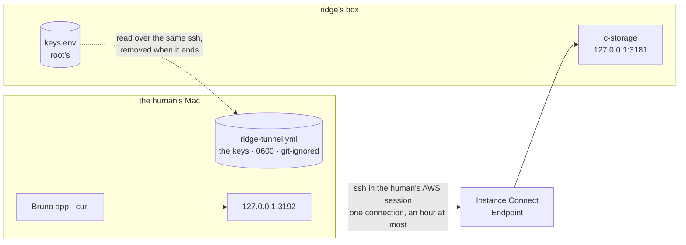

# ridge's tunnel: c-storage from this Mac, held open

**Where it stands — 2026-10-28:** done. The command is on `main` and deployed, GitHub's run read
green whole, and the human's first run held ridge's c-storage open for Bruno and ended clean by
Ctrl-C. Nothing is left to run; the recap is [here](../recaps/2026-10-28-ridge-tunnel.md).

> **Drafted** 2026-10-28 by the machine, from [ridge's plan](2026-10-28-ridge.md), `ops/lib.sh`,
> `ops/check.sh` and [the c-storage memo](../memo/c-storage.md). The need, from the human on 10-28:
> "a live way for the human to check c-storage's data on ridge"; then, after a public URL was
> planned and parked, "should we go back to using tunnels (from this machine only)". Yes.

## At a glance



Drawn from `box_open` and `read_keys` in `ops/lib.sh`, and from `ops/tunnel.sh`.

`ops/tunnel.sh ridge` opens the tunnel `ops/check.sh` already opens, and holds it until Ctrl-C or
the endpoint's hour ([the command](#the-command)). It says ready only once `/health` through it
names a commit of `main`. ridge's keys land in one Bruno environment, removed when the tunnel ends.
It costs $0 and adds nothing to AWS, the internet or the local network.

| Through it you can | With |
| --- | --- |
| read `/health`: is ridge up, on which commit | no key |
| register a service, then save, read and remove its records | the keys in the Bruno environment |
| read what the checks left | nothing: no route lists services, and no file keeps their keys ([what you can check](#what-the-human-can-check)) |

**One call:** a fresh service each run, nothing kept after it ([call 1](#the-humans-call)).

## The case table

| # | 👤 | The case | Held by |
| --- | --- | --- | --- |
| 1 | 👤 | One command on this Mac, in the human's own AWS session, holds `http://127.0.0.1:3192` to ridge's c-storage until Ctrl-C or the endpoint's hour, at $0, opening nothing on the internet or the local network | step 5's run |
| 2 | 👤 | Through it the human registers a service, saves records and reads them back, in Bruno's environment `ridge-tunnel` or with curl | step 5's run |
| 3 | 👤 | Only test data goes to ridge through it, never a client's, real or copied (ridge's [row 15](2026-10-28-ridge.md#the-checks)). The command refuses any environment but `ridge` until the guard that refuses a client's stack exists (ridge's plan, [Left behind](2026-10-28-ridge.md#left-behind)): a client's stack reachable from the same AWS session would put its admin keys on disk and point the collection, which writes test records, at real data | the human; `ops/test.sh`: `tunnel.sh other` refused before any AWS call |
| 4 | 👤 | When the tunnel ends (Ctrl-C, the terminal closed, a drop), the keys file is gone, and no key is ever printed or logged | `ops/test.sh`: `tunnel.sh` run whole, ended by INT, TERM and HUP, and by a drop; `on_exit`'s search of the log |
| 5 | | A port already taken is refused before anything is opened or written, and a refused run removes no file it did not write | `ops/test.sh`: `tunnel.sh` run whole beside a held run and beside a listener that speaks no HTTP, a keys file planted first |
| 6 | | A forward that cannot bind fails the open, for `check.sh` too | `ops/test.sh`: a stand-in `ssh` reading its arguments |
| 7 | | Ready only when `/health` through the port names a commit of `main`; `dev` or a sha `main` lacks stops the run | `ops/test.sh`: `tunnel.sh` run whole on the real binary stamped each way, on its scratch repository |
| 8 | | A tunnel that drops is named, and the command exits | `ops/test.sh`: `tunnel.sh` run whole, its stand-in `ssh` master killed |
| 9 | | The keys file is 0600 and git-ignored, written by the one writer `check.sh` uses too | `ops/test.sh`: the mode read; a path git does not ignore refused |

Each machine row is seen red once, by breaking its line ([QA](../conventions/qa.md) rule 2). Rows 1
and 2 need AWS, so step 5's run holds them. The endpoint's hour is *untested*: waiting an hour to
see it shows nothing row 8 does not.

## The command

`ops/tunnel.sh <env>`, one page like `check.sh`, run from a worktree at `main` like every `ops/`
script. It reuses `lib.sh` whole: the log, `main_synced`, `box_open`, `read_keys`, `mask`,
`on_exit`. What `check.sh` holds inline and both now need moves into `lib.sh`, and `check.sh` calls
it from there: the port's refusal, the Bruno environment's writer, `random_hex` and the read of
`/health` naming a commit of `main`. *Rejected:* a flag on `check.sh`. Its job is a verdict that
ends; this one holds.

1. **The port.** Refused when anything listens on `127.0.0.1:3192`, by a TCP connect rather than
   `check.sh`'s HTTP read, so a listener that speaks no HTTP is refused too. 3192 is neither the
   local stack's 3181 nor the check's 3191, so `check.sh` runs beside an open tunnel. It is fixed,
   with no override: the port is the lock against a second run.
2. **The tunnel.** `box_open <env> 3192`. `box_open` gains `-o ExitOnForwardFailure=yes` when it
   forwards, so a port taken between the check and the bind fails the open, where ssh now stays up
   without its forward. The Instance Connect key holds 60 s and only the login needs it. The one
   connection then lasts until the endpoint ends it, an hour at most, even if the AWS session
   expires meanwhile ([AWS's considerations](https://docs.aws.amazon.com/AWSEC2/latest/UserGuide/connect-with-ec2-instance-connect-endpoint.html#ec2-instance-connect-endpoint-prerequisites)).
   *Rejected:* reconnecting in a loop, a new key, service and `/health` read each time, for a
   session nobody has yet held an hour. *Trigger:* the first session the hour cuts short.
3. **Ready only on `main`.** `/health` through the port must name a commit of `origin/main`, or the
   run stops having written nothing.
4. **The keys.** `read_keys` (masked), a fresh service code `tunnel-<UTC time>` and a fresh access
   key, written to `c-storage/bruno/environments/<env>-tunnel.yml`, 0600, refused unless git
   ignores it. It is its own file, not `check.sh`'s `ridge.yml`, which each check rewrites and
   deletes. The run removes it on every exit, but only once it has written it, so a refused second
   run never deletes the first's. A file a killed run left is replaced, and the log says so. Nothing
   is registered until the human sends the register request.
5. **Hold.** It prints the ready lines, then checks the connection (`ssh -O check`) every few
   seconds, until Ctrl-C (`== exit 130`) or a drop (`the tunnel dropped`, `== exit 1`). `on_exit`
   closes the tunnel, removes the file and searches the log for the keys.

The admin key comes to the Mac because the collection's register needs it. The human holds every
credential ([who owns what](../conventions/collaboration.md#who-owns-what)), and ridge's keys reach
nothing without a tunnel, which needs the human's AWS session.

## What the human sees

```text
== tunnel ridge started 2026-10-28 14:02:11 +0700
[1/4] main and the port (0m01s)
ok   ops/ is origin/main's
[2/4] the tunnel to ridge's box (0m02s)
[3/4] /health names a commit of main (0m09s)
ok   /health names <sha>, a commit of main
[4/4] the Bruno environment (0m10s)
ready: http://127.0.0.1:3192 is ridge's c-storage, until Ctrl-C or 15:02 (the endpoint's hour)
  Bruno: open the collection c-storage/bruno, pick the environment ridge-tunnel
  curl:  curl http://127.0.0.1:3192/health; the keys are in c-storage/bruno/environments/ridge-tunnel.yml
  this run's service: tunnel-20261028T070211Z, registered by the collection's first request
```

- The URL is `127.0.0.1`, not `localhost`: the forward binds IPv4 loopback alone, and `localhost`
  may resolve to `::1` first.
- The log is `logs/<date>-<time>-tunnel-ridge.log` in the credo root, like every `ops/` log, and
  ends on `ok   no key in this log` and `== exit <n>`.
- While c-storage restarts, ssh may print `channel N: open failed: connect failed`.

## What the human can check

ridge holds no record today. Each check registered a service and removed its records, and its
access key went with its run; each drill registered one and saved nothing. No route lists services
or records ([the memo](../memo/c-storage.md#no-record-is-public)). Until piece 1 writes there,
checking data means registering this run's service, saving records and reading them back. The
collection, run once, does all of it green; a second run in the same session answers 409 at its
register, as it does locally. What a run saves stays on ridge after it, and no one can read it,
since its key leaves with the file.

## The human's call

1. **A fresh service each run, nothing kept after it.** *Recommended.* Each run writes a new
   service code and access key, and the file goes when the tunnel ends. *For:* no key outlives the
   session; nothing to build past the run. *Against:* what the human saves in one run cannot be
   read in the next.
   - *The alternative:* one standing service for the human, its access key kept between runs in a
     git-ignored `*.local*` file. *For:* records read back another day. *Against:* a service key on
     disk for good, a first-run path and a reuse path to build and test, and a lost file strands
     its records ([the memo](../memo/c-storage.md#keys-are-compared-exactly-and-stored-hashed)).
   - *Trigger to revisit:* the human wanting tomorrow what was saved today, or piece 1 writing to
     ridge, when the service to read is the BFF's own.

*Answered* 2026-10-28 by the human, having read rows 1 to 4: "yes, plz go ahead". That is the
recommended option: a fresh service each run, nothing kept after it.

## Hazards

- **A tunnel left open.** Only `kill -9` or a crash skips `on_exit`. ssh's master, daemonized by
  `-f`, then keeps the port until the endpoint's hour, and the next run is refused at the port. The
  runbook's branch: `lsof -nP -iTCP:3192 -sTCP:LISTEN`, then stop that ssh.
- **Keys left on disk.** The same kill leaves the file: 0600, git-ignored, and useless without a
  tunnel. It also leaves the run's scratch folder in the temp folder, with the Instance Connect
  private key the run pushed (valid 60 seconds after the push, so already useless). The next run
  replaces the file and says so. *No gate catches* a file left by a run never
  repeated; the runbook names the file.
- **A second run on the same port** is refused before it opens or writes anything, and leaves the
  first's file alone (row 5).
- **An expired AWS session** stops the run at its first AWS read, with AWS's message, before the
  tunnel or the file exist. A session that expires while the tunnel is open does not cut it.
- **The deploy or the drill restarting c-storage.** A release restarts it: requests fail for a few
  seconds, then answer on the new commit, and the tunnel and the keys hold. The drill's reboot drops
  the tunnel; the command says so and exits. Keys replaced after a leak leave the file's stale (401):
  run again. The deploy's own check runs on GitHub's runner and touches neither the port nor the
  file.

## Review

Another model's review of `73beb20..e369cd1` (QA rule 5), read-only. It found no `check.sh`
regression and no key leaked on any exit but `kill -9`. Each finding, handled in the fix pass:

1. **Medium: `tunnel.sh` held by no behavioural test.** `[FIXED]`. `ops/test.sh` now runs the real
   `tunnel.sh` from a scratch clone with a local origin, stand-in `aws` and `ssh`, and the real
   c-storage behind the forward; rows 4, 5, 7 and 8 are held there, and the stand-ins and order
   greps they replaced are retired. Only the clone's port and check interval differ from the real
   file. Seen red: the reviewer's two mutations, `tunnel_hold` deleted and `BRUNO_ENV_FILE` set
   before `log_start`.
2. **Low: `check.sh`'s port refusal unheld.** `[FIXED]`. Held by running `check.sh` on a port with
   c-storage on it and on one with a silent listener; red with the refusal deleted.
3. **Low: a second Ctrl-C cuts `on_exit` short.** `[FIXED]`. `on_exit` ignores INT, TERM and HUP
   from its start; the case signals the group twice while a stray writer holds the log's pipe; red
   with the line removed.
4. **Low: a bind failure named only the endpoint.** `[FIXED]`. Both messages name both causes;
   held by a port taken after the check; red with the old message.
5. **Low: five more hard-coded `127.0.0.1` on the box.** `[FIXED]`. `check.sh`, `release.sh` and
   `drill.sh` read `BOX_LISTEN_ADDR`; the messages are unchanged. No test: the value is the same,
   so no behaviour differs today.
6. **Low: the writer's refusal test passed with two lines swapped.** `[FIXED]`. Run in a child
   with `log_start`, asserting the refused path survives the exit; red with the lines swapped.
7. **Low: the hold test's name claimed a closed tunnel.** `[FIXED]`. The `-O exit` call is counted
   in the drop, signal and hold cases; red with `box_close` sending nothing.
8. **Info: `check.sh`'s `cleanup_extra` against `lib.sh`'s wording.** `[FIXED]` by the wording, not
   by removing it: `check.sh` runs in every deploy and its behaviour stays as it was; it clears its
   own file whatever wrote it, since each check rewrites it, and the comment now says so.
9. **Info: the access key's mask and the early ignore check deletable.** `[FIXED]`. The early
   ignore check is held by a run with no ignore rule (red when deleted); the "note: replacing"
   line and the clock time by the held run (red when removed). The mask is held by a run with
   `GITHUB_ACTIONS` set, which must write three `::add-mask::` lines (the box's two keys and the
   access key); red when the mask is deleted. (GitHub's first run of the suite failed four cases
   because the whole-script runs inherited `GITHUB_ACTIONS` and counted those lines as leaked
   keys; the runs now unset it.)
10. **Info: `kill -9` leaves the scratch folder and its private key.** `[FIXED]`. Named in the
    hazard above and in the runbook.
11. **Info: the hold test's `sleep 1` could race.** `[FIXED]`. It waits for the first `-O check`.
12. **Info: ~145-character comment lines.** `[FIXED]`. Wrapped.

Also from the orchestrator, the machine's call: `ops/tunnel.sh` refuses any environment but
`ridge` ([row 3](#the-case-table)); seen red with the refusal deleted.

## Steps

- [x] **1. This plan.** Who: 🤖. Done when: committed on `ridge-tunnel` with the path, name and id
  checks clean, and ridge's plan points here in one line. *Evidence:* this commit.
- [x] **2. Rows 1 to 4, and call 1.** Who: 👤, 5 minutes. Done when: the human has read the 👤 rows
  and answered call 1. *Evidence:* the call's *Answered* line above.
- [x] **3. The command and its guards.** Who: 🤖, about 2 hours. Consumes: step 2's answer. Done
  when: `ops/tunnel.sh`, the moves into `lib.sh` and `check.sh` calling them, rows 4 to 9 in
  `ops/test.sh` each seen red once then green, `shellcheck -x ops/*.sh` clean, the runbook's row
  and section, and another model's review (QA rule 5) with its findings fixed. *Evidence:* [the review](#review), its findings handled.
- [x] **4. CI.** Who: 👤 runs act in the terminal, then pushes the orchestrator's merge into
  `main`; 🤖 reads both logs whole. Done when: act's `ops` job is green, then GitHub's `check`,
  `e2e`, `ops` and `deploy`, the deploy's `check.sh`, now calling `lib.sh`, ending `== green`.
  *Evidence:* act run 2 (`ridge-tunnel-act-2.log`, 709 lines): `check`, `e2e` and `ops` each end
  `Job succeeded`; its one `== skipped:` line is the ignore rule, which a copied `.git` cannot
  answer, as planned. GitHub's run on `ridge-tunnel` at `58d13b7` (`ridge-tunnel-gh-1.log`, 1,205
  lines), green: `ok   the real repository ignores ridge-tunnel.yml and ridge.yml, not local.yml`
  and every tunnel case `ok`. Merged into `main` at `a9a2d4e` and pushed: GitHub's run 40662821363,
  all four jobs green (`ridge-deploy-3.log`, 1,688 lines). Its `deploy` ran the moved `check.sh`
  against the real box: `ok   /health names a9a2d4e6a4603e0457fc9479b6a18bb620681516, a commit of
  main`, every row `ok` as before, Bruno `Tests 33/33` and `every request ran, passed and asserted
  (25)`, `== green`. Two reds on the way, both fixed: [the recap](../recaps/2026-10-28-ridge-tunnel.md#the-two-reds).
- [x] **5. The first real run.** Who: 👤, 10 minutes. Consumes: step 4, since only `main`'s `ops/`
  runs. `ops/tunnel.sh ridge` from a worktree at `main`; in Bruno, environment `ridge-tunnel`:
  Health, then the collection once; then Ctrl-C. Done when: its log, read whole, shows the four
  steps, `/health` naming a commit of `main`, the ready lines, `ok   no key in this log` and
  `== exit 130`, and `c-storage/bruno/environments/` holds no `ridge-tunnel.yml`. *Evidence:* the
  log `2026-10-28-162038-tunnel-ridge.log`, 13 lines, read whole: the four steps `[1/4]` to
  `[4/4]`, `ok   ops/ is origin/main's`, `ok   /health names a9a2d4e6a4603e0457fc9479b6a18bb620681516,
  a commit of main`, `ready: http://127.0.0.1:3192 is ridge's c-storage, until Ctrl-C or 17:20 (the
  endpoint's hour)`, then `ok   no key in this log` and `== exit 130`. The human said "I can
  verified from bruno": Bruno on `ridge-tunnel` answered. After the Ctrl-C `environments/` holds
  `local.yml` alone, checked from the orchestrator.
- [x] **6. The recap.** Who: 🤖. Done when: `docs/recaps/2026-10-28-ridge-tunnel.md` says what
  shipped and what stays the human's, and "Where it stands" is rewritten. *Evidence:* the recap,
  [here](../recaps/2026-10-28-ridge-tunnel.md).

**Then stop.** The human holds ridge's c-storage open from this Mac, and nothing else changed on
ridge.
