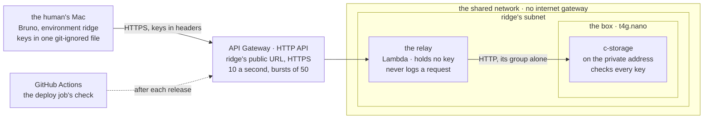

# ridge's public URL: c-storage from anywhere, behind its keys

**Where it stands — 2026-10-28 13:29 +07:** parked, not built. No code is written; the plan below is
the record.

> **Parked** 2026-10-28 by the human, at about 13:29 +07: "we'll go back later, when really necessary".
> This URL is **not built**. Until then ridge's c-storage is reached through the Instance Connect
> tunnel from the human's own Mac, and from nowhere else. *Trigger to come back:* someone other than
> the human, or a machine other than the human's Mac, needs to reach ridge's c-storage: partners
> sending requests themselves, or a CI or tool outside AWS. The decision is in
> [the c-storage memo](../memo/c-storage.md#no-public-url-for-now), the log in
> [open item 13](../open-items.md#13-the-public-url-in-front-of-ridges-c-storage-parked--the-human-parked-until-someone-or-a-machine-beyond-the-humans-mac-needs-it-the-ridge-url-plan-2026-10-28).
> The finding on function URLs is [the found section](#found-function-urls-in-malaysia); layer four is planned in [ridge-app](2026-10-28-ridge-app.md#layer-four), which takes this plan's listener and shape H for the BFF.

> **Drafted** 2026-10-28 by the machine, from the human's ask, [the architecture](2026-10-27-architecture.md),
> [ridge's plan](2026-10-28-ridge.md), [the c-storage memo](../memo/c-storage.md), `c-storage/`, `ops/`
> and AWS's own pages and price lists, read that day ([sources](#sources)).
>
> **This plan amends:**
>
> - the architecture's "Neither is on the internet" ([its at a glance](2026-10-27-architecture.md#at-a-glance)),
>   for ridge alone: c-storage on ridge answers one public URL, behind its keys. A client's stack never
>   gets that URL ([the condition](#the-shape)).
> - ridge's plan: the listener moves to the private address now, its first caller this URL rather than
>   the BFF ([open item 7](2026-10-28-ridge.md#the-listener-open-item-7)); the box's group gains its
>   second rule now; the check's "one rule" and "loopback alone" change, and its collection runs through
>   the URL ([what it pulls forward](#what-it-pulls-forward)).
> - the c-storage memo's [loopback only, for now](../memo/c-storage.md#the-listener-binds-one-address), rewritten
>   in step 3.
>
> **Found while planning, for layer four, not decided here:** Lambda function URLs appear not to be
> offered in Malaysia (`ap-southeast-5`). The architecture's [decision 2](2026-10-27-architecture.md#decisions--the-machines),
> CloudFront to the BFF's function URL, then cannot be built there as drawn
> ([the edge](#the-edge-weighed)).

## At a glance



Drawn from this plan; no code holds it yet. The human runs c-storage's Bruno collection, or any one
request of it, from his own Mac against ridge, with no AWS session and no tunnel. The URL holds no key:
c-storage checks every one, as it does today. Partners read the run's HTML report.

| What it adds | A month |
| --- | --- |
| the public URL, the relay, its log, its group and the box's rule for it ([the shape](#the-shape)) | ≈ $0.02 at ridge's traffic; under $40 if someone floods it at the throttle ([cost](#what-it-costs)) |
| c-storage on the private address; the check through the URL ([pulled forward](#what-it-pulls-forward)) | $0 |

**The human's three calls**, each with one recommendation ([below](#the-humans-calls)):

1. **What the admin key gives:** registering services, then any service's records with that service's
   key. No new route that reads every record.
2. **Partners** read the report; the keys stay on the human's Mac.
3. **A flood on the bill:** accepted, with a trigger to shut or shield the URL.

## The need

The human, 10-28 12:34: a live way to check c-storage's data on ridge ("let do it in next session"). Then:
"on c-storage url, if possible, plz give me a real public URL in front of c-storage, with admin access
key". His delivery method: each piece an MVP end to end at low cost, verified locally, given a generated
report, then deployed to ridge "so other partners can check without source code".

The caller is the human, and partners through his report, with Bruno. Nothing is built for any other.

## What the admin key gives

c-storage has three keys ([the memo](../memo/c-storage.md#the-internal-key-gates-every-path)):

| Key | Lets its holder | Without it |
| --- | --- | --- |
| internal (`x-internal-access-key`) | reach any route but `/health` | 401, whatever the path |
| admin (`x-super-admin-key`) | register a service: a code and its access key | 401 on register; nothing else needs it |
| a service's access key (`x-access-key`) | push, read and remove that service's records | 403, the same for a wrong key and an unknown service |

So the admin key alone reads no record, and no route lists services or records
([no record is public](../memo/c-storage.md#no-record-is-public)). What the human gets: `ops/check.sh
ridge --keep` reads the internal and admin keys from the box over the tunnel, once, in his AWS session,
and leaves them, with the URL and a fresh service code and access key of his own, in the git-ignored
Bruno environment `ridge` (mode 0600, printed nowhere). From then on the Bruno app or CLI on his Mac runs
the collection, or any one request, against the URL: register a service with the admin key, then push,
read and remove its records with its own key.

**What ridge holds today:** the check's service rows (`check-<time>`, their keys never kept) and the
drill's, and no record: every check removes its own. So "checking ridge's data" means writing records
and reading them back, until piece 1's BFF writes there in layer four. Reading any record with the admin
key would be a new route, and is [call 1](#the-humans-calls).

## The edge, weighed

Every fact below is AWS's, read 2026-10-28 ([sources](#sources)), but the one
[the finding](#found-function-urls-in-malaysia) marks. The rules held to: no internet gateway, no public
address on the box, no fixed monthly charge.

| Shape | For | Against | Verdict |
| --- | --- | --- | --- |
| A. CloudFront, origin access control, a function URL; the function relays to the box: the architecture's edge, pulled forward | the architecture's own edge, proven before the BFF depends on it; the control is free | Function URLs appear not to be offered in Malaysia ([the finding](#found-function-urls-in-malaysia)). Where offered: every POST must carry `x-amz-content-sha256`, the body's SHA-256 ("Lambda doesn't support unsigned payloads"), so Bruno's register and push need a script hashing the exact bytes sent; CloudFront caps no flood without a firewall | not buildable here |
| B. API Gateway HTTP API, a VPC link to the box through Cloud Map: no function code | no code; a free throttle | VPC links V2 are not offered in `ap-southeast-5` (AWS's table of Regions) | not buildable here |
| C. CloudFront's VPC origin on the box itself: no Lambda | no code, no hash; offered in Malaysia; $0 | "You need to add an internet gateway to the VPC": the one network under every client's stack, against the architecture's [decision 4](2026-10-27-architecture.md#decisions--the-machines) and the check's "internet gateways: 0"; the box's group must admit a group CloudFront makes only after the origin exists, so two change sets; no flood cap without a firewall | rejected: the price is the shared network's wall |
| D. A Lambda Web Function behind CloudFront, its egress connector to the box | CloudFront signs it with an unsigned payload, so no hash; a rate limit per endpoint | its connector needs "at least two subnets in different Availability Zones" (ridge has one zone); a new service, availability in Malaysia not read | rejected |
| E. A public function URL, no CloudFront | the least to build | the architecture rejected it ("whoever finds it runs the function, on our bill"); not offered here either | rejected |
| **H. An HTTP API whose one route invokes the relay, a Lambda in ridge's subnet** | offered in Malaysia; no gateway; Bruno's requests unchanged; a stage throttle, free; everything in `env.yml`, the human's change set; the relay's code ships inside the template | about 60 lines of relay to own and test; billed per request; past the throttle, no free cap | **recommended** |

**Recommended: H.** It is the one shape that is buildable in ridge's Region without a gateway or a fixed
charge, and it leaves the collection as it is. Were function URLs offered here, H would still win for this
caller: A's body hash would sit on every write the human types, and A has no free throttle.

### Found: function URLs in Malaysia

AWS's pages on function URLs now say only "Function URLs are not supported in all AWS regions" and point
to a regional table that renders in a browser alone. The earlier text of the same page, as search indexes
hold it, listed Asia Pacific (Malaysia) among the Regions without them; an open-source project's test of
2026-10-10 got "AccessDeniedException: Unable to determine service/operation name to be authorized"
creating one there. **Not read back from a current AWS page.** One read-only command of the human's
should settle it: in a Region without function URLs it is expected to answer that same
AccessDeniedException, and with them `ResourceNotFoundException`, since no such function exists.

```bash
aws lambda get-function-url-config --function-name credo-url-probe --region ap-southeast-5 2>&1 | tee logs/function-url-probe.log
```

(from the credo root). It decides nothing here; it decides how layer four reaches the BFF.

### The shape

All of it is added to `ops/env.yml`, each resource under one condition, `HasPublicUrl`, from a parameter
`PublicUrl` (`on` or `off`, `off` by default). A client's stack, made from the same template, gets none of
it unless its change set says `on`.

- **`PublicApi`**, an HTTP API, with **`PublicStage`** (`$default`, so no stage name enters the path; the
  default route's throttle 10 requests a second, bursts of 50; access logging off), one **`PublicRoute`**
  (`$default`: every method and path), its **`PublicIntegration`** (the relay, payload 2.0, 15 s), and
  **`PublicInvoke`**, the relay's permission for this API alone.
  - *Why 10 and 50:* the collection's 25 requests run back to back and must fit one burst; a deploy's
    check and the human's run may overlap. AWS calls the throttle "best-effort … targets rather than
    guaranteed request ceilings".
- **`Relay`**, a Lambda (Node.js 24, `nodejs24.x`, arm64, 128 MB, 10 s), in ridge's subnet under
  **`RelayGroup`**, whose only egress is c-storage's port on the box's group. Its role, **`RelayRole`**,
  holds what a function in a VPC needs (its network interfaces, its log) and nothing else; its log,
  **`RelayLogs`**, keeps 14 days. No reserved concurrency: AWS lets an account reserve only what leaves 100
  unreserved, and this account's quota is not read; the stage's throttle is the one cap.
  - *What it does:* sends the request on to `http://<the box's private address>:<c-storage's port>` with
    the method, path, query, body and headers, minus the connection's and AWS's own (`host`,
    `content-length`, `x-forwarded-*`, `x-amz*`), and returns c-storage's status, body and content type.
    It allows 8 s to the box. No answer is a 502, a hang a 504, and neither body names the box. It never
    follows a redirect and never writes the request to its log.
  - *Its code ships inline* (`Code: ZipFile`), so the template is the whole of it, and the deploy role
    needs no new right: there is no bucket and no deploy of code. *Rejected:* a Go relay beside c-storage,
    which needs a bucket for its zip and a build before each change set.
  - *Headers through API Gateway:* names arrive lowercased and a repeated header joined by commas. A
    repeated `If-Match` therefore reaches c-storage as one value it cannot read, and is still a 400.
- **`BoxFromRelay`**, the box group's second rule: c-storage's port, from `RelayGroup` alone. A rule of its
  own, so the change set adds and modifies nothing.
- **Outputs:** `StorageUrl` and `RelayGroupId`. `stack.sh` does not print `StorageUrl`, as it prints no
  role ARN.
- **c-storage's port** reaches the template as a parameter that `stack.sh` reads from
  `ops/c-storage.service` at `origin/main`, the port's one home (`unit_port`, [lib.sh](../../ops/lib.sh#L296)).
- **`stack.sh env ridge --public-url on`** sets the parameter; an update without the flag keeps the
  stack's value. `--public-url off` removes the resources, and so is refused unless each is named with
  `--take` ([the change-set guard](2026-10-28-ridge.md#the-templates)).

**Layer four.** The BFF reuses this shape, not this door: its function sits in the same subnet with a
group of its own, and the box admits that group as a third source on the same port, which the listener
already serves. Nothing here is replaced or removed by layer four. If function URLs are absent here, the
BFF's edge likely becomes an HTTP API invoking a function in the VPC, which this door proves first.
**The URL stays on ridge** while the human uses it, and goes by one change set (`--public-url off` with
its `--take`s) when he says it is unused, or at a [call 3](#the-humans-calls) trigger.

## What it pulls forward

Each from layer four, said once, with its price:

1. **The listener on the private address** ([open item 7](../open-items.md), as
   [ridge's plan](2026-10-28-ridge.md#the-listener-open-item-7) designed it): `LISTEN_ADDR`, optional,
   loopback when unset, so the local stack and every test stay as they are; one IP address, never `0.0.0.0`,
   `::` or a name, else c-storage stops at start. On the box, each release writes `LISTEN_ADDR` from the
   stack's `BoxAddress` into `/etc/c-storage/listen.env`, root's, beside the keys file it never touches;
   the unit reads it and starts once the network is online. The scripts that read `/health` on the box
   and the tunnel's forward move from `127.0.0.1` to that address (`lib.sh`, `release.sh`, `drill.sh`,
   `check.sh`). *Price:* loopback stops being a second wall; the box's group and c-storage's keys remain.
   The first release with it finds nothing on the private address before it installs, so it releases, as
   for any box that does not answer.
2. **The box group's second rule**, from `RelayGroup` alone. *Price:* the group is now the network's only
   wall before the port, as the architecture drew it for the BFF.
3. **The check's assertions** ([check.sh](../../ops/check.sh#L62)): "one rule, ssh from the endpoint's
   group" becomes that rule plus c-storage's port from `RelayGroupId`, and nothing else, when the stack's
   `PublicUrl` is `on`, and stays one rule when it is `off`, so the deploy that merges this before the
   human's stack update is green. "Listens on `127.0.0.1`" ([L88](../../ops/check.sh#L88)) becomes
   "listens on `BoxAddress` alone". New, when the URL exists: `/health` through it names the build the
   tunnel reads, a record read without the internal key is a 401 through it, and the collection runs
   through it ([L115](../../ops/check.sh#L115)); without the URL, through the tunnel as today. *Price:* a broken URL turns the deploy red though c-storage is
   well, which is right: the URL is part of ridge now.
4. **"Neither is on the internet"**, for ridge alone: anyone holding the URL reaches c-storage's
   `/health` and its 401s. *Price:* on ridge, c-storage's keys are the only wall against a request from
   the internet; `/health` answers a commit of this public repository, nothing more.

## The exposure

c-storage on ridge is reachable from the internet, behind its keys. ridge holds no real data
([ridge's row 15](2026-10-28-ridge.md#the-checks)).

| Hazard | What bounds it, free |
| --- | --- |
| guessing a key | each key is 32 random bytes from the box's kernel, compared whole in constant time; the throttle allows 10 guesses a second |
| a flood on the nano | the stage's throttle, 10 a second, bursts of 50, best effort; the relay's 8 s; c-storage's one writer at a time |
| a flood on our bill | within the throttle: at most ≈ 26 M requests a month, under $40 ([cost](#what-it-costs)). Requests the throttle refuses: whether billed is not read back. No free cap past that: [call 3](#the-humans-calls) |
| keys crossing the internet | HTTPS to API Gateway; API Gateway to the relay inside AWS; the relay to the box in plain HTTP inside the VPC, as the BFF's hop will be; the relay never logs a request (a guard reads it); access logging off |
| the public repository's logs | the keys masked first, as today; the URL masked in the deploy job and printed by no script; the job uploads no report of the ridge run |
| the URL in a public file | written in no committed file (`git grep -nE 'execute-api\.'` before each commit, beside the path greps); `stack.sh` does not print it; the HTML report stays in the credo root's `logs/` until the human hands it on |
| a key leaked | the [ridge plan's way](2026-10-28-ridge.md#deploys-from-github-actions): delete the box's keys file, `ops/release.sh ridge`; then `ops/check.sh ridge --keep` refreshes the human's file |

## What it costs

Malaysia, from AWS's price lists read 2026-10-28. ridge's traffic: a few deploys a day of about 30 requests
each, and the human's runs: about 10,000 requests a month.

| Piece | Price | A month at ridge's traffic |
| --- | --- | --- |
| the HTTP API | $1.125 per million requests (the file's own text says $1.25) | $0.01 |
| the relay, arm64, 128 MB | $0.18 per million requests; $0.000012 per GB-second | $0.002 |
| its log, 14 days | $0.50 per GB ingested, $0.03 per GB stored; 5 GB free | $0.002 |
| its network interface, the relay-to-box hop in one zone, the groups, the role | free | $0 |
| **Total** | | **≈ $0.02** |

**Flooded at the throttle all month:** 10 a second is ≈ 26 M requests, $29 to $32 at the API, $4.70 of
relay requests and under $1 of its time: ≈ $35 to $38. Free tiers are not counted: API Gateway's is for new customers
only, and whether Lambda's applies to this account is not read.

## The checks

One behaviour a line ([QA](../conventions/qa.md) rule 1). 👤 marks a row for the human's business sense.

| # | 👤 | The case | Held by |
| --- | --- | --- | --- |
| 1 | 👤 | After one `check.sh ridge --keep` in his AWS session, the human's Mac, with no AWS session and no tunnel, runs the collection through ridge's URL: register a service, then push, read and remove its record, all green | the Bruno app on the kept environment (step 8); the same collection through the URL in `check.sh`, its HTML report |
| 2 | 👤 | The admin key alone reads no record, and nothing through the URL lists services or records | c-storage's Go tests; the collection's 403 requests through the URL |
| 3 | 👤 | ridge's keys reach the human's Mac in one git-ignored file, 0600, and never in a log, a report, git or GitHub | `check.sh`'s git-ignore check, end-of-run search of its log, and search of the report for every key |
| 4 | 👤 | A client's stack never gets the URL: every resource of it carries the condition, `off` by default | `ops/test.sh` reads `env.yml`, red on a copy with one condition removed |
| 5 | | Every path but `/health` answers 401 through the URL without the internal key, as on the box | the collection's boundary folder, through the URL |
| 6 | | `/health` through the URL names the build the tunnel reads | `check.sh` |
| 7 | | The relay passes method, path, query, body and every request header but the connection's and AWS's, and returns c-storage's status, body and content type as they were | `ops/test.sh`: the relay, cut from `env.yml`, under Node's test runner against the real c-storage, at 100 % of its lines and branches |
| 8 | | A box that does not answer is a 502 and one that hangs is a 504, neither naming the box | the same |
| 9 | | The relay writes no request to its log | `ops/test.sh`: no `console` or stream write in the relay's code, red on a copy with one |
| 10 | | The URL refuses past 10 requests a second, bursts of 50 | `env.yml`'s stage, read by `ops/test.sh`; *untested* live: a flood test is billed |
| 11 | | The box admits ssh from the endpoint's group and c-storage's port from the relay's group, and nothing else; without the URL, ssh alone | `check.sh`'s rule filter, red on hand-written rule sets in `ops/test.sh` (a third rule, an address range on the port, the port from another group) |
| 12 | | c-storage listens on the box's private address alone; unset, on loopback | Go tests: the configuration refuses `0.0.0.0`, `::` and a name, and `Listen` binds exactly the address given; `check.sh` on the box |
| 13 | | A release writes `LISTEN_ADDR` from the stack's `BoxAddress`, and the keys file stays as it was | `release.sh`'s checksum before and after; the release's log |
| 14 | | The box has no public address and the VPC no internet gateway, as before | `check.sh`, unchanged |
| 15 | | The template's port for the relay is the unit's | `stack.sh` reads it from the unit; `ops/test.sh` reads that call |
| 16 | | The URL is in no committed file and unmasked in no public log | the pre-commit grep; `check.sh`'s mask in the job; the first deploy's log read whole |

Each row is seen red once ([QA](../conventions/qa.md) rule 2) as its "held by" says. Live, rows 10 and
14 are *untested*: a flood is billed, and making the stack wrong to watch it refused costs more than the
read is worth. Row 10's guard on the template is seen red on a copy with the throttle removed.

## The human's calls

1. **What "with admin access key" gives.** *Recommended:* the keys in the human's git-ignored Bruno
   environment, the collection and each request run against the URL, and no new route ([above](#what-the-admin-key-gives)).
   *The alternative:* a route that reads or lists any service's records with the admin key. It goes
   against the memo's "no record is public": on a client's stack that key would read every record of
   every service, for a caller the app does not have. *Trigger to revisit:* piece 1's data on ridge, if
   the human needs to read it outside the UI.
2. **Who holds ridge's keys.** *Recommended:* the human alone; partners get the run's HTML report, which
   holds no key, and may see the URL in it. *The alternative:* partners get the environment file too and
   send requests themselves; anyone with it can register services and write records on ridge, and taking
   it back is a key change ([a key leaked](#the-exposure)).
3. **A flood on the bill.** *Recommended:* accept it. The URL is in no public place, ridge's traffic costs
   about $0.02 a month, and the throttle bounds what reaches the relay at under $40 a month. *Trigger:* the URL
   seen anywhere public, or a month's line for API Gateway or Lambda in Malaysia over $1: shut the URL
   (`--public-url off`), or shield it. *The shield, priced:* CloudFront's flat-rate Free plan, $0 a month
   with "no overage charges", IP rate limiting and DDoS protection, in front of the API. Its firewall must
   live in `us-east-1`, a second small stack in another Region; the account must not be "using AWS Free
   Tier" (not read); and the API's own address stays callable by whoever learns it.

## Steps

The code steps start from `main` once the trust fix's pass is merged there: it is changing `ops/lib.sh`,
`ops/test.sh` and `ops/README.md` on `ridge` now. Each of the human's AWS steps is one command, run from a
worktree at `main`; every log of the human's lands in the credo root's `logs/`, and the machine reads it
whole.

- [x] **1. This plan.** Who: 🤖, 10-28. Done when: committed on `ridge-url`, the path, name, 12-digit and
  `execute-api` greps clean. *Evidence:* this commit.
- [ ] **2. The human's read.** Who: 👤, 15 minutes. Consumes: step 1. Done when: the three calls are
  answered under them, dated, and any correction is taken. The probe of
  [the finding](#found-function-urls-in-malaysia) may run alongside; this plan does not wait for it.
- [ ] **3. c-storage on the private address.** Who: 🤖, 2 hours, on a branch from `main`. Consumes: call
  1's answer (a "yes" to the alternative adds a route and its own plan first). Done when:
  - `LISTEN_ADDR` in c-storage's configuration and `Listen`, its tests seen red once each (row 12), `make
    check` green at 100 %, `bash scripts/e2e.sh` green;
  - the unit reads `/etc/c-storage/listen.env` and waits for the network; `release.sh` writes the file,
    and `lib.sh`, `release.sh`, `drill.sh` and `check.sh` read `/health` and forward the tunnel on the
    private address; `check.sh` asserts it (row 12);
  - the memo's "loopback only, for now", c-storage's `CLAUDE.md` line and README line rewritten; open item
    7 deleted;
  - ShellCheck, cfn-lint and `bash ops/test.sh` green.

  **Then stop.** Committed on the branch; nothing merged. Step 4 follows in the same branch.
- [ ] **4. The public URL.** Who: 🤖, 4 hours, on the same branch. Consumes: step 3's listener. Done when:
  - `env.yml` holds [the shape](#the-shape) under its condition; `stack.sh` takes `--public-url` and passes
    the unit's port;
  - the relay passes its tests under Node 24 at 100 % (rows 7, 8), and the guards of rows 4, 9, 10, 11 and
    15 are in `ops/test.sh`, each seen red;
  - `check.sh` holds the two shapes of row 11, the URL's reads (rows 5, 6) and the collection through the
    URL, masks the URL in the job, and by hand writes the HTML report into `logs/` and, with `--keep`,
    leaves the Bruno environment `ridge`; the report is searched for every key, with `e2e.sh`'s search
    shared rather than copied;
  - the `ops` job sets up Node 24; `ops/README.md` gains the runbook lines; ShellCheck, cfn-lint and
    actionlint clean.
- [ ] **5. The review, act, GitHub.** Who: 🤖 a model other than the author's (QA rule 5), an hour; 👤 runs
  act in his terminal (its output tee'd to `logs/ridge-url-act-1.log`), then pushes the branch. Consumes:
  steps 3 and 4. Done when: each finding is fixed or answered, act is green in `check`, `e2e` and `ops`, and
  GitHub's run on the branch is green, saved to `logs/ridge-url-gh-1.log` and read whole.
- [ ] **6. Into `main`.** Who: the orchestrator merges, 👤 pushes. Consumes: step 5. Done when: the push's
  `deploy` is read whole: released, c-storage on `BoxAddress`, the check green with the stack still
  without the URL (one rule), no key and no account id unmasked.
- [ ] **7. The URL made.** Who: 👤, about 5 minutes: `ops/stack.sh env ridge --public-url on --plan`, then
  the same without `--plan`. Consumes: step 6 (the template in `origin/main`). Done when: the log reads
  only adds (the API, its stage, route, integration and permission; the relay, its role, group and log;
  `BoxFromRelay`), nothing removed or replaced, `StorageUrl` "(not printed)", `== green`.
- [ ] **8. The human's walk.** Who: 👤, 10 minutes: `ops/check.sh ridge --keep`, then the Bruno app on the
  collection, environment `ridge`. Consumes: step 7. Done when: the log reads two rules, c-storage on
  `BoxAddress`, the same build through the tunnel and the URL, a 401 without the key, Bruno's 25 green
  through the URL, no key in the log or the report; and the human answers one question, yes or no:
  **"From your Mac, with no AWS session, does ridge's URL take your requests, and is the report fit for a
  partner?"**
- [ ] **9. The recap.** Who: 🤖, 30 minutes. Consumes: steps 5 to 8. Done when:
  `docs/recaps/2026-10-28-ridge-url.md` says what shipped, what was rejected and at what price, and what
  remains the human's, and "Where it stands" is rewritten.

**Then stop.** ridge answers one public URL, checked on each deploy, and the human uses it from his Mac.

## Left behind

Each waits until something calls it.

- **An admin read of any record:** call 1's alternative.
- **The shield in front of the URL:** call 3's trigger.
- **A name of ours for the URL:** ridge uses API Gateway's own, as it would CloudFront's.
- **The URL on taiga, crest or a client's stack:** `off` by default; each is its own decision.
- **The report from the deploy job:** not uploaded, since this repository's artifacts are public and the
  report holds the URL.
- **How layer four reaches the BFF,** if function URLs are absent in Malaysia: the probe above, then layer
  four's own plan.

## Sources

Read 2026-10-28.

- **CloudFront:** "Restrict access to an AWS Lambda function URL origin" (the body hash; both
  `lambda:InvokeFunctionUrl` and `lambda:InvokeFunction` for the CloudFront principal); "Restrict access to
  an AWS Lambda Web Function origin" (unsigned payloads); "Request and response behavior for custom
  origins" (which headers it forwards); "Use managed origin request policies" (`AllViewerExceptHostHeader`,
  "intended for use with Amazon API Gateway, AWS Lambda function URL, and Lambda Web Function origins");
  "Restrict access with VPC origins" (the gateway requirement; Malaysia supported); "CloudFront flat-rate
  pricing plans" (Free plan: 1 M requests, 100 GB, no overage, three per account); CloudFormation's
  `AWS::PricingPlanManager::Subscription` (a web ACL in `us-east-1`).
- **Lambda:** "Control access to Lambda function URLs" ("Starting in October 2025, new function URLs will
  require both … permissions"); "Creating and managing Lambda function URLs" and "Invoking Lambda function
  URLs" (availability only in the regional table); "Lambda Event Function runtimes" (`nodejs24.x` to
  2028-04-30); "Configuring reserved concurrency" (100 left unreserved); "AWS Lambda Web Functions" and
  "Configuring networking for AWS Lambda Web Functions" (two zones); CloudFormation's
  `AWS::Lambda::Function Code` (inline code is `index.js`, CommonJS); the General Reference's Lambda
  endpoints (Lambda offered in Malaysia).
- **API Gateway:** "Create private integrations for HTTP APIs" and "Set up VPC links V2" (Malaysia absent
  from its Regions); "Create AWS Lambda proxy integrations for HTTP APIs" (payload 2.0's headers); "Throttle
  requests to your HTTP APIs"; the pricing page (free tier for new customers only).
- **Prices:** AWS's Price List files for `ap-southeast-5`: Lambda (published 2026-10-22), API Gateway
  (2026-10-13), CloudWatch (2026-10-07); CloudFront's global file (2026-10-19).
- **Not AWS's:** an open-source project's pull request of 2026-10-10 listing the Regions without function
  URLs, Malaysia among them, from its own test; Bruno's docs on `req.getBody({ raw: true })`,
  `bru.interpolate` and its built-in `crypto-js`, read for shape A's body hash.
