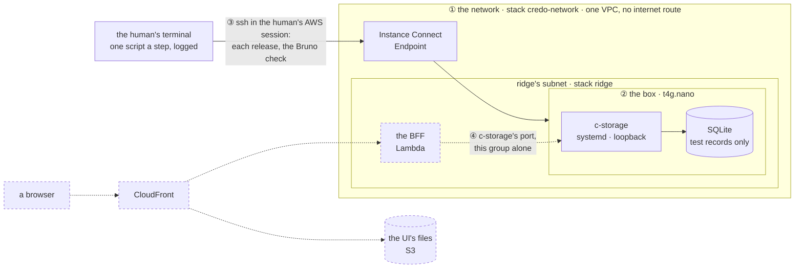

# ridge: c-storage in AWS, layer by layer

**Where it stands — 2026-10-28:** drafted, with one call open ([the human's calls](#the-humans-calls)).
Settled by the human on 10-28: Malaysia (`ap-southeast-5`), already enabled in the account (step 1);
ridge runs only commits of `main`, so c-storage is reviewed and merged there first (step 4). Nothing
is built. **Next:** the human's read (step 3), then c-storage into `main`.

> **Drafted** 2026-10-28 by the machine, from [the architecture](2026-10-27-architecture.md),
> [the app frame](2026-10-27-app-frame.md), [the c-storage memo](../memo/c-storage.md), c-storage's
> Bruno collection on branch `c-storage-bruno`, and the old app's ops. **Amends the architecture**
> in three places. Its "nothing is built before a client signs" no longer holds for ridge: ridge is
> ours, holds no client's data, and is not production, which is a signed client's own stack. The
> human's ssh needs no "box's key" ([no key pair](#the-templates)). The S3 gateway endpoint waits
> for its first caller ([left behind](#left-behind)).

## At a glance

Drawn from this plan; no code holds it yet. ridge is our own copy of a client's stack, made from
the templates a client's will use, and built from the bottom, each layer checked before the next:
① the network, ② one box running c-storage, ③ c-storage's own Bruno collection run against it
through the tunnel. ④, dashed, comes with piece 1 ([the need](#the-need)).

| Layer | Who | A month |
| --- | --- | --- |
| ① the network: a VPC, the Instance Connect Endpoint ([templates](#the-templates)) | 🤖 writes the template, 👤 runs one script | $0 |
| ② the box: `t4g.nano` $3.50, its 8 GB disk $0.69 | 🤖 writes the template, 👤 runs one script | ≈ $4.20, $0.14 a day |
| each release of c-storage, from `main` ([the release](#the-release)) | 🤖 writes the script, 👤 runs it | $0 |
| ③ the check and the drill ([the check](#the-check)) | 👤 runs one script each, 🤖 reads the logs | $0 |
| ④ the BFF, CloudFront, the UI's files | with piece 1 ([layer four](#the-fourth-layer-with-piece-1)) | priced then |

The human runs every `aws` command, always as one script, and the machine reads its log; the machine
holds no AWS credential, and the box's keys never enter git. **One call:** ridge up all month, about
$4.20 ([call 1](#the-humans-calls)).

## The need

The human, 10-27: "we can deploy only a part, instead of wait all ready before deploy, right? … can
we have a cloud formation for this too?" Then: "from QA perspective, we want to verify c-storage,
E2E via github action, in order to able to deliver with confidence … c-storage is simple, so I want
to make sure that we can use c-storage as a PoC of this." The environment is named ridge. More like
it will follow (taiga, crest), each a stack of its own from the same template, and none is built now.

ridge proves what the local stack cannot: that the templates make what the architecture drew, that
the arm64 binary starts on its box under systemd, that the tunnel is the only way in, and that the
data outlives a crash, a release and a reboot. What the code does stays proven where it is cheaper:
c-storage's Go tests, and CI's run of the collection on a local server. A whole environment is stood
up only for what ships: a new resource, hop or key.

## The templates

Two templates of hand-written CloudFormation YAML, shipped through change sets (the architecture's
[decision 8](2026-10-27-architecture.md#decisions--the-machines)):

| Template · stack | Its resources now, each for | Gains later |
| --- | --- | --- |
| `ops/network.yml` · `credo-network`, one for all | `Vpc`: the one private network, with no internet gateway. `Routes`: the route table every subnet joins, the local route alone. `EndpointSubnet`: a /28 the endpoint sits in. `EndpointGroup`: the endpoint's side, ssh out to the VPC and nothing else. `Endpoint`: the Instance Connect Endpoint, the human's one way in | `S3`: the gateway endpoint, on `Routes`, with its first caller (the nightly backup) |
| `ops/env.yml` · one per environment, named for it: `ridge` | `Subnet`: the environment's /24, in the network's zone, no public address on launch, joined to `Routes`. `BoxGroup`: the box's door, admitting tcp 22 from `EndpointGroup` alone. `Box`: the instance | with piece 1: the BFF's function and its group, a `BoxGroup` rule admitting that group alone on c-storage's port, the UI's bucket, the distribution |

- **The environment's name is a parameter, `Env`, written into no resource.** Every name and tag
  derives from it, and the script names the stack with the same value. taiga is then one more stack
  from `env.yml`, with its own name and /24. *Rejected:* the old app's environment baked into each
  name (`c-storage-ridge`, its folder, its process). There a second environment was a copy of every
  file.
- **One network under every environment and every client's stack**, as the architecture's
  [decision 4](2026-10-27-architecture.md#decisions--the-machines) draws it. Each gets its own
  subnet, and the wall between them is each box's group, then c-storage's keys. A box admits ssh
  from the endpoint's group and, from layer four, c-storage's port from its own BFF's group alone.
  The limits: one Instance Connect Endpoint per VPC and five per account and Region, and five VPCs
  per Region by default. This network uses one of each. Its /16 holds 256 environments of a /24,
  past the VPC's default quota of 200 subnets. *Rejected:* a network per environment. It would be
  free, and a network change could be tried on ridge's before the clients', but the account's five
  endpoints would then run out at five environments and clients together. *Hazard no gate catches:*
  a change to `network.yml` reaches every environment and client at once. *Trigger to revisit:* the
  first client's stack, before it joins.
- **An environment reads the network through the network stack's exports** (the VPC, `Routes`, the
  endpoint's group, the zone), so a network that still has an environment on it cannot be deleted.
  The network takes no environment's name because it outlives each one. *Rejected:* a stack per
  layer (network, box, BFF, front). A client would then be four stacks, made, updated and deleted
  in order, with an export at each boundary. The architecture's one stack per client holds only
  with one.
- **A stack grows by change sets that add.** `ops/stack.sh network`, or `ops/stack.sh env <name>`,
  makes the change set from the template in `main`, so only a reviewed template reaches AWS, and
  writes every change to its log. A change set that removes or replaces anything is refused: the
  script deletes it and names each such change. Any other is executed, and the outputs are read
  back. A removal or a replacement meant on purpose is named in its plan's step, and the script
  then takes it by its logical id. *Why:* a replaced box deletes its disk, and the database with it.
- **The box's image is a fixed id.** When the stack is made, the script reads the current Amazon
  Linux 2023 arm64 id from AWS's public parameter and passes it as a plain value. Each update keeps
  the previous value. *Rejected:* the image as an SSM-parameter type, as the old box template had
  it. CloudFormation resolves that type again at each update, so a new image would replace the box
  at the next change set. The old stack was never updated and never met this; ours grows by
  updates.
- **The box installs nothing**, because the VPC has no internet route. The standard AL2023 image
  already holds what the box uses: systemd, OpenSSH with Instance Connect's key hook, and curl.
  c-storage is one static binary. The first boot alone (`UserData`) adds a 2 GiB swap file and stops
  the SSM agent, which can reach nothing here. The swap file is written with `dd`, because AL2023's
  XFS root refuses one made by `fallocate`, as the old box found. Other settings:
  - CPU credits set to standard, so the price is the bill (a `t4g` launches unlimited by default).
  - No public address.
  - IMDSv2 alone.
  - The disk encrypted.
  - No instance role, since nothing on the box calls AWS before the backup.
- **No key pair.** Each run mints a key for itself, pushes it through Instance Connect, where it
  holds 60 s, and opens one ssh connection through the endpoint in the human's AWS session; the
  whole run rides that connection. *Rejected:* a key pair in the template, as the old box had: a
  private key to hold, and losing or changing it replaces the box, since a new `KeyName` means a
  replacement.
- **The zone** is the first, by name, that offers `t4g.nano`. The network script reads it and its
  log names it.
- **The gate:** ShellCheck on the scripts and cfn-lint on the templates, in CI beside c-storage's
  jobs. The refusal of a removal or a replacement is one jq filter, tested on two recorded change
  sets. *Rejected:* the old ops' shims and fakes of AWS, a test suite larger than the scripts, and
  its receipts, closures and one-off templates, structure built for weekly releases. Each script
  here is one short page, with `ops/lib.sh` holding the log, the tunnel and the stack reads.
  *Hazard no gate catches:* the rest of each script first runs in the human's run, read in its log.

## The listener: open item 7

c-storage binds `127.0.0.1` alone (`Listen` in
[`server.go`](../../c-storage/internal/server/server.go)). ridge's check reaches it through ssh's
forward to the box's loopback, so layers one to three need no change. Meanwhile the loopback bind is
a second wall, while the box's group has no rule for c-storage's port.

- **When:** in [layer four](#the-fourth-layer-with-piece-1), when something first calls the private
  address: the BFF on Lambda, with its group's rule on the box. Nothing on ridge calls that address
  before then.
- **How:** `LISTEN_ADDR` sets it and is optional. Unset, the listener is loopback, so the local
  stack and every test stay as they are. When set, it must be one IP address, never an unspecified
  one (`0.0.0.0`, `::`) and never a name; anything else stops the start, as every configuration
  error does. On the box the unit sets it from the stack's `BoxAddress` output and starts once the
  network is up. Its tests: the configuration refuses every interface and a name, and `Listen`
  binds exactly the address it is given, loopback by default (in place of
  `TestListenBindsLoopbackOnly`). The memo's
  [loopback only, for now](../memo/c-storage.md#loopback-only-for-now) is rewritten in the same
  commit. *Rejected:* every interface, which leaves the group as the only wall.

## The release

c-storage's binary is built from `main` alone (the human, 10-28), sent through the tunnel, and run
under systemd: `ops/release.sh ridge [<sha>]`.

1. **Built:** the sha, `main`'s tip by default, is checked out in a throwaway worktree, and one that
   `main` does not hold is refused. The script runs c-storage's whole gate (`make check`), as is
   done before shipping, then `make box`. `make box` uses the gate's cross-compile flags
   (`CGO_ENABLED=0`, `-trimpath`, `-s -w`, linux/arm64), writes `dist/c-storage`, and stamps the
   binary with the commit (`-X`). It refuses a tree with uncommitted changes, so a stamp always names
   its source. *Rejected:* the old Makefile's stamp, which defaulted to `unknown` and so shipped a
   build nobody could name.
2. **The box read first:** free disk, memory and swap. The release stops below the floor the script
   states.
3. **Sent and run:** the binary goes to `/opt/c-storage/c-storage`, replacing the old one by an
   atomic rename. The unit, `ops/c-storage.service`, has `Restart=always`, a user of its own
   (`DynamicUser`), the database under its state directory `/var/lib/c-storage/`, and the keys from
   an environment file. Then c-storage restarts. *Rejected:* the old unit, which ran as the login
   user with its keys in that user's home folder. *Rejected:* the old ridge's process manager, which
   gave up after three restarts and restarted c-storage every night, hiding a leak.
4. **The keys:** the first release makes them once, on the box: 32 random bytes each from the
   kernel, for `INTERNAL_ACCESS_KEY` and `X_SUPER_ADMIN_KEY`. They live in `/etc/c-storage/keys.env`,
   root's alone (0600). systemd reads the file before starting c-storage as its own user, so the
   service runs without root and the file stays root's. A release never writes the file again; a
   key changes only by a step that says so. The human holds the keys through the human's AWS session
   alone: a script that needs them (the check now, the BFF's layer later) reads them over ssh as it
   runs. They never enter git or a log, and each script searches its own log for them before it
   ends.
5. **Verified:** the script reads `/health` on the box's loopback for up to 30 s, until it names the
   commit shipped. The log ends on `released <sha>`, or on what `/health` answered. A failed release
   exits non-zero and leaves the box as it is. On ridge the way back is to release the previous
   commit (`ops/release.sh ridge <sha>`). *Rejected for ridge:* the old ops' automatic rollback,
   which nothing tests until a release fails. It returns with the first client's stack.

**How the human runs a step:** one command, from a worktree at `main`, in a terminal holding an AWS
session, such as `ops/release.sh ridge`. Each script:

- writes all its output to `logs/<date>-<time>-<script>-<env>.log` in the credo root (derived from
  git, as `$ROOT_DIR` is);
- prints each of its n/N steps with the time elapsed, and writes results as it goes;
- says its expected length in its first comment;
- ends on `== exit <n>`.

The machine reads the log, and the human never pastes output. While a script runs, the machine
answers in words alone and changes nothing the script reads. When the human says it has ended, the
machine reads the log first. The runbook, `ops/README.md`, is numbered steps and commands with
one-line branches; the why stays here. A c-storage change merged into `main` is released to ridge
and checked the same day: two commands, about four minutes.

## Which build is running

`/health` answers `buildVersion` again: the commit's full sha, stamped by `make box`. A build with no
stamp (the tests, CI's `go build`) answers `dev`. The release verifies against this field, and the
check refuses a ridge whose build is not a commit of `main`. When a symptom outlives a fix, the first
read is this field. A gap between it and the fix is reported, and the work stops there.

- *Why:* `/health` asks the process that is answering. *Rejected:* a file beside the binary, which
  says what was copied rather than what runs. *Rejected:* the start-up log line, which says what
  started and is read through another channel.
- *Price:* the one body without a key gains a field. A sha names code, not an environment or a key,
  and only the tunnel reaches the port (the BFF's group too, later). The BFF must never pass this
  body on to a browser: a row for layer four.
- *Test:* `/health` names the stamped build, a Go test seen red once, in place of "one field and no
  more". The collection's health request asserts both fields, in the same commit.

## The check

`ops/check.sh ridge` opens the tunnel with ssh forwarding a local port to c-storage's loopback
port. The local port is never the local stack's, so a c-storage on the human's machine cannot
answer for ridge. The box is the one the stack `ridge` names in its output, never a typed address,
and `/health`'s build is read through the tunnel before the collection runs. The script then:

- writes a git-ignored Bruno environment, `c-storage/bruno/environments/ridge.yml`, mode 0600, with
  the keys read over ssh;
- runs the collection with Bruno CLI 4.2.0, as CI does;
- deletes the file when it ends.

*Rejected:* the old ridge's connector map, whose ridge-named targets pointed at another
environment's host, so the wrong environment answered 200.

**Green** is all of these:

- the AWS reads: no public address, the box's group holding its one rule, no internet gateway on
  the VPC;
- the box's reads: the unit active, c-storage listening on loopback alone, the keys file 0600 and
  root's, no OOM kill since boot, and memory, swap and disk logged;
- `/health` naming a commit of `main`;
- every request and assertion of Bruno's 24 passing;
- neither key in the log.

The log ends `== green`, or names each red.

**What it writes.** The collection registers a service, then pushes, reads and removes its records,
and a second run under the same service code would answer 409 and turn red. So each run takes a
fresh code, `check-<UTC time>`, and a fresh access key. A run leaves one service row, its key
hashed, and no record: a few hundred bytes. A service cannot be removed
([keys](../memo/c-storage.md#keys-are-compared-exactly-and-stored-hashed)), so these rows stay;
ridge holds nothing else, so they are accepted (row 12). *Rejected:* emptying the database before
each run. That would take away what the drill proves, that the data outlives a release and a reboot.
The collection never runs against a client's stack; the first client's stack adds the guard that
refuses it.

**The drill**, `ops/drill.sh ridge`, runs once here, and again when the unit, the templates or the
box change. It reads disk and memory first, then:

- kills c-storage (`SIGKILL`), which must answer again within 10 s under a new process;
- registers a code, then reboots the box cleanly. After the reboot, c-storage must be back by itself
  on the same build, and the code must answer 409.

A power loss is the memo's accepted price ([the only copy](../memo/c-storage.md#the-file-is-the-only-copy)),
and is not drilled.

## The checks

One behaviour a line ([QA](../conventions/qa.md) rule 1). 👤 marks the row for the human's business
sense.

| # | 👤 | The case | Held by |
| --- | --- | --- | --- |
| 1 | | The box has no public address, and the VPC no internet gateway | `check.sh`, its AWS reads |
| 2 | | Only the tunnel reaches the box: its group admits ssh from the endpoint's group and nothing else | `check.sh`, its AWS reads |
| 3 | | c-storage listens on loopback alone until layer four | Go test; `check.sh` on the box |
| 4 | | `/health` names the build: the commit's sha, or `dev` unstamped | Go test |
| 5 | | A release runs only a commit of `main`, and ends only once `/health` names it | `release.sh` |
| 6 | | A release reads the box's disk, memory and swap first, and stops below its floor | `release.sh` |
| 7 | | The keys are made once, on the box, root's alone; no release rewrites them | `release.sh`; `check.sh` |
| 8 | | No key reaches git or a log | the git-ignore of Bruno's environments; each script's search of its own log |
| 9 | | A change set that removes or replaces anything is refused, and nothing changes | `stack.sh`'s filter, on two recorded change sets |
| 10 | | c-storage restarts after a crash | `drill.sh` |
| 11 | | A reboot keeps the data, and c-storage comes back by itself | `drill.sh` |
| 12 | 👤 | ridge holds test data alone: a check leaves one service row and no record, and no client's data, real or copied, is ever put there | `check.sh`'s fresh code each run; the human |
| 13 | | c-storage's Bruno collection passes over the tunnel, on a build of `main` | `check.sh` |
| 14 | | The box has had no OOM kill since boot | `check.sh` on the box |

Each row is seen red once before it counts ([QA](../conventions/qa.md) rule 2). The Go rows are
seen red by breaking their line. The script rows are seen red by a state ridge can safely be put in:

- row 5, a sha that `main` lacks;
- row 9, the recorded replacing change set;
- row 13, a wrong key;
- rows 10 and 11, by the drill itself.

Rows 1, 2 and 14 read states that the templates and the unit forbid, so their red is not staged:
*untested*. Making a public box just to see it refused costs more than the read is worth.

## The human's calls

1. **ridge up all month, or stopped between uses.** *Recommended:* up all month, about $4.20, or
   $0.14 a day. *For:* a check takes a minute, against a box that has lived through every release,
   which is part of what ridge proves. The check from GitHub, when it comes, finds the box up.
   *Against:* the box sits idle most hours. *The alternatives:*
   - Stopped between uses by a script: about $0.70 a month for the disk, plus $0.005 an hour while
     it runs. The data and keys are kept, at the price of two more commands and a minute's start for
     each use.
   - Deleted between uses: $0. Each use is then a new box, with new keys and an empty database,
     about ten minutes.

## Steps

Each of the human's steps is one script the machine writes, and its log is the evidence for the
step's done-when. A size is machine hours or the human's minutes.

- [x] **1. `ap-southeast-5` enabled.** Who: 👤, 10-28. Done when: the account reads it enabled.
  *Evidence:* on 10-28 the human ran `aws account get-region-opt-status --region-name
  ap-southeast-5` and read `"RegionOptStatus": "ENABLED"`.
- [x] **2. This plan, and the open items pointed at it.** Who: 🤖, 10-28. Done when: committed on
  `ridge`, with the path, name, 12-digit and link checks clean, and open items 4, 5 and 7 naming
  this plan as their home. *Evidence:* this commit. Item 6 still waits, with its reason.
- [ ] **3. The human's read.** Who: 👤, 15 minutes. Consumes: this plan. Done when: call 1 is
  answered under it, dated, and any correction is taken.
- [ ] **4. c-storage in `main`.** Who: 🤖, an hour: a model other than the author's reviews it (QA
  rule 5), the orchestrator merges, and 👤 pushes. Consumes: c-storage on `app-frame`, and its
  Bruno collection on `c-storage-bruno`. Done when: `main` holds both, and CI's two c-storage jobs
  read green on `main`'s commit.
- [ ] **5. `/health` names the build; `make box`.** Who: 🤖, an hour, on a branch from `main` after
  step 4, since it changes the code step 4 merges. Done when: `make check` is green, the new test
  has been seen red once, and the collection's health request asserts both fields.
- [ ] **6. The templates, the unit, the scripts, the runbook.** Who: 🤖, 4 hours, on the same
  branch. Consumes: step 4's collection, which the check runs, and step 5's `make box`, which the
  release calls. Done when: ShellCheck and cfn-lint are green in CI, and the change-set filter's two
  cases have been seen red and green. `ops/README.md` is the runbook, each script's first comment
  gives its expected length, and `CLAUDE.md`'s `Ship` names the release.
- [ ] **7. The review, then `main`.** Who: 🤖, an hour, by a model other than the author's; 👤
  pushes. Consumes: steps 5 and 6. Done when: each finding is fixed or answered, every gate is
  green, and `main` holds the work.
- [ ] **8. ① The network.** Who: 👤 runs `ops/stack.sh network`, about 5 minutes. Consumes:
  `network.yml` in `main` (step 7). Done when: the log reads the stack made, its outputs (the VPC,
  the zone, the endpoint's group), and no internet gateway.
- [ ] **9. ② The box.** Who: 👤 runs `ops/stack.sh env ridge`, about 4 minutes, on the same day as
  step 10: an idle box costs $0.14 a day and proves nothing. Consumes: the network's exports (step
  8). Done when: the log reads the stack made and the box running with no public address, then an
  ssh read-back through the endpoint: arm64, the swap on, the SSM agent stopped, the free memory.
- [ ] **10. The first release.** Who: 👤 runs `ops/release.sh ridge`, about 3 minutes. Consumes:
  the box (step 9) and `main`'s build (step 7). Done when: the log reads the disk and memory first,
  then the keys made (0600, root's), the unit active, and `/health` naming `main`'s sha.
- [ ] **11. ③ The check.** Who: 👤 runs `ops/check.sh ridge`, about a minute. Consumes: the release
  (step 10). Done when: the log ends `== green`.
- [ ] **12. The drill.** Who: 👤 runs `ops/drill.sh ridge`, about 5 minutes. Consumes: step 11's
  green, the known state the drill breaks. Done when: rows 10 and 11 read green, then
  `ops/check.sh ridge` reads green again.
- [ ] **13. The recap.** Who: 🤖, 30 minutes. Consumes: the logs of steps 8 to 12. Done when:
  `docs/recaps/<date>-ridge.md` is written from them, and "Where it stands" is rewritten.

**Then stop.** ridge stands, with c-storage checked on it. From then on, each c-storage change is
released from `main` and checked the day it merges.

## The fourth layer, with piece 1

This is not a step of this plan's first stop. It is planned when piece 1's BFF is green on the
local stack ([the app frame's step 6](2026-10-27-app-frame.md#steps)), which it consumes, and its
case table and done-when are written then. It adds the following to `env.yml`:

- the BFF's function and its group, and the BFF's arm64 bundle ([open item 5](../open-items.md));
- the box's rule admitting that group alone on c-storage's port;
- the UI's bucket and the distribution, on CloudFront's own name.

In the same layer, c-storage's listener moves to the private address
([open item 7](#the-listener-open-item-7)), and the BFF is kept from passing c-storage's `/health`
on.

## Left behind

Each waits until something calls it.

- **The nightly backup and its restore** ([open item 6](../open-items.md)): ridge holds no real
  data. The S3 gateway endpoint and the box's put-only role come with it.
- **The alarms** ([open item 1](../open-items.md)): no one depends on ridge being up.
- **Releases and the check from GitHub Actions:** an OIDC role giving GitHub rights in AWS is a
  decision of its own. Until then the human's terminal runs every step. This is where the human's
  aim, the check from GitHub, lands.
- **CloudFront, the BFF and the UI's files:** [layer four](#the-fourth-layer-with-piece-1), with
  piece 1.
- **A name of ours and its certificate:** the architecture's call 3 gives one to each client.
  ridge uses CloudFront's own name.
- **taiga, crest:** one stack each from `env.yml`, when the first is called.
- **With the first client's stack:**
  - the database on a volume of its own, which a replaced box keeps;
  - a release's automatic rollback;
  - the guard that refuses the check against a client's stack;
  - whether the client's stack joins this network;
  - the box's system updates (AL2023's repositories reach a box through the S3 gateway endpoint).
- **A removal script:** when an environment is first taken down.
