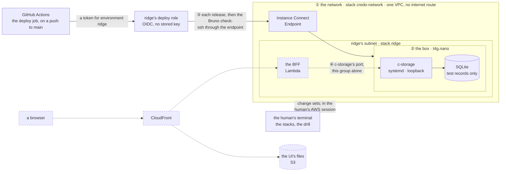

# ridge: c-storage in AWS, layer by layer

**Where it stands — 2026-10-28 13:35 +07:** ridge is live and deployed by GitHub from `main`. Steps
1 to 15 are done: the first deploy (run 40641839897, `37af006`) was green with no re-run, and the
drill read rows 13 and 14 green, with `ops/check.sh ridge` green after it. ridge stays up all month,
about $4.20 (step 4); Malaysia (`ap-southeast-5`); only commits of `main`; deploys from GitHub
Actions, beside piece 1. The public URL is parked
([open item 13](../open-items.md)), and the tunnel command is planned as its own piece. Next: layer
four, with piece 1, planned in [ridge-app](2026-10-28-ridge-app.md#layer-four) (function URLs are not offered in `ap-southeast-5`, so an HTTP API fronts the BFF). The recap holds what shipped and what remains the human's:
[the recap](../recaps/2026-10-28-ridge.md).

> **Drafted** 2026-10-28 by the machine, from [the architecture](2026-10-27-architecture.md),
> [the app frame](2026-10-27-app-frame.md), [the c-storage memo](../memo/c-storage.md), c-storage's
> Bruno collection on branch `c-storage-bruno`, and the old app's ops. **Amended** 2026-10-28 by
> the human: "can we continue with deploy too, in parallel, and should deploy from github action".
> c-storage's releases and their checks run in GitHub Actions, and the stacks stay the human's.
>
> **This plan amends the architecture** in four places:
>
> - Its "nothing is built before a client signs" no longer holds for ridge. ridge is ours, holds no
>   client's data, and is not production; production is a signed client's own stack.
> - c-storage's releases reach the box from GitHub Actions, not from the human's terminal
>   ([deploys](#deploys-from-github-actions)).
> - ssh needs no "box's key" ([no key pair](#the-templates)).
> - The S3 gateway endpoint waits for its first caller ([left behind](#left-behind)).

## At a glance

Drawn from this plan; no code holds it yet. ridge is our own copy of a client's stack, made from
the templates a client's will use, and built from the bottom, each layer checked before the next:
① the network, ② one box running c-storage, ③ each release, with c-storage's own Bruno collection
run through the tunnel, from GitHub Actions. ④, dashed, comes with piece 1 ([the need](#the-need)).

| Layer | Who | A month |
| --- | --- | --- |
| ① the network: a VPC, the Instance Connect Endpoint ([templates](#the-templates)) | 🤖 writes the template, 👤 runs one script | $0 |
| ② the box: `t4g.nano` $3.50, its 8 GB disk $0.69 | 🤖 writes the template, 👤 runs one script | ≈ $4.20, $0.14 a day |
| ③ each release and its check ([deploys](#deploys-from-github-actions)) | 🤖 writes the job; 👤's push to `main` starts it | $0: Actions are free on this public repository; OIDC and IAM are free |
| the drill ([the check](#the-check)) | 👤 runs one script, 🤖 reads the log | $0 |
| ④ the BFF, CloudFront, the UI's files | with piece 1 ([layer four](#the-fourth-layer-with-piece-1)) | priced then |

The human makes and changes the stacks, one script each, and the machine reads the logs. GitHub
Actions releases and checks c-storage after each push to `main`, under a role that only `main`'s
runs in GitHub's environment `ridge` can take. No AWS key is stored anywhere, and the box's keys
never enter git or GitHub. **One call:** ridge up all month, about $4.20
([call 1](#the-humans-calls)).

## The need

The human, 10-27: "we can deploy only a part, instead of wait all ready before deploy, right? … can
we have a cloud formation for this too?" Then: "from QA perspective, we want to verify c-storage,
E2E via github action, in order to able to deliver with confidence … c-storage is simple, so I want
to make sure that we can use c-storage as a PoC of this." The environment is named ridge. More like
it will follow (taiga, crest), each a stack of its own from the same template, and none is built now.

ridge proves what the local stack cannot: that the templates make what the architecture drew, that
the arm64 binary starts on its box under systemd, that the tunnel is the only way in, and that the
data outlives a crash, a release and a reboot. What the code does stays proven where it is cheaper:
c-storage's Go tests, and CI's run of the collection on a local server. A whole environment is stood
up only for what ships: a new resource, hop or key.

## The templates

Three templates of hand-written CloudFormation YAML, shipped through change sets (the architecture's
[decision 8](2026-10-27-architecture.md#decisions--the-machines)):

| Template · stack | Its resources now, each for | Gains later |
| --- | --- | --- |
| `ops/network.yml` · `credo-network`, one for all | `Vpc`: the one private network, with no internet gateway. `Routes`: the route table every subnet joins, the local route alone. `EndpointSubnet`: a /28 the endpoint sits in. `EndpointGroup`: the endpoint's side, ssh out to the VPC and nothing else. `Endpoint`: the Instance Connect Endpoint, the only way in | `S3`: the gateway endpoint, on `Routes`, with its first caller (the nightly backup) |
| `ops/github.yml` · `credo-github`, one per account | `GitHub`: the OIDC provider for GitHub's tokens, with audience `sts.amazonaws.com`. Made only where the account lacks one | nothing |
| `ops/env.yml` · one per environment, named for it: `ridge` | `Subnet`: the environment's /24, in the network's zone, no public address on launch, joined to `Routes`. `BoxGroup`: the box's door, admitting tcp 22 from `EndpointGroup` alone. `Box`: the instance. `DeployRole`: what GitHub's runs for this environment may do ([deploys](#deploys-from-github-actions)) | with piece 1: the BFF's function and its group, a `BoxGroup` rule admitting that group alone on c-storage's port, the UI's bucket, the distribution |

- **The environment's name is a parameter, `Env`, written into no resource.** Every name, tag and
  the deploy role's trust derive from it, and the script names the stack with the same value. taiga
  is then one more stack from `env.yml`, with its own name, /24 and role. *Rejected:* the old app's
  environment baked into each name (`c-storage-ridge`, its folder, its process). There a second
  environment was a copy of every file.
- **The repository's owner and name are never written in a committed file.** The script reads them
  from `git remote get-url origin` and passes them as the parameter `Repository`.
- **One network under every environment and every client's stack**, as the architecture's
  [decision 4](2026-10-27-architecture.md#decisions--the-machines) draws it. Each gets its own
  subnet, and the wall between them is each box's group, then c-storage's keys. A box admits ssh
  from the endpoint's group and, from layer four, c-storage's port from its own BFF's group alone.
  The limits: one Instance Connect Endpoint per VPC and five per account and Region, and five VPCs
  per Region by default. This network uses one of each. Its /16 holds 256 environments of a /24,
  past the VPC's default quota of 200 subnets. *Rejected:* a network per environment. It would be
  free, and a network change could be tried on ridge's before the clients', but the account's five
  endpoints would then run out at five environments and clients together. *Hazard no gate catches:*
  a change to `network.yml` reaches every environment and client at once. *Trigger to revisit:* the
  first client's stack, before it joins.
- **An environment reads the network through the network stack's exports** (the VPC, `Routes`, the
  endpoint and its group, the zone), so a network that still has an environment on it cannot be
  deleted. The network takes no environment's name because it outlives each one. The OIDC
  provider's ARN is fixed by its address, so the role names it without an export. *Rejected:* a
  stack per layer (network, box, BFF, front). A client would then be four stacks, made, updated and
  deleted in order, with an export at each boundary. The architecture's one stack per client holds
  only with one.
- **A stack grows by change sets that add, made from the human's terminal.** The script is
  `ops/stack.sh network`, `github` or `env <name>`. It makes the change set from the template in
  `main`, so only a reviewed template reaches AWS, and writes every change to its log. A change set
  that removes or replaces anything is refused: the script deletes it and names each such change.
  Any other is executed, and the outputs are read back. A removal or a replacement meant on purpose
  is named in its plan's step, and the script then takes it by its logical id. *Why:* a replaced box
  deletes its disk, and the database with it. The stack's status picks create or update: a stack
  that holds only a change set (`REVIEW_IN_PROGRESS`, left by a failed or interrupted creation)
  is created again with fresh parameters, and a `ROLLBACK_COMPLETE` one is refused until the human
  deletes it. `--plan` on a first creation deletes the empty stack CloudFormation keeps for the
  change set, so a plan changes nothing. An update keeps `Repository` as the stack has it and
  refuses a clone whose `origin` differs, so a fork cannot move the deploy role's trust. It keeps
  and checks `SubjectPrefix` the same way.
- **The box's image is a fixed id.** When the stack is made, the script reads the current Amazon
  Linux 2023 arm64 id from AWS's public parameter and passes it as a plain value. Each update keeps
  the previous value. *Rejected:* the image as an SSM-parameter type, as the old box template had
  it. CloudFormation resolves that type again at each update, so a new image would replace the box
  at the next change set. The old stack was never updated and never met this; ours grows by
  updates.
- **The box installs nothing**, because the VPC has no internet route. The standard AL2023 image
  already holds what the box uses: systemd, OpenSSH with Instance Connect's key hook, and curl.
  c-storage is one static binary. The first boot alone (`UserData`) adds a 2 GiB swap file and stops
  the SSM agent, which can reach nothing here. The swap file is written with `dd`, because AL2023's
  XFS root refuses one made by `fallocate`, as the old box found. Other settings:
  - CPU credits set to standard, so the price is the bill (a `t4g` launches unlimited by default).
  - No public address.
  - IMDSv2 alone.
  - The disk encrypted.
  - No instance role, since nothing on the box calls AWS before the backup.
- **No key pair.** Each run, from the job or a terminal, mints a key for itself and pushes it
  through Instance Connect, where it holds 60 s. It then opens one ssh connection through the
  endpoint, and the whole run rides that connection. *Rejected:* a key pair in the template, as the
  old box had: a private key to hold, and losing or changing it replaces the box, since a new
  `KeyName` means a replacement.
- **The zone** is the first, by name, that offers `t4g.nano`. The network script reads it and its
  log names it.
- **The gate**, a job `ops` in CI beside c-storage's:
  - ShellCheck on the scripts, and cfn-lint on the templates;
  - the refusal of a removal or a replacement, which is one jq filter, tested on four hand-written
    change sets;
  - the release's check of `/health`, run against the real c-storage binary, built with the
    Makefile's stamp and without it, so the job installs Go;
  - the other guards of `ops/test.sh`, each seen red ([the checks](#the-checks)).

  *Rejected:* the old ops' shims and fakes of AWS, a test suite larger than the scripts, and its
  receipts, closures and one-off templates, structure built for weekly releases. Each script here
  is one short page, with `ops/lib.sh` holding the log, the tunnel and the stack reads. *Hazard no
  gate catches:* the rest of each script first runs for real, read in its log.

## The listener: open item 7

c-storage binds `127.0.0.1` alone (`Listen` in
[`server.go`](../../c-storage/internal/server/server.go)). ridge's check reaches it through ssh's
forward to the box's loopback, so layers one to three need no change. Meanwhile the loopback bind is
a second wall, while the box's group has no rule for c-storage's port.

- **When:** in [layer four](#the-fourth-layer-with-piece-1), when something first calls the private
  address: the BFF on Lambda, with its group's rule on the box. Nothing on ridge calls that address
  before then.
- **How:** `LISTEN_ADDR` sets it and is optional. Unset, the listener is loopback, so the local
  stack and every test stay as they are. When set, it must be one IP address, never an unspecified
  one (`0.0.0.0`, `::`) and never a name; anything else stops the start, as every configuration
  error does. On the box the unit sets it from the stack's `BoxAddress` output and starts once the
  network is up. Its tests: the configuration refuses every interface and a name, and `Listen`
  binds exactly the address it is given, loopback by default (in place of
  `TestListenBindsLoopbackOnly`). The memo's
  [loopback only, for now](../memo/c-storage.md#loopback-only-for-now) is rewritten in the same
  commit. *Rejected:* every interface, which leaves the group as the only wall.

## The release

c-storage's binary comes from `main` alone (the human, 10-28). `ops/release.sh ridge [<sha>]` sends
it through the tunnel and runs it under systemd. The deploy job runs it, and so can the human.

1. **Built:** `make box` uses the gate's cross-compile flags (`CGO_ENABLED=0`, `-trimpath`, `-s -w`,
   linux/arm64), writes `dist/c-storage`, and stamps the binary with the commit (`-X`). It refuses a
   tree with uncommitted changes, so a stamp always names its source.
   - In the deploy job, the build is the commit the job runs on, after the gate's jobs are green.
   - By hand, it is `main`'s tip or a given sha `main` holds, checked out in a throwaway worktree,
     after c-storage's whole gate (`make check`). A sha `main` lacks is refused.

   *Rejected:* the old Makefile's stamp, which defaulted to `unknown` and so shipped a build nobody
   could name.
2. **The box read first:** free disk, available memory and total swap. The release stops below the
   floor `ops/lib.sh` states for each.
3. **Sent and run:** the binary and the unit go beside the old ones as `.new` files and are checked.
   Then one command renames both into place, an atomic rename each, and restarts c-storage, so
   nothing that runs changes before it. The unit, `ops/c-storage.service`, has `Restart=always`, a user of its own
   (`DynamicUser`), the database under its state directory `/var/lib/c-storage/`, and the keys from
   an environment file. *Rejected:* the old unit, which ran as the login
   user with its keys in that user's home folder. *Rejected:* the old ridge's process manager, which
   gave up after three restarts and restarted c-storage every night, hiding a leak.
4. **The keys:** the first release makes them once, on the box: 32 random bytes each from the
   kernel, for `INTERNAL_ACCESS_KEY` and `X_SUPER_ADMIN_KEY`. They live in `/etc/c-storage/keys.env`,
   root's alone (0600). systemd reads the file before starting c-storage as its own user, so the
   service runs without root and the file stays root's. A release never writes the file again, and
   compares its checksum before and after to say so; a key changes only by a step that says so. A run that needs them (the check now, the BFF's layer later)
   reads them over ssh as it runs. They never enter git, a log or a GitHub secret
   ([the check](#the-check) says why), and each script run by hand searches its own log for them
   before it ends.
5. **Verified:** the script reads `/health` on the box's loopback, one try a second for 31 tries,
   until it names the commit shipped: 30 s when the box answers at once, and at most about 3 minutes
   if every try hangs to its 5 s limit. The log ends on `released <sha>`, or on what `/health`
   answered. A failed release exits non-zero, which fails the job. A failure before the install
   leaves the box running what it ran; a failure after it (in the restart or the read of `/health`)
   leaves the new binary installed, and the way back is the re-run below. *Rejected for ridge:* the old
   ops' automatic rollback, which nothing tests until a release fails. It returns with the first
   client's stack.

**How the human runs a step:** the stacks, any change to them, the drill, and a release when GitHub
Actions is down. Each is one command, from a worktree at `main`, in a terminal holding an AWS
session, such as `ops/stack.sh env ridge`. Each script:

- refuses to run unless `ops/` in the working copy is `origin/main`'s, fetched first, so an
  unreviewed script never acts under the human's AWS session. In the deploy job
  (`GITHUB_ACTIONS=true`) it is the checked-out commit's instead, a commit that must be an ancestor
  of `origin/main` ([the job](#deploys-from-github-actions));
- writes all its output to `logs/<date>-<time>-<script>-<env>.log` in the credo root (derived from
  git, as `$ROOT_DIR` is);
- prints each of its n/N steps with the time elapsed, and writes results as it goes;
- says its expected length in its first comment;
- ends on `== exit <n>`, which is 130, 143 or 129 after Ctrl-C, SIGTERM or SIGHUP.

The machine reads the log, and the human never pastes output. While a script runs, the machine
answers in words alone and changes nothing the script reads. When the human says it has ended, the
machine reads the log first. A deploy's log is in GitHub; the orchestrator saves it with `gh run
view --log` into the same `logs/` folder. The runbook, `ops/README.md`, is numbered steps and
commands with one-line branches; the why stays here.

## Deploys from GitHub Actions

The human's push to `main` is the decision to deploy, and GitHub Actions carries it out. CD ships
and checks releases; it changes no stack.

**The job:** `deploy`, in `.github/workflows/c-storage.yml`, beside `check`, `e2e` and `ops`.

- It runs on `runs-on: ubuntu-24.04`, as does every job in the workflow. *Why:* GitHub's run
  annotation says the `ubuntu-latest` label moves to Ubuntu 26 from 2026-10-19, which would change
  the runner under a deploy unasked. Moving to 26.04 is a change of its own, made later, with the
  gate read on it first.
- It runs only on a push to `main` that touches `c-storage/`, `ops/` or the workflow, and only once
  `check`, `e2e` and `ops` are green (`needs`). The workflow's `paths` filter gives the first
  condition, and the job's `if` (a push, and `refs/heads/main`) the rest: a branch and a pull
  request never reach it.
- **It never runs under act**, which has no AWS and which the human runs before every push. A job's
  own `if` cannot read `env`, so every step of the job carries `if: ${{ !env.ACT }}` (act sets
  `ACT`), and the job is all skipped steps there. `ops/test.sh` fails when the job lacks the
  branch condition or any step lacks that line.
- It sets `environment: ridge`, and `concurrency` group `ridge` with in-progress runs never
  cancelled. One deploy runs at a time, and a run waiting behind it is replaced by a newer one
  (GitHub shows it cancelled). The group sits behind `needs`, so deploys queue in the order their
  gates finish, not the order of the pushes, and an older commit could overwrite a newer one with
  every check green. **ridge never moves backwards:** before it installs anything,
  `ops/release.sh` reads `/health` through the tunnel, and when ridge runs a commit that has the
  release's commit as a strict ancestor it ends `superseded: ridge runs <sha>`, exits 0 and changes
  nothing. The check then reads what runs, a commit of `main` all the same. *Rejected:* a gate
  before the group, which would hold the job's runner idle, and the job's own `if`, which cannot
  read ridge.
- `id-token: write` is granted to this job alone.
- It checks out with full history (`fetch-depth: 0`), since the release asks whether its commit is
  an ancestor of `origin/main`.
- It installs Bruno CLI with `npm install -g --ignore-scripts @usebruno/cli@4.2.0`, in this job and
  in `e2e`: the CLI brings 533 npm packages, unpinned, and this is the one job that holds the role.
  No install script of theirs runs, `e2e` proves `bru` works without them (it runs under act, the
  deploy job does not), and `ops/check.sh` runs `bru` with the job's credentials removed from its
  environment (the AWS keys, and the OIDC and runtime tokens). The session lasts 1200 s, as long as
  the job's timeout. *Deferred:* a lockfile for the CLI ([open item 12](../open-items.md)).
- Its steps:
  1. it builds the arm64 binary from its commit (`make box`); the runner cross-compiles, since
     c-storage is pure Go;
  2. it takes the role, with `mask-aws-account-id: true` on the credentials step (`lib.sh` adds no
     mask of its own), since AWS's error text carries the account id outside the secret role ARN,
     and this repository's logs are public (the action prints the role's unique id before it masks; the human accepted that, in [step 12](#steps));
  3. it runs `ops/release.sh ridge`, which releases over the Instance Connect tunnel and reads
     `/health`'s build against the commit;
  4. it runs `ops/check.sh ridge`, Bruno's collection through the tunnel.

**The role, through OIDC, with no stored key.** `DeployRole` in `env.yml` trusts the account's
GitHub provider for the audience `sts.amazonaws.com` and the subject
`<SubjectPrefix>:environment:<Env>` alone. `SubjectPrefix` is the start of the subject GitHub puts
in this repository's tokens, which `ops/stack.sh env` reads from
`gh api repos/<Repository>/actions/oidc/customization/sub`: `repo:owner/name`, or, for a repository
GitHub issues the immutable subject, `repo:owner@<id>/name@<id>`. The script refuses an answer it
cannot read and custom claim keys (`use_default` false), which change the subject's whole shape. An
update keeps the stack's prefix and refuses GitHub's when it differs, as it does `Repository`: a
fork's clone has other ids. Its rights:

- `cloudformation:DescribeStacks` on its own stack, which reads `BoxId`;
- `ec2-instance-connect:SendSSHPublicKey` on its own box, as `ec2-user`;
- `ec2-instance-connect:OpenTunnel` on the network's endpoint, to its box's private address on port
  22 alone, so the shared endpoint never takes it to another environment's or a client's box;
- the read-only describes that the tunnel and the check need (instances, endpoints, groups,
  gateways), which AWS grants on every resource or none.

It holds nothing else: no change to any stack, no IAM, nothing on `credo-network` or any client's
stack. GitHub's environment `ridge` admits deploys from `main` alone. Its one secret,
`AWS_ROLE_ARN`, holds the account's id, so GitHub masks it in every log.

**Bootstrap, once, from the human's terminal**, one logged script each, in order:

1. `ops/stack.sh network`, which makes `credo-network`.
2. `ops/stack.sh github`, which makes `credo-github`, the provider, only where the account lacks one.
3. `ops/stack.sh env ridge`, which makes `ridge`: the subnet, the box and the deploy role. Then, with
   the human's `gh`, it makes the GitHub environment `ridge` (deploys from `main` alone) and its
   secret, and reads both back.

**Argued against, from the shape first proposed:**

- *The provider and the role in one stack.* The provider is one per account and address, so a
  stack per environment cannot hold it: taiga's stack would collide with it. The role belongs to
  one environment, so it sits in that environment's stack, its trust drawn from `Env`, and taiga's
  role comes with taiga's stack, with nothing copied. *Price:* the human's change sets on `ridge`
  now carry IAM, read like any other change.
- *CloudFormation rights on `ridge` through an execution role the deploy role may pass.* CD ships
  releases, not templates, so those rights would sit unused, and the role lives in the stack they
  would let it change. They come with the call that moves template changes into CD
  ([left behind](#left-behind)).

**The release by hand stays**, as the same script the job runs. It costs no code of its own and is
the human's way to release while GitHub Actions is down. **The way back** from a failed deploy is a
revert of the bad commit, pushed to `main`: its deploy ships the reverted tree as a newer commit.
A re-run of an older run is not a way back, since ridge never moves backwards: it ends
`superseded`.

**Hazards:**

- **A deploy before c-storage's review reaches `main`** cannot happen, behind three gates: the job
  runs on `main` alone, the environment admits `main` alone, and the role trusts the environment
  alone. A branch, a pull request or a fork reaches none of them.
- **This repository is public, so its Actions logs are public too.** In the job, the keys are masked
  (`::add-mask::`) before anything else is printed, and never with the shell tracing commands. The
  role's ARN is a secret, so GitHub masks the account's id. *Hazard no gate catches:* a key printed
  before its mask stays public for good. *Guard:* the orchestrator reads the first run's log whole
  (step 13). On ridge, a leaked key is replaced by deleting `/etc/c-storage/keys.env` and running
  `ops/release.sh ridge`, which makes the keys again and restarts c-storage.
- **GitHub may issue the immutable subject; the template reads its prefix.** This repository's
  tokens carry `repo:owner@<id>/name@<id>:environment:ridge`, not `repo:owner/name:...`, so a trust
  built from the name alone refuses every deploy at `sts:AssumeRoleWithWebIdentity`. The template
  takes the prefix as `SubjectPrefix`, read from GitHub by the script (above), and the change to
  the trust is a Modify of `DeployRole` in place, with no replacement. It is also the safer form: a
  repository deleted and made again under the same name never gets the same ids. *Hazard no gate
  catches:* a repository setting changed later (custom claim keys, or the immutable subject
  turned off) moves the subject again; the next deploy is refused at the role, and the next
  `ops/stack.sh env` refuses to guess (a prefix that differs from the stack's is named, not applied).

- **GitHub's runners leave from addresses that change.** Nothing here depends on them. The tunnel is
  opened through the AWS API under the role, and the box's group admits only the endpoint's group,
  so no runner's address is allowed anywhere.
- **Bruno's records:** each deploy leaves one service row on ridge
  ([what it writes](#the-check)). At ten deploys a day, that is about a megabyte a year.
- **A template merged into `main` is live only after the human's run.** *Trigger to revisit:*
  template changes into CD.
- **A push to `main` that lands while a deploy runs** fails nothing. In the job the scripts compare
  `ops/` with the commit the job checked out (a clean tree), and still require that commit to be an
  ancestor of the `origin/main` they fetch, so the newer push changes no verdict; its own deploy
  follows. *Rejected:* comparing with the fresh `origin/main` in the job, which turned a sound
  deploy red, taught the reader to read past red ([call 1](#the-humans-calls)), and refused the
  way back exactly when it was needed. By hand the comparison with `origin/main` stays.
- **A release by hand while a deploy runs:** GitHub's concurrency group cannot see it, so it is run
  by hand only when GitHub Actions is down.

## Which build is running

`/health` answers `buildVersion` again: the commit's full sha, stamped by `make box`. A build with no
stamp (the tests, CI's `go build`) answers `dev`. The release verifies against this field, and the
check refuses a ridge whose build is not a commit of `main`. When a symptom outlives a fix, the first
read is this field. A gap between it and the fix is reported, and the work stops there.

- *Why:* `/health` asks the process that is answering. *Rejected:* a file beside the binary, which
  says what was copied rather than what runs. *Rejected:* the start-up log line, which says what
  started and is read through another channel.
- *Price:* the one body without a key gains a field. A sha names code, not an environment or a key,
  and only the tunnel reaches the port (the BFF's group too, later). The BFF must never pass this
  body on to a browser: a row for layer four.
- *Test:* `/health` names the stamped build, a Go test seen red once, in place of "one field and no
  more". The collection's health request asserts both fields, in the same commit.

## The check

`ops/check.sh ridge` runs in each deploy, after the release, and by hand. It opens the tunnel with
ssh forwarding a local port to c-storage's loopback port. The local port is never the local
stack's, so a c-storage on the same machine cannot answer for ridge. The box is the one the stack
`ridge` names in its output, never a typed address, and `/health`'s build is read through the tunnel
before the collection runs. The script then:

- reads the keys over the same ssh session, masking them first in the job;
- writes a git-ignored Bruno environment, `c-storage/bruno/environments/ridge.yml`, mode 0600, with
  those keys;
- runs the collection with Bruno CLI 4.2.0, as the `e2e` job does;
- deletes the file when it ends.

*Rejected:* the old ridge's connector map, whose ridge-named targets pointed at another
environment's host, so the wrong environment answered 200. *Rejected:* the keys as GitHub secrets.
They would be a second copy, kept in step by hand at every key change, while the box's file stays
their one home. Reading them over ssh widens nothing: a role that can release already has root on
the box.

**Green** is all of these:

- the AWS reads: no public address, the box's group holding its one rule, no internet gateway on
  the VPC;
- the box's reads: the unit active, c-storage listening on loopback alone, the keys file 0600 and
  root's, no OOM kill since boot, and memory, swap and disk logged;
- `/health` naming a commit of `main`;
- every request and assertion of Bruno's 25 passing;
- no key in the log.

The log ends `== green`, or names each red.

**What it writes.** The collection registers a service, then pushes, reads and removes its records,
and a second run under the same service code would answer 409 and turn red. So each run takes a
fresh code, `check-<UTC time>`, and a fresh access key. A run leaves one service row, its key
hashed, and no record: a few hundred bytes. A service cannot be removed
([keys](../memo/c-storage.md#keys-are-compared-exactly-and-stored-hashed)), so these rows stay;
ridge holds nothing else, so they are accepted (row 15). *Rejected:* emptying the database before
each run. That would take away what the drill proves, that the data outlives a release and a reboot.
The collection never runs against a client's stack; the first client's stack adds the guard that
refuses it.

**Run after run, green and meaningful.** The collection's first request registers its service, so a
fixed code would answer 409 on ridge's second run, and a fixed code with cleanup cannot work: a
service cannot be removed. The check therefore writes its Bruno environment anew each run, with a
fresh service code and access key (the drill's code is fresh too), and the collection removes its
own records. Every run starts from the same place, whatever earlier runs left, and still proves
the register, the 409 on a repeat and the 412s. *Rejected:* a fixed code, red from the second run;
and a Bruno variable per run on the command line (`--env-var`), which holds nothing more, since the
environment file is already written per run, mode 0600, and deleted at the end. The `deploy` job
runs this same script, so its check behaves the same.

**The drill**, `ops/drill.sh ridge`, is the human's. It runs once here, and again when the unit, the
templates or the box change. It reads disk and memory first, then:

- kills c-storage (`SIGKILL`), which must answer again within 10 s under a new process;
- registers a code, then reboots the box cleanly. After the reboot, c-storage must be back by itself
  on the same build, and the code must answer 409.

A power loss is the memo's accepted price ([the only copy](../memo/c-storage.md#the-file-is-the-only-copy)),
and is not drilled.

## The checks

One behaviour a line ([QA](../conventions/qa.md) rule 1). 👤 marks the row for the human's business
sense.

| # | 👤 | The case | Held by |
| --- | --- | --- | --- |
| 1 | | The box has no public address, and the VPC no internet gateway | `check.sh`, its AWS reads |
| 2 | | Only the tunnel reaches the box: its group admits ssh from the endpoint's group and nothing else | `check.sh`, its AWS reads |
| 3 | | c-storage listens on loopback alone until layer four | Go test; `check.sh` on the box |
| 4 | | `/health` names the build: the commit's sha, or `dev` unstamped | Go test |
| 5 | | A release runs only a commit of `main`; one whose `/health` names another commit fails, and fails the job | `release.sh`; `ops/test.sh` runs its check of `/health` against the real binary, stamped, unstamped and stamped otherwise, and `wait_build` retries a late or changing answer |
| 6 | | A release reads the box's disk, memory and swap first, and stops below each floor | `release.sh`; `ops/test.sh`, the floors |
| 7 | | The keys are made once, on the box, root's alone; no release rewrites them, and they are never a GitHub secret | `release.sh`'s checksum before and after, its comparison tested in `ops/test.sh`; `check.sh` |
| 8 | | No key reaches git, a log, or the public job log unmasked, and neither does the account's id | Bruno environments git-ignored; masks before any output; each script's search of its own log; the read of the first run |
| 9 | | A deploy starts only from `main`, once `check`, `e2e` and `ops` are green, and never under act | the workflow's `needs`, branch condition and `!env.ACT` on each step, read by `ops/test.sh` (a refusal seen for the branch condition, one step's `!env.ACT` and `needs`); the environment's branch rule |
| 10 | | Only `main`'s runs in environment `ridge` take the deploy role; it reaches ridge's box alone and changes no stack and no IAM | `DeployRole`'s trust (the subject from `SubjectPrefix`, which `stack.sh` reads from GitHub) and rights in `env.yml`; `ops/test.sh` reads the trust and the prefix's branches, each seen red |
| 11 | | One deploy runs at a time, and a running one is never cancelled | the workflow's `concurrency` group, every `cancel-in-progress` of the file `false` and no `continue-on-error` in the job, each read by `ops/test.sh` with a refusal seen |
| 12 | | A change set that removes or replaces anything is refused, and nothing changes | `stack.sh`'s filter, on four hand-written change sets |
| 13 | | c-storage restarts after a crash | `drill.sh` |
| 14 | | A reboot keeps the data, and c-storage comes back by itself | `drill.sh` |
| 15 | 👤 | ridge holds test data alone: a check leaves one service row and no record, and no client's data, real or copied, is ever put there | `check.sh`'s fresh code each run; the human |
| 16 | | c-storage's Bruno collection passes over the tunnel on each deploy, on a build of `main` | `check.sh`, in the job |
| 17 | | The box has had no OOM kill since boot | `check.sh` on the box |
| 18 | | The database's files are readable by the service alone: files 0600, their directory 0700 | `c-storage.service`'s `UMask` and `StateDirectoryMode`; `check.sh` on the box |
| 19 | | ridge never moves backwards: a release whose commit is a strict ancestor of the build ridge runs ends `superseded`, green, and sends nothing | `release.sh`; `ops/test.sh` asks `superseded` of the real binary stamped newer, older, on another line, unstamped and not answering (the call in `release.sh` itself is read, not run: it needs a box) |
| 20 | | A push that lands during a deploy turns no deploy red; by hand the scripts still compare `ops/` with `origin/main` | `ops_match_main` in both modes; `ops/test.sh` on a scratch repository |
| 21 | | Bruno CLI, third-party code, never holds the job's credentials | `bru_clean` in `lib.sh`, which `check.sh` alone calls; `ops/test.sh` reads what a stand-in `bru` sees; `--ignore-scripts` in both installs is read, and `e2e` proves `bru` works without scripts |

Each row is seen red once before it counts ([QA](../conventions/qa.md) rule 2). The Go rows are
seen red by breaking their line. The script rows are seen red by a state ridge can safely be put in:

- row 5, a sha that `main` lacks, and in the `ops` job the real c-storage stamped with another
  commit, or unstamped;
- row 19, the real c-storage stamped with a newer commit than the release's, and the ancestor test
  or the equal-commit test removed once each;
- row 20, the job's mode removed, and its ancestor test removed;
- row 21, one credential left out of the list, and `check.sh` calling bare `bru`;
- row 12, each of the filter's clauses deleted once (`Remove`, `Dynamic`, `True`, `Conditional`);
- row 16, a wrong key;
- rows 6 and 7, the floors and the keys' checksum comparison, on hand-written values;
- rows 13 and 14, by the drill itself.

The other rows are *untested*:

- Rows 1, 2, 17 and 18 read states that the templates and the unit forbid, and making a public box just
  to see it refused costs more than the read is worth.
- Rows 9 to 11 are GitHub's and IAM's rules, read in the bootstrap's read-back and in the first
  run. A red would need a workflow written only to be refused. What the workflow itself says is
  read by `ops/test.sh` on copies of the workflow with one condition broken, and seen red for each
  of these: the branch condition, one step's `!env.ACT`, `needs`, the environment, the concurrency
  group, a `cancel-in-progress` that is not `false` (the job's, and one at the workflow's level), a
  `continue-on-error` (the job's, and a step's), the Region, and the account id's mask. **Read, with
  the one green case on the real file but no refusal of their own:** the `runs-on` label, the job
  timeout, `id-token: write` and `contents: read` in the job, `id-token` in no other job, the
  credentials step's pin by sha, the single secret read, `--ignore-scripts` in the two installs and
  `role-duration-seconds`.

## The human's calls

1. **ridge up all month.** *Recommended:* up, about $4.20 a month, or $0.14 a day. *Why the
   alternatives no longer fit:* CD releases after every push to `main`, at any hour, so it needs the
   box up.
   - Stopped between uses ($0.70 a month for the disk, plus $0.005 an hour while it runs), every push
     during a stop would end in a red deploy that is no defect. A red that is no defect teaches
     everyone to read past red.
   - Deleted between uses ($0), each push would also wait for a new box, new keys and an empty
     database.

   *Against:* the box sits idle most hours; $4.20 a month is the price of CD having somewhere to
   land.

   **Answered** 2026-10-28, 00:43 +07: ridge stays up all month, about $4.20.

## Steps

Each of the human's steps is one script the machine writes, and its log is the evidence for the
step's done-when. A size is machine hours or the human's minutes.

- [x] **1. `ap-southeast-5` enabled.** Who: 👤, 10-28. Done when: the account reads it enabled.
  *Evidence:* on 10-28 the human ran `aws account get-region-opt-status --region-name
  ap-southeast-5` and read `"RegionOptStatus": "ENABLED"`.
- [x] **2. This plan, and the open items pointed at it.** Who: 🤖, 10-28. Done when: committed on
  `ridge`, with the path, name, 12-digit and link checks clean, and open items 4, 5 and 7 naming
  this plan as their home. *Evidence:* `d575546`. Item 6 still waits, with its reason.
- [x] **3. The amendment: deploys from GitHub Actions.** Who: 🤖, 10-28. Done when: committed on
  `ridge` after step 2, with the same checks clean. *Evidence:* this commit.
- [x] **4. The human's read.** Who: 👤, 15 minutes. Consumes: steps 2 and 3. Done when: call 1 is
  answered under it, dated, and any correction is taken. *Evidence:* the human, 2026-10-28 00:43
  +07, on the plan and its one call: "Yes, plz go ahead". No correction.
- [x] **5. c-storage in `main`.** Who: 🤖, an hour: a model other than the author's reviews it (QA
  rule 5), the orchestrator merges, and 👤 pushes. Consumes: c-storage on `app-frame`, and its
  Bruno collection on `c-storage-bruno`. Done when: `main` holds both, and CI's two c-storage jobs
  read green on `main`'s commit. *Evidence:* `main` is `47f21c8`, holding c-storage and its Bruno
  collection; GitHub's run 40563154471 was green on `47f21c8`, both jobs (read by the orchestrator,
  2026-10-28 01:50).
- [x] **6. `/health` names the build; `make box`.** Who: 🤖, an hour, on a branch from `main` after
  step 5, since it changes the code step 5 merges. Done when: `make check` is green, the new test
  has been seen red once, and the collection's health request asserts both fields.
  *Evidence:* `ecfb975` (2026-10-28), on `ridge` after `main` (`47f21c8`) was merged in (`ebe30f0`).
  - `make check` green, 100 % of statements outside `cmd/server`.
  - `TestHealthNamesTheBuild` seen red once: with the handler answering `"dev"` whatever was
    stamped, it failed on its stamped assertion (`buildVersion":"dev"` against the sha), then green
    with the line put back.
  - The collection's health request asserts both fields (keys are exactly `status` and
    `buildVersion`, the build a non-empty string); `bash scripts/e2e.sh` green: 25 requests passed,
    33 tests.
  - `make box` refused the dirty tree, then on the committed tree wrote a linux/arm64 static
    binary that holds the commit's sha.
- [x] **7. The templates, the unit, the scripts, the runbook, the `ops` job.** Who: 🤖, 4 hours, on
  the same branch. Consumes: step 5's collection, which the check runs, and step 6's `make box`,
  which the release calls. Done when:
  - the `ops` job is green in CI;
  - the change-set filter's two cases have been seen red and green;
  - the check of `/health` has been seen red against a local c-storage stamped with another commit;
  - `ops/README.md` is the runbook, and each script's first comment gives its expected length.

  The workflow gains no `deploy` job yet, so this merge deploys nothing.
  *Evidence:* `3f4cc34` templates and unit, `d91d631` scripts and tests, `bfe7902` runbook, `7aec55e` job, `b579f28` modes and timeouts (2026-10-28).
  - Linters, read whole: ShellCheck 0.11.0 on `ops/*.sh` clean; cfn-lint 1.46.0 on the three
    templates clean (one W6001 on output imports, fixed); actionlint 1.7.12 on the workflow clean.
  - Seen red, on copies with the rule broken: the filter without replacements, and without removals,
    each failed `ops/test.sh`; a `/health` check that accepts any build failed three cases; a sha
    `main` lacks was refused by `release.sh` (row 5); a key planted in a log was named by the
    end-of-run search. Green: the same cases with the rules in place.
  - Step 8's fix pass unticked this step for two items never read back; both are now read. GitHub's
    run 40623285783 on `b21350f` (read whole by the orchestrator, 2026-10-28): the `ops` job green
    in 1m21s on ubuntu-24.04, with ShellCheck 0.11.0's checksum `OK` and `ops/test.sh` passing the
    check of `/health` against the real c-storage built stamped, unstamped and stamped with another
    commit (F5, the stand-in deleted). Nothing ran against AWS.
- [x] **8. The review, then `main`.** Who: 🤖, an hour, by a model other than the author's; 👤
  pushes. Consumes: steps 6 and 7. Done when: each finding is fixed or answered, every gate is
  green, and `main` holds the work. *Evidence:* the Opus review of `9f27e8f`; the fix pass `fcf2a5c`
  to `b21350f` and [its recap](../recaps/2026-10-28-ridge.md), every finding tagged; act run 2,
  green in all three jobs, with the aarch64 ShellCheck checksum `OK`; GitHub's run 40623285783 on
  `b21350f`, `check`, `e2e` and `ops` green. "`main` holds the work" is the orchestrator's next
  action: it merges this commit into `main` by fast-forward.
- [x] **9. ① The network.** Who: 👤 runs `ops/stack.sh network`, about 5 minutes. Consumes:
  `network.yml` in `main` (step 8). Done when: the log reads the stack made, its outputs (the VPC,
  the zone, the endpoint and its group), and no internet gateway. *Evidence:* the credo root's
  `logs/2026-10-28-103844-stack-network.log`, read whole (10-28): template `ops/network.yml` at
  `origin/main` `751694b`; `credo-network` CREATE complete, six resources added and none removed or
  replaced; outputs the VPC, its CIDR, the zone `ap-southeast-5a`, the endpoint and its group, and
  the routes; `internet gateways on the VPC: 0`; `== green`, `== exit 0`.
- [x] **10. The GitHub provider.** Who: 👤 runs `ops/stack.sh github`, about a minute. Consumes:
  `github.yml` in `main` (step 8). Done when: the log reads the provider made, or found already
  there with the audience `sts.amazonaws.com`. *Evidence:* the credo root's
  `logs/2026-10-28-104330-stack-github.log`, read whole (10-28): the account held no provider;
  `credo-github` CREATE complete, one resource added (`GitHub`, `AWS::IAM::OIDCProvider`), none
  removed or replaced; `== green`, `== exit 0`. The log prints the provider's ARN, which holds the
  account's id: it stays out of this repository, which is public.
- [x] **11. ② The box, its deploy role, and GitHub's environment.** Who: 👤 runs
  `ops/stack.sh env ridge`, about 5 minutes, on the same day as step 12's merge: an idle box costs
  $0.14 a day and proves nothing. Consumes: the network's exports (step 9) and the provider (step
  10). Done when the log reads:
  - the stack made, and the box running with no public address;
  - an ssh read-back through the endpoint: arm64, the swap on, the SSM agent stopped, the free
    memory;
  - the GitHub environment `ridge` admitting `main` alone, and its secret set, read back by name.

  *Evidence:* the credo root's `logs/2026-10-28-115709-stack-ridge.log`, read whole (10-28, 43
  lines, 11:57 to 11:59 +07): `ops/` was `origin/main`'s and the template came from `origin/main`
  `751694b`; `ridge` a CREATE with five adds (`BoxGroup`, `Box`, `DeployRole`, `SubnetRoutes`,
  `Subnet`), the guard "no removal and no replacement", CREATE complete; outputs the box at
  10.0.1.43 in subnet 10.0.1.0/24, zone `ap-southeast-5a`, the deploy role's ARN not printed. Over
  the tunnel: aarch64, swap on (zram 412M and a 2G swapfile), the SSM agent inactive, 253 MiB
  available of 412. GitHub's environment `ridge` admits branches `main` and holds the secret
  `AWS_ROLE_ARN`. "no key in this log", `== green`, `== exit 0`.
- [x] **12. The `deploy` job.** Who: 🤖, 2 hours, on a branch from `main` after step 8 (the scripts
  it calls), reviewed by a model other than the author's; 👤 pushes. It is written beside steps 9 to
  11, but merged only after step 11, whose role and secret it uses: its merge into `main` is ridge's
  first deploy. Done when: the workflow passes its lint, each review finding is fixed or
  answered, and the human has answered **who may deploy to ridge**. Today anyone who can push
  `main` can, and the environment's main-only branch policy is the gate. The options: (a) that
  policy alone; (b) also protect `main` (a pull request and a review required); (c) also pin `ref`
  and `repository_id` in the OIDC subject. *Recommended:* (a) while only the human can push
  `main`, since (b) blocks a solo maintainer's own merges; then (b) once a second person can push,
  and (c) with the first client's stack. The account's id is masked in the job's logs
  ([the credentials step](#deploys-from-github-actions)).
  - **Answered** 2026-10-28, 11:00 +07 (the human): **(a), for today.** The environment's
    main-only policy alone. Take (b) when a second person can push `main`, and (c) with the first
    client's stack; if a `deployment/ridge` branch is parked, as the human later asked, (c) pins
    that branch.
  - **Answered** 2026-10-28, 11:23 +07 (the human: "uhm, let accept"): the pinned credentials
    action prints the assumed role's unique id (`AROA…`) before it masks the account id, and that
    id may decode to the account id. **Accepted, the mask kept as it is.** An account id is no
    credential; the gate is the role's trust (this repository's `ridge` environment, `main`
    alone); and replacing the official action with a login script of our own would put more custom
    code in the most sensitive step. The mask stays against the id in AWS's error text.

  *Evidence (10-28):* the job is written in the workflow, reviewed by Opus
  at `6dbf591`, and fixed ([the recap's step 12](../recaps/2026-10-28-ridge.md)). Seen read, not
  run: actionlint clean; ShellCheck 0.11.0 on `ops/*.sh` clean; `ops/test.sh` green, with a refusal
  seen red for each condition listed under [the checks](#the-checks) (rows 9 to 11), and rows 19 to
  21 seen red on the scripts. The
  credentials action is `aws-actions/configure-aws-credentials` v6.3.0, pinned by sha; its input
  `mask-aws-account-id` is read in that sha's `action.yml`, which says it is unmasked by default.
  Act run 3 green (`logs/ridge-act-3.log`, 579 lines, the `deploy` job skipped off `main`).
  GitHub's run 40634666564 on `60e282d` green (`logs/ridge-gh-2.log`, 1091 lines): `check`, `e2e`
  with `--ignore-scripts`, and `ops` with every new guard; `deploy` skipped. Every finding is fixed
  or answered, F6 accepted by the human. Nothing ran against AWS; the first deploy is step 13's.
- [x] **13. ③ The first deploy, read whole.** Who: 🤖, the orchestrator, 20 minutes. Consumes: the
  run that step 12's push starts. Done when: `gh run view --log` is saved in the credo root's
  `logs/` and read whole, and it shows:
  - `check`, `e2e` and `ops` green;
  - in `deploy`, the disk and memory read first, the keys made (0600, root's), the unit active,
    `/health` naming the commit, and Bruno's 25 green;
  - no key and no account id unmasked.

  *Evidence so far (10-28, about 12:15 +07):* the first deploy, GitHub run 40636117633 on `main` at
  `29cad9b`, failed at "Take the deploy role": `Could not assume role with OIDC: Not authorized to
  perform sts:AssumeRoleWithWebIdentity`, twelve tries. Nothing reached the box. The human's
  read-only diagnosis (`logs/ridge-oidc-debug.log`, which holds the account id and stays out of this
  repository) shows the cause: GitHub's settings for this repository read `use_default` true and
  `use_immutable_subject` true, with a `sub_claim_prefix` of the owner and the repository each
  followed by `@<numeric id>`; CloudTrail's three refused calls show GitHub sent
  `<that prefix>:environment:ridge`; the role's trust expected `repo:<owner>/<name>:environment:ridge`.
  The audience and the federated principal matched. **Answered** 2026-10-28 (the human): update the
  trust to the immutable subject. Fixed in the template and the script ([the trust](#deploys-from-github-actions)),
  and the run is not yet repeated. The human's order: merge and push this change (that push's
  `deploy` is red at the role unless the update lands first, as the trust is still the old one); `ops/stack.sh env ridge`, an
  update that changes only the trust (`--plan` first); then the re-run of the push that brings this
  fix to `main` (it deploys `main`'s tip; one re-run, or none if the run went green once the update
  landed). Run 40636117633 is not re-run. The step stays unticked
  until the re-run is read whole.

  *Evidence (10-28, 13:15 +07):* GitHub run 40641839897, the push of `main` at `37af006`, read whole
  from `logs/ridge-deploy-2.log` (1,590 lines). All four jobs succeeded, with no re-run: the trust
  update landed while `deploy` was still queued behind its gates. The update before it:
  `logs/2026-10-28-130648-stack-ridge.log` (`--plan`: one `Modify DeployRole (AWS::IAM::Role)
  replacement=False`, the guard clean, the change set deleted, `== exit 0`), then
  `logs/2026-10-28-130703-stack-ridge.log` (the same change applied, UPDATE complete, the outputs
  unchanged, GitHub's environment `ridge` admits `main` and holds `AWS_ROLE_ARN`, "no key in this
  log", `== green`, `== exit 0`).
  - `check` 100 % outside `cmd/server`; `e2e` 25/25 requests and 33/33 tests; `ops` ShellCheck's
    checksum OK, cfn-lint silent, `ops/test.sh` all checks passed.
  - `deploy`: "Take the deploy role" assumed the role by OIDC with no retry, the account id masked;
    the role's unique id (`AROA…`) printed once, as accepted in step 12. `make box` built arm64. The
    release sent `37af006`, its checksum matching. The box had 277 MiB memory available, 2459 MiB
    swap and 4361 MiB disk free. The keys were present and left as they were (600 root), the unit
    active, and `/health` named `37af006`: "released".
  - The check: public address None, internet gateways 0, one ssh rule from the endpoint's group, the
    unit listening on `127.0.0.1:3181`, keys 600 root, the database directory 700 and its files 600,
    OOM kills 0, swap 0 of 2459 MiB used, `/health` a commit of `main`, Bruno against ridge 25/25
    requests and 33/33 tests, every request ran and passed, `== green`, `== exit 0`.
- [x] **14. The drill.** Who: 👤 runs `ops/drill.sh ridge`, about 5 minutes. Consumes: step 13's
  green, the known state the drill breaks. Done when: rows 13 and 14 read green, then
  `ops/check.sh ridge` reads green again.

  *Evidence (10-28, 13:31 +07):* the one-off script's log `logs/20261028-1321-ridge-drill.log`
  (`main` = `origin/main` = `37af006`): `== verdict: drill green, check green`.
  `logs/2026-10-28-133148-drill-ridge.log` (23 lines): the tunnel at 0m04s; 283 MiB memory, 2459 MiB
  swap and 4361 MiB disk free; build `37af006`; `ok row 13: c-storage answers again, as a new
  process, within 10 s: yes`; `registering drill-<stamp>: 201`; a clean reboot at 0m14s, back at
  0m40s; `the box rebooted (its boot id changed): yes`; `/health` naming `37af006`; `ok row 14: the
  code registered before the reboot answers 409: 409`; `== green`, no key in the log, `== exit 0`.
  `logs/2026-10-28-133229-check-ridge.log` (122 lines): the same reads as step 13's check, Bruno
  25/25 requests and 33/33 tests, `== green`, `== exit 0`. The drill log prints neither the new pid,
  the boot ids nor the restart's seconds, so row 13's "within 10 s" stands on the script's own check.
- [x] **15. The recap.** Who: 🤖, 30 minutes. Consumes: the logs of steps 9 to 14. Done when:
  their section is appended to `docs/recaps/2026-10-28-ridge.md` (opened by step 8's fix pass), and
  "Where it stands" is rewritten.

**Then stop.** ridge stands, with c-storage checked on it. From then on, each push to `main` that
touches c-storage is released and checked by GitHub Actions. The root `CLAUDE.md`'s `Ship` line
names the deploy once it is built.

## The fourth layer, with piece 1

> **Planned** in [ridge-app](2026-10-28-ridge-app.md#layer-four) (2026-10-28); this section is the earlier sketch.

This is not a step of this plan's first stop. It is planned when piece 1's BFF is green on the
local stack ([the app frame's step 6](2026-10-27-app-frame.md#steps)), which it consumes, and its
case table and done-when are written then. It adds the following to `env.yml`:

- the BFF's function and its group, and the BFF's arm64 bundle ([open item 5](../open-items.md));
- the box's rule admitting that group alone on c-storage's port;
- the UI's bucket and the distribution, on CloudFront's own name.

In the same layer:

- c-storage's listener moves to the private address ([open item 7](#the-listener-open-item-7));
- the BFF is kept from passing c-storage's `/health` on;
- how CD ships the BFF's code is decided: either through the template, which is the human's, or as
  the function's code alone, a narrow right for the deploy role.

## Left behind

Each waits until something calls it.

- **The nightly backup and its restore** ([open item 6](../open-items.md)): ridge holds no real
  data. The S3 gateway endpoint and the box's put-only role come with it.
- **The alarms** ([open item 1](../open-items.md)): no one depends on ridge being up.
- **Template changes from CD:** a call of its own. The deploy role would then need CloudFormation
  rights through an execution role it may pass, and that role must not reach the deploy role
  itself, which lives in the stack it would change. Until then the human's terminal makes every
  change set.
- **A client's stack and its deploys:** production, a decision of its own when a client signs.
- **CloudFront, the BFF and the UI's files:** [layer four](#the-fourth-layer-with-piece-1), with
  piece 1.
- **A name of ours and its certificate:** the architecture's call 3 gives one to each client.
  ridge uses CloudFront's own name.
- **taiga, crest:** one stack each from `env.yml`, with its own GitHub environment, when the first
  is called.
- **With the first client's stack:**
  - the database on a volume of its own, which a replaced box keeps;
  - a release's automatic rollback;
  - the guard that refuses the check against a client's stack;
  - whether the client's stack joins this network;
  - the account-wide describes: ridge's role can read the metadata of every instance, group and
    endpoint in the account, and AWS offers no resource scoping for them. *Recommended then:*
    accept it for ridge; a separate account for clients is the alternative;
  - the box's system updates (AL2023's repositories reach a box through the S3 gateway endpoint).
- **A removal script:** when an environment is first taken down.
