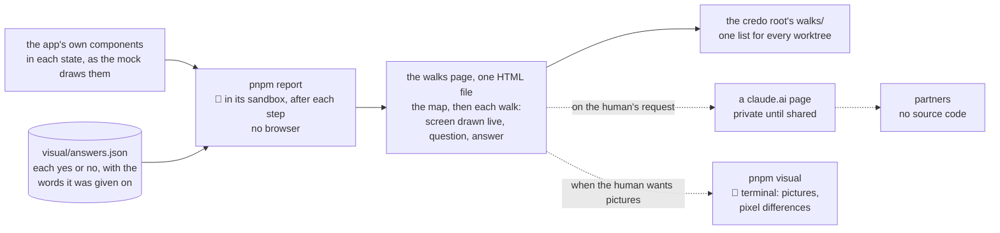

# The visual report: the walks page, rebuilt from the old suite

**Where it stands — 2026-10-28 01:29 +07:** the human's calls are answered
([the human's calls](#the-humans-calls)). The report is a live page: one HTML file that draws each
walk screen from the app's own components, built by the machine in its sandbox after each step.
Pictures are the human's terminal option, partners get a claude.ai page on request, and nothing
runs in CI. Nothing is built; `app-frame` is merged in at `5ecbbfe`, with its BFF and the mock
matched to the old app's look. **Next:** the human reads the 👤 rows of [the case
table](#the-case-table), which changed with the answers; then step 3, the build.

> **Drafted** 2026-10-28 by the machine, on the human's ask: "plz add new worktree and refactor
> visual report, like old code", with the old app's visual suite as the reference and, as the
> model, a run of its walks page the human pointed to. It serves the third of the human's four
> stages for every piece: an MVP end to end at low cost; verified locally; a generated visual
> report for feature review; deployed to ridge "so other partners can check without source code".
> **Amended** 2026-10-28 01:29 +07 with the human's answers: to "can you generate visual report
> from this repo?", yes, a live page drawn from the app's components that needs no browser to
> build; "let me run it … local only"; "don't push to artifacts automatically, but only push when
> requested".

## At a glance



Drawn from this plan; no code holds it yet.

| The old report's part | Here ([kept, changed, left](#the-old-suite-kept-changed-left)) |
| --- | --- |
| The walks page: the map of the day first, then each walk's screens, one question each, and the answers | **kept**, as the run the human pointed to; each screen **drawn live** from the app's components, in Vietnamese and English |
| A yes that holds until the screen's words change | **kept**; the words read without a browser |
| Each run a folder of its own beside the worktrees | **kept**, in the credo root's `walks/` |
| Screenshots and their pixel differences | **changed**: the human's terminal option, `pnpm visual`, local only |
| The partners' page on claude.ai | **kept**, published only when the human asks |
| Answers clicked on a page `pnpm walks` served | **left**: the human answers in the chat; the machine writes `visual/answers.json` |
| The gallery, the script that rewrites bases, the seeding, the nightly run, demo mode | **left** |

**Built by** the machine, in its sandbox, after each step: no browser, no wait on the human
([where it runs](#where-it-runs)). **Pictures** come from the human's terminal alone. **Partners**
get a claude.ai page when the human asks ([partners](#partners)). No GitHub Actions job.

## Read — 10-28

- **The old suite** is about 5,100 lines with its scripts and tests: a capture helper, eight
  visual specs, a seeding step, a gallery reporter, the walks' data, words, states, page,
  reporter and server, and two scripts. It holds 59 base images (4.0 MB), PC and phone, with no
  platform in their path. Its package's coverage took `src/` alone, so none of that code was held
  at 100 %.
- **The model run** the human pointed to: a static `index.html` (60 kB), `walks.json` (the map's
  people and parts, ten walks, 48 screens, each with its sentence in both languages, its
  question, the hash of its words and an image a language), `answers.json` (one row a screen) and
  104 images named by their content's hash, 7.2 MB, in a folder named `<date>-<time>-<commit>`
  beside the worktrees. Its 48 answers are all yes: 45 written by a session quoting the human, 3
  clicked on the served page. Its page fetches its fonts from Google.
- **The mock** (step 4 of [the app frame](2026-10-27-app-frame.md#steps)): `pnpm mock` builds
  `ui/dist/mock/mock.html`, one file that needs no server. It draws the walk's six screens in 15
  states, each light and dark, 390 and 1280 pixels wide, Vietnamese and English: 120 frames, each
  an iframe of its width, so the app's breakpoints answer to the frame, not the page. **Built in
  the machine's sandbox** on 10-28: 785.36 kB in 1.18 s at `f0dcd7f`; after the merge of
  `app-frame` at `5ecbbfe`, 1,466.80 kB in 0.71 s, its font, Noto Sans, now inlined. ui's
  `src/mock/screens.test.tsx` draws every state in both languages on jsdom, in the sandbox too, 2
  passed, before and after the merge.
- **Playwright** is in no package of this workspace: `pnpm exec playwright --version` answers
  `Command "playwright" not found`.
- **A browser in the machine's sandbox:** the old app's headless Chromium (Chrome for Testing
  153), left in Playwright's browser cache, started on a one-line page and stopped within the
  same command, ends at once, exit 133:
  `FATAL … bootstrap_check_in org.chromium.Chromium.MachPortRendezvousServer.<pid>: Permission
  denied (1100)`. Chromium registers a Mach service at start, to hand ports to its child
  processes, and the sandbox refuses every registration. Its profile denies by default and lists
  the Mach services it may look up; `sandbox.network.allowMachLookup` adds lookups, never a
  registration. No setting lets Chromium start inside it. Binding a local port, the app frame's
  stated need, is not what stops a browser.

## The old suite: kept, changed, left

| The old part | Here | Why | Price |
| --- | --- | --- | --- |
| **The capture helper**: `shot` compared and attached a screen, `capture` attached a case's screen uncompared, `shows` ran a test once a language, fixtures wrote rows and froze the clock | **Left** for the page: nothing is captured, each screen is drawn. **Changed** for `pnpm visual`: one spec takes each walk screen's picture | the page needs no browser, so the machine builds it unaided | pictures only when the human runs them |
| **The visual specs and their bases**: a base for each screen of every spec | **Changed**: a base for each walk screen alone, 14 in piece 1, made and compared by `pnpm visual` on the human's Mac, its platform in its path | [QA](../conventions/qa.md#the-rules) rule 7 keeps a base per walk screen, not per case; local only (call 4) | no pixel is compared until the human runs it |
| **The gallery**: every screen, with matches, differences and missing bases | **Left** (call 1): the mock stays apart, at `pnpm mock` | the walks page asks; the mock only shows | — |
| **The walks page**: the map, each walk's screens with one question, the answers | **Kept** as the run the human pointed to; **changed**: each screen drawn live from the app's components, one HTML file built with Vite as the mock is, its states computed by the build | it needs no browser to build, and opens from disk or as a claude.ai page | the viewer's browser draws the screens, so the page carries script, as the old one did |
| **The fingerprint**: a screen's accessibility snapshot in a browser, less the navigation unless marked, minted values kept to their shape | **Kept** as the screen's words; **changed**: read from the screen drawn on jsdom; minted values left until a walk screen shows one | rule 7 keys a yes to words, and the machine reads them where it runs; the navigation is left out from the first yes, since leaving it out later would ask every screen again | jsdom lays nothing out, so a word that CSS hides still counts |
| **The folder shared by every worktree**, and `pnpm walks` serving it on a fixed port | **Kept**: each build's folder in the credo root's `walks/`, found from git as before; **left**: the server (call 2) | one list for every worktree; the answers live in git | no buttons on the page |
| **The update script**, `visual:update <screen…>` | **Left**: Playwright's own update, narrowed to the named screens, in the human's run; the machine reads the moved bases in git's diff before it commits them | 14 bases; the old script ran the whole suite again to accept one run | a base moved by mistake is caught by reading the diff alone |
| **Seeding**: rows written through the BFF, a session saved for the signed-in screens | **Left**: the page draws from the mock's fixtures; the walk spec signs in through the page; `pnpm stack` writes the tenant ([the frame](2026-10-27-app-frame.md#the-frame)) | nothing else calls it | — |
| **Playwright's own HTML report** | **Kept** as `pnpm visual`'s output: the pictures, and base, now and the difference where one moved | it already shows them | — |
| **The partners' claude.ai page** | **Kept**, published only on the human's request (call 5) | a link with no login and nothing to unzip | a session publishes it each time |

**The old defects, not copied:**

1. The suite's code sat outside the coverage gate: the reporter, the page, the server and the
   scripts were read back by tests, never held at 100 %.
2. The walks page fetched its fonts from Google: a review page that calls a third party, and
   draws in fallbacks offline.
3. The page's script was TypeScript transpiled inside the reporter, with a pattern checking the
   shape of one import, and the page computed its states in the browser.
4. A run's folder name was parsed back out of a date formatted for display.
5. A value the run mints was caught only where a capture named it; one forgotten asked again at
   every run.
6. The bases had no platform in their path, and were made and compared on one Mac.
7. Answers held their date in two forms, a day from a session and a time from the page, and a yes
   clicked on the page kept the reason of the row it replaced.
8. Found late, by its review: a "no" whose screen left the walks fell out of the count (row 15
   here holds it); a "no" fixed in looks alone counted as changed, and a drifted capture path let
   a changed menu ask nothing. Those two leave with what caused them: the list of fixes a screen
   carried, and the navigation mark reached through a path.

## Where it conflicts, and the amendments

**[QA](../conventions/qa.md) rule 7 needs none** (call 1). The report carries no gallery, so its
line "*Rejected:* a gallery of every screen that asks nothing" ([qa.md#L100](../conventions/qa.md#L100))
stands, as does "*Rejected:* a base image per captured case": the bases are the walk's screens
alone. Amendment A is withdrawn.

**[The app frame plan](2026-10-27-app-frame.md)** takes six edits (calls 2, 3 and 6), made in the
build's first commit, after the merge of `app-frame` (step 3). The line numbers are those at
`5ecbbfe`, the merge of `app-frame`; the build finds each by its text, should a later merge move
them. B2, B3 and B5 are worded
to the human's answers on calls 1, 4 and 5: no GitHub runner and no gallery.

- **B1, the answers' home** ([app-frame#L173](2026-10-27-app-frame.md#L173), lines 173 to 179).
  *Now:* "The answers, dated, written here by the machine from the human's reply:" and a table of
  six screens by two languages. *Then:* "Their answers, dated, are written by the machine from the
  human's reply into `visual/answers.json`, each with the words it was given on, and the walks page
  shows them ([the visual report](2026-10-28-visual-report.md#the-answers))." The table goes: one
  home for an answer.
- **B2, the least tooling** ([app-frame#L181](2026-10-27-app-frame.md#L181), lines 181 to 185).
  *Now:* "… the committed base images are the machine's reader. The human walks live after `pnpm
  stack`, or reads the images. **Not built:** a walks page or answers file, a gallery, a script to
  rewrite bases, a nightly run, Bruno, WebKit." *Then:* "… the committed base images, made in the
  human's terminal, are the machine's reader. The human walks live after `pnpm stack`, or reads
  the walks page the machine builds ([the visual report](2026-10-28-visual-report.md)). **Not
  built:** a gallery, a script to rewrite bases, a nightly run, Bruno, WebKit."
- **B3, the need** ([app-frame#L187](2026-10-27-app-frame.md#L187), lines 187 and 188), a
  correction the probe found. *Now:* "**Needs:** the code session's sandbox to bind local ports
  (`sandbox.network.allowLocalBinding`). Without it the machine asks for that setting, and the
  human runs the walk meanwhile." *Then:* "**Needs:** a browser, which the code session's sandbox
  cannot start: it refuses Chromium's registration of a Mach service, and no sandbox setting
  allows one. The human runs the spec in the terminal; the walks page needs no browser
  ([where it runs](2026-10-28-visual-report.md#where-it-runs))."
- **B4, step 8's done-when** ([app-frame#L316](2026-10-27-app-frame.md#L316), lines 316 and 317).
  *Now:* "Done when: each screen's answers are in the table above, dated, and none is an open
  "no"." *Then:* "Done when: each screen's answers are in `visual/answers.json`, dated, and the
  walks page of the walk's commit shows none waiting and no open "no"."
- **B5, left behind** ([app-frame#L338](2026-10-27-app-frame.md#L338)). *Now:* "**The old visual
  suite's gallery, walks page, Bruno and nightly run:** the walk spec does." *Then:* "**The old
  visual suite's gallery, Bruno and nightly run:** the walk spec does. Its walks page returns with
  [the visual report](2026-10-28-visual-report.md), on the human's ask of 10-28."
- **B6, a seventh screen** (call 6), after [app-frame#L44](2026-10-27-app-frame.md#L44): "| 7. A
  save that failed, what was typed kept | Would the admin know the save did not happen, and that
  nothing typed is lost? |". Case row 8 of piece 1
  ([app-frame#L149](2026-10-27-app-frame.md#L149)) names the walk as holding it.
- The stamp ([app-frame#L9](2026-10-27-app-frame.md#L9)) gains "**Amended** 2026-10-28 by the
  human: the walks page and its answers file, and a seventh walk screen, from the visual report."

## What it reports in piece 1

**The map** is the app frame's ([piece 1's walk](2026-10-27-app-frame.md#piece-1s-walk)), as
[QA](../conventions/qa.md#the-rules) rule 7 draws it: the parts of the day across (set up, staff,
stock, orders, delivery), the people down, each on their device (the client's admin and office
staff at a PC, the driver on a phone). Piece 1 fills one cell, the client's admin at set-up; the
other fourteen are hatched. Each piece's plan adds its cells, and a new column only by its plan.

**The walk:** the client's admin, at a PC, 1280 pixels wide, light. The screens keep the app
frame's numbers; the page shows the main path first, then what can go wrong.

| # | The screen ([at a glance](2026-10-27-app-frame.md#at-a-glance)) | Path | The mock's state | The one question |
| --- | --- | --- | --- | --- |
| 1 | Sign in, in the company's name and colours | main | `1 empty` | Would the admin know this is their app, and how to sign in? |
| 2 | Sign-in refused | what can go wrong | `2 failed` | Does this say what to do? |
| 3 | Settings: name, logo, colour, languages | main | `3 filled` | Is this what an admin sets up first? |
| 4 | Saved: the app shows the new name and colour | main | `4 filled` | Does the change show where the admin expects? |
| 5 | The language switched | main | `5 filled`, the user menu open | Is the switch where a user would look? |
| 6 | The service down at start | what can go wrong | `6 failed` | Would the admin know it is not their fault, and to try again? |
| 7 | A save that failed, what was typed kept | what can go wrong | `3 save-failed` | Would the admin know the save did not happen, and that nothing typed is lost? |

Each screen in Vietnamese and English: 14 drawn screens and 14 answers, as the app frame's call 3
has each screen answered in both. Each screen's sentence is its label here, in both languages; its
question is in English, the human's to answer.

**How a screen is drawn.** The walk names, for each screen, the mock's state it shows. `ui/` gives
`visual/` one export, its mock's screens and states with the frame that draws one; the page draws
each walk screen in that frame at its person's device width, so the app's breakpoints answer to
1280, scaled down to fit the page, in each language. These are the app's own components, so the
page changes with the app at each build. The model files: `ui/vite.mock.config.ts` (one file,
script and styles inlined), `ui/src/mock/Frame.tsx` (a screen at its width), `ui/tests/render.tsx`
and `ui/src/mock/screens.test.tsx` (a screen drawn on jsdom, in a language).

**The words.** The build draws each walk screen on jsdom, as ui's tests draw one, and reads its
words: each text, accessible name, field value, placeholder and image alternative, in reading
order, with the role it sits in, less the menu's navigation unless the walk marks the screen as
about it. Each language's words are compared with the answer's. *Rejected:* the words read in the
viewer's browser, which the machine could not read back; a render on the server, which skips what
effects draw, so a screen could read otherwise than it shows.

**From the app frame's step 6**, the app is wired to the BFF, and the page still draws each screen
from the mock's states: the same components, with invented data. The live app's pictures come from
the walk spec through `pnpm visual` ([step 5](#steps)). A yes stays keyed to the drawn screen's
words, one reader, so demo data alone never asks a screen again.

### The page

As the model run: "A business's day in Credo", "Who does what, on the device they use." Then:

1. **The build line:** the branch, the commit and its time in Vietnam's; never a path, never a
   person.
2. **The map:** a built walk is a card with its title, its count of screens and what waits in it;
   an empty cell is hatched, so what is missing shows.
3. **Each walk:** the main path, then what can go wrong; each screen with its number, its sentence
   in both languages, its one question, and its drawn screen in each language beside that
   language's answer: not yet asked, a dated yes, a "no" with its reason, or asked again with the
   words before and now. Approved screens fold away.

One HTML file, script and styles inlined, as the mock is, its data computed by the build and
inlined with every `<` escaped; `walks.json` beside it holds the same data for the machine's
read-back. Its own frame (the map, the cards) meets the claude.ai page contract, so it publishes as
built: a short title ("Credo Day Walks"), colours as tokens with a dark set, a body background, a
16-pixel gutter, no sideways scroll at a phone's width, no font or script from elsewhere. The drawn
screens keep the app's look.

### The answers

`visual/answers.json`, committed with the walk it answers: keys sorted, one row a key,
`<walk>:<screen>:<language>`, each `{ answer, on, reason, words }`. `answer` is yes or no; `on` the
day, in one form; `reason` a "no"'s, quoting the human; `words` the screen's words it was given
on, a line each, so a changed screen shows what changed.

The human answers in the chat, a line such as "1 vi yes; 2 en no: the message is too small". The
machine of the piece, relayed by the orchestrator, writes the rows on the piece's branch and
commits them; a "no" also becomes a case in the piece's table ([QA](../conventions/qa.md#the-rules)
rule 7). The next build's page shows them. A "no" fixed in looks alone keeps its words, so the
fix's commit deletes its row and the screen is asked again.

*Rejected* (call 2): the old served mode, `pnpm walks` on a fixed port with a yes or no clicked on
the page. *Its price:* about 260 lines and their tests; answers outside git on one Mac, or a server
writing into a worktree; a refused answer whenever another worktree's run becomes the newest; and a
partners' page that shows no answer. In the model run, 45 of 48 answers came by reply anyway.
*Trigger to revisit:* a walk too long to answer in a line, or the human asking for the buttons.
*Rejected:* the plan's table as the input, a doc made a format code must parse; answers kept in the
browser, one set a browser.

## Where it runs

**1. The machine, in its sandbox: the walks page.** `pnpm report` builds the page and writes it to
`$ROOT_DIR/walks/<date>-<time>-<commit>/`, where `$ROOT_DIR` is the folder that holds `.bare`,
found from git's common directory: one list for every worktree, outside every worktree. It needs
no browser, only Vite and jsdom, both read back in the sandbox above. After each step of a piece
that changes what a walk screen draws, the machine runs it, reads `walks.json` back (what waits,
what changed, what is open), and names that in the step's evidence. No wait on the human.

**2. The human's terminal: pictures** (from step 4, local only, call 4). When the human wants
pictures or a pixel difference:

```sh
pnpm visual 2>&1 | tee "$ROOT_DIR/logs/visual.log"
```

The machine hands the command with `$ROOT_DIR` filled in, as for `act`. It builds the page, then
Playwright opens it from disk and takes each walk screen's picture at its full width; from step 5
it takes them from the live app on the local stack. Playwright's report lands in the same folder:
the pictures, and base, now and the difference where one moved. The bases are the Mac's, the
platform in their path. The machine watches the log, reads it whole, then reads the report's
pictures. Once, `pnpm --filter @credo/visual exec playwright install chromium` fetches the browser.

**Not inside the sandbox.** No setting lets Chromium start there. `sandbox.excludedCommands`, in
the user settings, would run `pnpm visual` outside it, with the human's full rights, the AWS keys
the sandbox hides among them; the human's answer, local only in the terminal, leaves it out.

**No GitHub Actions job** (call 4).

## Partners

**On request only** (call 5). When the human asks, the machine publishes the newest folder's page
as a claude.ai page with the Artifact tool: private until the human shares its link, republished
to the same link at the next request. The publish sends the page less the doctype, charset and
viewport lines the tool's skeleton adds, the old export's rule, and reads the published page back.
The link is deploy state, so the orchestrator keeps it, never a doc
([documentation](../conventions/documentation.md#never-in-a-doc)). Nothing is uploaded anywhere
unasked.

Everything the page holds is already public in the repository: its screens are drawn from its
code, its questions and answers are its files.

## Where it lives in the workspace

```text
ui/                one export more, ./mock: the mock's screens, their states, the frame
visual/            @credo/visual: the map, piece 1's walk, the words, the states, the page and
                   its one-file build, the folder's home; answers.json
visual/pictures/   from step 4: pnpm visual's Playwright config, its spec, the Mac's bases
```

- **A package of its own.** *Rejected:* the page inside `ui/`, beside the mock: the report's walks,
  answers and build would join the app's package. *Price:* one export from `ui/`, and React and
  Mantine declared in both.
- **Scripts:** the root's `pnpm report`, the machine's, builds the page into its folder; from step
  4, `pnpm visual`, the human's, builds it and adds the pictures. No `visual:update`, no `pnpm
  walks`.
- **Tests:** Vitest, on jsdom for the page and the words, in Node for the build and the folder's
  home, tested on a temporary repository; coverage at 100 % of `visual/src/`
  ([QA](../conventions/qa.md#the-rules) rule 8). The Vite config and `pictures/` sit outside
  `src/`.
- **The catalog** gains `@playwright/test` at step 4 alone, exact, at its rule: the newest release
  two weeks old.
- **knip:** a `visual` workspace, the page's entry and the build its entries; from step 4,
  Playwright's config, found by knip's plugin. **Lint:** the root config, with
  `visual/tsconfig.json`. `.gitignore` gains `/walks/`, and at step 4 Playwright's
  `test-results/`.
- **The gate:** `pnpm check` runs `visual/`'s unit tests; `pnpm report` runs after each step,
  outside the check; `pnpm visual` is the human's.
- **Nothing enters before its caller:** the page's caller is the machine's build after each step;
  Playwright's is the human's `pnpm visual`, at step 4; the walks hold piece 1's alone.

## The case table

👤 marks a business row, for the human's read ([QA](../conventions/qa.md) rule 1).

| # | 👤 | The case | Held by |
| --- | --- | --- | --- |
| 1 | 👤 | The page opens on the map: the parts of the day across, the people down with their device; a built walk is a card with its title and its count of screens, and an empty cell is hatched, so what is missing shows | unit, `page.test.tsx` |
| 2 | 👤 | The page draws each walk screen live from the app's own components, in its state, in Vietnamese and in English, at its person's device width | unit, `page.test.tsx`; read back |
| 3 | 👤 | Each walk shows its main path, then what can go wrong: each screen with its sentence in both languages and its one question | unit, `page.test.tsx` |
| 4 | 👤 | Each drawn screen shows its language's answer: not yet asked, a dated yes, or a "no" with its reason | unit, `states.test.ts`, `page.test.tsx` |
| 5 | 👤 | A yes holds while the screen's words stay the same; a changed word asks again, showing the words before and now; a change of look alone asks nothing | unit, `words.test.tsx`, `states.test.ts` |
| 6 | 👤 | The machine builds the page in its sandbox, with no browser, after each step, with no wait on the human | read back, at step 3 and each step after |
| 7 | 👤 | The page is one file that opens from disk or as a claude.ai page, with no network: no font or script from elsewhere | unit, `build.test.ts` |
| 8 | 👤 | Nothing in the published page names a key, a person or a path on one machine | unit, `build.test.ts` |
| 9 | 👤 | The page says what it was built from: the branch, the commit and its time | unit, `page.test.tsx` |
| 10 | 👤 | Every worktree's builds land in one list, the credo root's `walks/`, a folder a build, never committed | unit, `home.test.ts` |
| 11 | 👤 | `pnpm visual`, in the human's terminal, takes each walk screen's picture in both languages and shows any that moved beside its base and the difference (step 4) | the spec, `pnpm visual` |
| 12 | | A screen's words are its texts, accessible names, field values, placeholders and image alternatives in reading order, with their roles, read from the screen drawn on jsdom, less the menu's navigation unless the walk marks the screen as about it | unit, `words.test.tsx` |
| 13 | | Two builds of one commit give each walk screen the same words | read back, step 3 |
| 14 | | Each walk screen names a state the mock draws; one it lacks stops the build, naming it | unit, `walks.test.ts` |
| 15 | | An answer whose screen left the walks is listed on the page, never dropped from the count | unit, `states.test.ts` |
| 16 | | An answers file that does not parse, or a row of no known form, stops the build; it never reads as nothing answered | unit, `answers.test.ts` |
| 17 | | The folder is named `<date>-<time>-<commit>` in Vietnam's time, built from the date's parts, `-changes` on a changed tree; outside a repository none is written, and the build says why | unit, `home.test.ts` |
| 18 | | A folder is written aside and renamed, so a stopped build leaves none half written | unit, `build.test.ts` |
| 19 | | The page's data is inlined with every `<` escaped, so no text of the walks or the answers ends its script | unit, `build.test.ts` |
| 20 | | The published page is the folder's page less the doctype, charset and viewport lines the tool's skeleton adds | read back, at each publish |
| 21 | | Pictures are compared on the human's Mac alone, each base with its platform in its path (step 4) | the config |
| 22 | | No run is retried | the config, `retries: 0` ([QA](../conventions/qa.md#the-rules) rule 6) |

## Hazards no gate catches

- **jsdom lays nothing out.** A word that CSS hides at a width still counts, and a change made in
  CSS alone asks nothing. *Guard:* the pictures, `pnpm visual`, are the check of looks.
- **The page draws from the mock's states, with invented data.** A screen wired wrong to the BFF
  still draws right on it. *Guard:* the walk on the live app (the app frame's step 8) and `pnpm
  visual` on the local stack (step 5) are the checks of the wiring.
- **The pictures are the Mac's.** The app now ships its font, Noto Sans, inlined in the one file,
  so the page reads alike everywhere; but each platform draws the same font a little differently,
  so the bases hold on the Mac alone. *Trigger to revisit:* a second machine that runs `pnpm
  visual`.
- **The answers are public**, and so is the mock's invented password, which the page carries as
  the mock does. *Guard:* the machine writes a reason as the human gave it, never a name
  ([documentation](../conventions/documentation.md#nothing-machine-local-or-personal-in-a-committed-file));
  the root's real password, printed once by `pnpm stack`, enters no fixture.
- **A shared claude.ai link reaches whoever holds it.** The page holds nothing the repository does
  not.

## The human's calls

Each answered 2026-10-28 01:29 +07 by the human.

0. **The report is a live page.** To the machine's "can you generate visual report from this
   repo?": yes. Each screen drawn from the app's own components in its state, one self-contained
   HTML file, built by the machine in its sandbox after each step; a yes held by the screen's
   words. Screenshots become the human's terminal option.
1. **The gallery (amendment A).** Moot: the report carries no gallery, so rule 7 stands and A is
   withdrawn. The mock stays apart, at `pnpm mock`.
2. **How the human answers.** As recommended: in the chat; the machine writes
   `visual/answers.json`; no `pnpm walks` server.
3. **The app frame's lines B1 to B5.** As recommended, made in the build's first commit; B2, B3
   and B5 worded to the answers on calls 1, 4 and 5.
4. **Where it runs.** "let me run it … local only": the pictures in the human's terminal alone; no
   GitHub Actions job.
5. **Partners.** "don't push to artifacts automatically, but only push when requested": a claude.ai
   page, published on request; ridge's address left behind.
6. **A seventh screen, the failed save (amendment B6).** As recommended.

## Steps

- [x] **1. This plan.** Who: 🤖, 10-28. Done when: committed on `visual-report`; the path, name
  and link checks clean. *Evidence:* `f0dcd7f`, amended with the human's answers in the commit
  after the merge `5ecbbfe`; on each, the path and name grep finds nothing and every relative link resolves.
- [ ] **2. The human's read.** Who: 👤, 10-28, 20 minutes. Done when: each call answered under it,
  dated; each 👤 row kept or corrected. *The calls:* answered 10-28 01:29 +07. *The rows:* waiting;
  they changed with the answers.
- [ ] **3. The build: `visual/` and the live walks page.** Who: 🤖, after step 2 (the rows), 5
  hours. First, merge `app-frame` into `visual-report` again if it moved since `5ecbbfe` (merged 10-28
  01:33, the mock matched to the old app's look), so the build takes its newest UI; then the app frame's B1 to B6, found by their text, in
  the build's first commit; then `ui/`'s one export and `visual/`. Done when: `pnpm check` green,
  `visual/` at 100 %, knip silent, no warning; each row held by a unit test seen red once by
  breaking its rule; `pnpm report`, run by the machine in its sandbox, writes a folder in the credo
  root's `walks/`; read back from its `walks.json`: the map with one cell filled and fourteen
  hatched, the walk's seven screens in both languages with their questions, each not yet asked; a
  second build's words equal the first's (row 13); the page searched for a home path, the git
  author's name and email and a key's shape, none found (row 8). **Not seen:** the page drawn in a
  browser, the human's eyes.
- [ ] **4. `pnpm visual`, the human's pictures.** Who: 🤖 writes, after step 3 (it opens the built
  page), at the first free slot, 1.5 hours; 👤 runs it in the terminal. Done when: `pnpm check`
  green with `@playwright/test` in the catalog; the human's run's log read whole; its Playwright
  report in the folder holds the 14 pictures, each opened by the machine; the bases, written by the
  human's update of the named screens, read in git's diff and committed; a second run green; one
  screen's colour changed by the machine turns the human's run red, then put back.
- [ ] **5. The live screens.** Who: 🤖, inside the app frame's step 6 (it takes that step's walk
  spec and `pnpm stack`), 1.5 hours; 👤 runs it in the terminal. Done when: `pnpm visual` takes the
  14 pictures from the live app on the local stack in place of the built page's; the bases
  rewritten from that run, read in git's diff and committed, as the app frame's step 6 commits its
  bases; a second run green; the walks page unchanged, each yes still keyed to the drawn screen's
  words.

If step 3 is not done by 10-29 evening, the 10-30 walk goes ahead as the app frame plans it.

**Then stop.** After step 3, this plan's first stop. Step 4 takes the first free slot after it;
step 5 runs inside the app frame's step 6. A claude.ai page is published whenever the human asks.

## Left behind

Each until something calls it.

- **A GitHub Actions job for the report** (call 4): local only. It would cost nothing on this
  public repository and a few minutes a run, and its artifact needs a GitHub login.
- **An address on ridge for partners** (call 5): a path beside the UI's files on ridge's CloudFront,
  with its fourth layer, when called.
- **The served answers,** `pnpm walks` and its buttons (call 2): answers by reply.
- **The gallery** (call 1): the mock stays at `pnpm mock`.
- **Pictures by default:** `pnpm visual` is the human's, when wanted.
- **Demo mode, the questions hidden:** partners read the same page; until a demo needs the walks
  without questions.
- **The "before" picture beside a changed screen:** the words before and now show what changed.
- **A script to rewrite bases:** Playwright's own update, narrowed to the named screens.
- **Minted values kept to their shape:** until a walk screen shows one, such as piece 2's password
  said once. That screen's words are then read twice in its build, and words that differ between
  the two stop the build, naming the screen.
- **A frozen clock:** until a walk screen shows a time.
- **Seeding through the BFF:** the page draws from fixtures; `pnpm stack` writes the tenant.
- **A nightly run:** the machine builds the page after each step.
- **Skipping a folder when the newest shows the same:** it saved disk alone; the human deletes old
  folders as they like.
- **WebKit, and phone walks:** WebKit waits for sales-ready ([the stack](2026-10-27-app-frame.md#the-stack));
  the phone comes with the driver, piece 6.
