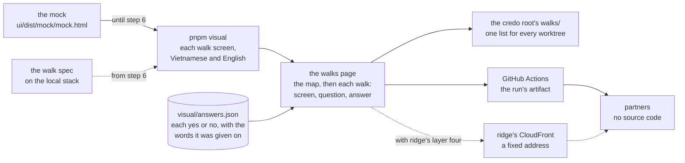

# The visual report: the walks page, rebuilt from the old suite

**Where it stands — 2026-10-28:** drafted by the machine; nothing is built. It waits on the
human's read: six calls ([the human's calls](#the-humans-calls)), two of them amendments to rules
this repo decided on 10-27. **Next:** step 2, the human's read. Piece 1's walk on 10-30 does not
wait on it ([steps](#steps)).

> **Drafted** 2026-10-28 by the machine, on the human's ask: "plz add new worktree and refactor
> visual report, like old code", with the old app's visual suite as the reference and, as the
> model, a run of its walks page the human pointed to. It serves the third of the human's four
> stages for every piece: an MVP end to end at low cost; verified locally; a generated visual
> report for feature review; deployed to ridge "so other partners can check without source code".

## At a glance



Drawn from this plan; no code holds it yet.

| The old report's part | Here ([kept, changed, left](#the-old-suite-kept-changed-left)) |
| --- | --- |
| The walks page: the map of the day first, then each walk's screens, one question each, and the answers | **kept**, as the run the human pointed to; it opens anywhere, with no script and no server |
| A yes that holds until the screen's words change | **kept** |
| Each run a folder of its own beside the worktrees | **kept**, in the credo root's `walks/` |
| The gallery of every screen | **changed**: the mock page, carried into each run's folder (call 1) |
| Base images and their differences | **changed**: the walk's screens alone, compared on GitHub's runner |
| Answers clicked on a page `pnpm walks` served on one Mac | **left**: the human answers in the chat; the machine writes them into a file in git (call 2) |
| The script that rewrites bases, the seeding, the nightly run, demo mode | **left** |

**Where it runs:** the human's terminal, one command, and GitHub Actions on each push; the
machine's sandbox cannot start a browser ([where it runs](#where-it-runs)). **Partners:** the
run's artifact on GitHub now, a fixed address on ridge with its fourth layer
([partners](#partners)).

## Read — 10-28

- **The old suite** is about 5,100 lines with its scripts and tests: a capture helper, eight
  visual specs, a seeding step, a gallery reporter, the walks' data, words, states, page,
  reporter and server, and two scripts. It holds 59 base images (4.0 MB), PC and phone, with no
  platform in their path. Its package's coverage took `src/` alone, so none of that code was held
  at 100 %.
- **The model run** the human pointed to: a static `index.html` (60 kB), `walks.json` (the map's
  people and parts, ten walks, 48 screens, each with its sentence in both languages, its
  question, the hash of its words and an image a language), `answers.json` (one row a screen) and
  104 images named by their content's hash, 7.2 MB, in a folder named `<date>-<time>-<commit>`
  beside the worktrees. Its 48 answers are all yes: 45 written by a session quoting the human, 3
  clicked on the served page. Its page fetches its fonts from Google.
- **The mock** (step 4 of [the app frame](2026-10-27-app-frame.md#steps)): `pnpm mock` builds
  `ui/dist/mock/mock.html`, one file that needs no server. It draws the walk's six screens in 15
  states, each light and dark, 390 and 1280 pixels wide, Vietnamese and English: 120 frames, each
  an iframe titled `<screen> <state> · <language> · <theme> · <width>`, loaded lazily, 1280 × 720
  or 390 × 780. Its own filters narrow it to a language, a theme or a width.
- **Playwright** is in no package of this workspace: `pnpm exec playwright --version` answers
  `Command "playwright" not found`.
- **The browser in the machine's sandbox:** the old app's headless Chromium (Chrome for Testing
  153), left in Playwright's browser cache, started on a one-line
  page and stopped within the same command, ends at once, exit 133:
  `FATAL … bootstrap_check_in org.chromium.Chromium.MachPortRendezvousServer.<pid>: Permission
  denied (1100)`. Chromium registers a Mach service at start, to hand ports to its child
  processes, and the sandbox refuses every registration. Its profile denies by default and lists
  the Mach services it may look up; `sandbox.network.allowMachLookup` adds lookups, never a
  registration. No setting lets Chromium start inside it; `sandbox.excludedCommands` runs a named
  command outside it ([where it runs](#where-it-runs)). Binding a local port, the app frame's
  stated need, is not what stops the walk.

## The old suite: kept, changed, left

| The old part | Here | Why | Price |
| --- | --- | --- | --- |
| **The capture helper**: `shot` compared and attached a screen, `capture` attached a case's screen uncompared, `shows` ran a test once a language, fixtures wrote rows and froze the clock | **Changed** to one helper: a walk screen's picture and its words, attached under the screen's id; each language a Playwright project | a walk is one person's handful of screens; the rest served 82 case screens a device | a piece that needs written rows, a second device or a fixed clock adds that fixture then |
| **The visual specs and their bases**: a base for each screen of every spec | **Changed**: a base for each walk screen alone, 12 in piece 1, made and compared on GitHub's runner | [QA](../conventions/qa.md#the-rules) rule 7 already keeps a base per walk screen, not per case; a Mac's fonts and Linux's differ, so a base holds on one platform | the terminal's run compares no pixels |
| **The gallery**: every screen, with matches, differences and missing bases | **Changed**: every state is the mock page, carried into each run's folder (call 1); a screen that differs from its base heads the page's part for the machine (step 6) | the mock already draws every state from the app's own components; a picture of each would be a second copy | a variation is seen drawn live, so two runs' variations are never set side by side as images |
| **The walks page**: the map, each walk's screens with one question, the answers | **Kept**, as the run the human pointed to; **changed** to a page written whole when the run ends: no script, no server, no font from elsewhere | it must open from disk, from GitHub and from ridge alike | an answer given after a run shows at the next run |
| **The fingerprint**: a screen's accessibility snapshot, less the navigation unless marked, minted values kept to their shape | **Kept** as the screen's words, but the minted values, left until a walk screen shows one | rule 7 already keys a yes to words; the navigation is left out from the first yes, since leaving it out later would ask every screen again | — |
| **The folder shared by every worktree**, and `pnpm walks` serving it on a fixed port | **Kept**: each run's folder in the credo root's `walks/`, found from git as before; **left**: the server (call 2) | one list for every worktree; the answers live in git | no buttons on the page |
| **The update script**, `visual:update <screen…>` | **Left**: the machine copies the named screens' images from the run that differed over their bases | 12 bases; the old script ran the whole suite again to accept one run | a copy by hand for each screen moved on purpose, named in its commit |
| **Seeding**: rows written through the BFF, a session saved for the signed-in screens | **Left**: the demo generator writes the tenant; the walk spec signs in through the page | `pnpm stack` already does it ([the frame](2026-10-27-app-frame.md#the-frame)) | — |
| **Playwright's own HTML report** | **Kept**, in each run's folder, for the machine | a failure's trace | — |

**The old defects, not copied:**

1. The suite's code sat outside the coverage gate: the reporter, the page, the server and the
   scripts were read back by tests, never held at 100 %.
2. The walks page fetched its fonts from Google: a review page that calls a third party, and
   draws in fallbacks offline.
3. The page's script was TypeScript transpiled inside the reporter, with a pattern checking the
   shape of one import, and the page computed its states in the browser.
4. A run's folder name was parsed back out of a date formatted for display.
5. A value the run mints was caught only where a capture named it; one forgotten asked again at
   every run.
6. The bases had no platform in their path, and were made and compared on one Mac.
7. Answers held their date in two forms, a day from a session and a time from the page, and a yes
   clicked on the page kept the reason of the row it replaced.
8. Found late, by its review: a "no" whose screen left the walks fell out of the count (row 13
   here holds it); a "no" fixed in looks alone counted as changed, and a drifted capture path let
   a changed menu ask nothing. Those two leave with what caused them: the list of fixes a screen
   carried, and the navigation mark reached through a path.

## Where it conflicts, and the amendments

The human has asked for the old report, so the human's call wins; each edit below is the smallest
that gives back what the old report gave. None is made in this session: each waits on its call,
and step 3 makes the answered ones.

**A. [QA](../conventions/qa.md) rule 7, its gallery line** ([qa.md#L100](../conventions/qa.md#L100),
lines 100 to 102; call 1).

- *Now:* "*Rejected:* a gallery of every screen that asks nothing. It makes the human read, and
  finds nothing missing: a picture shows only what was built."
- *Proposed:* "*Rejected:* a gallery of every screen as the check. It makes the human read, and
  finds nothing missing: a picture shows only what was built. Every state may sit beside the
  walks, as the mock draws it, for whoever wants to look; it asks nothing and decides nothing."
- The stamp ([qa.md#L3](../conventions/qa.md#L3)) gains "**Amended** 2026-10-28 by the human:
  rule 7's gallery line, for the visual report." The human version
  ([qa.md#L36](../conventions/qa.md#L36)) names no gallery, so it stays.
- *Rule 7's other rejection,* "a base image per captured case", **stands**: the bases here are
  the walk's screens alone, and the mock's 120 frames get none.

**B. [The app frame plan](2026-10-27-app-frame.md)** (calls 2 and 3).

- **B1, the answers' home** ([app-frame#L154](2026-10-27-app-frame.md#L154), lines 154 to 160).
  *Now:* "The answers, dated, written here by the machine from the human's reply:" and a table of
  six screens by two languages. *Proposed:* "Their answers, dated, are written by the machine from
  the human's reply into `visual/answers.json`, each with the words it was given on, and every
  run's walks page shows them ([the visual report](2026-10-28-visual-report.md#the-answers))." The
  table goes: one home for an answer.
- **B2, the least tooling** ([app-frame#L162](2026-10-27-app-frame.md#L162), lines 162 to 166).
  *Now:* "… the committed base images are the machine's reader. The human walks live after `pnpm
  stack`, or reads the images. **Not built:** a walks page or answers file, a gallery, a script to
  rewrite bases, a nightly run, Bruno, WebKit." *Proposed:* "… the committed base images, made on
  GitHub's runner, are the machine's reader. The spec's screens feed the walks page
  ([the visual report](2026-10-28-visual-report.md)). The human walks live after `pnpm stack`, or
  reads the page. **Not built:** a script to rewrite bases, a nightly run, Bruno, WebKit."
- **B3, the need** ([app-frame#L168](2026-10-27-app-frame.md#L168), lines 168 and 169), a
  correction this plan's probe found. *Now:* "**Needs:** the code session's sandbox to bind local
  ports (`sandbox.network.allowLocalBinding`). Without it the machine asks for that setting, and
  the human runs the walk meanwhile." *Proposed:* "**Needs:** a browser, which the code session's
  sandbox cannot start: it refuses Chromium's registration of a Mach service, and no sandbox
  setting allows one. The human runs the spec in the terminal, and GitHub Actions on each push
  ([where it runs](2026-10-28-visual-report.md#where-it-runs))."
- **B4, step 8's done-when** ([app-frame#L264](2026-10-27-app-frame.md#L264), lines 264 and 265).
  *Now:* "Done when: each screen's answers are in the table above, dated, and none is an open
  "no"." *Proposed:* "Done when: each screen's answers are in `visual/answers.json`, dated, and the
  walks page of the walk's commit shows none waiting and no open "no"."
- **B5, left behind** ([app-frame#L286](2026-10-27-app-frame.md#L286)). *Now:* "**The old visual
  suite's gallery, walks page, Bruno and nightly run:** the walk spec does." *Proposed:* "**The old
  visual suite's Bruno and nightly run:** the walk spec and the walks page do. Its walks page and
  gallery return with [the visual report](2026-10-28-visual-report.md), on the human's ask of
  10-28."
- **B6, a seventh screen** (call 6), after [app-frame#L43](2026-10-27-app-frame.md#L43): "| 7. A
  save that failed, what was typed kept | Would the admin know the save did not happen, and that
  nothing typed is lost? |". Case row 8 names the walk as holding it, and no screen shows it.
- The stamp ([app-frame#L8](2026-10-27-app-frame.md#L8)) gains "**Amended** 2026-10-28 by the
  human: the walks page and its answers file, from the visual report."

## What it reports in piece 1

**The map** is the app frame's ([piece 1's walk](2026-10-27-app-frame.md#piece-1s-walk)), as
[QA](../conventions/qa.md#the-rules) rule 7 draws it: the parts of the day across (set up, staff,
stock, orders, delivery), the people down, each on their device (the client's admin and office
staff at a PC, the driver on a phone). Piece 1 fills one cell, the client's admin at set-up; the
other fourteen are hatched. Each piece's plan adds its cells, and a new column only by its plan.

**The walk:** the client's admin, at a PC, 1280 pixels wide, light. The screens keep the app
frame's numbers; the page shows the main path first, then what can go wrong.

| # | The screen ([at a glance](2026-10-27-app-frame.md#at-a-glance)) | Path | The mock's frame | The one question |
| --- | --- | --- | --- | --- |
| 1 | Sign in, in the company's name and colours | main | `1 empty` | Would the admin know this is their app, and how to sign in? |
| 2 | Sign-in refused | what can go wrong | `2 failed` | Does this say what to do? |
| 3 | Settings: name, logo, colour, languages | main | `3 filled` | Is this what an admin sets up first? |
| 4 | Saved: the app shows the new name and colour | main | `4 filled` | Does the change show where the admin expects? |
| 5 | The language switched | main | `5 filled`, the user menu open | Is the switch where a user would look? |
| 6 | The service down at start | what can go wrong | `6 failed` | Would the admin know it is not their fault, and to try again? |
| 7 | A save that failed, what was typed kept (call 6) | what can go wrong | `3 save-failed` | Would the admin know the save did not happen, and that nothing typed is lost? |

Each screen in Vietnamese and English: 12 pictures and 12 answers, 14 with call 6, as the app
frame's call 3 has each screen answered in both. Each screen's sentence is its label here, in
both languages; its question is in English, the human's to answer.

**Two sources, one page.** One helper takes a walk screen's picture and its words, and attaches
both under the screen's id, `<walk>:<screen>:<language>`. The reporter reads those attachments
and never asks where they came from; the page's run line says it.

- **Until step 6, the mock.** `pnpm visual` builds the mock, opens it from disk, narrows it with
  its own filters to light and 1280, and for each walk screen and language finds the frame by its
  title, scrolls it into view (frames load lazily), waits for its screen to draw, and takes the
  frame's picture, 1280 × 720, and its body's words.
- **From step 6, the live app.** The walk spec, which [the app frame's](2026-10-27-app-frame.md#steps)
  step 6 writes in `visual/` beside the mock's capture, drives the local stack and calls the same
  helper on each screen, one Playwright project a language. The mock's capture is then deleted,
  since nothing calls it; the mock page stays in each folder as every state.
- **A yes given on the mock** holds on the live screen only while its words are equal. The mock's
  fixtures and the demo generator's data will differ, so most screens ask again at step 6, as the
  10-30 walk on the live app expects.

### The page

As the model run: "A business's day in Credo", "Who does what, on the device they use." Then:

1. **The run line:** what drew the screens (the mock, or the live app on the local stack), the
   branch, the commit and its time in Vietnam's; never a path, never a person.
2. **The map:** a built walk is a card with its title, its count of screens and what waits in it;
   an empty cell is hatched, so what is missing shows.
3. **Each walk:** the main path, then what can go wrong; each screen with its number, its sentence
   in both languages, its one question, and its picture in each language beside that language's
   answer: not yet asked, a dated yes, a "no" with its reason, or asked again with the words before
   and now. Approved screens fold away.
4. **Every state:** a link to the mock page in the same folder (call 1).
5. **For the machine** (from step 6): each walk screen that differs from its base, or has none,
   with its base, now and the difference; and a link to Playwright's own report.

Written whole when the run ends: static HTML and CSS, the language switch and the folds made in
CSS, light and dark as the system says, no script, no font from elsewhere, no sideways scroll at a
phone's width. The images sit beside it in `shots/`, named by their content's hash.

### The answers

`visual/answers.json`, committed with the walk it answers: keys sorted, one row a key,
`<walk>:<screen>:<language>`, each `{ answer, on, reason, words }`. `answer` is yes or no; `on` the
day, in one form; `reason` a "no"'s, quoting the human; `words` the screen's words it was given
on, a line each, so a changed screen shows what changed.

The human answers in the chat, a line such as "1 vi yes; 2 en no: the message is too small". The
machine of the piece, relayed by the orchestrator, writes the rows on the piece's branch and
commits them; a "no" also becomes a case in the piece's table ([QA](../conventions/qa.md#the-rules)
rule 7). The next run's page shows them. A "no" fixed in looks alone keeps its words, so the fix's
commit deletes its row and the screen is asked again.

*Rejected:* the old served mode (call 2), whose price is below. *Rejected:* the plan's table as
the input: a doc becomes a format code must parse, and the human reads the answers on the page.
*Rejected:* answers kept in the browser: each browser would hold its own.

## Where it runs

**1. The human's terminal.** From the worktree, after `pnpm install`, once
`pnpm --filter @credo/visual exec playwright install chromium` unless the cache holds the pinned
version's build:

```sh
pnpm visual 2>&1 | tee "$ROOT_DIR/logs/visual.log"
```

`$ROOT_DIR` is the folder that holds `.bare`; the machine hands the command with it filled in, as
for `act`. The run's folder lands in `$ROOT_DIR/walks/<date>-<time>-<commit>/`, found from git's
common directory, so every worktree's runs make one list, outside every worktree. The machine
watches the log, reads it whole, then reads the folder: the page's HTML and each image. This run
compares no pixels and says so: the bases are GitHub's runner's.

**2. GitHub Actions.** `.github/workflows/visual.yml`, on pushes and pull requests that touch
`ui/`, `shared/`, `visual/`, the lockfile or the workflow, and by hand. On `ubuntu-24.04`, inside
Playwright's own container image at the catalog's version, so the fonts move only with that
version; Node 26 and pnpm as `packageManager` pins them; `pnpm install --frozen-lockfile`;
`pnpm visual`; the run's folder uploaded as the artifact `walks`, kept GitHub's default 90 days.
In a plain checkout git's common directory is the checkout's own, so the folder lands in its
`walks/`, which `.gitignore` gains, anchored at the root. First `actionlint` here, then `act` in the
human's terminal, its log read whole, then the push; GitHub's run is the verdict, since `act` runs
arm64 and GitHub amd64. *Price:* nothing on a public repository; a few minutes a run, the image's
pull among them.

**3. Inside the machine's sandbox: not recommended** (call 4). No setting lets Chromium start
there. `sandbox.excludedCommands`, in the user settings (a project's settings do not count), runs
a named command outside the sandbox, for example `["pnpm visual"]`, so the machine could run the
report itself. *Price:* that command runs the repository's code and a browser with the human's
full rights, the AWS keys the sandbox hides among them, for a check the two ways above already
give. On a yes, the machine hands over the whole resulting settings file
([collaboration](../conventions/collaboration.md#the-loop), hand-off 3).

## Partners

- **Now:** the GitHub Actions run's artifact. The repository is public, so anyone signed in to
  GitHub downloads it, unzips it and opens `index.html` from disk. *Price:* a GitHub login, a
  zip, and a link that dies after 90 days.
- **With ridge's fourth layer:** the deploy job puts `main`'s walks page beside the UI's files on
  ridge's bucket, under `/report/` on the distribution's own name: one fixed address, no login,
  nothing to unzip. That layer's plan decides the job and the run it publishes; ridge holds test
  records alone, and a client's stack serves no report.
- **Public then, or not:** the human's call when that layer is planned (call 5). Everything the
  page holds is already public in the repository: screens drawn from its code, questions from its
  code, answers from its file. *Public:* no login for anyone. *Behind a password at CloudFront's
  edge:* partners only, for a function and a shared secret to hand out and change.

## Where it lives in the workspace

```text
visual/            @credo/visual: the map, piece 1's walk, the words, the states, the page,
                   the reporter, the folder's home; answers.json; from step 6, bases/
visual/captures/   the mock's capture until step 6; the walk spec from step 6
```

- **A package of its own.** *Rejected:* inside `ui/`, the old suite's place. `ui/`'s gate covers
  `src/` under jsdom; the report's code runs in Node and Playwright, and inside the app's package
  it sat outside the gate (old defect 1).
- **Scripts:** the root's `pnpm visual` builds the mock, then runs Playwright in `visual/`, its
  reporter writing the run's folder. No `visual:update`, no `pnpm walks`.
- **Tests:** Vitest in Node, coverage at 100 % of `visual/src/` ([QA](../conventions/qa.md#the-rules)
  rule 8); the capture and the walk spec sit outside `src/`, run by `pnpm visual` in Chromium. The
  folder's home is tested on a temporary repository.
- **The catalog** gains `@playwright/test`, exact, at its rule: the newest release two weeks old.
- **knip:** a `visual` workspace; its Playwright config is found by knip's plugin, and the
  reporter, which the config names by path, is an entry. **Lint:** the root config, with
  `visual/tsconfig.json` (Node, no DOM). `.gitignore` gains `/walks/` and Playwright's
  `test-results/`.
- **The gate:** `pnpm check` runs `visual/`'s unit tests; `pnpm visual` stays outside it, a browser
  run paced by [QA](../conventions/qa.md#the-rules) rule 6.
- **Nothing enters before its caller:** the caller now is the mock's walks page; the walk spec
  joins at step 6; the walks hold piece 1's alone.

## The case table

👤 marks a business row, for the human's read ([QA](../conventions/qa.md) rule 1).

| # | 👤 | The case | Held by |
| --- | --- | --- | --- |
| 1 | 👤 | The page opens on the map: the parts of the day across, the people down with their device; a built walk is a card with its title and its count of screens, and an empty cell is hatched, so what is missing shows | unit, `page.test.ts` |
| 2 | 👤 | Each walk shows its main path, then what can go wrong: each screen with its sentence in both languages, its one question, and its picture in each language on the person's device | unit, `page.test.ts` |
| 3 | 👤 | Each picture shows its language's answer: not yet asked, a dated yes, or a "no" with its reason | unit, `states.test.ts`, `page.test.ts` |
| 4 | 👤 | A yes holds while the screen's words stay the same; a changed word asks again, showing the words before and now; a moved pixel alone asks nothing | unit, `words.test.ts`, `states.test.ts` |
| 5 | 👤 | A run that lacks a screen a walk needs writes no page and says which | unit, `report.test.ts` |
| 6 | 👤 | Every state of every screen, both themes, widths and languages, sits beside the walks, as the mock draws it | unit, `report.test.ts` |
| 7 | 👤 | The page opens from disk, from GitHub's artifact or from a web address, with no network: no script, no font from elsewhere | unit, `page.test.ts` |
| 8 | 👤 | Nothing in the page or its folder names a person or a path on one machine | unit, `report.test.ts` |
| 9 | 👤 | The page says what drew its screens, the mock or the live app, with the branch and commit | unit, `report.test.ts` |
| 10 | 👤 | Every worktree's runs land in one list, the credo root's `walks/`, a folder a run, never committed | unit, `home.test.ts` |
| 11 | | A screen's words are its accessibility snapshot, less the menu's navigation unless the walk marks the screen as about it | unit, `words.test.ts` |
| 12 | | Two runs of one build give each walk screen the same words | read back, step 4 |
| 13 | | An answer whose screen left the walks is listed on the page, never dropped from the count | unit, `states.test.ts` |
| 14 | | An answers file that does not parse, or a row of no known form, stops the run; it never reads as nothing answered | unit, `report.test.ts` |
| 15 | | The folder is named `<date>-<time>-<commit>` in Vietnam's time, built from the date's parts, `-changes` on a changed tree; outside a repository none is written, and the run says why | unit, `home.test.ts` |
| 16 | | A folder is written aside and renamed, so a stopped run leaves none half written | unit, `report.test.ts` |
| 17 | | Each image is named by its content's hash | unit, `report.test.ts` |
| 18 | | Every text the page shows from the walks or the answers is escaped | unit, `page.test.ts` |
| 19 | | The mock's capture finds each walk screen's frame by its title; a missing frame fails the run, naming it | the capture, `pnpm visual` |
| 20 | | A walk screen that differs from its base, or has none, heads the page's part for the machine, with its base, now and the difference (step 6) | unit, `report.test.ts` |
| 21 | | Pixels are compared on GitHub's runner alone; the terminal's run ignores the bases and says so (step 6) | the config; the CI run |
| 22 | | No run is retried | the config, `retries: 0` ([QA](../conventions/qa.md#the-rules) rule 6) |

## Hazards no gate catches

- **The screens are drawn in the runner's fonts.** The app ships no font of its own, so GitHub's
  pictures are Linux's fonts, not what an admin on Windows or a Mac sees, and the terminal's are
  the Mac's. *Trigger to revisit:* a partner's "it looks different on my PC", or a base that moves
  with Playwright's version alone.
- **The answers are public.** A reason the human gives is published with the repository.
  *Guard:* the machine writes a reason as the human gave it, never a name
  ([documentation](../conventions/documentation.md#nothing-machine-local-or-personal-in-a-committed-file)).
- **The mock and the live app can say different words for one screen.** *Guard:* the run line
  names the source, and step 6's first run lists what asks again.
- **On ridge, the report shares the app's address**, so its pages could read what the app keeps in
  that browser. ridge holds test records alone; a client's stack serves no report.

## The human's calls

1. **Rule 7's gallery line (amendment A).** *Recommended:* yes. *For:* every state of every
   screen one click from the walks, for partners too, from a page already built; the walks stay
   the check. *Against:* a page that asks nothing travels with the report, and a reader may take it
   for the check. *Price:* 0.8 MB a run's folder.
2. **How the human answers.** *Recommended:* in the chat; the machine writes `visual/answers.json`
   on the piece's branch, and the next run's page shows it. *For:* no server, port or writer;
   answers in git, where every session and GitHub's run read them, so the partners' page shows the
   states too; in the model run, 45 of 48 answers came this way and 3 by a click. *Against:* no
   buttons; an answer shows at the next run, not at once. *The other way, the old served mode:*
   `pnpm walks` on a fixed port, a yes or no clicked on the page. *Its price:* about 260 lines and
   their tests; answers outside git on one Mac, or a server writing into a worktree; a refused
   answer whenever another worktree's run becomes the newest; and the partners' page shows no
   answer. *Trigger to revisit:* a walk too long to answer in a line, or the human asking for the
   buttons.
3. **The app frame's lines B1 to B5.** *Recommended:* yes, as drafted. B1 and B4 follow call 2; B2
   and B5 follow the human's ask; B3 corrects what the walk needs.
4. **Where it runs.** *Recommended:* the human's terminal and GitHub Actions, not inside the
   machine's sandbox. *For:* the sandbox stays whole, and GitHub's run is the verdict, as for
   c-storage. *Against:* the machine cannot run the report itself; each local run is the human's
   command. *The other way:* `sandbox.excludedCommands` with `pnpm visual`, priced
   [above](#where-it-runs).
5. **Partners.** *Recommended:* the run's artifact now; ridge's fixed address with its fourth
   layer; public then, asked again at that layer's plan. *For:* nothing to build for partners
   before layer four. *Against:* until then partners need a GitHub login and a zip.
6. **A seventh screen, the failed save (amendment B6).** *Recommended:* yes, under what can go
   wrong. Case row 8 of piece 1, "A failed save says so and keeps what was typed", names the walk as
   holding it, and none of the six screens shows it; the mock already draws it. *Price:* two more
   answers, one more step in the walk spec. *The other way:* row 8's "Held by" drops "the walk".

## Steps

- [ ] **1. This plan.** Who: 🤖, 10-28. Done when: committed on `visual-report`; the path, name
  and link checks clean.
- [ ] **2. The human's read.** Who: 👤, 10-28, 20 minutes. Done when: each call answered under it,
  dated; each 👤 row kept or corrected.
- [ ] **3. The amendments.** Who: 🤖, after step 2 (the answers to calls 1, 2, 3 and 6), 30
  minutes. Done when: `qa.md` and the app frame plan carry the answered edits and their stamps,
  committed on this branch; the path and name checks clean.
- [ ] **4. `visual/` and the mock's walks page.** Who: 🤖, after step 3 (the rule it builds under),
  5 hours; then 👤 runs `pnpm visual` once in the terminal, 5 minutes. Done when: `pnpm check`
  green, `visual/` at 100 %, knip silent, no warning; each row held by a unit test seen red once by
  breaking its rule; the human's run's log read whole; its folder in `walks/` read back: the map,
  the walk's screens in both languages with their questions, the run line naming the mock, and
  each image opened; a second run's words equal the first's (row 12); a frame's title changed
  fails the run, naming it (row 19). **Not seen:** the page in a browser, the human's eyes.
- [ ] **5. GitHub Actions.** Who: 🤖 writes, after step 4 (it runs `pnpm visual`), 1 hour; 👤 runs
  `act`, then pushes. Done when: `actionlint` clean; `act`'s log read whole; GitHub's run green, its
  log read whole; its artifact, downloaded by the human into the logs folder, read back as step 4's
  folder.
- [ ] **6. The live screens.** Who: 🤖, with the app frame's step 6 (it takes that step's walk
  spec and `pnpm stack`), 2 hours. Done when: the walk spec's screens feed the page in place of
  the mock's, the page saying so, the mock's capture deleted; the workflow starts the stack; the
  first GitHub run's images committed as the 12 bases; the next run green comparing them, rows 20
  and 21 each seen red once by a moved pixel; the terminal's run saying it compared nothing.

If step 4 is not done by 10-29 evening, the 10-30 walk goes ahead as the app frame plans it, and
the walks page joins at piece 2.

**Then stop.** After step 5, this plan's first stop. Step 6 runs inside the app frame's step 6, in
its session. The address on ridge is planned with ridge's fourth layer.

## Left behind

Each until something calls it.

- **Answer buttons and `pnpm walks`' server:** answers by reply (call 2).
- **Demo mode, the questions hidden:** partners read the same page; until a demo needs the walks
  without questions.
- **The "before" picture beside a changed screen:** the words before and now show what changed;
  until the human asks for the picture.
- **A script to rewrite bases:** the machine copies the named screens from the run that differed.
- **Minted values kept to their shape:** until a walk screen shows one, such as piece 2's password
  said once. The first such screen is captured twice in its run, and words that differ between the
  two fail the run, naming the screen.
- **A frozen clock:** until a walk screen shows a time.
- **Seeding through the BFF:** the demo generator writes the tenant.
- **A nightly run:** GitHub Actions runs on each push.
- **A picture of every mock frame:** the mock page is every state.
- **Skipping a folder when the newest shows the same:** it saved disk alone; the human deletes old
  folders as they like.
- **WebKit, and phone walks:** WebKit waits for sales-ready ([the stack](2026-10-27-app-frame.md#the-stack));
  the phone comes with the driver, piece 6.
- **A page published on claude.ai, the old partners' copy:** a copy outside our hosting that a
  session republishes at each run; GitHub's artifact and ridge replace it.
