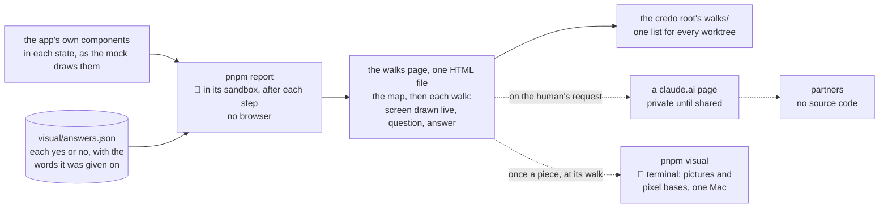

# The visual report: the walks page, rebuilt from the old suite

**Where it stands — 2026-10-28 10:23 +07:** the human's second look at the walks page (about
03:30: "uhm, not so user friendly, could you use front end design skill to restructure the
layout") is built as far as the machine reaches (`81e1c83`, `ee24c22`). The page is now a desk: the map of the
day first, then a rail of the walk's screens, each with a mark for each language and the one in
view marked (at the side on a PC, a strip across the top on a phone), under a switch that draws the
whole page in one language and at one width or all three; each screen's question and its large Yes
and No stand in one panel beside its widths, or under them on a phone, the reason box coming with a
No and the screen's words folded; the bar at the foot counts what is answered of all and copies the
block, whose text is unchanged. Every package is at 100 % and knip is silent; the gate's one red is
a case in `ui/`, which this branch does not touch: `MockPage.test.tsx` passes its 5-second limit
under the machine's load, red in three of four runs today, and is the human's to route ([step 4's
follow-up 2](#steps)). The page was built with `pnpm report` and read back by a jsdom run of its
script: four answers chosen through its controls gave a block byte-identical, but for the commit,
to the one the previous page gives for the same answers, and `pnpm answers` took all four. **Not
seen:** the page in a browser, which is the
human's, from the newest folder of `walks/`; rows 33 to 36 are new 👤 rows and rows 23 and 27 are
amended, for the human's read at that look ([the case table](#the-case-table)). **Recorded, not
built:** an eighth walk screen, the save conflict, answered yes; it enters on `app-frame` with the
walk spec, not here ([step 4's follow-up](#steps)). Pictures and bases wait for step 5, the human's
terminal. **Next:** the human opens the page and answers by it; the next block they paste goes
through `pnpm answers`; then step 5.

> **Drafted** 2026-10-28 by the machine, on the human's ask: "plz add new worktree and refactor
> visual report, like old code", with the old app's visual suite as the reference and, as the
> model, a run of its walks page the human pointed to. It serves the third of the human's four
> stages for every piece: an MVP end to end at low cost; verified locally; a generated visual
> report for feature review; deployed to ridge "so other partners can check without source code".
> **Amended** 2026-10-28 01:44 +07 by the human: at 01:23, "let me run it … local only, don't push
> to artifacts automatically, but only push when requested"; at 01:26, "yes" to a live page drawn
> from the app's own components that needs no browser to build, offered on the human's "can you
> generate visual report from this repo?". **Amended** 2026-10-28 02:02 +07 by the human: at 01:59,
> call 7's A, "yes, me", and every business row kept, "keep all". **Amended** 2026-10-28 03:15 +07
> by the human: at about 03:00, after opening the walks page, three answers: buttons plus a copy
> block (call 2 revisited), the page at the full width and each screen at three widths, and an
> eighth walk screen, the save conflict.
> **Amended** 2026-10-28 10:23 +07 on the human's ask: at about 03:30, after a second look, "uhm,
> not so user friendly, could you use front end design skill to restructure the layout"; the page
> laid out anew around its job, rows 23 and 27 amended and rows 33 to 39 added
> ([step 4's follow-up 2](#steps)).

## At a glance



Drawn from this plan; no code holds it yet.

| The old report's part | Here ([kept, changed, left](#the-old-suite-kept-changed-left)) |
| --- | --- |
| The walks page: the map of the day first, then each walk's screens, one question each, and the answers | **kept**, as the run the human pointed to; each screen **drawn live** from the app's components, in Vietnamese and English |
| A yes that holds until the screen's words change | **kept**; the words read without a browser |
| Each run a folder of its own beside the worktrees | **kept**, in the credo root's `walks/` |
| Screenshots and their pixel differences | **changed**: the human's terminal option, `pnpm visual`, local only; its bases made there, once a piece at its walk (call 7) |
| The partners' page on claude.ai | **kept**, published only when the human asks |
| Answers clicked on a page `pnpm walks` served | **changed**: Yes, No and a reason on the page; "Copy my answers" builds a block the human pastes into the chat; `pnpm answers` writes `visual/answers.json`. No server, no network |
| The gallery, the script that rewrites bases, the seeding, the nightly run, demo mode | **left** |

**Built by** the machine, in its sandbox, after each step: no browser, no wait on the human
([where it runs](#where-it-runs)). **Pictures** come from the human's terminal alone, and so do the
base images QA rule 7 compares, once a piece at its walk, before the merge into `main`
([call 7](#the-humans-calls)). **Partners** get a claude.ai page when the human asks
([partners](#partners)). No GitHub Actions job.

## Read — 10-28

- **The old suite** is about 5,100 lines with its scripts and tests: a capture helper, eight
  visual specs, a seeding step, a gallery reporter, the walks' data, words, states, page,
  reporter and server, and two scripts. It holds 59 base images (4.0 MB), PC and phone, with no
  platform in their path. Its package's coverage took `src/` alone, so none of that code was held
  at 100 %.
- **The model run** the human pointed to: a static `index.html` (60 kB), `walks.json` (the map's
  people and parts, ten walks, 48 screens, each with its sentence in both languages, its
  question, the hash of its words and an image a language), `answers.json` (one row a screen) and
  104 images named by their content's hash, 7.2 MB, in a folder named `<date>-<time>-<commit>`
  beside the worktrees. Its 48 answers are all yes: 45 written by a session quoting the human, 3
  clicked on the served page. Its page fetches its fonts from Google.
- **The mock** (step 4 of [the app frame](2026-10-27-app-frame.md#steps)): `pnpm mock` builds
  `ui/dist/mock/mock.html`, one file that needs no server. It draws the walk's six screens in 15
  states, each light and dark, 390 and 1280 pixels wide, Vietnamese and English: 120 frames, each
  an iframe of its width, so the app's breakpoints answer to the frame, not the page. **Built in
  the machine's sandbox** on 10-28: 785.36 kB in 1.18 s at `f0dcd7f`; after the merge of
  `app-frame` at `5ecbbfe`, 1,466.80 kB in 0.71 s, its font, Noto Sans, now inlined. ui's
  `src/mock/screens.test.tsx` draws every state in both languages on jsdom, in the sandbox too, 2
  passed, before and after the merge.
- **Playwright** is in no package of this workspace: `pnpm exec playwright --version` answers
  `Command "playwright" not found`.
- **A browser in the machine's sandbox:** the old app's headless Chromium (Chrome for Testing
  153), left in Playwright's browser cache, started on a one-line page and stopped within the
  same command, ends at once, exit 133:
  `FATAL … bootstrap_check_in org.chromium.Chromium.MachPortRendezvousServer.<pid>: Permission
  denied (1100)`. Chromium registers a Mach service at start, to hand ports to its child
  processes, and the sandbox refuses every registration. Its profile denies by default and lists
  the Mach services it may look up; `sandbox.network.allowMachLookup` adds lookups, never a
  registration. No setting lets Chromium start inside it. Binding a local port, the app frame's
  stated need, is not what stops a browser.

## The old suite: kept, changed, left

| The old part | Here | Why | Price |
| --- | --- | --- | --- |
| **The capture helper**: `shot` compared and attached a screen, `capture` attached a case's screen uncompared, `shows` ran a test once a language, fixtures wrote rows and froze the clock | **Left** for the page: nothing is captured, each screen is drawn. **Changed** for `pnpm visual`: one spec takes each walk screen's picture | the page needs no browser, so the machine builds it unaided | pictures only when the human runs them |
| **The visual specs and their bases**: a base for each screen of every spec | **Changed**: a base for each walk screen alone, 14 in piece 1, made and compared by `pnpm visual` on the human's Mac, its platform in its path, once a piece at its walk (call 7) | [QA](../conventions/qa.md#the-rules) rule 7 keeps a base per walk screen, not per case; local only (call 4) | no pixel is compared until the human runs it |
| **The gallery**: every screen, with matches, differences and missing bases | **Left** (call 1): the mock stays apart, at `pnpm mock` | the walks page asks; the mock only shows | — |
| **The walks page**: the map, each walk's screens with one question, the answers | **Kept** as the run the human pointed to; **changed**: each screen drawn live from the app's components, one HTML file built with Vite as the mock is, its states computed by the build | it needs no browser to build, and opens from disk or as a claude.ai page | the viewer's browser draws the screens, so the page carries script, as the old one did |
| **The fingerprint**: a screen's accessibility snapshot in a browser, less the navigation unless marked, minted values kept to their shape | **Kept** as the screen's words; **changed**: read from the screen drawn on jsdom; minted values left until a walk screen shows one | rule 7 keys a yes to words, and the machine reads them where it runs; the navigation is left out from the first yes, since leaving it out later would ask every screen again | jsdom lays nothing out, so a word that CSS hides still counts |
| **The folder shared by every worktree**, and `pnpm walks` serving it on a fixed port | **Kept**: each build's folder in the credo root's `walks/`, found from git as before; **left**: the server (call 2) | one list for every worktree; the answers live in git | no buttons on the page |
| **The update script**, `visual:update <screen…>` | **Left**: Playwright's own update, narrowed to the named screens, in the human's run; the machine reads the moved bases in git's diff before it commits them | 14 bases; the old script ran the whole suite again to accept one run | a base moved by mistake is caught by reading the diff alone |
| **Seeding**: rows written through the BFF, a session saved for the signed-in screens | **Left**: the page draws from the mock's fixtures; the walk spec signs in through the page; `pnpm stack` writes the tenant ([the frame](2026-10-27-app-frame.md#the-frame)) | nothing else calls it | — |
| **Playwright's own HTML report** | **Kept** as `pnpm visual`'s output: the pictures, and base, now and the difference where one moved | it already shows them | — |
| **The partners' claude.ai page** | **Kept**, published only on the human's request (call 5) | a link with no login and nothing to unzip | a session publishes it each time |

**The old defects, not copied:**

1. The suite's code sat outside the coverage gate: the reporter, the page, the server and the
   scripts were read back by tests, never held at 100 %.
2. The walks page fetched its fonts from Google: a review page that calls a third party, and
   draws in fallbacks offline.
3. The page's script was TypeScript transpiled inside the reporter, with a pattern checking the
   shape of one import, and the page computed its states in the browser.
4. A run's folder name was parsed back out of a date formatted for display.
5. A value the run mints was caught only where a capture named it; one forgotten asked again at
   every run.
6. The bases had no platform in their path, and were made and compared on one Mac.
7. Answers held their date in two forms, a day from a session and a time from the page, and a yes
   clicked on the page kept the reason of the row it replaced.
8. Found late, by its review: a "no" whose screen left the walks fell out of the count (row 15
   here holds it); a "no" fixed in looks alone counted as changed, and a drifted capture path let
   a changed menu ask nothing. Those two leave with what caused them: the list of fixes a screen
   carried, and the navigation mark reached through a path.

## Where it conflicts, and the amendments

**[QA](../conventions/qa.md) rule 7's gallery line needs no edit** (call 1, moot). The report
carries no gallery, so "*Rejected:* a gallery of every screen that asks nothing"
([qa.md#L100](../conventions/qa.md#L100)) stands, as does "*Rejected:* a base image per captured
case": the bases are the walk's screens alone. Amendment A is withdrawn, and `qa.md` is not edited.

**Rule 7's machine reader stands as written** (call 7, A). "The machine compares its look with
its committed base image: a moved pixel is a red" ([qa.md#L97](../conventions/qa.md#L97)). With no
GitHub run (call 4) and no browser in the machine's sandbox ([read](#read--10-28)), a base can be
made, and a pixel compared, only when the human runs `pnpm visual` in the terminal; the live page
compares words, never pixels. The human runs it once a piece, at its walk, before the merge into
`main`, so `qa.md` is not edited.

**[The app frame plan](2026-10-27-app-frame.md)** took six edits at step 3, on this branch (calls
3 and 6; B1 and B4 follow call 2), each stamped "*Amended 2026-10-28 01:47 +07 by the human: B<n>
of the visual report.*" Each *Was* is the text at `5ecbbfe`, the merge of `app-frame`, found by
its text; each link points at the amended lines. B2, B3 and B5 are worded to the answers on calls
1, 4 and 5: no GitHub runner and no gallery. B2 and B3 stand under call 7's answer, A.

- **B1, the answers' home** ([app-frame#L178](2026-10-27-app-frame.md#L178), lines 178 to 181).
  *Was:* "The answers, dated, written here by the machine from the human's reply:" and a table of
  six screens by two languages. *Is:* "Their answers, dated, are written by the machine from the
  human's reply into `visual/answers.json`, each with the words it was given on, and the walks page
  shows them ([the visual report](2026-10-28-visual-report.md#the-answers))." The table went: one
  home for an answer.
- **B2, the least tooling** ([app-frame#L183](2026-10-27-app-frame.md#L183), lines 183 to 189).
  *Was:* "… the committed base images are the machine's reader. The human walks live after `pnpm
  stack`, or reads the images. **Not built:** a walks page or answers file, a gallery, a script to
  rewrite bases, a nightly run, Bruno, WebKit." *Is:* "… the committed base images, made in the
  human's terminal, are the machine's reader. The human walks live after `pnpm stack`, or reads
  the walks page the machine builds ([the visual report](2026-10-28-visual-report.md)). **Not
  built:** a gallery, a script to rewrite bases, a nightly run, Bruno, WebKit."
- **B3, the need** ([app-frame#L191](2026-10-27-app-frame.md#L191), lines 191 to 195), a
  correction the probe found. *Was:* "**Needs:** the code session's sandbox to bind local ports
  (`sandbox.network.allowLocalBinding`). Without it the machine asks for that setting, and the
  human runs the walk meanwhile." *Is:* "**Needs:** a browser, which the code session's sandbox
  cannot start: it refuses Chromium's registration of a Mach service, and no sandbox setting
  allows one. The human runs the spec in the terminal; the walks page needs no browser
  ([where it runs](2026-10-28-visual-report.md#where-it-runs))."
- **B4, step 8's done-when** ([app-frame#L323](2026-10-27-app-frame.md#L323), lines 323 to 325).
  *Was:* "Done when: each screen's answers are in the table above, dated, and none is an open
  "no"." *Is:* "Done when: each screen's answers are in `visual/answers.json`, dated, and the
  walks page of the walk's commit shows none waiting and no open "no"."
- **B5, left behind** ([app-frame#L346](2026-10-27-app-frame.md#L346), lines 346 to 348). *Was:*
  "**The old visual suite's gallery, walks page, Bruno and nightly run:** the walk spec does."
  *Is:* "**The old visual suite's gallery, Bruno and nightly run:** the walk spec does. Its walks
  page returns with [the visual report](2026-10-28-visual-report.md), on the human's ask of 10-28."
- **B6, a seventh screen** (call 6), [app-frame#L47](2026-10-27-app-frame.md#L47), after screen 6:
  "| 7. A save that failed, what was typed kept | Would the admin know the save did not happen, and
  that nothing typed is lost? |", its stamp on the line below the table. Case row 8 of piece 1
  ([app-frame#L154](2026-10-27-app-frame.md#L154)) names the walk as holding it.
- The header stamp ([app-frame#L13](2026-10-27-app-frame.md#L13)) gained "**Amended** 2026-10-28
  01:47 +07 by the human: the walks page and its answers file, and a seventh walk screen, from the
  visual report."

## What it reports in piece 1

**The map** is the app frame's ([piece 1's walk](2026-10-27-app-frame.md#piece-1s-walk)), as
[QA](../conventions/qa.md#the-rules) rule 7 draws it: the parts of the day across (set up, staff,
stock, orders, delivery), the people down, each on their device (the client's admin and office
staff at a PC, the driver on a phone). Piece 1 fills one cell, the client's admin at set-up; the
other fourteen are hatched. Each piece's plan adds its cells, and a new column only by its plan.

**The walk:** the client's admin, at a PC, light; drawn at three widths (row 2). The screens keep the app
frame's numbers; the page shows the main path first, then what can go wrong.

| # | The screen ([at a glance](2026-10-27-app-frame.md#at-a-glance)) | Path | The mock's state | The one question |
| --- | --- | --- | --- | --- |
| 1 | Sign in, in the company's name and colours | main | `1 empty` | Would the admin know this is their app, and how to sign in? |
| 2 | Sign-in refused | what can go wrong | `2 failed` | Does this say what to do? |
| 3 | Settings: name, logo, colour, languages | main | `3 filled` | Is this what an admin sets up first? |
| 4 | Saved: the app shows the new name and colour | main | `4 filled` | Does the change show where the admin expects? |
| 5 | The language switched | main | `5 filled`, the user menu open | Is the switch where a user would look? |
| 6 | The service down at start | what can go wrong | `6 failed` | Would the admin know it is not their fault, and to try again? |
| 7 | A save that failed, what was typed kept | what can go wrong | `3 save-failed` | Would the admin know the save did not happen, and that nothing typed is lost? |

Each screen in Vietnamese and English: 14 drawn screens and 14 answers, as the app frame's call 3
has each screen answered in both. Each screen's sentence is its label here, in both languages; its
question is in English, the human's to answer.

**How a screen is drawn.** The walk names, for each screen, the mock's state it shows. `ui/` gives
`visual/` one export, its mock's screens and states with the frame that draws one; the page draws
each walk screen in that frame at three widths, PC 1280, tablet 768 and phone 390, so the app's
breakpoints answer to each, scaled down to fit the page, in each language. The person's device
stays on the map; the walk is drawn at all three whoever it is for. These are the app's own components, so the
page changes with the app at each build. The model files: `ui/vite.mock.config.ts` (one file,
script and styles inlined), `ui/src/mock/Frame.tsx` (a screen at its width), `ui/tests/render.tsx`
and `ui/src/mock/screens.test.tsx` (a screen drawn on jsdom, in a language).

**The words.** The build draws each walk screen on jsdom, as ui's tests draw one, and reads its
words: each text, accessible name, field value, placeholder and image alternative, in reading
order, with the role it sits in, less the menu's navigation unless the walk marks the screen as
about it. Each language's words are compared with the answer's. *Rejected:* the words read in the
viewer's browser, which the machine could not read back; a render on the server, which skips what
effects draw, so a screen could read otherwise than it shows.

**From the app frame's step 6**, the app is wired to the BFF, and the page still draws each screen
from the mock's states: the same components, with invented data. The live app's pictures come from
the walk spec through `pnpm visual` ([step 6](#steps)). A yes stays keyed to the drawn screen's
words, one reader, so demo data alone never asks a screen again.

### The page

As the model run: "A business's day in Credo", "Who does what, on the device they use." Then:

1. **The build line:** the branch, the commit and its time in Vietnam's; never a path, never a
   person.
2. **The map:** a built walk is a card with its title, its count of screens and what waits in it;
   an empty cell is hatched, so what is missing shows.
3. **The rail and the view:** each walk's screens, the main path first, each with a mark for each
   language (outlined while open, filled for a yes, struck through for a no, dashed when asked
   again), the one in view marked; above them, the language (Tiếng Việt first) and the widths (PC,
   tablet, phone or all three) the whole page is drawn in. At the side from a window 1000 pixels
   wide, a strip across the top below. A change of view brings back the screen that was in view.
4. **Each walk:** the main path, then what can go wrong; each screen with its number and its
   sentence in both languages, then its drawn widths in the page's language beside one panel: its
   one question, Yes and No, the reason box a No brings, and one line on its answer (not yet
   asked, a dated yes, a "no" with its reason, or asked again, with the words before and now
   opened under the widths) and on what a choice will do to it. Shown together, the widths sit at
   one scale, the PC's across the top and the tablet's and the phone's under it, each column as
   wide as its device. The screen's words, the machine's record, are folded under them. Approved
   screens fold away.
5. **At its top, one or two lines** on how to answer, and that the block goes to the chat.
6. **A bar at the foot**, always in view: a ledger of every screen in every language, how many are
   answered of all, how many wait to be copied, "Copy my answers", and, once pressed, the block in
   a box to select where the clipboard refuses.

**The whole window.** The page has no maximum width; a window, a tablet or a phone is filled, with
a 16-pixel gutter and no sideways scroll at 390 pixels. A screen's panel stands beside its widths
where the screen's body is 900 pixels wide, and under them below that, riding at the window's foot
while they scroll by; the three widths sit together where they have 560 pixels; the map falls to
one column at 480. jsdom lays nothing out, so `page.test.tsx` holds the rules, and the look is the
human's. The page's own look is quiet, in the app's face, Noto Sans, already inlined for the
screens, with the app's teal kept for a yes and the one action, so the drawn screens stand out.
*Rejected:* the six frames of a screen at once, the old layout: the answer sat a row of frames
below its question, and the page ran 42 frames long.

One HTML file, script and styles inlined, as the mock is, its data computed by the build and
inlined with every `<` escaped; `walks.json` beside it holds the same data for the machine's
read-back. Its own frame (the map, the cards) meets the claude.ai page contract, so it publishes as
built: a short title ("Credo Day Walks"), colours as tokens with a dark set, a body background, a
16-pixel gutter, no sideways scroll at a phone's width, no font or script from elsewhere. The drawn
screens keep the app's look.

### The answers

`visual/answers.json`, committed with the walk it answers: keys sorted, one row a key,
`<walk>:<screen>:<language>`, each `{ answer, on, reason, words }`. `answer` is yes or no; `on` the
day, in one form; `reason` a "no"'s, quoting the human; `words` the screen's words it was given
on, a line each, so a changed screen shows what changed.

The human answers on the page: Yes or No for a screen in a language, and a reason, required for a
No. "Copy my answers" builds one plain-text block, to paste into the chat:

```text
Credo walks answers
Build: branch <branch>, commit <commit>
admin-setup:3-settings:vi | yes | 0123456789ab
admin-setup:3-settings:en | no | 0123456789ab | the save button is hard to find
```

A line is the screen's key (`<walk>:<screen>:<language>`), `yes` or `no`, the **fingerprint** of the
words the answer was given on (twelve hex digits of their hash, computed by the build and only
copied by the page) and a no's reason on one line. The page sends nothing, calls no network, and
keeps unsent choices in `localStorage` when the browser allows it, dropping any given on words that
have since changed; without storage it works the same.

The machine of the piece, relayed by the orchestrator, runs **`pnpm answers <file>`** on the pasted
block (a file, or stdin when none is named; a relative path is the caller's), and **`pnpm answers
--partners <file>`** on the partners' posts, which the human hands over saying they are partners'
([the sharing plan](2026-10-28-walks-share.md#how-partners-answer)). It draws every walk
screen as the build does and holds each line against its words now: a line whose fingerprint is no
longer the screen's (stale), whose screen or language is unknown, whose no has no reason, or that is
no answer at all is **refused, by its line number, saying why**; the lines that hold are written
over their rows, dated in Vietnam's day, with the words they were given on, keys sorted, and the
rows of other screens stay. The exit status is 1 when any line was refused. The machine commits the
rows on the piece's branch; a "no" also becomes a case in the piece's table
([QA](../conventions/qa.md#the-rules) rule 7). The next build's page shows them. A "no" fixed in
looks alone keeps its words, so the fix's commit deletes its row and the screen is asked again.

*Rejected* (call 2): the old served mode, `pnpm walks` on a fixed port with a yes or no clicked on
the page. *Its price:* about 260 lines and their tests; answers outside git on one Mac, or a server
writing into a worktree; a refused answer whenever another worktree's run becomes the newest; and a
partners' page that shows no answer. In the model run, 45 of 48 answers came by reply anyway.
*Trigger to revisit:* a walk too long to answer in a line, or the human asking for the buttons.
*Fired 10-28 03:15:* the human asked, and chose the buttons with a copy block, still no server
(call 2, revisited); the served mode stays rejected.
*Rejected:* the plan's table as the input, a doc made a format code must parse; answers kept in the
browser, one set a browser.

## Where it runs

**1. The machine, in its sandbox: the walks page.** `pnpm report` builds the page and writes it to
`$ROOT_DIR/walks/<date>-<time>-<commit>/`, where `$ROOT_DIR` is the folder that holds `.bare`,
found from git's common directory: one list for every worktree, outside every worktree. It needs
no browser, only Vite and jsdom, both read back in the sandbox above. After each step of a piece
that changes what a walk screen draws, the machine runs it, reads `walks.json` back (what waits,
what changed, what is open), and names that in the step's evidence. No wait on the human.

**2. The human's terminal: pictures and bases** (from step 5, local only, call 4). The human runs
it once a piece, at its walk, before the merge into `main` (call 7), and whenever they want
pictures:

```sh
pnpm visual 2>&1 | tee "$ROOT_DIR/logs/visual.log"
```

The machine hands the command with `$ROOT_DIR` filled in, as for `act`. It builds the page, then
Playwright opens it from disk and takes each walk screen's picture at its full width; from step 6
it takes them from the live app on the local stack. Playwright's report lands in the same folder:
the pictures, and base, now and the difference where one moved. The bases are made here alone,
the Mac's, the platform in their path. The machine watches the log, reads it whole, then reads the
report's pictures. Once, `pnpm --filter @credo/visual exec playwright install chromium` fetches
the browser.

**Not inside the sandbox.** No setting lets Chromium start there. `sandbox.excludedCommands`, in
the user settings, would run `pnpm visual` outside it, with the human's full rights, the AWS keys
the sandbox hides among them; the human's answer, local only in the terminal, leaves it out.

**No GitHub Actions job** for the report (call 4): the draft's workflow, `visual.yml`, goes.
c-storage's own workflow, which uploads its Bruno report, is a separate thing, already approved,
and stays.

## Partners

**On request only** (call 5). When the human asks, the machine publishes the newest folder's page
as a claude.ai page with the Artifact tool: private until the human shares its link, republished
to the same link at the next request. The publish sends the page less the doctype, charset and
viewport lines the tool's skeleton adds, the old export's rule, and reads the published page back.
The link is deploy state, so the orchestrator keeps it, never a doc
([documentation](../conventions/documentation.md#never-in-a-doc)). Nothing is uploaded anywhere
unasked. This is how the old app's partners saw its walks page, a claude.ai page shared by link;
it replaces, for now, the run's GitHub artifact and the path on ridge the draft proposed.

Everything the page holds is already public in the repository: its screens are drawn from its
code, its questions and answers are its files.

## Where it lives in the workspace

```text
ui/                one export more, ./mock: the mock's screens, their states, the frame
visual/            @credo/visual: the map, piece 1's walk, the words, the states, the page and
                   its one-file build, the folder's home; answers.json
visual/pictures/   from step 5: pnpm visual's Playwright config, its spec, the Mac's bases
```

- **A package of its own.** *Rejected:* the page inside `ui/`, beside the mock: the report's walks,
  answers and build would join the app's package. *Price:* one export from `ui/`, and React and
  Mantine declared in both.
- **Scripts:** the root's `pnpm report`, the machine's, builds the page into its folder; the
  machine's `pnpm answers <file>` writes a pasted block into `visual/answers.json`; from step 5,
  `pnpm visual`, the human's, builds the page and adds the pictures. No `visual:update`, no `pnpm
  walks`.
- **Tests:** Vitest, on jsdom for the page and the words, in Node for the build and the folder's
  home, tested on a temporary repository; coverage at 100 % of `visual/src/`
  ([QA](../conventions/qa.md#the-rules) rule 8). The Vite config and `pictures/` sit outside
  `src/`.
- **The catalog** gains `@playwright/test` at step 5 alone, exact, at its rule: the newest release
  two weeks old.
- **knip:** a `visual` workspace, the page's entry and the build its entries; from step 5,
  Playwright's config, found by knip's plugin. **Lint:** the root config, with
  `visual/tsconfig.json`. `.gitignore` gains `/walks/`, and at step 5 Playwright's
  `test-results/`.
- **The gate:** `pnpm check` runs `visual/`'s unit tests; `pnpm report` runs after each step,
  outside the check; `pnpm visual` is the human's.
- **Nothing enters before its caller:** `pnpm answers` is called each time the human pastes a
  block, so it enters now; the page's caller is the machine's build after each step;
  Playwright's is the human's `pnpm visual`, at step 5; the walks hold piece 1's alone.

## The case table

👤 marks a business row, for the human's read ([QA](../conventions/qa.md) rule 1); the human kept
every one as written ([step 2b](#steps)). Rows 33 to 36 are new and rows 23 and 27 amended, on the
human's ask of 10-28 about 03:30 for an easier page, for the human's read at the next look. From the draft at `f0dcd7f`, its row 6, every state
beside the walks, left with call 1; its row 5, a run that lacks a screen writes no page, is now
row 14, the machine's.

| # | 👤 | The case | Held by |
| --- | --- | --- | --- |
| 1 | 👤 | The page opens on the map: the parts of the day across, the people down with their device; a built walk is a card with its title and its count of screens, and an empty cell is hatched, so what is missing shows | unit, `page.test.tsx` |
| 2 | 👤 | The page draws each walk screen live from the app's own components, in its state, in Vietnamese and in English, at three widths: PC 1280, tablet 768 and phone 390 (amended 10-28 at the human's own ask, answered; was "at its person's device width") | unit, `page.test.tsx`, `report.test.ts`, `walks.test.ts`; read back |
| 3 | 👤 | Each walk shows its main path, then what can go wrong: each screen with its sentence in both languages and its one question | unit, `page.test.tsx` |
| 4 | 👤 | Each drawn screen shows its language's answer: not yet asked, a dated yes, or a "no" with its reason | unit, `states.test.ts`, `page.test.tsx` |
| 5 | 👤 | A yes holds while the screen's words stay the same; a changed word asks again, showing the words before and now; a change of look alone asks nothing | unit, `words.test.tsx`, `states.test.ts` |
| 6 | 👤 | The machine builds the page in its sandbox, with no browser, after each step, with no wait on the human | read back, at step 4 and each step after |
| 7 | 👤 | The page is one file that opens from disk or as a claude.ai page, with no network: no font or script from elsewhere | unit, `build.test.ts` |
| 8 | 👤 | Nothing in the published page names a key, a person or a path on one machine | unit, `build.test.ts` |
| 9 | 👤 | The page says what it was built from: the branch, the commit and its time | unit, `page.test.tsx` |
| 10 | 👤 | Every worktree's builds land in one list, the credo root's `walks/`, a folder a build, never committed | unit, `home.test.ts` |
| 11 | 👤 | `pnpm visual`, in the human's terminal, takes each walk screen's picture in both languages and shows any that moved beside its base and the difference (step 5) | the spec, `pnpm visual` |
| 12 | | A screen's words are its texts, accessible names, field values, placeholders and image alternatives in reading order, with their roles, read from the screen drawn on jsdom, less the menu's navigation unless the walk marks the screen as about it | unit, `words.test.tsx` |
| 13 | | Two builds of one commit give each walk screen the same words | read back, step 4 |
| 14 | | Each walk screen names a state the mock draws; one it lacks stops the build, naming it | unit, `walks.test.ts` |
| 15 | | An answer whose screen left the walks is listed on the page, never dropped from the count | unit, `states.test.ts` |
| 16 | | An answers file that does not parse, or a row of no known form, stops the build; it never reads as nothing answered | unit, `answers.test.ts` |
| 17 | | The folder is named `<date>-<time>-<commit>` in Vietnam's time, built from the date's parts, `-changes` on a changed tree; outside a repository none is written, and the build says why | unit, `home.test.ts` |
| 18 | | A folder is written aside and renamed, so a stopped build leaves none half written | unit, `build.test.ts` |
| 19 | | The page's data is inlined with every `<` escaped, so no text of the walks or the answers ends its script | unit, `build.test.ts` |
| 20 | | The published page is the folder's page less the doctype, charset and viewport lines the tool's skeleton adds | read back, at each publish |
| 21 | | Pictures are compared on the human's Mac alone, each base with its platform in its path (step 5) | the config |
| 22 | | No run is retried | the config, `retries: 0` ([QA](../conventions/qa.md#the-rules) rule 6) |
| 23 | 👤 | Each screen, in each language, has Yes and No, and a reason box that a No brings; the reason is required for a No; the human answers once per screen per language, not per width (answered 10-28; amended 2026-10-28 10:23 +07 on the human's ask for an easier page, was "has Yes and No and a reason box") | unit, `page.test.tsx` |
| 24 | 👤 | "Copy my answers" builds one plain-text block naming the build, and for each answered screen and language its screen, language, yes or no, the reason and the fingerprint of the words it was answered on; with a No lacking its reason, or nothing answered, it gives no block and says so (answered 10-28) | unit, `block.test.ts`, `choices.test.ts`, `page.test.tsx`; read back |
| 25 | 👤 | The page says at its top, in a line or two, how to answer and that the block goes to the chat (answered 10-28) | unit, `page.test.tsx` |
| 26 | 👤 | The page sends nothing and calls no network; unsent choices are kept across a reload in `localStorage`, dropped when their words changed, and the page works without storage (answered 10-28) | unit, `choices.test.ts`, `page.test.tsx`, `build.test.ts` (row 7) |
| 27 | 👤 | The page uses the whole width of the window and reads on a PC, a tablet and a phone: on a PC the rail at the side, and a screen's three widths together at one scale, the PC's across the top, with its question and answer beside them; on a phone the rail a strip across the top, the widths stacked and the answer under them; no sideways scroll at 390 pixels (answered 10-28; amended 2026-10-28 10:23 +07 on the human's ask for an easier page, was "a language's three widths side by side on a PC, stacked on a phone") | unit, `page.test.tsx` (the rules); the look is the human's |
| 28 | 👤 | `pnpm answers <file>` (or stdin) writes the pasted block's answers into `visual/answers.json`, dated, on the words the screens draw now, keeping the other rows (answered 10-28) | unit, `take.test.ts`, `cli.test.ts` |
| 29 | 👤 | `pnpm answers` refuses, by line, an answer whose fingerprint no longer matches the screen's words (stale), and says which (answered 10-28) | unit, `take.test.ts`, `cli.test.ts` |
| 30 | 👤 | `pnpm answers` refuses, by line, an unknown screen and an unknown language, and says which (answered 10-28) | unit, `take.test.ts` |
| 31 | | A line that is no answer, a no without its reason, or text with no block title is refused by line or stops the command; with every line refused the file is left as it was and the exit status is 1 | unit, `block.test.ts`, `take.test.ts`, `cli.test.ts` |
| 32 | | A screen's fingerprint is twelve hex digits of its words, computed by the build; the page's and the command's are the same | unit, `fingerprint.test.ts`, `report.test.ts`, `cli.test.ts` |
| 33 | 👤 | A switch draws the whole page in one language, Tiếng Việt first, and at one width or all three, so every walk screen is one press from each width in each language (new 10-28, on the human's ask) | unit, `page.test.tsx`; read back |
| 34 | 👤 | A rail lists each walk's screens, the main path first, each with a mark for each language (open, yes, no or asked again) and the one in view marked: at the side on a PC, a strip across the top on a phone (new 10-28, on the human's ask) | unit, `page.test.tsx`, `marks.test.ts` |
| 35 | 👤 | Each screen's question and its Yes and No stand together, beside its widths on a PC and under them on a phone, riding at the window's foot while they scroll by; one line says what is on record and what a choice will do to it; the screen's words are folded (new 10-28, on the human's ask) | unit, `page.test.tsx` |
| 36 | 👤 | The bar at the foot says how many answers are given of all, chosen on the page or on record, and how many wait to be copied (new 10-28, on the human's ask) | unit, `page.test.tsx`, `marks.test.ts` |
| 37 | | A change of language or width brings back the screen that was in view | unit, `page.test.tsx` |
| 38 | | The bar keeps its height on the page, so an answer at the window's foot rests above it | unit, `page.test.tsx` |
| 39 | | Every control shows a focus ring, a radio's on the face it lies under, and every colour has a dark value, whether the system or the page asks for dark | unit, `page.test.tsx` |

## Hazards no gate catches

- **jsdom lays nothing out.** A word that CSS hides at a width still counts, and a change made in
  CSS alone asks nothing. *Guard:* the pictures, `pnpm visual`, are the check of looks, run once a
  piece at its walk (call 7).
- **The pixel check runs only in the human's terminal.** Between two runs a moved pixel is no red,
  and the machine's evidence after a step can name none. *Guard:* the human runs it once a piece,
  at its walk, before the merge into `main` (call 7); the machine names, in each step that changes
  what a walk screen draws, that no pixel was compared. *Trigger to revisit:* a branch that
  changes `ui/` merging without the run.
- **The page draws from the mock's states, with invented data.** A screen wired wrong to the BFF
  still draws right on it. *Guard:* the walk on the live app (the app frame's step 8) and `pnpm
  visual` on the local stack (step 6) are the checks of the wiring.
- **The pictures are the Mac's.** The app now ships its font, Noto Sans, inlined in the one file,
  so the page reads alike everywhere; but each platform draws the same font a little differently,
  so the bases hold on the Mac alone. *Trigger to revisit:* a second machine that runs `pnpm
  visual`; then call 7's C.
- **The answers are public**, and so is the mock's invented password, which the page carries as
  the mock does. *Guard:* the machine writes a reason as the human gave it, never a name
  ([documentation](../conventions/documentation.md#nothing-machine-local-or-personal-in-a-committed-file));
  the root's real password, printed once by `pnpm stack`, enters no fixture.
- **A shared claude.ai link reaches whoever holds it.** The page holds nothing the repository does
  not.

## The human's calls

The draft's six calls, each answered under it; then call 7, which the answers raised, answered at
the second read.

**The live page, on the human's ask.** The human asked: "can you generate visual report from this
repo?". The machine offered a live walks page that draws each screen from the app's own
components: one self-contained HTML file that needs no browser to build, so the machine builds it
in its sandbox after each step; the map and the walks kept, a yes held by the screen's words;
screenshots, `pnpm visual`, the human's terminal option rather than the report's source.
**Answered** 2026-10-28 01:26 +07 by the human: "yes".

1. **Rule 7's gallery line (amendment A).** *Recommended:* yes, the mock page beside the walks.
   *For:* every state of every screen one click from the walks, for partners too. *Against:* a
   page that asks nothing travels with the report, and a reader may take it for the check.
   *Price:* 0.8 MB a run's folder.
   **Answered** 2026-10-28 by the human, with the live page's yes: moot. The report carries no
   gallery, so rule 7's line stands, A is withdrawn and `qa.md` is not edited; the mock stays
   apart, at `pnpm mock`.
2. **How the human answers.** *Recommended:* in the chat; the machine writes `visual/answers.json`
   on the piece's branch, and the next page shows it. *For:* no server, port or writer; answers in
   git, where every session reads them, so the partners' page shows them too. *Against:* no
   buttons; an answer shows at the next build, not at once. *The other way,* the old served mode,
   is priced at [the answers](#the-answers).
   **Answered** 2026-10-28 by the human: as recommended.
   **Answered** 2026-10-28 about 03:00 +07 by the human, revisiting this call after opening the
   walks page ("no way to send feedback, is it under-implemented?"): **buttons plus copy**. The
   trigger above fired. Yes and No and a reason on each screen in each language; a "Copy my
   answers" button builds one block to paste into the chat; no server, no network; the machine's
   `pnpm answers <file>` writes `visual/answers.json` from it ([the answers](#the-answers); rows 23
   to 32).
3. **The app frame's lines B1 to B5.** *Recommended:* yes, as drafted. B1 and B4 follow call 2; B2
   and B5 follow the human's ask; B3 corrects what the walk needs.
   **Answered** 2026-10-28 by the human: as recommended, B2, B3 and B5 worded to the answers on
   calls 1, 4 and 5 ([the amendments](#where-it-conflicts-and-the-amendments)).
4. **Where it runs.** *Recommended:* the human's terminal and GitHub Actions, not inside the
   machine's sandbox. *For:* the sandbox stays whole, and GitHub's run is the verdict, as for
   c-storage. *Against:* the machine cannot run the report itself. *The other way:*
   `sandbox.excludedCommands` with `pnpm visual`.
   **Answered** 2026-10-28 01:23 +07 by the human: "let me run it … local only". The pictures run
   in the human's terminal alone, and the report has no GitHub Actions job: the draft's step 5 and
   its `visual.yml` go. c-storage's Bruno report upload, in its own workflow, stays. With the live
   page (01:26), the report itself needs no browser and runs in the machine's sandbox.
5. **Partners.** *Recommended:* the run's artifact now; ridge's fixed address with its fourth
   layer; public then, asked again at that layer's plan. *For:* nothing to build for partners
   before layer four. *Against:* until then partners need a GitHub login and a zip.
   **Answered** 2026-10-28 01:23 +07 by the human: "don't push to artifacts automatically, but
   only push when requested". The machine publishes the page as a claude.ai page only when asked,
   private until the human shares its link ([partners](#partners)); the GitHub artifact and the
   path on ridge leave, for now.
   *Calls 4 and 5, for the walks page alone, are changed by [the sharing
   plan](2026-10-28-walks-share.md#the-humans-calls): a GitHub job deploys it to Cloudflare Pages,
   and partners sign in by Access; the pictures stay local.*
6. **A seventh screen, the failed save (amendment B6).** *Recommended:* yes, under what can go
   wrong. Case row 8 of piece 1, "A failed save says so and keeps what was typed", names the walk
   as holding it, and none of the six screens shows it; the mock already draws it. *Price:* two
   more answers, one more step in the walk spec.
   **Answered** 2026-10-28 by the human: as recommended.
7. **Rule 7's base images: who reads the pixels, and when.** Rule 7 gives each walk screen
   two readers: "The machine compares its look with its committed base image: a moved pixel is a
   red" ([qa.md#L97](../conventions/qa.md#L97)), and the human's yes. Call 4 leaves no GitHub run,
   and the machine's sandbox cannot start a browser ([read](#read--10-28)), so a base can be made,
   and a pixel compared, only when the human runs `pnpm visual` in the terminal. The live page,
   built after each step, compares words, never pixels.
   - **A. The bases from the human's terminal, on one machine.** `pnpm visual` makes and compares
     the 14 bases on the human's Mac, the platform in their path. The human runs it once a piece,
     at its walk, before the merge into `main`, and whenever they want pictures; the machine reads
     the log and the report. Rule 7 stands as written. *For:* no edit to a rule decided on 10-27,
     nothing pushed, nothing to pay; a moved pixel is still a red before a piece merges. *Against:*
     between two runs a moved pixel is no red, and the machine cannot run the check itself; the
     bases hold on that one Mac, so another human's run on another machine may red screens that
     did not change. *Price:* about five minutes of the human's terminal a piece, beside the walk.
   - **B. Amend rule 7: the machine reads the live page's words and structure; pixels only in the
     terminal option.** Each build compares each walk screen's words and roles, as drawn on jsdom,
     with a committed record; a change not committed on purpose is a red. `pnpm visual` keeps its
     pictures, with no bases. *For:* the machine reads its own check after every step, in its
     sandbox, on any machine; no base images to keep. *Against:* jsdom lays nothing out, so a
     colour, a spacing or an overlap that moves is never a red, the look just matched to the old
     app among them; the machine's reader and the human's yes would read the same words. *Price:*
     an edit to `qa.md`, its rule 7 and its human version, on the human's yes; one record a walk
     screen, rewritten with each change of words; the looks checked by eye alone.
   - **C. A GitHub run for the bases alone.** A workflow on push runs `pnpm visual` in Playwright's
     container and compares bases made there; the report stays local, and nothing is published.
     *For:* rule 7 stands, and the pixels are compared on every push without the human's terminal,
     on one platform for every human. *Against:* it reopens call 4's "local only"; a red shows only
     after a push, which is the human's, and the machine reads GitHub's run only through the
     human; the bases are Linux's, so the human's terminal run compares nothing. *Price:* nothing
     on a public repository; a few minutes a run; a workflow, with `actionlint` and `act` first.

   *Recommended:* A. It keeps the rule as decided and the human's "local only", and the pixels are
   compared where it counts, before a piece merges, beside a walk the human makes anyway. *Trigger
   to revisit:* a second machine that runs `pnpm visual`, or a branch that changes `ui/` merging
   without the run; then C. B and C re-word the app frame's B2 and B3; B adds an amendment to
   `qa.md` before step 5.
   **Answered** 2026-10-28 01:59 +07 by the human: A, "yes, me". The bases come from the human's
   terminal on one Mac, `pnpm visual` run once a piece, at its walk, before the merge into `main`;
   rule 7 stands as written, `qa.md` is not edited, and the app frame's B2 and B3 stand.

## Steps

- [x] **1. This plan.** Who: 🤖, 10-28. Done when: committed on `visual-report`; the path, name
  and link checks clean. *Evidence:* `f0dcd7f`; rewritten to the live page at `da9a632`, after the
  merge `5ecbbfe`, and to the human's answers in the commit after it; on each, the path and name
  grep finds nothing and every relative link resolves.
- [x] **2. The human's calls.** Who: 👤, 10-28, 20 minutes. Done when: each of the six calls
  answered under it, dated; the rows, and call 7 which the answers raised, moved to step 2b on
  10-28. *Evidence:* [the human's calls](#the-humans-calls): calls 4 and 5 at 01:23 +07; the live
  page at 01:26 +07, which made call 1 moot; calls 2, 3 and 6 as recommended.
- [x] **2b. The human's second read.** Who: 👤, 10-28, 10 minutes. Done when: call 7 answered under
  it, dated; each 👤 row kept or corrected, the six marked new or changed first. *Evidence:* the
  human, 2026-10-28 01:59 +07: call 7, A ("yes, me"), written under it; the rows, "keep all", so
  every 👤 row of [the case table](#the-case-table) is kept as written, rows 2, 6, 7, 8, 9 and 11
  among them, and their marks dropped.
- [x] **3. The amendments.** Who: 🤖, after step 2 (calls 2, 3 and 6), 30 minutes. Done when: the
  app frame plan carries B1 to B6, each with its stamp, and its header stamp, each found by its
  text, committed on this branch; `qa.md` untouched (call 1); the path, name and link checks
  clean; `git merge-tree` against `app-frame` read and reported. *Evidence:* the commit that ticks
  this step, [the amendments](#where-it-conflicts-and-the-amendments) linking each edit; `qa.md`
  not in its diff; the path grep finds only the documentation convention's own pattern, the diff
  names no one, and every relative link in both plans resolves; `git merge-tree --write-tree
  app-frame` against this branch's tree is clean, the merged tree this branch's own, since
  `app-frame` is still at `fdc517c`, the merge base.
- [x] **4. The build: `ui/`'s one export, `visual/` and the live walks page.** Who: 🤖, after
  steps 2b (the rows it holds) and 3 (the walk's seven screens), 5 hours. If `app-frame` moved
  since `5ecbbfe`, merge it in first, so the page draws its newest UI. Everything is built and read
  in the machine's sandbox. Done when:
  `pnpm check` green, `visual/` at 100 %, knip silent, no warning; each row held by a unit test
  seen red once by breaking its rule; `pnpm report`, run by the machine, writes one folder in the
  credo root's `walks/`, its output read whole; read back from that folder's `walks.json` and
  page: the map with one cell filled and fourteen hatched, the walk's seven screens in both
  languages, each with its question and its words, each not yet asked; the page one file, naming
  no other host; a second build's words equal the first's (row 13); the page searched for a home
  path, the git author's name and email and a key's shape, none found (row 8). **Not seen by the
  machine:** the page drawn in a browser. It hands the human the folder's path; the human opens
  the page from disk, and the look is the human's to judge.
  *Evidence:* `3b744f5` (the export) and `7609f20` (the package). `pnpm check` green: `shared`,
  `bff`, `ui`, `scripts` and `visual` each at 100 % of statements, branches, functions and lines
  (`visual`: 309, 137, 106, 266 of as many), no ignore hint, knip silent, no warning. Rows 1 to 5,
  7 to 10, 12, 14 to 19 each held by a unit test seen red once by breaking its rule, the red from
  the assertion on it (row 4's on the answer shown, row 18's on the half folder left); row 13 by a
  unit test of two draws and by the read-back; row 6 by this step's own `pnpm report`. Read back
  from `walks/2026-10-28-024824-7609f20a1/` (a clean tree at `7609f20`): `walks.json` has the
  map's three people and five parts with one cell filled and fourteen hatched, one walk of seven
  screens (1 to 7, main path 1, 3, 4, 5, then 2, 6, 7), 14 words lists, every one not yet asked,
  no orphan; screen 7 is the mock's `3 save-failed` and its English words hold the failed-save
  alert and the typed name. The page is one 1.48 MB file: no `src`, no `<link>`, no `@import`, no
  `url(` to a host; the font is inline; its inlined data equals `walks.json` and holds no raw `<`;
  its script, run on jsdom, mounts the page with 14 frames at 1280 and 14 hatched cells. A second
  build, `walks/2026-10-28-024829-7609f20a1/`, gives the same words for all 14 (row 13). The page
  and `walks.json` hold no home path, no author name or email and no key shape (row 8). Host
  names do appear inside the bundled libraries' strings (React's error links, SVG and MathML
  namespaces, JSON-schema ids): none is loaded. **Not seen:** the page in a browser, and any
  pixel; the look is the human's to judge.
  **Follow-up, from the human's look at the walks page** (10-28, about 03:00 +07), three answers,
  each the recommended option, all the human's own asks:
  1. **Feedback: buttons plus copy** (call 2, revisited). Built at `c85b9c2`: rows 23 to 26 and 28
     to 32.
  2. **"Make the UI full width, and cover PC, Tablet and Mobile": both.** The page itself fills the
     window and reads on a PC, a tablet and a phone; each walk screen is drawn at PC 1280, tablet
     768 and phone 390 (`DEVICE_WIDTH` gains the tablet; the mock's `Width` type gains 768, the one
     change in `ui/src/mock/`), the three of a language side by side on a PC and stacked on a
     phone, scaled alike. The human still answers once per screen per language, not per width.
     Built at `c85b9c2`: rows 2 and 27.
  3. **An eighth walk screen, the save conflict ("someone else saved first"): yes.** *Not added
     here.* The walk spec on `app-frame` must gain it at the same time, or `visual/src/walks.test.ts`
     (its guard that the walk's screens equal the spec's) goes red. The orchestrator adds it on
     `app-frame` after this branch merges there: the walk spec's eighth step, this plan's
     [walk table](#what-it-reports-in-piece-1) and `walks.ts` together. The mock already draws it, as
     the settings screen's `conflict` state in `ui/src/mock/screens.tsx`. When it enters, the
     walk is 16 answers, not 14, and the case table gains its row.

  *Evidence:* `c85b9c2`. `pnpm check` green, every package at 100 % of statements, branches,
  functions and lines (`visual`: 450, 200, 142, 393 of as many), knip silent, no warning. Each new
  rule seen red once by breaking it: the stale, unknown-screen, unknown-language and no-reason
  refusals; the block's reason, title and fingerprint; the No's missing reason; the changed-words
  drop and the storage fallback; the required reason, the how-to line, the three widths, the
  clipboard write and the page's width; the tablet width; the day and the exit count of the
  command. `pnpm report` wrote `walks/2026-10-28-031337-c85b9c260/`; read back from it, by a jsdom
  run of the page's script: 42 frames (14 each at 1280, 768 and 390), 14 pairs of Yes and No, 14
  reason boxes, the how-to line, and, after choosing a yes and a no with a reason, a block whose
  text equals the clipboard's (the build line, `…:1-sign-in:en | yes | <fingerprint>` and
  `…:7-save-failed:vi | no | <fingerprint> | <reason>`). That block fed to `pnpm answers` in a
  scratch copy wrote both rows; a block with a wrong fingerprint, an unknown screen, an unknown
  language and a stale line wrote none, refused each by line, and exited 1. The page and
  `walks.json` hold no home path, no key shape and no author email (row 8). **Not seen:** the page
  in a browser, at any of the three widths or at 390 pixels, and no pixel; the look is the human's
  to judge.
  **Follow-up 2, from the human's second look** (10-28, about 03:30 +07): "uhm, not so user
  friendly, could you use front end design skill to restructure the layout". The answer sat a row
  of frames below its question, every screen was drawn six times at once, its state was said twice,
  its words were an open wall, and nothing said what was left. Built at `81e1c83`, and at `ee24c22`
  each answer group described by its question: rows 33 to 39, rows 23 and 27 amended; the copy
  block's text, `block.ts` and `take.ts` untouched.
  **The human's look at that page** (10-28, 10:34 +07, on `walks/2026-10-28-103047-ee24c221e/index.html`):
  "thank you very much, it's perfect". Rows 33 to 36, which describe it, are kept as written.

  *Evidence:* `81e1c83` and `ee24c22`. `pnpm check` green at `81e1c83`, every package at 100 % of
  statements, branches, functions and lines (`visual`: 557, 235, 184, 483 of as many), knip silent,
  no warning. Its other three runs went red in `ui/` alone, which this branch does not touch:
  `MockPage.test.tsx`'s second case passed its 5-second limit, at 5.14 and 5.17 s, inside `ui`'s
  own run of 14 files at a load average of 8 to 12, beside `bff` or with the packages run one at a
  time; alone it takes 3.0 s. No run's green is a verdict on it
  ([QA](../conventions/qa.md#the-rules) rule 6), and it goes to the human. On the final tree,
  typecheck, lint and formatting pass, `shared`, `bff`, `scripts` and `visual` are at 100 % and
  knip is silent. Each new or changed rule seen red once by breaking it, the red from its
  assertion, 52 breaks: the view ignored, in language or width; the screen in view not brought
  back; the rail's order, marks, current and empty path; the reason box always there, there for a
  Yes, not required or never marked; the panel's line on the record; the words open or in one
  language; Clear doing nothing; a choice replacing the others in the block; a missing reason named
  by key; the progress counting only a yes; the bar's height; a capped page; the rail not sticky;
  no side rail; the panel neither beside nor riding the foot; the widths off one scale; a focus
  ring removed; a colour with no dark value; an answer group not described by its question. The
  map's phone rule had stayed green when the map
  fell to two columns; its test is tightened and seen red. The mount test now unmounts its root, as
  one full run threw "window is not defined" from a render after jsdom's window had gone.
  `pnpm report` wrote `walks/2026-10-28-102126-81e1c8367/`, then, at the final commit,
  `walks/2026-10-28-103047-ee24c221e/`; each read back by a jsdom run of the page's script, alike:
  one 1.50 MB file; the map with 14 hatched cells; the rail's 7 screens in the page's order
  (1, 3, 4, 5, then 2, 6, 7); the view at Tiếng Việt and all three, 21 frames at 1280, 768 and 390;
  7 answer panels, each described by its question, no reason box before a No, 7 words folded,
  the bar at "0 of 14 answered". In
  English, 21 English frames; PC, tablet and phone alone, 7 each at their width. Four answers chosen
  through the panels, two in each language, two of them a No with its reason, gave their marks,
  "4 of 14 answered", "4 answers to copy" and a block equal to the clipboard's, byte-identical but
  for the commit to the one the page at `c85b9c2` gives for the same four answers through its own
  controls; `pnpm answers` took all four, refusing none, and `visual/answers.json` was put back. The
  page and `walks.json` hold no home path, no key shape and no author email; the author's
  two-letter name occurs only inside minified identifiers and a library's message (row 8). **Not
  seen:** the page in a browser, at any width, and no pixel; the look is the human's to judge.
- [ ] **5. `pnpm visual`, the human's pictures and the bases.** Who: 🤖 writes, after step 4 (it
  opens the built page), 1.5 hours; 👤 runs it in the terminal on the one Mac, then once a piece at
  its walk, before the merge into `main` (call 7). Done when: `pnpm check` green with
  `@playwright/test` in the catalog; the human's run's log read whole; its Playwright report in
  the folder holds the 14 pictures, each opened by the machine; the bases, written by the human's
  update of the named screens, read in git's diff and committed; a second run green; one screen's
  colour changed by the machine turns the human's run red, then put back.
- [ ] **6. The live screens.** Who: 🤖, inside the app frame's step 6 (it takes that step's walk
  spec and `pnpm stack`), 1.5 hours; 👤 runs it in the terminal. Done when: `pnpm visual` takes the
  14 pictures from the live app on the local stack in place of the built page's; the bases
  rewritten from that run, read in git's diff and committed, as the app frame's step 6 commits its
  bases; a second run green; the walks page unchanged, each yes still keyed to the drawn screen's
  words.

If step 4 is not done by 10-29 evening, the 10-30 walk goes ahead as the app frame plans it.

**Then stop.** After step 4, this plan's first stop. Step 5 takes the first free slot after it;
step 6 runs inside the app frame's step 6. A claude.ai page is published whenever the human asks.

## Left behind

Each until something calls it.

- **A GitHub Actions job for the report**, the draft's `visual.yml` (call 4): local only. It would
  cost nothing on this public repository and a few minutes a run, and its artifact needs a GitHub
  login. Call 7's trigger would bring one back, for the bases alone (its C).
- **An address on ridge for partners** (call 5): a path beside the UI's files on ridge's CloudFront,
  with its fourth layer, when called.
- **The served answers,** `pnpm walks` and a server writing the answers (call 2): the buttons
  came back on 10-28 without a server, as a copy block.
- **The gallery** (call 1): the mock stays at `pnpm mock`.
- **Pictures at every step:** `pnpm visual` is the human's, once a piece at its walk (call 7), and
  when wanted.
- **Demo mode, the questions hidden:** partners read the same page; until a demo needs the walks
  without questions.
- **The "before" picture beside a changed screen:** the words before and now show what changed.
- **A script to rewrite bases:** Playwright's own update, narrowed to the named screens.
- **Minted values kept to their shape:** until a walk screen shows one, such as piece 2's password
  said once. That screen's words are then read twice in its build, and words that differ between
  the two stop the build, naming the screen.
- **A frozen clock:** until a walk screen shows a time.
- **Seeding through the BFF:** the page draws from fixtures; `pnpm stack` writes the tenant.
- **A nightly run:** the machine builds the page after each step.
- **Skipping a folder when the newest shows the same:** it saved disk alone; the human deletes old
  folders as they like.
- **WebKit, and phone walks:** WebKit waits for sales-ready ([the stack](2026-10-27-app-frame.md#the-stack));
  the phone comes with the driver, piece 6.
