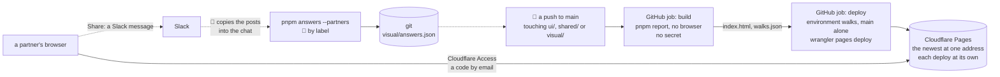

# Sharing the walks with partners, on Cloudflare

**Where it stands — 2026-10-29 01:13 +07:** the six calls are answered, all as recommended
([the human's calls](#the-humans-calls)); step 4's workflow is built, reviewed and read green under
`act`. Step 6's code is built and reviewed four times by Opus, fixed after each (10, 8, 5 and 3
findings); the reviews are done, and `main` is merged in. What is left is the human's round trip in Slack after the merge
and the deploy, and, once it is read, the real copy of Slack's text. The human's setup (step 3)
and its script wait for the latest point that needs them; step 7 is next.

> **Drafted** 2026-10-28 by the machine, on the human's ask at about 17:30 +07: "next, on the
> daily walks, how can I share with other partners? Since there're a lot of photo, I think of using
> these - R2 (from cloudflare) for photo storage - CF pages for static host. is it feasible? Will
> have another mechanism to remove old versions later", and its addition minutes later: "can we
> deploy via github action too? instead of running on local machine". **Amended** 2026-10-28
> 18:03 +07 on the human's further addition, at about 17:50: "I think we can add a share button for
> the human to copy raw text and share in markdown format (via slack). I will collect the format and
> send back to you" ([how partners answer](#how-partners-answer), step 6). It is the fourth stage
> of every piece for the walks page: partners check it without the source code.

## At a glance



Drawn from this plan; no code holds it yet.

| | Recommended | A month |
| --- | --- | --- |
| What a partner gets | the walks page of `main`'s newest change, at one address; no pictures ([call 1](#the-humans-calls)) | — |
| Where it lives | Cloudflare Pages alone: a run is 2 files and 1.5 MB, so R2 is not needed (call 2) | $0 |
| Who sees it | the partners listed in Cloudflare Access, each signing in by a code sent to their email (call 3) | $0 up to 50 people |
| Who uploads | GitHub Actions, on a push to `main` and on demand; the pictures stay in the human's terminal (call 4) | $0 |
| How partners answer | a Share button copies their answers as a Slack message; the human pastes the posts into the chat; `pnpm answers --partners` keeps each under the partner's label (calls 5 and 6) | — |
| Old versions | kept for now; the human's removal plugs in after the deploy ([retention](#retention-later)) | — |

- **There are no photos to store.** Today's walks page draws every screen itself, from the app's
  own code, so a run is one page and its data ([read](#read--10-28)). The pictures are the walk's
  base images, made on the human's Mac: 48 in git, 78 once the operator's walk lands.
- **The first piece on Cloudflare.** The app stays on AWS. This is a review page, on a second
  vendor whose account and token the human holds.
- **The human's part:** six calls, a setup of about 20 minutes once ([step 3](#steps)), a look at
  the first deploy, and one Slack post copied back ([step 6](#steps)).

## Read — 10-28

**The runs on disk.** The credo root's `walks/` holds eight folders, 12 MB. Each is two files:
`index.html`, the page, 1.47 to 1.52 MB with its script, styles, font and data inlined, and
`walks.json`, 20 to 36 kB. The newest, at 17:00 with the operator's walk (13 screens), is 1,520,013
and 35,955 bytes. The page loads nothing from elsewhere ([the visual report's row
7](2026-10-28-visual-report.md#the-case-table)) and holds no image: each screen is drawn in the
viewer's browser.

**The pictures are not in a run.** The walk spec, `walk/`, run by the human on the local stack,
compares each screen with its committed base. At `app-frame` there are 48 bases in
`walk/specs/piece-1.spec.ts-snapshots/`, 2.28 MB, 10 to 90 kB each (47 kB on average), each named
`-chromium-darwin`. On `ridge-app` the specs make 78 (piece 1's nine screens and the operator's
four, two languages, three widths), of which 48 are committed there; at the average, 78 come to
about 3.7 MB. A green run's Playwright report is one 530 kB file with no picture, since a passing
screenshot check attaches none. `pnpm visual`, the visual report's step 5, is not built: the walk
spec takes its place.

**Cloudflare's docs, read 10-28** (each page's "last updated" in brackets):

- **Pages:** 20,000 files a site on the free plan, 25 MiB a file, 500 builds a month, previews
  unlimited [limits, 09-05]. Wrangler's direct upload takes the same 20,000 files, and a
  direct-upload project can never switch to Git integration [direct upload, 04-21]. "Requests to
  static assets are free and unlimited" on every plan [Functions pricing, 09-08].
- **Addresses and Access:** each deploy gets `<hash>.<project>.pages.dev`, and the project's
  "Enable access policy" "will only protect your preview deployments" [previews, 10-12]. Known
  issues lists the steps that put the project's own `<project>.pages.dev` behind Access too, leaving
  two Access applications [known issues, 10-15].
- **The token:** a CI upload takes Account · Cloudflare Pages · Edit, with `CLOUDFLARE_API_TOKEN`
  and `CLOUDFLARE_ACCOUNT_ID`, and runs `wrangler pages deploy <dir> --project-name=<name>` [direct
  upload with CI, 09-18]. Pages Edit "grants access to create, edit and delete Cloudflare Pages
  projects", at the account's level; neither page offers a scope of one project [permissions,
  10-12]. Wrangler has `pages deployment list` and `pages deployment delete` [wrangler pages
  commands, 04-23].
- **R2:** free up to 10 GB-month, 1 M Class A and 10 M Class B operations a month; egress is free
  [pricing, 10-26]. `r2.dev` "is rate-limited and should only be used for development purposes";
  access controls such as Access need a custom domain, which "must have been added as a zone in the
  same account as the R2 bucket" [public buckets, 09-25]. A token scoped to some buckets is an S3
  key pair; wrangler's R2 permission covers the account [R2 tokens, 10-01].
- **Access:** the one-time PIN needs no identity provider; the code comes by email, works once and
  for 10 minutes, and goes only to an address a policy admits [one-time PIN, 08-31]. Zero Trust's
  Free plan: 50 users, $0 [plans page, undated]. Its onboarding still asks for "payment details",
  and "you will not be charged" on the Free plan [Zero Trust onboarding, 04-23].
- **GitHub:** "GitHub Actions usage is free for … public repositories that use standard
  GitHub-hosted runners" [Actions billing, undated].

**Slack's formatting, read 10-28** (neither page shows a date): Slack's markup is `*bold*`,
`_italic_`, `~strike~`, `` `code` `` and a code block between three backticks, "inspired by
markdown, but uses different rules"; it has no list syntax, and "Text within inline code blocks will
not use any other formatting" [docs.slack.dev, formatting message text]. `&`, `<` and `>` are its
control characters, colon codes become emoji, and plain addresses become links [same page]. With
the markup preference, "Formatting will be applied to messages after you send them", lists are not
formatted, and "Messages that you copy and paste will appear in plain text" [Slack help, "Set your
message formatting preference"]. Neither says whether a multi-line code block is left unformatted.

**Not read back:** whether Slack's composer renders markup that is pasted rather than typed, and
what a copy of a posted message gives back (step 6's round trip in Slack proves both); whether a
direct upload counts as one of the 500 builds (at about one deploy a
day, 30 of 500 either way); whether wrangler's `pages deploy` works when it is installed with
`--ignore-scripts` (step 5's run proves it); what wrangler prints, the account id among it (a
secret, so GitHub masks it).

## What a partner gets

**The walks page of `main`'s newest commit that changed a screen**, at the project's address,
`https://<project>.pages.dev/`: the same page the human answers on, with the map, each walk's
screens drawn at three widths in both languages, and the answers on record. Each deploy also keeps
its own address, `<hash>.<project>.pages.dev`, behind the same sign-in, so an older page is one
link from the Pages dashboard, which is the human's. Partners read the page the human reads,
buttons included. A block a partner copies goes to the human, who decides whether to paste it;
`pnpm answers` and `visual/answers.json` stay the human's, from the chat.

**No pictures** (call 1). The page already draws each walk screen at each width, in each
language, from the app's components with the mock's invented data. The bases show the same screens
from the live app on the local stack, also with invented data. Showing them would take a view the
page does not have, and either the Mac's bases copied from git or a browser and the whole stack on
the runner (the call's B and C).

## The hosting

**Pages alone** (call 2). A deploy is two files and 1.5 MB, against Pages' 20,000 files and
25 MiB a file; with the 78 pictures it would be 80 files and about 5.2 MB, still far inside. Pages
keeps each deploy whole at its own address, so nothing piles up against the file limit.

*Rejected:* Pages for the page and R2 for the pictures, the human's proposal. It fits the old app's
run, 104 images and 7.2 MB, but today's run has no image. *Its price:* a bucket, plus a way for the
page to reach it. `r2.dev` is rate-limited, meant for development, and cannot sit behind Access, so
the pictures would be public. A custom domain needs a zone the human holds on Cloudflare, and a
third Access application. A Pages Function bound to the bucket keeps one address behind one
sign-in, but it is code, and its requests count against Workers' free 100,000 a day. Each way also
adds R2's permission to the token, and wrangler holds that for the whole account. *Trigger to
revisit:* a deploy near 20,000 files or a file near 25 MiB, or pictures to keep across deploys.

*Rejected:* a path on ridge's CloudFront, the visual report's
[left-behind](2026-10-28-visual-report.md#left-behind). CloudFront has no sign-in of its own, so
"partners only" would be code, and the review page would ride ridge's deploys.

## Who can see it

**Cloudflare Access: a list of the partners' emails, each signing in by a code** (call 3). A
partner opens the address, types their email and pastes the code Cloudflare sends; an address not
on the list gets no code. There are two Access applications, as Pages' known issues set out: one
for the project's address and one for every deploy's own. The list lives in Cloudflare's dashboard
alone, never in git. It is free for up to 50 people. Zero Trust's onboarding takes a card and
charges nothing on the Free plan.

*Rejected:* public. Everything on the page is in the public repository already ([the visual
report's partners](2026-10-28-visual-report.md#partners)), but only as code; a public page shows
the human's product to anyone the link reaches, and to search engines. *Rejected:* an unguessable
address. The project's address is its name, a deploy's is eight hex digits, and a forwarded link
opens for anyone.

## The upload, from GitHub Actions

`.github/workflows/walks.yml` holds two jobs (call 4):

1. **build** holds no secret. It checks out, sets up Node 26 and pnpm 12, runs `pnpm install
   --frozen-lockfile` and `pnpm report`. On a runner git's common directory is the checkout's own
   `.git`, so the folder lands in the checkout's `walks/`, which `.gitignore` already leaves out.
   The job prints the folder's name and each file's size and SHA-256, and hands the folder to the
   next job as a run artifact kept one day.
2. **deploy** runs after build, in GitHub's environment `walks`, which admits `main` alone, one
   run at a time (`concurrency: walks`, where a newer run replaces a waiting one). Before the upload
   it fetches the project's address with no sign-in and stops unless Access refuses it. Then it
   installs wrangler at one exact version with `--ignore-scripts` and runs `wrangler pages deploy
   <folder> --project-name "$PROJECT" --branch main --commit-hash "$GITHUB_SHA"`, with
   `WRANGLER_SEND_METRICS=false`. Last, it reads back with the same token that the project's
   newest production deploy carries this commit, and that the new deploy's own address refuses a
   fetch with no sign-in. A refusal counts as a redirect to Access's sign-in on a
   `cloudflareaccess.com` address, whose team name it does not print; a 200 fails the job.

**Why two jobs.** The build runs the workspace's dependencies, their install scripts and Vite's
plugins, and any step can write into the job's environment for the steps after it. So the token
enters the deploy job alone, whose one third-party program is wrangler, installed without its
scripts, as the deploy job of `ci.yml` installs Bruno. *Price:* the run's artifact, the page, can be
downloaded for a day by anyone signed in to GitHub; it holds nothing the repository does not.

**When:** a push to `main` touching `ui/`, `shared/`, `visual/`, `pnpm-lock.yaml` or the
workflow itself, and `workflow_dispatch` on `main`. The human pushes only when needed, otherwise
once in the evening, so partners get the day's page about once a day. A change in `walk/` changes
no line of the page, so it starts no run.

**The token** is the human's alone: a custom token with Account · Cloudflare Pages · Edit, on the
one account, with an end date. Cloudflare offers nothing narrower, so it reaches every Pages
project in that account. It sits in the environment `walks` as `CLOUDFLARE_API_TOKEN`, beside
`CLOUDFLARE_ACCOUNT_ID` and `CLOUDFLARE_PAGES_PROJECT`. All three are secrets, so GitHub masks
each wherever it is printed, and none is in git, a log or the machine's context. Only the deploy
job's steps read them. The human sets them once with a one-off script ([step 3](#steps)), whose
`gh secret set` reads each value from the terminal. The environment follows ridge's ([deploys from
GitHub Actions](2026-10-28-ridge.md#deploys-from-github-actions)).

**Pins:** every action pinned by SHA with its version beside it, as
`.github/workflows/ci.yml` does, using the same SHAs for the actions both workflows use;
`persist-credentials: false`; `contents: read` and nothing more. Every step of the deploy job
carries `if: ${{ !env.ACT }}`, so `act` runs the build and skips the deploy, as the deploy job of
`ci.yml` does. The order is `actionlint`, then the human's `act`, then GitHub's run, which is the
verdict.

**The pictures stay in the human's terminal.** Call 4 reverses the visual report's [call
4](2026-10-28-visual-report.md#L519) for the page alone. No browser runs on the runner and the
runner takes no picture. Its token cannot push, so nothing it makes can become a base.

## How partners answer

**Share, beside "Copy my answers"** (step 6). A partner answers on the shared page as the human
does, types their label once (call 5), and presses Share; the page copies one Slack message. The
partner posts it, the human copies the posts from Slack into the chat and says they are partners',
and the machine runs `pnpm answers --partners` on them. "Copy my answers" stays as it is, for the
human, whose own block the machine takes with plain `pnpm answers`.

The message, a readable part for Slack, then the machine's lines in a code block at its end, the
existing block with one line more, `By:`:

````text
*Credo walks: answers from p1*
Build: main, commit 1a2b3c4d5
*1. Sign in* (Tiếng Việt): Yes
*2. Sign-in refused* (English): No. The message does not say what to do
```
Credo walks answers
Build: branch main, commit 1a2b3c4d5
By: p1
admin-setup:1-sign-in:vi | yes | 0123456789ab
admin-setup:2-sign-in-refused:en | no | 0123456789ab | The message does not say what to do
```
````

Each screen shows its number, its sentence and its language; the width is left out, since a
screen is answered once a language, whatever its width. **The fingerprints sit in the code block,
not inline**: Slack formats nothing inside code, so a key's colons are never read as an emoji code
and an underscore never as italics, and the readable lines carry no hex. *Rejected:* each line's
fingerprint inline in backticks: every readable line then carries a key and twelve hex digits. A
reason's backticks become `'` in both parts, so no reason closes the block. If Slack shows the
pasted marks as typed, the message still reads, and the lines below the title come back the same.

**`pnpm answers` takes both.** One paste may hold several blocks, each from its title line to
the next. Inside one, a line that starts like an answer, with a key and a bar, is held as today:
taken, or refused by its line number for a stale fingerprint, an unknown screen or language, a No
with no reason, or a form that does not parse. Every other line is skipped: Slack's names and
times, the readable lines, the fences. Today every line but the title, the build line and the
fences is refused (the visual report's [row 31](2026-10-28-visual-report.md#the-case-table),
amended so). A line that starts like an answer (a key, then a bar) before any title is refused, never
dropped, and so is a title with no answer line under it. **Whose a block is, the command decides,
never the paste, and the machine runs both modes:** the human hands over the partners' posts saying
they are partners', and their own block apart. Plain `pnpm answers` takes blocks with no `By:` line,
the human's own; a paste holding a partner's Share post, shown by any line that looks like a `By:`
mark (`by:`, `*By:*`, `> By:`, a zero-width character before it) or by Share's readable header
(`*Credo walks: answers from <label>*`), anywhere in it, writes nothing at all and says so in one
refusal naming `--partners`, so a mixed paste never reaches the human's key. A partner's "Copy my
answers" post, which has neither, beside the human's block is the hazard below. `pnpm answers --partners` takes
only blocks with one `By:` line, a label, before the block's first answer, and refuses every answer
of any other, of a block with a second `By:` line, and of one that follows a code fence's end with
its title lost, and any other `By:`-looking line inside a block spoils it. The page tells partners to use Share, and that "Copy my answers" is not for them.

**`visual/answers.json` keeps each source apart by its key.** The human's row stays
`<walk>:<screen>:<language>`; a partner's is `<walk>:<screen>:<language>@<label>`, with the same
four fields. A later answer from one label replaces that label's row alone, never the human's or
another partner's. Existing rows carry no label and read as the human's, so the file needs no
rewrite and its read needs no default. *Rejected:* a `by` field in each row, with a default at the
read for the rows that lack it: two partners' answers to one screen still need two keys, so the
field would repeat the key. The page shows the partners' answers under each screen, by label; the
human's alone marks the screen, counts in the bar and closes a walk (call 6).

## Retention, later

Every deploy stays at its own address until it is deleted, and the `walks/` folders stay on the
Mac until the human deletes them. The human's removal plugs in as one step after the deploy's
read-back: the same token lists the project's deploys (`wrangler pages deployment list`) and
deletes the older ones (`wrangler pages deployment delete`), keeping the newest. Nothing in this
plan stands in its way.

## What it costs

- **Pages:** $0; requests for static files are free and unlimited.
- **Access:** $0 for up to 50 people, with a card on file.
- **GitHub Actions:** $0 on this public repository.
- **R2:** not used.
- **Slack:** the human's own workspace; nothing new.

## The case table

👤 marks a business row, for the human's read ([QA](../conventions/qa.md) rule 1).

| # | 👤 | The case | Held by |
| --- | --- | --- | --- |
| 1 | 👤 | A listed partner opens one address, signs in with a code sent to their email, and sees the walks page of `main`'s newest commit that changed a screen | the human's look, step 5 |
| 2 | 👤 | Anyone not signed in gets no page, at the project's address or at any deploy's own | the deploy job's fetches, every run; the machine's fetch, steps 3 and 5 |
| 3 | 👤 | A push to `main` that changes a screen, a walk or an answer publishes its page, with no step of the human's | the workflow's `on`; GitHub's run, step 5 |
| 4 | 👤 | The Cloudflare token, the account id and the project's name are in no committed file, no log and not the machine's context | the environment's secrets; the run's log searched for them, step 5 |
| 5 | | The deploy publishes the folder the build wrote: the deploy job prints its files' sizes and SHA-256, equal to the build job's, and the project's newest production deploy names this commit | the deploy job's read-back; the run's log, step 5 |
| 6 | | The token is in the deploy job alone; the build job holds no secret | the workflow, read at review |
| 7 | | Only `main` deploys: the environment refuses another branch's run | the environment's rule, read back by the setup script |
| 8 | | A newer run replaces a waiting one, and two never deploy at once | `concurrency: walks` |
| 9 | | Under `act` the build runs and nothing deploys | the human's `act` log, step 4 |
| 10 | | The workflow changes no base, no `answers.json` and nothing in `walk/` | `contents: read`; no step writes them |
| 11 | 👤 | Beside "Copy my answers", a Share button copies the answers chosen on the page as one Slack message: each screen's number, sentence and language, Yes or No, a No's reason, and the machine's lines in a code block at its end | unit, `share.test.ts`, `page.test.tsx` |
| 12 | 👤 | Share asks once for the partner's label, keeps it in the browser, and gives no message without one, saying so | unit, `page.test.tsx`, `choices.test.ts` |
| 13 | 👤 | A Share message posted in Slack and copied back by the human is taken whole by `pnpm answers`, several posts in one paste: every answer, its label and its fingerprint | unit, `take.test.ts`, on a sample as we expect Slack's copy to give it (the marks dropped, the fences gone, a name and a time between posts, CRLF), swapped for the real copy after the human's round trip; read back, the human's round trip, step 6 |
| 14 | 👤 | Each partner's answer is kept under their label, beside the human's and every other partner's; a later answer from one label replaces only that label's | unit, `take.test.ts` |
| 15 | 👤 | Each screen shows the partners' answers by label; the human's yes or no alone marks the screen, counts in the bar and closes a walk | unit, `states.test.ts`, `page.test.tsx` |
| 16 | 👤 | "Copy my answers" and its block stay as they are, and its answers are the human's | unit, `block.test.ts`, `take.test.ts` |
| 17 | | A label is 1 to 20 lowercase letters, digits or hyphens; the page lowercases what is typed, and `pnpm answers` refuses any other, by line | unit, `share.test.ts`, `take.test.ts` |
| 18 | | A line that starts like an answer is taken or refused by line, and one before any title is refused; every other line is skipped, so Slack's names, times and readable lines never stop a paste | unit, `block.test.ts` |
| 19 | | A reason's backticks become `'` in the message, and its `&`, `<`, `>`, `*`, `_`, `~` and colon codes come back unchanged | unit, `share.test.ts`, `take.test.ts` |
| 20 | | Rows without a label, every row on record today, read as the human's, unchanged | unit, `answers.test.ts` |
| 21 | | A partner's answer whose words changed shows as asked again, and one whose screen left the walks as an orphan, as the human's do; neither counts in the bar | unit, `states.test.ts` |

## Hazards no gate catches

- **Access on the previews alone leaves the project's own address public.** The project's one
  switch covers previews only. *Guard:* the deploy job refuses to upload when the address answers
  an anonymous fetch with 200 (row 2).
- **The token reaches every Pages project in its account.** *Guard:* one permission, one account,
  an end date. If the human's account holds other Pages projects, a Cloudflare account for credo
  alone narrows it to this one. *Trigger to revisit:* Cloudflare offering a token scoped to one
  project.
- **The partners' emails are personal data.** *Guard:* they live in the Access policy alone, never
  in git, a log or a doc.
- **A label is not a sign-in**: a partner may type another's. *Guard:* the human sees who posted
  each message in Slack before pasting it.
- **A partner's answer must never read as the human's.** A block without `By:` is the human's, and
  a partner may press "Copy my answers" by mistake. *Guard:* the machine runs `pnpm answers
  --partners` on the posts the human hands over as partners', and plain `pnpm answers` on the
  human's own block, never one paste for both; plain mode writes nothing from a paste holding any
  `By:` mark, and `--partners` refuses a block with no `By:`; the page says "Copy my answers" is
  not for partners.
- **A paste from Slack carries the posters' names.** *Guard:* `pnpm answers` writes the labels
  alone; the pasted text stays in the machine's temporary folder, never in git or a doc.
- **A wrangler release changes what a deploy does.** *Guard:* one exact version, no install
  scripts, moved by hand under the catalog's rule (the newest release at least two weeks old).
- **Two branches append to `ops/test.sh`.** *Done:* the merge of `main` into this branch (10-29)
  kept both blocks. `ridge-app`'s guards also end the file, so the merge of the second into `main`
  conflicted there. `ridge-app`'s `!env.ACT` guard reads in
  its `ci.yml`, not in `walks.yml`.

## The human's calls

1. **What a partner gets.**
   - **A. The walks page alone.** *For:* nothing to build in `visual/`; the page already draws
     every screen at three widths in both languages. *Against:* a partner sees the screens as the
     page draws them, not the live app's pixels.
   - **B. The page plus the Mac's bases, copied from git at the commit.** *For:* no browser on the
     runner. *Against:* the page needs a link for each screen and width, with its rows and tests;
     the pictures are as of the human's last walk, and can be older than the page. 80 files and
     5.2 MB a deploy.
   - **C. Pictures taken on the runner.** *Against:* Go, the stack and Chromium on the runner, a few
     minutes a run, and pictures from Linux, whose font edges differ from the Mac's. They are kept
     apart from the bases by a picture folder outside the checkout, set for that run alone, and
     are never compared with a base or committed, since the runner cannot push.

   *Recommended:* A. *Trigger to revisit:* a partner asks for the live app's pictures; then B.

   *Answered* 2026-10-28 by the human: "yes to all", as recommended (A, the walks page alone).
2. **Where it lives.** *Recommended:* Pages alone. *For:* one service, one token permission, one
   address behind one sign-in. *Against:* pictures, if they come, ride in every deploy. *The other
   way:* Pages plus R2, the human's proposal, priced [above](#the-hosting).

   *Answered* 2026-10-28 by the human: "yes to all", as recommended (Pages alone).
3. **Who can see it.** *Recommended:* Cloudflare Access, listing the partners' emails, with a
   sign-in code by email. *For:* partners only, with no account to make, free up to 50 people.
   *Against:* a card on file with Cloudflare, and a code at each new session. *The other ways:*
   public, or an unguessable address ([who can see it](#who-can-see-it)).

   *Answered* 2026-10-28 by the human: "yes to all", as recommended (Cloudflare Access).
4. **Who uploads.**
   - **A. GitHub Actions, on a push to `main` and on demand** (the human's addition). *For:* no
     step for the human after the setup; the token lives on GitHub, not on the Mac; each day's
     `main` reaches partners by itself. *Against:* it reverses the visual report's call 4 for the
     page; a branch's page before its merge stays local; a token in the environment of a public
     repository.
   - **B. The human's terminal.** A one-off script deploys the newest `walks/` folder with wrangler
     and a token kept in a `secrets/` folder, which the machine's sandbox cannot read. *For:* any
     branch's page, whenever the human runs it; call 4 stands. *Against:* the human's minutes each
     time, wrangler and a token on the Mac.

   *Recommended:* A. A yes to calls 3 and 4 also puts one line under the visual report's calls 4
   and 5, saying this plan replaces call 5's channel and, for the page alone, call 4
   ([step 7](#steps)).

   *Answered* 2026-10-28 by the human: "yes to all", as recommended (A, GitHub Actions).
5. **Who answered: what a partner types.**
   - **A. A label the human gives each partner,** such as `p1`, typed once on the page. *For:*
     `answers.json` is committed to a public repository, and a committed file names no person
     ([documentation](../conventions/documentation.md#nothing-machine-local-or-personal-in-a-committed-file));
     the human knows who is who from Slack. *Against:* the human hands out the labels, and keeps
     who holds each outside git.
   - **B. The partner's name or initials.** *For:* nothing to hand out. *Against:* a person named
     in a public file, against the convention; initials still point at a person.

   *Recommended:* A.

   *Answered* 2026-10-28 by the human: "yes to all", as recommended (A, a label for each partner,
   never a name).
6. **What a partner's answer does.**
   - **A. Shown beside the human's, which alone decides.** A partner's "no" is the human's to turn
     into a case, or not. *For:* QA rule 7 stands: the human answers each screen for the business.
     *Against:* a partner's "no" holds nothing open by itself.
   - **B. Any "no", the human's or a partner's, holds the walk open.** *Against:* every partner can
     stop a merge; it amends QA rule 7, its human version too.

   *Recommended:* A.

   *Answered* 2026-10-28 by the human: "yes to all", as recommended (A, the human's answer alone
   decides).

## Steps

- [ ] **1. This plan.** Who: 🤖, 10-28. Done when: committed on `walks-share`; the path and name
  checks find nothing and every relative link resolves.
- [x] **2. The human's calls.** Who: 👤, 10 minutes. Done when: each call answered under it,
  dated. *Done* 2026-10-28: all six answered under their calls, each "yes to all", as
  recommended.
- [ ] **3. The human's setup, once.** Who: 👤, after calls 3 and 4 (the sign-in, and that GitHub
  uploads), about 20 minutes. In Cloudflare's dashboard:
  1. a Pages project by direct upload, named by the human, its production branch `main`, its first
     upload a one-line `index.html` that holds nothing;
  2. the machine fetches its address with no sign-in and reads 200, so the refusal it reads after
     the next step is Access's; that same fetch, through `ops/walks-refused.sh`, is the refusal
     check seen red on a public address that answers 200 (it is red there, and green after the
     next step);
  3. Zero Trust's Free plan (a team name and a card), the one-time PIN, and the two Access
     applications by the known-issues steps, each with one policy, the partners' emails;
  4. a token: Account · Cloudflare Pages · Edit, the one account, an end date.

  Then one script the machine writes, `$ROOT_DIR/one-off/<stamp>-walks-env.sh`, outside git: it
  makes GitHub's environment `walks`, admitting `main` alone, sets its three secrets from the
  terminal, and reads back the rule and the secrets' names into its log in `$ROOT_DIR/logs/`. Done
  when: the log names the rule and the three secrets, and no value; the machine's fetches of the
  address and of the placeholder deploy's own address are refused, each a redirect to Access's
  sign-in.
- [x] **4. The workflow.** Who: 🤖, after call 4 (it needs none of step 3), 1.5 hours. Done when:
  wrangler's version and each action's SHA read from their releases; `actionlint` clean; the
  human's run of the machine's script `$ROOT_DIR/one-off/<stamp>-act-walks-share.sh`, which runs
  `act push -W .github/workflows/walks.yml` in a fresh clone of the branch (a worktree's `.git` is
  a file that points outside what act copies, so `pnpm report` cannot find its repository there),
  its log `$ROOT_DIR/logs/walks-act.log` read whole: the build green, its folder named without
  `-changes`, its two files listed with sizes and SHA-256, the deploy skipped (row 9); reviewed by a
  model other than the author's ([QA](../conventions/qa.md) rule 5); committed on this branch. The
  refusal check seen red on a public address that answers 200 moves to step 3.2.
  *Built* 2026-10-28 18:50 +07: `.github/workflows/walks.yml`; its three guards
  `ops/walks-refused.sh`, `ops/walks-digest.sh` and `ops/walks-served.sh`, each case in
  `ops/test.sh` seen red once by breaking its rule; wrangler 4.151.0 (npm, 2026-10-14, the newest at
  least two weeks old), `actions/download-artifact` v8.0.2 (`9000827c`) and the three SHAs
  c-storage's workflow already pins, each read back from its tag; `actionlint` and ShellCheck
  clean. The folder line and the digest were read on a build of this tree whose folder was removed
  afterwards, so the act run is their evidence. pnpm 12.10.1 is the branch's `packageManager`.
  *Reviewed* 2026-10-28 by Opus (a model other than the author's), 13 findings, each tagged:
  - F1 [FIXED] `act` copies the worktree's `.git`, a file pointing under the repository's bare
    folder, absent in the container, so `pnpm report` fails at `git rev-parse --git-common-dir`:
    the script clones the branch fresh and runs `act` there.
  - F2 [FIXED] `deploy` had no Node, and wrangler 4.151.0 needs 22 or newer: `setup-node` at the
    pin the other workflows use, Node 26, before wrangler's install.
  - F3 [FIXED] only the environment's rule kept `deploy` to `main`, and a missing environment is
    made with no rules: the job carries `if: github.ref == 'refs/heads/main'`.
  - F4 [FIXED] the refusals' messages were not checked for what they must not print: every
    refusal case now captures standard output and error and finds no `://`, `pages.dev`,
    `cloudflareaccess.com` or `dash.cloudflare.com`; each check seen red by a message that leaks
    the location, the address or a dashboard link.
  - F5 [FIXED] `pnpm report | tee` had no `pipefail`: the step runs under `shell: bash`, which sets
    it (`bash -e` alone lets `false | cat` pass; with `pipefail` it stops).
  - F6 [FIXED] builds ran in parallel and only `deploy` was in the group, so an older push could
    deploy last: `concurrency: walks` moves to the workflow, so runs go in order and a newer run
    replaces a waiting one.
  - F7 [FIXED] the triggers lacked the root `package.json`, `tsconfig.base.json`,
    `pnpm-workspace.yaml` and `ops/walks-*.sh`: added.
  - F8 [FIXED] the 200 check was neither claimed nor left: it moves to step 3.2, where the
    placeholder's fetch reads 200.
  - F9 [FIXED] the comment that said the deploy is skipped under act is true now, by F3 off `main`
    and by each step's `!env.ACT` on it; its wording says so.
  - F10 [FIXED] `walks-served.sh` passed `--arg commit` to `jq` and never read it: removed.
  - F11 [FIXED] wrangler's dependencies floated in the job holding the token: the install adds
    `--before=` its publish time, read from the registry.
  - F12 [FIXED] the headers of `ops/test.sh` and of c-storage's `ops` job now list the three
    guards; the merge hazard with `ridge-app`'s `ops/test.sh` is in the hazards.
  - F13 [FIXED] the claim without a trace is reworded above: the act run is its evidence.
  *Done* 2026-10-28 19:31 +07: the human's run of the act script at `f6875ef`, 36 s, green and read
  whole (`logs/walks-act.log`, 85 lines): `build` "Job succeeded" (L85), every step green; the
  install by pnpm 12.10.1 (L51 to L65); `pnpm report` named the folder
  `2026-10-28-192953-f6875ef43`, without `-changes` (L71 to L73); `index.html` 1,504,905 bytes and
  `walks.json` 25,068 bytes, each with its SHA-256 (L74, L75); `deploy` printed no line, skipped by
  its job-level `if` off `main`; no wrangler, Cloudflare or `pages` command ran, and no account id,
  address or key is in the log. The one "error" line, "Non-terminating error while running 'git
  clone'" (L11), is act's own, in Set up job, which succeeded.
- [ ] **5. The first deploy.** Who: 👤 pushes `main` after the merge, by a one-off script the
  machine writes that follows GitHub's run and saves its log, as ridge's pushes do; after steps 3
  and 4 (the environment and its secrets; the workflow). Done when: GitHub's run green and its log
  read whole: the folder and its two files, wrangler's upload, the read-back naming the commit,
  both refusals, and no secret's value, each masked; the machine's own fetches refused; the human
  opens the address, signs in by code, sees the page naming `main`'s commit, and says yes (row 1).
- [ ] **6. Share, and `pnpm answers` by label.** Who: 🤖, after calls 5 and 6 (the label, and what
  an answer does), 3 hours; 👤 one round trip in Slack, 10 minutes, after the deploy that carries
  it. The page's Share and label field, `pnpm answers` reading both blocks, the labelled keys, and
  each screen showing the partners' answers; the model files are `visual/src/block.ts`,
  `take.ts`, `send.tsx` and `choices.ts`. Done when: `pnpm check` green, `visual/` at 100 %, knip
  silent, no warning; rows 11 to 21 each held by a test seen red once by breaking its rule; `pnpm
  report` read back by a jsdom run of the page's script: a label typed, two answers chosen, Share's
  message equal to the clipboard's, and "Copy my answers" giving the block it gives today;
  reviewed by a model other than the author's ([QA](../conventions/qa.md) rule 5); committed on
  this branch. Then, after its merge into `main` and that push's deploy: the human answers two
  screens on the shared page under a label, posts the message in a Slack channel, copies it back
  into the chat, and `pnpm answers` takes both answers, refusing none (row 13).
  *Built* 2026-10-28 19:46 +07, and fixed after the review below: `share.ts` (the message and the
  label), `block.ts` (a `By:` line, several blocks, the skipped lines, whose block it is), `take.ts`,
  `answers.ts`, `states.ts`, `report.ts`, `choices.ts`, `send.tsx` (the label field and Share),
  `screen.tsx` (the partners' lines) and `cli.ts` (`--partners`). Rows 11 to 21 are each held by a
  test in `visual/`, each seen red by breaking its rule once, the failing test named:
  - 11: Share's code block dropped, red in `share.test.ts` "The message reads for Slack, then holds
    the machine's lines in a code block at its end", `choices.test.ts` and the two mounted-page
    runs; the reviewer's 8 further mutations of it were all red.
  - 12: no label required, the label not kept, red in `page.test.tsx` "Share asks once for the
    partner's label".
  - 13: the label lost, names and readable lines not skipped, a block not closed, each red in
    `take.test.ts` "A Share message posted in Slack and copied back"; the reviewer's M13a, c, e and
    f red, and M13b and d (CRLF) equivalent, handled by the split and the trim.
  - 14: the label dropped from the key, red in `take.test.ts` "A partner's answer is kept under".
  - 15: partners not shown, a partner's orphan counted, a partner's yes settling the card, red in
    `states.test.ts`, `report.test.ts` and `page.test.tsx` "A screen every partner answered yes".
  - 16: "Copy my answers" using Share's message, red in `page.test.tsx` and the mounted runs.
  - 17: a longer label, a label allowing `@` or `:`, a label not lowercased, red in
    `block.test.ts` "A label is 1 to 20 lowercase letters, digits or hyphens" and `share.test.ts`.
  - 18: a line before a title taken, other lines refused, red in `block.test.ts`.
  - 19: backticks kept, red in `share.test.ts` "A reason's backticks become a quote".
  - 20: a label required on every row, red in `answers.test.ts`.
  - 21: a partner's orphan unknown, red in `states.test.ts`.
  `pnpm check`'s visual part green: `visual/` at 100 %, knip silent, no warning. The mounted page's
  script runs in jsdom twice: `main.test.tsx` on the app's own mount, and `built-page.test.ts` on
  the script of a built `index.html` (run as a classic script after the page is parsed, since jsdom
  runs no module): a label typed, two answers chosen, Share's message equal to the clipboard's and
  to the text shown, and "Copy my answers" giving the block with no `By:` line.
  *Reviewed* 2026-10-28 by Opus (a model other than the author's), partly (39 of 57 mutations),
  10 findings, each tagged:
  - F1 [FIXED] a partner's answer could decide a walk: a block without `By:` was the human's, so a
    partner's "Copy my answers" block pasted beside a Share post overwrote the human's yes, and a
    late or early `By:` mis-attributed answers. Now the command decides whose a block is: plain
    `pnpm answers` takes only blocks with no `By:`, `pnpm answers --partners` only blocks with a
    valid `By:` before their first answer; each refuses the other's, answer by answer. The page's
    how-to says partners use Share and "Copy my answers" is the human's; a hazard says so. Reds:
    each of the three rules broken once.
  - F2 [FIXED] rows 11 and 13 cited "the module absent", which holds nothing: the reds named above.
  - F3 [FIXED] nothing failed if a partner's yes settled a card: a fixture with a partner's yes in
    both languages and no human answer; red when it does.
  - F4 [FIXED] row 17's bad labels lacked `@` and `:`: added; red when the label allows them.
  - F5 [FIXED] a mangled line vanished or was taken with a tail: a no-break space, a `> ` prefix, a
    fence glued to either end and `(edited)` are cleaned before matching, and a title with no
    answer line under it is refused; each red when removed. The real Slack copy settles which
    happen.
  - F6 [FIXED] a chat name such as `Jane | Acme` was refused: a line starts like an answer only
    with a key, `walk:screen:language`, before its bar; red with the old pattern.
  - F7 [FIXED] a real first name stood in two committed tests: an invented name. The rest of the
    diff and the commit messages name no one.
  - F8 [FIXED] (a) the jsdom run of the built page: `built-page.test.ts`, red when Share drops the
    `By:` line; (b) the shown text is read and equals the clipboard's; (c) row 13 says "as we
    expect", to be swapped for the real copy after the round trip.
  - F9 [FIXED] `heldFor(answer, words): Held` types "waiting" away, so no cast and no case that
    `partnerLine` lacks.
  - F10 [FIXED] the textarea is labelled "The text to paste" and its button "Hide the text", and
    `cli.ts` says the human pastes blocks, partners' Share posts with `--partners`; the `ui/`
    advisory (jsdom created 14 times) is not from this work and is left.
  Left: the human's round trip after the merge and the deploy, with the real copy of Slack's text.
  *Reviewed again* 2026-10-29 by Opus (a model other than the author's), on the fix above, 8
  findings, each tagged; *fixed* 2026-10-29 00:35 +07 by the author:
  - G1 [FIXED] the late `By:` after an answer was unpinned in plain mode: red when the late
    `spoiled = true` is removed, in `block.test.ts` "A By: line after an answer spoils a block that
    had its label before" and, for plain mode, "...in the human's own paste is a partner's mark
    too" (red when plain mode's whole-paste refusal is removed).
  - G2 [FIXED] plain `pnpm answers` on a mixed paste wrote every no-`By:` block: it writes
    nothing from a paste holding any `By:` mark, with one refusal naming `--partners`; red in
    `take.test.ts` "...plain writes nothing at all, --partners takes the partner's alone" and
    `cli.test.ts`. [REJECTED] the page refusing "Copy my answers" once a label is kept: the
    human's own browser may keep a label from trying Share, and the whole-paste rule holds a mixed
    paste already.
  - G3 [FIXED] plain mode knew a partner's block by the exact prefix `By:`: now any line matching
    `/^\W*by\s*:/i` after zero-width characters go, answer lines excepted; nothing the human's block
    or Share's readable part prints matches; red in `block.test.ts` "Any line that looks like a
    By: mark" with the strict prefix, and "Nothing the human's own block prints looks like a By:
    mark" with the broad one on answer lines.
  - G4 [FIXED] `--partners` was parsed in `run.mjs`, outside coverage: `parseArgs` in `cli.ts`,
    tested flag first, last and absent; red in `cli.test.ts` "reads the command and the file, and
    --partners wherever it stands" with the flag read as `false`. `run.mjs` stays a bare entry and
    is excluded in `vitest.config.ts` with its reason.
  - G5 [FIXED] a second `By:` line spoils the block (red in "A second By: line spoils the block"
    with each `spoiled = true` removed, `By: P1` then `By: p1` included). A code fence's end now
    ends a block, so a post whose title and `By:` were lost behind a fence no longer joins the one
    above (red in "A code fence's end ends the block"). [DEFERRED] the same loss without a fence,
    where only a chat name-and-time line stands between: no sound pattern for it before the real
    copy of Slack's text is read, to `docs/open-items.md` #16.
  - G6 [FIXED] the how-to said "the human's own", a word partners do not know: "“Copy my answers”
    is not for partners"; red in `page.test.tsx` "The page says at its top how to answer".
  - G7 [FIXED] `cleaned` took U+00A0 alone for a space: every non-newline space is one, and
    U+200B and U+FEFF go, in the precheck too; red in "Reads an answer line whose only signals are
    mangled" with each removed and with the precheck on `trim()`.
  - G8 [FIXED] the drift: this section, who runs which mode (the machine runs both, the human
    hands over the posts saying whose they are: the hazard, "How partners answer", the visual
    report's recipe), the key's shape (the pattern needs the three parts; red in "A key has three
    parts" with the old pattern), the table and diagram naming `--partners`, and two cosmetic
    lines.
  *Reviewed a third time* 2026-10-29 by Opus, on that fix: ready to merge, 5 Low findings; *fixed*
  2026-10-29 by the author:
  - H1 [FIXED] a reason ending in triple backticks cut the human's block short at the fence
    boundary: `blockText` turns every backtick into a quote; red in `block.test.ts` "A reason with
    a code fence in it is written with quotes" with the replacement removed.
  - H2 [FIXED] a Share post that kept its readable header and lost its `By:` was the human's in
    plain mode: the header is a partner mark; red in "A partner's Share post that kept its
    readable header" with the header dropped from the marks.
  - H3 [FIXED] the `run.mjs` exclude did nothing: dropped, and an `untested:` comment beside
    `include` names what stays in `run.mjs`.
  - H4 [FIXED] a second `By:` written another way was missed in `--partners`: any `By:`-looking
    line inside a block that is not exactly `By: <label>` spoils it; red in "A second By: line
    written another way" with the old prefix test.
  - H5 [FIXED] "Where it stands" says the reviews are done; the mangled-title check in G7's test
    is inside an `expect`, red from its assertion with the precheck on `trim()`; the test of
    what the human's block prints is cut to what it prints.
  *Reviewed a fourth time* 2026-10-29 by Opus, on the merge of `main` (`fee6f72`): ready to squash
  into `main`, no blocker, the four conflict resolutions sound, 3 Low items; *fixed* 2026-10-29 by
  the author:
  - I1 [FIXED] the "written another way" branch was held by no test: a `--partners` case with
    `by: p1` and `By : p1` as the block's first `By:`; red in `block.test.ts` "A first By: line
    written another way" with the branch turned off.
  - I2 [FIXED] the refusal's reason now says "is written another way"; open item 16 names the
    case it does not cover, a chat line starting `by:` spoiling a valid block if Slack's copy loses
    the fences (loud, nothing misattributed, waits for the real copy).
  - I3 [FIXED] the plan's "c-storage's deploy job" now names `ci.yml`, and the hazard of two
    branches appending to `ops/test.sh` is marked done.
- [x] **7. The pointer line.** Who: 🤖, after the yes to calls 3 and 4, 5 minutes. Done when: one
  line under the visual report's calls 4 and 5 points here, committed on this branch.
  *Done* 2026-10-29 01:13 +07: the line stands under call 5's answer in
  `docs/plans/2026-10-28-visual-report.md` (its anchor `#the-humans-calls` resolves to the heading
  of this plan's calls); calls 3 and 4 were answered as recommended 10-28, read in this plan's
  [calls](#the-humans-calls).

**Then stop.** After step 6. Step 6's code takes the first free slot after calls 5 and 6; its
round trip waits for step 5's deploy. Step 7 takes the first free slot after the calls.

## Left behind

Each until something calls it.

- **Pictures for partners:** call 1's B or C.
- **A branch's page before its merge,** at `<branch>.<project>.pages.dev`: until the human wants
  partners to see a piece before it merges; then the environment admits that branch.
- **An address of the human's own:** until it is wanted; then a zone on Cloudflare and a third
  Access application.
- **Removing old deploys:** the human's, [later](#retention-later).
- **A service token for the workflow to read the served page:** the read-back of the commit and
  the human's look hold it; until a deploy serves an older page unnoticed.
- **R2:** [the hosting](#the-hosting) says when.
