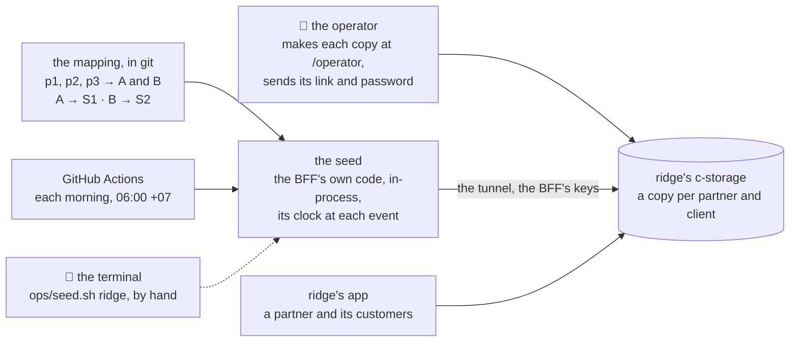

# Demo seed on ridge: scenarios per client, partners mapped to clients, a day added each morning

**Where it stands — 2026-10-29 16:44 +07:** decided; steps 1 to 6 are done, and step 7 is written, its full gates owed.
`ridge_cli seed`, `ops/seed.sh`, `.github/workflows/seed.yml` and the runbook's section exist; the
`scripts/` tests (`ridge-seed.test.ts`, `ridge.test.ts`) and the workflow's guards are seen red, then
green; `ops/test.sh` (the whole run of `seed.sh`, rows 7 and 23), `pnpm check` and the human's `act`
run are still to come ([step 7](#order)). This branch sits on piece 2's `caa52d7`; piece 2 gains a fix
pass, so it rebases again ([order](#order)).

> **Drafted** 2026-10-29 by the machine, on the human's ask of 13:0x +07
> ([the need](#the-need)), from [the big picture](2026-10-27-big-picture.md),
> [the architecture](2026-10-27-architecture.md), [the app frame](2026-10-27-app-frame.md),
> [ridge](2026-10-28-ridge.md), [ridge-app](2026-10-28-ridge-app.md),
> [ridge's tunnel](2026-10-28-ridge-tunnel.md), [the parked URL plan](2026-10-28-ridge-url.md),
> [the walks shared](2026-10-28-walks-share.md), [the open items](../open-items.md), `scripts/`,
> `shared/`, `bff/` and `ops/` on `main` at `f8c85e6`. It builds on three plans not in `main`, named by
> branch: piece 2 (`employee-list` at `6f370cf`: its data set, its generator through the BFF's routes,
> its seed door, c-storage's list), the operator's dashboard (`operator-dashboard`: the clients
> listed, `madeAt`) and the operator console (`operator-console`: operators sign in by passkey alone,
> a sign-in ending an hour after its last use).
>
> **Decided** 2026-10-29 13:28 +07: the human's answers of 13:2x +07 to the five calls, two
> scenarios and a week of history in place of six and 30 days, and the mapping started on them
> ([partners and clients](#partners-and-clients)). Rebased the same minute onto piece 2's `caa52d7`
> (step 3), so the code linked below is that commit's.

## At a glance

Drawn from this plan; no code holds it yet.

| The question | The answer here |
| --- | --- |
| What is a scenario? | a kind of company (trade and size) whose data each piece's generator draws: staff now, goods and orders as their pieces land. Two to start: building materials and drinks wholesale ([scenarios](#scenarios)) |
| Two partners on client A? | each gets its own copy, so one's customers never meet the other's ([copies](#partners-and-clients)) |
| What grows, and when? | the last week at the first fill, then each day by 06:00; the same day gives the same data, and a re-run adds nothing ([increments](#increments)) |
| How does it reach ridge? | the product's own BFF code run by the script, through the tunnel the deploy's check already opens ([the way in](#how-the-data-reaches-ridge)) |
| Who signs in? | the partner as each copy's root, given privately by the human; customers as the partner chooses ([sign-ins](#sign-ins)) |
| What does it cost? | $0 a month: no AWS resource, no change set, GitHub's runs free ([cost](#what-it-costs)) |

**The human's five calls, answered** ([below](#the-humans-calls)): two scenarios and a week of
history; a copy per partner; the operator makes each copy; the daily run in GitHub Actions; started
now on piece 2's branch. About 2½ machine days and 45 minutes of the human's, an estimate, not a
date.

## The need

The human, 2026-10-29 13:0x +07: "and one more thing: seed data generator — we'll use ridge env to
demo to varios partners, each will sell to a group of customers — so, plz help me prepare a
mechanism to generate seed data for them (multiple scenario, increasementally). For example:
Partners 1 will use 3 clients, A, B, C, each have a specific kind of data; Partners 1 will use 2
clients, A, D; Partners 3 will use 4 clients, C, D, E, F. And we need daily script to add new data
for them". The second "Partners 1" is read as partner 2. Partners are labels, `p1`, `p2`, never
names ([the walks shared, call 5](2026-10-28-walks-share.md#L395)).

The callers: the human, who keeps the mapping and makes the copies; the morning's run; partners and
their customers, who only sign in. Nothing is built for any other.

## What exists today

| Part | Today | Where |
| --- | --- | --- |
| The local stack's data, piece 2's (`main` still makes `demo` from fixed constants) | one fixed data set, `@credo/shared/demo`, that the fake and the stack share; the stack's client `demo` made from it through the BFF's own routes, in-process, signed in as its root; a loopback door, `POST /seed`, making a fresh `walk-N` client per walk screen | [`generator.ts#L50`](../../scripts/src/generator.ts#L50), [`stack.ts#L127`](../../scripts/src/stack.ts#L127), [`seeding.ts#L18`](../../scripts/src/seeding.ts#L18) |
| A client made on ridge | by the operator at `/operator`, or by each deploy's check through the tunnel, with the BFF's service and keys read from the box | [`check.sh#L148`](../../ops/check.sh#L148), [`ridge.ts#L76`](../../scripts/src/ridge.ts#L76), [`lib.sh#L608`](../../ops/lib.sh#L608) |
| The BFF's clock | an argument of `buildApp`, so a caller in-process sets the time each record is stamped with | [`app.ts#L54`](../../bff/src/app.ts#L54) |
| Sessions | the BFF's own `createSessions`, which issues and ends them | [`sessions.ts#L33`](../../bff/src/sessions.ts#L33) |
| ridge's rule | invented data alone; the BFF's key prefix the only wall between its tenants; codes guessable, the root's password the wall | [ridge-app#L463](2026-10-28-ridge-app.md#L463), [#L127](2026-10-28-ridge-app.md#L127), [#L866](2026-10-28-ridge-app.md#L866) |
| A schedule | none anywhere: the deploy runs on a push to `main` alone, in environment `ridge`, group `ridge` | [`ci.yml#L216`](../../.github/workflows/ci.yml#L216) |
| Partners | labels in `visual/answers.json`, Cloudflare Access for the walks page; nothing on ridge knows them | [walks shared](2026-10-28-walks-share.md#who-can-see-it) |

Nothing knows a scenario, a partner or a day: every date in the data set is fixed, so the demo
ages from the day it is made.

## Scenarios

**A scenario is a kind of company: a trade and a size.** It is a profile, data alone: headcount,
departments and positions, who signs what, its rates of hires and leavers; later its goods, its
suppliers and customers, its orders a day. **A piece is a generator**, code that reads every
profile: staff now (piece 2), then goods and stock (3), receipts (4), orders (5), delivery notes
(6). A new scenario is one profile; a new piece is one generator and one block in each profile.
Each piece's plan adds its block to every chosen scenario as part of its own done-when, as piece 2
adds to the data set.

**Two to start** ([call 1](#the-humans-calls)), invented companies of the big picture's market,
SMEs that deliver goods ([the goal](2026-10-27-big-picture.md#the-goal)). Six were proposed; the
other four wait in [left behind](#left-behind) for the human to add.

| # | Trade | Staff | Its people | Later: goods, a day's work (drafts each piece's plan confirms) |
| --- | --- | --- | --- | --- |
| S1 | Building materials (vật liệu xây dựng): cement, steel, brick, sand to builders | ~45 | a sales office, a yard, truck drivers with class C licences | ~60 items by bag, tonne, thousand bricks, m³; 2 receipts a week, ~10 orders, trucks of 1 to 3 drops |
| S2 | Drinks and household goods (đồ uống, hàng tiêu dùng) to grocery shops | ~60 | sales reps on routes, a warehouse, van and motorbike drivers | ~250 items by carton; a receipt a day, ~30 small orders, many drops a route |

**Why these two** (the machine's pick; the human may swap either): both sit near the big picture's
50 staff, and they sell and deliver most differently, a few heavy truck loads by bag and tonne
against many small cartons on motorbike and van routes, so every later piece shows both shapes.

- **Each client is one invented company of one scenario:** its name, colour and logo, and its own
  random stream. Two clients may share a scenario (two drinks wholesalers), and differ in every
  person.
- **Every record goes through the shared schemas:** each generator's output is typed by
  `@credo/shared` and parsed with the schema the BFF reads it with, as piece 2's fake answers are.
- **The walks' data set stays apart.** `@credo/shared/demo` is fixed, so each walk's picture never
  moves; a scenario's data moves every day. They share the schemas and the way records are written
  (through the BFF's routes, [below](#how-the-data-reaches-ridge)), never the data. *Rejected:* the
  data set as one scenario's first day, where each change to a scenario would move every walk's
  pictures and ask them again. *Rejected:* a scenario in the fake (`?fake&scenario=`): nothing calls
  it now. *Trigger:* the human wanting to preview a scenario without the stack.
- **Where:** `scripts/src/demo/`, beside its one caller. *Rejected:* a subpath of `shared/`: the
  profiles and generators are the scripts' alone, and the data set's subpath is the fake's too.
- **Never real** ([the big picture's never](2026-10-27-big-picture.md#L141)): names built from common
  parts, never a known business; phone numbers from one invented range, emails at `example.com`,
  plates and tax codes invented. The human reads every company name at step 6.

## Partners and clients

**The mapping**, one typed file in `scripts/src/demo/`: each client by its letter, with its
scenario, its company and its copies; each copy a partner's label and a code. Committed: it holds
labels and codes alone, and the labels are already public in `visual/answers.json`. The label to a
partner's name stays the human's, outside git. A test holds it: codes valid and unique, every
scenario named exists, labels by the walks' rule ([row 17](2026-10-28-walks-share.md#L315)).
*Rejected:* the mapping in a GitHub variable: not reviewed, not tested, and edited in a web form.

**Two partners naming A get two copies** ([call 2](#the-humans-calls)). Each copy is a client on
ridge of its own, with its own code and root. Every copy of A is the same company with the same
people and days, because A's stream is keyed by A, not by the copy; they differ in ids, passwords
and whatever their own users did. *Rejected:* one shared A. A customer of p1 who archives a person,
changes a password or confirms an order changes p2's demo too, mid-meeting.

**How the mapping starts:** A is S1 and B is S2, and each of the example's partners, p1, p2 and p3,
gets a copy of both: six copies. Trimming the example to two letters would leave p3 with none and
p2 with one; the human edits the mapping as the real partners and their letters come.

**Codes:** the company's name without marks, then the copy's number: `<company>-1`, `<company>-2`,
written in the mapping once and fixed, as every code is ([ridge-app](2026-10-28-ridge-app.md#the-operator)).
Never the partner's label: a customer sees the code in the link. Names and codes are drafted at
step 4 and read by the human at step 6.

## Increments

- **A day's events are a pure function** of the client, its scenario and the date: a seeded stream
  from SHA-256 of those three, no new dependency. The same day gives the same events, on the Mac and
  on GitHub's runner.
- **Days are Vietnam's** (+07). A day's events carry times between 07:30 and 17:30 and none on
  Sundays. The BFF's clock is set to each event's time, so a record is stamped when it happened.
- **The first fill:** the company's settings (name, colour, logo), its staff setup, its people as
  they stood a week ago (start dates spread over the years before), then each of the last 7 days.
  The reach is call 1's answer.
- **Each run** applies every day after the copy's last, up to yesterday. A missed run is caught up
  by the next; at most 30 days at once, beyond which the copy is reported and left.
- **The ledger:** one record per copy, `tenant.<id>.seed`, holding its scenario, its first day and
  its last day applied, moved with its tag after each day. It is the seed's alone: the BFF never
  reads it, and it sits outside every list the BFF reads. Its key joins `recordKeys`, the layout's
  one home ([`records.ts#L6`](../../shared/src/records.ts#L6)).
- **Nothing twice:** a day is applied before the ledger moves past it, and each event names its
  record by a key the product keeps unique: a person's code now, a document's number later. A second
  add is then the product's own 409, read as "already there". Two runs at once: the ledger's tag
  stops the second for that copy.
- **What its users changed wins:** an event whose target they changed or removed (a person already
  archived, a department deleted) is skipped and named in the log, never forced back. Only that 409
  or 404 is a skip; any other answer stops the run red.
- **What grows a day, now (piece 2):** a hire or a leaver about every 10 working days in S2 and
  every 15 in S1; headcount stays near its size. A week's fill holds one such event at most, so the
  staff's start dates carry the history. The later columns of [the scenarios](#scenarios) are
  drafts.
- **A list's ceiling:** c-storage answers at most 1,000 records a list, and the BFF answers 500 past
  it rather than show a part ([the memo](../memo/c-storage.md#L42)). Staff stay far below it
  (about 60 plus 20 a year, those who left included). Orders at 30 a day pass it in a month, so a
  list that grows daily needs a period or a page in its key before its scenario block is added: an
  input to pieces 4 to 6. A test holds that no list of any scenario passes 500 within 365 days.
- **A reset** of a copy is *not yet*, by call 3's answer O ([call 3](#the-humans-calls)): a
  messed-up copy is replaced by a new one under a new code, and the old one is dropped from the mapping. It stays on ridge, a
  few hundred records, unread.

## How the data reaches ridge

ridge's c-storage listens on the box's private address, with no internet route; the BFF reaches it
inside the subnet, and the tunnel through the Instance Connect Endpoint, in an AWS session.

| Way | For | Against | Verdict |
| --- | --- | --- | --- |
| A. The product's API over HTTP, through CloudFront | the real path, end to end | making a client needs an operator's session, and operators sign in by passkey alone (the console's row 7, `operator-console`), which no script holds; a client's data needs its root's password, which its users change; every record stamped now, so no history; the API's throttle, 10 a second | rejected |
| B. c-storage directly, records written by key with the BFF's service key | the fewest calls | no rule of the product holds on the data (codes, versions, permissions, the code's index); each piece's record layout copied into the seed, the copy that rots | rejected |
| C. The stack's seed door, `POST /seed` | built (piece 2) | a loopback door of `pnpm stack` alone; on ridge it would be a new route behind CloudFront | rejected for ridge |
| **D. The BFF's own code run by the script** (`buildApp` and `inject`, piece 2's generator), over the tunnel, with the BFF's keys read from the box | every rule of the product holds; the clock is the script's, so history is stamped right; the tunnel, the keys' read and the scripts' runner exist (the check makes a client this way); no new key, route or resource | the script runs the commit it holds, so it must be the one ridge runs (below) | **recommended** |

- **Signed in without a password:** the seed issues the root a session with the BFF's own
  `createSessions`, as the sign-in would, and ends it when the run ends. It holds the BFF's service
  key for the run, which already writes any record, so it gains nothing a password would give.
  *Rejected:* a seed user in each client, seen in its staff and its sign-ins.
- **Only a fresh client is filled:** a mapped code with no ledger is filled only if it holds what
  the operator's create left and nothing else (piece 2's list by prefix reads it); otherwise it is
  refused, named, and left. A code not in the mapping (`check-…`, `acme`) is never read.
- **One commit:** `/health` through the tunnel must name the seed's own commit, or nothing is
  written. *Why:* records written by one commit's code are read by another's BFF; a deploy ships
  c-storage, the BFF and the UI under one commit ([ridge-app row 27](2026-10-28-ridge-app.md#L478)).
- **The box first:** the run reads its disk and memory and refuses below the release's floor
  ([collaboration](../conventions/collaboration.md#L65), [`lib.sh#L474`](../../ops/lib.sh#L474)).
- **Not the parked URL:** that URL is for a caller with no AWS session. GitHub's runner here holds
  the deploy role's, and reaches the box through the tunnel as each deploy's check does, so open
  item 13 stays parked ([the parked plan](2026-10-28-ridge-url.md#L6)).
- **Who runs it:** `ops/seed.sh ridge`, one page as `operator.sh` is, on port 3195. GitHub's run
  each morning; the human's terminal from a worktree at `main` while Actions is down, or for a copy
  just made. It calls `ridge_cli seed`, which runs without the job's credentials
  ([`lib.sh#L595`](../../ops/lib.sh#L595)). It prints codes, days and counts, never a key, address
  or password, and searches its log for the keys as every `ops/` script does.

## The daily run

| Where | For | Against |
| --- | --- | --- |
| **GitHub Actions, a schedule at 23:00 UTC (06:00 +07) and a manual run, environment `ridge`, the deploy role** | $0 on this public repository; no AWS resource, change set or new right: the deploy's check already opens the tunnel and reads the keys under this role; the role's trust names the environment, whatever started the run ([ridge#L308](2026-10-28-ridge.md#L308)) | a daily job under the role that releases ridge; its log is public; GitHub delays or drops scheduled runs when busy, and disables them after 60 days without activity on a public repository |
| An AWS schedule calling a function in ridge's subnet | inside AWS, no runner | a function, role and schedule in `env.yml` (the human's change set); the keys copied into a second function; the generators inside a deployed bundle, which piece 2 keeps the data set out of; a failure posts nowhere, with no internet route (open item 1) |
| The human's Mac, at a fixed hour | the human's own session | an AWS session each morning and the Mac awake; it is the by-hand fallback, not the schedule |

Recommended: GitHub Actions ([call 4](#the-humans-calls)). Its shape:

- `.github/workflows/seed.yml`: `schedule` and `workflow_dispatch`, `main` alone, environment
  `ridge`, `id-token: write` in this job alone, `!env.ACT` on every step, no `continue-on-error`;
  checkout, Node, pnpm install (before the role), the role, `bash ops/seed.sh ridge`. `ops/test.sh`
  reads it as it reads `deploy`.
- **Its own concurrency group, `ridge-seed`, never `ridge`.** A run waiting in a group replaces the
  one waiting before it, so a seed queued in `ridge` would cancel a waiting deploy. A seed that
  overlaps a release meets about a second of 503s and ends red; the next run catches the day up.
- **Its log:** GitHub's run log, public: codes, days, counts, the commit, the box's floor read. A
  by-hand run logs to the credo root's `logs/`, as every `ops/` script.
- **A failure reaches the human** by GitHub's own notice of a failed scheduled run, sent to whoever
  last changed the cron line (not read today), and by the morning's board, one plain line when the
  last run is red or its last green is older than two days.
- **The human sets up once:** nothing in AWS or GitHub's settings; GitHub's notifications for
  Actions left on. *Price:* the run's minutes, about five a day.

## Sign-ins

| Who | Gets | From | How | Never |
| --- | --- | --- | --- | --- |
| the human, the operator | its own sign-in (a passkey, after the console lands) | itself | — | given to anyone |
| a partner | for each of its copies: the link, `root`, its first password | the human, from `/operator`'s "shown once" ([call 3](#the-humans-calls)) | one private message to that partner, never the channel where Share posts go | another partner's copies |
| a partner's customer | the link and a sign-in the partner chooses: the root, or a person the partner gives a sign-in in Staff | the partner | the partner's own | the operator's sign-in, any key, any AWS or GitHub access |

- **Never shared:** the operator's passkey or password; c-storage's and the BFF's keys, on the box,
  in the function and in a run's memory alone; the AWS session and the deploy role; which label is
  which partner; the API's own address.
- **The daily run makes no password and shows none:** it signs in by an issued session, and makes
  no client and no sign-in. A password pasted in the wrong place means a new copy, since a root's
  own reset is not yet ([ridge-app row 11](2026-10-28-ridge-app.md#L462)).
- **What a customer can reach:** its copy alone, through the link; another copy's code is
  guessable and shows its brand, and its root's password is the wall
  ([ridge-app](2026-10-28-ridge-app.md#L866)).

## Locally first

- **`pnpm demo`**, as `pnpm stack` is: the same stack, then every copy of the mapping (or one
  partner's, by `CREDO_DEMO_PARTNER`) made by the operator's create in-process, filled as of four days
  ago, then three daily runs to yesterday, so the morning's path runs on every start. It prints each
  copy's link and root password once, as `pnpm stack` prints the demo's; `pnpm demo -- <command>` is
  up, the command, down, with the copies' sign-ins in its environment.
- **The tests** run the generators pure, and the applier against the real c-storage started per
  test file, as the BFF's route tests and piece 2's generator tests do: [the case table](#the-case-table)'s
  rows 12 to 22.
- **The look:** the human opens one copy of each scenario on `pnpm demo` (step 6), then one on ridge
  (step 10). The screens are piece 2's, already walked; only the data differs, so no base image and
  no walks-page screen is added ([QA](../conventions/qa.md) rule 7).

## The case table

👤 marks a business row, for the human's read ([QA](../conventions/qa.md) rule 1).

| # | 👤 | The case | Held by |
| --- | --- | --- | --- |
| 1 | 👤 | Each partner has its own copy of each of its clients; what one partner's customers do never shows in another partner's copy | unit, scripts: the mapping; the applier on real c-storage, two copies of A |
| 2 | 👤 | Every copy of one client is the same invented company: the same name, brand, people and days, apart from passwords and what its own users did | unit, scripts |
| 3 | 👤 | Each client is a company of one of two scenarios, building materials (S1) or drinks wholesale (S2), its data of that kind: staff now; goods, receipts, orders and deliveries as each piece lands; more scenarios join later | unit, scripts; the human's look |
| 4 | 👤 | A copy starts with its company's last week, its staff's start dates spread over the years before, so it looks lived-in on its first day | unit, scripts |
| 5 | 👤 | Each morning by about 06:00 Vietnam time, every copy holds the previous day's events, stamped that day; a missed morning is caught up by the next; nothing is added twice | the applier on real c-storage; the scheduled run |
| 6 | 👤 | What a copy's users changed or removed is never forced back: that day's event is skipped and named in the log | the applier on real c-storage |
| 7 | 👤 | The human makes each copy at `/operator` with its mapped code and sends its link and root password privately; the seed makes no client and shows no password | `ops/test.sh`: `seed.sh` whole; the run's log searched |
| 8 | 👤 | The seed fills only a fresh client whose code is mapped, and never touches any other (`check-…`, `acme`, a copy someone used first) | the applier on real c-storage |
| 9 | 👤 | No company, person, phone, email, address or plate is a real one's | unit, scripts: the ranges; the human's read of the names |
| 10 | 👤 | A code never shows a partner's label | unit, scripts: the mapping |
| 11 | 👤 | Not yet: a reset that deletes a copy (a new copy instead); a copy per customer; a partner making its own copies; sign-ins for staff made by the seed; events during the day; customers' and vendors' records before pieces 4 and 5 | none: the human's to move |
| 12 | | The same client, scenario and day give the same events; another day gives others | unit, scripts |
| 13 | | Every generated record parses under the `@credo/shared` schema the BFF reads it with, every scenario, 365 days | unit, scripts |
| 14 | | The mapping: codes valid and unique, every scenario named exists, labels by the walks' rule | unit, scripts |
| 15 | | No list of any scenario passes 500 records within 365 days | unit, scripts |
| 16 | | Each event is written through the BFF's routes in-process, its clock at the event's time; no date is after yesterday | the applier on real c-storage |
| 17 | | A second run over the same days adds nothing; a run after k missed days adds those k, in order; at most 30, then the copy is reported | the applier on real c-storage |
| 18 | | Only a 409 or a 404 on an event's target is a skip; any other answer stops the run red | the applier, with a client that fails on a chosen write |
| 19 | | The seed's session is issued by the BFF's `createSessions` and ended at the run's end; the run reads, makes and prints no password | the applier on real c-storage; the log searched |
| 20 | | The ledger's key is built by `recordKeys`, outside every prefix the BFF lists; two runs at once never apply one day twice | unit, shared; the applier |
| 21 | | A copy whose ledger names another scenario than the mapping is refused, never switched | unit, scripts |
| 22 | | `pnpm demo` makes the mapped copies, fills them to four days ago, then runs three days, and prints each link and password once | unit, scripts |
| 23 | | `seed.sh` writes nothing unless `/health` names its own commit, and refuses below the box's floor; its log holds no key, address or password | `ops/test.sh`: `seed.sh` whole on stand-ins for aws and ssh |
| 24 | | The workflow: a schedule and a manual run, `main` alone, environment `ridge`, group `ridge-seed`, `!env.ACT` on every step, no `continue-on-error` | `ops/test.sh` reads it |

Each row is seen red once before it counts ([QA](../conventions/qa.md) rule 2).

## The human's calls

1. **Scenarios.** Which of S1 to S6, which client letter each is, and the first fill's reach.
   *Recommended:* all six, A to F in order, 30 days back. *For:* one of each trade the market has,
   sizes 12 to 60. *Against:* six profiles to extend as each piece lands, about an hour each per
   piece. *The alternative:* three (S1, S2, S5), less upkeep and fewer stories for partners.

   **Answered** 2026-10-29 13:2x +07 by the human: "thank you, don't need all, just 2 is enought,
   and 1w of history; will add more later". Two scenarios, S1 and S2, the machine's pick
   ([why](#scenarios)), as clients A and B; a week of history; S3 to S6 wait in
   [left behind](#left-behind).
2. **A copy per partner.** *Recommended:* each partner its own copy of each of its clients, coded
   `<company>-<n>`, never with its label; the mapping committed, labels and codes alone. *For:* one
   partner's customers never meet another's; no extra cost, as ridge's tenants share one stack.
   *Against:* nine copies in the example instead of six. *The alternatives:* one shared copy per
   client, where customers collide; the label in the code (`p1-…`), shown to every customer.

   **Answered** 2026-10-29 13:2x +07 by the human, on calls 2 to 5: "thank you, aggree to all". As
   recommended; with two scenarios the example's copies are six ([the mapping's start](#partners-and-clients)).
3. **How a copy is made, and its password reaches the partner.**
   - **O. The human makes each copy at `/operator`** with its mapped code, and sends the link and
     the root's password shown once; the next run fills it. *For:* no new credential path, the
     product's own "shown once"; nothing to delete or to build for passwords. *Against:* a create
     per copy, nine in the example; staff sign-ins given by the partner in Staff; a mess means a new
     copy under a new code.
   - **T. One terminal run makes every copy** and writes one sheet per partner (links, the root's
     and three staff passwords), 0600, in the credo root's `secrets/`, which the machine's sandbox
     cannot read; a reset deletes a copy and fills it again. *For:* one command; staff sign-ins
     ready; the same link back clean. *Against:* passwords at rest until the human deletes the
     sheets; a deletion path on ridge to build and test, about half a day more.

   *Recommended:* O. *Trigger to revisit:* more than about five partners, or a partner asking for
   the same link back clean.

   **Answered** 2026-10-29 13:2x +07 by the human: "thank you, aggree to all". O, as recommended.
4. **The daily run.** *Recommended:* GitHub Actions at 06:00 +07 under ridge's deploy role, in its
   own group ([the daily run](#the-daily-run)). *For:* $0, nothing to set up. *Against:* a daily job
   under a role that can release ridge (its scripts reviewed in `main`, as the deploy's are); a
   public log. *The alternatives:* a role of its own (a change set, a GitHub environment and its
   secret, about 15 minutes of the human's); an AWS schedule; the Mac.

   **Answered** 2026-10-29 13:2x +07 by the human: "thank you, aggree to all". As recommended.
5. **When to start.** *Recommended:* now, from piece 2's newest commit, as the dashboard started
   from its group A ([order](#order)). *For:* steps 4 and 5 consume only what that commit holds
   (the people's routes, the list, the schemas); seen locally days earlier. *Against:* a third branch
   on piece 2's base, rebased when piece 2 merges; ridge waits for piece 2's merge either way.
   *The alternative:* start once piece 2 is in `main`.

   **Answered** 2026-10-29 13:2x +07 by the human: "thank you, aggree to all". Started now: step 3
   rebased this branch onto piece 2's `caa52d7`.

## Order

- **Before any code:** this plan, then the human's read (step 2).
- **The base** ([call 5](#the-humans-calls)): piece 2's `caa52d7` on `employee-list`, its step 14
  ticked. It consumes group A's routes (people, sign-ins, archive, departments, positions), group
  B's back end (the company's own fields, such as a start date and a licence, and the numbering),
  c-storage's list by prefix, the BFF's minted sessions and `@credo/shared/demo`'s schemas. The
  dashboard answered the same call the same way (its call 2, `operator-dashboard`: "start the
  dashboard now from piece 2's group A commit").
- **Piece 2 is under review** and gains a fix pass; this branch rebases again onto piece 2's end,
  and its gates run there.
- **Merges after piece 2.** It takes `main` in once piece 2 is merged, and merges after it.
- **Beside the dashboard and the console:** the seed never signs in as an operator, so passkeys do
  not touch it. Both add to files this piece adds to: `createClient` gains `madeAt` (the dashboard);
  `scripts/src/ridge.ts` and `ops/operator.sh` change for the operator's link (the console). Each
  side adds beside the other; whichever lands second keeps both.
- **Each later piece** adds its generator and its block in each chosen profile, in its own plan.

## What it costs

- **AWS:** nothing added. The writes go to ridge's box, a few MB a month in its SQLite file; the
  tunnel and the endpoint are free; partners' and customers' calls are ridge-app's traffic, priced
  there ([ridge-app](2026-10-28-ridge-app.md#what-it-costs)).
- **GitHub:** $0 on this public repository, about five minutes a day.
- **The human:** the read, done; the look on `pnpm demo`, about 15 minutes; the copies on ridge and
  the look there, about 15 for the six; the next morning's run, a glance.
- **The machine:** about 2½ days ([steps](#steps)).

## Steps

- [x] **1. This plan.** Who: 🤖, 10-29, 2 hours. Done when: committed on `demo-seed`; the path,
  name and address greps clean; every relative link resolves, anchors included. **Then stop** for
  the human's read. *Evidence:* this commit, the plan alone. The documentation convention's path
  grep, ridge-app's CloudFront and API address greps and the 12-digit grep find nothing; the name grep finds no
  person; all 64 relative links resolve, their anchors and line numbers included.
- [x] **2. The human's read.** Who: 👤, 20 minutes. Done when: each call answered under it, dated;
  each 👤 row kept or corrected. *Evidence:* the five calls answered 2026-10-29 13:2x +07, each
  written under it ([the calls](#the-humans-calls)); the 11 👤 rows taken as kept by "agree to all",
  rows 3 and 4 rewritten to call 1's answer, unless the human objects.
- [x] **3. The base.** Who: 🤖, after step 2 (call 5), 15 minutes. Done when: `demo-seed` rebased
  onto piece 2's newest commit, this plan on top; the touched packages' gates green. *Evidence:*
  `git rebase --onto caa52d7 f8c85e6 demo-seed` replayed the plan's one commit clean onto
  `caa52d7`; `pnpm install --offline` ended "Done", exit 0, 330 packages reused, no warning. This
  branch touches no package, so no gate runs ([QA](../conventions/qa.md) rule 6); `main`'s
  `570f2f8` and `f8c85e6` come back with piece 2's merge.
- [x] **4. The scenarios and the mapping, pure.** Who: 🤖, after step 3, ¾ of a day. Done when: the
  stream, the chosen profiles' staff blocks, the mapping with the companies' names and codes; rows
  2, 3, 4, 9, 10, 12 to 15 and 21 seen red once, then green; `scripts/` at 100 %. *Evidence:*
  `scripts/src/demo/` (`stream.ts`, `days.ts`, `scenarios.ts`, `company.ts`, `staff.ts`,
  `mapping.ts`, `demo.test.ts`), 18 tests. Each row's test was broken once by a one-line change and
  failed on its assertion (a stream that ignores the date: row 12; a partner label in a code: rows
  10 and 21; a real-looking phone range: row 9; no Sunday rule: row 4; recent start dates: row 4; a
  hire every day: rows 3 and 4; an empty department name: row 13; a copy-keyed brand: row 2; a name
  not redrawn), then green. `scripts/` at 100 % (476/476 statements, 142/142 branches). The mapping:
  client A is S1, client B is S2, each with a copy for p1, p2 and p3, six codes. The company names
  are for the human's read at step 6.
- [x] **5. The applier, the ledger and `pnpm demo`.** Who: 🤖, after step 4, a day. Done when: rows
  1, 5, 6, 8, 16 to 20 and 22 seen red once against the real c-storage, then green; `pnpm check`
  green; `pnpm demo -- <a command>` reads each copy's staff count through the API, read back.
  **Then stop** for the look. *Evidence:* `scripts/src/demo/apply.ts`, `ledger.ts`, `apply.test.ts`
  (21 tests on the real c-storage), `scripts/src/demo.test.ts`, `demo-main.ts`, `runDemo` in
  `cli.ts`; `recordKeys.tenant(id).seed` and `.all` in `shared`; two exports added to `bff`. Each row
  was broken once by a one-line change and failed on its assertion (rows 5, 6, 8, 16 to 22, and the
  ledger key in `shared`). `pnpm check` exit 0: shared 75, bff 185, ui 236, scripts 120 (100 %,
  648/648 statements, 213/213 branches), visual 219. `CREDO_DEMO_PARTNER=p1 pnpm demo -- <a
  command>` read S1 p1 at 49 people (5 left) and S2 p1 at 67 (8 left), the counts the generator gives.
- [x] **6. The human's look.** Who: 👤, 15 minutes, on `pnpm demo`. Done when: one copy of each
  scenario opened as its root, its staff read, one question each, "Would a partner's customer take
  this for a running company of this trade?", answered and dated here; every company name read. A
  "no" becomes a row.
  *Evidence:* `cd <the worktree> && CREDO_DEMO_PARTNER=p1 pnpm demo` run by the human, who looked at
  the copies and said, 2026-10-29 16:21 +07: "thank you, it's perfect". No "no", so no row added.
- [ ] **7. ridge's run.** Who: 🤖, after step 6, half a day. Done when: `ridge_cli seed`,
  `ops/seed.sh`, `.github/workflows/seed.yml` and the runbook's section; rows 7, 23 and 24 seen red,
  then green; `ops/test.sh`, ShellCheck and `pnpm check` green; the human's `act` run skips every
  step that would reach AWS, its log read.
  *Stopped:* written, not ticked. Model files followed: `ridge.ts`'s `operator` and `tenant` for `seed`;
  `ops/operator.sh`, `ops/tunnel.sh` and `ops/release.sh`'s floor for `seed.sh`; the `deploy` job of
  `ci.yml` and `ops/test.sh`'s `deploy_guards` and `operator.sh` whole run for the workflow and its guards.
- [ ] **8. The review.** Who: 🤖, a model other than the author's ([QA](../conventions/qa.md) rule
  5), an hour. Done when: each finding fixed, rejected or deferred, in the recap.
- [ ] **9. Into `main`.** Who: 🤖 the rebase, after piece 2 is in `main`; the orchestrator merges on
  the human's word. Done when: the gates green on the rebased branch, merged.
- [ ] **10. ridge.** Who: 👤, about 15 minutes for the six copies, after the merge's deploy is
  green. One script the machine writes in the credo root's `one-off/`, if more than one command remains. Done when: the
  copies made at `/operator` with their mapped codes; `ops/seed.sh ridge` once by hand, its log read
  green whole by the machine; one copy opened from a browser, the step 6 question answered; the next
  morning's scheduled run read green.

**Then stop.** The demo grows by itself each morning; each later piece adds its block.

## Hazards no gate catches

- **An invented name that is a real business's**, or a phone that rings someone. *Guard:* names from
  common parts, never a known one, read by the human (row 9); one invented phone range, `example.com`
  for mail.
- **The schedule stops in silence:** GitHub disables a public repository's schedules after 60 days
  without activity, and drops runs when busy. *Guard:* the catch-up, and the board's line on the last
  green. *Trigger:* a last green older than two days.
- **The daily job runs under the deploy role.** A change to `seed.yml` or `ops/seed.sh` acts on ridge
  the next morning. *Guard:* both reviewed in `main`, read by `ops/test.sh`. *Trigger to revisit*
  call 4: a step in the job that runs code from outside the repository under the role.
- **A list that grows daily past c-storage's 1,000** answers 500 in the app. *Guard:* row 15 for
  staff. *Trigger:* each later piece's block, whose list must page or carry a period first.
- **A password sent to the wrong partner** opens that copy until it is replaced. *Guard:* one message
  per partner; a new copy as the way back.
- **A copy made by hand with a mistyped code** is not in the mapping, so it stays empty. The run's log
  names each mapped code not found on ridge.

## Unverified

- That a scheduled or manual run in environment `ridge` takes the deploy role: the trust names the
  environment alone ([ridge#L308](2026-10-28-ridge.md#L308)); the first manual run proves it.
- Who GitHub notifies of a failed scheduled run, and its 60-day rule, both from memory; not read
  today.
- How long a first fill takes over the tunnel, and its burst of writes on the nano; step 10's log
  times each copy.

## Left behind

**Four scenarios, proposed and kept for later** (call 1's answer: "will add more later"); each is
one profile when the human adds it:

| # | Trade | Staff | Its people | Later: goods, a day's work |
| --- | --- | --- | --- | --- |
| S3 | Appliances (điện máy, điều hoà), delivered and installed | ~30 | showroom sales, technicians, delivery | ~120 items with a serial each; ~6 orders, installed the next day |
| S4 | Farm supplies (phân bón, thức ăn chăn nuôi) to farms and dealers | ~20 | a small office, a warehouse, two truck drivers | ~40 items by 25 or 50 kg bag; ~5 orders, busier in planting months |
| S5 | Office supplies (văn phòng phẩm) to companies | ~12 | the owner, two sales, one in the store, two motorbike drivers | ~300 small items; ~15 orders, delivered the same day |
| S6 | Packaged and chilled food (thực phẩm) to shops and restaurants | ~40 | sales, a cold store, early-morning drivers | ~120 items with an expiry date; ~20 orders, delivered before 9:00 |

Each until something calls it: a reset that deletes (call 3's T); a copy per customer; a partner's
own page or copies; events during the day (several runs a day, the ledger by the hour); customers'
and vendors' records, which the generator writes with pieces 4 and 5
([the big picture](2026-10-27-big-picture.md#L131)); removing copies dropped from the mapping.
