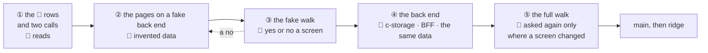

# Piece 2: the employee list

**Where it stands — 2026-10-29 00:35 +07:** drafted; nothing is built. It waits for the human's
read of the 15 👤 rows and the two calls ([step 2](#steps)). **Next:** that read; then step 3, the
fake `Api` and its `?fake` switch.

> **Drafted** 2026-10-29 by the machine, from [the app frame](2026-10-27-app-frame.md) (piece 1, its
> case table and its piece order), [ridge-app](2026-10-28-ridge-app.md) (a client is a tenant under
> a minted id), [the visual report](2026-10-28-visual-report.md), [the big picture](2026-10-27-big-picture.md),
> [the architecture](2026-10-27-architecture.md), [the c-storage memo](../memo/c-storage.md),
> [the open items](../open-items.md) and the code piece 1 built. Also read, none copied: the old
> app's employee pages, its employee routes and their tests, its employee walk, and its memos on
> employees, the login that follows the row, and the register.
> It is the first piece planned under the human's flow of 2026-10-28 ("Yes, that really what it
> should be"): the UI walked on a fake back end first, then the back end, then the full walk
> ([the flow](#the-flow-as-this-piece-runs-it)).

## At a glance

| Who | What they do in piece 2 ([the case table](#the-case-table)) |
| --- | --- |
| **the root**, the company's admin | keeps the departments; adds a person with a code and hands over a sign-in shown once; changes a person, gives a new password, archives someone who left |
| **staff in a department allowed it** | sign in with their code and see the staff list: names, codes, departments, phones |
| **staff in no department** | sign in, and one page says there is nothing for them yet |

The human reads the 👤 rows and answers two calls first ([the calls](#the-humans-calls)): the root
alone changes the staff list, and piece 2 is the old app's core, its QR sign-in going to piece 6.
Then the human previews 14 screens on invented data before piece 2's back end exists; the full
walk asks again only what changed. About five machine days, an estimate, not a date.

## The need

The human's order puts the employee list second, "as far as the old app got"
([the pieces](2026-10-27-app-frame.md#the-pieces)): "the root adds staff, each given a sign-in;
archiving revokes it; a department sets what each may do". Piece 1 left three things here: staff
sign-ins (its row 9); departments, which its frame put among the settings' keys and which get a
record of their own here ([the records](#the-records)); and a session keyed by a device id the
browser picks ([open item 10](../open-items.md)).

## The flow, as this piece runs it

| The human's condition, 10-28 | Here |
| --- | --- |
| 1. The 👤 rows are read before any code; the fake walk comes after | step 2, then steps 3 to 6 |
| 2. The fake data goes through the same `@credo/shared` schemas as the real data | row 26: every fake answer parses under the schema the real one is read with |
| 3. One dummy data set feeds the fake and the generator; the full walk's pictures are compared with the fake's, and only a screen that differs is asked again | `@credo/shared/demo`, rows 29 and 32; step 11 |
| 4. The bases and the verdict come from the full run alone; one vertical slice, done only at the full walk; the flow's second stage holds the BFF and c-storage | steps 7 to 11; nothing is committed as a base before step 11 |

**What the human sees of the fake walk** (step 6): the walks page, built by the machine with no
browser, draws each screen live from the app on the fake ([the fake](#the-fake)); `pnpm fake` serves
the same app for a look in the human's own browser; one run in the human's terminal takes the fake's
pictures, the reference the full run is compared with.

## What piece 2 holds

- **A person** has a name and a code, and may have a phone, a department and a note. The code is
  their sign-in name. Adding a person makes their sign-in at once, with a first password shown
  once (rows 1 to 3).
- **The root** changes a person's name, phone, department and note, never the code; gives a new
  password, shown once; archives someone who left (rows 5 to 9). No one is un-archived.
- **Departments** are the root's: each a name and what its staff may do. Piece 2's catalogue holds
  one thing a department may be allowed, to see the staff list (`see-staff`); each later piece
  adds its own (rows 10, 11). The root may do everything and holds no department, as in piece 1.
- **Staff** sign in on the company's link with their code, as the root does, and the menu holds
  only what they may open (rows 12, 13).
- **Settings stay the root's alone**, as piece 1's call 2 has them; no department may be allowed
  them.

## The records

Every key is built by `recordKeys` in `shared/src/records.ts`, under the tenant's minted id
([ridge-app](2026-10-28-ridge-app.md#what-a-client-is)).

| Record | Holds | Written by |
| --- | --- | --- |
| `tenant.<id>.employee.<employee id>` | the code, the name, the phone, the department as `{id, name}`, the note, whether archived | an add, last, `If-None-Match: *`; a change and an archive, each with its tag |
| `tenant.<id>.user.<sign-in name>` | piece 1's sign-in record, plus the person's id and the time of their last new password | an add, first, `If-None-Match: *` (or over a stale one, with its tag); a new password, with its tag |
| `tenant.<id>.departments` | each department's minted id, name and grants | the Departments page's save, with its tag |
| `tenant.<id>.session.<session id>` | piece 1's session, plus the device id and when it was issued | a sign-in, `If-None-Match: *` on a fresh id; a renewal, with its tag |

- **A record per person, read through a new c-storage list** (row 19). *Rejected:* the old app's
  one record for a whole register. Every change rewrites it, two changes to two people conflict,
  and orders (piece 5) outgrow one record. *Price:* one c-storage route with its tests, its Bruno
  request and a line in the memo, shipped to ridge's box by the deploy as every release is. It adds
  no resource, hop or key, so no environment is stood up
  ([collaboration](../conventions/collaboration.md#the-loop), hand-off 3).
- **The sign-in record stays keyed by its sign-in name.** Piece 1 accepted the name as the id until
  "piece 2, where a name can change, adds a minted id and a name index"
  ([the frame](2026-10-27-app-frame.md#the-frame)). In piece 2 no code changes (row 5), so the
  sign-in record is itself the name's index, and the person's own record carries the minted id
  every later piece links to. A code rename, when it comes, rewrites one sign-in record and nothing
  that links to the person.
- **An add claims the code first and makes the person last** (row 17). The list finds a person's
  record as soon as it is written, so that write must be the last. A sign-in record left by a
  failed add names a person who does not exist: it signs no one in, since the session check reads
  the person, and its password was never shown. The next add of that code takes it over with its
  tag. *Rejected:* the person first, then the sign-in, as the old app's login followed its row. A
  failure between them leaves a listed person with no sign-in, and a retry lists the code twice.
- **An archived person keeps both records**, so the code stays taken (row 2) and every session of
  theirs is refused at its next request (row 22). *Rejected:* removing the sign-in at the archive.
  The code would be free again, and the old app's defect returns: a live code issued twice.
- **Departments in a record of their own**, not in the settings. Piece 1's settings contract, its
  walked screens and their answers stay as they are, and a departments save never meets a
  settings save. *Rejected:* `departments` inside `TenantConfig`: a field added to a contract whose
  halves deploy apart, and every settings screen's words changed, so each is asked again.
- **A person names their department by its id, with its name beside it.** A rename keeps its staff
  and what they may do; a removed department allows nothing, and its staff show the name as saved
  (row 11). *Rejected:* the old app's link by the department's label, under which a rename shut
  its staff out at their next page.
- **Grants are resolved on the BFF at every request and closed on a miss:** no department, or one
  removed, allows nothing (the old app's rule). A staff member's call reads five records (the
  client's index, the session, the sign-in, the person, the departments), the root's three, as
  piece 1's do. *Rejected:* a cache of grants, as the old app's minute-long one: an archive would
  wait out the minute, to save reads that cost nothing inside one zone.
- **Every write names its tag.** In piece 2 no record's tag moves except by a change the caller
  must see, so a 412 answers 409 and is never retried
  ([CLAUDE.md](../../CLAUDE.md)'s rule; [the memo](../memo/c-storage.md#a-write-on-a-moved-record-is-refused)).
- **Two fields added to the contract get their default at the client's boundary:** what a person
  may do (`may`), in the sign-in's and `me`'s answer, defaults to nothing in the UI's parse, and the
  root may do everything whatever it holds (row 24); the sign-in record's new fields default when
  the BFF reads one piece 1 wrote.

## The routes

| Route | Its caller | Who may call it |
| --- | --- | --- |
| `GET /api/employees` | the staff list | the root; a department allowed `see-staff`, without the note |
| `GET /api/employees/:id` | a person's page | the root |
| `POST /api/employees` | adding a person; the answer carries the first password, once | the root |
| `PUT /api/employees/:id` | a person's form | the root |
| `POST /api/employees/:id/archive` | archive, after its check | the root |
| `POST /api/employees/:id/password` | a new password; the answer carries it, once | the root |
| `GET /api/departments`, `PUT /api/departments` | the Departments page; the picker in a person's form | the root |
| `POST /api/auth/sign-in`, `GET /api/auth/me` | piece 1's, now answering what the person may do | anyone with the client's code |
| c-storage `GET /api/records/{serviceCode}?prefix=…` | the BFF's read of the staff list | the BFF, with its keys |

Who may call each is call 1's recommendation; its alternative adds a grant
([the calls](#the-humans-calls)).

## Sessions: open item 10, decided

A session is keyed by a minted id, with the device id beside it, and the handle becomes
`<session id>.<secret>`. A sign-in writes a new record and ends the session the device's kept handle
still names, which the UI already sends on every call. One person can no longer replace another's
session by naming a device. A new password signs its person out everywhere: a session issued before
it is refused (rows 8, 21, 22). The operator's sessions share the module and change with it.

*Rejected:* a sign-in refused over another person's live session on that device. A shared shop PC
would then lock out whoever signs in after someone who forgot to sign out. *Price:* every handle now
held, on ridge and locally, stops resolving once, so everyone signs in again; ridge holds invented
data alone. Sessions on devices that never sign in again stay until read, as piece 1's do; the
sweep stays [left behind](#left-behind).

## The fake

- **The fake `Api`** has the shape of the fixture `Api` in `ui/src/App.test.tsx`: an object of the
  same methods as `createApi`'s, holding the data set in memory, seeded afresh at each load. Every
  answer it gives parses under the `@credo/shared` schema the real answer is read with (row 26).
  *Rejected:* a fake `fetch` behind the real `createApi`, which would exercise the UI's wire code
  in fake mode too. It is a small BFF to keep in step with the real one, and `ui/src/api.ts`'s own
  tests and the full walk already hold that code.
- **Cues:** the address names one call and the status it answers once, 403, 409 or 503; the walk
  spec opens each failure screen's address with its cue, and the human can type one (row 27).
- **The switch:** `ui/src/main.tsx`, which builds the `Api` once, reads `?fake` and builds the fake
  in place of `createApi`, with a device store on the tab's session storage, so a fake sign-in never
  touches what the device keeps for the real app. The switch and the data set are compiled into the
  fake build alone (`vite build --mode fake`); the bundle the stack and ridge serve holds neither
  (row 28). *Rejected:* the switch in every bundle. A client's staff could land on invented data at
  their own address, and nothing on ridge calls it.
- **`pnpm fake`**, as `pnpm stack` is: it builds the fake app and serves it alone, with no BFF and
  no c-storage, and prints its address; `pnpm fake -- <command>` is up, the command, down.
- **The one data set**, `@credo/shared/demo`: the demo company (the generator's settings of today,
  moved), two departments (one allowed to see the staff list, one allowed nothing yet), and about
  six invented people, one who left and one in no department. It is a subpath of `shared/`, never in
  the package's index, so neither the BFF's bundle nor the app's carries it. Both readers already
  depend on `shared/`. *Rejected:* a package of its own, against [CLAUDE.md](../../CLAUDE.md)'s one
  shared package; a copy for each reader, which drift apart.
- **The walks page draws each piece-2 screen as a fake scene:** the app on the fake, at an address,
  signed in as a data-set person, with its cue and a few steps (type into a field, press a button,
  each named by its words in the app's dictionaries). The page draws it live, and the build reads
  its words on jsdom, as for piece 1's mock states; the visual report's rules are otherwise
  unchanged: no browser, a yes keyed to the words (row 30). *Rejected:* piece 2's states added to
  the static mock (`ui/src/mock/`), which the human's flow replaces for a feature inside the frame.
  *Rejected:* the page drawing the fake run's pictures. The page would wait for the human's
  terminal at each step, against the visual report's row 6.
- **The fake run** is the walk spec's `fake` project on `pnpm fake`; its pictures go to the credo
  root's `walks/`, outside git. They are the reference the full run is compared with, never bases.

## The walks

The map ([QA](../conventions/qa.md) rule 7); a dash is a part of the day not built yet.

| | set up | staff | stock | orders | delivery |
| --- | --- | --- | --- | --- | --- |
| **the operator**, us, PC | ridge-app | — | — | — | — |
| **the client's admin**, PC | piece 1 | ⭐ piece 2: departments, staff and their sign-ins | — | — | — |
| **office staff**, PC | — | ⭐ piece 2: look someone up | — | — | — |
| **driver**, phone | — | — | — | — | — |

| The admin's walk, `admin-staff`: take on staff and hand over their sign-ins | Path | The one question |
| --- | --- | --- |
| 1. Departments: each a name, and whether its staff may see the staff list | main | Is this how the admin would say who sees the staff list? |
| 2. The staff list: name, code, department, phone | main | Is this what the admin needs to see about the staff at a glance? |
| 3. Adding a person: name, code, phone, department, note | main | Are these the details a business takes when it hires? |
| 4. Added: the sign-in name and a first password, shown once | main | Would the admin know what to hand over, and that the password is not shown again? |
| 5. A person's page: the details, the note, how they sign in | main | Is anything missing from a person's page? |
| 6. A new password, shown once | main | Is a new password from the person's page how a business would do it? |
| 7. Archive, after a check: their sign-in stops at once, their record is kept | main | Is "archive" the word for someone who left, and is the check clear? |
| 8. People who left, shown by the switch | main | Should the admin find people who left this way? |
| 9. The code already taken | what can go wrong | Does this say what to fix? |
| 10. Someone else saved first, what was typed kept | what can go wrong | Would the admin know someone else saved first, and how to see what they saved? |
| 11. A save that failed, what was typed kept | what can go wrong | Would the admin know the save did not happen, and that nothing typed is lost? |

| Office staff's walk, `office-staff`: look someone up | Path | The one question |
| --- | --- | --- |
| 1. Signed in with a code: the menu holds the staff list alone, without the admin's buttons | main | Should office staff see the staff list like this, and nothing more yet? |
| 2. A page this person may not open | what can go wrong | Does this say why, and whom to ask? |
| 3. Someone in no department: nothing to work on yet | what can go wrong | Would the person know to ask their admin? |

- **14 screens**, each in Vietnamese and English at PC 1280, tablet 768 and phone 390, as piece 1's:
  28 answers and 84 bases. The staff's sign-in is piece 1's screen 1, already answered.
- **Each failure is provoked** in the fake run by its cue, and in the full run as the product would
  meet it: admin 9 by typing a code the data set holds; admin 10 by a second save through the real
  API, as piece 1's screen 8 is; admin 11 by a stubbed 503, as piece 1's screen 7 is; office 2 by an
  office person opening Departments; office 3 by signing in as the data set's person in no
  department.
- **Each full run of piece 2's walk starts on a client of its own**, made by the stack from the one
  data set: its writes (an add, an archive) cannot be undone, so a second run on the same client
  would list the first run's people.
- **The pictures carry no minted value:** a first password is masked, and no screen shows a time
  or an id.
- **Piece 1's bases move** at the full run, since the menu gains two pages; its answers hold, since a
  screen's words leave the menu out
  ([the visual report](2026-10-28-visual-report.md#what-it-reports-in-piece-1)).

## The case table

👤 marks a business row, for the human's read ([QA](../conventions/qa.md) rule 1). Rows 10, 13 and
15 are written as calls 1 and 2 recommend.

| # | 👤 | The case | Held by |
| --- | --- | --- | --- |
| 1 | 👤 | The root adds a person with a name and a code, and if known a phone, a department and a note; a phone is 10 to 15 of digits, spaces, `+`, `-` and brackets | BFF route, `employees.route.test.ts`; unit, shared; unit, ui; the walk |
| 2 | 👤 | A code is 2 to 20 of the letters A to Z, digits and hyphens, unique in the company in any case, among people who left too, and is the person's sign-in name; a code already taken is refused, and its holder is unchanged | unit, shared; BFF route; the walk |
| 3 | 👤 | Once a person is added, the root is shown their sign-in name and a first password once, to copy and hand over; the password is never shown again and is kept only as its hash | BFF route; unit, ui; the walk |
| 4 | 👤 | The staff list shows each person's name, code, department and phone, in code order; people who left are hidden, and a switch shows them | BFF route; unit, ui; the walk |
| 5 | 👤 | A person's page shows their details, their note and how they sign in; the root changes the name, phone, department and note there, never the code | BFF route; unit, ui; the walk |
| 6 | 👤 | A save over someone else's newer one is refused, what was typed is kept, and the page offers the newer details | BFF route; unit, ui; the walk |
| 7 | 👤 | A save that fails says so and keeps what was typed | unit, ui; the walk |
| 8 | 👤 | The root gives a person a new password, shown once, and it signs them out on every device | BFF route; unit, ui; the walk |
| 9 | 👤 | The root archives a person who left, after a check: they are stopped at their next step and cannot sign in again, and their record and code are kept; no one is un-archived, so someone who returns is added again under a new code | BFF route; unit, ui; the walk |
| 10 | 👤 | The root keeps the company's departments, each a name and what its staff may do; in piece 2 a department may be allowed one thing, to see the staff list (call 1) | BFF route, `departments.route.test.ts`; unit, shared; unit, ui; the walk |
| 11 | 👤 | Renaming a department keeps its staff and what they may do; removing one leaves its staff allowed nothing, its name shown on them as it was saved | BFF route; unit, ui |
| 12 | 👤 | A person signs in with their code and password on the company's link, on a PC or a phone, and the menu holds only the pages they may open; with none, one page says there is nothing for them yet | BFF route, `auth.route.test.ts`; unit, ui; the walk |
| 13 | 👤 | Only the root adds, changes, archives or gives a new password (call 1); a person allowed to see the list sees names, codes, departments and phones, without the note or the root's buttons; a page a person may not open says so | BFF route; unit, ui; the walk |
| 14 | 👤 | Every new screen reads fully in Vietnamese and in English | unit, ui; the walk |
| 15 | 👤 | Not yet (call 2): the QR sign-in; signing in by email; a position, an email, a second phone, a photo; codes numbered by the app; a code changed; a password the root types; a person changing their own password; search and filters beyond the switch for people who left; a department allowed to change staff or the settings; staff read from an Excel file | none: the human's to move |
| 16 | | Each person is one record under a minted id; their sign-in record, keyed by the code's sign-in name, names that id; a person names their department by its id, with its name beside it | unit, shared, `records.test.ts` |
| 17 | | An add reads the code's sign-in record, writes it with `If-None-Match: *` or over a stale one with its tag, then writes the person last; a sign-in record left by a failed add names no person, signs no one in, and the next add of that code takes it over | BFF route, with a client that fails on a chosen write |
| 18 | | Every write of a person, a sign-in or the departments names the tag it read; a moved record answers 409 with the current one, and nothing writes blind | BFF route |
| 19 | | c-storage lists one service's records under a non-empty prefix, at most 1,000 in key order with their tags, and says when there are more; the route sits behind the same two key gates as every record route | Go tests, `server_test.go`; Bruno; unit, shared: the client and its Bruno parity |
| 20 | | The BFF's list answers 500 when c-storage says there are more, or when a record under the prefix does not parse, naming its kind and never its key; it never answers a short list | BFF route |
| 21 | | A session is keyed by a minted id with the device beside it, and a sign-in ends the session the device still held; a handle with the wrong secret is a 401 | BFF route, `auth.route.test.ts` |
| 22 | | A session issued before its person's last new password, or held by a person archived since, is a 401 at its next request; an archived person's sign-in gets the one wrong-name-or-password answer | BFF route |
| 23 | | Every staff route checks the grant on the BFF and answers 403 whatever the UI shows; the BFF's route list is held exact | BFF route |
| 24 | | Sign-in and `me` answer what the person may do; the UI's parse defaults it to nothing, and the root may do everything whatever it holds | unit, shared; unit, ui |
| 25 | | A department's grants name only the catalogue's (`see-staff`); an unknown grant, an empty name or an id the record does not hold is a 400, and a new department's id is minted by the BFF | unit, shared; BFF route |
| 26 | | Every answer of the fake `Api` parses under the shared schema the real answer is read with | unit, ui, `fake.test.ts` |
| 27 | | The fake answers 403, 409 or 503 once, on the call its cue names, and otherwise from the data set | unit, ui |
| 28 | | The switch and the data set are compiled into the fake build alone; the bundle `pnpm stack` and ridge serve holds no part of either | unit, scripts: a read of the built bundle |
| 29 | | One data set seeds the fake and the stack's generator, which writes it through the BFF's own functions; each full run of piece 2's walk starts on a client of its own | unit, scripts, `generator.test.ts`; unit, ui |
| 30 | | Each piece-2 walk screen is drawn on the walks page as a fake scene; a step that finds nothing stops the build, naming the walk, the screen and the step | unit, visual, `walks.test.ts` |
| 31 | | The walk spec's screens equal the walks page's list, piece 2's as piece 1's | unit, visual |
| 32 | | The full run is first compared with the fake run's pictures, and a screen that differs has its answers removed, so it is asked again; then the bases are written from the full run alone | the human's run, its log read whole; `visual/answers.json`'s diff |

Each row is seen red once before it counts ([QA](../conventions/qa.md) rule 2); every package
stays at 100 % (rule 8).

## The human's calls

Both are asked at step 2, the read: each changes rows the code is then written to.

1. **Who may see the staff list, and who may change it.** *Recommended:* the root alone adds,
   changes, archives and gives new passwords; a department the root allows may see the list, its
   names, codes, departments and phones, never the note (rows 10, 13).
   - *For:* no staff member can hand themselves or a colleague a sign-in, or read the root's notes
     on a person; staff phones show only where the root says; one grant to build and walk, which
     each later piece extends with its own.
   - *Against:* every hire waits for whoever holds the root's sign-in. The old app let a department
     be allowed to add, change and archive staff, with handing over a password as a grant of its
     own.
   - *The other way's price:* a "manage staff" grant and a separate password grant, with their
     tests and screens, about half a day. Without the second, a manager could give a colleague a new
     password and sign in as them.
2. **How far piece 2 goes.** *Recommended:* the old app's core, in rows 1 to 14: people, a sign-in
   each shown once, a new password, the archive, departments with one grant. The rest waits in row
   15, each part coming back when a client or a later piece asks for it. The QR sign-in goes with
   piece 6, whose plan reads the driver's phone ("as simple as Zalo",
   [criterion 2](2026-10-27-big-picture.md#success-criteria)).
   - *For:* about five machine days, against about eight for all of it (both estimates); each part
     left is a field or a screen of its own, cheap to add later; the QR sign-in is designed with the
     person who needs it most; a photo needs the file store piece 6 decides anyway.
   - *Against:* the demo shows less of the staff list than the old app did; staff on a phone type
     a code and a password until piece 6; the root types each code, where the old app could number
     them.

**Not a call** (the machine's, each with its reason above): a record per person and c-storage's list;
the sign-in keyed by its name; sessions by a minted id; departments in a record of their own; the
fake's shape, its switch and its scenes.

## From the old app: kept, changed, left

| The old app's | Here | Why |
| --- | --- | --- |
| A password shown once and stored nowhere readable | **kept** (rows 3, 8) | the old app's own decision; a password on a staff record is readable by whoever reads the record |
| The archive as the only status move, taking effect at the next request, with no reactivation | **kept** (row 9) | a reactivation would hand a fresh sign-in to whoever may change a record |
| An archived person's code never issued again | **kept** (row 2) | its reason: an archive must not free a live code |
| Grants resolved on the server, closed on a miss | **kept** (rows 11, 23) | a person with no department, or one removed, gets nothing rather than the company's all |
| Sign-in by the code; the phone rule; the walk's screens and questions | **kept**, rewritten (rows 1, 12; [the walks](#the-walks)) | they were walked; the questions still ask what the business needs |
| A department's value still shown on a person after it left the setup | **kept** (row 11) | an edit must not drop it unasked |
| People who left vanished from the list | **changed**: hidden, and a switch shows them (row 4) | its walk asked whether they should stay findable; the answer is not on record |
| A department linked by its label | **changed**: by its id, with its name beside it | a rename shut its staff out at their next page |
| The login made after its row, a shortfall a warning beside it | **changed**: the code claimed first, the person written last (row 17) | one store, not two services: no second service to fall short, and the list must not show a person before their sign-in exists |
| One record for each register, with a version on each row | **left**, for a record per person and a c-storage list | every change rewrote the register, and orders would outgrow it |
| The QR sign-in, email sign-in, position, a second phone, the photo, typed passwords and their policy, codes numbered under a prefix, search, filters and their link, the pager, phone copy and call buttons, a record's times | **left**, row 15 (call 2) | each a field or a screen of its own, back when asked; the photo needs piece 6's file store |
| The per-company switches for each field | **left** | one field set for every client, until two clients differ |
| The per-person grant layer and its tab, the minute-long grant cache | **left** | no client asked for a per-person exception; the cache delays an archive |
| The operator's JSON page for departments, behind an admin key | **left** | the settings are the root's, inside the app (piece 1's call 2) |

## What it costs

- **AWS:** no new resource. A staff member's call makes five c-storage reads where piece 1's make
  three; they are free inside one zone, and the Lambda time they add is about $0.02 a client a month
  at a million calls, an estimate. ridge: nothing added.
- **The human's time:** the read, about 30 minutes; the fake walk, about 45 minutes and a round for
  each "no"; the full walk, about 30 minutes; ridge, about 10.
- **The machine's:** about five days ([steps](#steps)), against the app frame's 2, an estimate.
  What is new: the fake and its scenes, which every later piece reuses; the departments; c-storage's
  list; the sessions.

## Steps

- [x] **1. This plan.** Who: 🤖, 10-29. Done when: committed on `employee-list`, the checks clean.
  *Evidence:* this file's first commit (`git log --oneline -- docs/plans/2026-10-29-employee-list.md`);
  before it, the path grep of [documentation](../conventions/documentation.md#nothing-machine-local-or-personal-in-a-committed-file)
  and ridge-app's address grep found nothing in it, every link and anchor in it resolved, and its
  diff named no person.
- [ ] **2. The human's read.** Who: 👤, about 30 minutes. Done when: each 👤 row kept or corrected,
  and each call answered under it, dated. **Then stop:** no code before it.
- [ ] **3. The fake `Api` and `?fake`.** Who: 🤖, after step 2 (the rows it serves), about half a
  day. It moves the demo company into `@credo/shared/demo`, which the generator then reads; builds
  the fake for piece 1's calls (piece 2's come with the pages that call them, step 4), its cues, the
  switch, the fake build and `pnpm fake`, and adds their line to `CLAUDE.md` and the README. Done when: `pnpm check` green at 100 %, no warning; rows 26,
  27 and 28 each seen red once; a test boots the app with `?fake` on jsdom and reads the data set's
  company on the sign-in; in the sandbox, `pnpm fake -- curl` reads the page and leaves nothing
  listening. *Model files:* `ui/src/main.tsx` (the seam), the fixture `Api` in `ui/src/App.test.tsx`,
  `scripts/src/stack.ts` and `scripts/src/main.ts` (the `-- <command>` form), `scripts/src/front.ts`.
- [ ] **4. The pages, on the fake.** Who: 🤖, after step 3, about a day and a half. Piece 2's schemas
  in `shared/` (the employees, the departments, the grant catalogue, `may`), the `Api`'s new
  methods in `createApi` and in the fake, and the pages: the staff list, a person's page and form,
  the archive's check, the two shown-once answers, Departments, the menu by grant, the page for
  someone with nothing yet, and the page a person may not open. Done when: the UI half of rows 1 to
  14, and rows 24 and 25's shared half, each seen red once; `pnpm check` green at 100 %, knip
  silent. *Model files:* `ui/src/Settings.tsx` and `SettingsPage.tsx` (a page, its wiring, its
  outcomes), `ui/src/NewClient.tsx` and `ClientMade.tsx` (a form and an answer shown once),
  `ui/src/Shell.tsx` and `nav.ts` (the menu); the old app's employee pages, read, none copied.
- [ ] **5. The walk on the fake.** Who: 🤖, after step 4, about half a day. The walks page's fake
  scenes, piece 2's two walks in `visual/src/walks.ts`, a one-line pointer in the visual report's
  "how a screen is drawn", the walk spec `walk/specs/piece-2.spec.ts` with a `fake` and a `full`
  project, and the fake run's one script in the credo root's `one-off/`. Done when: rows 30 and 31
  each seen red once; `pnpm report` builds the page and `walks.json` reads back 14 piece-2 screens,
  28 answers waiting, none drawn from the mock; `pnpm check` green. *Model files:*
  `visual/src/walks.ts` and `words.tsx`, `walk/specs/piece-1.spec.ts` and `walk/support.ts`.
- [ ] **6. The fake walk: the human's preview.** Who: 👤, after step 5, about 45 minutes, and a
  round for each "no". The human opens the newest walks page (and, if wanted, `pnpm fake` in a
  browser), answers each piece-2 screen in each language, and pastes the block; the machine runs
  `pnpm answers`. A "no" becomes a case here, is fixed on the fake, and its screen is asked again.
  Last, on the commit whose answers are all yes, the human runs the fake run's script: its pictures
  are the full run's reference. Done when: the page shows no piece-2 screen waiting and no open
  "no"; the fake run's log read whole, green, its 84 pictures named. **Then stop:** the UI is fixed
  here.
- [ ] **7. c-storage's list.** Who: 🤖, the first free slot after step 2, since it takes nothing from
  the UI (while the human previews, for one), about three hours. Done when: row 19 seen red once
  (the prefix ignored, the bound removed, "more" dropped, a key gate skipped); `make check` green at
  100 %, no warning; the route in `everyRoute` and one Bruno request with its test; the shared
  client's method and its Bruno parity green; the memo's line on the list and its bound.
  *Not run here:* `e2e.sh`, which is GitHub's run at the push. *Model files:* `getRecord` in
  `c-storage/internal/server/handlers.go`, `Get` in `c-storage/internal/store/store.go`.
- [ ] **8. The BFF.** Who: 🤖, after step 6 (the contract as the preview fixed it) and step 7 (the
  list), about a day. The employee and department routes, the grants, the sessions. Done when: rows
  16 to 18 and 20 to 25, and the BFF half of rows 1 to 13, each seen red once; `pnpm check` green at 100 %; seen
  live on the stack, `pnpm stack -- <command>`: the root adds a person, that person signs in, the
  root archives them, and their next call is a 401; open item 10 deleted. *Model files:*
  `bff/src/app.ts` (the tenant, the session check), `bff/src/clients.ts` (writes that must find
  nothing, the index last), `bff/src/sessions.ts`, `bff/src/config.route.test.ts` and
  `bff/tests/tenant.ts`.
- [ ] **9. The generator, the stack and the full run's script.** Who: 🤖, after step 8, about three
  hours. The generator writes the data set's departments and people through the BFF's functions,
  and a client for each full run of piece 2's walk; the full run's one script in `one-off/` runs
  piece 1's spec, the operator's and piece 2's: piece 2's first against the fake run's pictures,
  then twice against its own bases, writing them, then comparing. Done when: row 29 seen red once;
  `pnpm check` green; `pnpm stack -- <command>` signs in as the data set's office person.
- [ ] **10. The review.** Who: 🤖, a model other than the author's ([QA](../conventions/qa.md) rule
  5), after step 9, about two hours with the fixes. Done when: each finding fixed, rejected or
  deferred with its reason, tagged in the recap; `pnpm check` and `make check` green.
- [ ] **11. The full walk and the final review.** Who: 👤 runs the script, after step 10, about 30
  minutes; 🤖 reads. Done when: the log read whole; each screen that differs from the fake's named,
  with its cause, and fixed where it is wrong; its answers removed and answered again on the walks
  page, beside the full run's picture and its difference; the second run green at threshold 0, no
  warning; the 84 bases committed, and piece 1's moved bases read in git's diff (the menu alone);
  the page shows none waiting and no open "no".
- [ ] **12. The recap and the merge.** Who: 🤖 the recap; the orchestrator merges on the human's
  word. Done when: the recap written, open items updated, `employee-list` ready to merge into
  `main`.
- [ ] **13. ridge.** Who: 👤, after the push of the `main` that holds it, about 10 minutes. The deploy
  ships c-storage's list, the BFF and the UI. Every handle there stops resolving once (the sessions),
  so each person signs in again. On a client's link, the human signs in as its root, adds a person,
  signs in as them in a second browser, and archives them. One question: would a partner follow
  this without help? Done when: the deploy's check green, its log read whole, and the human's
  answer.

**Then stop.** Piece 2 ends walked on the full stack and on ridge, its recap written, its branch
merged.

## Unverified

- **The fake build's pictures equal the production build's.** The mode is the one difference by
  design; the first fake run and the full run read it.
- **Steps played on jsdom and in the page** type into Mantine's inputs as a person does; to be seen
  red and green at step 5.
- **Five reads a staff call** on Lambda: unmeasured; about $0.02 a client a month is an estimate.
- **c-storage's prefix read uses the records table's key** with no schema change; read at step 7.
- **The estimates:** five machine days for rows 1 to 14, about eight with row 15.
- **The old app's answer** on whether people who left should stay findable: its walk asked, and no
  answer is on record.

## Left behind

Each until something calls it: row 15's parts; a sweep of sessions no one reads again; paging past
c-storage's 1,000 records a list (the first list that can pass it, orders in piece 5, brings it); a
department allowed to change the settings; the operator's work that ridge-app left.

## Hazards no gate catches

- **The fake drifts from the BFF**: a screen right on the fake and wrong on the stack. *Guard:* row
  26 holds the shapes; the full run's comparison (row 32) holds what is drawn.
- **A fix after the fake run** makes each screen it touches differ at the final review. *Guard:* the
  fake run is step 6's last act; a later fix to a screen is named in step 11 as its cause.
- **A browser tab holding the old UI** meets `may` in the sign-in's or `me`'s answer, and its strict
  parse refuses it: "service unavailable" until a reload. *Accepted:* one reload after the deploy,
  on ridge's invented data. *Trigger:* the first client's own stack, where a deploy in working hours
  would show it; then answers parsed so that a key they do not know passes.
- **The take-over of a stale sign-in record** rests on its person's record being absent. A later
  writer of people that skips the add (an import, say) could leave a person whose sign-in names
  another id, and no gate reads that. *Trigger:* the first writer of people other than the add.
- **jsdom lays nothing out**, so a step may press a button CSS hides. *Guard:* the pictures.

## After this piece: the human's decision

Once this piece has used the flow, the machine proposes amending [QA](../conventions/qa.md)'s at a
glance and [collaboration](../conventions/collaboration.md)'s hand-off 1 to it (the fake walk first,
the full walk compared with it). That is the human's yes, in a change of its own; it is not a step
of this plan.
