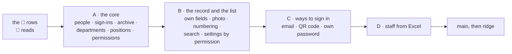

# Piece 2: the employee list

**Where it stands — 2026-10-29 07:47 +07:** steps 2 to 8 are ticked: group A's UI is fixed and walked on the fake, c-storage lists records under a prefix, and the BFF serves group A's staff setup, people, passwords, archive and sessions with every permission checked on the server. **Next:** step 9, the generator, the stack and the full run's script.

> **Drafted** 2026-10-29 by the machine, from [the app frame](2026-10-27-app-frame.md) (piece 1, its
> case table and its piece order), [ridge-app](2026-10-28-ridge-app.md) (a client is a tenant under
> a minted id), [the visual report](2026-10-28-visual-report.md), [the big picture](2026-10-27-big-picture.md),
> [the architecture](2026-10-27-architecture.md), [the c-storage memo](../memo/c-storage.md),
> [the open items](../open-items.md) and the code piece 1 built. It is the first piece planned under
> the human's flow of 2026-10-28 ("Yes, that really what it should be"): the UI walked on a fake back
> end first, then the back end, then the full walk ([the flow](#the-flow-as-this-piece-runs-it)).
> **Amended** 2026-10-29 01:08 +07 by the human, at 00:4x: "1. departments and positions information
> are configurable by root user 2. root user can change password of employee 3. each department,
> employee have permission config, and UI displayed base on this permission 4. root user can update
> permission by department, possition and employee"; then, on the two calls, "configurable, by root
> user" and "all"; then "keep new code similar (in consideration of custom logic from specific
> clients)" and "use json object `extra` for data, so we can custom the UI without breaking the BFF
> code when client ask for custom logic". Read for it, none copied: the old app's UI docs whole (its
> permissions memo, its employee memos and reviews, its client-specific-logic and config memos), its
> employee pages and routes, and the old code where a memo left a question open.

## At a glance

Each group runs the human's flow: its pages on a fake back end with invented data, the human's
preview, then the back end, then the full walk, asked again only where a screen changed.

| Who | What they do in piece 2 ([the case table](#the-case-table)) |
| --- | --- |
| **the root**, the company's admin | keeps departments, positions, the person's fields and what each may do; adds people and hands over sign-ins and passwords; sets a person's own permissions |
| **staff** | sign in with a code, an email or a QR code; see and do what their department, position and own permissions allow; change their own password |

Only the root gives a sign-in, a password or a permission, so no grant lets anyone take over a
colleague's sign-in. No call is open. About 12½ machine days, an estimate, not a date.

## The need

The human's order puts the employee list second ([the pieces](2026-10-27-app-frame.md#the-pieces)):
"the root adds staff, each given a sign-in; archiving revokes it; a department sets what each may
do". On 10-29 the human made it the whole of what the old app's list held, with permissions set by
the root by department, position and person, the screens drawn by them, and every record's data in
an `extra` object a client's own logic can use without a BFF change. Piece 1 left three things here:
staff sign-ins (its row 9); departments, which its frame put among the settings' keys and which get a
record of their own here ([the records](#the-records)); and a session keyed by a device id the
browser picks ([open item 10](../open-items.md)).

## The flow, as this piece runs it

| The human's condition, 10-28 | Here |
| --- | --- |
| 1. The 👤 rows are read before any code; the fake walk comes after | step 2, then each group's fake walk (steps 6, 13, 18, 23) |
| 2. The fake data goes through the same `@credo/shared` schemas as the real data | row 49: every fake answer parses under the schema the real one is read with |
| 3. One dummy data set feeds the fake and the generator; the full walk's pictures are compared with the fake's, and only a screen that differs is asked again | `@credo/shared/demo`, rows 52 and 55; each group's full walk |
| 4. The bases and the verdict come from the full run alone; one vertical slice, done only at the full walk; the flow's second stage holds the BFF and c-storage | each group's back end; the piece ends at step 26, the full walk of everything |

**What the human sees of a fake walk:** the walks page, built by the machine with no browser, draws
each screen live from the app on the fake ([the fake](#the-fake)); `pnpm fake` serves the same app
for a look in the human's own browser; one run in the human's terminal takes the fake's pictures,
the reference the full run is compared with.

## The old approach followed

The old app's UI docs describe how one client's own logic plugs in. Each part, and its home here:

| The old app's | Here | Why, where it departs |
| --- | --- | --- |
| One config per client, with a block per module (`features.employees`), read by the UI | **the staff setup**, one record per company, the root's ([the records](#the-records)) | the old self-managed org already wrote this slice through its own route; here the root owns it, since the operator never edits a client ([ridge-app](2026-10-28-ridge-app.md#the-operator)) |
| Department and position options, each a value and a label in both languages | departments and positions in the staff setup, each a minted id, a name, its permissions and its `extra` | a minted id, not a value, so a rename moves nothing ([CLAUDE.md](../../CLAUDE.md)'s rule) |
| A switch per optional field (`email`, `avatar`, …), off by default; a field turned off is hidden and its stored value stays | the staff setup's switches: email, second phone, photo; off by default (row 18) | as the old app |
| A client's own fields on a record (the old receipts' and orders' `customFields`: a key, a label, a kind, options, shown in the list) | the company's own fields on a person, in the staff setup (row 19) | labels in Vietnamese and English, as the app is |
| `extra`: data the UI owns, which the BFF passes through untouched; a save replaces it whole | the same, bounded, its schema in `shared/` ([extra](#extra)) | the old bag had no size limit; this one has 8 KB |
| A field the server must trust leaves `extra` for a checked field of its own | kept: the code, the name, the email, the links, the permissions and the archive are typed | the old rule, applied from the start |
| A code prefix and length (`EMP-`, 4), the next code counted in the page | the staff setup's numbering, the next code counted by the BFF past every code given (row 20) | the old page's count raced and reissued codes; its own memo named the server as the fix |
| Permissions in four sparse layers, each overriding the last (`overlay ?? base`): base, client, department, employee | base, department, position, person (row 2) | the client layer was the operator's licensing envelope, and nothing licenses here; the position is the human's point 4 |
| Permission editing narrowed to the root (`rootUserOnly`, on by default) | a fixed rule: the root alone (row 4) | the human's point 4 |
| Setting a password and issuing a QR code, kept apart from changing a person | the root's alone, never a permission (row 4) | no grant may hand over a sign-in |
| The menu, each page's route and each button gated by the permissions; a page refused shows a 403 page | the same, drawn from what `me` answers (rows 5, 42) | the old browser resolved its own copy beside the server's, and the two drifted; here only the BFF resolves |
| Search and filters in the browser over the whole loaded list, labels searched as shown | the same (row 23) | filters in the address as plain values, written only when set, as the old app's last version kept them |
| An Excel template built from the field switches, both languages' headers, sample rows with the client's real labels | the same, the company's own fields included (row 29) | the old import had no path for a client's own fields |
| A QR link for one sign-in within 15 minutes | the same, made by the BFF (row 26) | a new code now cancels the last; in the old app it did not, though its screen said so |
| A ladder for a client's own logic: config first, then a variant module, then a `by-clients/<code>/` page with a `default/`; data in `extra`, behaviour in the display layer, the store and the BFF never forked, no client named in shared code | **kept as the rule**; its first rung, config, is built now | the variant and `by-clients/` pages enter with the first client whose logic config cannot express: nothing calls them yet |
| A client's translations overriding the app's labels | **left** | no client asks to rename a built label; a company's own field brings its own labels |
| A client's own field visible or editable only by some departments | **left** | whoever may see a person sees their whole record, as the old employee list did; back when a client asks to hide a field |

## What piece 2 holds

- **A person** has a name and a code, and may have a department, a position, permissions of their
  own, an email and their `extra`: a phone, a second phone, a note, the company's own fields. A
  photo sits beside the record. The code is their sign-in name; the email, when set, is a second one.
- **The staff setup**, the root's: the departments, the positions, the person's optional fields and
  the company's own fields, the code numbering, and whether the QR sign-in is on.
- **Permissions** are what a person may do on each page built. Each department and position carries
  them, and so may each person; only the root sets them (row 2). Piece 2's catalogue holds the staff
  list's four (to see it, to add a person, to change one, to archive one) and one for Settings
  (rows 3, 24). The root may do everything, holds no department, and needs no permission.
- **Only the root** gives a sign-in or a password, issues a QR code, changes a person's department,
  position, permissions, code or email, keeps the staff setup, and imports staff (row 4). Each of
  these either hands over a sign-in or raises what someone may do.
- **Every person**, the root included, changes their own password (row 28).

## The records

Every key is built by `recordKeys` in `shared/src/records.ts`, under the tenant's minted id
([ridge-app](2026-10-28-ridge-app.md#what-a-client-is)). Every record a client's UI shows carries
`extra` ([below](#extra)).

| Record | Holds | Written by |
| --- | --- | --- |
| `tenant.<id>.employee.<employee id>` | the code, the name, the email, the department and the position as `{id, name}`, the person's own permissions, whether archived, `extra` | an add, last, `If-None-Match: *`; a change, an archive, a new code or email, each with its tag |
| `tenant.<id>.user.<sign-in name>` | piece 1's sign-in record: the password's hash (none until one is given), the person's id, the time of the last password | an add or a new code, first, `If-None-Match: *` (or over a stale one with its tag); a password, with its tag |
| `tenant.<id>.staff-setup` | the departments and positions (each an id, a name, permissions and `extra`), the field switches, the company's own fields, the numbering, the QR switch, `extra` | the staff setup page's save, with its tag |
| `tenant.<id>.session.<session id>` | piece 1's session, plus the device id and when it was issued | a sign-in, `If-None-Match: *` on a fresh id; a renewal, with its tag |
| `tenant.<id>.employee-photo.<employee id>` (group B) | one square image of at most 50 KB | a photo saved, with its tag |
| `tenant.<id>.signin-email.<email>` (group C) | the person's id | an email set, `If-None-Match: *`; removed with its tag when it changes |
| `tenant.<id>.signin-qr.<employee id>` (group C) | the hash of a QR code's secret and when it ends | a code issued, replacing the last; removed with its tag when spent |

- **A record per person, read through a new c-storage list** (row 39). *Rejected:* the old app's
  one record for a whole register. Every change rewrote it, two changes to two people conflicted,
  and orders (piece 5) would outgrow it. *Price:* one c-storage route with its tests, its Bruno
  request and a line in the memo, shipped to ridge's box by the deploy as every release is. It adds
  no resource, hop or key, so no environment is stood up
  ([collaboration](../conventions/collaboration.md#the-loop), hand-off 3).
- **The sign-in record stays keyed by its sign-in name**, the code's, as piece 1's are by name; the
  person's own record carries the minted id everything else links to. A code change writes a new
  sign-in record and removes the old (row 21). An email and a QR code name the person by id, so a
  code change leaves them right.
- **A sign-in record is live only while its person names it back.** An add or a new code writes the
  sign-in record first and the person last, since the list finds a person as soon as they are
  written. A sign-in record left by a failure in between names a person who does not name it: it
  signs no one in, its password was never shown, and the next add or new code of that code takes it
  over with its tag (row 37). *Rejected:* the person first, then the sign-in, as the old app's login
  followed its row: a failure between leaves a listed person whose retry lists the code twice.
- **An archived person keeps both records**, so the code stays taken (row 9) and every session of
  theirs is refused at its next request (row 41). *Rejected:* removing the sign-in at the archive.
  The code would be free again, and the old app's defect returns: a live code issued twice.
- **The staff setup is a record of its own**, not inside the settings: piece 1's settings contract,
  walked screens and answers stay as they are, and a staff setup save never meets a settings save.
  The old app kept the org slice inside its config because its browser resolved permissions at boot
  from it; here the BFF resolves, so nothing needs it in the boot. *Rejected:* `features` inside
  `TenantConfig`: a field added to a contract whose halves deploy apart, and a whole-record settings
  save that must carry a slice it does not edit, the old app's lost-keys defect.
- **Every write names its tag.** A 412 is a 409, never retried, except where the conflict is false:
  a numbered code lost to a race takes the next number, three times at most (row 38).
- **Reads a call makes:** a staff member's call reads the client's index, the session, the sign-in
  record, the person and the staff setup, five where piece 1's root reads three; a sign-in by email
  reads one more. Each permission layer is in one of those records.

## extra

- **What it is:** a JSON object on every record a client's UI shows: a person, a department, a
  position and the staff setup. The BFF checks it only as a bounded JSON object, stores it and
  returns it untouched, so a client's own fields and screens change with no BFF change.
- **Typed, outside it:** what the BFF or c-storage reasons about: ids, the code, the name (required,
  and every later piece's snapshot of a person), the email (a sign-in name), the department and
  position links, permissions, the archive, and the concurrency token, which is c-storage's tag.
  **Inside it:** the phone (`phone`), the second phone (`personalPhone`, the old key's meaning), the
  note (`note`) and each of the company's own fields under its key. The photo is a record of its own,
  named by the person's id, so `extra` holds no reference to it.
- **Its schema, `extraSchema` in `@credo/shared`:** an object of at most 8 KB as JSON and five
  levels deep; no key `__proto__`, `constructor` or `prototype`; any JSON value otherwise. It
  defaults to `{}` at each reader's boundary, the contract rule, so a record or an answer written
  before a field existed still parses (row 32). *Rejected:* no bound, the old bag's: the list returns
  every person, and 50 people at 8 KB is 400 KB at most.
- **A company's own field's key** is 1 to 64 letters, digits and underscores, a letter first,
  unique, fixed once made, and never `phone`, `personalPhone` or `note` (row 34), so a client's
  field and a built-in one never share a key (the old rule).
- **A save replaces `extra` whole**, as the old app's did: the form starts from the stored bag, so a
  key it does not show survives, and an emptied field removes its key. `extra` is part of the
  record, so its bytes are in the record's tag: a save over a changed `extra` is a 409 like any other
  (rows 12, 32). The old app's lesson stays in a test: a form that spreads an old bag over the new
  one keeps a cleared field alive.
- **Its fields are checked by the UI**, from the staff setup's field list: a phone's rule, a number,
  a date, a choice among the field's options. The BFF does not read them. A field the server must
  trust leaves `extra` for a typed field, in a change of its own (the old rule).
- **Search, filters and the import reach it** through the same field list: search reads every value
  the list shows, `extra` fields included; a company's own choice field shown in the list gets a
  filter; the Excel template carries a column for each field the form shows, mapped to its key.
- **Piece 1's settings take no `extra`:** nothing calls it now. It enters with the first client
  whose own setting no typed field holds.

## Permissions

- **The model**, the old app's sparse layers: a permission not set at a layer takes the layer
  before's value. The base allows nothing; then the department; then the position; then the person.
  A department stores what it allows; a position and a person store only what they change, allow or
  refuse. The person's page shows each permission's value with a mark where the person's own differs,
  and saving stores only the differences (the old app's "Custom" mark and its stripping of what
  matches the layers below).
- **Why this order:** the person is the most particular and is last, as in the old app; a position
  is a person's role inside a department, so it overrides the department. *Rejected:* a union of
  department and position, where a position could never take away what its department allows (a
  trainee who may not archive). *Price:* a position's refusal applies in every department.
- **The catalogue** (row 3): `staff` with `canView`, `canCreate`, `canEdit`, `canDelete` (the
  archive), the old employee module's shape, and from group B `settings.canEdit`. `canEdit` changes a
  person's name and `extra` alone. Setting a password and issuing a QR code, the old app's separate
  actions, are the root's alone and in no catalogue.
- **One catalogue and one resolver, in `shared/`**: the BFF checks with it, and the root's editors
  show with it. *Rejected:* the old app's copy in the browser beside the server's. Its own memo
  counted four homes for one flag, two of them unchecked, and the two sides drifted silently.
- **Enforced on the BFF at every call**; the UI's menu, pages and buttons are a view of the same
  answer, never the guard. `me` and the sign-in answer the person's resolved permissions; a 403 makes
  the UI read `me` again and redraw (row 42). A layer that cannot be read answers 503, never a
  partial set, since the layers are mostly refusals and a partial set would allow too much (the old
  memo's "could not build, never denied"; row 36). *Rejected:* the old browser's cache of resolved
  permissions and its forced reloads: the BFF reads the layers at each call, so a change takes effect
  at the person's next step.
- **No migration:** `settings.canEdit` re-gates the settings' save, and an absent permission is a
  refusal, so everyone but the root stays as today. That is the old memo's warning about re-gating,
  checked and not needed here.

## The routes

| Route | Its caller | Who may call it |
| --- | --- | --- |
| `GET /api/staff-setup` | every staff page: names, fields, labels | the root; `staff.canView` |
| `PUT /api/staff-setup` | the staff setup page | the root |
| `GET /api/employees`, `GET /api/employees/:id` | the list; a person's page | the root; `staff.canView` |
| `POST /api/employees` | adding a person; the root's add answers the first password, once | the root; `staff.canCreate`, without department, position, permissions or sign-in |
| `PUT /api/employees/:id` | a person's form | the root; `staff.canEdit` for the name and `extra` alone, a 403 for any other change |
| `POST /api/employees/:id/archive` | archive, after its check | the root; `staff.canDelete` |
| `PUT /api/employees/:id/password` | a password typed or made in the page, shown once | the root |
| `PUT /api/employees/:id/code` (B) | a new code | the root |
| `GET`, `PUT /api/employees/:id/photo` (B) | a person's photo | `staff.canView`; `staff.canEdit` |
| `PUT /api/config` (B) | Settings' save | the root; `settings.canEdit` |
| `PUT /api/employees/:id/email` (C) | an email set or changed | the root |
| `POST /api/employees/:id/qr` (C), `POST /api/auth/sign-in-qr` (C) | a QR code issued; a phone that opens it | the root; anyone with the link |
| `PUT /api/auth/password` (C) | one's own password | anyone signed in |
| `POST /api/employees/import` (D) | the import's rows, at most 100 a call | the root |
| `POST /api/auth/sign-in`, `GET /api/auth/me` | piece 1's, now answering the person's permissions, and taking an email as a name (C) | anyone with the client's code |
| c-storage `GET /api/records/{serviceCode}?prefix=…` | the BFF's read of the staff list | the BFF, with its keys |

## Sessions: open item 10, decided

A session is keyed by a minted id, with the device id beside it, and the handle becomes
`<session id>.<secret>`. A sign-in writes a new record and ends the session the device's kept handle
still names, which the UI already sends on every call. One person can no longer replace another's
session by naming a device. *Rejected:* a sign-in refused over another person's live session on that
device: a shared shop PC would lock out whoever signs in after someone who forgot to sign out.

**Read against the new model**, it holds. A session names the sign-in record, whichever way the
person signed in (code, email or QR code). Its check reads that record and the person, so a password
given or changed after the session was issued, an archive or a new code each refuse it at its next
request (row 41); a changed permission needs nothing of the session, since the BFF reads the layers
at each call. A person changing their own password gets a fresh session in the answer, and every
other is refused. The operator's sessions share the module and change with it. *Price:* every handle
now held, on ridge and locally, stops resolving once, so everyone signs in again; ridge holds
invented data alone. Sessions on devices that never sign in again stay until read, as piece 1's do.

## What each later group brings, and its cheapest sound way

None needs a new service, account, credential or fixed charge, so none is a call.

- **The photo (B):** the browser crops a square and shrinks it to 256 pixels, at most 50 KB, and the
  BFF keeps it in c-storage as a record of its own, as piece 1 keeps the logo. *Rejected:* the old
  app's file store behind presigned uploads: a new resource in each stack and a credential, for 50
  small faces. *Trigger:* piece 6's delivery photos, which need the file store its plan decides.
- **Sign-in by email (C):** the email is a second sign-in name, set by the root alone (the old app's
  rule, after its review found any editor could rewrite it). **No mail is ever sent**, so nothing is
  verified and no mail sender is needed. *Changed from the old app:* there the email replaced the code
  for signing in; here both work, so nothing re-points and someone who forgets which one still gets
  in.
- **The QR sign-in (C):** the root issues a code for a person: 32 random bytes, kept as their hash,
  in a record per person that a new code replaces, so the last one stops working. The link is
  `/login?client-code=<code>&qr=<person id>.<secret>`, drawn as a QR code by a library in the browser.
  Opening it signs in once: the record is removed with its tag, so two openings sign in one (the old
  app's hazard, fixed by c-storage's conditional write). *Accepted:* a code photographed or forwarded
  within its 15 minutes signs in whoever opens it first, the old app's rule; the code shows only on
  the root's screen. The staff setup can turn it off.
- **A password the root types, and one's own (A and C):** typed twice, or made by the page, with the
  old app's rule: at least 8 characters with a capital, a small letter, a digit and one of `@$!%*?&`
  (row 14). One's own needs the current one first. *Changed from the old app:* its password changes
  ended no session; here each signs its person out of every other device.
- **A code changed (B):** the root's alone; the person signs in with the new one and is signed out
  everywhere; the old code is free again. Nothing that names the person changes, since links are by id.
- **Codes numbered by the app (B):** the BFF counts past the highest number under the prefix among
  every person, people who left included, and claims it with `If-None-Match: *`. *Rejected:* the
  old page's count of the list plus one, which raced and, after an archive, reissued a code.
- **Search and filters (B):** in the browser over the loaded list, as the old app's, with an input
  that keeps Vietnamese typing whole (its lesson). *Ceiling:* about 500 people, the old app's; a client
  near it brings a search on the server.
- **Staff from Excel (D):** the file is read in the root's own browser alone, by a maintained library
  pinned in the catalog and loaded only on the import page; the BFF sees validated JSON rows, never the
  file. A file over 2 MB or 500 rows is refused before reading. *Rejected:* the old app's library, an
  old release with published advisories (the reader's note, not checked here), and a parse on the
  BFF, which holds the keys. Imported people come without a sign-in; the root gives each one.

## The fake

- **The fake `Api`** has the shape of the fixture `Api` in `ui/src/App.test.tsx`: an object of the
  same methods as `createApi`'s, holding the data set in memory, seeded afresh at each load. Every
  answer it gives parses under the `@credo/shared` schema the real answer is read with (row 49).
  *Rejected:* a fake `fetch` behind the real `createApi`: a small BFF to keep in step with the real
  one, where `ui/src/api.ts`'s tests and the full walk already hold that code.
- **Cues:** the address names one call and the status it answers once, 403, 409 or 503; the walk
  spec opens each failure screen's address with its cue, and the human can type one (row 50).
- **The switch:** `ui/src/main.tsx`, which builds the `Api` once, reads `?fake` and builds the fake
  in place of `createApi`, with a device store on the tab's session storage, so a fake sign-in never
  touches what the device keeps for the real app. The switch and the data set are compiled into the
  fake build alone (`vite build --mode fake`); the bundle the stack and ridge serve holds neither
  (row 51). *Rejected:* the switch in every bundle. A client's staff could land on invented data at
  their own address, and nothing on ridge calls it.
- **`pnpm fake`**, as `pnpm stack` is: it builds the fake app and serves it alone, with no BFF and
  no c-storage, and prints its address; `pnpm fake -- <command>` is up, the command, down.
- **The one data set**, `@credo/shared/demo`: the demo company (the generator's settings of today,
  moved); a staff setup with departments, positions and their permissions; and about eight invented
  people with phones and notes, one with permissions of their own, one who left, one in no
  department. Each later group adds its own: the field switches and one company field of each kind
  (B), a person with an email (C), an import file (D). A subpath of `shared/`, never in the
  package's index, so neither the BFF's bundle nor the app's carries it. *Rejected:* a package of its
  own, against [CLAUDE.md](../../CLAUDE.md)'s one shared package; a copy for each reader, which drift
  apart.
- **The walks page draws each piece-2 screen as a fake scene:** the app on the fake, at an address,
  signed in as a data-set person, with its cue and a few steps (type into a field, press a button,
  each named by its words in the app's dictionaries). The page draws it live, and the build reads its
  words on jsdom, as for piece 1's mock states; the visual report's rules are otherwise unchanged
  (row 53). *Rejected:* piece 2's states added to the static mock (`ui/src/mock/`), which the human's
  flow replaces for a feature inside the frame; the page drawing the fake run's pictures, which would
  wait for the human's terminal at each step, against the visual report's row 6.
- **The fake run** is the walk spec's `fake` project on `pnpm fake`; its pictures go to the credo
  root's `walks/`, outside git, as the reference the full run is compared with, never as bases.

## The walks

The map ([QA](../conventions/qa.md) rule 7); a dash is a part of the day not built yet.

| | set up | staff | stock | orders | delivery |
| --- | --- | --- | --- | --- | --- |
| **the operator**, us, PC | ridge-app | — | — | — | — |
| **the client's admin**, PC | piece 1; ⭐ piece 2: the staff setup | ⭐ piece 2: take on staff, their records, sign-ins and import | — | — | — |
| **office staff**, PC | — | ⭐ piece 2: look up and add staff, as allowed | — | — | — |
| **driver**, phone | — | ⭐ piece 2: sign in by a QR code | — | — | — |

| `admin-staff-setup`: the staff setup | Group | Path | The one question |
| --- | --- | --- | --- |
| 1. Departments and positions, each with what its staff may do | A | main | Is this how the admin would say who does what? |
| 2. The person's fields: the switches, the company's own fields, the code numbering | B | main | Are these the choices a company makes about its staff records? |

| `admin-staff`: take on staff, their records, sign-ins and import | Group | Path | The one question |
| --- | --- | --- | --- |
| 1. The staff list: name, code, department, position, phone | A | main | Is this what the admin needs to see about the staff at a glance? |
| 2. Adding a person: name, code, phone, department, position, note | A | main | Are these the details a business takes when it hires? |
| 3. Added: the sign-in name and a first password, shown once | A | main | Would the admin know what to hand over, and that the password is not shown again? |
| 4. A person's page: details, note, how they sign in | A | main | Is anything missing from a person's page? |
| 5. A person's own permissions, over their department's and position's | A | main | Would the admin see what this person may do, and what is theirs alone? |
| 6. A password typed or made, shown once | A | main | Is a password from the person's page how a business would do it? |
| 7. Archive, after a check: their sign-in stops at once, their record is kept | A | main | Is "archive" the word for someone who left, and is the check clear? |
| 8. People who left, shown by the filter | A | main | Should the admin find people who left this way? |
| 9. The code already taken | A | what can go wrong | Does this say what to fix? |
| 10. Someone else saved first, what was typed kept | A | what can go wrong | Would the admin know someone else saved first, and how to see what they saved? |
| 11. A save that failed, what was typed kept | A | what can go wrong | Would the admin know the save did not happen, and that nothing typed is lost? |
| 12. Adding a person with the company's own fields and a second phone; the code numbered | B | main | Does the form hold what this company keeps? |
| 13. A person's photo | B | main | Is the photo where the admin would look for it? |
| 14. The list searched and filtered; the address keeps them | B | main | Would the admin find a person this way? |
| 15. A code changed: the person signs in with the new one | B | main | Is it clear the old code no longer signs in? |
| 16. A value the company's own field refuses | B | what can go wrong | Does this say what to fix? |
| 17. An email given: the person may sign in with it | C | main | Is it clear the email is a second way to sign in, and that no mail is sent? |
| 18. A QR code and its link, for one sign-in within 15 minutes | C | main | Would the admin know to show it, and that it works once? |
| 19. Import: the template, and the file chosen | D | main | Would the admin know to fill the template and choose it? |
| 20. Before saving: each row read, with the reasons for the refused | D | main | Would the admin know which rows will be added and why others are not? |
| 21. Imported: the people added, without sign-ins yet | D | main | Would the admin know each still needs a sign-in? |
| 22. A file without the name column | D | what can go wrong | Does this say what to fix? |

| `office-staff`: look up and add staff, as allowed | Group | Path | The one question |
| --- | --- | --- | --- |
| 1. Signed in with a code: the menu and the buttons their permissions allow | A | main | Should office staff see and do this, and nothing more? |
| 2. Adding a person without a sign-in, which the root gives | A | main | Is it clear who gives the sign-in? |
| 3. A page this person may not open | A | what can go wrong | Does this say why, and whom to ask? |
| 4. Someone allowed nothing: nothing to work on yet | A | what can go wrong | Would the person know to ask their admin? |
| 5. Allowed to change the settings: Settings in the menu | B | main | Is it clear this person may change the company's settings? |
| 6. Changing one's own password | C | main | Would a person find this, and know what to type? |
| 7. The current password wrong | C | what can go wrong | Does this say what to fix? |

| `phone-sign-in`: sign in by a QR code | Group | Path | The one question |
| --- | --- | --- | --- |
| 1. Signed in on a phone by the code, on the person's first page | C | main | Would the person know they are in, and where? |
| 2. A code used before, or past its 15 minutes | C | what can go wrong | Would the person know to ask for a new one? |

- **33 screens**, each in Vietnamese and English at PC 1280, tablet 768 and phone 390, as piece 1's:
  66 answers and 198 bases (A 16 screens, B 7, C 6, D 4). A group's screens are asked at its fake
  walk; each full walk compares all built so far. Staff sign in on piece 1's screen 1, already
  answered.
- **Each failure is provoked** in the fake run by its cue, and in the full run as the product would
  meet it: a code the data set holds; a second save through the real API, as piece 1's screen 8 is; a
  stubbed 503, as piece 1's screen 7 is; an office person opening a page their permissions refuse; a
  QR code opened twice.
- **Each full run starts on a client of its own**, made by the stack from the one data set: an add or
  an archive cannot be undone, so a second run on the same client would list the first run's people.
- **The pictures carry no minted value:** a password, a QR code and its link are masked, and no
  screen shows a time or an id.
- **Piece 1's bases move** at group A's full run, since the menu gains two pages; its answers hold,
  since a screen's words leave the menu out
  ([the visual report](2026-10-28-visual-report.md#what-it-reports-in-piece-1)).

## The case table

👤 marks a business row, for the human's read ([QA](../conventions/qa.md) rule 1). Each row names
the group whose walk holds it.

| # | 👤 | The case | Held by |
| --- | --- | --- | --- |
| 1 | 👤 | A: The root keeps the company's departments and positions, adding, renaming and removing them; a person names theirs by its id, so a rename follows them, and a removed one shows on them as it was saved | BFF route, `staff-setup.route.test.ts`; unit, ui; the walk |
| 2 | 👤 | A: Each department and each position carries what its staff may do, and each person may carry their own; the person's beats the position's, which beats the department's, and what none of them allows is refused | unit, shared, `permissions.test.ts`; BFF route |
| 3 | 👤 | A: Piece 2's permissions are to see the staff list, to add a person, to change a person's name and details, and to archive a person; the root sets them at any of the three levels | unit, shared; BFF route; the walk |
| 4 | 👤 | A: Only the root gives a sign-in or a password, issues a QR code, changes a person's department, position, permissions, code or email, keeps the staff setup, or imports staff; no permission allows any of these, so no one can take over a colleague's sign-in or raise what anyone may do | BFF route, the route list held exact |
| 5 | 👤 | A: Each person sees in the menu only the pages their permissions allow, and on a page only the buttons for what they may do; a page they may not open says so, and with no page at all one page says there is nothing for them yet | unit, ui; the walk |
| 6 | 👤 | A: The BFF checks the same permissions on every call, whatever the screen shows, and a change the root makes takes effect at that person's next step | BFF route |
| 7 | 👤 | A: The root adds a person with a name, a code, a phone, a department, a position and a note, and is then shown their sign-in name and a first password once, to copy and hand over; the password is never shown again and is kept only as its hash | BFF route, `employees.route.test.ts`; unit, ui; the walk |
| 8 | 👤 | A: Someone allowed to add people adds one with a name, a code, a phone and a note, without a department, a position or a sign-in, which the root gives; the person's page says they cannot sign in yet | BFF route; unit, ui; the walk |
| 9 | 👤 | A: A code is 2 to 20 of the letters A to Z, digits and hyphens, unique in the company in any case, among people who left too, and is the person's sign-in name; a code already taken is refused, and its holder is unchanged | unit, shared; BFF route; the walk |
| 10 | 👤 | A: The staff list shows each person's name, code, department, position and phone, in code order; people who left are hidden, and a filter shows them | BFF route; unit, ui; the walk |
| 11 | 👤 | A: A person's page shows their details, their note, how they sign in and whether they can yet; someone allowed changes their name, phone and note there | BFF route; unit, ui; the walk |
| 12 | 👤 | A: A save over someone else's newer one is refused, what was typed is kept, and the page offers the newer details | BFF route; unit, ui; the walk |
| 13 | 👤 | A: A save that fails says so and keeps what was typed | unit, ui; the walk |
| 14 | 👤 | A: The root gives a person a password, typed twice or made by the app, of at least 8 characters with a capital, a small letter, a digit and one of `@$!%*?&`; it is shown once, and it signs the person out on every device | unit, shared; BFF route; unit, ui; the walk |
| 15 | 👤 | A: Someone allowed archives a person who left, after a check: they are stopped at their next step and cannot sign in again, and their record and code are kept; no one is un-archived, so someone who returns is added again under a new code | BFF route; unit, ui; the walk |
| 16 | 👤 | A: A person signs in with their code and password on the company's link, on a PC or a phone | BFF route, `auth.route.test.ts`; the walk |
| 17 | 👤 | A to D: Every new screen reads fully in Vietnamese and in English | unit, ui; the walk |
| 18 | 👤 | B: The root chooses which optional fields the company keeps on a person, an email, a second phone, a photo, all off until turned on; a field turned off is hidden everywhere, and what was stored in it stays | unit, ui; BFF route; the walk |
| 19 | 👤 | B: The root adds the company's own fields to a person, each with a name in Vietnamese and English, a kind (text, number, date, or a choice from a list) and whether the list shows it; they appear on the form, the person's page and the list, and a value is checked as its kind says | unit, shared; unit, ui; the walk |
| 20 | 👤 | B: A code left empty is the next number under the company's prefix and length (`EMP-` and 4 digits until the root sets them), counted past every code ever given, people who left included | BFF route; the walk |
| 21 | 👤 | B: The root changes a person's code: from then on they sign in with the new one, they are signed out everywhere, and nothing that names the person changes | BFF route; the walk |
| 22 | 👤 | B: Someone allowed to change a person crops and saves a square photo, made small by the app, shown on the person's page; the list shows initials | unit, ui; BFF route; the walk |
| 23 | 👤 | B: Search finds a person by any word the list shows, the company's own fields included; filters choose by department, position, whether they left, and the company's choice fields; the address keeps both, so a copied link opens the same list | unit, ui; the walk |
| 24 | 👤 | B: A department, a position or a person may be allowed to change the company's settings | unit, shared; BFF route; the walk |
| 25 | 👤 | C: The root gives a person an email, unique among the company's sign-ins, and they then sign in with the email or the code; no mail is ever sent to it | BFF route; the walk |
| 26 | 👤 | C: The root shows a person a QR code and its link, for one sign-in within 15 minutes; a new code cancels the last; the company may turn the QR sign-in off | BFF route; unit, ui; the walk |
| 27 | 👤 | C: A QR code opened on a phone signs that phone in, on the person's first page; opened a second time, or after its 15 minutes, it is refused and says to ask for a new one | BFF route; unit, ui; the walk |
| 28 | 👤 | C: Each person, the root included, changes their own password from their menu, giving the current one first; the new one follows row 14's rule and signs them out on every other device | BFF route; unit, ui; the walk |
| 29 | 👤 | D: The root reads staff from an Excel file: the app gives a template in Vietnamese or English with the columns the form shows, the company's own fields included, and sample rows with its real departments and positions | unit, ui; the walk |
| 30 | 👤 | D: Before anything is saved, the root sees each row read and the reason for any refused; only the name is required, an empty code is numbered, and a code already taken, in the company or twice in the file, is refused | unit, ui; BFF route; the walk |
| 31 | 👤 | D: The rows that hold are added as people without a sign-in, each through the same checks as one added by hand, and the root gives each a sign-in from their page | BFF route; the walk |
| 32 | | Every record a client's UI shows carries `extra`: a JSON object of at most 8 KB and five levels, with no key `__proto__`, `constructor` or `prototype`; the BFF stores and returns it untouched, each reader defaults it to `{}`, and a save replaces it whole | unit, shared, `extra.test.ts`; BFF route |
| 33 | | A person's id, code, name, email, department and position links, permissions and archive are typed; their phone, second phone, note and the company's own fields are in `extra` | unit, shared |
| 34 | | B: A company's own field's key is 1 to 64 letters, digits and underscores, a letter first, unique, fixed once made, and never `phone`, `personalPhone` or `note` | unit, shared |
| 35 | | One catalogue and one resolver, in `shared/`, serve the BFF's check and the root's editors; the editors list the catalogue in its order | unit, shared |
| 36 | | A permission layer that cannot be read answers 503, never a partial set | BFF route |
| 37 | | Each person is one record under a minted id; their sign-in record names that id; a sign-in record its person does not name back signs no one in, and the next add or new code of that code takes it over with its tag | BFF route, with a client that fails on a chosen write |
| 38 | | Every write names the tag it read; a moved record answers 409 with the current one; a numbered code lost to a race takes the next number, three times at most | BFF route |
| 39 | | c-storage lists one service's records under a non-empty prefix, at most 1,000 in key order with their tags, and says when there are more; the route sits behind the same two key gates as every record route | Go tests, `server_test.go`; Bruno; unit, shared: the client and its Bruno parity |
| 40 | | The BFF's list answers 500 when c-storage says there are more, or when a record under the prefix does not parse, naming its kind and never its key; it never answers a short list | BFF route |
| 41 | | A session is keyed by a minted id with the device beside it, and a sign-in ends the session the device still held; a session issued before its person's last password, or since archived or given a new code, is a 401 at its next request | BFF route, `auth.route.test.ts` |
| 42 | | Sign-in and `me` answer the person's resolved permissions; the UI's parse defaults them to none, the root may do everything whatever they hold, and a 403 makes the UI read `me` again | unit, shared; unit, ui |
| 43 | | The staff setup saves with its tag; a department or position sent without an id gets one minted; a permission the catalogue lacks, or a field of no known kind, is a 400 | BFF route |
| 44 | | A `PUT` of a person by someone who is not the root, changing anything but the name and `extra`, is a 403 and changes nothing | BFF route |
| 45 | | B: A photo is an image of at most 50 KB in its own record; anything else is a 400 | unit, shared; BFF route |
| 46 | | C: A QR code is 32 random bytes kept as their hash, in one record per person; spending it removes the record with its tag, so two openings sign in once | BFF route |
| 47 | | C: An email names the person by id in its own record; a second person's same email is a 409; changing the email removes the old record | BFF route |
| 48 | | D: The file is read in the root's browser alone; one over 2 MB or 500 rows is refused before reading; the BFF takes rows as JSON, at most 100 a call, each checked as one add | unit, ui; BFF route |
| 49 | | Every answer of the fake `Api` parses under the shared schema the real answer is read with | unit, ui, `fake.test.ts` |
| 50 | | The fake answers 403, 409 or 503 once, on the call its cue names, and otherwise from the data set | unit, ui |
| 51 | | The switch and the data set are compiled into the fake build alone; the bundle `pnpm stack` and ridge serve holds no part of either | unit, scripts: a read of the built bundle |
| 52 | | One data set seeds the fake and the stack's generator, which writes it through the BFF's own functions; each full run starts on a client of its own | unit, scripts, `generator.test.ts`; unit, ui |
| 53 | | Each piece-2 walk screen is drawn on the walks page as a fake scene; a step that finds nothing stops the build, naming the walk, the screen and the step | unit, visual, `walks.test.ts` |
| 54 | | The walk spec's screens equal the walks page's list, piece 2's as piece 1's | unit, visual |
| 55 | | Each full run is first compared with the fake run's pictures, and a screen that differs has its answers removed, so it is asked again; then the bases are written from the full run alone | the human's run, its log read whole; `visual/answers.json`'s diff |

Each row is seen red once before it counts ([QA](../conventions/qa.md) rule 2); every package
stays at 100 % (rule 8).

## The human's calls

1. **Who may see the staff list, and who may change it.** *Recommended* in the first draft: the root
   alone changes it; a department the root allows may see it.
   **Answered** 2026-10-29 00:4x +07 by the human: "configurable, by root user", with the four
   points: departments and positions configurable by the root; the root changes an employee's
   password; each department and employee has its permissions, and the UI is drawn by them; the root
   sets permissions by department, position and employee. Rows 1 to 6, 8, 14 and 24 hold it.
2. **How far piece 2 goes.** *Recommended* in the first draft: the old app's core, the rest later.
   **Answered** 2026-10-29 00:4x +07 by the human: "all". Every part the first draft left to "not
   yet" comes in: rows 18 to 31, in groups B to D.

**No call is open.** The parts that came in need no new service, account, credential or fixed charge
([their ways](#what-each-later-group-brings-and-its-cheapest-sound-way)). The machine's, each with its
reason above: the records and c-storage's list; the staff setup's own record; the order of the
permission layers; `extra`'s shape; the sessions; the photo in c-storage; email with no mail; the
fake's shape, its switch and its scenes.

## From the old app: kept, changed, left

The old approach for a client's own logic is [above](#the-old-approach-followed). For the list
itself:

| The old app's | Here | Why |
| --- | --- | --- |
| A password shown once and stored nowhere readable | **kept** (rows 7, 14) | the old app's own decision; a password on a staff record is readable by whoever reads the record |
| The archive as the only status move, taking effect at the next request, with no reactivation | **kept** (row 15) | a reactivation would hand a fresh sign-in to whoever may change a record |
| An archived person's code never issued again | **kept** (row 9) | its reason: an archive must not free a live code |
| Employees as the identity source | **kept**: a staff member's session names their sign-in, which names their person | the old app matched a session to a person by email, a rule it had to enforce by lint after fourteen call sites drifted; here nothing matches |
| Sign-in by the code; the phone rule; the walk's screens and questions | **kept**, rewritten (rows 9, 16; [the walks](#the-walks)) | they were walked; the questions still ask what the business needs |
| A department's value still shown on a person after it left the setup | **kept** (row 1) | an edit must not drop it unasked |
| People who left vanished from the list | **changed**: hidden, and a filter shows them (row 10) | its walk asked whether they should stay findable; the answer is not on record |
| A department linked by its value | **changed**: by its id, with its name beside it | a rename shut its staff out at their next page |
| The login made after its row, a shortfall a warning beside it | **changed**: the code claimed first, the person written last (row 37) | one store, not two services: no second service to fall short, and the list must not show a person before their sign-in |
| One record for each register, with a version on each row | **left**, for a record per person and a c-storage list | every change rewrote the register, and orders would outgrow it |
| A position as a label only | **changed**: a permission layer (row 2) | the human's point 4 |
| A password typed or made in the page, with its rule | **kept** (row 14), and the root's alone | the human's point 2; the guard |
| A form on a PC only | **changed**: every screen at three widths | the walk draws each at a phone's width; a phone is where a field manager is |
| The activity log, the driver's profile, a record's times, the pager past 100 rows, phone copy and call buttons | **left** | not in this piece's ask; the driver's profile is piece 6's |

## What it costs

- **AWS:** no new resource. A staff member's call makes five c-storage reads where piece 1's root
  makes three, for the person's and the staff setup's layers; they are free inside one zone, and the
  Lambda time they add is about $0.02 a client a month at a million calls, an estimate. Photos add
  about 2.5 MB a company to its one file. ridge: nothing added.
- **The human's time:** the read, about 45 minutes; group A's fake walk about 45 minutes, B's to
  D's about 30 each, and a round for each "no"; four full walks, about 30 minutes each; ridge, about
  15.
- **The machine's:** about 12½ days ([steps](#steps)), an estimate: group A about 6½, B about 2½,
  C about 2, D about 1½. The app frame's table said 2, for a narrower piece.

## Steps

- [x] **1. This plan.** Who: 🤖, 10-29. Done when: committed on `employee-list`, the checks clean.
  *Evidence:* this file's commits (`git log --oneline -- docs/plans/2026-10-29-employee-list.md`);
  before each, the path grep of [documentation](../conventions/documentation.md#nothing-machine-local-or-personal-in-a-committed-file)
  and ridge-app's address grep found nothing in it, every link and anchor in it resolved, and its
  diff named no person. Amended to the human's answers in the second.
- [x] **2. The human's read.** Who: 👤, about 45 minutes. Done when: each 👤 row kept or corrected,
  dated. **Then stop:** no code before it. *Evidence:* the human, 2026-10-29 01:4x +07, after
  reading the 31 👤 rows: "thank you, plz go ahead with 31 business rows in the plan", a yes to
  rows 1 to 31 as written, none corrected. The four calls the machine flagged stand uncorrected:
  sign-in by email sends no mail; the photo is kept in c-storage, 256 px, at most 50 KB; the
  permission layers apply as department, then position, then person, the later winning; the email
  is a second sign-in name beside the code.

**Group A, the core.**

- [x] **3. The fake `Api` and `?fake`.** Who: 🤖, after step 2 (the rows it serves), about half a
  day. It moves the demo company into `@credo/shared/demo`, which the generator then reads; builds
  the fake for piece 1's calls (piece 2's come with the pages that call them, step 4), its cues, the
  switch, the fake build and `pnpm fake`, and adds their line to `CLAUDE.md` and the README. Done when:
  `pnpm check` green at 100 %, no warning; rows 49, 50 and 51 each seen red once; a test boots the app
  with `?fake` on jsdom and reads the data set's company on the sign-in; in the sandbox,
  `pnpm fake -- curl` reads the page and leaves nothing listening. *Model files:* `ui/src/main.tsx`
  (the seam), the fixture `Api` in `ui/src/App.test.tsx`, `scripts/src/stack.ts` and
  `scripts/src/main.ts` (the `-- <command>` form), `scripts/src/front.ts`. *Evidence:* rows 49, 50 and 51 each seen red once, from their assertions
  (`ui/src/fake.test.tsx`, `scripts/src/fake.test.ts`); a jsdom test boots the app on `?fake` and
  reads the demo company's name on the sign-in, signs the root in and reads a cued 503; `pnpm fake --
  curl` read the page and a 404 on `/api`, and a process test reads nothing left listening or in the
  temp folder. The gates of the packages touched, not the whole `pnpm check` (the BFF and c-storage
  are untouched): shared, ui and scripts each typecheck and test at 100 % with no warning, eslint,
  prettier and knip clean. The data set holds piece 1's company and two names for now: the staff
  setup and the people come with step 4's schemas. Open item 17 holds a sign-in defect the cue
  found.
- [x] **4. A's pages, on the fake.** Who: 🤖, after step 3, about two days. In `shared/`: `extra`,
  the person's, staff setup's and permissions' schemas, the catalogue and its resolver. The `Api`'s
  new methods in `createApi` and the fake. The pages: the staff setup (departments, positions, their
  permissions), the list, a person's page and form, their own permissions, the password, the
  archive's check, the shown-once answers, the menu and buttons by permission, the 403 page and the
  page for someone allowed nothing. A memo, `docs/memo/extra.md`, holds `extra`'s rules and the
  ladder for a client's own logic, which every later piece follows. Done when: the UI and shared
  halves of rows 1 to 17 and of rows 32, 33, 35 and 42 each seen red once; `pnpm check` green at
  100 %, knip silent. *Model files:* `ui/src/Settings.tsx` and `SettingsPage.tsx` (a page, its
  wiring, its outcomes), `ui/src/NewClient.tsx` and `ClientMade.tsx` (a form and an answer shown
  once), `ui/src/Shell.tsx` and `nav.ts` (the menu); the old app's employee pages and its
  permissions panel, read, none copied. *Evidence:* the UI and shared halves of rows 1 to 15, 17, 32, 33, 35 and 42 each seen red once, from
  their assertions, by changing the rule's line and putting it back (row 16's sign-in by a code is
  the fake's and the BFF's, read in `ui/src/fake.test.tsx`). Every package touched typechecks and
  tests at 100 % with no warning: shared (54 tests), ui (175), scripts (61), visual (188), bff (86);
  eslint, prettier and knip clean. The whole `pnpm check` was not run as one command. Choices the
  plan left open: the first page of the menu stays Settings for the root, so piece 1's walks still
  land where they did and only the menu gains two lines; a code is kept in capitals and unique in
  any case; the email stays out of the person until group C; an `Api` method added here comes with
  its fake answer, parsed under its schema in `ui/src/fake.test.tsx`; `docs/memo/extra.md` holds
  `extra`'s rules and the ladder. Open item 17 stands.
- [x] **5. A's walk on the fake.** Who: 🤖, after step 4, about half a day. The walks page's fake
  scenes, the four walks in `visual/src/walks.ts` with A's screens, a one-line pointer in the visual
  report's "how a screen is drawn", the walk spec `walk/specs/piece-2.spec.ts` with a `fake` and a
  `full` project, and the fake run's one script in the credo root's `one-off/`. Done when: rows 53
  and 54 each seen red once; `pnpm report` builds the page and `walks.json` reads back A's 16
  screens, 32 answers waiting, none drawn from the mock; `pnpm check` green. *Model files:*
  `visual/src/walks.ts` and `words.tsx`, `walk/specs/piece-1.spec.ts` and `walk/support.ts`.
  *Evidence:* rows 53 and 54 each seen red once, from their assertions, by changing the rule's line
  and putting it back: row 53 (`visual/src/words.test.tsx`) with the typed value never sent to the
  page, with a step that finds nothing skipped, and with the walk and the screen left out of its
  error; row 54 (`visual/src/walks.test.ts`) with a screen renamed in the spec, in the page's list,
  and with the `full` project removed. `pnpm report` on `920132e` built the page and `walks.json`
  read back 16 screens in `admin-staff-setup` (1), `admin-staff` (11) and `office-staff` (4), none
  with a `mock`, each with its `scene`, 32 answers waiting. Gates of the packages touched: ui (183
  tests), visual (217) and scripts (61, which builds the fake bundle) each at 100 % with no
  warning; shared, ui, visual and walk typecheck; eslint, prettier and knip clean. Not the whole
  `pnpm check`: the BFF and c-storage are untouched. *Choices:* three walks, not four: the phone's
  holds only C's screens and comes with step 17; a scene's steps are named by dictionary keys, so a
  renamed label stops the build where it was renamed; `walk/specs/piece-2.spec.ts` skips its `full`
  project, saying why, until steps 8 and 9 give it the BFF's sign-ins and failures; the fake run's
  pictures are taken with `page.screenshot` into `CREDO_FAKE_DIR`, outside git, and compared with
  nothing; `ui/src/scene.ts` (`sceneParts`) gives the walks page and `ui/tests/open.tsx` one way to
  put the app on the fake, and `App` takes a `look` (scheme and root element) for a frame. *Found:*
  React's DOM renderer decides at its first load whether it hears a text field's `input` event, so
  the report's words reader loads after `installDom` and the visual tests' setup no longer loads
  React DOM in a Node-environment test (`visual/src/cli.ts`, `visual/src/setup.ts`; red when a
  static import is put back); Node's own `FormData` refuses a jsdom form, so `installDom` gives the
  window's. *Not run here:* the walk spec itself and the script `one-off/20261029-0305-fake-run-employee-list.sh`,
  which need a browser.

- [x] **6. A's fake walk, the human's preview.** Who: 👤, after step 5, about 45 minutes, and a round
  for each "no". The human opens the newest walks page (and, if wanted, `pnpm fake` in a browser),
  answers each screen in each language, and pastes the block; the machine runs `pnpm answers`. A "no"
  becomes a case here, is fixed on the fake, and its screen is asked again. Last, on the commit whose
  answers are all yes, the human runs the fake run's script: its pictures are the full run's
  reference. Done when: the page shows none of A's screens waiting and no open "no"; the fake run's
  log read whole, green, its 96 pictures named. **Then stop:** A's UI is fixed here.
  *Evidence:* the human, 2026-10-29 06:53 +07, "32 of 32 yes" on the page built at `920132e`, no
  reasons; `pnpm answers` wrote 32 and refused 0; `pnpm report` read back 0 waiting, 0 asked again,
  0 no, 58 yes in all (the 26 earlier yeses kept). The fake run, the human's, on `dc8aabb`,
  2026-10-29 07:06:32 to 07:06:50 +07: `one-off/20261029-0305-fake-run-employee-list.sh`, its log
  (`logs/fake-run-employee-list.log`, 35 lines) read whole: verdict green; Playwright ran 6 tests in
  project `fake` (3 widths by 2 languages), 6 passed in 16.0s, none failed, skipped, flaky or
  retried, no warning line. The 96 pictures, 6 for each of the 16 screens, the smallest 19,096
  bytes, are in the credo root's `walks/fake-run-2026-10-29-070633-dc8aabb/`, counted on disk: the
  reference for the full run, never bases. The spec's test title said "group A: the staff" though
  the walk also covers the setup and office screens; it now says "the staff setup and the staff",
  and no picture's name changes.

- [x] **7. c-storage's list.** Who: 🤖, the first free slot after step 2, since it takes nothing from
  the UI (while the human previews, for one), about three hours. Done when: row 39 seen red once (the
  prefix ignored, the bound removed, "more" dropped, a key gate skipped); `make check` green at 100 %,
  no warning; the route in `everyRoute` and one Bruno request with its test; the shared client's
  method and its Bruno parity green; the memo's line on the list and its bound. *Not run here:*
  `e2e.sh`, which is GitHub's run at the push. *Model files:* `getRecord` in
  `c-storage/internal/server/handlers.go`, `Get` in `c-storage/internal/store/store.go`.
  *Evidence:* row 39 seen red once per rule, from its assertion, by changing the rule's line and
  putting it back: the prefix ignored (`TestAListHoldsExactlyTheKeysThatStartWithThePrefix`), its upper
  bound dropped (the same), the prefix read as a pattern (`TestAListHoldsTheRecordsUnderThePrefixInKeyOrder`),
  the service not scoped (the same), the bound removed and the trim removed
  (`TestAListHoldsAtMostAThousandAndSaysWhenThereAreMore`), `more` dropped (the same), an empty prefix
  accepted (`TestAListNeedsOneNonEmptyPrefix`), the access-key gate skipped
  (`TestEveryRecordRouteRefusesAMissingOrWrongAccessKeyOrAnUnknownService`), the route with no Bruno
  request (`TestTheCollectionHoldsARequestPerRouteAndATestPerRequest`), and the two edges of the text's
  order (`TestAListHoldsExactlyTheKeysThatStartWithThePrefix`). The shared client's list is red with the
  prefix unencoded, a status other than 200 accepted, `more` defaulted and a wrong query name
  (`shared/src/c-storage.test.ts`, `c-storage.bruno.test.ts`). `make check` in `c-storage/` green at
  100 % of statements, the box's cross-compile included. Six Bruno requests (18 to 23) cover the list,
  its empty answer, the missing prefix and the wrong key; `e2e.sh` is GitHub's run at the push. The
  memo's section "A list reads one prefix" holds the route and its bound. *Read, from the plan's
  "Unverified":* SQLite plans the prefix as `SEARCH records USING INDEX sqlite_autoindex_records_1
  (service_code=? AND key>? AND key<?)`, no sort, no schema change. *Choices:* the prefix is a range
  over the key (the prefix up to itself with its last character raised), never `LIKE`, so `%`, `_` and
  case are exact; a prefix that is not UTF-8 is a 400; no caller reads the list until step 8 (the
  client's method is on its type, so knip is silent).
  *Gates:* the whole `pnpm check` green once at the end (shared 57 tests, ui 183, bff 86, scripts 61,
  visual 217, each at 100 %, no warning line). Found on its first run: the visual build test
  (`visual/src/cli.test.ts`) counted answers still waiting, so group A's 32 yeses turned it red;
  it now counts the sixteen scenes' thirty-two states whatever the answers hold, and the generator's
  in-memory storage gained the list method the type now needs.
- [x] **8. A's BFF.** Who: 🤖, after step 6 (the contract as the preview fixed it) and step 7 (the
  list), about a day and a half. The staff setup's, employees' and password's routes, the permission
  check on every route, the sessions. Done when: rows 36 to 38, 40, 41, 43 and 44 and the BFF half of
  rows 1 to 16 each seen red once; `pnpm check` green at 100 %; seen live on the stack,
  `pnpm stack -- <command>`: the root sets a department's permissions, adds a person in it, that
  person signs in and is refused a call outside them, the root archives them, and their next call is
  a 401; open item 10 deleted. *Model files:* `bff/src/app.ts` (the tenant, the session check),
  `bff/src/clients.ts` (writes that must find nothing, the index last), `bff/src/sessions.ts`,
  `bff/src/config.route.test.ts` and `bff/tests/tenant.ts`.
  *Evidence:* the BFF half of rows 1 to 4, 6 to 12, 14 to 16, 32, 36 to 38, 40, 41, 43 and 44 each seen
  red once, from its assertion, by changing the rule's line and putting it back (27 changes in all,
  26 red): the session refused after a new password, a person who left or a sign-in their person does
  not name back; a sign-in ending the kept handle; the layers' order; the root's answer; each route's
  permission check removed (list, add, change, archive) and each root-only rule (the setup, the
  password, a unit on an add, a unit or permissions on a change); the list's `more` ignored and its
  sort; the root's own sign-in taken over as a failed add's; a save, an archive or a password written
  without its tag; an id the setup never held accepted; a typed password ignored; a password made for
  someone who may not give one; a made password with no symbol. The one change left green: the staff
  setup's early version check, which the tag on the write already holds, so it only orders a 409 before
  a 400. Tests: `bff/src/staff-setup.route.test.ts`, `employees.route.test.ts`, `auth.route.test.ts`,
  `operator.route.test.ts` (the route list held exact, now with the staff routes), `password.test.ts`.
  *Found by the tests, fixed:* an add of the code `root` took over the root's sign-in as a failed add's,
  and a position's id passed as a department's. *Live,* `pnpm stack -- node <script>`: the root saved a
  department allowing the list, added a person in it, the person signed in, read the list, was refused
  an add and the setup's save (403), the root archived them, and their next call and a new sign-in were
  401; open item 10 is deleted. The whole `pnpm check` green once, at 100 %, no warning.
  *Choices:* sessions are keyed by a minted id, the handle is `<session id>.<secret>`, and the record
  holds the device and the time it was issued; a sign-in ends only the handle the app sends with it
  (naming a device ends nothing), and operator sessions follow the same module; a session issued before
  the sign-in record's last password time is refused (`passwordAt`, strictly before: a session in the
  same millisecond stands), and a record in the old shape stops resolving once, as the plan priced; the
  sign-in record gained `employeeId` and `passwordAt` and a null password, defaulted when read, and holds
  no password until the root gives one; a company with no saved setup reads as an empty one at version
  `''`, which the first save names (`If-None-Match: *`), so no tenant needs a record written; a 409 on a
  person, an archive or the setup carries the current one (`null` if gone); the staff list answers every
  person, those who left too, in code order, and the UI filters; the root's `permissions` answer is the
  resolver's, all true, where piece 1's was `{}`; a field turned in a wire contract: none (the request
  schemas' `version` is now a tag, `''` for a first setup), so no default at a wire boundary was owed.
  The UI's code-change, email and QR routes, the generator and the full walk are later steps.
- [ ] **9. The generator, the stack and the full run's script.** Who: 🤖, after step 8, about three
  hours. The generator writes the data set through the BFF's functions, and a client for each full
  run; the full run's one script in `one-off/` runs piece 1's spec, the operator's and piece 2's:
  piece 2's first against the fake run's pictures, then twice against its own bases, writing them,
  then comparing. Done when: row 52 seen red once; `pnpm check` green; `pnpm stack -- <command>` signs
  in as the data set's office person.
- [ ] **10. A's review.** Who: 🤖, a model other than the author's ([QA](../conventions/qa.md) rule
  5), after step 9, about two hours with the fixes. Done when: each finding fixed, rejected or deferred
  with its reason, tagged in the recap; `pnpm check` and `make check` green.
- [ ] **11. A's full walk and final review.** Who: 👤 runs the script, after step 10, about 30
  minutes; 🤖 reads. Done when: the log read whole; each screen that differs from the fake's named,
  with its cause, and fixed where it is wrong; its answers removed and answered again on the walks
  page beside the full run's picture and its difference; the second run green at threshold 0, no
  warning; A's 96 bases committed, and piece 1's moved bases read in git's diff (the menu alone); the
  page shows none waiting and no open "no".

**Group B, the record and the list.** Each step as its group A step, for rows 18 to 24, 34 and 45.

- [ ] **12. B's pages and walk, on the fake.** Who: 🤖, after step 11, about a day and a half: the
  staff setup's fields and numbering, the company's own fields on the form, page and list, the photo,
  search and filters with their address, a code changed, Settings by permission, and B's 7 screens on
  the walks page. Done when: the UI and shared halves of B's rows each seen red once; `walks.json`
  reads B's screens waiting; `pnpm check` green.
- [ ] **13. B's fake walk.** Who: 👤, about 30 minutes. Done when: as step 6, for B's screens; the
  fake run's pictures of all 23 screens so far taken last. **Then stop.**
- [ ] **14. B's back end.** Who: 🤖, about a day: the numbering, the code change, the photo's routes,
  `settings.canEdit` on `PUT /api/config`, the generator's B data. Done when: the BFF half of B's rows
  each seen red once; `pnpm check` green.
- [ ] **15. B's review.** Who: 🤖, another model. Done when: as step 10.
- [ ] **16. B's full walk.** Who: 👤 runs the script; 🤖 reads. Done when: as step 11, for all 23
  screens so far; B's 42 bases committed.

**Group C, the ways to sign in.** Each step as its group A step, for rows 25 to 28, 46 and 47.

- [ ] **17. C's pages and walk, on the fake.** Who: 🤖, about a day: the email on a person, the QR
  code and its page, the phone's QR landing, one's own password, and C's 6 screens. Done when: as
  step 12, for C's rows.
- [ ] **18. C's fake walk.** Who: 👤, about 30 minutes. Done when: as step 13, the pictures of all 29
  screens. **Then stop.**
- [ ] **19. C's back end.** Who: 🤖, about a day: the email's record and the sign-in by it, the QR
  code's issue and spend, one's own password, the QR switch. Done when: as step 14, for C's rows.
- [ ] **20. C's review.** Who: 🤖, another model. Done when: as step 10.
- [ ] **21. C's full walk.** Who: 👤 runs the script; 🤖 reads. Done when: as step 11, for all 29
  screens; C's 36 bases committed.

**Group D, staff from Excel.** Each step as its group A step, for rows 29 to 31 and 48.

- [ ] **22. D's pages and walk, on the fake.** Who: 🤖, about a day: the template, the read in the
  browser with its pinned library (the newest release at least two weeks old), the preview, the rows
  sent, and D's 4 screens. Done when: as step 12, for D's rows.
- [ ] **23. D's fake walk.** Who: 👤, about 30 minutes. Done when: as step 13, the pictures of all 33
  screens. **Then stop.**
- [ ] **24. D's back end.** Who: 🤖, about half a day: the import route, each row through the add.
  Done when: as step 14, for D's rows.
- [ ] **25. D's review.** Who: 🤖, another model. Done when: as step 10.
- [ ] **26. The full walk of everything.** Who: 👤 runs the script; 🤖 reads. Done when: as step 11,
  for all 33 screens and piece 1's and the operator's walks; D's 24 bases committed, all 198 of
  piece 2's in place; the walks page shows nothing waiting and no open "no". The piece is done here.

**The close.**

- [ ] **27. The recap and the merge.** Who: 🤖 the recap; the orchestrator merges on the human's
  word. Done when: the recap written, open items updated, `employee-list` ready to merge into `main`.
- [ ] **28. ridge.** Who: 👤, after the push of the `main` that holds it, about 15 minutes. The deploy
  ships c-storage's list, the BFF and the UI. Every handle there stops resolving once (the sessions),
  so each person signs in again. On a client's link, the human signs in as its root, sets a
  department's permissions, adds a person in it, signs in as them in a second browser, and shows a QR
  code to a phone. One question: would a partner follow this without help? Done when: the deploy's
  check green, its log read whole, and the human's answer.

**Then stop.** Piece 2 ends walked on the full stack and on ridge, its recap written, its branch
merged.

## Unverified

- **The fake build's pictures equal the production build's.** The mode is the one difference by
  design; the first fake run and the full run read it.
- **Steps played on jsdom and in the page** type into Mantine's inputs as a person does; to be seen
  red and green at step 5.
- **Five reads a staff call** on Lambda: unmeasured; about $0.02 a client a month is an estimate.
- **A face at 256 pixels in 50 KB** reads well enough on a person's page; seen at group B's walk.
- **The import library and the QR library** are chosen at their steps; that the old import's library
  carries published advisories is the reader's note, not checked here.
- **The estimates:** about 12½ machine days in all.
- **The old app's answer** on whether people who left should stay findable: its walk asked, and no
  answer is on record.

## Left behind

Each until something calls it: a sweep of sessions no one reads again; paging past c-storage's 1,000
records a list, and a search on the server past about 500 people; per-department visibility of a
company's own field; a client's translations of the app's labels; the variant and `by-clients/`
rungs of the ladder; `extra` on piece 1's settings; the activity log; the operator's work that
ridge-app left.

## Hazards no gate catches

- **The fake drifts from the BFF**: a screen right on the fake and wrong on the stack. *Guard:* row
  49 holds the shapes; each full run's comparison (row 55) holds what is drawn.
- **A fix after a fake run** makes each screen it touches differ at that group's full walk. *Guard:*
  the fake run is each preview's last act; a later fix to a screen is named as its cause.
- **A value the server should trust lands in `extra`**, where the BFF checks nothing. *Guard:* the
  rule that such a field leaves `extra` first, read by each review against the BFF's reads.
- **A form that drops a key it does not show** erases it, since a save replaces `extra` whole.
  *Guard:* the form starts from the stored bag, and a test keeps an unknown key through an edit.
- **A browser tab holding the old UI** meets the permissions in the sign-in's or `me`'s answer, and
  its strict parse refuses them: "service unavailable" until a reload. *Accepted:* one reload after
  the deploy, on ridge's invented data. *Trigger:* the first client's own stack; then answers parsed
  so that a key they do not know passes.
- **The take-over of a stale sign-in record** rests on its person not naming it back. A later writer
  of people that skips the add (an import of another kind, say) could break that, and no gate reads
  it. *Trigger:* the first writer of people other than the add.
- **A QR code forwarded within its 15 minutes** signs in whoever opens it first. *Accepted*, the old
  app's rule; the code shows on the root's screen alone.
- **jsdom lays nothing out**, so a step may press a button CSS hides. *Guard:* the pictures.

## After this piece: the human's decision

Once this piece has used the flow, the machine proposes amending [QA](../conventions/qa.md)'s at a
glance and [collaboration](../conventions/collaboration.md)'s hand-off 1 to it (the fake walk first,
the full walk compared with it). That is the human's yes, in a change of its own; it is not a step
of this plan.
