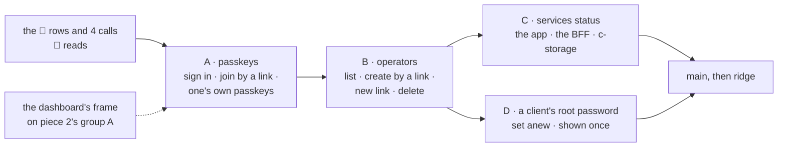

# The operator console: sign-in by passkey, adding an operator, the services status, a root's password

**Where it stands — 2026-11-01 11:10 +0700:** steps 1 to 9 and 17 done. Step 15 is done and its preview answered
(10 of 10 yes). Step 17, C's back end, meets its done-when (see the step). The review of line 24's two High, one Medium
and one Low are fixed on this branch; the rest are [open item 38](../open-items.md). `main`@fe7d31f is taken in, and the
whole check and `bash ops/test.sh` read green after it. **Next:** `act` on `ci.yml` in the human's terminal, then the
squash; then step 18, C's review, and step 16's fake run waits for the batch of full walks.

> **Drafted** 2026-10-29 by the machine, on the human's ask of 11:0x +07, from
> [ridge-app](2026-10-28-ridge-app.md) (where the operator came in), [ridge](2026-10-28-ridge.md),
> [the parked URL plan](2026-10-28-ridge-url.md), [the app frame](2026-10-27-app-frame.md),
> [the architecture](2026-10-27-architecture.md), [the big picture](2026-10-27-big-picture.md),
> [the visual report](2026-10-28-visual-report.md), [the open items](../open-items.md) and the
> operator's code on `main` at `570f2f8`. It builds on two plans not yet in `main`, named by path:
> the operator's dashboard (`docs/plans/2026-10-29-operator-dashboard.md` on `operator-dashboard`,
> committed at 11:15 +07 and decided by the human at 11:2x +07), whose frame holds the Operators and
> Services status sections this plan fills; and piece 2 (`docs/plans/2026-10-29-employee-list.md` on
> `employee-list` at `35ce945`), whose shape it follows: the UI walked on a fake back end first, then
> the back end, then the full walk. Read for it, none copied: the old console, a single-owner console
> of the old repo with a passkey sign-in and a status page ([what it teaches](#what-the-old-console-teaches)).
> **Amended** 2026-10-29 12:28 +07 by the human's answers of 12:2x +07 to the four calls: passkey only; any
> operator creates and deletes others and gives new-passkey links, "for now, will have operator
> level later"; a sign-in lasts one hour. Delete replaces this plan's disable, and one hour its 12.
> **Amended** 2026-10-29 12:36 +07 by the human's two answers of 12:3x +07: a delete erases everything
> ("no need, just delete everything for now"); the hour runs from the last use, renewed while the
> operator works up to a cap of 12 hours, and the passkey never expires ("yes, login session should
> expired for 1h; the passkey is last forever").
> **Amended** 2026-10-29 15:06 +07 by the human's read of the rows at 15:0x +07: the 23 kept, and a fourth
> slice, D: an operator sets a new password for a client's root.
> **Amended** 2026-10-29 15:28 +07 by the human's answer of 15:3x +07 to D's call ([call 5](#the-humans-calls)):
> "both plz, operator input or server made if no input".

## At a glance

| The human asked | Here |
| --- | --- |
| 1. An operator signs in by passkey | one button and the device's fingerprint, face or PIN; the first passkey made from a one-time link ([A](#a-passkeys)) |
| 2. An operator adds another | a name, then a join link shown once to send; any operator may delete another, never themselves ([B](#b-operators)) |
| 3. The services' status on the dashboard | the app, the BFF and c-storage: answering or not, their builds, their times, read each minute while open ([C](#c-the-services-status)) |
| 4. An operator updates a client's root password (15:0x) | from the clients list, the client's code typed to confirm; typed by the operator under piece 2's rule, or, left empty, made by the app and shown once; every session of that root ends ([D](#d-a-clients-root-password)) |

Each slice runs the human's flow: its pages on the fake, the human's preview, then the back end,
then the full walk. No new AWS resource, credential or change set. About 9½ machine days, an
estimate, not a date. **The human's four answers** ([below](#the-humans-calls)): passkey only; any
operator creates and deletes others and gives new-passkey links, the last one's from the terminal;
operator levels come later; a delete leaves no trace; a sign-in ends after an hour unused or 12
hours in, a passkey lasts, and one touch picks the task up again.

## The need

The human, 2026-10-29 11:0x +07, pointing at the old console: "next, plz help me check the console
UI too, just a plan is ok. 1. operator should be able to login via passkey 2. able to add new
operator 3. monitor services status on the ops dashboard". ridge-app made one operator, the human,
and put "a second operator" among its "not yet"
([its row 11](2026-10-28-ridge-app.md#L462)); the dashboard's plan leaves Operators and Services
status as pages saying "coming later" for this plan to fill. On reading the rows, 15:0x +07: "allow
operator to update password for the root user of clients" ([D](#d-a-clients-root-password)).

## What exists today

| Part | On `main` at `570f2f8` |
| --- | --- |
| How the operator signs in | a name and a password at `/operator` ([`OperatorApp.tsx#L57`](../../ui/src/OperatorApp.tsx#L57), [`app.ts#L175`](../../bff/src/app.ts#L175)); the hash is scrypt ([`records.ts#L31`](../../shared/src/records.ts#L31)) |
| How operators come to exist | one record, `operator.user.<name>` ([`records.ts#L9`](../../shared/src/records.ts#L9)). Locally `pnpm stack` writes it and prints its password ([`generator.ts#L40`](../../scripts/src/generator.ts#L40), [`stack.ts#L109`](../../scripts/src/stack.ts#L109)); on ridge `ops/operator.sh` writes it through the tunnel and shows the password on the terminal alone, `--replace` for a lost one ([`operator.sh#L3`](../../ops/operator.sh#L3), [`ridge.ts#L56`](../../scripts/src/ridge.ts#L56)). None is in an environment: the BFF holds c-storage's four names alone ([`env.ts#L4`](../../bff/src/env.ts#L4)), and an operator's key there was rejected ([ridge-app#L166](2026-10-28-ridge-app.md#L166)) |
| What ridge holds for them | the one operator the human made at ridge-app's step 17 ([ridge-app#L809](2026-10-28-ridge-app.md#L809)); its sessions |
| The session | a week per device, renewed in its last three days ([`sessions.ts#L13`](../../bff/src/sessions.ts#L13)); every operator route checks it and that the operator's record still exists ([`app.ts#L114`](../../bff/src/app.ts#L114)). Piece 2 re-keys sessions by a minted id, the operator's included |
| What c-storage exposes | `GET /health`, before its key gate: `{status, buildVersion}`, the build a commit or `dev` ([`server.go#L88`](../../c-storage/internal/server/server.go#L88), [ridge](2026-10-28-ridge.md#which-build-is-running)) |
| What the BFF exposes | nothing: no route reads `/health`, and no answer may carry its body ([ridge-app#L319](2026-10-28-ridge-app.md#L319), [row 23](2026-10-28-ridge-app.md#L474)). Its commit is the function's description, set at each deploy ([`app.sh#L130`](../../ops/app.sh#L130)); the bundle carries none ([`bundle.ts#L10`](../../bff/src/bundle.ts#L10)) |
| What the UI exposes | its commit in `index.html`'s metadata in S3 ([`app.sh#L150`](../../ops/app.sh#L150)); the bundle carries none |
| Who reads them | `ops/check.sh`, in each deploy or the human's terminal: the three commits agree ([`check.sh#L140`](../../ops/check.sh#L140)), and the box's memory, disk and OOM kills over ssh. No browser reads any of it |
| ridge's address | CloudFront's own name, in the stack's output `AppAddress` ([`env.yml#L547`](../../ops/env.yml#L547)), read by `ops/` ([`lib.sh#L654`](../../ops/lib.sh#L654)) and in no committed file. Through CloudFront and the HTTP API, the BFF sees the API's own host, not that name ([ridge-app#L244](2026-10-28-ridge-app.md#L244)) |

## What the old console teaches

The old console was one owner's: no operator model, invites or audit, so slice B is drawn from
ridge-app's create and piece 2's "added, shown once" instead.

| The old console's | Here | Why |
| --- | --- | --- |
| Passkeys by `@simplewebauthn/server` and `/browser`; discoverable, user verification required, attestation `none` | **kept** | it held; and here it runs on Node, which the library supports, where the old one ran it on a runtime it does not declare |
| The relying party read from each request's host | **changed**: from `APP_ORIGIN`, given at deploy | through the HTTP API the request's host is the API's own; the old one's own note: a new domain meant every passkey made again |
| Challenges in a table, five minutes, spent once by a delete | **changed**: signed by the BFF, spent in the operator's record | its options route wrote a row for every anonymous call |
| One passkey ever; the first made with a secret from the environment | **changed**: several operators, several passkeys each, the first by a terminal's one-time link | the human's ask; an environment secret was ridge-app's rejected shape |
| No password | **kept** ([call 1](#the-humans-calls)) | |
| Recovery planned as a one-off, never written | **changed**: the terminal's link is step 6's done-when | a recovery left for later was missing when needed |
| The counter stored; a synced passkey stays at 0 | **kept**: the challenge, not the counter, stops a replay | |
| A week's fixed session; sign-out ending every session, after a lost device kept one alive | **changed**: an hour from the last use, 12 at most ([call 3](#the-humans-calls)); a delete ends all of one operator's | sign-out stays one device, as piece 1's |
| A 500's body passed to the browser's ceremony, which then read "no passkey was given" | **kept as a lesson** (row 34) | |
| A software authenticator signing real ceremonies in tests; Chromium's virtual authenticator in the browser spec | **kept** | |
| A cron every five minutes reading each host's `/health`, posting each change to a chat, two failures before "down" | **changed**: read while the page is open; no cron, no alert | posting out of the private network needs an internet route, a fixed charge ([the architecture](2026-10-27-architecture.md#decisions--the-machines)); alerts stay [open item 1](../open-items.md) |
| A cached `/health` read as "up"; a page read once at load, so "down" showed only on reload | **kept as lessons**: never cached; read each minute while in view | |
| "Other commit": the served build against the reported | **kept**: one build or not | the deploy check already holds the same rule |
| A deploy that removed the database the passkey lived in | **kept as a hazard** ([below](#hazards-no-gate-catches)) | here c-storage's file is the only copy |
| A layout spec of 171 passes over widths, themes and data | **left** | the walk's screens alone |

## A: passkeys

**The ceremonies, by `@simplewebauthn/server` and `@simplewebauthn/browser`**, pinned in the
catalog at the newest release at least two weeks old. *Rejected:* none, by hand. The CBOR, COSE and
signature checks are the code most often got wrong, and the library is maintained and held in the
old console. *Rejected:* a hosted identity service. The BFF has no internet route, so reaching one
means a fixed-charge gateway, and it adds a vendor and a credential.

- **Discoverable and usernameless:** the sign-in page has one button; the device offers the
  operator's passkeys for this address; the answer carries the operator's id as its user handle,
  which names their record. User verification is required (a fingerprint, face or PIN), so a
  passkey alone is two factors. Attestation `none`: which device made it is not asked.
- **The challenge is signed, not stored.** Each options call mints a random challenge bound to its
  purpose (sign in, join by a link, add one's own) and to the link or operator it serves, good for
  5 minutes, signed under a key the BFF derives from its own service key. No options call writes
  anything. A sign-in spends its challenge in the operator's record, written with its tag, so the
  same answer replayed is a 401; a join spends its link. *Rejected:* a record per options call. The
  sign-in's options answer anyone, and a flood at the API's throttle would write about 170 MB a day
  to the box's 8 GB. *Rejected:* a new secret in the BFF's environment. It is one more key to make,
  mask and read on the box, while the service key is already a secret only the BFF and the box hold.
- **Where the passkeys live:** in c-storage, in the operator's own record ([the records](#the-records)).
- **The relying party:** each ceremony is checked against the address the BFF is given in
  `APP_ORIGIN`, never against the request's host:

  | Where | The address the operator opens | Relying party id | Given by |
  | --- | --- | --- | --- |
  | the local stack | `http://localhost:<port>`; today `http://127.0.0.1:<port>` ([`stack.ts#L140`](../../scripts/src/stack.ts#L140)), and no passkey takes an IP address | `localhost` | `pnpm stack`, which picks the front's port before it starts the BFF |
  | the fake: `pnpm fake`, the walks page | its own | none: a fake authenticator answers and no BFF runs | — |
  | ridge | CloudFront's own name, `https://…` | that name | `ops/app.sh`, from `AppAddress`, at each deploy, as a fifth name in the function's environment |
  | a signed client's stack | its name of ours | that name | decided with that stack, as whether it serves the operator's page at all ([ridge-app](2026-10-28-ridge-app.md#what-a-client-is)) |

  **What the parked URL plan means here.** It parks a public address for c-storage, not the app's,
  so nothing here waits for it. Its lesson applies: an address that changes strands what is bound
  to it. A passkey is bound to its host for good, so ridge keeping CloudFront's own name is what lets
  its operators' passkeys last; a name of ours there, or the distribution made again, means every
  operator joins again by a terminal link ([hazards](#hazards-no-gate-catches)). The API's own
  address, which answers anyone ([ridge-app#L252](2026-10-28-ridge-app.md#L252)), gains a caller
  nothing: an answer signed for one origin is refused at another.
- **The first operator and the first passkey:** the terminal makes the operator and a one-time
  link, `<address>/operator/join#<token>`: `pnpm stack` prints it, as it prints the operator's password
  today; `ops/operator.sh ridge <name>` shows it on the terminal alone, never in the log, as it shows
  the password today. The token is 32 random bytes, kept as its hash, in the fragment so no page
  request or log carries it, and sent once in a body. Opening the link names whose it is; making the
  passkey spends the link and signs the operator in.
- **The password retires** ([call 1](#the-humans-calls)): the password route and `operator.user.*`
  go. ridge's operator is made again by `ops/operator.sh` after the deploy; the old record is left
  unread, a few hundred bytes.
- **A lost passkey** ([call 2](#the-humans-calls)): each operator may hold several, a synced one
  counting as many devices; they add and remove them from their own page, never the last. With
  every passkey lost, a new-passkey link: from another operator (B), or for the last one from the
  terminal, `ops/operator.sh ridge --replace <name>`, which needs the human's AWS session, as today.
  Using it replaces every passkey the operator held and ends their sessions. The terminal stays the
  way back for the last operator, since no other operator is left to give the link.
- **The session** ([call 3](#the-humans-calls)): piece 2's module, naming the operator's id. It ends
  an hour after the operator's last call, or 12 hours after the passkey, whichever comes first;
  signing out ends it on that device. The check at each call reads the roster, so a deleted operator
  is a 401 at their next step.
  - *The renewal:* the session holds when it was issued and when it ends. A call more than 5 minutes
    after the last renewal moves the end to an hour ahead, never past 12 hours from the issue, written
    with its tag as piece 1's renewal is (a 412 re-reads, three times at most). So a session writes at
    most once in 5 minutes, and lapses between 55 and 60 minutes after the last call.
  - *What counts as use:* every call the operator makes. The status page's timed read each minute
    says so in its query and renews nothing, so a tab left in view does not hold a sign-in for 12
    hours; its "Check now" counts.
  - *The cap's number,* 12 hours, is the one the human said yes to as offered ("such as 12 hours");
    it stays the human's to move.
  - *The passkey never expires:* it lasts until its operator removes it, a new-passkey link replaces
    it, or a delete removes its operator.
- **When the sign-in ends mid-task,** after an hour away or at the 12 hours alike: the next call
  meets the BFF's 401, and the console asks for the passkey again over the page: one touch, with the
  page and what was typed kept beneath it. The call
  that met the 401 wrote nothing, since the session is checked first, and it is not sent again by
  itself: the operator presses it again. A passkey that names another operator starts the console
  over, dropping what was typed. A shown-once answer already on screen stays until the operator
  leaves it. The prompt says the sign-in ended, after an hour away or 12 hours in, and that what was
  typed is kept. This amends the dashboard's "a 401 drops the handle and shows the sign-in", which
  would lose a form at every lapse; it is A's change to the frame, in step 4. *Rejected:* a warning
  before the end. The prompt already costs one touch, and a timer adds a state to every page.
- **In the browser:** the UI reaches WebAuthn through one port, `passkeys`: the library's
  `startRegistration` and `startAuthentication` in the app; a fake that answers as a passkey would in
  the fake build and on jsdom, so the human's preview never makes a passkey on the human's own device.
  Only the browser's `NotAllowedError` reads "the passkey was not given"; a failed or unparsed
  options call reads "unavailable".
- **The walk:** yes, Playwright drives it in the human's terminal. The walk runs Chromium alone
  ([`playwright.config.ts#L20`](../../walk/playwright.config.ts#L20)), whose DevTools protocol
  offers a virtual authenticator (`WebAuthn.addVirtualAuthenticator`: internal, resident keys,
  verified user), as the old console's spec used. It answers for that page alone, so the human's own
  keychain is untouched, and no browser dialog enters a picture. The BFF's route tests sign real
  ceremonies with a software authenticator (an ES256 key pair, attestation `none`).

## B: operators

- **Who may:** every operator, alike ([call 4](#the-humans-calls)): create one, give one a
  new-passkey link, delete one, never themselves, so at least one operator always remains. No level
  yet, so no 403 enters, as the dashboard's table expects.
- **A fresh touch for what lasts** (the human, 2026-10-30: "20a"): B's create operator and new-passkey
  link take the same fresh touch as A's add and remove of a passkey (case row 60), since each is a
  lasting access a stolen session could otherwise make.
- **Operator levels later**, the human's "for now, will have operator level later": a piece of its
  own ([left behind](#left-behind)). *Room for it:* the roster's line for each operator gains a
  `level`, read with a default that grants today's rights, and the one session check every operator
  route runs answers it for the route to test; no key, record or route moves.
- **Creating one, the invite:** a name, unique among the operators not deleted. The operator is
  shown once the join link, with a copy button, and sends it by their own channel; no mail is sent,
  as piece 2 sends none. The new operator is "invited" until their first passkey is made. A link works
  once, within 24 hours, and only while it is the newest for that operator. *Accepted:* a link
  forwarded or seen within its day makes whoever opens it first that operator; the list shows when
  each joined, and a delete ends it. *Rejected:* 15 minutes, piece 2's QR rule: an invite crosses a
  chat and a working day, not a desk.
- **A new-passkey link** for an operator, invited or active, replaces their last link; for an active
  one it is the way back from lost passkeys (A). For the last operator, only the terminal gives it.
- **Delete,** after a check:
  - *Everything of theirs goes* (the human, 12:3x: "just delete everything for now"): their line in
    the roster, their account (passkeys and live link), and the links they made that were never used,
    so an invite they sent dies with them. Their sessions are refused at their next step, since the
    check finds no line. Nothing records that they were there or who deleted them.
  - *What it leaves:* an operator they added keeps their own line, whose "added by" holds an id that
    now names no one, shown as "—". The operators they invited stay invited, for another to send a
    new link or delete. The clients they made stay as they are; nothing records who made a client.
  - *Their name* is free again; a new operator of that name gets a new id. Nothing restores a deleted
    operator; they are created anew.
  - *Replaced:* this plan's earlier drafts, a disable that kept the account, then a delete that kept a
    roster line; the human chose to erase everything.
- **The server's checks:** every route but the four anonymous ones and sign-out ([the routes](#the-routes))
  needs an operator's live session. A taken name and the "not yourself" rule are checked against the
  roster read with its tag, and the write names that tag: two operators acting at once meet a 412,
  re-read, and the second is checked again, as its actor may have just been deleted.
- **No audit for now:** the roster holds who added each operator, by id, while both are there, and
  each passkey keeps when it was added and last used. No line records an act; the BFF's request log
  keeps its usual lines for 14 days on ridge, a method, a path and a status. An audit trail of the
  operators' acts comes with operator levels, if wanted ([left behind](#left-behind)), and the
  dashboard's "Activity" entry may show it.

## C: the services status

| Service | "Answers" means | Its build | Its time |
| --- | --- | --- | --- |
| the app's page | the page loaded: it is drawing this | stamped into the UI's bundle at its build, `dev` unstamped | — |
| the BFF, through CloudFront and the HTTP API | it answered the status call | stamped into the bundle at its build, `dev` unstamped | the call's round trip, timed by the page |
| c-storage | its `/health` answered `OK` to the BFF within 3 seconds | its `buildVersion` | that read, timed by the BFF |

- **How the BFF learns it:** `GET /api/operator/services`, behind an operator's session,
  reads c-storage's `/health` on the private address the BFF already reaches, through a `health()`
  the shared client gains with its Bruno parity. No scheduler, agent or AWS read: the BFF has no
  route out, and an interface endpoint is a fixed charge. The answer is never cached. *Amends*
  [ridge-app's row 23](2026-10-28-ridge-app.md#L474): this one answer carries c-storage's build, to a
  signed-in operator alone; the repository's commits are public, so a build names nothing secret;
  every other answer still carries none and `/api/health` stays a 404.
- **One build or not:** the page compares the three, as the deploy's check does. Two builds mean a
  deploy half done: c-storage ships first, then the BFF and the UI.
- **When one is down, the page still says which.** The session lives in c-storage, so with c-storage
  down no operator can be checked, and the status call answers 503. The page reads that answer: the
  BFF's own error shape means the BFF answered, and its 503 means c-storage did not, since every
  c-storage failure is the BFF's 503 ([`errors.ts#L22`](../../bff/src/errors.ts#L22)). A request that
  fails, or the edge's own error, means the BFF did not answer, and c-storage cannot be seen from
  here. The operator's "service unavailable" screen before sign-in says the same, naming the hop.

  | What fails | The page says |
  | --- | --- |
  | nothing | the three answer, one build, each time, when checked |
  | c-storage | the app answers; the BFF answers but cannot reach its storage; no one can sign in or save |
  | the BFF or the edge | the app answers; the BFF does not; c-storage cannot be seen from here |
  | the app's files | nothing: the page cannot load, and the browser shows its own error |

- **Refresh:** each minute while the page is open and in view, at once when shown again, and on
  "Check now"; nothing while hidden. A tab open all month is about 43,000 calls, under $0.10.
- **Left out:** the box's memory, disk and OOM kills (the check's, over ssh); a history of answers;
  the last deploy's time (GitHub's run shows it); an alert ([open item 1](../open-items.md)); any
  stack but the one the console runs on.

## D: a client's root password

It answers ridge-app's "not yet" for a root's password changed ([its row 11](2026-10-28-ridge-app.md#L462))
and its recap's ask: a ridge client's first root password went through a chat, and no route could
change it ([the recap](../recaps/2026-10-28-ridge-app.md#L113)).

- **Where:** "New root password", an action on each row of the dashboard's clients list. A slice of
  its own, since it acts on a client, not an operator; it takes the session and the prompt from A
  and the list from the dashboard, and nothing from B or C.
- **The password, typed or made** ([call 5](#the-humans-calls)): the form has a password field,
  optional, with its twin to type it again, as piece 2's own password form has.
  - *Typed:* it must pass piece 2's rule, `passwordIsValid` in `shared/src/staff.ts` (on
    `employee-list` at `66eb3c3`): 8 to 128 characters with a capital, a small letter, a digit and one
    of `@$!%*?&`, no space at either end, no control or format character (`\p{C}`), any script. The
    form refuses one that breaks it, or two that differ, before sending, with piece 2's words in both
    languages (`person.passwordHint`, `passwordInvalid`, `passwordMismatch`); the server refuses it
    again, a 400, through the same `setPasswordRequestSchema`. It is hashed in Unicode's composed form
    by piece 2's `hashPassword`, the one place that is done, and never shown back.
  - *Left empty:* the server makes one, with the maker a new client's first password comes from, and
    shows it once with a copy button, as the make-a-client answer shows it.
- **The check:** any operator signed in, as for the rest, until levels. The confirm names the
  company and its code, says what it ends, and sends nothing until the operator types the code. The
  route takes the code: the BFF answers 400 for a malformed one and 404 for an unknown one before it
  reads anything of the tenant.
- **What it writes:** the root's sign-in record, and nothing else. The BFF reads it for its tag, keeps
  its other fields, and writes a new hash and a new password generation through piece 2's one
  password function, the one the root uses to give a person a password, with that tag; a 412
  re-reads, three times at most. Nothing of the record goes back: the answer holds a made password
  alone, a typed one never, and no log line holds either.
- **What it ends:** every session of that root, at their next step, by piece 2's rule that a session
  names its sign-in record's password generation (`passwordAt` at its group A, a random generation
  from its step 14). The old password signs in no more.
- **Whether the root is told:** by the operator, who sends the new password by their own channel; no
  mail is sent, and the app says nothing more. The root's next step meets the sign-in, where the old
  password is refused. Once piece 2's group C lands, the root changes it to one of their own.
- **The walls it moves:** ridge-app's row 9 and the dashboard's row 10 said the operator never reads
  or changes a client's settings, users or sessions. Now it may write one record, a root's sign-in,
  through this one route; it still reads none of them back and never sees a root's old password, and
  the route list stays exact with the route added.
- **No audit** (the human's "just delete everything for now"): nothing records which operator set it,
  until levels. The BFF's request log keeps its usual line, a method, a path with the code and a
  status, for 14 days on ridge.
- **Left out:** any user's password but the root's, which the root gives (piece 2); the root told by
  the app.

## The records

Every key is built by `recordKeys` in `shared/src/records.ts`, the layout's one home.

| Record | Holds | Written by |
| --- | --- | --- |
| `operator.roster` | each operator's id, name and state (invited or active); who added them, by id, and when; when they joined; later, their level | the terminal's first operator, `If-None-Match: *`; every create and join, with its tag; a delete removes the operator's line, with its tag |
| `operator.account.<id>` | their passkeys: credential id, public key, counter, transports, when added and last used; their live link's hash; the challenges spent in the last 5 minutes | a create, `If-None-Match: *`; a join, a sign-in, a passkey added or removed, a new link, each with its tag; removed with its tag at a delete |
| `operator.link.<token hash>` | the operator's id; join or new passkey; who made it; when it ends | a link made, `If-None-Match: *`; removed with its tag when spent or replaced, or when its operator or its maker is deleted |
| `operator.session.<session id>` | piece 2's session, naming the operator's id | a sign-in or a join |

- **One roster, written last at a create.** A name taken and "at least one operator" hold under one tag.
  The account and the link are written first; a failure before the roster leaves them unreachable,
  and the name free. *Rejected:* a record per operator found by a name index and c-storage's list,
  the dashboard's shape for clients. The two rules would then read several records and race. Operators
  are a handful and change rarely, so one record under one tag is the simpler wall. *Price:* two
  creates at once meet a false 412 and re-read, a bounded retry.
- **Credentials apart from the roster,** so a sign-in writes one operator's record and never the
  roster. *Rejected:* everything in the roster, where every sign-in would write the one record every
  act needs.

## The routes

| Route | Its caller | Who may call it |
| --- | --- | --- |
| `POST /api/operator/passkey/options`, `POST /api/operator/passkey/sign-in` | the sign-in page | anyone |
| `POST /api/operator/join/options`, `POST /api/operator/join` | the join page: whose link it is, then the passkey made | anyone holding a live link |
| `GET`, `POST /api/operator/passkeys` (with its options and `confirm-options`), `DELETE /api/operator/passkeys/:id` | one's own passkeys; an add and a remove carry a fresh touch, from `confirm-options` (row 60) | the operator signed in, on their own |
| `GET`, `POST /api/operator/operators` | the Operators page; a create, answering the link once (B) | any operator signed in |
| `POST /api/operator/operators/:id/link`, `DELETE /api/operator/operators/:id` | a new-passkey link once; a delete (B) | any operator signed in, never on themselves for a delete |
| `GET /api/operator/services` | the Services status page (C) | any operator signed in |
| `POST /api/operator/clients/:code/root-password` | the clients list's "New root password", answering it once (D) | any operator signed in |
| `POST /api/operator/sign-out`, `GET /api/operator/me` | kept; `me` answers the id beside the name | as today |
| ~~`POST /api/operator/sign-in`~~ | the password's, retired (A) | — |

## The fake and the data set

Piece 2's and the dashboard's, extended, never copied.

- **The fake `Api`** gains each new call; each answer parses under the schema the real one is read
  with. **The fake authenticator** answers registration and sign-in with fixed JSON, after a tick.
- **Cues,** in piece 2's grammar: a 401 on the passkey sign-in (a passkey that opens nothing here), a
  dead link on the join, 409 on a create (the name taken), 401 on any call (the sign-in ended), 503
  on each call, the authenticator's "not given", and on the status call a 503 (c-storage) and no
  answer at all (the BFF). D sets its root password on the dashboard's three data-set clients.
- **The data set,** `@credo/shared/demo`: two active operators and one invited, one of them added by
  an operator since deleted, so "—" shows; invented names and fixed times. The stack's generator
  writes them through the BFF's own functions, their passkeys made from key pairs it then forgets, so
  the list reads the same in the fake and the full run. The walk's invited operator joins by the stack's link; the active one is signed in by a handle.

## The walks

The map ([QA](../conventions/qa.md) rule 7); a dash is a part of the day not built yet.

| | set up | staff | stock | orders | delivery |
| --- | --- | --- | --- | --- | --- |
| **the operator**, us, PC | the dashboard; ⭐ this piece: passkeys, operators, services, a root's password | — | — | — | — |
| **the client's admin**, PC | piece 1; piece 2 | piece 2 | — | — | — |

| `operator-passkeys`: sign in and keep one's passkeys (A) | Path | The one question |
| --- | --- | --- |
| 1. A join link opened: whose it is, who made it, "Make a passkey" | main | Would the new operator know what this is and what to do? |
| 2. One's own passkeys: when each was added and last used; add one; remove one | main | Would you keep a second passkey here, and tell them apart? |
| 3. The passkey not given | wrong | Does this say what to do? |
| 4. A passkey that opens nothing here | wrong | Would you know to ask another operator? |
| 5. A link used, too old or replaced | wrong | Would you know to ask for a new link? |
| 6. The sign-in ended mid-task, an hour away or 12 hours in: one touch to go on, what was typed kept | wrong | Would you know nothing typed is lost, and to press save again? |

| `operator-team`: who else may sign in here (B) | Path | The one question |
| --- | --- | --- |
| 1. The operators: name, state, added by whom ("—" once that one is deleted) and when, passkeys, last sign-in; you marked | main | Is this what you need to know of who may sign in here? |
| 2. Creating an operator: a name | main | Is a name all you need to add someone? |
| 3. Added: the join link, once, to send | main | Would you know to send this, that it works once within a day, and that no mail goes? |
| 4. A new link for an operator who lost their passkeys, after a check, once | main | Is it clear their old passkeys stop when they use it? |
| 5. Deleting an operator, after a check: nothing of them is kept | main | Is it clear they are signed out at once, nothing of them is kept, and they come back only by a new invite? |
| 6. The name taken | wrong | Does this say what to fix? |

| `operator-services`: whether each service answers (C) | Path | The one question |
| --- | --- | --- |
| 1. All three answer, one build | main | Would you know from this that all is well? |
| 2. Two builds: a deploy half done | wrong | Would you know what is out of step? |
| 3. c-storage does not answer | wrong | Would you know what is down and what it stops? |
| 4. The BFF does not answer | wrong | Would you know what is down, and what cannot be seen? |
| 5. Before sign-in: the service unavailable, naming the hop | wrong | Would you know where it fails without signing in? |

| `operator-root-password`: a client's root password set anew (D) | Path | The one question |
| --- | --- | --- |
| 1. The confirm, a password typed: the company, its code typed, the password twice, what it ends | main | Would you know whose password this changes, that their root is signed out, and that leaving it empty makes one? |
| 2. A typed password refused on the form, the rule said | wrong | Does this say what to fix? |
| 3. Left empty, made: the new password, once, to copy and send | main | Would you know to send it to the root, and that it is not shown again? |
| 4. Not set: the service failed, the password as it was | wrong | Would you know nothing changed, and to try again? |

- **21 screens**, each in Vietnamese and English at PC 1280, tablet 768 and phone 390: 42 answers and
  126 bases. The dashboard's `operator-setup` screen 1, the sign-in, changes words with A (one passkey
  button): asked again, its 6 bases moved.
- **Each failure is provoked** in the fake run by its cue, and in the full run as the product meets
  it: a link opened twice; a virtual authenticator holding a passkey no operator has; one with user
  verification off; a name taken and a delete through the real API; the sign-in's end as the session
  ended through the real API's sign-out under a typed form, since a run cannot wait an hour. The status
  page's failures and D's are stubbed at the browser, as piece 1's screen 7 is: the stack cannot stop
  c-storage under a running spec. D's refused password is typed into the real form. After a typed
  reset and after a made one, the full run signs in as that root on the client's link: the old
  password refused, the new one in; no picture.
- **The pictures carry no minted value:** links and passwords masked; every time (added, last used, checked, how
  long) fixed at its source, in the fake and in the stack's seed alike, never masked (QA rule 7, decided
  10-31); no id shown.
- **Each language and width of the full run starts on a stack of its own**, as the dashboard's does.

## The case table

👤 marks a business row, for the human's read ([QA](../conventions/qa.md) rule 1). Each row names
its slice.

| # | 👤 | The case | Held by |
| --- | --- | --- | --- |
| 1 | 👤 | A: An operator signs in at `/operator` with a passkey alone: one button, then their device's fingerprint, face or PIN; no name and no password is typed | BFF route, `operator-passkeys.route.test.ts`; unit, ui; the walk |
| 2 | 👤 | A: An operator's first passkey is made from a one-time link: it shows whose link it is and who made it; making the passkey signs them in, and the link then works no more | BFF route; unit, ui; the walk |
| 3 | 👤 | A: The first operator and their link come from the human's terminal, `pnpm stack` locally and `ops/operator.sh` on ridge, shown there once and in no log, where the first password shows today | unit, scripts; the script's search of its own log |
| 4 | 👤 | A: A link works once, within 24 hours, and only while it is the newest for that operator; a used, old or replaced one says so and to ask for a new one | BFF route; unit, ui; the walk |
| 5 | 👤 | A: An operator may hold several passkeys, say a laptop's and a phone's; from their menu they see when each was added and last used, add one, and remove one, never the last | BFF route; unit, ui; the walk |
| 6 | 👤 | A: An operator who lost every passkey gets a new-passkey link, from another operator or, for the last one, from the human's terminal (`--replace`); using it replaces every passkey they held and signs them out everywhere (call 2) | BFF route; unit, scripts; the walk |
| 7 | 👤 | A: No operator signs in with a password any more; ridge's operator is made again from the terminal (call 1) | BFF route: the route list held exact |
| 8 | 👤 | A: A sign-in ends an hour after the operator last used the console, or 12 hours after the passkey, whichever comes first; working keeps it; the passkey itself never expires; signing out ends it on that device; when it ends mid-task, the page asks for the passkey again over itself, one touch, keeps what was typed, and the operator presses save again (call 3) | BFF route, with a clock the test moves; unit, ui; the walk |
| 9 | 👤 | A: A passkey asked for and not given says so and offers to try again; a passkey that opens no operator here says so without saying why; a service failure says the service is unavailable, never "no passkey" | unit, ui; BFF route; the walk |
| 10 | 👤 | B: The Operators page lists each operator, invited or active: name; who added them and when, "—" once that one is deleted; how many passkeys they hold; when they last signed in; the one signed in marked as you | BFF route, `operator-team.route.test.ts`; unit, ui; the walk |
| 11 | 👤 | B: Any operator creates another by a name and is shown once the join link to send them; no mail is sent; the new one is invited until their passkey is made | BFF route; unit, ui; the walk |
| 12 | 👤 | B: A name is unique among the operators not deleted; a taken one is refused, and the operator holding it unchanged | BFF route; the walk |
| 13 | 👤 | B: Any operator gives another, invited or active, a new-passkey link, shown once; it replaces their last link; for the last operator, only the human's terminal can (call 2) | BFF route; unit, scripts; the walk |
| 14 | 👤 | B: Any operator deletes another, after a check: they leave the list, their sessions end at their next step, their passkeys and live link go, and so do the links they made and no one used; nothing of them is kept; their name is free again; no one is restored, but created anew | BFF route; unit, ui; the walk |
| 15 | 👤 | B: No operator deletes themselves, so at least one operator always remains | BFF route, with two deletes racing; unit, ui |
| 16 | 👤 | B: Every operator may do all of this alike, the first included, until operator levels come as a later piece; none reads a client's settings, users or sessions, and none changes them but a root's password, D's (ridge-app's row 9, amended) (call 4) | BFF route: the route list held exact |
| 17 | 👤 | B: A deleted operator leaves no trace: no record says they were there or who deleted them, and an operator they added shows "—" as its adder; an audit trail comes with operator levels, if wanted | BFF route, the records read back |
| 18 | 👤 | C: The Services status page shows the app's page, the BFF and c-storage: whether each answers, the build each runs, and whether all three run one build | BFF route, `operator-services.route.test.ts`; unit, ui; the walk |
| 19 | 👤 | C: It shows how long the BFF and c-storage took and when it last checked; it checks each minute while open and in view, at once when shown again, and on "Check now" | unit, ui; the walk |
| 20 | 👤 | C: When c-storage does not answer, it says the BFF answers but cannot reach its storage, so no one can sign in or save; when the BFF does not answer, it says so and that c-storage cannot be seen; the "unavailable" screen before sign-in says the same | unit, ui; BFF route; the walk |
| 21 | 👤 | C: It shows the stack it runs on alone, and alerts no one when no page is open (open item 1 stays) | none: the human's to read |
| 22 | 👤 | A to D: Every new screen reads fully in Vietnamese and English, at PC, tablet and phone widths | unit, ui; the walk |
| 23 | 👤 | A to D: Not yet: operator levels, a later piece; a root told by the app; mail; recovery codes; a passkey's own name; an operator renamed or restored; an audit trail of the operators' acts; the box's memory and disk; a history of answers; an alert; the last deploy's time; another stack's status; the Activity page | none: the human's to move |
| 24 | | A: Each ceremony is checked against the relying party and origin of `APP_ORIGIN`, never the request's host; user verification required; attestation `none`; the operator found by the user handle | BFF route |
| 25 | | A: A challenge is minted per options call, bound to its purpose and to its link or operator, good for 5 minutes, signed under a key derived from the BFF's service key; no options call writes a record | BFF route, c-storage's records counted; unit, bff |
| 26 | | A: A sign-in writes its challenge into the operator's record with its tag, so the same answer again is a 401; a join removes its link with its tag first, so two openings make one passkey | BFF route, with a client that races on a chosen write |
| 27 | | A: An unknown user handle, an operator not active, an unknown credential, a failed signature or a dead challenge is one 401 that does not say which | BFF route |
| 28 | | A: The counter is kept and checked as the library does; a synced passkey's 0 passes | BFF route, a software authenticator at 0 and counting |
| 29 | | A: A link's token is 32 random bytes in the address's fragment and a request's body, never a path or query; stored as its hash; one live link per operator | BFF route; unit, ui |
| 30 | | A: Removing one's last passkey is a 409, and it stays | BFF route |
| 31 | | A: `APP_ORIGIN` is required, https or localhost; `pnpm stack` gives the front's localhost address, `ops/app.sh` ridge's `AppAddress`; `check.sh` reads five names, and the sign-in options' relying party through CloudFront is the app's host | unit, bff; `ops/test.sh`; `check.sh` |
| 32 | | A: The password route and `operator.user.*` are gone; the route list is held exact with the routes added | BFF route |
| 33 | | A: The UI reaches WebAuthn through one port; the fake build and jsdom use a fake one and never the browser's | unit, ui; unit, scripts: a read of the fake bundle |
| 34 | | A: Only the browser's `NotAllowedError` reads "not given"; options that fail or do not parse read "unavailable" | unit, ui |
| 35 | | A: Route tests run real ceremonies through a software authenticator; the walk through Chromium's virtual authenticator | BFF route; the walk |
| 36 | | B: The roster is written with its tag at every create, join and delete; a 412 re-reads and checks the actor again, three times at most | BFF route, with a client that races on a chosen write |
| 37 | | B: Every session check reads the roster; a deleted operator's session is a 401 at its next request | BFF route |
| 38 | | C: `GET /api/operator/services` needs an operator's session, reads c-storage's `/health` within 3 seconds, and is never cached; no other answer carries the `/health` body, and `/api/health` stays a 404 | BFF route; `check.sh` |
| 39 | | C: The BFF's bundle and the UI's files carry the commit they were built from, `dev` unstamped, given by `ops/app.sh` | unit, bff; unit, ui; `check.sh` |
| 40 | | C: The page takes the BFF's own error shape as "the BFF answered" and its 503 as c-storage silent; anything else as the BFF silent; `me` and `services` answer 503 for a c-storage failure alone | unit, ui; BFF route |
| 41 | | C: The shared c-storage client's `health()` sends what its Bruno request sends | unit, shared |
| 42 | | C: The page reads nothing while hidden | unit, ui |
| 43 | | A to D: Every answer of the fake's new calls parses under the real one's schema; a cue makes each failure once, the authenticator's included | unit, ui, `fake.test.tsx` |
| 44 | | A to D: Each new walk screen is a fake scene; the spec's screens equal the walks page's list | unit, visual, `walks.test.ts` |
| 45 | | A to C: The operator's view gains its id, read with a default at the UI's wire boundary | unit, shared |
| 46 | | A: A 401 opens the passkey prompt over the page, which stays mounted; the call that met it is not sent again by itself; a passkey naming another operator starts the console over | unit, ui |
| 47 | | B: A delete removes the operator's roster line, account, live link and the unused links they made, each with its tag; an "added by" naming them then names no one | BFF route, the records read back |
| 48 | | A: A session holds its issue and its end; a call more than 5 minutes after the last renewal moves the end an hour ahead, never past 12 hours from the issue, with its tag; the status page's timed read renews nothing | BFF route, with a clock the test moves and c-storage's writes counted; unit, ui |
| 49 | 👤 | D: From the clients list, any operator sets a new password for a client's root, after typing the client's code to confirm: they type one, twice, or leave the field empty for the app to make one; no mail is sent | BFF route, `operator-root-password.route.test.ts`; unit, ui; the walk |
| 50 | 👤 | D: A typed password follows piece 2's rule: at least 8 characters with a capital, a small letter, a digit and one of `@$!%*?&`, no space at either end; one that does not, or two that differ, is refused on the form with piece 2's words before anything is sent; a typed password is never shown back | unit, ui; BFF route; the walk |
| 51 | 👤 | D: A password the app makes is shown once, with a copy button, to send to the root, and never again | BFF route; unit, ui; the walk |
| 52 | 👤 | D: Either way, every session of that root ends at their next step and the old password signs in no more; the root learns it from the operator, and the app tells them nothing more | BFF route; the walk |
| 53 | 👤 | D: The operator still never sees a root's old password and reads nothing of a client's settings, users or sessions; setting it writes the root's sign-in alone | BFF route: the route list held exact, the records read back |
| 54 | 👤 | D: A setting that fails says so, and the root's password is as it was | BFF route; unit, ui; the walk |
| 55 | | D: The route needs an operator's session; a malformed code is a 400 and an unknown one a 404, before anything of the tenant is read; the body is piece 2's `setPasswordRequestSchema`, so a typed password that breaks the rule is a 400; the answer holds a made password alone, a typed one never, and no log line holds either | BFF route, the logger's output searched |
| 56 | | D: The root's sign-in record is read for its tag and written with a new hash, made in composed form by piece 2's `hashPassword`, and a new generation, by piece 2's one password function, with that tag; a 412 re-reads, three times at most | BFF route, with a client that races on a chosen write; the same word typed composed and decomposed signs in |
| 57 | | D: The form sends nothing until the code typed equals the row's, and a typed password passes `passwordIsValid` and equals its twin, both checks from `shared/` | unit, ui |
| 58 | 👤 | A: Adding a passkey on a device that already holds one of the operator's says so and what to do (add one on another device or a security key), not "try again"; decided by the human 2026-10-30 (22a) | unit, ui, the browser port's `InvalidStateError` and the fake's honouring of `excludeCredentials` |
| 59 | 👤 | A: A join page tells a link made from the command line ("This link was made from the command line.") from one whose maker was deleted ("The operator who made it has since been deleted."); the BFF's answer carries `madeByTerminal`, read as false when an older BFF says nothing; decided by the human 2026-10-30 (21a) | BFF route; unit, shared; unit, ui; unit, ui and the BFF route (the words are first seen on ridge at step 26) |
| 60 | 👤 | A: Adding a passkey or removing one asks, in the same act, for a fresh touch of one of the operator's own passkeys, on a challenge made for that act, spent in the account with its tag, checked against `APP_ORIGIN` with user verification; a session alone does neither, so a stolen session cannot put in the thief's passkey or take out the owner's; a refused touch is a 403 and changes nothing; B's create operator and new link will take the same touch; decided by the human 2026-10-30 (20a) | BFF route; unit, shared, ui, scripts (`stack.test.ts`); the walk |

Each row is seen red once before it counts ([QA](../conventions/qa.md) rule 2); every package stays
at 100 % (rule 8), and no visual test prints a React act warning (`main`'s `f8c85e6` makes one red).

## The human's calls

Each needed the human's sense of risk; all four are answered, and the plan follows the answers.

1. **The password.** *Recommended:* it retires; an operator signs in by passkey alone, and the
   terminal's one-time link is the way in for the first operator and the last.
   - *For:* a passkey cannot be phished, typed into the wrong page or pasted into a chat, as a ridge
     client's first root password was ([ridge-app's recap](../recaps/2026-10-28-ridge-app.md#L113));
     one way in to build, walk and keep; the terminal shows a link that works once, not a secret
     that lives on.
   - *Against:* each operator needs a device that makes passkeys: a current browser on a Mac,
     Windows, iOS or Android does, and a phone can serve a PC through the browser's own prompt.
   - *The alternatives:* the password kept beside the passkey, two doors where the weaker decides;
     a password only to make the first passkey, which the link already does without a lasting secret.

   **Answered** 2026-10-29 12:2x +07 by the human: "NO, only passkey". As recommended.
2. **A lost passkey.** *Recommended:* a new-passkey link from another operator; for the last one,
   from the human's terminal (`ops/operator.sh ridge --replace <name>`), which needs the human's AWS
   session, as `--replace` does today. Using it replaces the lost passkeys and ends their sessions.
   - *For:* nothing stored to guard, and the link is what the join already needs.
   - *Against:* an only operator who lost both their passkeys and the machine holding their AWS
     session waits until AWS access is back. A second passkey, or a synced one, is the guard.
   - *The alternatives:* recovery codes shown at the join, one more secret to keep and a screen to
     build; mail, a sender, a vendor and a credential.

   **Answered** 2026-10-29 12:2x +07 by the human: "Operator can: create / delete other operators;
   issue new passkey link (for now, will have operator level later)". The link as recommended; the
   terminal stays for the last operator ([A](#a-passkeys)); delete replaces disable ([B](#b-operators)).
   **Then,** 12:3x +07, on what a delete keeps: "no need, just delete everything for now". A delete
   leaves no trace ([B](#b-operators)).
3. **How long a session lasts.** *Recommended:* 12 hours from sign-in, not renewed.
   - *For:* a handle taken from the browser's storage opens the console for a day at most, not a
     week; a passkey sign-in is one touch. *And, added at step 8's review (2026-10-30):* a stolen
     session could still add the thief's passkey and remove the owner's, a lasting access with the
     owner locked out, so adding or removing a passkey asks for a fresh touch of a passkey held, in
     the same act (the human, 2026-10-30: "20a").
   - *Against:* a sign-in each working day.
   - *The alternative:* a week, renewed in its last three days, as today and as a client's.

   **Answered** 2026-10-29 12:2x +07 by the human: "1 hour"; **then,** 12:3x +07, asked whether that
   meant an hour since the last use: "yes, login session should expired for 1h; the passkey is last
   forever". An hour from the last use, renewed while the operator works, up to the 12 hours offered;
   the passkey never expires; the prompt over the page keeps a task alive past either end
   ([A](#a-passkeys)).
4. **The first operator, and who may add others.** *Recommended:* the human holds the first, made
   from the terminal as today; then every active operator may add, give a new link to and disable any
   other, alike, never themselves.
   - *For:* no roles to build or walk; the roster says who did what; the terminal brings anyone back.
   - *Against:* any operator may disable all the others.
   - *The alternative:* an owner alone adds and disables: a role, a 403 page and a walk screen more,
     and the owner's own loss still needs the terminal.

   **Answered** 2026-10-29 12:2x +07 by the human: "Any operators (for now, will have operator level
   later)". As recommended, with delete for disable; operator levels a later piece
   ([left behind](#left-behind)).
5. **A root's new password, typed or made** (D, asked at 15:0x). *Recommended:* made by the server
   and shown once, as a new client's first password is.
   - *For:* no rule to type against; the operator never chooses one they may reuse.
   - *Against:* the operator cannot give a password agreed with the root beforehand.
   - *The alternative:* typed by the operator, under piece 2's password rule.

   **Answered** 2026-10-29 15:3x +07 by the human: "both plz, operator input or server made if no
   input". Typed under piece 2's rule, or made when the field is left empty ([D](#d-a-clients-root-password)).

**No credential or change set is the human's here.** The template is unchanged (`AppAddress` is an
output already), the deploy role gains nothing, and the challenge's key is derived from a key the
BFF holds. The human's acts are a push of `main`, `ops/operator.sh ridge` once after it, and a
passkey on the human's own device for ridge's address (step 26).

## Order

- **A, then B, then C and D.** The invite's end is the first passkey, made from a link: A builds the
  link, the join page and the ceremonies, issued from the terminal; B adds the console's side of the
  same link. B first would build an invite for a password, then throw it away. C consumes nothing
  from A or B: its steps may take the first free slot, such as while the human previews A or B. D
  consumes A's session and prompt and the dashboard's clients list, nothing from B or C: it may take
  the first free slot after A.
- **After the dashboard, which is after piece 2.** The dashboard's branch starts from piece 2's group
  A (`35ce945`) and merges into `main` after piece 2. This branch restarts from the dashboard's tip once
  its pages exist (step 3) and merges after it. It consumes from the dashboard: the frame and its
  user menu, the Operators and Services status pages it replaces, the operator's walk as fake scenes
  with a `fake` and a `full` project, and the full run's stack per language and width. From piece 2:
  the fake `Api`, `?fake`, the cues, `pnpm fake`, the scenes, sessions keyed by a minted id, and for
  D its one password function and the password generation a session names.
- **The files all three touch**, each an addition beside the other's, the second to merge keeping
  both: `ui/src/i18n/en.ts` and `vi.ts`; `shared/src/wire.ts`, `records.ts` and `demo.ts`;
  `ui/src/api.ts`, `fake.ts` and `scene.ts`; `bff/src/app.ts`, `sessions.ts` and
  `operator.route.test.ts`; `scripts/src/generator.ts` and `stack.ts`; `visual/src/walks.ts` and
  `visual/answers.json`; `walk/specs/operator.spec.ts` and its bases; for D, the dashboard's clients
  list page. Piece 2's groups B to D still
  change the shell, the words, the fake, the walks and the sessions.

## What it costs

- **AWS:** nothing added. A status page open all month is under $0.10; a ceremony is a few c-storage
  reads, free inside one zone. ridge: one more name in the function's environment.
- **The human's time:** the read, about 30 minutes; the four fake walks, about 90; the four full
  runs, about 20 each; ridge, about 20.
- **The machine's:** about 9½ days ([steps](#steps)), an estimate: A about 4½, B about 2, C about 1,
  D about 1½, the close half a day. The old console's single-owner sign-in, with its keys page, took about 490 lines
  against 300 planned.

## Steps

- [x] **1. This plan.** Who: 🤖, 10-29. Done when: committed on `operator-console`, the path, name
  and address greps clean and every relative link and anchor resolving. *Evidence:* this commit.
  Before it, the path grep of [documentation](../conventions/documentation.md#nothing-machine-local-or-personal-in-a-committed-file),
  ridge-app's address grep and a 12-digit grep found nothing in this file, and the name grep no
  person; all 68 relative links resolved, anchors and line numbers included, by a check seen red
  once on a copy with a broken anchor and a line past a file's end.
- [x] **2. The human's read.** Who: 👤, about 30 minutes. Done when: each 👤 row kept or corrected and
  calls 1 to 4 answered, dated. **Then stop:** no code before it. *The calls:* answered 2026-10-29
  12:2x +07, and two points after them at 12:3x, each under its call; the plan amended to them each
  time. *The rows:* the human, 2026-10-29 15:0x +07, after reading the 23: "yes, OK too, with minor
  change: allow operator to update password for the root user of clients". Rows 1 to 23 kept as
  written; the change is slice D, its business rows 49 to 54 read at its preview (step 21), and its
  call answered at 15:3x ([call 5](#the-humans-calls)).
- [x] **3. The base.** Who: 🤖, about 15 minutes, after step 2 and the dashboard's pages (its steps 4
  to 6). Done when: this branch sits on `operator-dashboard`'s tip, and `git log operator-dashboard..`
  reads this plan's commits alone. **Then stop:** only this plan moved.
  *Done 2026-10-30 01:26 +0700:* `git rebase --onto 29e949f 570f2f8` replayed this plan's five commits
  (old tip `1239006`, new tip at the commit below); `git log operator-dashboard..operator-console` reads
  them alone; `pnpm install --offline` exit 0; `tsc --noEmit` exit 0 in `ui/` and `bff/`.

**Slice A, passkeys.** Rows 1 to 9, 22, 24 to 35, 43 to 46, 48.

- [x] **4. A's pages and walk, on the fake.** Who: 🤖, after step 3, about a day and three quarters. The
  ceremonies' JSON shapes and the link's answers in `shared/`; the `passkeys` port and its fake; the
  new calls in `createApi` and the fake, with their cues; the sign-in, the join page and one's own
  passkeys, each state; the prompt over the page when the sign-in ends; the status page's timed read
  marked; A's six scenes and the spec's `fake` project; the fake run's script in the credo root's
  `one-off/`. Done when: the UI and shared halves of A's rows each seen red once;
  `walks.json` reads A's screens and `operator-setup` screen 1 waiting; the touched packages at 100 %,
  no warning; eslint, prettier and knip clean. *Model files:* the dashboard's pages, `ClientMade.tsx`
  (shown once), piece 2's `fake.ts` and `scene.ts`. **Then stop:** for the preview.
  *Done 2026-10-30 02:07 +07:* the shared half of A's rows red first (the shapes' tests failed on the
  missing code, then passed); the UI's by mutation, each of nine rules broken once and put back (the
  same-operator prompt, the join's handle, the 401 read as "no passkey", the prompt's Escape, the
  last passkey, the console starting over, the fresh options, `NotAllowedError` alone, the spent
  link). `pnpm check` exit 0, shared 73, ui 292, bff 161, scripts 79, visual 225 tests, each package
  at 100 %. `pnpm report`: 12 waiting (A's six screens), 2 asked again (`operator-setup` screen 1, whose
  words changed), 66 yes. The 34 screens older than A drew the same DOM in both languages as at
  `29e949f`, but that sign-in. *Not done here:* the status page's timed read marked (C's page is its
  only caller, so it comes with C); the passkeys full run (step 7).

- [x] **5. A's fake walk.** Who: 👤, after step 4, about 30 minutes, and a round for each "no". The
  human answers each screen on the newest walks page and pastes the block; the machine runs
  `pnpm answers`; last, the fake run's script. Done when: none of A's screens waiting, no open "no";
  the fake run's log read whole, its pictures counted. **Then stop:** A's UI is fixed here.
  *Answers recorded 2026-10-30 05:54 +07:* the human,
  2026-10-30 05:4x +07, about the walks page of build `2026-10-30-020900-223b5f8a7` (12 waiting, 2 asked
  again, 0 no, 66 yes): "on the operator console's passkey preview, plz mark yes for all". The 14
  screens, yes in the human's own plain mode: `operator-setup:op-1-sign-in` and
  `operator-passkeys:pk-1-join`, `pk-2-passkeys`, `pk-3-not-given`, `pk-4-no-operator`, `pk-5-link-dead`
  and `pk-6-sign-in-ended`, each in `vi` and `en`, from the block that page's Copy gives, built from that
  build's `walks.json`. `pnpm answers`: "14 written to answers.json, 0 refused". `pnpm report` after it,
  build `2026-10-30-055328-223b5f8a7-changes`: "0 waiting, 0 asked again, 0 no, 80 yes".
  *Fake run, read 2026-10-30 07:13 +0700:* script `20261030-0147-fake-run-operator-passkeys.sh`, log
  `20261030-0147-fake-run-operator-passkeys.log`, both on `71142cb`, clean. Run 1, the human, 05:59:22 to
  05:59:32 +07: "== verdict: green: 36 pictures (6 screens x 2 languages x 3 widths)", Playwright "6 passed",
  "36 pictures, 36 expected", smallest 27218 bytes, no warning; folder
  `fake-run-operator-passkeys-2026-10-30-055922-71142cb`. It ran at a one-minute load of about 20 (19.94 at
  05:59:49), against the script's own hazard (its header, lines 8 to 9). Run 2, the human, 07:11:31 to
  07:11:40 +07, the same commit at load 2.97: the same verdict, "6 passed (6.2s)", "36 pictures, 36
  expected", smallest 27218 bytes, no warning, nothing secret, the 38-line log read whole; folder
  `fake-run-operator-passkeys-2026-10-30-071131-71142cb`. The two sets compared with `cmp -s`: the same 36
  names (`pk-1-join` to `pk-6-sign-in-ended`, `en` and `vi`, at 1280, 768 and 390), all 36 byte-identical, so
  the load moved no pixel. **Run 2's folder is step 9's reference**, taken quiet. The log shows about 10
  seconds (each browser run about 1 s, one worker) and no build time; the script's header says about 4
  minutes, which overstates it.
- [x] **6. A's back end.** Who: 🤖, after step 5, about two days and a quarter. The library pinned; the routes, the
  challenge, the roster, account and link records, the session's hour from the last use and its
  12-hour cap; `APP_ORIGIN`; the password
  route and record removed; the software authenticator; `pnpm stack` prints the operator's link
  (`CREDO_OPERATOR_LINK` in place of `CREDO_OPERATOR_PASSWORD`, with `CLAUDE.md`'s line); `ops/operator.sh`
  shows a join link, and with `--replace` a new-passkey one; `ops/app.sh` gives `APP_ORIGIN`;
  `check.sh` reads five names and the relying party. Done when: the BFF and scripts halves of A's
  rows each seen red once; `pnpm check` and `bash ops/test.sh` green; live, `pnpm stack -- <command>`:
  a script with the software authenticator joins by the link, signs out and in, adds a passkey,
  removes one, is refused the last, replays an answer (401), and an options call leaves the record
  count as it was. *Model files:* `bff/src/clients.ts` (writes that must find nothing, the index
  last), `sessions.ts`, `scripts/src/ridge.ts`. **Then stop:** for the full run's script.

  *Done 2026-10-30 10:26 +0700:* the pin `cf56ad8`, the rest `ebe878d`. *The pin:* `@simplewebauthn/server`
  14.0.3, released 2026-09-25, the newest release there is and past the cutoff of 2026-10-16; the browser
  half is the 14.x line's only release, 14.0.0 (2026-09-02), so no newer browser half was out on the cutoff
  either; read from the registry's metadata, no pnpm command; the human's install at 09:34 +07 added 24
  packages, no warning. *Model files opened first:* `bff/src/clients.ts` (writes that must find nothing,
  the roster last, as `createOperator` writes), `sessions.ts` (generalised, not copied: a `sliding` policy
  beside the tenant's), `scripts/src/ridge.ts`. *What stands:* `bff/src/operator-auth.ts` (the routes and the
  session check), `operators.ts` (roster, account and link records), `challenge.ts` (signed, not stored),
  `env.ts` (`APP_ORIGIN`, https or localhost); `shared/src/records.ts`; `scripts/src/stack.ts` (the front's
  port picked before the BFF, the address `http://localhost:<port>`), `ridge.ts`, `generator.ts`,
  `cli.ts`; `ops/` (`operator.sh` shows the link, `app.sh` sets `APP_ORIGIN`, `check.sh` reads five
  names and the relying party through the edge); `CLAUDE.md`'s `CREDO_OPERATOR_LINK`.
  *Red once:* the software authenticator is `bff/tests/authenticator.ts`, an ES256 key pair with
  attestation `none` whose JSON the real library verifies. The BFF's route tests were written after the
  code (the order slipped), so their red is by mutation, each run on its own test and put back: a sign-in
  accepted from another origin ("expected 200 to be 401"), user verification not required at sign-in and at
  join ("expected 200 to be 401" and "expected 200 to be 400"), a challenge good for any purpose or link
  ("expected 'c1' to be null", and at the route "expected 200 to be 400"), a challenge that never ends, a
  spent challenge not checked (a synced passkey's replay, "expected 200 to be 401"), a counter not handed to
  the library, a link that never ends, an older link still live ("expected 200 to be 404"), the last
  passkey removed ("expected 200 to be 409"), a replacing link that keeps the sessions, a session idling
  two hours, no 12-hour cap, a renewal at every call and a marked read that renews ("expected 2 to be 1"),
  the roster not read at a call, the name not checked again after a 412 ("expected { …(2) } to be 'taken'"),
  and a join that keeps its link ("expected [ 200, 200 ] to deeply equal [ 200, 404 ]"). The route list,
  `APP_ORIGIN` and the environment's names were red against the new code before their tests were moved:
  `operator.route.test.ts` "serves exactly these routes" showed the six added routes, and `server.test.ts`
  and `lambda.test.ts` "invalid environment: …, APP_ORIGIN". The scripts half, by mutation too:
  `io.show` made `io.out` (the link in the log: "expected [] to deeply equal [ Array(1) ]") and a replace
  link made a join link ("expected { …(4) } to match object { kind: 'replace', madeBy: null }"); `ops/test.sh`
  with the five names put back to four, the link echoed into the log and `APP_ORIGIN` left out of the
  function's environment: six FAIL lines naming "the function holds the five variables", "the log holds the
  operator made and neither the link nor its token" and "holds the app's address as the origin its
  passkeys are bound to".
  *Green:* `pnpm check` exit 0 on the tree of `ebe878d`, load 3.96 at its start: shared 75 tests, ui 292,
  bff 221 (58 route tests for the passkey ceremonies in `operator-passkeys.route.test.ts`, 4 for the
  challenge, `bundle.test.ts` running the bundled library), scripts 84, visual 225, each package at 100 %
  statements, branches, functions and lines; eslint, prettier and knip clean; no warning and no act
  warning in the 133-line log read whole. `bash ops/test.sh`: 383 ok, none FAIL, "all checks passed", on
  `ebe878d`, without a pseudo-terminal (`OPS_TEST_NO_TTY`), so `operator.sh` ran whole on the stand-ins.
  *A red a rerun turned green, reported:* the first whole `pnpm check` of this step failed in
  `visual/src/cli.test.ts` ("Test timed out in 60000ms" in `pnpm answers`, and the test after it), the
  run at a one-minute load of about 10 with this piece's five packages and piece 2's gate going at once;
  `visual/src/cli.test.ts` alone passed (7 tests), and the second whole run, started at load 3.96 with
  no other gate by my reading of `uptime`, passed in full. Nothing in `visual/` changed in this step, so it
  is load, not a fault of this change; the test builds a production walks page and has a 60-second bound.
  *Live:* `bff/src/operator-passkeys.route.test.ts` runs every case on the real c-storage;
  `scripts/src/stack.test.ts` runs `runStack`, the body of `pnpm stack -- <command>`, with a command that
  has the software authenticator join by `CREDO_OPERATOR_LINK`, sign out (204, then 401), sign in again,
  add a passkey, remove one (200), be refused the last (409), replay an answer (401) and make a client:
  "200,204,401,200,401,201,200,409,201,200,200,404"; a second test hashes `records.db` and its WAL before
  and after six options calls and finds them the same. The link is at `http://localhost:<port>`,
  the front's port, and Node's `fetch` reaches the front's `127.0.0.1` listener through it.
  *Not in the sandbox, still the walk's:* Chromium reaching it (step 9), the bundle under Node 24 (the
  `app` job; here the same bundle runs under this machine's Node), and a passkey on the human's device
  for ridge's name (step 26). *Step 7 needs:* `walk/specs/operator.spec.ts`, which signs in at
  `/api/operator/sign-in` with `CREDO_OPERATOR_PASSWORD` (both gone), to join by `CREDO_OPERATOR_LINK`
  on Chromium's virtual authenticator, and the `full` project's list.
- [x] **7. A's full run.** Who: 🤖, after step 6, about two hours: the spec's `full` project on
  Chromium's virtual authenticator, the dashboard's script extended. Done when: `playwright test
  --list` reads A's runs; `pnpm check` green. **Then stop:** for the review.

  *Done 2026-10-30 11:03 +0700:* `6562bdb`. *The spec:* `walk/specs/operator.spec.ts` joins once per walk by
  `CREDO_OPERATOR_LINK` (`joinByLink` in `walk/support.ts`: the page's virtual authenticator, the join page's
  own button, the handle read from the device), where it signed in at the retired route; the passkeys spec has a
  full walk in the order the stack's one link allows (the link unused, the passkey not given by an
  authenticator that cannot verify, a passkey no operator holds, the join, the link spent, one's own passkeys
  with one more added, the sign-in ended by the real sign-out under a typed form); `playwright.config.ts` has
  `passkeys-full`. Its screens 1 (the stack's operator, made by no one) and 2 (the days masked) will differ from
  the fake's, and step 9 names them. No word of any screen changed. *Replayed in jsdom with the real router:*
  the join by the link's button ending on the dashboard with the handle kept (`OperatorWalk.test.tsx`) and the
  added passkey (`PasskeyWalk.test.tsx`); the stack-only parts (the authenticator that cannot verify, the
  stranger's passkey, the real sign-out) have no fake and are the walk's. *Listing:* `playwright test --list`
  reads 6 runs for each of `passkeys-full` and `operator-full`, each named by one pattern. *Script for step 9:*
  `one-off/20261030-1034-full-run-operator-passkeys.sh`, replaced in step 8's fix pass by `one-off/20261030-1136-full-run-operator-passkeys.sh` (30 stacks: 18 for the passkeys walk against the fake
  run of 07:11, 12 for the operator's, writing only the 6 sign-in bases that moved), not run. *Green:* `pnpm
  check` exit 0 at a one-minute load of 3.23, shared 75, ui 296, bff 221, scripts 84, visual 225, each package at
  100 %, no warning. *Reds, reported:* two earlier whole runs (loads 5 to 79 and 7 to 28, other agents' gates
  running) timed out at 5000 ms in `ui/src/StaffSetupPage.test.tsx` and `StaffPages.test.tsx`, with the BFF's
  run killed (SIGKILL) in the first, the same family as item 26; a third run was red in `visual/src/walks.test.ts`,
  a defect of this step (the full walk's `at(` calls counted twice), fixed in `6562bdb`.
- [ ] **8. A's review.** Who: 🤖, a model other than the author's ([QA](../conventions/qa.md) rule 5),
  after step 7, about two hours with the fixes. Done when: each finding fixed, rejected or deferred
  with its reason, tagged in the recap; `pnpm check` and `bash ops/test.sh` green. **Then stop:** for
  the full walk.

  *Fix pass 2026-10-30 11:38 +0700, on the review of `9ee6c69`:* `operator-dashboard` first taken in by a
  merge (`cb79e3b`; `git merge-tree` reported no conflict), so `walk/specs/operator.spec.ts-snapshots/` holds
  the 54 `-operator-full-darwin` bases and no `-chromium-darwin`. Each finding red first, then green, and each
  guard shown red by its mutation.
  - **S2** fixed by a test (`5b47045`): "refuses the first answer replayed after a synced passkey signed in
    again within 5 minutes"; with `spent.filter(() => false)` it reads "expected 200 to be 401".
  - **S3** fixed (`5b47045`): the handle is read under `z.string().optional()` and anything else is the one
    401; "answers 401, not a 500, for a handle that is a number, an object, null or a list" read "7: expected
    500 to be 401".
  - **S4** (`5b47045`): "refuses a join whose passkey was made for another relying party" (400) and "refuses a
    sign-in whose passkey signed for another relying party" (401), on `SoftwareAuthenticator(ORIGIN,
    'elsewhere.example')`, whose `rpId` a test may now set; red with `expectedRPID` deleted or a second
    allowed at the join ("expected 200 to be 400") and a second allowed at the sign-in ("expected 200 to be 401").
  - **S5** (`5b47045`): "signs no one in on the half-made state a 503 join leaves: invited, with a passkey";
    with the sign-in's `state === 'active'` dropped it reads "expected 200 to be 401".
  - **S6** (`5b47045`): the add race now asserts the rival's `spent` entry survives; "keeps one passkey when
    two removes of the last two race, the loser told it is the last" (`[200, 409]`, one passkey left) reads
    `[200, 200]` with no `held.tag` in `updateAccount`.
  - **S7** (`9ff7ca2`): `ridge-main.ts` says the link is not shown, not the password.
  - **W1** (`cdb214d`, `3a62240`; the walk's way changed by S1's commit): the full walk first called `authenticator.forget()` before it pressed add, and now, since the add asks for a touch of the passkey held, which the authenticator must keep, it drops `excludeCredentials` from the add options by a route, so the second passkey is made as on another device. The fake
    add options now exclude the listed passkeys and the fake port refuses a registration with
    `InvalidStateError` while it holds one (`hold`; none held by default, so no preview or walked
    screen moves). The jsdom replay of the full run's add holds the passkey and drops the add options'
    exclusion, as the walk's route does (re-check F3); a second test holds the refusal ("The passkey was not added. Try again.").
    The browser run itself is step 9's.
  - **W3**: not an edit of the handed script; `one-off/20261030-1136-full-run-operator-passkeys.sh` prints
    "expected: pk-1-join, pk-2-passkeys (N pictures)" apart from "others:" and is red on any other screen that
    differs from the fake's; a base other than the six `op-1-sign-in-*` that moves was red already. `bash -n`
    and shellcheck clean.
  - **W4** (`3a62240`): the join is awaited by its pathname (`reachedPath`) and opened by `gotoQuietly`, whose
    failure names no address, so no token reaches the log.
  - **The stamps** at the top and in step 7 corrected: step 7 is `9ee6c69`, committed 11:03.
  - **Decided by the human, 2026-10-30 11:4x ("20a 21a 22a"), done after:**
    - **S1, 20a** (`42cef3f`): adding or removing a passkey asks, in the same act, for a fresh touch of a
      passkey held (`confirm-options`, purposes `confirm-add` and `confirm-remove`, spent in the account
      with its tag, 403 when refused; case row 60; call 3 amended; B's create and new link take the same
      touch). The reviewer's stolen-session probe, `[201, 200, 401, 200]` on the old code, now reads
      "expected [ 201, 200 ] to deeply equal [ 400, 400 ]" red and fails at the add; "refuses a touch that
      is the wrong act's, a thief's, unverified, for another origin or replayed, and changes nothing"
      holds the 403s. The page asks for the touch first, the fake port answers it, `stack.test.ts` walks
      it, and the full walk makes its second passkey as on another device. No walked screen's words
      changed.
    - **W2, 21a** (`8ea601d`): the join answer carries `madeByTerminal` (false when an older BFF says
      nothing); "This link was made from the command line." / "Đường dẫn này được tạo từ dòng lệnh."
      (case row 59). **pk-1 of the full run reads the fake's words** (the "made from the command line" words are held by `JoinPage.test.tsx` and the BFF route, first seen on ridge at step 26).
    - **W5, 22a** (`2c268ed`): the browser's `InvalidStateError` reads as `PasskeyAlreadyHere` and
      says "This device already has a passkey for you. Add one on another device or a security key." /
      "Thiết bị này đã có khóa truy cập của bạn. Hãy thêm trên thiết bị khác hoặc khóa bảo mật."
      (case row 58); no walked screen holds it.
  - **A warning, reported not silenced:** the Node 26.10 that a bare `bash` finds in this sandbox
    prints "ExperimentalWarning: The supports Web Crypto API method…" and "The ML-DSA-44 Web Crypto
    API algorithm…" in the `bff` and `scripts` tests. Node itself emits them when
    `@simplewebauthn/server` 14.0.3 calls `SubtleCrypto.supports('verify', 'ML-DSA-44')` the first time
    `generateRegistrationOptions` runs in a process (its `getDefaultSupportedAlgorithmIDs`); not at
    load, not from `@peculiar`. Node 24.10 and later, 25 and 26.0 to 26.10 warn; 26.12.1 and Node 24.1
    or older do not. Step 6's check ran under 26.12.1.
  - **Warning fixed, 2026-10-30 12:33 +0700** (`3c2a37d`): `@simplewebauthn/server` 14.0.3's default
    algorithm list asks the runtime about ML-DSA-44, in `generateRegistrationOptions` and in
    `verifyRegistrationResponse` (`verifyAuthenticationResponse` asks only for a post-quantum key, so
    it is left as it is). `bff/src/operator-auth.ts` names `PASSKEY_ALGORITHMS` (-8, -7, -257) once and
    passes it to both. `bff/src/operator-algorithms.route.test.ts` holds the options' `pubKeyCredParams`
    and that `SubtleCrypto.supports` is never called through a join and a sign-in; without the option it
    reads "expected [ …(4) ] to deeply equal [ …(3) ]" (the extra `-48`), and with the option dropped
    from the verify alone, "expected "supports" to not be called at all, but actually been called 1
    times". No install, no version change, nothing filtered. The whole `pnpm check`
    (`logs/20261030-1229-operator-console-warning-check-2.log`, 132 lines) is green with no warning line:
    shared 77, ui 301, bff 231, scripts 84, visual 225 tests, each at 100%. The first run
    (`logs/20261030-1224-operator-console-warning-check.log`) had no warning line either but was red in
    `visual/src/cli.test.ts` under load 12.02 (60 s timeout, then `window is not defined`); it is
    recorded in open item 26, and the rerun's green gives no verdict on it.

  *Re-check 2026-10-30 12:56 +0700 (Opus, `8ed1f9e`): ready for step 9.* Six findings:
  - **F1** Medium, unverified: one click on "Add a passkey" runs two ceremonies, the touch and then the
    register (`ui/src/PasskeysPage.tsx`); WebKit may spend the click's user activation on the first and
    refuse the second. `[DEFERRED]` by the human (Decide 24, "chrome only for now") to open item 30.
  - **F2** Low: the touch's "replayed" case was held by the authenticator's counter, not by the spent
    challenge. A new test, "refuses a touch replayed from a synced passkey, whose counter says nothing, and adds
    nothing", replays an add's touch (`{ counter: 0 }`) with fresh add options each time, so only the touch
    can refuse it (`c3d8e77`); with `bff/src/operator-auth.ts`'s spent check deleted it reads "expected 201 to be 403". It
    is a test of its own because the touch test's operator already has a counter of 1 from its setup, and
    its replay shared the spent add token. `[FIXED]`
  - **F3** Info: in the jsdom replay of the full run's add, `hold` then `forget` did nothing. The test keeps
    `hold`, the fake loses its unused `forget`, and the test drops the add options' exclusion by an override of the fake's call, as the walk's route
    does; without the drop it reads "expected [ …(3) ] to have a length of 4 but got 3", in both languages (`c3d8e77`). `[FIXED]`
  - **F4** Info, the plan: 22a's Vietnamese words added and the stale clause "The human's call is in the
    report" dropped. `[FIXED]`
  - **F5** Info, for slice B: a touch moves a passkey's `lastUsedAt`, so row 10's "last sign-in" cannot
    be read from it; noted in step 10. `[FIXED]` (a note, no code)
  - **F6** Info, the step 9 script: appends to its log, refuses an unread load, and derives its folders
    inside instead of from the environment. `[FIXED]`
  *`main` taken in 2026-10-30 23:26 +0700* (`git merge main`, `ade6d54`, 103 commits past the dashboard's tip
  `10329a9`): the merge `855fff1`, then three adaptation commits, `488910c`, `d027eec` and `c58a640`.
  24 files conflicted, none under `.claude/` (`main`'s own `.claude/settings.json` came in whole, a plugin
  off), each kept on both sides:
  - **Sign-in:** the console's passkey routes stay in `bff/src/app.ts` and `main`'s name-and-password
    operator routes are dropped (the human's call 1). A session holds `main`'s string `generation` and the
    console's `issuedAt`; an operator's `generation` is its account's, as a string
    (`bff/src/operator-auth.ts`). `main`'s `./sessions` and `tests/c-storage` exports sit beside the
    console's `./operators` and `tests/join` ones.
  - **UI:** the user menu keeps `main`'s `passwordPath` and the console's `menuLinks`; the fake keeps the
    console's authenticator and `main`'s `signIns`, photos, QR secret and tab-kept `?fake` switch (`fakeParts`
    answers null when none is asked for); the data set, `api.ts`, `scene.ts`, `Shell`, `main.tsx` and
    `fake.test.tsx` the same way.
  - **Walks and answers:** `visual/answers.json` merged by key, `main`'s 102 and the console's 12 (114);
    `walks.ts` keeps the passkeys walk and `main`'s helpers; the counts in `cli`, `report` and `walks` tests
    come from `WALKS`, and piece 2's walks are found by id. `walk/` keeps `main`'s settled fake capture whole,
    and `passkeys-fake` takes the same `snapshotPathTemplate` into `CREDO_FAKE_DIR`.
  - **Docs and ops:** `docs/open-items.md` keeps `main`'s entries and this branch's 26 and 30;
    `ops/README.md` keeps both table rows; `scripts` keeps `stack.ts`' link and `storage`.
  - **Adaptations:** `pnpm demo` handed the operator's first password, which no longer exists, so it hands the
    join link as `pnpm stack` does, and the seed's drivers build the app with the generator's placeholder
    origin and key (`488910c`); the UI tests take the fake's passkeys (`d027eec`); two walks tests that cut the
    walks at a typed index read the passkeys screens as the staff setup's and were red ("expected
    ['pk-2-passkeys', …] to deeply equal ['setup-2-fields']"), green once they find piece 2 by id (`c58a640`).
    No answered screen's words changed.
  - **The check:** the first whole run (`logs/20261030-2300-operator-console-main-merge-check.log`) was red on
    those two tests; the second (`…-2308-…-check-2.log`) was red in `visual/src/cli.test.ts`, "With partners…"
    at 120 s, with the load at 14 from another session (open items 26 and 27: the file alone then took 263 s
    and passed); the third (`…-2318-…-check-3.log`, load 3.5 at its start, 133 lines, `== exit 0`) was green:
    shared 105 tests, bff 349, ui 452, scripts 149, visual 383, each 100 % of statements, branches,
    functions and lines. The second red is not a pass: that green is no verdict on item 26, which stays open.
  - **`pnpm install`:** `--offline --frozen-lockfile` stopped on the lockfile's supply-chain check (the
    metadata cache holds no entry for it); `pnpm report`'s own dependency check then added the nine missing
    packages from the store, and the gates ran on that.
  *`main` taken in again 2026-10-31* (`git merge main`, `b4e08ee`, line 29's steady pictures and `walk/run.sh`):
  the merge `d8ef668`. Five files conflicted, each kept on both sides:
  - **`walk/support.ts`, `walk/playwright.config.ts`:** `main`'s steady capture (raw reader, scroll to the
    top, shots until two are byte-equal, `--disable-partial-raster`) wins; `shot` no longer asks which project
    runs it and every project writes to `CREDO_SHOTS_DIR`. The virtual authenticator and join helpers stay,
    and `passkeys-fake` and `passkeys-full` stay as projects without the `CREDO_FAKE_DIR` and
    `CREDO_REFERENCE_DIR` templates `main` removed.
  - **`docs/open-items.md`:** item 25 was deleted on `main` (line 29 closed it), so it goes; 26 and 30 stay and
    no number moved. **`scripts/vitest.config.ts`:** the operator's-link comment and `walks-main.ts`'s
    both stay. **`visual/src/walks.test.ts`:** `main`'s assertions on the capture; the config's `passkeys-full`
    is asserted too.
  - **`walk/run.sh` does not yet know the passkeys walk:** its table holds piece-1, piece-2 and operator. Step 9
    needs one more row, `passkeys|operator-passkeys.spec.ts|passkeys-fake|passkeys-full|test|
    walk/specs/operator-passkeys.spec.ts-snapshots|-passkeys-full-darwin` (6 runs, one stack each), made by
    the machine on the human's word, and the walk's bases are new, so `--write`. The operator's walk joins by
    the stack's link and its bases were written for the password sign-in; `main`'s 18-stack operator read
    may name the sign-in screens as moved. The script `one-off/20261030-1136-full-run-operator-passkeys.sh`
    is replaced by `walk/run.sh`.
  - **The check:** `logs/20261031-1147-operator-console-main-merge-check.log` (133 lines, `== exit 0`, load 7
    at its start): shared 105 tests, bff 349, ui 452, scripts 190, visual 388, each 100 % of statements,
    branches, functions and lines; no warning line.

- [x] **9. A's full walk.** Who: 👤 runs two commands, after step 8, about 25 minutes each; 🤖 reads. Done
  when: the log read whole; each screen that differs from the fake's named and asked again; the
  second run green with every raw count 0, no warning; A's 36 bases committed and `operator`'s moved
  ones read in git's diff; none waiting. **Then stop:** A is done here.
  - **First run**, writes the bases: `bash walk/run.sh passkeys operator --moved all --write`, from the worktree's root.
    It must end with `== verdict: green` and `== done`, exit 0; `passkeys: 36 bases written`, `operator: 54
    bases written`, and in the passkeys read "36 new" (it has no bases yet). Its log is
    `logs/<date>-walk-passkeys-operator.log`. A red names each comparison and its raw count; nothing is
    written. The machine then reads git's diff and commits the bases.
  - **First run, 10-31 13:22 to 13:25** (`logs/20261031-1322-walk-passkeys-operator.log`, read from its comparison
    lines): `== verdict: green: 6 comparisons`, no warning. *passkeys:* 36 pictures; fake to full-1 0 moved, full-1
    to full-2 0 moved, against the bases 36 new; 36 bases written. *operator:* 54 pictures; fake to full-1 0 moved,
    full-1 to full-2 0 moved, against the bases 6 moved (op-1 sign-in, vi and en at 1280, 768 and 390, 108267 to
    154961 px, all in the card's box) and none new; 54 bases written, only those 6 files changed in git. The
    bases are committed. Step 9 stays unticked until the second run.
  - **Second run**, after the bases are committed: `bash walk/run.sh passkeys operator`.
    It must end with `== verdict: green` and `== done`, exit 0, every comparison "0 moved, 0 new" and the
    git tree clean.
  - **First run red (10-31 12:41), and the fix, 10-31:** the fake and the stack parted at the operators
    (`scripts/src/generator.ts` made one invited `operator`, the fake served two data-set operators), and the
    walk's own join, sign-in and add stamp the BFF's clock, so pk-2's days were masked. Step 12's part of the
    data set's operators is pulled forward: the generator now writes `operator` active with
    `DEMO_PASSKEYS`' two passkeys at their fixed times (key pairs made and dropped), the invited one
    (`DEMO_INVITED_NAME`) with a link `operator` made, and a session for `operator` whose handle the stack
    gives as `CREDO_OPERATOR_HANDLE`, so no ceremony stamps a passkey the list shows. `CREDO_OPERATOR_LINK` is now
    the invited operator's. pk-2's mask is gone and pk-1's words follow the fake's. The operator walk keeps the
    handle on the device in place of its own join (the passkeys walk holds the join); the full walk no longer
    adds a second passkey (held by `PasskeyWalk.test.tsx` and the BFF's route tests). B's step 12 still writes
    the roster's other rows (an operator since deleted, "—") and the list's fixed times.
  - **Review of `e459ad2` (Opus):** `[FIXED]` the Medium: the full walk checked no browser answer once the
    add was gone; Lan Anh now signs in by the passkey the join made and adds a second (touch checked by the
    stack), after pk-5, no picture. `[FIXED]` the stack's no-command lines say the invited operator joins by
    the link, then signs in (`stack.test.ts`). `[FIXED]` the sign-out call's failure is rethrown without
    Playwright's call log, which prints the handle. `[FIXED]` the stale lines of this plan and `CLAUDE.md`.
  - *Done 2026-10-31 13:36 +0700:* the second run, `bash walk/run.sh passkeys operator`, 13:30 to 13:34
    (`logs/20261031-1330-walk-passkeys-operator.log`, read by the machine): `== verdict: green: 6 comparisons`,
    passkeys 36 pictures and operator 54, each of fake to full-1, full-1 to full-2 and full-1 to the bases
    "0 moved, 0 new, 0 without a counterpart, 0 unreadable"; no warning; the tree clean. `pnpm report`: 0 waiting,
    0 asked again, 0 no, 114 yes. The `op-1-sign-in` words did not change (they are the passkey words answered
    yes on 10-30); only its old bases, written for the password sign-in, moved, so it waits for nothing.
  - `walk/run.sh` knows the walk by a row added on this branch (`passkeys`, 6 stacks); a walk with no bases
    reads every picture as new and green (`scripts/src/walks.ts`, `compare`; held by
    `scripts/src/walk-run.test.ts`, "a walk with no bases yet…").

**Slice B, operators.** Rows 10 to 17, 22, 36, 37, 43 to 45, 47.

> **B1, the list and the create (steps 10 to 14 for rows 10 to 12, 16, 22, 36's create, 43 to 45), is carried out in its own plan,** [B1](2026-11-03-console-operators.md#steps).
>
> **B2, a new link for a lost passkey and the delete (rows 13 to 15, 17, 36's delete, 37, 47), is carried out in its own plan,** [B2](2026-11-03-console-operators-b2.md#steps); B is done with it.

- [x] **10. B's pages and walk, on the fake.** Who: 🤖, after step 9, about a day: the Operators page
  in place of its "coming later", the create and its link once, a new link, the delete's check, B's six
  scenes. **Note from step 8:** every add or remove of a passkey takes a touch that moves that passkey's
  `lastUsedAt` (`bff/src/operator-auth.ts`), so the Operators page's "last sign-in" (case row 10) cannot be
  read from the passkeys' last use; B records the last sign-in on its own. Done when: as step 4, for B's rows. **Then stop:** for the preview.
- [x] **11. B's fake walk.** Who: 👤, about 20 minutes. Done when: as step 5, for B's screens.
  **Then stop:** B's UI is fixed here.
- [x] **12. B's back end.** Who: 🤖, about a day: the roster's create, new link and delete, the list,
  the log lines, the data set's operators in the generator. Done when: the BFF half of B's rows each
  seen red once; `pnpm check` green; live: one operator creates a second, the second joins, the
  first deletes them, their next call is a 401, and a delete of oneself is refused. **Then stop:** for
  the review.
- [x] **13. B's review.** Who: 🤖, another model, about an hour and a half. Done when: as step 8.
  **Then stop:** for the full walk.
- [x] **14. B's full walk.** Who: 👤 runs the script, about 20 minutes; 🤖 reads. Done when: as
  step 9, B's 36 bases committed. **Then stop:** B is done here.

**Slice C, the services status.** Rows 18 to 22, 38 to 45.

- [x] **15. C's pages and walk, on the fake.** Who: 🤖, any free slot after step 3, about half a
  day: the Services status page in place of its "coming later", its refresh, the failures read from
  the answer, the "unavailable" screen naming the hop, C's five scenes. Done when: as step 4, for C's
  rows. **Then stop:** for the preview.
  *Done 2026-10-31 14:22 +07:* the Services status page, its refresh, the failures read from the answer
  and the "unavailable" screen naming the hop, in both languages; C's five scenes (`operator-services`,
  `sv-1` to `sv-5`) and the spec's `services-fake` project (lists 6 tests). Each of C's UI rows seen
  red by breaking its rule once and putting it back: 18 (one build), 19 (the minute, the checked-at
  time), 20 (the two messages), 40 (the BFF's error shape, in the page and in `api.test.ts`); the
  shared half (reply and error-shape schemas) red likewise. The first whole check
  (`logs/20261031-1415-operator-console-check-c-fake.log`, exit 1) failed on three 5-second timeouts
  in files this step does not touch, at a load of about 24 from another lane: a flake, not a pass.
  Rerun at load 7: `logs/20261031-1418-operator-console-check-c-fake-2.log`, 133 lines, `== exit 0`;
  shared 108, bff 349, ui 479, scripts 193, visual 391 tests, each package at 100 %. `pnpm report`: 10
  waiting. *Not done here:* the `WALKS` row in `walk/run.sh` (its `--checks` needs `services-full`, which
  comes with step 17), the build stamp (UI says `dev` until step 17), the fake-run script for step 16.
- [ ] **16. C's fake walk.** Who: 👤, about 20 minutes. Done when: as step 5, for C's screens.
  **Then stop:** C's UI is fixed here.
  *Answers recorded 2026-10-31 15:11 +07 (the fake run not yet done, so the box stays open):* the human,
  2026-10-31 14:2x +07, about the walks page of build `operator-console`@`0a53913c9` (10 waiting, 114
  yes): 10 of 10 yes, C's five screens (`operator-services:sv-1-all-well`, `sv-2-two-builds`,
  `sv-3-storage-silent`, `sv-4-bff-silent`, `sv-5-unavailable`) each in `vi` and `en`. `pnpm answers`: "10
  written to answers.json, 0 refused". `pnpm report` after it: "0 waiting, 0 asked again, 0 no, 124 yes".
- [x] **17. C's back end.** Who: 🤖, about half a day: the route, `health()` with its Bruno parity,
  the commit stamped into the BFF's bundle and the UI's build, `ops/app.sh` passing it. Done when:
  the BFF, shared and ops halves of C's rows each seen red once; `pnpm check` and `bash ops/test.sh`
  green; live, the route answers `dev` for each build and two times. **Then stop:** for the review.
  *Written 2026-10-31 16:46 +07, not ticked:* `health()` with its Bruno parity (row 41), `GET /api/operator/services`
  (rows 18, 38, 40; `bff/src/operator-services.route.test.ts`), the commit stamped into the BFF's bundle and the UI's
  build (row 39; `ops/lib.sh`'s `build_app` gives `CREDO_BUILD`), the `WALKS` row and the `services-full` project with
  its full spec (written without a browser, never run). Seen red once by breaking the rule: the parity and the
  timeout (shared), the session check and the no-store header (BFF), the bundle's define. Not yet seen red: the
  ops stamp check and the UI build's stamp. Package gates read green (shared 112, bff 359, ui 479, scripts 194 tests,
  each at 100 %, `logs/20261031-1535-operator-console-check-c-back-2.log`) but that whole check ended `== exit 1` on
  the visual package alone: scene timeouts at a load of 15 to 70 from other agents (the same run's
  `logs/20261031-1527-operator-console-check-c-back.log` went red on a 5-second c-storage timeout in `apply.test.ts`
  at load 24). Not a pass then.
  *Ticked 2026-11-01 09:2x +07, after `main`@e194bdd was taken in:* `pnpm check` `== exit 0`
  (`logs/20261101-0912-operator-console-check.log`: shared 120, bff 403, ui 515, scripts 212, visual 437 tests, each
  package at 100 %) and `bash ops/test.sh` `== exit 0`, "all checks passed"
  (`logs/20261101-0909-operator-console-ops-test.log`, 471 lines). The 09:09 `pnpm check` stopped at prettier on
  the merged `scripts/src/generator.test.ts` before any test ran (`logs/20261101-0909-operator-console-check.log`);
  fixed in `6c2e023` and rerun.
  *Done-when met 2026-11-01 10:18 +07, after the review of line 24* (`logs/20261101-0920-operator-console-review.md`,
  finding 3). Row 39's two halves seen red once: the ops half by taking `CREDO_BUILD=$2` out of `build_app`'s bundle
  half (`ops/lib.sh`), `logs/20261101-0947-operator-console-red-ops-stamps.log`, `== exit 1`, "FAIL the BFF's bundle is
  built with the commit" (the same run also had the new refusals and the `ci.yml` env check broken, each one named as
  its own FAIL; its two "INT" lines, the Ctrl-C test, were red in this run and green in the next, unchanged; the run was started as a `&` subshell, which leaves SIGINT ignored, the likely cause, not shown);
  the UI half by making the define in `ui/vite.config.ts` always `'dev'`,
  `logs/20261101-1017-operator-console-red-ui-stamp.log`, `== exit 1`, `scripts/src/fake.test.ts` "expected … to contain
  'a1b2c3d4e5f6'". Both put back. Live, in one invocation (`pnpm stack -- bash <curl twice>`), the route answered
  `{"build":"dev","storage":{"build":"dev","ms":1}}` with 200 both times: `logs/20261101-1017-operator-console-live-check.log`,
  `== exit 0`. The first green whole check stays `logs/20261101-0912-operator-console-check.log` (`pnpm check`); `bash
  ops/test.sh` read green again after the fixes of the review at `logs/20261101-0958-operator-console-ops-test.log`,
  `== exit 0`. **Read again after `main` was taken in twice (2026-11-01 11:10 +07).** After `main`@376129b (merge `afc4363`, 17 conflicts, and `474b39e`, which restored two helpers that merge dropped): `pnpm check` `== exit 0`, `logs/20261101-1023-operator-console-check.log`, and `bash ops/test.sh` `== exit 0`, `logs/20261101-1028-operator-console-ops-test.log`; the first whole check after that merge, `logs/20261101-1021-operator-console-check.log`, `== exit 1`, was red on the scripts typecheck (`forgottenPublicKey` and `OPERATOR_DEVICE` dropped by the resolution). After `main`@fe7d31f (lane A's slice 3, merge `71ef567`, 7 conflicts, none dropped): `pnpm check` `== exit 0`, `logs/20261101-1103-operator-console-check.log` (shared 134, bff 457, ui 596, scripts 215, visual 459 tests, each package at 100 %) and `bash ops/test.sh` `== exit 0`, `logs/20261101-1108-operator-console-ops-test.log`, 473 lines.
- [ ] **18. C's review.** Who: 🤖, another model, about an hour. Done when: as step 8. **Then
  stop:** for the full walk.
- [ ] **19. C's full walk.** Who: 👤 runs the script, about 20 minutes; 🤖 reads. Done when: as step
  9, C's 30 bases committed. **Then stop:** C is done here.

**Slice D, a client's root password.** Rows 22, 23, 43, 44, 49 to 57.

- [x] **20. D's pages and walk, on the fake.** Who: 🤖, after step 9 (A's session and prompt), about
  three quarters of a day: "New root password" on the dashboard's clients list, its confirm with the
  code typed and the optional password typed twice under piece 2's rule and words, the made answer
  once with its copy button, its failure; the call in `createApi` and the fake, with its cue; D's
  four scenes. Done when: as step 4, for D's rows. **Then stop:** for the preview.
- [x] **21. D's fake walk.** Who: 👤, about 20 minutes, with D's six business rows read here. Done
  when: as step 5, for D's screens, and rows 49 to 54 kept or corrected, dated. **Then stop:** D's UI
  is fixed here.
- [x] **22. D's back end.** Who: 🤖, about half a day: the route on `setPasswordRequestSchema`, piece
  2's password function on the root's sign-in record, the route list. Done when: the BFF half of D's rows each seen red once;
  `pnpm check` green; live, `pnpm stack -- <command>`: the operator sets the demo root's password,
  typed and then made, a typed one breaking the rule is a 400, the root's old session is a 401 at its
  next call, the old password is refused and the new one signs in. *Model files:* piece 2's password route (`PUT /api/employees/:id/password`) and
  `bff/src/clients.ts`. **Then stop:** for the review.
- [x] **23. D's review.** Who: 🤖, another model, about an hour. Done when: as step 8. **Then stop:**
  for the full walk.
- [x] **24. D's full walk.** Who: 👤 runs the script, about 20 minutes; 🤖 reads. Done when: as step
  9, D's 24 bases committed; with C's step 19 done, the walks page shows nothing waiting and no open
  "no". **Then stop:** D is done here, and the piece once C is too.

> **Steps 20 to 24 are carried out in D's own plan,** [part D](2026-11-01-console-root-password.md#steps) (its steps 3 to 8), and its [recap](../recaps/2026-11-03-console-root-password.md); ticked 2026-11-03, D being in `main` (`f6f5043`).

**The close.**

- [ ] **25. The recap and the merge.** Who: 🤖 the recap, about an hour; the orchestrator merges on
  the human's word, after the dashboard. Done when: the recap written, open items updated,
  `operator-console` ready to merge into `main`. **Then stop.**
- [ ] **26. ridge.** Who: 👤, after the push of the `main` that holds it, about 20 minutes. The deploy
  ships the BFF and the UI; the human runs `ops/operator.sh ridge <name>`, opens the link shown,
  makes a passkey on their own device and signs in; creates a second operator and opens that link in
  another browser profile; opens Services status; sets a new root password for the ridge client whose
  first one went through a chat, and signs in as that root with it. One question: would you run
  ridge's operators and clients this way? Done when: the deploy's check green (five names, the
  relying party), the script's log read whole, the human's answer. **Then stop.**

**Then stop.** The operator console ends walked on the full stack and on ridge, its recap written,
its branch merged after the dashboard.

## Unverified

- **The library** bundles into the BFF's one CommonJS file and runs under Node 24, the `app` job's
  check (`bff/src/bundle.test.ts` runs the bundle under this machine's Node, green); the software
  authenticator writes its few bytes of CBOR itself, since the library's helper is not a direct dependency.
- **`localhost`** reaches the front's `127.0.0.1` listener from Node and from Chromium, which may try
  IPv6 first.
- **Chromium's virtual authenticator** returns a user handle for a resident key, and with user
  verification off gives `NotAllowedError`, as the "not given" screen needs.
- **A passkey on the human's own device** for ridge's CloudFront name, first seen at step 26.
- **The estimates:** about 9½ machine days.
- **Safari** (open item 30, parked): "Add a passkey" runs two ceremonies on one click, which WebKit may
  refuse as the second; the console is Chrome-only for now.

## Left behind

Each until something calls it. **Operator levels**, the human's "later" of 10-29: a piece of its own,
with its 403, on the room B leaves for it ([B](#b-operators)), and with it an audit trail of the
operators' acts, if wanted. Then: the root told by the app (D); mail; recovery codes; a
passkey's own name; an operator renamed or restored; the Activity page (the dashboard's "coming
soon"); the box's memory and disk on the page; a history of answers; an alert (open item 1); the last
deploy's time; another stack's status; WebAuthn's related origins, which would let a later name
accept passkeys made for ridge's CloudFront name.

## Hazards no gate catches

- **Passkeys are bound to ridge's address.** A name of ours for ridge, or its distribution made
  again, leaves every operator's passkey unusable. *Way back:* `ops/operator.sh` makes a link for each.
  *Trigger:* ridge's address changing; then decide related origins or the joins again, before it.
- **c-storage's file is the only copy** ([the memo](../memo/c-storage.md#the-file-is-the-only-copy)):
  a box replaced loses every operator and passkey with the clients. *Way back:* the terminal's first
  operator again.
- **A join link seen by someone else within its day** makes them the operator. *Guard:* shown once,
  in the fragment, never in a log; the list shows when each joined; a delete ends it.
- **Any operator may delete all the others,** one at a time, until levels come. *Accepted* by the
  human's answer (call 4). *Way back:* the terminal makes an operator.
- **A delete leaves no trace,** so after one no one can tell who removed whom, or that they were
  there. *Accepted* by the human (12:3x). *Trigger:* an operator gone with no one knowing why; then
  the audit trail with operator levels.
- **A new root password travels by the operator's own channel,** as a first one does, and a chat
  was where one went before. *Guard:* shown once, in no log; the root changes it to their own once
  piece 2's group C lands. *Accepted:* any operator may sign a client's root out by setting one, until
  levels.
- **A synced passkey lives in the operator's own cloud account**, so whoever holds that account and
  the device's unlock holds the operator. *Accepted:* user verification is required.
- **A BFF 503 for any cause but c-storage** would show c-storage as silent. *Guard:* row 40's test on
  `me` and `services`. *Trigger:* any route of theirs that answers 503 otherwise.
- **The page cannot see its own host down**, and no one watches while no page is open: open item 1.
- **The virtual authenticator is Chromium's.** *Trigger:* WebKit in the walk; Safari's passkeys are
  then the human's walk on a device.

## Sources

Read 2026-10-29.

- **This branch at `570f2f8`:** `CLAUDE.md`, the three conventions, the session skill, the plans
  linked above, the open items, `bff/src/`, `shared/src/`, `ui/src/`, `scripts/src/`, `walk/`,
  `visual/src/walks.ts`, `ops/` (`operator.sh`, `app.sh`, `check.sh`, `lib.sh`, `env.yml`) and
  c-storage's `/health`.
- **Two plans by `git show`, their worktrees not opened:** piece 2's at `35ce945` and the dashboard's
  on `operator-dashboard` (committed at 11:15 +07, rebased on `35ce945` since).
- **The old console,** read and none of it copied: its passkey sign-in and sessions, its heartbeat
  and status page, its plan's and recaps' lessons, its tests and browser specs.
- **Not read:** the library's newest release and its own notes; whether Chromium's virtual
  authenticator behaves as the Unverified section assumes.
