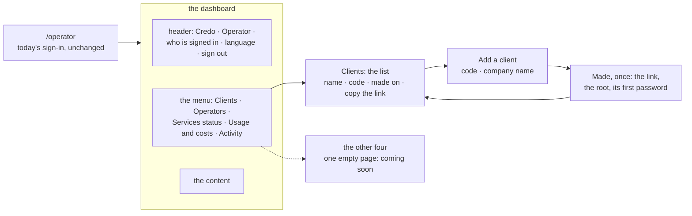

# The operator's dashboard: a frame of sections, the clients listed, a client added

**Where it stands — 2026-10-30 00:42 +07:** the UI is fixed on the fake (steps 3 to 7), the BFF is
built (step 8) and the full run's script is written, not run (step 9). **Next:** step 10, the review
by a model other than the author's ([steps](#steps)).

> **Drafted** 2026-10-29 by the machine, on the human's ask of 11:0x +07, from
> [ridge-app](2026-10-28-ridge-app.md) (where the operator and its clients came in),
> [the app frame](2026-10-27-app-frame.md), [the visual report](2026-10-28-visual-report.md),
> [the big picture](2026-10-27-big-picture.md), [the architecture](2026-10-27-architecture.md),
> [the open items](../open-items.md) and the operator's code. Its shape follows
> [piece 2's plan](2026-10-29-employee-list.md), the first piece run by the human's flow of 10-28:
> the UI walked on a fake back end first, then the back end, then the full walk. **Scoped**
> 2026-10-29 by the human, relayed by the orchestrator at about 11:10 +07: passkeys, adding an
> operator and a services status page belong to the operator console plan, written in parallel.
> **That plan fills the Operators and Services status sections and builds on this frame**; here they
> are entries with an empty page, and the sign-in stays as it is. **Amended** 2026-10-29 11:25 +07
> to the human's three answers of 11:2x ([the calls](#the-humans-calls)): five sections, this branch
> on piece 2's group A, and a made-on date in the list.

## At a glance

| What the operator gets | Today | Here |
| --- | --- | --- |
| A frame | a header and one page | a menu of five sections, a header with the language and sign-out ([the frame](#the-frame)) |
| The clients | none listed | a list, newest first, each with its made-on date and its link to copy ([the list](#the-clients-list)) |
| A new client | a form, then its link and password once | the same, checked on the form first, inside the frame ([adding](#adding-a-client)) |

Built the human's way: the pages on a fake back end, the human's preview, then the back end, then
the full walk, asked again only where a screen differs. It starts from piece 2's group A and takes
`main` in once piece 2 is merged ([piece 2 and this piece](#piece-2-and-this-piece)). About 2¾
machine days, an estimate, not a date.

## The need

The human, 2026-10-29 11:0x +07: "next, let consider the operator UI. Plz help me make it similar to
admin dashboard, - add a list of clients - add new clients - other will come later, just UI skeleton
for now". The operator is the human alone, as [ridge-app](2026-10-28-ridge-app.md#the-operator)
made it. ridge's partners each sign in as a client the operator made; the operator now has a
handful of clients and no screen that names them. ridge-app's row 11 put "a list of clients" among
the "not yet" ([its case table](2026-10-28-ridge-app.md#the-case-table)); this plan brings it in, on
the human's ask.

## What exists today

On this branch's base, `35ce945`: `main`'s operator code as ridge-app left it, and piece 2's group A
beside it.

| Part | On the base | Here |
| --- | --- | --- |
| The door | `/operator` is drawn outside a client's boot ([`App.tsx#L19`](../../ui/src/App.tsx#L19)) | kept |
| The sign-in | credo's own, its own routes and session ([`OperatorSignIn.tsx#L8`](../../ui/src/OperatorSignIn.tsx#L8), [`app.ts#L233`](../../bff/src/app.ts#L233)) | kept as it is; passkeys are the operator console plan's |
| The frame | a header of credo's name, an "Operator" badge and a sign-out button, no menu ([`OperatorPage.tsx#L10`](../../ui/src/OperatorPage.tsx#L10)) | **reshaped**: the client's shell, with the operator's sections |
| The language | the device's kept choice, else Vietnamese; nothing on the page changes it ([`OperatorApp.tsx#L95`](../../ui/src/OperatorApp.tsx#L95)) | **new**: the header's menu, as a client's |
| Who is signed in | read by `me`, never shown ([`OperatorApp.tsx#L39`](../../ui/src/OperatorApp.tsx#L39)) | **new**: in the header |
| Make a client | one page: the form or its answer, no address of its own ([`OperatorApp.tsx#L103`](../../ui/src/OperatorApp.tsx#L103)) | **reshaped**: a page of its own, reached from the list |
| The form's checks | none in the page: a code not in the form reaches the BFF, whose 400 reads "try again" ([`NewClient.tsx#L19`](../../ui/src/NewClient.tsx#L19), [`api.ts#L159`](../../ui/src/api.ts#L159), [`OperatorApp.tsx#L79`](../../ui/src/OperatorApp.tsx#L79)) | **new**: the shared schemas on the form |
| The answer, once | the link, `root` and the first password, read-only fields ([`ClientMade.tsx#L16`](../../ui/src/ClientMade.tsx#L16)) | kept, with a copy button each |
| The BFF | `sign-in`, `sign-out`, `me` and `POST /api/operator/clients`, each behind the operator's session ([`app.ts#L157`](../../bff/src/app.ts#L157), [`app.ts#L254`](../../bff/src/app.ts#L254)); the route list held exact ([`operator.route.test.ts#L407`](../../bff/src/operator.route.test.ts#L407)) | **new**: `GET /api/operator/clients` |
| A client's record | the index `client.<code>` in c-storage: the minted id and the name as made, no time ([`records.ts#L8`](../../shared/src/records.ts#L8), [`records.ts#L33`](../../shared/src/records.ts#L33)), written last by the create ([`clients.ts#L32`](../../bff/src/clients.ts#L32)) | **new**: the time it was made |
| c-storage | a record by its key, and piece 2's list by prefix ([`server.go#L42`](../../c-storage/internal/server/server.go#L42)) | unchanged: the list reads the index |
| The fake | piece 2's, already answering the operator's sign-in, `me` and the create ([`fake.ts#L290`](../../ui/src/fake.ts#L290)); scenes signed in as a client's person ([`scene.ts#L31`](../../ui/src/scene.ts#L31)) | **new**: the list; a scene signed in as the operator |
| The walk | four screens from the static mock ([`walks.ts#L216`](../../visual/src/walks.ts#L216)), 24 bases ([`operator.spec.ts#L21`](../../walk/specs/operator.spec.ts#L21)) | **reshaped**: nine fake scenes ([the walks](#the-walks)) |

## The frame

**The client's shell, reused** ([`Shell.tsx#L28`](../../ui/src/Shell.tsx#L28)): a menu at the side,
behind a menu button below the tablet's width; a header with the brand and a user menu holding the
language and sign-out; the page in the content area; light and dark as the system says. It is what
an admin dashboard is, and piece 1's walk already asked where the language sits ("Is the switch where
a user would look?", answered yes). The operator's shell differs in three things: credo's name and
colour, the "Operator" badge beside the name so the door is never taken for a client's (ridge-app's
screen 1), and the operator's sections in the menu, through the `pages` piece 2 gave the shell.
*Rejected:* a second frame for the operator. It would be a second menu, header and phone layout to
keep, for the same job.

**The page map.** Every page wears the frame but the sign-in.

| Address | Page | Its states | Calls |
| --- | --- | --- | --- |
| `/operator` (signed out) | today's sign-in | idle, busy, refused | `sign-in` |
| `/operator`, `/operator/clients`, any unknown `/operator/…` | the clients list | loading, failed with a retry, empty, ready | `GET /api/operator/clients` |
| `/operator/clients/new` | add a client, then its answer, once | idle, refused on the form, busy, taken, failed, made | `POST /api/operator/clients` |
| `/operator/operators`, `/operator/services`, `/operator/usage`, `/operator/activity` | one empty page under the section's name: "coming soon" | one | none |

- **The sections**, top to bottom, as the human answered call 1: Clients, Operators, Services status,
  Usage and costs, Activity. Clients opens first.
- **The four skeleton sections share one page:** the section's name as its title and "coming soon",
  in the human's word, in both languages, and nothing else. The operator console plan replaces
  Operators' and Services status' with its pages; Usage and costs and Activity wait for a plan.
- **The shown-once answer has no address.** It lives in the add page's state, so a reload or a step
  away loses it, and the password is never shown twice.
- **A 401 on any call** drops the handle and shows the sign-in, as today. Only a 401 signs out.

## The clients list

- **Columns:** the company's name as the operator gave it, its code, the day it was made, and a
  button that copies the client's link (`<this address>/login?client-code=<code>`). *Rejected:* the
  link written out in a column. It is long on a phone, and its address differs between the fake and
  the stack, so every picture would mask it.
- **The name as made, never the client's own.** The index keeps the name the operator gave. A root
  who renames the company in Settings changes its settings, which the operator never reads
  (ridge-app's row 9, kept). The column's title says "name when made". *Rejected:* reading each
  client's settings for its current name. It crosses row 9's wall, and costs a read per client.
- **The made-on date** ([call 3](#the-humans-calls)), through the whole slice:
  - **the record:** the index `client.<code>` in c-storage gains `madeAt`, milliseconds since the
    epoch, set by the BFF's own clock when the create writes it. c-storage keeps it as JSON and its
    code does not change; the shape's one home is `storedClientSchema` in `shared/`;
  - **made before the field:** an index without `madeAt` reads as none, at the reader, as
    [`CLAUDE.md`](../../CLAUDE.md)'s contract rule asks, so nothing is rewritten. On ridge that is
    every client made before this piece ships: `acme`, the partners' and each deploy check's
    `check-…` ([`check.sh#L150`](../../ops/check.sh#L150)). They show "—";
  - **the order:** newest first; the clients with no date after them, by code;
  - **shown** as a day in the operator's language and the browser's time zone: `29/10/2026` in
    Vietnamese, `29 Oct 2026` in English;
  - **never from the caller:** the route takes no time. The stack's generator alone passes the data
    set's fixed ones, through the create's function, as it already passes the demo's settings.
- **Empty:** "No clients yet." with the add button, which sits above the list in every state.
- **Left out now:** search, filters, sorting by a column, and pages. ridge holds a handful of
  people's clients and one check client a deploy, and a signed client's own stack holds one client.
  *Trigger:* about 50 clients, a screen's worth,
  for search; c-storage's 1,000 a list for pages, where the BFF answers 500 rather than a short list
  (row 14).

## Adding a client

- **The fields:** the code and the company's name, as today. Nothing else is needed to start a client
  ([ridge-app](2026-10-28-ridge-app.md#the-operator)); the root sets the rest in Settings.
- **The checks, both sides, one schema.** The form lowers and trims the code, then checks it and the
  name with `createClientRequestSchema` from `@credo/shared`, which the BFF parses with
  ([`wire.ts#L114`](../../shared/src/wire.ts#L114)). A code not in the form is refused on its field,
  saying the rule, and nothing is sent. The BFF still answers 400 to whatever reaches it. *Why:* today
  the BFF's 400 reads "the client was not made, try again", and trying again fails the same way.
- **After:** the answer once, as today (the link, `root`, the first password), each with a copy
  button; then "Back to the clients", where the new one now leads the list, or "Add another client".
- **What can go wrong, each on the fake by its cue:**

  | Status | When | What the operator sees |
  | --- | --- | --- |
  | 409 | the code is taken | "That code already belongs to another client", what was typed kept (today's) |
  | 503 | the service failed | "The client was not made", what was typed kept (today's words) |
  | 503 | the list could not be read | "This page could not be loaded", with a retry |
  | 401 | the session ended | the sign-in |
  | 403 | **never** | no operator route answers it: there is one role, and anyone else is a 401 |

  A 403 comes with a second operator who may do less, which is the operator console plan's.

## Who may do it

The operator alone. Each operator route, the list's included, starts with the check every one runs
today ([`app.ts#L157`](../../bff/src/app.ts#L157)): the handle in `x-auth-id` names a live session
under `operator.session.…`, and that session's operator record still exists. A client's handle, a
made-up one or none is a 401, so a client's root reaches nothing here (ridge-app's rows 1 and 16). No
header names the operator and no client code is read. The UI's menu is a view, never the guard. The
list reads the index alone, the operator's own record, and nothing of a client's settings, users or
sessions; the route list stays exact (row 15).

## The fake and the data set

Piece 2's, extended, never copied ([its fake](2026-10-29-employee-list.md#the-fake)):

- **The fake `Api`** gains `listClients`, answering the data set's clients, then any it made since
  the page loaded, newest first. Each answer parses under the schema the real one is read with
  (row 21).
- **Cues:** `?cue=listClients:503`, `makeClient:409`, `makeClient:503`, in piece 2's grammar.
- **The data set,** `@credo/shared/demo`: the demo company and two more invented ones, never a real
  client's ([the big picture](2026-10-27-big-picture.md#never)), each with a fixed made-on time at
  noon UTC, so its day reads the same from UTC−11 to UTC+11: in the sandbox's jsdom and in the human's
  browser alike. The stack's generator makes them through the operator's create with those times, so
  the fake's list and the stack's are the same three, dates included (row 22).
- **A scene signed in as the operator:** `sceneParts` signs in a data-set person; it gains the
  operator's handle in place of a client's.

## The walks

The map ([QA](../conventions/qa.md) rule 7); a dash is a part of the day not built yet.

| | set up | staff | stock | orders | delivery |
| --- | --- | --- | --- | --- | --- |
| **the operator**, us, PC | ⭐ this piece: the dashboard, its clients | — | — | — | — |
| **the client's admin**, PC | piece 1; piece 2 | piece 2 | — | — | — |

The operator's walk keeps its id (`operator-setup`) and its four screens' ids, so their answers and
names stay, and gains five. Each is a fake scene, then shot in the full run.

| `operator-setup`: run the clients from the dashboard | Path | The one question |
| --- | --- | --- |
| 1. Sign in at the operator's page | main | *answered yes; unchanged, so it holds* |
| 2. A new client: its code and the company's name, in the frame | main | Is this all you need to start a client? |
| 3. Made: the link, the root's name and its first password, once, to copy | main | Would you know what to send the client, and that the password is not shown again? |
| 4. The code already taken | wrong | Does this say what to do? |
| 5. The dashboard: the five sections, who is signed in, the clients newest first with the day each was made | main | Is this what you need to see of your clients, and are these the sections you expect? |
| 6. A section coming soon (Usage and costs) | main | Is it clear this part is not built yet? |
| 7. The list could not be loaded | wrong | Would you know it is not your fault, and to try again? |
| 8. A code not in the form, said before anything is sent | wrong | Does this say what to fix? |
| 9. The client not made, what was typed kept | wrong | Would you know the client was not made, and that nothing typed is lost? |

- **Nine screens**, each in Vietnamese and English at PC 1280, tablet 768 and phone 390: 18 answers
  and 54 bases. Screens 2 to 4 are asked again if their words change, as the header's will; the walks
  page says which. Screen 5 keeps the menu's words (`navigation`), since the sections are its question.
  Screen 6 stands for all four skeleton sections: they are one page.
- **The empty list is no screen:** a variation, held by a unit test (QA rule 7). A signed client's
  stack meets it once.
- **The pictures stay stable:** screen 5 is shot before the walk makes a client, so its list holds the
  data set's three and their fixed days, the same on the fake and the stack; a screen that ever shows
  a client the walk made masks that client's day, as screen 3 masks the link and the password; no
  screen shows an id (row 24).
- **Piece 1's and piece 2's bases do not move:** the shell gains the badge as an option a client's
  app never passes (row 25).
- **The mock's operator screens** (11 to 13, [`screens.tsx#L216`](../../ui/src/mock/screens.tsx#L216))
  are retired when the walk moves to scenes: nothing then draws them for a walk.

## The case table

👤 marks a business row, for the human's read ([QA](../conventions/qa.md) rule 1). **Waiting** for
the human's read (step 3): no code before it.

| # | 👤 | The case | Held by |
| --- | --- | --- | --- |
| 1 | 👤 | The operator signs in at `/operator` as today and lands on the dashboard: a menu of sections at the side (behind a menu button on a phone), a header with credo's name, the "Operator" badge, the operator's name and a menu holding the language and sign-out, and the clients list | unit, ui; the walk |
| 2 | 👤 | The menu holds Clients, built here, then Operators, Services status, Usage and costs and Activity, each the same empty page under its name saying "coming soon", which calls nothing; the operator console plan fills Operators and Services status | unit, ui; the walk |
| 3 | 👤 | The clients list shows every client on this stack, ridge's existing ones and its deploy check's included, with nothing redone: the company's name as the operator gave it, its code, the day it was made, and a button that copies its sign-in link; newest first | BFF route, `operator.route.test.ts`; unit, ui; the walk |
| 4 | 👤 | The list shows the name given when the client was made; a name its root changes later in Settings does not show here, since the operator never reads a client's settings | BFF route |
| 5 | 👤 | With no client yet, the list says so and offers to add the first | unit, ui |
| 6 | 👤 | The operator adds a client from the list with a code and the company's name; a code not in the form (3 to 32 lowercase letters, digits and hyphens, a letter first, a letter or digit last) is refused on the form, saying the rule, before anything is sent; typed in capitals or with spaces around it, it is lowered and trimmed first | unit, ui; unit, shared; the walk |
| 7 | 👤 | Added: the operator is shown once the link, the root's name and its first password, each with a copy button, then goes back to the list, which the new client now leads, or adds another; the password is never shown again, a reload included | unit, ui; BFF route; the walk |
| 8 | 👤 | A code already taken is refused, what was typed is kept, and the client that holds it is unchanged | BFF route; unit, ui; the walk |
| 9 | 👤 | A list that cannot be loaded says so and offers to try again; a client not made because the service failed says so and keeps what was typed | unit, ui; the walk |
| 10 | 👤 | Only the operator reaches the dashboard and its calls; anyone else, a client's root included, is refused and meets the operator's sign-in; the operator still never reads or changes a client's settings, users or sessions, and never sees a root's password again | BFF route |
| 11 | 👤 | Every new screen reads fully in Vietnamese and English, at PC, tablet and phone widths | unit, ui; the walk |
| 12 | 👤 | Not yet: search, filters, sorting by a column and pages in the list; a client's own page; a client removed, paused or its code changed; a root's password reset; and the operator console plan's passkeys, second operator and services' status | none: the human's to move |
| 13 | | `GET /api/operator/clients` answers each client's code, name as made, made-on time and link path, from one c-storage list under `client.`, newest first and those with no time after them by code; it needs the operator's session as the create does: 401 without one, a client's handle included | BFF route |
| 14 | | The list answers 500 when c-storage says there are more than it returned, or when an index record does not parse, naming its kind and never its key; never a short list | BFF route, with a client that answers `more` or a bad record |
| 15 | | The BFF's route list stays exact, the list's `GET` the one route added | BFF route, the route list |
| 16 | | Only index records sit under `client.`: no other key `recordKeys` builds starts with it | unit, shared, `records.test.ts` |
| 17 | | The link's path is built by one function in `shared/`, which the create's answer and the list's both use | unit, shared; BFF route |
| 18 | | The form checks the code and the name with the `@credo/shared` schemas the BFF parses them with | unit, ui |
| 19 | | `/operator` and any unknown `/operator/…` path open the list; each section has its own address; the shown-once answer has none | unit, ui |
| 20 | | The header's name is the sign-in's or `me`'s; the language chosen is kept on the device as a client's is; a 401 on any call drops the handle and shows the sign-in | unit, ui |
| 21 | | Every answer of the fake's operator calls, the list included, parses under the schema the real one is read with; the fake answers 409 or 503 once on the call its cue names | unit, ui, `fake.test.tsx` |
| 22 | | One data set seeds the fake's list and the stack's generator, which makes its clients through the operator's create with their fixed made-on times | unit, scripts, `generator.test.ts`; unit, ui |
| 23 | | Each operator walk screen is a fake scene signed in as the operator; the walk spec's screens equal the walks page's list; the mock draws no operator screen | unit, visual, `walks.test.ts` |
| 24 | | Each language and width of the operator's full run starts on a stack of its own, so its list holds the data set alone; the run is compared with the fake run's pictures first, and the bases are written from the full run alone | the human's run, its log read whole; `visual/answers.json`'s diff |
| 25 | | The shell's badge is an option a client's app never passes: piece 1's and piece 2's screens draw as before | unit, ui; their bases unchanged in the full run |
| 26 | | The create writes `madeAt`, the BFF's clock at the create, into the index; the route takes none from its caller; an index without one reads as none, and nothing rewrites it | unit, shared; BFF route |
| 27 | | A made-on time shows as a day in the operator's language and the browser's zone, and "—" for none; the data set's, at noon UTC, read the same day in the sandbox and the human's browser | unit, ui |

Each row is seen red once before it counts ([QA](../conventions/qa.md) rule 2); every package stays
at 100 % (rule 8).

## The human's calls

1. **The skeleton's sections.** *Recommended:* Clients, Operators and Services status alone.
   **Answered** 2026-10-29 11:2x +07 by the human, relayed by the orchestrator: "yes, Clients,
   Operators and Services status; Usage and costs, Activity: coming soon". Five entries; the four
   skeleton ones share one empty "coming soon" page (row 2).
2. **The order with piece 2.** *Recommended:* A, piece 2's group A merged into `main` first.
   **Answered** 2026-10-29 11:2x +07 by the human: "B, start the dashboard now from piece 2's group A
   commit". This branch was rebased onto `35ce945` (step 4); it takes `main` in only after piece 2
   merges, and merges after it ([piece 2 and this piece](#piece-2-and-this-piece)).
3. **A made-on date in the list.** *Recommended:* not now. **Answered** 2026-10-29 11:2x +07 by the
   human: "yes, no real client yet". Read as: add it now, since no real client's records would show
   the gap; only ridge's invented clients show "—" ([the list](#the-clients-list), rows 3, 26, 27).
4. **The deploy check's clients on ridge.** **Answered** 2026-10-29 12:15 +07 by the human, by the
   yes to the 12 rows: *show them*, the recommended option. Each deploy's check makes a client `check-<time>`
   through the operator's create ([`check.sh#L150`](../../ops/check.sh#L150)), so ridge's list holds
   one a deploy, and from this piece on each new one leads the list.
   - **Show them** (*recommended*). *For:* the list is what the stack holds, with no rule keyed on a
     code's spelling. *Against:* after each deploy one sits at the top; they go only with a client's
     removal, which is not yet.
   - **Hide codes starting `check-`.** *For:* the list shows people's clients alone. *Against:* a rule
     that holds only while the check names its clients that way, and a client the operator names
     `check-…` disappears.

## Piece 2 and this piece

**The base.** This branch starts from `35ce945`, piece 2's group A end, as call 2 answered. That
commit holds `main` up to `85d5a2b` (the walks shared), but not `main`'s later `570f2f8` (the sharing
plan's last ticks, docs) or `f8c85e6`, where `visual/src/setup.ts` fails any test an act warning lands
in (open item 15's fix). Piece 2 goes on from the same commit with groups B to D on `employee-list`.

**The end.** Piece 2 merges into `main` first. Then this branch rebases onto that `main` (step 13),
its commits replayed over piece 2's B to D and `main`'s two, its gate run again, and its full run
compared with its own bases; it merges after. The operator console plan builds on this frame and
merges after this piece.

**The act rule, met from the start.** Every visual test this piece adds prints no act warning, read in
its log at each step, so the rebase meets `f8c85e6`'s rule with nothing to change.

**What the rebase will meet,** read from `git diff 85d5a2b..35ce945`, without opening piece 2's
worktree; B to D will touch more of the same:

| Both touch | Piece 2 | This piece |
| --- | --- | --- |
| `ui/src/Shell.tsx`, `ui/src/nav.ts` | the menu's pages by permission; B adds a guard per route | the badge; the operator's pages in a file of their own |
| `ui/src/App.tsx`, `ui/src/ClientApp.tsx` | a `look` for scenes; the staff routes | `App.tsx` alone, if the operator's routes need it; `ClientApp.tsx` untouched |
| `ui/src/i18n/en.ts`, `vi.ts` | the staff's words | the operator's, under `operator` |
| `ui/src/api.ts`, `ui/src/fake.ts`, `ui/src/scene.ts`, `ui/tests/unused.ts` | the staff calls; the fake and the scenes | `listClients`; the scene signed in as the operator |
| `shared/src/wire.ts`, `shared/src/demo.ts`, `shared/src/records.ts` | the staff's schemas, the data set, the keys | the list's reply, the link's path, the data set's clients, `madeAt` |
| `bff/src/app.ts`, `bff/src/clients.ts`, `bff/src/operator.route.test.ts`, `scripts/src/generator.ts` | the staff routes, the root's sign-in record, the route list, the generator | the list's route and its line, `madeAt`, the clients made |
| `visual/src/walks.ts`, `visual/answers.json`, `walk/` | its scenes and answers, the `fake` and `full` projects | the operator's scenes, 18 answers, the operator's spec and its bases |

- **Keeping it small:** this piece adds beside piece 2's lines and rewrites none of them, so each
  conflict is two additions, and the rebase keeps both. `visual/answers.json` is the likeliest: both
  add keys; the rebase keeps both sides', and `pnpm report` then reads back every answer.
- **A screen the rebase moves:** piece 2's B to D may change the shell under the operator's screens.
  The full run after the rebase names any such screen with its cause; its answers hold unless its
  words changed.

## What it costs

- **AWS:** nothing added. Opening the list makes one c-storage read, free inside one zone; `madeAt`
  adds a few bytes to each client's index. ridge: nothing added.
- **The human's time:** the read, about 20 minutes; the fake walk, about 30; the full walk, about 20,
  and its compare after the rebase onto `main`, about 20; ridge, about 10.
- **The machine's:** about 2¾ days ([steps](#steps)), an estimate.

## Steps

- [x] **1. This plan.** Who: 🤖, 10-29. Done when: committed on `operator-dashboard`, the path,
  name and address greps clean and every relative link and anchor resolving. *Evidence:* this file's
  commits (`git log --oneline -- docs/plans/2026-10-29-operator-dashboard.md`). Before each, the path
  grep of [documentation](../conventions/documentation.md#nothing-machine-local-or-personal-in-a-committed-file)
  and ridge-app's address grep found nothing in this file; the name grep found only the package name
  `@credo/shared`; every relative link resolved, anchors and line numbers included, by a check seen
  red once on a copy with a broken anchor and a line past a file's end.
- [x] **2. The human's calls.** Who: 👤, 10-29. Done when: calls 1 to 3 answered, dated. *Evidence:*
  the human, 2026-10-29 11:2x +07, relayed by the orchestrator, each quoted under its call: five
  sections, order B, the made-on date in. None as first recommended; the plan is amended to them.
- [x] **3. The human's read.** Who: 👤, about 20 minutes. Done when: each 👤 row kept or corrected,
  and call 4 answered, dated. *Evidence:* the human, 2026-10-29 12:15 +07, relayed by the
  orchestrator: "yes" to the 12 👤 rows ([rows 1 to 12](#the-case-table)), kept as written; and, by
  that yes, call 4 answered with its recommended option: ridge's `check-…` clients are shown.
- [x] **4. The base.** Who: 🤖, 10-29, about 15 minutes. Done when: this branch sits on `35ce945`,
  `git log 35ce945..` reads this plan's commits alone, and the workspace installs. *Evidence:*
  `git rebase --onto 35ce945 570f2f8 operator-dashboard` applied the plan's one commit clean at 11:21
  +07; `pnpm install --offline` ended "Done", 330 packages from the local store, none downloaded.
- [x] **5. The pages, on the fake.** Who: 🤖, after step 3, about a day: the frame (the shell with the
  badge and the operator's sections, the language, who is signed in), the list with its made-on day,
  the add page and its answer with copy buttons, the one "coming soon" page, the routes;
  `listClients` in `createApi` and the fake, the list's reply schema, `madeAt` in the index's schema
  and the link's function in `shared/`, the data set's clients; the mock's operator screens retired.
  Done when: the UI and shared halves of rows 1 to 11, 17 to 21, 23 and 25 to 27 each seen red once;
  the touched packages at 100 %, no warning; eslint, prettier and knip clean. *Model files:*
  `ui/src/Shell.tsx` and `nav.ts` (the frame), [`StaffListPage.tsx`](../../ui/src/StaffListPage.tsx)
  (a list, its empty and failed states), [`AddPersonPage.tsx`](../../ui/src/AddPersonPage.tsx) (a
  form and an answer shown once), [`page.ts`](../../ui/src/page.ts) and `Loaded.tsx` (a page's one
  state).
  *Evidence:* 12:59 +07. Built: `OperatorPage` is the client's `Shell` with a `badge` option and the
  operator's five sections (`operatorNav.ts`); `ClientsPage`, `AddClientPage` (over `NewClient`, which
  checks with `createClientRequestSchema`, and `ClientMade`, each field with a copy button),
  `SoonPage`; `listClients` in `createApi` and the fake (cue `listClients:503`); in `shared/`:
  `clientLinkPath`, `clientListReplySchema`, `newestFirst`, `madeAt` optional in `storedClientSchema`,
  `DEMO_CLIENTS`. Rows 1 to 11, 17 to 21, 25 to 27 held by unit tests in `ui` and `shared`; 29
  mutations of the new lines, 28 turned a test red from its assertion (the 29th, an id in
  `operatorNav.ts`, is no behaviour). `pnpm check` exit 0, every package 100 %, no warning, no act warning, eslint,
  prettier and knip clean. Piece 1's and piece 2's screens: 70 dumps (words and DOM, ids and UUIDs
  masked) at `3a47f72` and after, equal. **Moved to step 6:** the mock's operator screens (11 to 13)
  and row 23, since `visual/src/walks.ts` still draws the operator's walk from them until its scenes
  replace them; their components stay until then.

- [x] **6. The walk, on the fake.** Who: 🤖, after step 5, about half a day: the nine screens as fake
  scenes in `visual/src/walks.ts` (a scene signed in as the operator in `sceneParts`; the mock's
  operator screens 11 to 13 retired with them, step 5's leftover), `walk/specs/operator.spec.ts` with a `fake` and a `full` project,
  the fake run's one script in the credo root's `one-off/`. Done when: row 23 seen red once;
  `pnpm report` builds and `walks.json` reads the operator's nine screens, the new and the changed
  waiting; the visual tests' log holds no act warning. *Model files:*
  [`piece-2.spec.ts`](../../walk/specs/piece-2.spec.ts) and piece 2's scenes in `visual/src/walks.ts`.
  *Evidence:* 13:19 +07. The nine screens are scenes in `visual/src/walks.ts` (a scene gains
  `operator`, which `sceneParts` turns into the operator's handle); the mock's operator screens 11 to
  13 and their fixtures are gone, and `NewClient` lost the `initial` prop only they used. The spec
  `walk/specs/operator.spec.ts` opens each screen at an address of its own, with whole-label
  patterns and no `check()`; `playwright.config.ts` names `operator-fake` and `operator-full` (the
  `chromium` project ignores the spec), and `support.ts` takes pictures only in both fake projects.
  The spec's openings (path, operator, cue) equal the scenes' by a test, and each is seen red when
  one is changed. The spec was replayed in jsdom, its real source over a shim of Playwright's page
  (real router, real clicks and typing, the fake from `?fake`): both languages, 132 actions and
  checks each, every locator resolving to exactly one element, every effect showing; a bare name that
  matches three buttons was seen refused. `pnpm check` exit 0, every package at 100 %, no warning;
  piece 1's and piece 2's screens: the 70 dumps equal those at `3a47f72`. `pnpm report` reads the
  operator's nine screens: screen 1 holds its yes, screens 2 to 4 are asked again, screens 5 to 9
  wait. The 24 old bases in `walk/specs/operator.spec.ts-snapshots` are not read by any project now;
  the full walk (step 11) writes the 54 new ones. The fake run's script is written, not run.

- [x] **7. The human's preview.** Who: 👤, after step 6, about 30 minutes, and a round for each "no".
  The human answers each screen on the newest walks page and pastes the block; the machine runs
  `pnpm answers`. A "no" becomes a row here, fixed on the fake and asked again. Last, the fake run's
  script. Done when: none of the operator's screens waiting and no open "no"; the fake run's log read
  whole, its 54 pictures counted. **Then stop:** the UI is fixed here.
  *Evidence:* the human's block of the preview, 16 lines (screens 2 to 9, Vietnamese and English), every
  one yes, written by `pnpm answers` (16 written, 0 refused); `pnpm report` then read 0 waiting, 0 asked
  again, 0 no, 68 yes. The human's fake run, 2026-10-29 13:38:45 to 13:38:57 +07, of
  `one-off/20261029-1310-fake-run-operator-dashboard.sh` on `63ae46b`, its log read whole by another
  agent (38 lines): `operator-dashboard` at `63ae46b`, clean; 54 of 54 pictures expected, the smallest
  11450 bytes; Playwright "6 passed (8.6s)", `[operator-fake]` on PC, tablet and phone in Vietnamese and
  English, 1.2 to 1.5 s each; no warning, error, retry, flaky, timeout or skip; the folder holds 54
  `.png`, 6 for each of the 9 screens, every name to pattern; no secret, and no address but
  `127.0.0.1`. The whole `pnpm check`, 14:17 +07 on a quieter Mac, exit 0: shared 65 tests, ui 219, bff
  152, scripts 75, visual 220, every package at 100 %, no warning (two earlier runs under a load
  of about 40 failed on the machine, a worker that did not start and a timing test, none on a case).
  **Then stop:** the UI is fixed here.

- [x] **8. The BFF.** Who: 🤖, after step 7, about half a day: `GET /api/operator/clients`, `madeAt`
  written by the create, the link's one function used by the create, the route list, the generator's
  clients with their times. Done when: the BFF's halves of rows 3, 4, 7, 8 and 10, and rows 13 to 17,
  22 and 26, each seen red once; `pnpm check` green at 100 %; live, `pnpm stack -- <command>`: the
  operator lists the data set's three with their days, makes one and lists four with the new one
  first, and a root's handle is a 401.
  *Evidence:* 15:21 +07. `GET /api/operator/clients` (`listClients` in `bff/src/clients.ts`): one
  c-storage list under `recordKeys.clientPrefix`, newest first, 500 on `more`, a record that does not
  parse or a key that holds no code, behind the operator's session; the create writes `madeAt` from
  the BFF's `now()` (a time in the body is a 400) and builds the link with `clientLinkPath`; the
  generator makes the data set's other two clients with their fixed times and `seedClient` takes a
  time. The BFF halves of rows 3, 4, 7, 8, 10, 13 to 17, 22 and 26 are held by route and generator
  tests; 14 mutations of the new lines, 13 turned a test red from its assertion (the 14th, the index
  parse check, still ends in a 500 through a `TypeError`, so only the log's message differs). Live,
  `pnpm stack -- <command>`: the operator listed `binh-an`, `hoa-sen`, `demo` with their days
  (21 Oct, 2 Oct and 14 Sep), made `live-check` (201, `/login?client-code=live-check`), listed four
  with it first dated today, a root's handle was 401 and no handle 401. `pnpm check` exit 0 but for
  `scripts`, which missed coverage only at `scripts/src/processes.ts#L83` (the timing test, open item
  23 of `employee-list`) under load, and passed at 100 % alone; visual alone 100 %. Counts: shared 65
  tests, ui 219, bff 160, scripts 77, visual 220, each at 100 %; eslint, prettier, knip and every
  typecheck clean. c-storage unchanged, so no `make check`. The 88 scene dumps (the 70 of piece 1 and
  2 and the operator's 18) are equal before and after, Mantine and React ids masked.

- [x] **9. The full run's script.** Who: 🤖, after step 8, about two hours: one script in `one-off/`
  runs the operator's spec once per language and width, each on a stack of its own, first against the
  fake run's pictures, then writing its bases, then comparing; piece 1's spec on a stack as before.
  Done when: `playwright test --list` reads the operator's six runs; `pnpm check` green.
  *Evidence:* 00:42 +07. The script is one file in the credo root's `one-off/`, written on the model
  of piece 2's full run, not committed and not run (it needs a browser). `playwright test --list
  --project operator-full` reads 6 tests, and the script's pattern for each run (device, width,
  language) matches exactly 1, checked in the script before it acts. Because the walk makes a client
  by a fixed code, a second pass on a stack would meet it, so each pass of each run has a stack of its
  own: 6 runs x 3 passes (against the fake run's pictures, the bases written, compared) = 18 stacks,
  and piece 1's write and compare 2 more. It refuses before acting (branch, clean tree, tools, another
  run going, load above 12, counts, the fake run's 54 names), counts the 54 `operator-full` bases and
  names the old `chromium` ones it leaves for step 11. ShellCheck clean; its refusals and the listing
  checks were replayed, and the pass-1 reader seen on a moved picture and on a timeout. No code
  changed, so `pnpm check` stands as at step 8. **Then stop.**
- [x] **10. The review.** Who: 🤖, a model other than the author's ([QA](../conventions/qa.md) rule
  5), after step 9, about two hours with the fixes. Done when: each finding fixed, rejected or
  deferred with its reason; `pnpm check` green.
  *Evidence:* 01:24 +07. Opus reviewed `4f77e98`; six findings, all fixed, each test seen red first.
  F1 (High): the spec shot screen 5 after screen 3 made a client, so a stack's dashboard listed
  four rows where the fake lists three; screens 5, 6 and 7 are now shot right after screen 1, ids and
  numbers unchanged, and the two order checks in `visual/src/walks.test.ts` compare ids unordered.
  The new test there (the three shot before the first make) was red on the old spec (`op-5-dashboard`
  at 2751, the make at 1703). `scripts/src/dashboard-list.test.ts` holds the data on a seeded stack:
  the fake's three until the make, then four with the new one first. `ui/src/OperatorWalk.test.tsx`
  replays the moved steps in jsdom on the fake with the real router, in both languages, whole-label
  matches and an expect after each opening. The fake run's 54 pictures stay valid: no source file the
  walks page or a scene draws from changed (`git diff 4f77e98` over `ui/src`, `shared`, `visual/src`,
  `walk/support.ts` is empty but for tests), and `pnpm report` still builds. F2 (Medium): the
  script reads piece 2's 96 `-full-darwin` bases too, one more stack (`--project full
  --update-snapshots=none`, 6 runs listed first); 21 stacks; replayed whole on stubs, green with
  `--project full` called, and red when it fails. F3: `operator.route.test.ts` reads the log stream,
  each of the list's three 500s logged by its kind and holding neither the key nor a value; mutants
  B3 (parse check removed) and B4 (the key in the message) turn it red. F4: `ridge.test.ts` reads
  the `tenant` command's `madeAt` between the times before and after the run; S1 (`madeAt: 0`)
  turns it red. F5: `AddClientPage.test.tsx` makes a second client after "Add another client"; U7
  (no `setStatus('idle')`) turns it red. F6: the hazard above. The two gaps: the script's busy check
  now names an idle `pnpm stack` or `pnpm fake` and `src/main.ts` or `src/fake-main.ts` with no
  command, and its load is compared as a decimal (12.99 is refused above 12, either decimal mark).
  `pnpm check` exit 0, no warning: shared 65 tests, ui 226, bff 161, scripts 79, visual 221, each at
  100 %. ShellCheck clean.
- [ ] **11. The full walk.** Who: 👤 runs the script, after step 10, about 20 minutes; 🤖 reads. Done
  when: the log read whole; each screen that differs from the fake's named with its cause and asked
  again; the second pass green at threshold 0, no warning; the operator's 54 bases committed, piece 1's
  and piece 2's read unchanged; the walks page shows nothing waiting and no open "no".
- [ ] **12. The recap.** Who: 🤖, after step 11, about an hour. Done when: the recap written, with
  the review's findings tagged, and the hazard of reverting past this piece on ridge repeated.
- [ ] **13. Onto `main`.** Who: 🤖, after piece 2's merge into `main`, about two hours; then 👤 runs
  the full run's script, about 20 minutes. Done when: this branch rebased onto that `main`, each
  conflict kept both sides; `pnpm check` green at 100 %, no act warning (`f8c85e6`'s rule); the full
  run's log read whole, each screen that moved named with its cause, its bases rewritten only for
  those and the human's answer asked again only where words changed. The piece is done here.
- [ ] **14. The merge.** Who: the orchestrator, on the human's word, after step 13. Done when:
  `operator-dashboard` merged into `main`, the recap's last line naming the merge.
- [ ] **15. ridge.** Who: 👤, after the push of the `main` that holds it, about 10 minutes. The deploy
  ships the BFF and the UI. The human signs in at `/operator`, finds ridge's clients listed (those made
  before this piece with "—"), adds one, sees it lead the list with today's date, and opens its copied
  link. One question: is this the console you would run clients from? Done when: the deploy's check
  green, its log read whole, and the human's answer.

**Then stop.** The operator's dashboard ends walked on the full stack and on ridge, its frame ready
for the operator console plan.

## Unverified

- **A stack's start**, twenty in a full run (18 for the operator's six runs, 2 for piece 1): a few
  seconds each plus a build, unmeasured; the script's 15 to 25 minutes is a guess.
- **Copying from the page** needs the browser's clipboard, which a secure address gives: ridge's
  HTTPS and the local loopback. jsdom has none, so the tests stub it; the walk sees the button only.
- **The header on a phone** holds the menu button, credo's name, the badge and the user's button at
  390 pixels; seen at step 7.
- **The day's two formats** in jsdom's `Intl` and in Chromium's: the same text is expected; the first
  fake run against the walks page reads it.
- **How many `check-…` clients ridge holds:** one a deploy since layer four; not counted here.
- **The estimates:** about 2¾ machine days.

## Left behind

Each until something calls it: search, filters, sorting by a column and pages in the list; a
client's own page, its removal, a pause or a new code; a root's password reset; Usage and costs, and
Activity, beyond their empty pages; passkeys, a second operator and the services' status, which are
the operator console plan's.

## Hazards no gate catches

- **The name as made drifts from the client's own:** the operator may look for a company by a name its
  root has since changed. *Accepted:* the code beside it is fixed. *Trigger:* the operator asking for
  the current name; then a field the root's save copies into the index, which the operator still
  never reads from a client's settings.
- **A key added under `client.`** would be read as an index and turn the list into a 500. *Guard:*
  row 16's test over `recordKeys`, the layout's one home.
- **A data-set time near midnight UTC** would read as another day in another zone, and the fake's
  picture would differ from the full run's. *Guard:* the data set's times at noon UTC (row 27).
- **The rebase onto `main` meets piece 2's B to D** in the shell, the words, the fake, the walks and
  `visual/answers.json`. *Guard:* this piece adds beside piece 2's lines and rewrites none; step 13's
  gate and full run read the result.
- **A revert past this piece on ridge** makes every client made after it answer 500: the old strict
  client schema refuses the `madeAt` the create now writes (`shared/src/records.ts`, read strictly in
  `bff/src/app.ts`). *Guard:* on ridge, roll forward, never revert past this piece; step 12's recap
  repeats it.
- **The operator console plan changes the frame in parallel.** *Guard:* it builds on this frame and
  merges after it; a change it needs in the shell is its own step, after this piece is in `main`.
