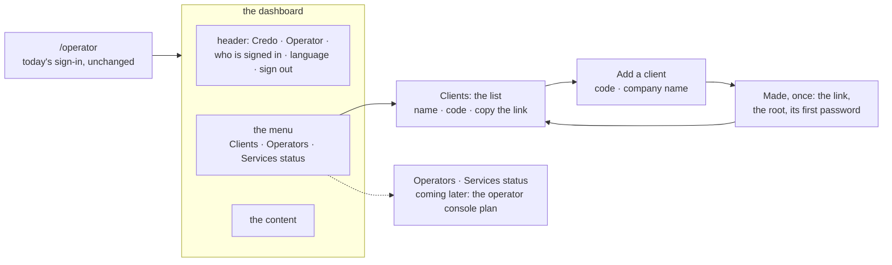

# The operator's dashboard: a frame of sections, the clients listed, a client added

**Where it stands — 2026-10-29 11:15 +07:** planned (step 1); nothing is built. Three calls wait for the
human, with the 12 business rows ([the case table](#the-case-table), [the calls](#the-humans-calls)).
**Next:** step 2, the human's read; no code before it.

> **Drafted** 2026-10-29 by the machine, on the human's ask of 11:0x +07, from
> [ridge-app](2026-10-28-ridge-app.md) (where the operator and its clients came in),
> [the app frame](2026-10-27-app-frame.md), [the visual report](2026-10-28-visual-report.md),
> [the big picture](2026-10-27-big-picture.md), [the architecture](2026-10-27-architecture.md),
> [the open items](../open-items.md) and the operator's code on `main` at `570f2f8`. Its shape follows
> piece 2's plan (`docs/plans/2026-10-29-employee-list.md`, on `employee-list` at `35ce945`), the first
> piece run by the human's flow of 10-28: the UI walked on a fake back end first, then the back end,
> then the full walk. **Scoped** 2026-10-29 by the human, relayed by the orchestrator at about 11:10
> +07: passkeys, adding an operator and a services status page belong to the operator console plan,
> written in parallel. **That plan fills the Operators and Services status sections and builds on this
> frame**; here they are entries with an empty page, and the sign-in stays as it is.

## At a glance

| What the operator gets | Today | Here |
| --- | --- | --- |
| A frame | a header and one page | a menu of sections, a header with the language and sign-out ([the frame](#the-frame)) |
| The clients | none listed | a list with each client's link to copy ([the list](#the-clients-list)) |
| A new client | a form, then its link and password once | the same, checked on the form first, inside the frame ([adding](#adding-a-client)) |

Built the human's way: the pages on a fake back end, the human's preview, then the back end, then
the full walk, asked again only where a screen differs. About 2½ machine days, an estimate, not a
date. It starts once piece 2's fake and c-storage's list are in `main` (call 2).

## The need

The human, 2026-10-29 11:0x +07: "next, let consider the operator UI. Plz help me make it similar to
admin dashboard, - add a list of clients - add new clients - other will come later, just UI skeleton
for now". The operator is the human alone, as [ridge-app](2026-10-28-ridge-app.md#the-operator)
made it. ridge's partners each sign in as a client the operator made; the operator now has a
handful of clients and no screen that names them. ridge-app's row 11 put "a list of clients" among
the "not yet" ([its case table](2026-10-28-ridge-app.md#the-case-table)); this plan brings it in, on
the human's ask.

## What exists today

| Part | On `main` at `570f2f8` | Here |
| --- | --- | --- |
| The door | `/operator` is drawn outside a client's boot ([`App.tsx#L16`](../../ui/src/App.tsx#L16)) | kept |
| The sign-in | credo's own, its own routes and session ([`OperatorSignIn.tsx#L8`](../../ui/src/OperatorSignIn.tsx#L8), [`app.ts#L175`](../../bff/src/app.ts#L175)) | kept as it is; passkeys are the operator console plan's |
| The frame | a header of credo's name, an "Operator" badge and a sign-out button, no menu ([`OperatorPage.tsx#L9`](../../ui/src/OperatorPage.tsx#L9)) | **reshaped**: the client's shell, with the operator's sections |
| The language | the device's kept choice, else Vietnamese; nothing on the page changes it ([`OperatorApp.tsx#L95`](../../ui/src/OperatorApp.tsx#L95)) | **new**: the header's menu, as a client's |
| Who is signed in | read by `me`, never shown ([`OperatorApp.tsx#L39`](../../ui/src/OperatorApp.tsx#L39)) | **new**: in the header |
| Make a client | one page: the form or its answer, no address of its own ([`OperatorApp.tsx#L103`](../../ui/src/OperatorApp.tsx#L103)) | **reshaped**: a page of its own, reached from the list |
| The form's checks | none in the page: a code not in the form reaches the BFF, whose 400 reads "try again" ([`NewClient.tsx#L19`](../../ui/src/NewClient.tsx#L19), [`api.ts#L136`](../../ui/src/api.ts#L136), [`OperatorApp.tsx#L79`](../../ui/src/OperatorApp.tsx#L79)) | **new**: the shared schemas on the form |
| The answer, once | the link, `root` and the first password, read-only fields ([`ClientMade.tsx#L16`](../../ui/src/ClientMade.tsx#L16)) | kept, with a copy button each |
| The BFF | `sign-in`, `sign-out`, `me` and `POST /api/operator/clients`, each behind the operator's session ([`app.ts#L114`](../../bff/src/app.ts#L114), [`app.ts#L195`](../../bff/src/app.ts#L195)); the route list held exact ([`operator.route.test.ts#L400`](../../bff/src/operator.route.test.ts#L400)) | **new**: `GET /api/operator/clients` |
| A client's record | the index `client.<code>`: the minted id and the name as made ([`records.ts#L8`](../../shared/src/records.ts#L8), [`records.ts#L27`](../../shared/src/records.ts#L27)), written last by the create ([`clients.ts#L32`](../../bff/src/clients.ts#L32)) | kept: the list reads it |
| c-storage | a record by its key, no list ([`server.go#L41`](../../c-storage/internal/server/server.go#L41)) | piece 2's list by prefix, unchanged here |
| The walk | four screens from the static mock ([`walks.ts#L168`](../../visual/src/walks.ts#L168)), 24 bases ([`operator.spec.ts#L21`](../../walk/specs/operator.spec.ts#L21)) | **reshaped**: nine fake scenes ([the walks](#the-walks)) |

## The frame

**The client's shell, reused** ([`Shell.tsx#L26`](../../ui/src/Shell.tsx#L26)): a menu at the side,
behind a menu button below the tablet's width; a header with the brand and a user menu holding the
language and sign-out; the page in the content area; light and dark as the system says. It is what
an admin dashboard is, and piece 1's walk already asked where the language sits ("Is the switch where
a user would look?", answered yes). The operator's shell differs in three things: credo's name and
colour, the "Operator" badge beside the name so the door is never taken for a client's (ridge-app's
screen 1), and the operator's sections in the menu. *Rejected:* a second frame for the operator. It
would be a second menu, header and phone layout to keep, for the same job.

**The page map.** Every page wears the frame but the sign-in.

| Address | Page | Its states | Calls |
| --- | --- | --- | --- |
| `/operator` (signed out) | today's sign-in | idle, busy, refused | `sign-in` |
| `/operator`, `/operator/clients`, any unknown `/operator/…` | the clients list | loading, failed with a retry, empty, ready | `GET /api/operator/clients` |
| `/operator/clients/new` | add a client, then its answer, once | idle, refused on the form, busy, taken, failed, made | `POST /api/operator/clients` |
| `/operator/operators` | Operators: coming later | one | none |
| `/operator/services` | Services status: coming later | one | none |

- **The sections**, top to bottom: Clients, Operators, Services status. Clients opens first. The two
  later ones are fixed by the scope note; call 1 asks whether any other joins them.
- **A "coming later" page** is one component: the section's title, one line of what it will hold, and
  "coming later", in both languages. *Operators:* "Who else may sign in here." *Services status:*
  "Whether each service answers." The operator console plan replaces each with its page.
- **The shown-once answer has no address.** It lives in the add page's state, so a reload or a step
  away loses it, and the password is never shown twice.
- **A 401 on any call** drops the handle and shows the sign-in, as today. Only a 401 signs out.

## The clients list

- **Columns:** the company's name as the operator gave it, its code, and a button that copies the
  client's link (`<this address>/login?client-code=<code>`). *Rejected:* the link written out in a
  column. It is long on a phone, and its address differs between the fake and the stack, so every
  picture would mask it.
- **The name as made, never the client's own.** The index keeps the name the operator gave. A root
  who renames the company in Settings changes its settings, which the operator never reads
  (ridge-app's row 9, kept). The list says "name when made" in its column's title. *Rejected:* reading
  each client's settings for its current name. It crosses row 9's wall, and costs a read per client.
- **Order:** by code, the order c-storage holds the index in, so the list costs one read and no sort.
- **Empty:** "No clients yet." with the add button, which sits above the list in every state.
- **Left out now:** search, filters, sorting and pages. ridge holds a handful of clients, and a
  signed client's own stack holds one. *Trigger:* about 50 clients, a screen's worth, for search;
  c-storage's 1,000 a list for pages, where the BFF answers 500 rather than a short list (row 14).
- **A made-on date** is call 3: the index holds no time today.

## Adding a client

- **The fields:** the code and the company's name, as today. Nothing else is needed to start a client
  ([ridge-app](2026-10-28-ridge-app.md#the-operator)); the root sets the rest in Settings.
- **The checks, both sides, one schema.** The form lowers and trims the code, then checks it and the
  name with `createClientRequestSchema` from `@credo/shared`, which the BFF parses with
  ([`wire.ts#L95`](../../shared/src/wire.ts#L95)). A code not in the form is refused on its field,
  saying the rule, and nothing is sent. The BFF still answers 400 to whatever reaches it. *Why:* today
  the BFF's 400 reads "the client was not made, try again", and trying again fails the same way.
- **After:** the answer once, as today (the link, `root`, the first password), each with a copy
  button; then "Back to the clients", where the new one now is, or "Add another client".
- **What can go wrong, each on the fake by its cue:**

  | Status | When | What the operator sees |
  | --- | --- | --- |
  | 409 | the code is taken | "That code already belongs to another client", what was typed kept (today's) |
  | 503 | the service failed | "The client was not made", what was typed kept (today's words) |
  | 503 | the list could not be read | "This page could not be loaded", with a retry |
  | 401 | the session ended | the sign-in |
  | 403 | **never** | no operator route answers it: there is one role, and anyone else is a 401 |

  A 403 comes with a second operator who may do less, which is the operator console plan's.

## Who may do it

The operator alone. Each operator route, the list's included, starts with the check every one runs
today ([`app.ts#L114`](../../bff/src/app.ts#L114)): the handle in `x-auth-id` names a live session
under `operator.session.…`, and that session's operator record still exists. A client's handle, a
made-up one or none is a 401, so a client's root reaches nothing here (ridge-app's rows 1 and 16). No
header names the operator and no client code is read. The UI's menu is a view, never the guard. The
list reads the index alone, the operator's own record, and nothing of a client's settings, users or
sessions; the route list stays exact (row 15).

## The fake and the data set

Piece 2's, extended, never copied ([call 2](#the-humans-calls) puts them in `main` first):

- **The fake `Api`** (`ui/src/fake.ts`) already answers the operator's sign-in, `me` and the create.
  It gains `listClients`, answering the data set's clients and any it made since the page loaded.
  Each answer parses under the schema the real one is read with (row 21).
- **Cues:** `?cue=listClients:503`, `makeClient:409`, `makeClient:503`, as piece 2's grammar has them.
- **The data set,** `@credo/shared/demo`: the demo company and two more invented ones, never a real
  client's ([the big picture](2026-10-27-big-picture.md#never)). The stack's generator makes them
  through the operator's create, so the fake's list and the stack's are the same three (row 22).
- **A scene signed in as the operator:** piece 2's `sceneParts` signs in a data-set person; it gains
  the operator's handle in place of a client's.

## The walks

The map ([QA](../conventions/qa.md) rule 7); a dash is a part of the day not built yet.

| | set up | staff | stock | orders | delivery |
| --- | --- | --- | --- | --- | --- |
| **the operator**, us, PC | ⭐ this piece: the dashboard, its clients | — | — | — | — |
| **the client's admin**, PC | piece 1; piece 2 | piece 2 | — | — | — |

The operator's walk keeps its id (`operator-setup`) and its four screens' ids, so their answers and
names stay, and gains five. Each is a fake scene, then shot in the full run.

| `operator-setup`: run the clients from the dashboard | Path | The one question |
| --- | --- | --- |
| 1. Sign in at the operator's page | main | *answered yes; unchanged, so it holds* |
| 2. A new client: its code and the company's name, in the frame | main | Is this all you need to start a client? |
| 3. Made: the link, the root's name and its first password, once, to copy | main | Would you know what to send the client, and that the password is not shown again? |
| 4. The code already taken | wrong | Does this say what to do? |
| 5. The dashboard: the sections, who is signed in, the clients | main | Is this what you need to see of your clients, and are these the sections you expect? |
| 6. A section coming later | main | Is it clear this part is not built yet? |
| 7. The list could not be loaded | wrong | Would you know it is not your fault, and to try again? |
| 8. A code not in the form, said before anything is sent | wrong | Does this say what to fix? |
| 9. The client not made, what was typed kept | wrong | Would you know the client was not made, and that nothing typed is lost? |

- **Nine screens**, each in Vietnamese and English at PC 1280, tablet 768 and phone 390: 18 answers
  and 54 bases. Screens 2 to 4 are asked again if their words change, as the header's will; the walks
  page says which. Screen 5 keeps the menu's words (`navigation`), since the sections are its question.
- **The empty list is no screen:** a variation, held by a unit test (QA rule 7). A signed client's
  stack meets it once.
- **The pictures carry no minted value:** the link and the password are masked on screen 3, as today;
  no screen shows a time or an id; the list shows the data set's three clients alone (row 24).
- **Piece 1's and piece 2's bases do not move:** the shell gains the badge and the sections as
  options a client's app never passes (row 25).
- **The mock's operator screens** (11 to 13, [`screens.tsx#L216`](../../ui/src/mock/screens.tsx#L216))
  are retired when the walk moves to scenes: nothing then draws them for a walk.

## The case table

👤 marks a business row, for the human's read ([QA](../conventions/qa.md) rule 1).

| # | 👤 | The case | Held by |
| --- | --- | --- | --- |
| 1 | 👤 | The operator signs in at `/operator` as today and lands on the dashboard: a menu of sections at the side (behind a menu button on a phone), a header with credo's name, the "Operator" badge, the operator's name and a menu holding the language and sign-out, and the clients list | unit, ui; the walk |
| 2 | 👤 | The menu holds Clients, built here, then Operators and Services status, each a page that says it is coming later and what it will hold, and calls nothing; any section call 1 adds is the same | unit, ui; the walk |
| 3 | 👤 | The clients list shows every client made on this stack, ridge's existing ones included with nothing redone: the company's name as the operator gave it, its code, and a button that copies its sign-in link, in code order | BFF route, `operator.route.test.ts`; unit, ui; the walk |
| 4 | 👤 | The list shows the name given when the client was made; a name its root changes later in Settings does not show here, since the operator never reads a client's settings | BFF route |
| 5 | 👤 | With no client yet, the list says so and offers to add the first | unit, ui |
| 6 | 👤 | The operator adds a client from the list with a code and the company's name; a code not in the form (3 to 32 lowercase letters, digits and hyphens, a letter first, a letter or digit last) is refused on the form, saying the rule, before anything is sent; typed in capitals or with spaces around it, it is lowered and trimmed first | unit, ui; unit, shared; the walk |
| 7 | 👤 | Added: the operator is shown once the link, the root's name and its first password, each with a copy button, then goes back to the list, where the new client now is, or adds another; the password is never shown again, a reload included | unit, ui; BFF route; the walk |
| 8 | 👤 | A code already taken is refused, what was typed is kept, and the client that holds it is unchanged | BFF route; unit, ui; the walk |
| 9 | 👤 | A list that cannot be loaded says so and offers to try again; a client not made because the service failed says so and keeps what was typed | unit, ui; the walk |
| 10 | 👤 | Only the operator reaches the dashboard and its calls; anyone else, a client's root included, is refused and meets the operator's sign-in; the operator still never reads or changes a client's settings, users or sessions, and never sees a root's password again | BFF route |
| 11 | 👤 | Every new screen reads fully in Vietnamese and English, at PC, tablet and phone widths | unit, ui; the walk |
| 12 | 👤 | Not yet: search, filters, sorting and pages in the list; a made-on date (call 3); a client's own page; a client removed, paused or its code changed; a root's password reset; and the operator console plan's passkeys, second operator and services' status | none: the human's to move |
| 13 | | `GET /api/operator/clients` answers each client's code, name as made and link path in code order, from one c-storage list under `client.`; it needs the operator's session as the create does: 401 without one, a client's handle included | BFF route |
| 14 | | The list answers 500 when c-storage says there are more than it returned, or when an index record does not parse, naming its kind and never its key; never a short list | BFF route, with a client that answers `more` or a bad record |
| 15 | | The BFF's route list stays exact, the list's `GET` the one route added | BFF route, the route list |
| 16 | | Only index records sit under `client.`: no other key `recordKeys` builds starts with it | unit, shared, `records.test.ts` |
| 17 | | The link's path is built by one function in `shared/`, which the create's answer and the list's both use | unit, shared; BFF route |
| 18 | | The form checks the code and the name with the `@credo/shared` schemas the BFF parses them with | unit, ui |
| 19 | | `/operator` and any unknown `/operator/…` path open the list; each section has its own address; the shown-once answer has none | unit, ui |
| 20 | | The header's name is the sign-in's or `me`'s; the language chosen is kept on the device as a client's is; a 401 on any call drops the handle and shows the sign-in | unit, ui |
| 21 | | Every answer of the fake's operator calls, the list included, parses under the schema the real one is read with; the fake answers 409 or 503 once on the call its cue names | unit, ui, `fake.test.tsx` |
| 22 | | One data set seeds the fake's list and the stack's generator, which makes its clients through the operator's create | unit, scripts, `generator.test.ts`; unit, ui |
| 23 | | Each operator walk screen is a fake scene signed in as the operator; the walk spec's screens equal the walks page's list; the mock draws no operator screen | unit, visual, `walks.test.ts` |
| 24 | | Each language and width of the operator's full run starts on a stack of its own, so its list holds the data set alone; the run is compared with the fake run's pictures first, and the bases are written from the full run alone | the human's run, its log read whole; `visual/answers.json`'s diff |
| 25 | | The shell's badge and sections are options a client's app never passes: piece 1's and piece 2's screens draw as before | unit, ui; their bases unchanged in the full run |

Each row is seen red once before it counts ([QA](../conventions/qa.md) rule 2); every package stays
at 100 % (rule 8).

## The human's calls

1. **The skeleton's sections.** Clients, Operators and Services status are in, the last two by the
   scope note. *Could join them,* each an entry and a "coming later" page: **Usage and costs** (what
   each client uses and costs a month, [criterion 6](2026-10-27-big-picture.md#success-criteria)) and
   **Activity** (who made which client, when).
   - *For more:* the menu looks like the admin dashboard the human named, at the price of a line each.
   - *Against:* a page with no plan behind it promises what nothing schedules, and each later fill
     moves the menu's picture on every screen.
   - *Recommended:* the three alone; Usage and costs comes with criterion 6's first bill, by a plan.
2. **The order with piece 2.** This piece needs three things piece 2 built on `employee-list` and
   `main` lacks: the fake `Api` and `?fake`, c-storage's list by prefix, and the walks page's fake
   scenes ([piece 2 and this piece](#piece-2-and-this-piece)).
   - **A, recommended:** the orchestrator merges `employee-list` at group A's end (`35ce945`: walked on
     the full stack with no difference from the fake, reviewed, its bases committed) into `main`; this
     branch rebases on it, moving only this plan. *For:* this piece starts now on what piece 2 built,
     and its merge holds its own files alone; the operator console plan builds on both. *Against:*
     `main` holds piece 2 before its groups B to D, against its plan's single merge at step 27; a push
     of `main` ships group A to ridge, where everyone signs in again, so the human pushes when needed.
   - **B:** this branch restarts from `35ce945` and merges after piece 2. *For:* `main` untouched.
     *Against:* its merge waits for piece 2's B to D, about five machine days and three walks, and its
     rebase then meets their changes to the shell, the menu, the words, the fake and the walks.
   - **C:** start once piece 2 is merged whole. *For:* no overlap at all. *Against:* the same wait,
     before any work.
   - *Rejected:* building on `main` alone. It copies the fake, the list and the scenes, and the second
     merge meets two of each.
3. **A made-on date in the list.** *Recommended:* not now.
   - *For:* the operator sees which client is new, and the list could show the newest first.
   - *Against:* the index holds no time, so a field is added (read with a default, since ridge's
     clients have none, and shown as "—" for them), and a date in a picture is masked or differs from
     the fake's every day.

## Piece 2 and this piece

Read from `git diff main...employee-list` at `35ce945`, without opening piece 2's worktree.

| Both touch | Piece 2 | This piece |
| --- | --- | --- |
| `ui/src/Shell.tsx`, `ui/src/nav.ts` | the menu's pages by permission (`pages`) | the badge; the operator's pages in a file of their own |
| `ui/src/App.tsx`, `ui/src/ClientApp.tsx` | a `look` for scenes; the staff routes | `App.tsx` alone, if the operator's routes need it; `ClientApp.tsx` untouched |
| `ui/src/i18n/en.ts`, `vi.ts` | the staff's words | the operator's, under `operator` |
| `ui/src/api.ts`, `ui/src/fake.ts`, `ui/src/scene.ts`, `ui/tests/unused.ts` | the staff calls; the fake and the scenes made | `listClients`; the scene signed in as the operator |
| `shared/src/wire.ts`, `shared/src/demo.ts`, `shared/src/records.ts` | the staff's schemas, the data set, the keys | the list's reply, the link's path, the data set's clients |
| `bff/src/app.ts`, `bff/src/operator.route.test.ts`, `scripts/src/generator.ts` | the staff routes, the route list, the generator | the list's route and its line, the clients made |
| `visual/src/walks.ts`, `visual/answers.json`, `walk/` | its scenes, 32 answers, the `fake` and `full` projects | the operator's scenes, 18 answers, the operator's spec and its bases |

- **Keeping the merge small:** under call 2's A, this branch takes group A from `main` and touches
  piece 2's files only to add beside them. Piece 2's later merge (B to D) meets this piece's lines in
  the shell, the words, the fake, the walks and `visual/answers.json`, each an addition beside
  another's; the second to merge keeps both. Piece 1's bases move in neither, and the operator's move
  here alone.
- **The operator console plan** builds on this frame, so it merges after this piece.

## What it costs

- **AWS:** nothing added. Opening the list makes one c-storage read, free inside one zone. ridge:
  nothing added.
- **The human's time:** the read, about 20 minutes; the fake walk, about 30; the full walk's script,
  about 20; ridge, about 10.
- **The machine's:** about 2½ days ([steps](#steps)), an estimate.

## Steps

- [x] **1. This plan.** Who: 🤖, 10-29. Done when: committed on `operator-dashboard`, the path,
  name and address greps clean and every relative link and anchor resolving. *Evidence:* this
  commit. Before it, the path grep of [documentation](../conventions/documentation.md#nothing-machine-local-or-personal-in-a-committed-file)
  and ridge-app's address grep found nothing in this file; the name grep found only the package
  name `@credo/shared`; all 49 relative links resolved, anchors and line numbers included, by a
  check seen red once on a copy with a broken anchor and a line past a file's end.
- [ ] **2. The human's read.** Who: 👤, about 20 minutes. Done when: each 👤 row kept or corrected
  and calls 1 to 3 answered, dated. **Then stop:** no code before it.
- [ ] **3. The base.** Who: 🤖, about 15 minutes, after call 2's merge (the orchestrator's, on the
  human's word). Done when: this branch sits on the `main` that holds piece 2's fake, list and scenes,
  `git log main..` reads this plan's commits alone. Nothing to gate: only this plan moves.
- [ ] **4. The pages, on the fake.** Who: 🤖, after step 3, about a day: the frame (the shell with the
  badge and the operator's sections, the language, who is signed in), the list, the add page and its
  answer with copy buttons, the two "coming later" pages, the routes; `listClients` in `createApi` and
  the fake, the list's reply schema and the link's function in `shared/`, the data set's clients; the
  mock's operator screens retired. Done when: the UI and shared halves of rows 1 to 11, 17 to 21, 23
  and 25 each seen red once; the touched packages at 100 %, no warning; eslint, prettier and knip
  clean. *Model files:* `ui/src/Shell.tsx` and `nav.ts` (the frame), and on piece 2's code
  `ui/src/StaffListPage.tsx` (a list, its empty and failed states), `AddPersonPage.tsx` (a form and an
  answer shown once), `ui/src/page.ts` and `Loaded.tsx` (a page's one state).
- [ ] **5. The walk, on the fake.** Who: 🤖, after step 4, about half a day: the nine screens as fake
  scenes in `visual/src/walks.ts`, `walk/specs/operator.spec.ts` with a `fake` and a `full` project,
  the fake run's one script in the credo root's `one-off/`. Done when: row 23 seen red once;
  `pnpm report` builds and `walks.json` reads the operator's nine screens, the new and the changed
  waiting. *Model files:* piece 2's `walk/specs/piece-2.spec.ts` and `visual/src/walks.ts`.
- [ ] **6. The human's preview.** Who: 👤, after step 5, about 30 minutes, and a round for each "no".
  The human answers each screen on the newest walks page and pastes the block; the machine runs
  `pnpm answers`. A "no" becomes a row here, fixed on the fake and asked again. Last, the fake run's
  script. Done when: none of the operator's screens waiting and no open "no"; the fake run's log read
  whole, its 54 pictures counted. **Then stop:** the UI is fixed here.
- [ ] **7. The BFF.** Who: 🤖, after step 6, about half a day: `GET /api/operator/clients`, the link's
  one function used by the create, the route list, the generator's clients. Done when: the BFF's
  halves of rows 3, 4, 7, 8 and 10, and rows 13 to 17 and 22, each seen red once; `pnpm check` green
  at 100 %; live, `pnpm stack -- <command>`: the operator lists the data set's three, makes one and
  lists four, and a root's handle is a 401.
- [ ] **8. The full run's script.** Who: 🤖, after step 7, about two hours: one script in `one-off/`
  runs the operator's spec once per language and width, each on a stack of its own, first against the
  fake run's pictures, then writing its bases, then comparing; piece 1's spec on a stack as before.
  Done when: `playwright test --list` reads the operator's six runs; `pnpm check` green.
- [ ] **9. The review.** Who: 🤖, a model other than the author's ([QA](../conventions/qa.md) rule 5),
  after step 8, about two hours with the fixes. Done when: each finding fixed, rejected or deferred
  with its reason; `pnpm check` green.
- [ ] **10. The full walk.** Who: 👤 runs the script, after step 9, about 20 minutes; 🤖 reads. Done
  when: the log read whole; each screen that differs from the fake's named with its cause and asked
  again; the second pass green at threshold 0, no warning; the operator's 54 bases committed, piece 1's
  read unchanged; the walks page shows nothing waiting and no open "no". The piece is done here.
- [ ] **11. The recap and the merge.** Who: 🤖 the recap, about an hour; the orchestrator merges on the
  human's word. Done when: the recap written, `operator-dashboard` ready to merge into `main`.
- [ ] **12. ridge.** Who: 👤, after the push of the `main` that holds it, about 10 minutes. The deploy
  ships the BFF and the UI. The human signs in at `/operator`, finds ridge's clients listed, adds one
  and opens its copied link. One question: is this the console you would run clients from? Done when:
  the deploy's check green, its log read whole, and the human's answer.

**Then stop.** The operator's dashboard ends walked on the full stack and on ridge, its frame ready
for the operator console plan.

## Unverified

- **A stack's start**, six in a full run: a few seconds each, unmeasured.
- **Copying from the page** needs the browser's clipboard, which a secure address gives: ridge's
  HTTPS and the local loopback. jsdom has none, so the tests stub it; the walk sees the button only.
- **The header on a phone** holds the menu button, credo's name, the badge and the user's button at
  390 pixels; seen at step 6.
- **The estimates:** about 2½ machine days.

## Left behind

Each until something calls it: search, filters, sorting and pages in the list; a made-on date (call
3); a client's own page, its removal, a pause or a new code; a root's password reset; Usage and costs,
and Activity, unless call 1 adds them; passkeys, a second operator and the services' status, which are
the operator console plan's.

## Hazards no gate catches

- **The name as made drifts from the client's own:** the operator may look for a company by a name its
  root has since changed. *Accepted:* the code beside it is fixed. *Trigger:* the operator asking for
  the current name; then a field the root's save copies into the index, which the operator still
  never reads from a client's settings.
- **A key added under `client.`** would be read as an index and turn the list into a 500. *Guard:*
  row 16's test over `recordKeys`, the layout's one home.
- **The second branch to merge meets `visual/answers.json`** changed on both sides. *Guard:* both sides
  only add keys; the second keeps both, and `pnpm report` reads back every answer it held.
- **The operator console plan changes the frame in parallel.** *Guard:* it builds on this frame and
  merges after it; a change it needs in the shell is its own step, after this piece is in `main`.
