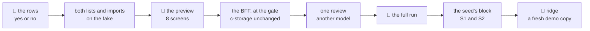

# Slice 1: customers and products from Excel

**Where it stands — 2026-10-31 13:21 +07:** steps 1 to 7 done, step 8 done but for one run: the lists and imports on the fake, the
8 screens answered (16 yes), the BFF routes and the stack's generator at the gate, the review's findings
fixed or parked, `main`@`b4e08ee` taken in. **Next:** one `pnpm demo` run's log (step 8's last clause), then the recap and the merge (step 9).

> **Drafted** 2026-10-31 by the machine, for lane A's first demo slice of the road to 11-04 (the
> orchestrator's plan: part 1, row 1; Decides 41 to 47, by which a demo's details are the machine's).
> Read for it: piece 2's import ([its recap](../recaps/2026-10-30-employee-list.md#L39),
> [its group D](2026-10-29-employee-list.md#L1275)), [the demo seed](2026-10-29-demo-seed.md#scenarios),
> and the code at `main`@`3512c70`. **A demo slice's ceremony** (Decide 46): no re-review or re-check,
> one preview and one full run, no run script of its own, red first only on the business rows. The
> gate, the fake first, the walks page, CI's deploy and a half-page recap stay.

## At a glance



| The root, in demo step 2 | What it is |
| --- | --- |
| opens **Customers** or **Products** in the menu | a list to read, in code order |
| downloads the **template**, fills it in Excel, chooses it | one file a list, read in the browser alone |
| reads the **preview**: each row, and why any is refused | nothing saved yet |
| presses **Add**, and the list fills | each row checked again on the server |

Each demo copy on ridge already holds its company's customers and products (S1 building materials,
S2 drinks). Not in this slice: adding or changing one by hand, one workbook for all three lists, files
over 500 rows ([row 12](#the-case-table)). About 1½ machine days and an hour of the human's, an
estimate.

## The demo step

Step 2, about 2 minutes. Signed in as the copy's root, the office opens Customers, downloads the
template and drops in the demo's customer file. The preview reads "8 of 10 rows will be added": one
code is already in the list, one row has no name. Add, and the list shows them. Then the same for
Products, where one price is refused. The files are made for each scenario by step 8.

## What it holds

| | Typed: the BFF trusts it | In `extra`: the company's own |
| --- | --- | --- |
| **a customer** | id (minted), code, name | phone, address, note |
| **a product** | id (minted), code, name, unit, price in whole đồng, stocked (yes or no) | note |

- **Why these are typed:** the code is unique in its list; the name is every later snapshot's (an
  order names its customer); slice 2 prices an order from the product on the BFF, and its line keeps
  the unit beside the price. Everything else is `extra`, bounded by `extraSchema`
  ([CLAUDE.md](../../CLAUDE.md)'s rule).
- **The code** follows the employee code's rule, reused and not copied: 2 to 20 of A–Z, digits and
  hyphens, in capitals (`normaliseEmployeeCode`, `employeeCodeIsValid` in `shared/src/staff.ts`). It is
  required. *Rejected:* an empty code numbered, as piece 2 does: a numbering record and its claims, for
  lists an SME's accounting tool already gives with codes.
- **The records**, keys built by `recordKeys` ([`records.ts`](../../shared/src/records.ts#L15)):
  `tenant.<id>.customer.<customer id>` and `tenant.<id>.product.<product id>`, one record each,
  written once with `If-None-Match: *`, read by prefix through c-storage's list. **c-storage needs no
  change:** the list by prefix and the conditional write exist
  ([`handlers.go`](../../c-storage/internal/server/handlers.go#L89)).
- **A code unique in its list** is checked by the BFF against the list it reads once a call, and the
  codes written earlier in the call, as piece 2's import does (its D3). *Rejected:* a claim record per
  code, as the email's: a second write a row and a failed claim to take over, for a list with one
  writer. *Price, accepted for the demo:* two imports at once into one copy can both add a code.
  *Trigger:* editing by hand, or a second writer (slice 2 adding a customer from an order).
- **Who:** the root alone sees both lists and imports, checked on the server. *Rejected now:* a view
  permission for office staff. It adds rows to the permission editors, which moves piece 2's walked
  screens, and nothing calls it before slice 2's orders.

## The wire, added to `shared/`

- `customerSchema` and `productSchema`, each list's reply, and each add request:
  `addCustomerRequestSchema` (code, name, `extra`) and `addProductRequestSchema` (code, name, a unit of
  1 to 20 characters, a whole price from 1 to 10¹², stocked, `extra`).
- `importReplyOf(record)`: one result a row, in the order sent: `added` with the record, or `refused`
  as `taken`, `invalid` or `busy`, as piece 2's `importResultSchema`. Both imports reuse
  `importCallSchema` and the limits in [`import.ts`](../../shared/src/import.ts#L6): 2 MB and 500
  rows a file, 100 rows a call. Staff's reply keeps its own shape.
- `ROUTES.customers` and `ROUTES.products`, each a `GET` of the list and a `POST …/import`.
- The data set, `@credo/shared/demo`: six customers and seven products (one not stocked) for the fake's company, and each
  list's import rows (three that hold, one code already there, one refused), with a file that lacks
  the code column.

**Amended 2026-10-31 by the human (08:5x), before any screen was answered:** a product carries a
`stocked` flag (Quản lý tồn kho), the flag only, from the old app's v1 product flag; typed because the
stock piece's BFF will rely on it, required on the wire (the sheet supplies Có for an empty cell).
Row 23 is the new 👤 row, the human's yes as written; rows 1, 3, 11 and 12 are amended above. The
template column sits between price and note, is not a needed column, and shows in the list and the
preview; no new screen. Stock on hand and what the flag drives stay after 11-04.

## The model files

| Part | Follows |
| --- | --- |
| the two list pages | [`StaffListPage.tsx`](../../ui/src/StaffListPage.tsx#L60), its root-only import button |
| one import page for both lists | [`ImportPage.tsx`](../../ui/src/ImportPage.tsx#L70) and [`importSheet.ts`](../../ui/src/importSheet.ts#L184); `importFile.ts` and `saveAs.ts` as they are |
| the four routes | `everyone` and the import route in [`staff.ts`](../../bff/src/staff.ts#L173) (its L387), tested as `employee-import.route.test.ts` is |
| the fake's four calls | `importEmployees` in [`fake.ts`](../../ui/src/fake.ts#L307) |
| the seed's block | `fill` in [`apply.ts`](../../scripts/src/demo/apply.ts#L169); the profiles in [`scenarios.ts`](../../scripts/src/demo/scenarios.ts#L97) |
| the walk | `walk/specs/piece-2.spec.ts` and `visual/src/walks.ts` |

**Staff's import page stays as it is.** *Rejected:* lifting it onto the new page now. That re-opens
four accepted screens and their tests for no demo gain. *Price:* the send loop (calls of 100, the
answered rows kept, Choose another file disabled while sending, the busy rows) lives in two places,
about 60 lines, its cases tested in both. *Trigger:* one workbook for all three lists.

## The case table

👤 marks a business row, for the human's read ([QA](../conventions/qa.md) rule 1). Each 👤 row is seen
red once from its assertion (rule 2); every package stays at 100 % (rule 8).

| # | 👤 | The case | Held by |
| --- | --- | --- | --- |
| 1 | 👤 | The root opens Customers and Products from the menu; each lists all of the company's in code order: a customer's code, name, phone and address; a product's code, name, unit, price in đồng and whether its stock is kept | BFF route; unit, ui; the walk |
| 2 | 👤 | Only the company's root sees the two lists and imports into them; office staff get them with orders, in slice 2 | BFF route |
| 3 | 👤 | For each list the app gives a template in Vietnamese or English: its columns (a product's with Stocked, before Note), two sample rows, and a sheet saying what each column takes | unit, ui; the walk |
| 4 | 👤 | Before anything is saved, the root sees each row read and the reason for any refused; Add adds only the rows that hold, and the list then shows them | unit, ui; BFF route; the walk |
| 5 | 👤 | A customer needs a code and a name; a product a code, a name, a unit and a price; a row missing one is refused, naming it | unit, ui; BFF route |
| 6 | 👤 | A code is 2 to 20 letters, digits and hyphens, read in capitals, unique in its list; one already in the list, or twice in the file, is refused, and the one there stays as it was | unit, ui; BFF route |
| 7 | 👤 | A price is a whole number of đồng above zero; typed with dots or commas between the thousands (95.000) it reads as 95000; a decimal, a negative or a word is refused | unit, ui; unit, shared |
| 8 | 👤 | A customer's phone, address and note, and a product's note, are kept as typed and may be empty | unit, ui; BFF route |
| 9 | 👤 | A file over 2 MB or 500 rows, or without its code or name column, is refused before any row is read, saying what to fix | unit, ui; the walk |
| 10 | 👤 | A row the system could not answer for is listed by its row and name, "not added, try again", and the rest goes on; the same file sent again is refused row by row as already in the list | BFF route; unit, ui |
| 11 | 👤 | Each demo copy starts with its company's lists: S1 about 30 builders and 60 stocked materials by bag, tonne, thousand bricks and m³, plus 2 not stocked (a transport fee by the trip, rebar cutting by the job); S2 about 80 grocery shops and 250 stocked drinks and household goods by carton, plus 1 not stocked (a delivery fee by the trip); every name, phone and address invented | unit, scripts; the applier on real c-storage |
| 12 | 👤 | Not yet: adding, changing or removing one by hand; one workbook for staff, customers and products; files over 500 rows; search in the lists; a company's own columns; prices by customer; stock on hand and anything the stocked flag drives | none: the human's to move |
| 23 | 👤 | A product says whether its stock is kept (Quản lý tồn kho / Stocked: Có or Không). An empty cell reads Có. Không, No, 0 or false read Không; Có, Yes, 1 or true read Có. Any other word refuses the row and names the column. The list shows it. Nothing moves stock yet; stock comes after 11-04 | unit, ui; BFF route |
| 13 | | Each customer and product is one record under a minted id, its key built by `recordKeys`, written once with `If-None-Match: *` | BFF route |
| 14 | | A list answers 500 when c-storage says there are more, or when a record does not parse, naming its kind and never its key; never a short list | BFF route |
| 15 | | An import call takes 1 to 100 rows, each read as one add: refused by the schema, `invalid`; a code in the list or earlier in the call, `taken`; a 503, `busy`, and the call goes on; any other failure ends the call, the rows before it kept | BFF route |
| 16 | | The list is read once a call, and each code written joins it | BFF route |
| 17 | | A write whose answer was lost is read back once by its id, and the row is `added` if it is there | BFF route, a client that fails on a chosen write |
| 18 | | The four routes answer 401 unsigned and 403 to anyone but the root; the route list stays exact | BFF route, `operator.route.test.ts`'s list |
| 19 | | The fake's four calls answer as the BFF does, parse under the shared schemas, and answer a cue's 403, 409 or 503 once | unit, ui, `fake.test.tsx` |
| 20 | | One data set gives the fake and the stack's generator the same customers and products | unit, scripts, `generator.test.ts` |
| 21 | | The walk's eight screens are drawn on the walks page as fake scenes, and the spec's list equals the page's | unit, visual, `walks.test.ts` |
| 22 | | The seed writes a copy's lists at its first fill through the two import routes, 100 rows a call; the same client gives the same lists, each record parsing under its schema; a code already there is skipped and named; any other refusal stops the run red | unit, scripts; the applier on real c-storage |

## The walks

The map ([QA](../conventions/qa.md) rule 7); a dash is a part of the day not built yet.

| | set up | staff | stock | orders | delivery |
| --- | --- | --- | --- | --- | --- |
| **the operator**, us, PC | ridge-app; the dashboard | — | — | — | — |
| **the client's admin**, PC | piece 1; piece 2's staff setup; ⭐ slice 1: customers and products from Excel | piece 2 | — | — | — |
| **office staff**, PC | — | piece 2 | — | — | — |
| **driver**, phone | — | piece 2 | — | — | — |

| `admin-lists`: customers and products from Excel | Path | The one question |
| --- | --- | --- |
| 1. The customer list: code, name, phone, address | main | Is this what the office needs to see about its customers at a glance? |
| 2. Import: the template, and the file chosen | main | Would the admin know to fill the template and choose it? |
| 3. Before saving: each row read, with the reasons for the refused | main | Would the admin know which customers will be added, and why the others are not? |
| 4. Imported: the customers added | main | Would the admin know they are now in the list? |
| 5. A file without the code column | what can go wrong | Does this say what to fix? |
| 6. The product list: code, name, unit, price | main | Is this what the office needs to see about its products at a glance? |
| 7. Before saving: a price that is no price, refused | main | Would the admin know which products will be added, and what to fix in a price? |
| 8. Imported: the products added | main | Would the admin know they are now in the list? |

- **8 screens**, each in Vietnamese and English at 1280, 768 and 390: 16 answers and 48 bases. Screen
  5 is provoked by the data set's file without the code column, in the fake run and the full run alike.
- **The menu gains two pages for the root,** so every root screen of piece 1 and piece 2 whose picture
  shows the menu moves at the full run; their answers hold, since a screen's words leave the menu out
  ([as piece 2's did](2026-10-29-employee-list.md#L401)).

## Steps

- [x] **1. This plan.** Who: 🤖, 10-31. Done when: committed on `customers-products`, the path grep
  clean, the diff naming no person. *Evidence:* this file's commit (`git log -- <this file>`); before
  it, the path grep of [documentation](../conventions/documentation.md#nothing-machine-local-or-personal-in-a-committed-file)
  found nothing in it, and its diff names no person.
- [x] **2. The human's read of the 👤 rows.** Who: 👤, about 10 minutes, yes or no a row. Done when:
  each 👤 row kept or corrected here. **Then stop.** *Evidence:* 2026-10-31 08:3x, the human, to the
  12 rows (1 to 12) put as yes-or-no questions: "all yes". Every 👤 row stands as written.
- [x] **3. Both lists and both imports, on the fake.** Who: 🤖, after step 2 (the rows it builds),
  about ¾ day. In `shared/`: the wire above, the keys, the data set's lists and files. In `ui/`: the
  two list pages, the one import page, the fake's four calls, the menu's two pages, the words in vi and
  en. The 8 screens in `visual/src/walks.ts` and a walk spec. The big picture's "no page for customers"
  and its piece order amended to 11-04, as Decide 41 says. Done when: the UI half of rows 1 and 3 to
  10 each seen red once; `pnpm check` exit 0 at 100 %, no warning; `pnpm report` reads the 16 new
  answers waiting and none asked again elsewhere. *Evidence:* commits `e812ecd` and `f9bcbcd` (shared),
  `bf23fcc`, `08b2069` and the fix after it (ui), `18f29de` (the walks and `walk/specs/lists.spec.ts`);
  whole check `logs/20261031-0915-customers-products-whole-check.log`, last line `== exit 0`, no
  warning (the run before it, `…-0907-…-knip-red.log`, was red on an exported function nothing else
  called, fixed, not rerun to green by chance); every package at 100 %. `pnpm report` read "16 waiting, 0
  asked again, 0 no, 102 yes". *Reds*, each from the row's own assertion with its rule's line changed
  and put back, in `logs/20261031-0852-customers-products-red-row<n>-*.log` for rows 1, 3, 4, 5, 6, 7, 8,
  9 and 10, and row 23 seen red before its code (`…-0904-…-red-row23-stocked.log`). *Model files
  followed:* `StaffListPage.tsx` (the list), `ImportPage.tsx` and `importSheet.ts` (the import and the
  sheet), `importFile.ts`, `importDemo.ts` and `saveAs.ts` as they are, `importEmployees` in `fake.ts`
  (the fake), `employeeSchema` and `importResultSchema` in `shared/` (the records and the reply).
  The big picture's "no page for customers" and dates are amended; Decide 41's own text was not
  readable from this worktree, so the dates note cites it as the slice's plan does.
- [x] **4. The human's preview.** Who: 👤, about 20 minutes, after step 3: the 8 screens on the walks
  page, or on `pnpm fake` at `/customers` and `/products`. Done when: each screen answered yes or no;
  a no becomes a case here and its fix lands before step 5. **Then stop.**
  *Evidence:* 2026-10-31 09:3x, the human, on the walks page built from `8becb80`: all 16 yes
  (`visual/answers.json`, 16 written by `pnpm answers`, 0 refused; the file now reads 118 yes, 0 no,
  0 waiting). No case added.
- [x] **5. The BFF, at the gate.** Who: 🤖, after step 4 (the contract as the preview left it), about
  ¼ day: the four routes, and the stack's generator writing the data set's lists. c-storage does not
  change, so `make check` is not run. Done when: the BFF half of rows 2, 4 to 6, 8 and 10 each seen red
  once; `pnpm check` exit 0 at 100 %, no warning.
  *Evidence:* commits `7fefb42` (the routes in `bff/src/lists.ts`, tested in `bff/src/lists.route.test.ts`)
  and the generator's (`scripts/src/generator.ts`, the data set's lists through the two import
  routes; c-storage unchanged). Whole check `logs/20261031-1136-customers-products-whole-check-step5c.log`,
  133 lines, last line `== exit 0`, no warning, started 11:36:38 and ended 11:44:12; every package at
  100 % (shared 101 tests, bff 320, ui 411, scripts 146, visual 386). Reds, each from the row's own
  assertion with its rule's line changed and put back, in `logs/20261031-0949-customers-products-red-<name>.log`:
  `row2-root`, `row4-added`, `row5-invalid`, `row6-capitals`, `row6-taken`, `row8-extra`,
  `row10-busy`, `row23-stocked`. An earlier whole check (`…-0950-…-step5.log`) was red on prettier
  alone; a second (`…-1001-…-step5b.log`) was red under a load of 44 (visual timeouts, scripts
  SIGKILL), and both packages were green alone on a quiet Mac (`…-1128-…-scripts-alone.log`,
  `…-1129-…-visual-alone.log`) before the green whole check; not rerun to green by chance.
- [x] **6. One review.** Who: 🤖, a model other than the one in the code commits' `Co-Authored-By`
  line ([QA](../conventions/qa.md) rule 5), on steps 3 and 5 with the case table. Done when: each
  finding tagged `[FIXED]`, `[REJECTED]` or `[DEFERRED]` here with its reason, and `pnpm check` exit 0
  after the fixes. No re-review.
  *Evidence:* Opus, on `5fbba5b` in a scratch tree. **Fixed:** `[FIXED]` 1 (medium, row 1): the code-order
  test used random ids, so c-storage's key order sometimes equalled the code order; it holds fixed ids
  whose key order is the reverse, and with `records.sort(byCode)` removed it is red every time
  (`logs/20261031-1156-customers-products-red-review-finding1-sort.log`). `[FIXED]` 5 (row 2): the
  403 test grants every id in `PERMISSIONS`, not three. `[FIXED]` 6: the products file's comment in
  `shared/src/demo.ts` names VT-007 and VT-008 as the empty stocked cells (a row change would have
  re-asked screen 7). `[FIXED]` 7: `readPrice`'s doc comment sits above `readPrice`. `[FIXED]` 8: a row
  whose write may have landed but whose read-back failed is `busy` and its code joins the call's set,
  so a later row with it is `taken`, not written twice; red first without that line
  (`…-1157-…-red-review-finding8-busy-codes.log`). **Deferred**, all to
  [open item 34](../open-items.md) (technical rows, Decide 46): `[DEFERRED]` 2 (row 14, the 500's log
  never read), 3 (row 13, the `If-None-Match: *` precondition not held), 4 (row 19, the fake's code
  order not held). **Not findings:** `[REJECTED]` `taken` by the in-memory set (accepted in
  [the plan](#what-it-holds), with its trigger), the typed fields (the same section and the wire
  amendment), the 1,000-record 500 ([the hazard](#hazards-no-gate-catches)) and "moved" answered
  `busy` (`replyFor` makes every non-400 `CStorageError` a 503; a write under a fresh id cannot move).
  After the fixes `main`@`b4e08ee` was taken in (`0e000f9`; one conflict, `walk/playwright.config.ts`:
  main's launch options and capture kept, and the lists' walk given its own projects `lists-fake` and
  `lists-full` since `walk/run.sh` runs a walk by project; `walk/run.sh` gained the `admin-lists` row,
  seen red first in `walk-run.test.ts`, `…-red-walk-table.log`; `visual/src/walks.test.ts` reads the new
  names, red first, `…-red-walk-config.log`). Whole check
  `logs/20261031-1201-customers-products-whole-check-step6.log`, 133 lines, last line `== exit 0`, no
  warning, 12:01:08 to 12:08:53; every package at 100 % (shared 101 tests, bff 322, ui 411, scripts 188,
  visual 386).
- [x] **7. The human's full run.** Who: 👤, about 20 minutes, by lane B's shared run script with this
  walk's name, once it is in `main` (all this step takes from lane B); 🤖 reads the log whole. Done
  when: the 8 screens' full-stack pictures equal the fake's, or a screen that differs is asked again
  and answered; the run's bases committed (the 48, and the root screens moved by the menu alone); no
  walked screen holds an open "no".
  *Prepared, not run* (`walk/run.sh` has the `admin-lists` row; the operator's walk has no menu of the
  root's and is left out). **The menu moves** piece 1's five settings screens signed in as the root
  (3, 4, 5, 7, 8: not the sign-in, the refused sign-in, the service down or the unknown company) and
  piece 2's root screens (`setup-1`, `setup-2`, `staff-1` to `staff-22`; the `office-` and `phone-`
  screens are other people's menus, which do not gain the root's two pages). A screen named that does
  not move prints "named, not moved" and stays green. `--write` replaces every base of each walk named
  with the first stack's picture, and a picture with no base yet (the 48 of `admin-lists`, whose folder
  does not exist) reads as new and green, never refused (`compare` in `scripts/src/walks.ts`).
  **First run**, in the human's terminal, about 20 minutes, nothing else running:

  ```
  bash walk/run.sh piece-1 piece-2 admin-lists --moved 3-settings,4-saved,5-language-menu,7-save-failed,8-save-conflict,setup-1-departments-positions,setup-2-fields,staff-1-list,staff-2-add,staff-3-added,staff-4-person,staff-5-permissions,staff-6-password,staff-7-archive,staff-8-left,staff-9-code-taken,staff-10-save-conflict,staff-11-save-failed,staff-12-own-fields,staff-13-photo,staff-14-search,staff-15-code-changed,staff-16-field-refused,staff-17-email,staff-18-qr,staff-19-import,staff-20-preview,staff-21-imported,staff-22-no-name --write
  ```

  It must end `== verdict: green`, `== done`, exit 0; `compare full-1 to the bases: admin-lists: 48
  pictures, 0 moved, 48 new`, `admin-lists: 48 bases written`, `piece-1: 54 bases written`, `piece-2:
  198 bases written`; the fake to the stack and the stack to the stack read 0 moved on all three
  walks; only the named screens moved against the bases. **Second run**, the same terminal:

  ```
  bash walk/run.sh piece-1 piece-2 admin-lists
  ```

  It must end `== verdict: green`, `== done`, exit 0, every count 0 moved and 0 new, and `git status`
  holding only what the first run wrote. The machine then reads the diff and commits the bases.
  *First run, read from its log* (`logs/20261031-1214-walk-piece-1-piece-2-admin-lists.log`, the human,
  12:14 to 12:24:26, 10m00s, `== verdict: green: 8 comparisons, every raw count as asked`, `== done`):
  fake to the stack and the stack to a second stack, 0 moved on `piece-2` (198) and `admin-lists` (48),
  and the stack twice on `piece-1` (54), 0 moved. Against the bases: `piece-1` 54 pictures, 20 moved,
  0 new (the five named settings screens, en and vi at 1280 and 768 only: the phone's menu is closed);
  `piece-2` 198 pictures, 96 moved, 0 new (the 24 named root screens, the same four pictures each);
  `admin-lists` 0 base pictures, 48 new. Every picture that moved is on a named screen, at the same
  box (the menu's two new entries, 1043 px in English and 1162 in Vietnamese, shade 255), and no
  named screen of a walk that has it failed to move (no "named, not moved" line). Bases written: 54,
  198 and 48, committed in `e0a9849`. The second run is the human's, and this step stays unticked
  until it ends green with every count 0.
  *Second run, read from its log* (`logs/20261031-1230-walk-piece-1-piece-2-admin-lists.log`, the
  human, 12:30:13 to 12:40:22, 10m09s, 189 lines): `== verdict: green: 8 comparisons, every raw count
  as asked`, `== done`. Every comparison reads 0 moved, 0 new, 0 without a counterpart, 0 unreadable:
  `piece-1` 54 pictures (stack twice, and against the bases), `piece-2` 198 (fake to stack, stack
  twice, bases), `admin-lists` 48 (the same three); no `moved`, `new` or `red` line anywhere. The 16
  `admin-lists` answers are unchanged (the screens' words did not move), and the bases are committed
  (`e0a9849`). No walked screen holds an open "no".
- [ ] **8. The seed's block.** Who: 🤖, after step 7 (the seed changes `scripts/`, which the run
  reads), about ¼ day: each scenario's customers and products, a block in `scenarios.ts` and a
  generator beside `scripts/src/demo/staff.ts`, written at the first fill; and the demo's files for
  step 2 (8 new rows, one code already in the copy, one refused; S1 and S2, vi and en), which
  `pnpm demo-files` writes into the credo root's `demo-files/`, outside git. Done when: rows 11 and 22
  each seen red once; `pnpm check` exit 0; a `pnpm demo` run's log reads each copy's two counts.
  *Evidence:* commits `8e29068` (ui: `listFile` and `readListFile` in `ui/src/importDemo.ts`) and
  `72cfda5` (scripts: each scenario's `lists` profile in `scripts/src/demo/scenarios.ts`, the generator
  `scripts/src/demo/lists.ts` beside `staff.ts`, `addLists` in the first fill of
  `scripts/src/demo/apply.ts`, and `pnpm demo-files`). The first fill writes a copy's customers and
  products through the two import routes, 100 rows a call: S1 30 customers, 60 stocked products and 2
  services (`Cước vận chuyển theo chuyến`, `Cắt sắt theo việc`), S2 80 customers, 250 stocked and 1
  service (`Phí giao hàng theo chuyến`); a code already there is skipped and named, any other refusal
  stops the run red. Reds, each from the row's own assertion with its rule's line changed and put
  back, in `logs/20261031-1247-customers-products-red-seed-<name>.log` (`row22-fill`, `row22-skip`,
  `row22-calls`, `row11-notstocked`, `row11-counts`, `row11-refused-file`) and
  `…-1256-…-red-seed-row22-stop.log` (the 1247 log of that mutation was a broken edit, deleted). Whole
  check `logs/20261031-1312-customers-products-whole-check-step8b.log`, 133 lines, last line
  `== exit 0`, 13:12:40 to 13:20:30, no warning; every package at 100 % (shared 101 tests, bff 322, ui
  413, scripts 203, visual 386). The check before it (`…-1304-…-step8.log`, 13:04:32 to 13:12:17) was
  red on knip alone, two exports nothing else called (`digits`, `FileRow`), fixed, not rerun to green by
  chance. **Not done, so the step stays unticked:** a `pnpm demo` run's log reading each copy's two
  counts (it starts a stack, and the Mac was held for the human's timed walk); the applier's own tests
  on the real c-storage read the 30, 80 and 251 counts meanwhile.
  **The demo's files**, for the human to run later from the worktree's root:

  ```
  pnpm demo-files
  ```

  It writes eight files into the credo root's `demo-files/` (outside git): `S1-customers-vi.xlsx`,
  `S1-customers-en.xlsx`, `S1-products-vi.xlsx`, `S1-products-en.xlsx`, and the same four for `S2`. It
  ends `8 files written, outside git`, exit 0. Each has ten rows: eight new, one whose code a fresh
  copy already holds, one refused (a customer with no name, a product whose price is no price); the
  import page reads each as 8 that hold, 1 already there, 1 refused (`scripts/src/demo-files.test.ts`).

- [ ] **9. The recap and the merge.** Who: 🤖 the half-page recap, after step 8; the orchestrator
  merges into `main` on the human's word. Done when: the recap is committed.
- [ ] **10. ridge, on a fresh demo copy.** Who: 👤, about 15 minutes, after the push of the `main`
  that holds it and CI's deploy green: a fresh copy of an S1 and an S2 client made at `/operator`,
  filled by the seed (`ops/seed.sh ridge`, or the morning's run), then demo step 2 as its root with
  the demo's files. Done when: the human's yes to "would a prospect follow step 2 without help?" The
  slice is done here.

## Hazards no gate catches

- **A copy filled before this slice's deploy gets no lists.** The seed fills only a fresh client
  ([its row 8](2026-10-29-demo-seed.md#L295), the human's read), so step 10's copy is made after the
  deploy, or under a new code in the mapping. *Rejected:* filling the lists into an older copy, which
  breaks that row.
- **c-storage lists at most 1,000 records,** and the BFF answers 500 past it, never a part. S2's 250
  products plus a demo's imports stay below; the lists do not grow daily. *Trigger:* a real client's
  catalogue, which brings a page in the key.
