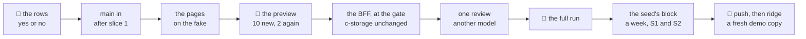

# Slice 2: an order, sent to a driver

**Where it stands — 2026-10-31 12:54 +07:** step 1 done: this plan. **Next:** the human's read of the
👤 rows (step 2), then step 3 once slice 1 (customers and products) is in `main`.

> **Drafted** 2026-10-31 by the machine, for lane A's second demo slice of the road to 11-04 (the
> orchestrator's plan: part 1, row 2; part 6, amended 10-31 on the human's four missing pieces; Decides
> 41 to 47, by which a demo's details are the machine's until a client signs). Read for it: the old
> app's sales order (v2: draft, confirmed, fulfilled, cancelled; a price a line and a total) and its
> delivery request (v1: made from an order, a driver, a planned day, its number, its lines); piece 2's
> [plan](2026-10-29-employee-list.md#permissions) and [recap](../recaps/2026-10-30-employee-list.md);
> [the demo seed](2026-10-29-demo-seed.md#increments); slice 1's plan and code on `customers-products`;
> `main`@`b4e08ee`. **A demo slice's ceremony** (Decide 46): no re-review or re-check, one preview and
> one full run, no run script of its own, red first only on the business rows. The gate, the fake
> first, the walks page, CI's deploy and a half-page recap stay.

## At a glance

| The office, in demo steps 1, 3 and 4 | What it is |
| --- | --- |
| signs in and lands on **Orders** | the last 7 days' orders: number, customer, total, state, driver |
| opens **Delivery requests** | today's, one group a driver; the office opens one |
| makes a **new order** | a customer and two products from slice 1's lists, priced by the app, the total shown |
| presses **Confirm**, picks the driver and the day | the order is confirmed and its delivery request made, each with its number |

Not in this slice: Delivered and fulfilled (slice 3), stock, payments, VAT, changes after confirm,
sending many at once ([row 14](#the-case-table)). About 2¾ machine days and an hour and a quarter of
the human's, an estimate.

## The demo steps

- **Step 1** (1 min): an office person of the copy signs in and lands on Orders, this week's. A click
  on Delivery requests shows today's, by driver, filled by the morning's seed.
- **Step 3** (1 min): New order, a customer, two products with a quantity each; each line shows the
  product's price and amount, the order its total. Confirm.
- **Step 4** (1 min): the confirm asks for the driver and the day, today already chosen. The order
  reads confirmed, with its request's number; today's list shows it under that driver; the office
  opens it.

## What it holds

| | Typed: the BFF trusts it | In `extra` |
| --- | --- | --- |
| **an order** | id (minted), number, day, state (draft, confirmed, cancelled; fulfilled from slice 3), the customer as at the order (`{id, code, name, extra}`), the lines, the total, its live request (`{id, number, day, driver: {id, code, name}}` or none), `madeAt` | its own, empty for now |
| **a line** | the product's id, code, name, unit and price as at the save, the quantity, the amount | none |
| **a delivery request** | id (minted), number, day, state (waiting, cancelled; delivered from slice 3), the driver (`{id, code, name}`), the order (`{id, day, number}`), its customer and lines as at the order, the total to collect, `madeAt` | its own, empty for now |

- **Why typed:** the BFF prices the lines and sums the total; the state, the number, the day and the
  links are what it reasons about; slice 3's Delivered and slice 4's cash read the request's state and
  total. The customer's phone and address stay in the customer's `extra`, copied whole into the
  snapshot, so the BFF never reads their keys.
- **The records**, keys built by `recordKeys` ([`records.ts`](../../shared/src/records.ts#L15)):
  `tenant.<id>.order.<day>.<order id>`, `tenant.<id>.delivery.<day>.<request id>`, and
  `tenant.<id>.document-numbering`. The day is in the key because a list reads one prefix and
  c-storage answers at most 1,000 records ([the demo seed's ceiling](2026-10-29-demo-seed.md#increments)):
  S2's busiest day is about 40, a week is 7 reads. An order and a request are named by their day and
  id in every address. **c-storage needs no change:** the list by prefix and the conditional write
  exist ([`handlers.go`](../../c-storage/internal/server/handlers.go#L89)).
- **The numbering** is the staff numbering's model, not its record: `DH-` and five digits for an
  order, `GH-` for a request, each raised over its tag before its record is written; a number lost to
  a failed write is never given again. *Rejected:* a company's own prefix, which nothing asks for yet.
- **The day:** an order's day is the office's today as the page sends it; a request's is the day
  picked, on or after it. The BFF's clock stamps `madeAt` alone, which no screen shows, so the walk
  draws the same days on the fake and the stack (QA rule 7). *Rejected:* the BFF's clock for the day,
  which files the walk's order under the run's real day and moves its pictures run to run.
- **The writes**, in an order that leaves every stop valid: confirm (and send again) writes the order
  first, naming its request, then the request; cancel writes the request first, then the order. A stop
  between leaves a confirmed order with no live request, which offers "send again", never a waiting
  request for an order that is not confirmed.
- **One a time:** an order names at most one request that is not cancelled. Decide 42's "the office
  cancels and issues again" is that request cancelled and a new one sent, with a new number.

## Who may do what

| Who | May | Held by the permission |
| --- | --- | --- |
| **the root** | everything; slice 1's imports stay its alone | none: the root holds no layer |
| **office staff** | see orders and requests, and slice 1's two lists (its row 2's promise) | `orders.canView` |
| | make, save, confirm and cancel orders; send and cancel requests | `orders.canEdit` |
| **a driver** | be offered in Confirm; from slice 3, their own requests on their phone | `deliveries.canDeliver` |

The three join piece 2's catalogue, set by the root at a department, a position or a person
([its model](2026-10-29-employee-list.md#permissions)). An absent permission is a refusal, so no one
but the root gains anything until the root sets them. The demo's office departments get the first
two, its drivers' departments the third. *Rejected:* the root alone, as slice 1 did: demo step 1 is
the office signing in, and slice 1's row 2 promised them the lists here. *Price:* the editors list the
catalogue, so piece 2's `setup-1` and `staff-5` change their words and are asked again (4 answers).

## The wire, added to `shared/`

- `shared/src/orders.ts`: `orderSchema`, `orderLineSchema`, `deliveryRequestSchema`, `daySchema` (a
  real `YYYY-MM-DD`); the requests: a draft's save (`day`, `customerId`, lines of `productId` and
  `quantity`, `extra`, a version when it exists), confirm and send (`version`, `driverId`, `day`),
  cancel (`version`); the replies: each record with its version, a week's orders, a day's requests,
  the drivers.
- `ROUTES` and route builders, as `employeeRoutes`: `GET /api/orders?from&to` (at most 7 days),
  `POST /api/orders`, `GET` and `PUT /api/orders/:day/:id`, `POST …/confirm`, `…/send`, `…/cancel`;
  `GET /api/deliveries?day`, `GET /api/deliveries/:day/:id`, `POST …/cancel`; `GET /api/drivers`.
- `PERMISSIONS` gains the three above; `recordKeys` the three records and each day's prefix.
- The data set, `@credo/shared/demo`: a week of Minh Phát's orders and requests at fixed times, ending
  on its today; its Văn phòng allowed to see and make orders, its Giao hàng to deliver.

## The model files

| Part | Follows |
| --- | --- |
| the orders list, the requests by driver | slice 1's `ListPage.tsx`; `StaffListPage.tsx` |
| the order's form and page, a request's page | `AddPersonPage.tsx` and `PersonPage.tsx` (a record over its version, the conflict, the failed save) |
| the confirm's driver and day, each cancel's check | `ArchivePanel` in `PersonPage.tsx`; the date input in `ownFields.tsx` |
| the routes | slice 1's `bff/src/lists.ts` (a list never short); `raiseGiven` in [`staff.ts`](../../bff/src/staff.ts#L235) (the numbering); its archive route (a state over a tag) |
| the fake's calls | slice 1's list calls in `ui/src/fake.ts` |
| the stack's generator | `seedClient` in `scripts/src/generator.ts`, its clock set as `driverFor`'s in `apply.ts` |
| the seed's block | `dayEvents` in [`staff.ts`](../../scripts/src/demo/staff.ts#L245); `fill` and the day loop in [`apply.ts`](../../scripts/src/demo/apply.ts#L169); slice 1's `lists.ts` |
| the walk | slice 1's `walk/specs/lists.spec.ts`; `visual/src/walks.ts` |

## The case table

👤 marks a business row, for the human's read ([QA](../conventions/qa.md) rule 1). Each 👤 row is seen
red once from its assertion (rule 2); every package stays at 100 % (rule 8).

| # | 👤 | The case | Held by |
| --- | --- | --- | --- |
| 1 | 👤 | The root sets three new permissions at a department, a position or a person, as piece 2's: to see orders and delivery requests with the customer and product lists, to make and send orders, and to deliver goods; office staff do what theirs allow | unit, shared; BFF route; the walk |
| 2 | 👤 | Someone who may see orders lands on them after signing in: the last 7 days', newest first, each with its number, day, customer, total, state, and the driver of one sent; the 7 days before are one click away | BFF route; unit, ui; the walk |
| 3 | 👤 | A new order: the office picks a customer from the list and products from the list, each with a quantity in whole units; a product added twice is one line; each line shows its unit, price and amount, the order its total in đồng | unit, ui; BFF route; the walk |
| 4 | 👤 | A line's price is the product's, set by the app, never typed; the total is the sum of the lines, with no VAT, discount or fee beyond a product's own line (S1's transport fee is one); a confirmed order keeps its prices and its customer's name, phone and address as they were | unit, shared; BFF route |
| 5 | 👤 | An order is saved as a draft and changed again, or confirmed; once confirmed it is not changed | BFF route; unit, ui; the walk |
| 6 | 👤 | Each order has a number from its first save, `DH-` and five digits, each delivery request its own, `GH-`; each counts past every number given, a cancelled one's included, and is never given twice | BFF route; the walk |
| 7 | 👤 | Confirm asks for the driver, among the people allowed to deliver who have not left, and the day, today unless another is picked, never before the order's; the order is confirmed and its request made, and the order shows the request's number, driver and day | BFF route; unit, ui; the walk |
| 8 | 👤 | A delivery request carries the order's number, its customer with their phone and address as at the order, its lines and quantities, and the total to collect; an order has one at a time | BFF route; unit, ui; the walk |
| 9 | 👤 | Delivery requests shows a day's, today unless another is picked, one group per driver, each with its number, customer, address, order number, total and state; the office opens one to read it | BFF route; unit, ui; the walk |
| 10 | 👤 | The office cancels a waiting request after a check; the order stays confirmed and offers to send it again, to a driver and a day, as a new request with a new number | BFF route; unit, ui; the walk |
| 11 | 👤 | The office cancels a draft, or a confirmed order whose request still waits, after a check; its request is cancelled with it, and the order stays in the list as cancelled, under its number | BFF route; unit, ui |
| 12 | 👤 | A save or a confirm over someone else's newer one is refused, what was typed kept, and the page offers theirs; one that fails says so and keeps what was typed; with no one allowed to deliver, Confirm says to ask the admin | BFF route; unit, ui; the walk |
| 13 | 👤 | Each demo copy starts with its week: S1 about 10 orders a working day to its builders, S2 about 30 to its grocery shops, made between 07:30 and 17:30; most confirmed and sent for that day or the next working day, a few left as drafts, a few cancelled; each morning adds the day before, so today's list by driver is already full | unit, scripts; the applier on real c-storage |
| 14 | 👤 | Not yet: Delivered and fulfilled (slice 3); stock held or moved; payments; VAT and discounts; changes after confirm, or back to draft; a part of a unit; prices by customer; a note on an order; sending many at once; trips, partial deliveries, the visit order; a customer added from the order | none: the human's to move |
| 15 | | An order is `tenant.<id>.order.<day>.<order id>`, a request `tenant.<id>.delivery.<day>.<request id>`, keys built by `recordKeys`; a day is one prefix read, a week seven | unit, shared; BFF route |
| 16 | | A list answers 500 when c-storage says there are more or a record does not parse, naming its kind and never its key; never a short list | BFF route |
| 17 | | A save carries the customer's id and each line's product id and quantity (1 to 100,000, 1 to 50 lines); the BFF reads both lists and prices each line; a price or total sent, a product twice, an id not in its list, or a total over 10¹⁵ is a 400 | unit, shared; BFF route |
| 18 | | A number is raised in `document-numbering` over its tag before its record is written, read again when it moved, three tries, then 503 | BFF route, a client that fails on a chosen write |
| 19 | | Every write names the tag read; a moved record is a 409 with the current one; a step its state does not allow (confirming a cancelled order) is a 409 | BFF route |
| 20 | | Confirm and send write the order, then the request with `If-None-Match: *`; cancel writes the request, then the order; a request the order names and c-storage lacks reads as not sent | BFF route, a client that fails on a chosen write |
| 21 | | The driver must be active and hold `deliveries.canDeliver` when the request is made, or the call is a 400; `GET /api/drivers` answers them, resolved through the layers | BFF route |
| 22 | | Every route answers 401 unsigned and 403 without its permission; slice 1's two lists also open to `orders.canView`, their imports stay the root's; the route list stays exact | BFF route |
| 23 | | An order's day is the page's, a real date; a request's is on or after it; the BFF's clock stamps `madeAt` alone | unit, shared; BFF route |
| 24 | | The fake's calls answer as the BFF does, parse under the shared schemas, and answer a cue's 403, 409 or 503 once | unit, ui, `fake.test.tsx` |
| 25 | | One data set gives the fake and the stack's generator the same week at fixed times; the fake build's today is the data set's, and the walk fixes the browser's clock at it | unit, scripts, `generator.test.ts`; the human's run |
| 26 | | The walk's screens are drawn on the walks page as fake scenes, and the spec's list equals the page's | unit, visual, `walks.test.ts` |
| 27 | | The seed writes a day's orders through the BFF's routes, its clock at each one's time; one already in the day's list (the same customer at the same time) is skipped and named; only a 409 or a 404 is a skip; no day's list passes 500 within 365 days | unit, scripts; the applier on real c-storage |
| 28 | | A copy's ledger names the blocks it was filled with; a copy filled before this block keeps its staff's days and gets no order, since its drivers may not deliver | unit, scripts; the applier on real c-storage |

## The walks

The map ([QA](../conventions/qa.md) rule 7); a dash is a part of the day not built yet.

| | set up | staff | stock | orders | delivery |
| --- | --- | --- | --- | --- | --- |
| **the operator**, us, PC | ridge-app; the dashboard | — | — | — | — |
| **the client's admin**, PC | piece 1; piece 2; slice 1 | piece 2 | — | as the office | as the office |
| **office staff**, PC | — | piece 2 | — | ⭐ slice 2: an order made, confirmed, sent | ⭐ slice 2: the day's requests by driver |
| **driver**, phone | — | piece 2 | — | — | slice 3: my deliveries today |

| `office-orders`: an order, sent to a driver | Path | The one question |
| --- | --- | --- |
| 1. Orders: the last 7 days' | main | Is this what the office needs to see of its week's orders at a glance? |
| 2. A new order: a customer, two products at their prices, the total | main | Is this how the office would take an order? |
| 3. Confirm: the driver and the day, today chosen | main | Would the office know whom it goes to, and when? |
| 4. Confirmed: the order's number and its request's | main | Would the office know the order is confirmed and with the driver? |
| 5. Delivery requests: today's, by driver | main | Is this how the office would see who delivers what today? |
| 6. A delivery request opened | main | Is anything missing that the office or the driver needs? |
| 7. A request cancelled; its order offers to send it again | main | Would the office know how to send it again? |
| 8. Someone else saved the draft first, what was typed kept | what can go wrong | Would the office know someone else saved first, and how to see it? |
| 9. A confirm that failed, what was typed kept | what can go wrong | Would the office know nothing was sent, and nothing typed is lost? |
| 10. No one allowed to deliver yet | what can go wrong | Would the office know to ask the admin? |

- **10 screens**, each in Vietnamese and English at 1280, 768 and 390: 20 answers and 60 bases,
  signed in as the data set's office person. Screen 8 is the real API's second save, screen 9 a
  stubbed 503, screen 10 the root's setup saved without the right first, through the real API.
- **The menu lists Orders and Delivery requests first**, so whoever may see orders lands on them.
  Piece 1's walk then opens Settings from the menu after its sign-in. Every root and office picture
  whose menu shows moves at the full run; their answers hold, since a screen's words leave the menu
  out. `setup-1` and `staff-5` are asked again ([who may do what](#who-may-do-what)).

## Steps

- [x] **1. This plan.** Who: 🤖, 10-31. Done when: committed on `orders-delivery`, the path grep clean,
  the diff naming no person. *Evidence:* this file's commit (`git log -- <this file>`); before it, the
  path grep of [documentation](../conventions/documentation.md#nothing-machine-local-or-personal-in-a-committed-file)
  found nothing in it, every relative link resolves, and its diff names no person.
- [x] **2. The human's read of the 👤 rows.** Who: 👤, about 10 minutes, yes or no a row. Done when:
  each 👤 row kept or corrected here. **Then stop.** *Evidence:* the human, 2026-10-31 13:1x, to the
  14 rows put as yes-or-no questions: "yes, as your recommendation", all 14 yes; no row corrected,
  so the table below stands as drafted.
- [x] **3. `main` taken in once slice 1 has merged.** Who: 🤖, after slice 1's merge into `main` (an
  order picks from its lists and its words), ¼ hour. Done when: `main` merged in, its conflicts named;
  `pnpm install --offline` exit 0. *Evidence:* `main`@`983d454` merged at `0d736db`, no conflict (the
  branch held only this plan); `pnpm install --offline --frozen-lockfile` read "Done in 2.4s", exit 0.
- [ ] **4. The pages on the fake.** Who: 🤖, after step 3, about a day. The wire above in `shared/`;
  in `ui/`: the orders list, the order's form and page with its confirm and cancel, the requests by
  driver, a request's page, the fake's calls, the menu, the words in vi and en; piece 1's walk to its
  Settings by the menu; the 10 screens in `visual/src/walks.ts` and `walk/specs/orders.spec.ts`, its
  projects `orders-fake` and `orders-full`, and the row `office-orders` in `walk/run.sh`'s `WALKS`,
  seen red first in `scripts/src/walk-run.test.ts`. Done when: the UI half of rows 1 to 12 each seen
  red once; `pnpm check` exit 0 at 100 %, no warning; `pnpm report` reads 20 waiting and 4 asked
  again (`setup-1`, `staff-5`), none elsewhere.
- [ ] **5. The human's preview.** Who: 👤, about 25 minutes, after step 4: the 12 screens on the walks
  page, or on `pnpm fake` at `/orders`. Done when: each answered yes or no; a no becomes a case here
  and its fix lands before step 6. **Then stop.**
- [ ] **6. The BFF, at the gate.** Who: 🤖, after step 5 (the contract as the preview left it), about
  ¾ day: the routes in `bff/src/orders.ts`, the lists opened to `orders.canView`, the stack's generator
  writing the data set's week at its times. c-storage does not change, so `make check` is not run.
  Done when: the BFF half of rows 1 to 12 each seen red once; `pnpm check` exit 0 at 100 %, no warning.
- [ ] **7. One review.** Who: 🤖, a model other than the one in the code commits' `Co-Authored-By`
  line ([QA](../conventions/qa.md) rule 5), on steps 4 and 6 with the case table, about ¼ day with
  its fixes. Done when: each finding tagged `[FIXED]`, `[REJECTED]` or `[DEFERRED]` here with its
  reason; `pnpm check` exit 0 after the fixes. No re-review.
- [ ] **8. The human's full run.** Who: 👤, about 25 minutes for two runs, nothing else running; 🤖
  reads each log whole. First `bash walk/run.sh piece-1 piece-2 admin-lists office-orders --moved
  <every screen the menu and the catalogue move, listed by the machine here> --write`, then the same
  without flags. Done when: both end `== verdict: green`, the second with every count 0; the bases
  committed; no walked screen holds an open "no".
- [ ] **9. The seed's block and the demo week.** Who: 🤖, after step 8 (the seed changes `scripts/`,
  which the run reads), about ½ day: an orders block in `scenarios.ts` (the rates, the office's and
  the drivers' rights), a generator beside `scripts/src/demo/staff.ts`, the day's events in the
  applier, the ledger's blocks. Done when: rows 13, 27 and 28 each seen red once; `pnpm check` exit 0;
  a `pnpm demo` run's log reads each copy's week of orders and today's requests.
- [ ] **10. The recap and the merge.** Who: 🤖 the half-page recap, after step 9; the orchestrator
  merges into `main` on the human's word. Done when: the recap is committed.
- [ ] **11. The push.** Who: 👤, of the `main` that holds this slice, when the human calls for it.
  Done when: CI's deploy of that `main` is green.
- [ ] **12. ridge, on a fresh mapped code.** Who: 👤, about 15 minutes, after step 11: a copy of an S1
  and an S2 client made at `/operator` under a mapped code after the deploy, filled by the seed
  (`ops/seed.sh ridge`, or the morning's run); demo steps 1, 3 and 4 as its root (who lands on Orders
  as the office does), or as an office person it gives a sign-in. Done when: the human's yes to "would a prospect follow steps 1, 3 and 4 without
  help?" The slice is done here.

## Hazards no gate catches

- **A copy filled before this slice's deploy gets no orders.** The seed fills only a fresh client
  ([its row 8](2026-10-29-demo-seed.md#L295)), and row 28 keeps its mornings free of orders, so
  step 12's copy is made after the deploy, under a mapped code no copy holds yet.
- **Until slice 3, every past day's request reads waiting.** Slice 3's block delivers them, with drawn
  photos; a demo before it shows a week no driver closed.
- **The office's own clock files an order.** A PC set to the wrong day files its orders under that day.
  *Trigger:* a real client, whose orders' days the BFF then checks against its own.
