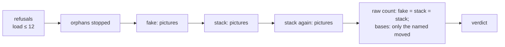

# The walk made steady, and one run script for every walk

**Where it stands — 2026-10-31 11:29 +07:** all nine steps done, ready to merge into `main`: the probe read (`--disable-partial-raster`
is the fix), rule 7's text in `qa.md`, the reader and the strays' choice in `scripts/`, the capture in `walk/`, the script `walk/run.sh`. The two runs of step 8 read green and the bases are committed. Next: the merge, the orchestrator's call.

> **Drafted** 2026-10-31 by the machine: lane B's first piece of the road to 11-04, its fixes two
> and three (the pictures made steady, with the pixel piece of the human's Decide 30 of 10-30, "a
> moved pixel is a raw pixel", folded in; and one shared run script), and open items 25 and 32.

## At a glance

| What moved | Where | Why | Fix |
| --- | --- | --- | --- |
| A card's two top corners, 8 to 19 pixels by one shade | the operator's screens 3, 4, 9; piece 2's phone cards | the browser rasters a tile in part, and the edge falls one of two ways, run by run. Shown by the probe: only the switch `--disable-partial-raster` made it steady | `--disable-partial-raster` in the walk's browser |
| The client's logo on a phone, 14 pixels by up to 22 shades | piece 2's phone menus and lists | the same two states, run to run, even in the settled capture; until 10-30 16:02 the fake also took one shot | the same switch; one capture, made strict |
| Neither was flagged | every run read "0 differ" | Playwright's check skips softened edge pixels | the script counts raw pixels |
| The top bar mid-page | item 25 | the scroll at the shot | scroll to the top first |
| A run refused on a stray | 10-30 18:37 | a killed stack leaves its servers up | the script stops orphans first |

One command runs any walk's full run: `bash walk/run.sh <walk>…` ([the script](#the-script)),
reviewed once. The human's part: the probe and two runs in the terminal, and one yes on
[rule 7's text](#qa-rule-7-amended). No screen is asked again: a yes follows the words.

## The causes

Read by the machine from the 10-30 runs' folders in `$ROOT_DIR/walks/`, pixel by pixel (any channel
moved by any amount), with Playwright's own comparator beside it.

### 1. A card's corners: two raw states, and the run picks one. Shown by the probe

- `full-run-operator-2026-10-30-184201-66fa27c/moved-bases/` holds the six bases pass 2 rewrote. Each
  differs from the committed one by the same 10 pixels, at most one shade a channel, on the lower arc
  of the card's two top corners (`op-3-made-en-1280`: x 256–257 and 1262–1263, y 211–213; pixel
  (257, 211) is `235,236,239` in one state, `234,236,238` in the other). Two states, never a third.
- The same run's fake against the committed bases: 6 of 54 differ raw; the bases it wrote against its
  own fake: 4 of 54, a different set. Playwright's comparator calls all of them equal.
- Only screens 3, 4 and 9 flip: those where a press sends a request and the button goes busy
  ([`ui/src/NewClient.tsx#L72`](../../ui/src/NewClient.tsx#L72)). Screen 8 presses it with no
  request and screen 2 shows the card unpressed; neither flips. Screen 3's card is a new one
  ([`ui/src/ClientMade.tsx#L41`](../../ui/src/ClientMade.tsx#L41)), so the state outlives the
  button's card: it is the page's raster, not one element's style.
- Piece 2, 16:39 (`full-run-2026-10-30-163915-949fdb4/`): its fake against its own written bases,
  3 of 198 differ raw (`office-6-password-vi-390`, `staff-22-no-name-{en,vi}-390`), 19 pixels at most
  one shade, on a card's corners (x 16 and 373, eight rows).
- *Inferred (the mechanism; the effect is shown below):* Mantine 9.6.3's busy button mounts its loader in a 150 ms transform transition, and
  its `::before` overlay carries `filter: blur(12px)` with transitions of its own; while they run the
  browser gives them a layer, and a half-covered edge pixel blended through one more layer rounds one
  shade off. No browser starts in the agent's sandbox to see it.
- **The probe** (10-31 08:19–08:26, 31 runs, each "2 passed"; log `$ROOT_DIR/logs/20261031-0758-probe-walk-steady.log`,
  results `$ROOT_DIR/walks/probe-walk-steady-2026-10-31-081917-dc7096d/states.txt`), the fake alone, each
  picture's raw states counted over the runs, four ways of taking pictures:

  | Set | now | no-partial-raster | all-stages | fresh-layer |
  | --- | --- | --- | --- | --- |
  | operator at 1280, 5 runs each | 6 pictures unsteady (screens 3, 4, 9, both languages), 10 px, shade 1 | **steady** | the same 6 | steady |
  | piece 2 at 390 | 5 runs: 9 pictures unsteady | **3 runs: steady** | 3 runs: 4 unsteady | not run |

  Cause 1 is shown: "as now" takes two states on screens 3, 4 and 9, and `--disable-partial-raster`
  takes one on every picture of both sets.

### 2. The logo on a phone: two raw states, and the settled capture does not close them

- The logo ([`shared/src/demo.ts#L5-L7`](../../shared/src/demo.ts#L5-L7), an SVG drawn at 32 pixels
  by [`ui/src/BrandMark.tsx#L8`](../../ui/src/BrandMark.tsx#L8)) has two raw states at 390 wide: 14
  pixels on its rounded corners, up to 22 shades apart.
- Every fake run until 10-30 16:02 took one shot at once (`page.screenshot`): the five fake folders
  read, of 10-29 and 10-30, hold the first state on every phone picture whose bar is at the top (22,
  12, 30, 44, 44), the second on none. The committed bases, from the settled capture, hold the second
  on 11 of the 12 English screens taller than the window and the first on 9 of the 10 that fit it.
  Hence 38 phone pictures, 14 pixels each, at 16:02.
- `7450420` (10-30 16:36) gave the fake the settled capture. At 16:39 the fake, that run's bases and the
  committed bases held the same state screen by screen: no logo pixel moved *in that run*.
  The same commit closed staff-20's hover scrollbar and staff-8's checkbox transition (its message).
- **What the probe shows, and what holds.** With the settled capture alone (`now`), five runs at 390
  took the logo in both states: `office-1-menu` and `staff-1-list`, English and Vietnamese, 14 pixels by
  up to 22 shades, in runs 1 to 3 against runs 4 and 5. So the logo was never only the first shot against
  the settled one. That difference was real (it made 38 pictures differ at once) and `7450420` removed
  it, but under it lay the same flip as cause 1: the browser's partial raster draws the logo's rounded
  edge one of two ways, run by run, and the settled loop keeps whichever the last two shots agree on,
  blind to these pixels (cause 3). The 16:39 run was one draw of that coin, not a proof it was steady.
  The same set shows the card corners flip at 390 (office-6, office-7, staff-19: 8 to 19 pixels, shade
  1). `--disable-partial-raster` took one state on all 66 pictures, three runs.

### 3. The comparator sees neither

[`walk/playwright.config.ts#L31-L33`](../../walk/playwright.config.ts#L31-L33) sets `threshold: 0` and
`maxDiffPixels: 0`, but Playwright 1.64 hands pixelmatch the threshold alone, so its
`includeAA: false` stands: a pixel it judges anti-aliased is never counted. Both causes move only such
pixels, so each run's `differs.txt` read "0 differ" while `--update-snapshots=all` rewrote the files
and git saw them move. The same comparator judges "two equal shots in a row", so a settled capture may
keep either state.

### 4. The bar mid-page

Item 25 ([`docs/open-items.md#L146-L153`](../open-items.md#L146-L153)): a picture taken after the
walk scrolled draws the fixed bar where the scroll left it, 3597 pixels between two runs. Its fix
belongs to the next change to the walk: this one.

### 5. The orphans

[`scripts/src/processes.ts#L47-L48`](../../scripts/src/processes.ts#L47-L48) stops a child when its
parent exits; a SIGKILL runs no handler, so the BFF and c-storage live on under parent 1, and the next
run refuses: `$ROOT_DIR/logs/20261030-1838-stop-stray-stack.log#L2`, a c-storage of a test's stack,
parent 1, up since 09:53.

## The fixes

- **One way of taking a picture, made raw** ([`walk/support.ts#L20-L39`](../../walk/support.ts#L20-L39)):
  the pointer parked, the page scrolled to the top, then `page.screenshot` (full page, animations
  off, caret hidden, the masks) until two shots in a row are equal byte for byte, at most ten, or a red
  naming the raw pixels between the last two; written to `CREDO_SHOTS_DIR/<screen>-<language>-<width>.png`.
  `toHaveScreenshot` goes, with its update modes, `CREDO_FAKE_DIR`, `CREDO_REFERENCE_DIR` and the
  snapshot templates ([`walk/playwright.config.ts#L13-L63`](../../walk/playwright.config.ts#L13-L63)):
  Playwright takes, the script compares. *Rejected:* `toHaveScreenshot` kept as the capture. Its
  settling and its comparison both skip those pixels, and it takes pictures two ways, comparing or
  writing (the console's 0147 fake one-off ran without `--update-snapshots=all`, which main's settled
  capture needs).
- **The browser setting: `--disable-partial-raster`**, in the config's `launchOptions.args`, chosen by
  the probe. It is the only variant steady in both sets. *Rejected:* `--run-all-compositor-stages-before-draw
  --disable-checker-imaging`, unsteady in both sets (the same 6 pictures at 1280, 4 at 390). *Rejected:*
  the stylesheet `html { will-change: transform }`, steady at 1280 but never tried at 390, so it would
  need a second probe, and it changes how the page is composited inside the picture where a switch
  changes only how it is drawn. *Weaker than it looks:* piece 2's steadiness rests on 3 runs, against 5
  for `now`, and a coin that lands the same way three times in a row is no proof (one in four, if fair).
  Step 8 takes every picture three more times in one go (the fake, `full-1`, `full-2`) and the script's
  raw count is red on any difference between them: if one moves, the fix is wrong and the second probe
  (the button's transitions awaited before the next screen; one raster thread; the stylesheet at 390)
  comes before the bases are written. Bases written under it move (46 of 66 of piece 2's, 8 of 18 of
  the operator's at 1280, against main's bases): step 8's `--moved all` is the rewrite.
- **The raw reader**, in `scripts/`: Node's zlib decodes the PNGs (8-bit RGB or RGBA, not interlaced,
  what Chromium writes; any other kind refused by name) and counts each pixel whose colour moved.
  *Rejected:* Playwright's bundled decoder, an internal path the one-offs pinned to 1.64; `pngjs`, a
  dependency for some 60 lines that read one encoder's output.
- **The masks, under rule 7's new text:** the six masked fields
  ([`operator.spec.ts#L139`](../../walk/specs/operator.spec.ts#L139),
  [`piece-2.spec.ts#L238`](../../walk/specs/piece-2.spec.ts#L238), `#L263`, `#L387`) each name the
  unit test that holds what they cover, or their content is fixed at the source.

## The script

`bash walk/run.sh <walk>… [--moved <screen>,…|all] [--write]`, committed beside the walk so each
worktree runs its own; the worktree and `$ROOT_DIR` come from git, never from the environment.

| Part | What it does |
| --- | --- |
| the walks | `piece-1`, `piece-2`, `operator`: a table at its top, one line a walk (its spec, its fake project or none, its full project, one stack a pass or one a test). The console adds `operator-passkeys` |
| refusals, each `== refused:`, exit 2 | an unknown walk or option; a tree not clean, a merge going, `main` not in; node not v26.12.1 (nvm's folder first on `PATH`), pnpm not the `packageManager`'s; Chromium or its headless shell missing; the gate lock; a one-minute load above 12; the process list unreadable; another walk, stack or fake of credo's with a live parent |
| the strays, first | a process of credo's (its command under `$ROOT_DIR`, or its binary in a temp `credo-` folder) whose parent is 1 is stopped (TERM, five seconds, KILL) and named; one with a live parent is someone's run, and the script refuses |
| the passes | each walk's fake into `fake/`, then on the stack `full-1/` and, on fresh stacks, `full-2/`; one stack a test where the walk makes a client by a fixed code, as the operator's does |
| the raw count | a line for each comparison and walk: fake → full-1 and full-1 → full-2 must read 0 pixels; full-1 → the committed bases may move only the `--moved` screens, new screens listed apart, a base no picture matches red; each moved picture in `raw.txt` (its raw pixels, largest shade, box) |
| `--write` | after a green read only: full-1 over the walk's bases, new ones added, retired ones removed; the machine reads git's diff and commits |
| its logs | every line `tee -ai`'d to `$ROOT_DIR/logs/<YYYYMMDD-HHMM>-walk-<walks>.log`; the pictures and `results.txt`, written as each pass ends, in `$ROOT_DIR/walks/run-<date>-<sha>/` |
| its progress | its first comment gives the expected length; `== n/8 <step> (elapsed, load)`, `-- stack k/K` within a pass, `== verdict: green` or `red:` with every raw count, `== done`; exit 0, 1, 2, or 130 on Ctrl-C with the verdict still logged |

The logic with branches is TypeScript under the gate, in `scripts/`: the raw reader and the strays'
choice from a `ps` listing. The bash is the commands in order. *Rejected:* all in bash, the parsing that
drew four to six fixes a review; all in TypeScript, a second runner beside `pnpm stack` for a dozen
commands.

The load mid-run is printed, not judged: with one steady capture only a moved page moves a pixel, and
if load moves one the raw count is red with the load beside it. *Rejected:* red on any `vitest` seen
mid-run, two false reds on 10-30: another repo's tests
(`$ROOT_DIR/logs/20261030-1722-full-run-operator-dashboard.log#L506`) and a shell's command line
holding the word (`$ROOT_DIR/logs/20261030-1438-full-run-employee-list.log#L1468`).

### What the one-offs taught

In `$ROOT_DIR/one-off/`; `1722` is `20261030-1722-full-run-operator-dashboard.sh`.

| Lesson | Seen in | In `walk/run.sh` |
| --- | --- | --- |
| paths from the script's place, never the environment | `1722#L87-L95` | from git |
| a lazily loaded nvm leaves bash an older node | `1722#L103-L110` | nvm's folder first, or refused |
| a Ctrl-C still logs the verdict | `1722#L310-L314` | `tee -ai`, a trap, exit 130 |
| an unreadable process list is no "nothing running" | `1722#L417-L426` | refused |
| busy by credo's paths, not by a word | the two false reds above | credo's paths only |
| a stray is stopped, a live parent left | `20261030-1838-stop-stray-stack.sh`; `1722#L324-L347` named, stopped none | stopped first |
| one capture, no update modes | `20261030-0147-fake-run-operator-passkeys.sh`; `7450420` | the raw capture alone |
| counts from Playwright and the pictures, not the spec's source | `1722#L447-L473`, sed over the languages' loop | the listing's tests, the fake's names |
| the expected moves named apart, any other red | `20261030-1136-full-run-operator-passkeys.sh#L1-L4` | `--moved` |
| a stack a test where the walk makes a fixed code | `1722#L52-L54` | the table's column |
| results written as it goes | `1722#L564-L580` | `results.txt` |

### The case table

All the machine's; nothing here is the business's.

| # | The case | Held by |
| --- | --- | --- |
| 1 | Two pictures equal pixel for pixel read 0, whatever their files' bytes | the reader, `scripts/` |
| 2 | One channel moved by one on one pixel reads one pixel, shade 1, its box | the reader |
| 3 | Two sizes read as moved, both sizes named | the reader |
| 4 | A PNG it cannot read is named, never read as equal | the reader |
| 5 | A picture with no counterpart is named on its side: new, or a base no screen takes | the reader |
| 6 | Credo's process under parent 1 is a stray, one with a live parent is busy, another repo's is neither | the strays' choice, `scripts/` |
| 7 | A c-storage in a temp `credo-` folder under parent 1 is a stray | the strays' choice |
| 8 | A screen moved and not named in `--moved` is red; a named one unmoved is printed | `walk/run.sh` on stand-in folders |
| 9 | Each refusal stops before any act, exit 2 | `walk/run.sh`, each seen in the sandbox |
| 10 | Two shots a pixel apart are not settled; ten such end red with the raw count | `walk/support.ts`, the human's runs (no browser here) |

## QA rule 7, amended

For the human's yes (step 3). It replaces the sentence "The machine compares its look with its
committed base image: a moved pixel is a red." ([`qa.md#L102-L103`](../conventions/qa.md#L102-L103)):

> The machine compares its look with its committed base image, raw: a moved pixel is any pixel
> whose colour moved by any amount, a softened edge's included, and one is a red. The same input
> gives the same picture: a date, a name or anything random is fixed at its source (the data set,
> the fake, the stack's seed); a mask, a box of one colour, covers only what a unit test holds and the
> human need not judge, and names that test. The run script prints the raw count of moved pixels for
> every comparison it makes. *Rejected:* a tolerance, a threshold or a comparator that skips
> anti-aliased pixels: it hides a picture that is not steady, and the next real move of one shade
> inside it. *Rejected:* a mask over what moves, such as a card's frame: the human judges the frame.

Its line at a glance ([`qa.md#L37`](../conventions/qa.md#L37)) becomes: "7. The screens are the
final check: each person's day, on their device, yes or no; the machine counts every moved pixel,
raw." The stamp: "**Amended** <date> by the human: rule 7's raw pixel (Decide 30)."

## Steps

- [x] **1. This plan.** Who: 🤖. Done when: committed on `walk-steady`; the path and name checks
  clean; the probe's reads run once in the sandbox. *Evidence:* the one-off's `--checks` in the
  sandbox read node v26.12.1, pnpm 12.10.1, Playwright 1.64.0, Chromium r1248, the load, and its
  config listing 2 and 2 tests, then refused as built on the process list, which the sandbox cannot
  read (`pgrep: Cannot get process list`); its reading, on folders made from the 10-30 runs, gave the
  numbers above. The path grep finds nothing in this file, and it names no person.
- [x] **2. The probe.** Who: 👤 in the human's terminal, about 12 minutes, then 🤖 15 minutes. Run
  `bash $ROOT_DIR/one-off/20261031-0758-probe-walk-steady.sh`; lane B tests nothing meanwhile. Done
  when: its log ends on `== verdict: read: …` and `== done`, the machine has read it whole with its
  `states.txt`, and cause 1 here names the steady variant, or the second probe. *Evidence:* the log
  (1384 lines) ends `== done`, 31 of 31 runs "2 passed", no warning or error line; `states.txt` read
  whole: `now` unsteady in both sets, `no-partial-raster` steady in both, `all-stages` unsteady in both,
  `fresh-layer` steady at 1280 only. Cause 1 is shown; cause 2 is reread (the logo flips under the
  settled capture too); the fix is `--disable-partial-raster`, with its weakness (3 runs at 390) and
  its fall-back written in [the fixes](#the-fixes).
- [x] **3. Rule 7's text.** Who: 👤 yes or a correction, then 🤖 5 minutes. Done when: the human's answer,
  dated, here; then `qa.md`'s rule 7 and its line at a glance in one commit, with the stamp.
  *Evidence:* the human said yes to the text above on 2026-10-31 (08:3x, "all yes"); `qa.md` rule 7,
  its line at a glance and the header stamp changed in one commit.
- [x] **4. The reader and the strays' choice.** Who: 🤖, about 2 hours, needs nothing above. Done
  when: cases 1 to 7 each seen red from its assertion, `scripts/` green at 100 %; the reader on
  `$ROOT_DIR/walks/full-run-operator-2026-10-30-184201-66fa27c/` reads `fake/` against
  `bases-before/` as 6 of 54, 10 pixels each, shade 1.
  *Evidence:* `scripts/src/pixels.ts` (PNG reader, raw compare), `strays.ts` (the choice from a `ps`
  listing), `walks.ts` (`compare` and `strays`, the commands `walk/run.sh` calls, entry
  `walks-main.ts`); cases 1 to 7 each seen red from their assertion before the code (a stub first), and
  cases 1 and 6 broken once by hand (the zero test, the root test, the self test) and red; coverage of
  the three files 100 %. The reader on `fake/` against `bases-before/` of the 10-30 operator run read
  `54 pictures, 6 moved`, each `10 px, shade 1` (op-3-made en 768, vi 1280, vi 768; op-4-code-taken
  en and vi 1280; op-9-make-failed vi 1280).
- [x] **5. The capture.** Who: 🤖, after steps 2 and 3, about 1 hour 30. Done when: `walk/` as
  [the fixes](#the-fixes) say, with step 2's variant; each mask names its unit test or is gone;
  the walk's typecheck and lint green; Playwright lists each project's tests;
  `git grep toHaveScreenshot -- walk` empty.
  *Evidence:* `walk/support.ts` takes full-page shots (pointer parked, scrolled to the top first) until
  two in a row are equal by the raw reader, at most ten, into `CREDO_SHOTS_DIR`;
  `walk/playwright.config.ts` has `--disable-partial-raster` and no `toHaveScreenshot`, snapshot
  template, `CREDO_FAKE_DIR` or `CREDO_REFERENCE_DIR`; the walk imports the reader as
  `@credo/scripts/pixels` (a workspace link, one lockfile line). The four masks (screens op-3, staff-3,
  staff-6, staff-18) each name their unit test in a comment. `visual/src/walks.test.ts` holds the
  capture's text (seen red on its assertion before the code). The walk's `tsc` and ESLint are green,
  Playwright lists 6 tests in each of its 5 projects, `git grep toHaveScreenshot -- walk` is empty.
  Case 10 stays the human's runs (no browser here). The bases keep their folders and names; the script
  (step 6) maps them.
- [x] **6. The script.** Who: 🤖, after steps 4 and 5, about 2 hours. Done when: `walk/run.sh` as
  [the script](#the-script) says; `bash -n` and ShellCheck clean, and CI's ShellCheck takes
  `walk/*.sh` ([`ci.yml#L195`](../../.github/workflows/ci.yml#L195)); cases 8 and 9 each seen.
  *Evidence:* `walk/run.sh` (bash 3.2 safe, ShellCheck 0.11.0 clean, `bash -n` clean; CI's ShellCheck
  takes `walk/*.sh`). `scripts/src/walk-run.test.ts` runs it in a made-up repository with stand-ins for
  node, pnpm, ps and uptime: each refusal seen (an unknown walk, option, none, `--moved` bare; dirty;
  a merge going; main not in; node; pnpm; the gate lock; the load; unreadable load; no node_modules;
  Playwright's version; Chromium; the headless shell; no test listed; a pattern not matching one; ps
  unreadable; a ps the choice cannot read; a live run), each stopping before any act with exit 2 and no
  `walks/` folder; then whole runs on stand-ins: green with `--write` and a second run at 0, a moved
  picture between stacks red and nothing written, a moved base red unless named, a pass short of
  tests red. Each refusal line was broken once and its test went red, except four defensive ones
  (the commit unreadable, a tool missing, `git status` failing, `mkdir` failing), left untested. A run
  on stand-ins found that the script's own `--inside` re-entry unset the folders the outer run gave it:
  fixed. Case 8 is held by `compare` in `scripts/` (table amended). `scripts/` 184 tests, coverage 100 %.
  The time: about 15 to 20 minutes a run, not the 25 for two: step 8's estimate is 40 minutes for both.
- [x] **7. The review, once.** Who: 🤖, a model other than the author's (QA rule 5), about 1 hour.
  Done when: steps 4 to 6 read together, each finding `[FIXED]`, `[REJECTED]` or `[DEFERRED]` with
  its reason, the fixes committed.
  *Evidence:* read by Opus (the author is Sonnet), steps 4 to 6 together, with the reader checked
  against Playwright's bundled encoder (filters 0 to 4, RGB and RGBA, up to 1280x6000: 0 mismatches),
  Bash 3.2 behaviours run, Ctrl-C and pnpm's argument passing tried by hand. Findings: (1) the strays'
  choice matched file names (`.tsx`, `vite.config.ts`) in any process and a relative entry of another
  repo `[FIXED]`: a root path must be in a node process's arguments, a relative entry counts only when
  `lsof` puts its working folder under the root; the four processes it named added to the test.
  (2) the tail of a compare's result called a missing base "1 moved" `[FIXED]`. (3) "named, not moved"
  printed when one language moved, and a typo in `--moved` was silent `[FIXED]`: "named, no such
  screen". (4) `--moved --write` took `--write` as the list `[FIXED]`. (5) the listings read stdin
  `[FIXED]`. (7) `mkdir` failing after the strays were stopped said "refused" `[FIXED]`: red, exit 1.
  (6) the interrupt verdict claimed the stacks were down unchecked `[FIXED]`: it names what is left; a
  Ctrl-C during step 1's listings ends as a refusal, exit 2 `[DEFERRED]`, harmless: nothing was acted
  on. (8) the stray stop loop and the Ctrl-C path are not exercised by the stand-in tests
  `[DEFERRED]`: the sandbox cannot signal a process an earlier command started; the human's first
  stray or interrupt shows them. The capture's test now asserts the equality line, so a tolerance
  turns it red `[FIXED]`. The reader's forward filter in the test is the author's own
  `[REJECTED]`: the reviewer's pngjs run covers it once; Chromium's own encoder cannot run here.
- [x] **8. Two runs back to back.** Who: 👤 in the human's terminal, about 40 minutes (15 to 20 a run), then 🤖. Run
  `bash walk/run.sh piece-1 piece-2 operator --moved all --write` from the worktree's root (every base
  taken again by the new capture); the machine reads its log whole and commits the bases; then
  `bash walk/run.sh piece-1 piece-2 operator`. Done when: both verdicts green, every raw count of the
  second 0, `git status` clean after it, both logs read whole. What the first run ends with: `== 8/8`,
  one line a comparison (fake to full-1, full-1 to full-2, full-1 to the bases, each walk), then
  `== verdict: green` and `== done`, exit 0; the fake-to-stack and stack-to-stack counts read `0 moved`,
  the bases comparison lists the moved pictures `(named)` and the new ones. A red names the comparison
  and its raw pixels: if full-1 to full-2 or fake to full-1 moves, the fix is wrong ([the fixes](#the-fixes)).
  *First run, 10-31 10:23:10 to 10:35:21 (12m11s), * log
  `$ROOT_DIR/logs/20261031-1023-walk-piece-1-piece-2-operator.log` (456 lines), ending
  `== verdict: green: 8 comparisons, every raw count as asked` and `== done`. Its comparison lines:
  fake to full-1: piece 2 and the operator, 198 and 54 pictures, 0 moved; full-1 to full-2: piece 1 (54),
  piece 2 (198) and the operator (54), 0 moved; full-1 to the bases: piece 1 24 of 54 moved, piece 2 106
  of 198, the operator 24 of 54, none new, none without a counterpart, all named by `--moved all`. So the
  fix holds on the first run: three takes of every picture agree pixel for pixel. The 154 moved bases
  are committed (`5353d42`); `git status` was clean after. 
  *Second run, 10-31 11:17:15 to 11:27:41 (10m26s), no flags:* log
  `$ROOT_DIR/logs/20261031-1117-walk-piece-1-piece-2-operator.log` (299 lines), ending
  `== verdict: green: 8 comparisons, every raw count as asked` and `== done`; no warning or error line.
  Its comparisons, all `0 moved, 0 new, 0 without a counterpart, 0 unreadable`: full-1 to full-2 for
  piece 1 (54), piece 2 (198) and the operator (54); fake to full-1 for piece 2 and the operator;
  full-1 to the bases for all three, with `== 7/8` not asked. `git status` was clean before it and
  after. The 154 rewritten bases were read by eye by Opus: the large piece-2 moves were the old bases
  shot scrolled down, the fixed bar and sidebar painted mid-page over content (the staff person page's 10
  screens in 6 sizes), now at the top: item 25 is done by this piece.
- [x] **9. The close.** Who: 🤖, 30 minutes. Done when: items 25 and 32 deleted from the log; the
  recap written (what shipped, the review's findings, what was rejected); this plan's "Where it
  stands" rewritten; the stop tells the orchestrator what the console's step 9 takes (below).
  *Evidence:* items 25 and 32 are deleted from `docs/open-items.md`; the parked leftovers of the
  review are item 33 there; the recap is [`docs/recaps/2026-10-31-walk-steady.md`](../recaps/2026-10-31-walk-steady.md).
  The console's step 9 takes what [What it hands on](#what-it-hands-on) says.

## What it hands on

- **The console's step 9** runs on this script once the console takes it in (from this branch or
  from `main`: the orchestrator's call, since lane B merges after slice 4 is on ridge). It adds
  `operator-passkeys` to the table; the script's own fake pass takes its fake pictures at the same
  commit, so the 0147 folder is not read; and a screen the fake draws differently from the stack (the
  1136 one-off expected pk-1 and pk-2 to) is red until fixed at the source or masked under rule 7.
- **Left out:** the source fix for the orphans, children that end with their parent, on the board for
  the next piece touching `scripts/src/stack.ts`; a Mac-wide test lock (after 11-04, to the kit); a
  second machine's bases (the pictures stay the Mac's).
