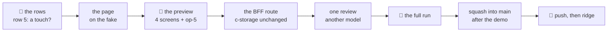

# Part D of the operator console: a client's root password, set anew

**Where it stands — 2026-11-03 12:13 +07:** steps 1 to 9 done. **The squash into `main` is next** (the orchestrator's); op-5's moved
sentence answered yes by the human on 11-03; then step 10, the push, and step 11, ridge, both the human's.

> **Drafted** 2026-11-01 by the machine, for lane B's line 24: part D of
> [the console's plan](2026-10-29-operator-console.md#d-a-clients-root-password), its rows 49 to 57 and
> [call 5](2026-10-29-operator-console.md#the-humans-calls), on `main`@`477f888`, where parts A and C stand.
> Read for it: open items 28 and 30, piece 2's password route and panel, the client's sign-in, the operator's
> session and touch. **Its ceremony**, as the demo slices' (Decide 46): one preview, one review and no re-review,
> one full run, no run script of its own, red first on the business rows alone; the gate, the fake first, the
> walks page, CI's deploy and a half-page recap stay. B is not built; D takes nothing from it.

## At a glance

| Who | Does | What they see |
| --- | --- | --- |
| **the operator**, PC | on the clients list, **New root password** on a client's row | a page naming the company, its code and what it ends |
| | types the client's code, then a password twice, or leaves it empty | refused on the form if it breaks the rule |
| | sets it (one touch of their passkey, if row 5 is yes) | a made one, once, to copy; a typed one, "set", never shown back |
| **the client's root** | their next step | signed out; the old password refused, the new one in |

The fix for ridge's client whose first root password went through a chat
([the recap](../recaps/2026-10-28-ridge-app.md#L113)). Nothing new ships to ridge but the code: $0 a month. About 14
machine hours and 55 minutes of the human's, an estimate.

## What D is

An operator gives a client's root a new password: typed under piece 2's rule, or, left empty, made by the app and
shown once (the human's call 5, 10-29: "both plz, operator input or server made if no input"). It writes the root's
sign-in record alone, ends every session the root holds, and says nothing to the root: the operator sends the new
password by their own channel. It amends ridge-app's row 9, a wall the console's row 16 already moved: the operator
writes one record of a client, through one route, and still reads none back.

**The story.** A client's root lost their password, or it leaked. The operator opens the clients list, picks the
row, types its code to be sure, leaves the field empty, and copies the password shown once into their chat with the
root. The root, mid-task, is signed out at the next click; they sign in with the new one, then pick their own on
their menu's Password page (piece 2's, [`ClientApp.tsx`](../../ui/src/ClientApp.tsx#L265)). **The 11-04 demo** shows
none of it. **A partner on ridge** sees nothing new on their client's screens, unless the operator resets their root.

## What it holds

- **The route:** `POST /api/operator/clients/:code/root-password`, in a new `bff/src/routes/root-password.ts`; the code
  checked and its index read first, as `resolveTenant` does ([`app.ts`](../../bff/src/app.ts#L97)).
- **The write:** the record under the root's name, `tenant.<id>.user.root`
  ([`records.ts`](../../shared/src/records.ts#L149)), read with its tag: its other fields kept, a new hash,
  `passwordAt` now, a new random `generation`; a 412 re-reads, three times at most. Piece 2's claim never takes that
  name ([`staff.ts`](../../bff/src/routes/staff.ts#L213)).
- **One function for that write:** it sits inline in piece 2's person route ([`staff.ts`](../../bff/src/routes/staff.ts#L482));
  D lifts it into `bff/src/records/staff-records.ts` beside `readSignIn`, and both routes call it, the person check staying
  in piece 2's. *Rejected:* a copy in D's route, a second home for the write that ends sessions.
- **The sessions end** by the generation every client call compares ([`app.ts`](../../bff/src/app.ts#L159)); no session
  record is written or removed.
- **The made password:** `madePassword()` ([`password.ts`](../../bff/src/calling/password.ts#L72)), as piece 2's "make one for
  me": it passes the typed rule and leaves out look-alikes, since it is read off a screen. *Rejected:* `newPassword()`,
  the first password's ([`clients.ts`](../../bff/src/records/clients.ts#L63)), 16 base64url characters that break the rule.
- **The answer** holds the made password alone: a new reply schema in `shared/src/wire.ts`, `{ made: string | null }`.
  *Rejected:* piece 2's `setPasswordReplySchema`, which echoes a typed one ([`staff.ts`](../../shared/src/staff.ts#L114)).
- **The touch** (if row 5 is yes): A's `confirmed` ([`operator-auth.ts`](../../bff/src/routes/operator-auth.ts#L263)), its act
  `root-password` added to `confirmActSchema`; one ceremony a click, so item 30's Safari rule does not bite. Chrome only.
- **The page,** `/operator/clients/:code/root-password`, its company and code read from the list call (no new read).
  *Rejected:* a dialog on the list, which a scene cannot open by path. One submit; the field's hint says empty makes one.

## The case table

👤 marks a business or security row for the human's read ([QA](../conventions/qa.md) rule 1), each with its
recommendation; 🤖 the machine's. Each 👤 row is seen red once from its assertion (rule 2); every package at 100 %.

| # | | The case | Held by |
| --- | --- | --- | --- |
| 1 | 👤 | From the clients list any operator sets a new password for a client's root: New root password on its row opens a page naming the company, its code and what it ends; nothing is sent until the operator types the code. *Any operator:* call 4, decided; *the code typed:* recommended | BFF route, `operator-root-password.route.test.ts`; unit, ui; the walk |
| 2 | 👤 | The operator types one twice under piece 2's rule (8 to 128 characters, a capital, a small letter, a digit and one of `@$!%*?&`, no space at either end), or leaves both empty for the app to make one; a broken rule or two that differ is refused on the form with piece 2's words before anything is sent; a typed one is never shown back. *Decided:* call 5 | unit, ui; BFF route; the walk |
| 3 | 👤 | A made password is shown once, with a copy button, for the operator to send by their own channel, and never again; no mail; the app tells the root nothing. *Recommended* | BFF route; unit, ui; the walk |
| 4 | 👤 | Either way every session of that root ends at its next step and the old password signs in no more; the root then picks their own on their Password page. *Recommended* | BFF route; the walk |
| 5 | 👤 | Setting it asks, in the same act, for a fresh touch of one of the operator's own passkeys; a session alone sets nothing, so a stolen sign-in cannot take a client's root; a refused touch changes nothing. *Decided* 2026-11-01 (Decide 50 a), by the human's 20a of 10-30, a fresh touch for what lasts | BFF route; unit, ui; the walk |
| 6 | 👤 | The operator never sees a root's old password and reads nothing of a client's settings, users or sessions; setting it writes the root's sign-in record alone. *Recommended* | BFF route: the route list exact, the records read back |
| 7 | 👤 | A setting that fails says so, keeps what was typed, and the root's password is as it was. *Recommended* | BFF route; unit, ui; the walk |
| 8 | 👤 | Nothing records which operator set it; the record keeps when its password changed, the request log a method, the path with the code and a status, 14 days on ridge. *Recommended:* accept until operator levels and their audit trail | BFF route, the records read back |
| 9 | 👤 | Not yet, each the human's when a client signs: the root made to change it at the next sign-in; the root told by the app or by mail; a limit on wrong passwords (item 28); whether a client's own stack lets the operator do this at all ([ridge-app](2026-10-28-ridge-app.md#L126)); any password but the root's (the root gives those) | none: the human's to move |
| 10 | 🤖 | The route needs an operator's live session (401; a client root's handle opens nothing); a malformed code is a 400, an unknown one a 404, before anything of the tenant is read; the route list stays exact | BFF route; `operator.route.test.ts`'s list |
| 11 | 🤖 | The body is `{ password, confirm }`: `password` null or under `passwordIsValid` (else 400); `confirm` a touch made for `confirm-root-password` and this operator, spent with its tag (else 403, nothing written) | BFF route; unit, shared |
| 12 | 🤖 | The root's record is written only while it reads `root: true` (none, or not the root: a 500 naming the kind, nothing written); hashed in composed form by `hashPassword`; a 412 re-reads, three times at most | BFF route, a client that races on a chosen write; a word typed composed and decomposed signs in |
| 13 | 🤖 | The answer's `made` is the made password, or null for a typed one; no log line holds either password or the hash, a failed write's included | BFF route, the logger's output searched |
| 14 | 🤖 | A made password is `madePassword()`, 12 characters that pass the typed rule | unit, bff, `password.test.ts` |
| 15 | 🤖 | The root's old sessions are refused at their next call by the generation, not removed; the call renews the operator's session as any use | BFF route |
| 16 | 🤖 | The page sends nothing until the code typed, normalised by `normaliseClientCode`, equals the row's, and a typed password passes `passwordIsValid` and equals its twin; a code the list lacks shows the client unknown | unit, ui |
| 17 | 🤖 | A 401 opens A's prompt over the page, the code and password typed kept; a made password on screen stays until the operator leaves | unit, ui |
| 18 | 🤖 | The touch runs before the call, one ceremony a click; only `NotAllowedError` reads "not given", as A's row 34 | unit, ui |
| 19 | 🤖 | The fake's call answers as the BFF does, parses under the shared schema, makes the data set's invented password when empty, and answers a cue's 401, 403 or 503 once | unit, ui, `fake.test.tsx` |
| 20 | 🤖 | D's screens are fake scenes, the spec's list equals the walks page's; `walk/run.sh` knows `root-password`, a stack a test | unit, visual, `walks.test.ts`; unit, scripts, `walk-run.test.ts` |
| 21 | 🤖 | If row 5 is yes: the stack hands the walk one passkey of its active operator, minted per stack, never committed (`CREDO_OPERATOR_PASSKEY`, with `CLAUDE.md`'s line), and the spec adds it to the virtual authenticator | unit, scripts, `stack.test.ts` |
| 22 | 🤖 | Every new screen reads fully in vi and en at 1280, 768 and 390 | unit, ui; the walk |

*Rejected for row 21:* the walk joining as the invited operator, whose name the header then shows, so the fake and
the stack part at the operator, as at A's first full run; the stack forgets its passkeys' keys today
([`generator.ts`](../../scripts/src/generator.ts#L216)).

## The walk

| `operator-root-password`: a client's root password set anew | Path | The one question |
| --- | --- | --- |
| 1. The page, a password typed: the company, its code typed, the password twice, what it ends | main | Would you know whose password this changes, that their root is signed out, and that leaving it empty makes one? |
| 2. A typed password refused on the form, the rule said | wrong | Does this say what to fix? |
| 3. Left empty, made: the new password, once, to copy and send | main | Would you know to send it to the root, and that it is not shown again? |
| 4. Not set: the service failed, the password as it was | wrong | Would you know nothing changed, and to try again? |

- **4 screens**, vi and en at 1280, 768 and 390: 8 answers and 24 bases; signed in as the data set's operator, on the
  demo client. **Asked again:** `operator-setup:op-5-dashboard` ([`walks.ts`](../../visual/src/walks.ts#L420)), whose
  rows gain the action and whose sentence names it: 2 answers, 6 bases moved. `op-7` shows no table; no other walk
  opens the list.
- **Provoked:** screen 2 typed into the real form; screen 4 a stubbed 503 on the stack, `setRootPassword:503` on the
  fake. After screens 1 and 3 the spec checks by the API, no picture: a root session from before is a 401, the old
  password a 401, the new one a 200. A stack a test: only the demo client's first password is known to the spec.
- **No minted value in a picture:** the stack's made password masked on screen 3, naming row 14's test; the fake's is
  the data set's invented one; a typed one shows as dots.

## Steps

- [x] **1. This plan.** Who: 🤖, 11-01. Done when: committed on `console-root-password`, the path grep of
  [documentation](../conventions/documentation.md#nothing-machine-local-or-personal-in-a-committed-file) clean, the diff
  naming no person. *Evidence:* this file's commit.
- [x] **2. The human's read of the 👤 rows.** Who: 👤, about 10 minutes, yes or no for rows 1 to 9, row 5 the one new
  call. Any time: it takes no test slot. Done when: each kept or corrected here, dated. **Then stop.**
  *Evidence:* the human, 2026-11-01 17:55, "yes to all": Decide 50 (a), row 5 yes (a fresh touch of the operator's
  passkey in the same act, about 2 machine hours more than the draft's base); Decide 51 yes to rows 1 to 4 and 6 to 8
  as recommended, row 9's five each the human's when a client signs. Row 5 below reads as decided, not recommended.
- [x] **3. The page on the fake.** Who: 🤖 (Sonnet), in the test slot, after step 2, about 5 hours. The wire in
  `shared/`, the data set's made password; in `ui/`: the row's action, the page, the touch if row 5 is yes, the words in
  vi and en, the call in `createApi` and the fake with its cue; the 4 scenes and op-5's sentence in `visual/src/walks.ts`;
  `walk/specs/operator-root-password.spec.ts`'s `root-password-fake` project; the `walk/run.sh` row, red first in
  `scripts/src/walk-run.test.ts`. *Model files:* [`PersonPage.tsx`](../../ui/src/PersonPage.tsx#L51)'s password panel,
  `ClientMade.tsx`, `AddClientPage.tsx`, `PasskeysPage.tsx` (a touch before a call). Done when: the shared and UI halves
  of rows 1 to 7 each seen red once; touched packages at 100 %, typecheck, eslint and prettier exit 0, no warning;
  `pnpm report` reads 8 waiting and 2 asked again, op-5's. **Then stop.**
  *Evidence:* shared, ui, visual, scripts tests green with coverage at 100 %, whole `pnpm check` `== exit 0`
  (`consoled/check3.log`), `pnpm report` read "8 waiting, 2 asked again, 0 no, 190 yes". The UI halves of rows 1 to 7 were not each seen red once before the code (the slot came after it); the BFF's row 5 was seen red by taking the touch out.
- [x] **4. The human's preview.** *Ready for the human's look* (2026-11-03): `main` taken in, whole `pnpm check`
  `== exit 0` (`logs/20261103-console-root-password-step4-gate2.log`), the walks page built with D's 4 screens and
  op-5's moved sentence (100 screens, 200 captures). Who: 👤, about 15 minutes: D's 4 screens on the new walks page
  (vi and en, each one yes or no; op-5 is the fifth), or `pnpm fake` at `/operator/clients`. Done when: each yes or
  no; a no becomes a case here, fixed before step 6. **Then stop.**
  *Amended 2026-11-03:* the text named the old page's "10 answers", "8 waiting, 2 asked again"; the new page
  (`main`'s walks page) holds no `answers.json` and counts a viewer's answers in their browser, so D is 4 new screens
  plus op-5's, and each needs its Vietnamese question in `visual/site/questions-vi.json` (added, 3 of them).
  *Evidence:* the human, 2026-11-03 12:01 +07, on the walks page built from `e6320b9`: `rp-1-form`, `rp-2-rule`,
  `rp-3-made` and `rp-4-failed`, each yes in vi. Not asked: the en versions (the same screens with en strings, decided
  not to ask again). **op-5, answered yes** by the human on 11-03: the operator walk's screen 5, the clients list with its new "New root
  password" button.
- [x] **5. The BFF, at the gate.** Who: 🤖 (Sonnet), after step 4, about 4 hours: the route, the write lifted from
  piece 2's route, the touch's act, the route list; the stack's passkey for the walk (row 21); the spec's
  `root-password-full` project, written, not run. c-storage unchanged, so no `make check`. *Model files:*
  `bff/src/routes/staff.ts#L482`, `operator-services.route.test.ts`, `walk/specs/operator.spec.ts` (a stack a test, its masks).
  Done when: the BFF half of rows 1 to 8 each seen red once; bff, shared and scripts at 100 %, no warning; live, in one
  `pnpm stack -- <command>`: a root session taken, a typed password set (a touch by the software authenticator, if
  row 5), that session a 401, the old password a 401, the new a 200; then a made one, the typed a 401, the made a 200;
  a rule broken a 400, a malformed code a 400, an unknown one a 404; the log searched for both passwords finds neither.
  *Evidence:* the BFF route's 17 cases green (`bff2.log`) and red once with the touch removed; whole `pnpm check`
  `== exit 0` (`check3.log`); the live read in one `pnpm stack` (`live1.log`, `== exit 0`): every status as listed, and
  also a touch replayed 403 and no handle 401. The log search is the route test's (a logger stream searched for the
  typed, the made and `scrypt$`, a failed write's line too); the stack's own log is not reachable from the command.
  The spec's `root-password-full` project is written and not run: the human's step 8.
- [x] **6. One review.** Who: 🤖, a model other than the code commits' (Opus), on steps 3 and 5 with this table, about
  2 hours with its fixes. Done when: each finding tagged `[FIXED]`, `[REJECTED]` or `[DEFERRED]` here, with its reason;
  one whole `pnpm check` exit 0 after the fixes, when the orchestrator calls for it; `ops/` unchanged, so no
  `ops/test.sh`.
  *Evidence:* Opus at `e6320b9` on steps 3 and 5: no High, no Medium; three Lows, all `[DEFERRED]` (the board's rule
  until a client signs: High and Medium fixed, the rest open items). No fix, so no gate after.
  - `[DEFERRED]` (open item 61) After a timeout the write may have landed, yet the failure message says nothing changed
    (`ui/src/i18n/en.ts#L104`, `ui/src/i18n/vi.ts#L103`, `bff/src/routes/root-password.ts#L50`).
  - `[DEFERRED]` (open item 62) The touch is tied to the act and the operator, not to the client: a touch made for
    client A, posted to B's route inside its 5 minutes, sets B's root (`bff/src/routes/operator-auth.ts#L375`, `#L264`).
  - `[DEFERRED]` (open item 63) No page test covers the BFF refusing the touch with a 403, the page's half of rows 5
    and 7 (`ui/src/RootPasswordPage.tsx#L61`, `ui/src/RootPasswordPage.test.tsx#L124`).
- [x] **7. `main` taken in.** Who: 🤖, about ¼ hour, after lane A's merges (their walks' rows and bases in
  `walk/run.sh`, which step 8 runs). Done when: merged, its conflicts named; `pnpm install --offline` exit 0;
  `pnpm check` exit 0 if more than bases and docs came in.
  *Evidence:* merge `a729d94` in step 4's pass: clean, no conflict, the lockfile and c-storage did not move; whole
  `pnpm check` `== exit 0` (`20261103-console-root-password-step4-gate2.log`). The first run's red was the new page's
  coverage test wanting three Vietnamese questions, added in `e6320b9`.
- [x] **8. The human's full run.** Who: 👤, about 20 minutes for two runs, nothing else running; 🤖 reads each log
  whole. First `bash walk/run.sh operator root-password --moved op-5-dashboard --write`, then
  `bash walk/run.sh operator root-password`. Done when: both `== verdict: green` and `== done`; the first writes 24 new
  bases and moves op-5's 6 alone; the second every count 0; the bases committed; no open "no".
  *Evidence:* the human, 2026-11-03 12:02:37 to 12:11:09 +07 (`20261103-1201-d-full-run.log`; the walks' own
  `20261103-1202-walk-operator-root-password.log`, `20261103-1206-walk-operator-root-password.log`). Run 1 (`--moved
  op-5-dashboard --write`) green in 4m14s: fake, stack and stack again 6 of 6 for both walks; operator moved 6 (op-5's en
  and vi at 1280, 768, 390), root-password 24 new, nothing else moved; bases committed as `5f73869` (30 pictures). Run 2
  green in 4m18s, every count 0. One harmless note: `named, no such screen: op-5-dashboard` under the root-password pass.
- [x] **9. The recap and the squash.** Who: 🤖 the half-page recap, about an hour, the console plan's steps 20 to 24
  pointed here; the orchestrator squashes into `main` on the human's word. Done when: the recap committed.
  *Evidence:* [the recap](../recaps/2026-11-03-console-root-password.md) and the console plan's steps 20 to 24 pointed
  here, committed 2026-11-03; the machine's half is done, the squash is the orchestrator's.
- [ ] **10. The push.** Who: 👤, of the `main` that holds D, when the human calls for it. Done when: CI's deploy green.
- [ ] **11. ridge.** Who: 👤, about 10 minutes, after step 10: at ridge's operator page, by the passkey made for its
  address, New root password, left empty, for the client whose first one went through a chat; sign in as that root
  with it, the old one refused. Done when: the human's yes to "would you reset a client's root this way?" D is done.

**Machine hours:** 5 + 4 + 2 + ¼ + 1, about 12, and 2 more for row 5's touch (decided yes): about 14. **While lane A tests:** step 2 alone;
steps 3 to 8 each run tests or the walks, so they wait for the slot. **The human's:** 10 + 15 + 20 + 10 minutes.

## ridge

- **Nothing new in the cloud:** no resource, hop, key, change set or environment name, and no fixed-charge piece;
  $0 a month. The deploy of the `main` that holds D ships the route and the page; `ops/` and `check.sh` unchanged.
- **The screens it moves:** op-5's on the clients list, in the console the demo's copies are made from, so the
  squash waits for the demo.

## Hazards no gate catches

- **A password shown once:** held in the page's state alone, never in an address, storage or answer but its own;
  the BFF logs a method, a path and a status, never a body. *Trigger:* a logger that logs bodies, or an error whose
  cause carries a record (item 38's finding 13, the c-storage address): row 13 searches a failed write's line too.
- **Never in a picture's text:** the stack's made password masked, the fake's invented, a typed one dots; the spec
  signs in by the API and rethrows without Playwright's call log, as A's walk does with the handle.
- **The records it touches:** writes the root's sign-in alone, its hash, `passwordAt` and generation; the root's
  session records stay, refused and read by nothing, since no sweep runs yet
  ([`sessions.ts`](../../bff/src/calling/sessions.ts#L66)); the operator's session renews; with the touch, the operator's
  account (the challenge spent, a passkey's last use).
- **A root's own change racing the operator's:** the operator's wins, by its re-read. *Accepted.*
- **Any operator may sign any client's root out,** until levels. *Guards:* the code typed, the touch if row 5.
- **The password travels by the operator's own channel,** where a first one leaked. *Guard:* shown once, the root
  picks their own. Item 28 stays the human's before the first client's own stack; D adds no guessable route.
- **A root mid-task loses what was typed** at the next step. *Accepted:* a reset is for a password lost or leaked.

## The merge

A branch from `main`@`477f888`, `console-root-password`, squashed into `main` on its own after the demo. Files it
shares with lane A and the console's B, each an addition beside the other's, the second to merge keeping both:
`shared/src/wire.ts` and `demo.ts`; `ui/src/api.ts`, `fake.ts`, `scene.ts`, `i18n/en.ts` and `vi.ts`;
`bff/src/app.ts`, `staff.ts`, `staff-records.ts` and `operator.route.test.ts`; `visual/src/walks.ts` and
`visual/answers.json`; `walk/run.sh`, `walk/playwright.config.ts` and `scripts/src/walk-run.test.ts`; with row 21,
`scripts/src/generator.ts`, `stack.ts` and `CLAUDE.md`'s line on `pnpm stack`.
