# Slice 3: the driver's phone, with a photo; the order fulfilled

**Where it stands — 2026-11-01 09:46 +07:** steps 1 to 4 done, on the fake; **the human's preview (step 5) is next**,
the walks page `pnpm report` built, 16 waiting and 4 asked again (`orders-1-list`, `orders-5-requests`,
each in two languages, whose past orders now read Fulfilled and one of today's Delivered). Model files
followed: slice 2's `DeliveriesPage.tsx`, `DeliveryPage.tsx`, `OrderParts.tsx`, `fake.ts` calls, `walks.ts`
orders walk and `walk/specs/orders.spec.ts`; piece 2's `PhotoPanel.tsx`/`photo.ts` for the shrink and its
phone walk's QR link. Surprises for the open list: (a) the plan's "no menu moves" was wrong for the data
set's drivers `EMP-0005` and `EMP-0006`, whom piece 2's "allowed nothing" screen and tests used: they now
hold My deliveries, so those use `noDrivers` (the right taken away; same picture); (b) `scripts/` generator
and its test read red until step 6, since the data set now holds delivered requests the generator still
makes waiting.

> **Drafted** 2026-11-01 by the machine, for lane A's third demo slice of the road to 11-04 (the
> orchestrator's plan: part 1, row 3; part 6, amended 10-31; Decides 42, 44 and 45 for this slice, and
> 41 to 47, by which a demo's details are the machine's until a client signs). Read for it: slice 2's
> plan (`docs/plans/2026-10-31-orders-delivery.md`) and code on `orders-delivery`@`8c3c536`, under
> review and not in `main`; piece 2's [photo](2026-10-29-employee-list.md#L264), QR sign-in and
> permissions; [the demo seed](2026-10-29-demo-seed.md#sign-ins); `main`@`5c8cb98`. **A demo slice's
> ceremony** (Decide 46): no re-review or re-check, one preview and one full run, no run script of its
> own, red first only on the business rows. The gate, the fake first, the walks page, CI's deploy and a
> half-page recap stay.

## At a glance

```mermaid
flowchart LR
  rows["👤 the rows<br/>yes or no"] --> in2["slice 2 in<br/>after its review"]
  in2 --> fake["the phone's pages<br/>on the fake"]
  fake --> preview["👤 the preview<br/>8 new screens"]
  preview --> bff["the BFF, at the gate<br/>c-storage unchanged"]
  bff --> review["one review<br/>another model"]
  review --> main["main in<br/>after slice 2's merge"]
  main --> run["👤 the full run"]
  run --> seed["the seed's block<br/>past days delivered"]
  seed --> ridge["👤 push, then ridge<br/>a real phone"]
```

| Who, in demo steps 5 and 6 | Does | What it is |
| --- | --- | --- |
| the root, on the PC | opens the driver in Staff, shows their QR code | piece 2's, as it is |
| **the driver**, on a phone | scans it and lands on **My deliveries** | today's requests sent to them |
| | opens one | the customer, the address, the goods, the money to collect |
| | taps **Delivered**, takes a photo, sends it | the request delivered, its order fulfilled |
| **the office**, on the PC | opens Orders, then the request | Fulfilled; Delivered, with the photo |

Three screens from open to delivered: [the big picture's criterion 2](2026-10-27-big-picture.md#success-criteria),
read at this walk. Not in this slice: the time of delivery on a screen, other days on the phone, no
signal, GPS, a signature, part deliveries, the cash ([row 10](#the-case-table)). About 2¼ machine days
and an hour and a quarter of the human's, an estimate.

## The demo steps

- **Step 5** (2 min): signed in as the copy's root on the PC, the presenter opens a driver in Staff and
  shows their QR code; the phone scans it and lands on My deliveries, today's. A tap opens one, a tap
  on Delivered opens the camera, the photo shows, Send.
- **Step 6** (½ min): on the PC, Orders shows the order Fulfilled; its request, opened, reads Delivered
  with the photo. No page updates by itself: the office sees it when it opens or reloads one.

## What it holds

| | Added, typed: the BFF trusts it |
| --- | --- |
| **a delivery request** | the state `delivered`; `deliveredAt`, the BFF's clock, optional so a request slice 2 wrote still reads |
| **an order** | the state `fulfilled` |
| **a delivery's photo** | one record a delivered request, `tenant.<id>.delivery-photo.<day>.<request id>`: `{ photo }`, a JPEG, PNG or WebP data URL of at most 200 KB |

- **Where the photo is kept: c-storage** (Decide 45), a record of its own beside the request, as piece 2
  keeps a person's photo and piece 1 the logo. Its key does not start with the day's prefix, so a day's
  list never carries a photo (S2's 40 a day would be 10 MB). The stack carries a record this size
  already: the logo may be 200 KB ([`config.ts`](../../shared/src/config.ts#L61)). On the way: the
  BFF's body limit, Fastify's default of 1 MiB ([`app.ts`](../../bff/src/app.ts#L75)); API Gateway's
  10 MB ([`env.yml`](../../ops/env.yml#L243)); Lambda's 6 MB; c-storage's 10 MB
  ([`httpx.go`](../../c-storage/internal/httpx/httpx.go#L15)). **Nothing new ships to ridge:** no
  resource, hop or key; $0 a month. *Rejected:* S3 behind presigned uploads, a bucket and a
  credential in each stack, for a demo (Decide 45; it comes with a client, as piece 2's trigger
  [said](2026-10-29-employee-list.md#L267)). *Trigger:* a signed client, whose 30 photos a day (about
  2 GB a year) outgrow one SQLite file on an 8 GB disk.
- **How big:** the phone shrinks it before it is sent: at most 1280 px on its long side, a JPEG at the
  first quality from 0.8 down to 0.4 that keeps it within 200 KB, upright by the picture's own
  orientation ([`shrinkToPhoto`](../../ui/src/photo.ts#L12)'s model). The BFF checks the type and the
  bytes alone, with no image library.
- **Who reads it back:** those who may see orders, and the request's own driver, by its own route
  ([row 7](#the-case-table)).
- **The fake:** the data set holds three drawn pictures (a parcel at a door, cartons on a step, bricks
  on a pallet), each a PNG under 10 KB kept as a data URL, one on each delivered request of the week;
  the fake keeps a photo sent beside its request, in memory, as it keeps the rest. The walk takes its
  photo by choosing one of them as the camera's file.
- **The writes**, in an order that leaves every stop valid: Delivered writes the photo, then the
  request delivered over its tag, then the order fulfilled over its tag. A stop after the photo leaves
  a waiting request with a photo nothing reads, written over by the next try; a stop after the request
  leaves a confirmed order whose request is delivered, which reads fulfilled. The office's cancel
  refuses a fulfilled order, or a confirmed one whose request is delivered (409); slice 2's refused a
  cancelled one alone.
- **From slice 2's review** (11-01, its findings 3, 13 and 14), what steps 5 and 6 need:
  - *3, the order's cancel drops a request write that moved:* not needed, a window of one read and one
    write. The fulfil writes only a confirmed order that still names its request, read again when
    moved; any other is left, the request stays delivered and the driver reads Delivered. The fix is
    slice 2's route's ([parked 6](#parked)).
  - *An order the office cancelled:* its cancel writes the request cancelled first, so Delivered meets a
    cancelled request before any write: 409, and the driver reads that the office cancelled it (row 8).
  - *13, a confirm whose request write failed:* that order names no live request, so no phone lists it;
    the office sends it again. Nothing needed.
  - *14, a send's false 409 between a cancel and the unlink:* the office's alone; the deliver's one order
    write is the fulfil. Nothing needed.
- **The day:** the phone lists the requests of its own today, as the office's page sends its day; a
  waiting request is delivered whatever its day, so the seed delivers past days.
- **The time of delivery** is stamped and shown on no screen ([row 10](#the-case-table)): the walk's
  own delivery would carry the run's real time and move its pictures run to run (QA rule 7).

## Who may do what

| Who | May | Held by |
| --- | --- | --- |
| **a driver** | see their own requests of a day, open one and its photo, mark it delivered with a photo | `deliveries.canDeliver`, and the request names them |
| **the office** | see a delivery's photo beside its request | `orders.canView` |
| **the root** | as the office; never deliver, since it holds no employee and no request names it | — |

- **The driver is piece 2's person**, named on the request by slice 2 (id, code, name), signed in by the
  QR code only the root issues and kept seven days, renewed on use (Decide 44). The BFF knows the
  person from the sign-in's `employeeId`; the wire gains nothing about it.
- **My deliveries** is the first page of whoever may deliver and is not the root. No one in the root's
  or the office's walks holds the right, so no menu moves.

## The wire, added to `shared/`

- `REQUEST_STATES` gains `delivered`, `ORDER_STATES` `fulfilled`; `deliveryRequestSchema` gains
  `deliveredAt`, optional.
- In `shared/src/photo.ts`, beside piece 2's: `MAX_PROOF_BYTES` (200 KB), `PROOF_SIDE` (1280),
  `deliverRequestSchema` (`version`, `photo`), `deliveryPhotoReplySchema` (`photo`).
- `ROUTES.myDeliveries`, `GET /api/my-deliveries?day`; `deliveryRoutes`: `POST …/deliver`,
  `GET …/photo`. `recordKeys`: `deliveryPhoto(day, requestId)`.
- The data set: the week's requests before today delivered at fixed times, each with a drawn photo,
  their orders fulfilled; one of today's delivered before the walk's 10:00; a QR stand-in for the
  driver `EMP-0005`.

## The model files

| Part | Follows |
| --- | --- |
| My deliveries; the driver's request page | slice 2's `DeliveriesPage.tsx` and `DeliveryPage.tsx` |
| the camera, the preview, the shrink | [`PhotoPanel.tsx`](../../ui/src/PhotoPanel.tsx), `shrinkToPhoto` in [`photo.ts`](../../ui/src/photo.ts#L12) |
| the routes | slice 2's `bff/src/orders.ts` (`issue` and its write order); the photo route in [`staff.ts`](../../bff/src/staff.ts#L600) |
| the menu's page | [`nav.ts`](../../ui/src/nav.ts) |
| the fake's calls and cues | slice 2's delivery calls in `ui/src/fake.ts` |
| the stack's generator | slice 2's week in `scripts/src/generator.ts` |
| the seed's block | slice 2's orders block in `scripts/src/demo/` |
| the walk | slice 2's `walk/specs/orders.spec.ts`; piece 2's phone walk, its QR link |

## The case table

👤 marks a business row, for the human's read ([QA](../conventions/qa.md) rule 1). Each 👤 row is seen
red once from its assertion (rule 2); every package stays at 100 % (rule 8).

| # | 👤 | The case | Held by |
| --- | --- | --- | --- |
| 1 | 👤 | A driver is a person of the staff whom the root allows to deliver (slice 2's right, at their department, position or themselves). On a phone they sign in by the QR code the root shows them, and land on My deliveries; the root, and anyone not allowed to deliver, has no such page | unit, ui; BFF route; the walk |
| 2 | 👤 | My deliveries lists the driver's own delivery requests for the phone's today, those waiting first and then those delivered, each with its number, customer, address and total to collect; one the office cancelled is not listed, and another driver's never is | BFF route; unit, ui; the walk |
| 3 | 👤 | A request opened on the phone shows the customer's name, phone (a tap calls it) and address, each product with its unit and quantity, the total to collect, and one button, Delivered | unit, ui; the walk |
| 4 | 👤 | Delivered opens the phone's camera; the photo is shown before it is sent, to send or to take again; the phone makes it smaller first (at most 1280 px on its long side, 200 KB); without a photo nothing is delivered | unit, ui; unit, shared; BFF route; the walk |
| 5 | 👤 | Delivered is the whole request, marked once, only by its own driver from their phone: no part delivered, refused or returned, and the office cannot mark it; a delivered request and its order are not changed, sent again or cancelled after | BFF route; unit, ui |
| 6 | 👤 | Once sent, the phone reads Delivered with the photo, and the order is Fulfilled; the office sees both in Orders, Delivery requests, the order and the request (with the photo) when it next opens or reloads one | BFF route; unit, ui; the walk |
| 7 | 👤 | A delivery's photo is seen by those who may see orders and by the driver who took it, by no one else | BFF route |
| 8 | 👤 | A request the office cancelled before Delivered was sent tells the driver so, and nothing is delivered; a send that fails says so, keeps the photo on the phone, and sends it again on a tap | BFF route; unit, ui; the walk |
| 9 | 👤 | Each demo copy starts with its past days delivered: each request on its day, by its driver, after it was sent and before 17:30, with a drawn (invented) photo, its order fulfilled; today's still wait, for the demo; sign-in by QR code is on, so the root can show a driver their code | unit, scripts; the applier on real c-storage |
| 10 | 👤 | Not yet: the time of delivery on a screen; another day than today on the phone; deliveries kept on the phone without signal, or sent again by themselves; GPS; the customer's signature; a photo from the gallery, or more than one; part delivered, refused or returned; the office told the moment it happens; the cash collected (slice 4); an icon for the phone's home screen | none: the human's to move |
| 11 | | A request's states are waiting, delivered and cancelled, an order's draft, confirmed, fulfilled and cancelled; `deliveredAt` is optional, so a request slice 2 wrote still reads | unit, shared; BFF route |
| 12 | | A photo is a JPEG, PNG or WebP data URL of at most 200 KB, in its own record built by `recordKeys`, outside the day's prefix, so no day's list reads one | unit, shared; BFF route |
| 13 | | Deliver takes the version read and the photo: the request waiting at that version (else 409 with the current one), the caller its driver and still allowed to deliver (else 403, the root's included), the photo valid (else 400) | BFF route |
| 14 | | Deliver writes the photo, then the request delivered with `deliveredAt` over its tag (409 when moved), then the order fulfilled over its tag while it is confirmed and names this request, read again when moved, three tries, after which it is left; a confirmed order whose request is delivered reads fulfilled, alone and in the list | BFF route, a client that fails on a chosen write |
| 15 | | An order's request is shown while it waits or is delivered; the order's cancel refuses a fulfilled order, or a confirmed one whose request is delivered (409) | BFF route |
| 16 | | `GET /api/my-deliveries?day` answers the caller's own requests of the day, the cancelled left out, waiting first and then delivered, each by number; 403 to the root and to anyone not allowed to deliver | BFF route |
| 17 | | A request's `GET` and its photo's answer the office and the request's own driver, 403 to anyone else; the photo of a request not delivered is a 404 | BFF route |
| 18 | | The new routes answer 401 unsigned; the route list stays exact | BFF route, `operator.route.test.ts`'s list |
| 19 | | The phone's shrink keeps 1280 px and 200 KB, upright; a file it cannot read, or that stays too large, asks for another photo | untested: a canvas jsdom lacks, rule 8's hint names it; the walk's browser; the human's phone at step 13 |
| 20 | | The menu lists My deliveries first for someone who may deliver and is not the root; its address opens for no one else | unit, ui |
| 21 | | The fake's calls answer as the BFF does, parse under the shared schemas, and answer a cue's 403, 409 or 503 once; `deliver:409` has the office cancel the request first, as the full run does | unit, ui, `fake.test.tsx` |
| 22 | | One data set gives the fake and the stack's generator the same deliveries at fixed times with the same photos; the generator delivers through the route as each driver, signed in | unit, scripts, `generator.test.ts` |
| 23 | | The walk's screens are drawn on the walks page as fake scenes, where the shrink is a stand-in that hands the drawn picture as taken; the spec's list equals the page's | unit, visual, `walks.test.ts` |
| 24 | | The seed delivers through the BFF's own deliver as the request's driver, with no session, since it makes no sign-in ([the demo seed](2026-10-29-demo-seed.md#sign-ins)); only the route checks who. A request already delivered or cancelled is skipped and named; only a 409 or a 404 is a skip; each photo is under 10 KB | unit, scripts; the applier on real c-storage |
| 25 | | A copy's ledger names its blocks; a copy filled before this block keeps its requests as they were | unit, scripts; the applier on real c-storage |

*Rejected for row 24:* a sign-in for each driver, which the copy's root would find in Staff; the root
allowed to deliver, which breaks row 5.

## The walks

The map ([QA](../conventions/qa.md) rule 7); a dash is a part of the day not built yet.

| | set up | staff | stock | orders | delivery |
| --- | --- | --- | --- | --- | --- |
| **the operator**, us, PC | ridge-app; the dashboard | — | — | — | — |
| **the client's admin**, PC | piece 1; piece 2; slice 1 | piece 2 | — | as the office | as the office |
| **office staff**, PC | — | piece 2 | — | slice 2 | slice 2; ⭐ slice 3: the order fulfilled, the photo |
| **driver**, phone | — | piece 2 | — | — | ⭐ slice 3: my deliveries today, delivered with a photo |

| `driver-deliveries`: the driver's phone | Path | The one question |
| --- | --- | --- |
| 1. Signed in by the QR code: my deliveries today, waiting first | main | Would the driver know what to deliver today, and where? |
| 2. A request opened: customer, phone, address, goods, money to collect | main | Would the driver know what to hand over and what to collect? |
| 3. The photo taken, before it is sent | main | Would the driver know to send it, or to take it again? |
| 4. Delivered: the request with its photo | main | Would the driver know it is done? |
| 5. A send that failed, the photo kept | what can go wrong | Would the driver know nothing was lost, and to try again? |
| 6. The office cancelled it first | what can go wrong | Would the driver know not to deliver it? |

| `office-orders`, two screens added | Path | The one question |
| --- | --- | --- |
| 11. An order fulfilled, its request delivered | main | Would the office know this order is delivered and done? |
| 12. A delivered request, with its photo | main | Would the office take this photo as proof of delivery? |

- **8 new screens**, each in Vietnamese and English at 1280, 768 and 390, as the walks page draws every
  walk: 16 answers and 48 bases. The driver's six are asked on the phone's width. Signed in as the data
  set's driver `EMP-0005`, the office's as `EMP-0001`; the clock at the data set's today, 10:00.
- **How each is provoked:** screen 1 opens the driver's QR link signed out (the fake's stand-in; on the
  stack the root issues it through the real API with QR sign-in on, as piece 2's phone walk does);
  screen 3 chooses a drawn picture as the camera's file; screen 5 is a stubbed 503 on the stack and
  `deliver:503` on the fake; screen 6 the office's cancel through the real API, `deliver:409` on the
  fake. Screens 11 and 12 open today's request the data set delivered.
- **Asked again:** `orders-1-list` and `orders-5-requests`, whose past orders read Fulfilled and one of
  today's Delivered: 4 answers; any other screen `pnpm report` reads at step 4 is named there.

## Steps

- [x] **1. This plan.** Who: 🤖, 11-01. Done when: committed on `driver-phone`, the path grep clean, the
  diff naming no person. *Evidence:* this file's commit (`git log -- <this file>`); before it, the path
  grep of [documentation](../conventions/documentation.md#nothing-machine-local-or-personal-in-a-committed-file)
  found nothing in it (its one text hit is `main`'s own, that rule's line; the rest are bytes in base
  pictures, the same files at `main`@`5c8cb98`),
  every relative link resolves, and its diff names no person.
- [x] **2. The human's read of the 👤 rows.** Who: 👤, about 10 minutes, yes or no for rows 1 to 10;
  it consumes nothing of slice 2. Done when: each 👤 row kept or corrected here. **Then stop.**
  *Evidence:* the human answered yes to all 10 👤 rows on 2026-11-01 about 09:0x, in the
  orchestrator's chat; none corrected, so rows 1 to 10 stand as drafted.
- [x] **3. Slice 2 taken in.** Who: 🤖, after slice 2's review (its step 7: its contract in
  `shared/src/orders.ts`, its pages, its fake and its walk as the review's fixes leave them), on the
  orchestrator's word; or `main`, if slice 2 has merged by then; ¼ hour. Done when: merged, its
  conflicts named; `pnpm install --offline` exit 0. *Price:* a second merge at step 8.
  *Evidence:* `orders-delivery` merged at its HEAD `d31b8ae` (merge commit `9d086e8`), no conflicts;
  `pnpm install --offline --frozen-lockfile` finished "Done", no `ERR_PNPM_NO_OFFLINE_META`.
- [x] **4. The phone's pages on the fake.** Who: 🤖 (Sonnet), after step 3, about ¾ day. The wire above
  in `shared/`, the data set's deliveries and drawn photos; in `ui/`: My deliveries, the driver's
  request page with the camera, the preview and the send, the office's request with its photo and the
  order fulfilled, the states' words in vi and en, the menu's page, the fake's three calls; the 8
  screens in `visual/src/walks.ts`, `walk/specs/driver.spec.ts` with its projects `driver-fake` and
  `driver-full`, `office-orders`' two screens, and the row `driver-deliveries` in `walk/run.sh`'s
  `WALKS`, seen red first in `scripts/src/walk-run.test.ts`. Done when: the UI half of rows 1 to 8
  each seen red once; `pnpm check` exit 0 at 100 %, no warning; `pnpm report` reads 16 waiting and
  the screens asked again, each named here.
  *Evidence:* the UI half of rows 1 to 6 and 8 seen red once from their assertions (logs
  `20261101-0925-driver-phone-red-ui-rows.log` and `…-red-rows-proof-and-run-row.log`, the shared photo
  limit and the `walk/run.sh` row there too); row 7 is the BFF's alone. Per package at 100 %: shared, ui,
  visual tests, `typecheck` of shared, ui, visual, walk, scripts, eslint and prettier on the touched files
  exit 0; `pnpm report` exit 0, "16 waiting, 4 asked again, 0 no, 134 yes". *Not green:* two ui timeouts
  under load on one run, green on rerun (reported as a red, `…-red-ui-two-timeouts.log`); `scripts/`
  generator test and one `apply.test.ts` timeout (`…-red-scripts-generator-and-apply-timeout.log`), the
  first step 6's to turn green. The walk spec was not run (the human's terminal).
- [x] **5. The human's preview.** Who: 👤, about 20 minutes, after step 4: the 8 screens and those
  asked again on the walks page (the driver's on the phone's width), or on `pnpm fake` at
  `/my-deliveries` in a window 390 px wide. Done when: each answered yes or no; a no becomes a case
  here and its fix lands before step 6. **Then stop.**
  *Evidence:* 20 of 20 answers yes on 2026-11-01 about 10:2x, for build `driver-phone`@`d60486b27`; `pnpm answers` wrote 20 to `visual/answers.json`, 0 refused (the 4 asked again replaced, 16 new); no case added.
- [ ] **6. The BFF, at the gate.** Who: 🤖 (Sonnet), after step 5 (the contract as the preview left
  it), about ½ day: the three routes and the deliver in `bff/src/orders.ts`, the order's shown request
  and its cancel's refusal of a fulfilled order, the stack's generator delivering the data set's. c-storage does not change, so
  `make check` is not run. Done when: the BFF half of rows 1, 2 and 4 to 8 each seen red once;
  `pnpm check` exit 0 at 100 %, no warning.
- [ ] **7. One review.** Who: 🤖, a model other than the one in the code commits' `Co-Authored-By`
  line ([QA](../conventions/qa.md) rule 5), on steps 4 and 6 with the case table, about ¼ day with its
  fixes. Done when: each finding tagged `[FIXED]`, `[REJECTED]` or `[DEFERRED]` here with its reason;
  `pnpm check` exit 0 after the fixes. No re-review.
- [ ] **8. `main` taken in, once slice 2 has merged.** Who: 🤖, after slice 2's merge into `main` (its
  walk's bases and `walk/run.sh` row, which step 9 runs on; its seed block, which step 10 extends),
  ¼ hour. Done when: merged, its conflicts named; `pnpm install --offline` exit 0; `pnpm check` exit 0
  when more than bases and `scripts/` came in.
- [ ] **9. The human's full run.** Who: 👤, about 25 minutes for two runs, nothing else running; 🤖
  reads each log whole. First `bash walk/run.sh office-orders driver-deliveries --moved <every screen
  the data set moves, listed by the machine here> --write`, then the same without flags. Done when:
  both end `== verdict: green`, the second with every count 0; the bases committed; no walked screen
  holds an open "no".
- [ ] **10. The seed's block.** Who: 🤖 (Sonnet), after step 9 (the seed changes `scripts/`, which the
  run reads) and step 8 (slice 2's day of orders and requests, which this block delivers), about ½ day:
  a deliveries block in `scenarios.ts` (the time after sending, the drawn photos), the day's
  deliveries in the applier after its orders, the ledger's block, QR sign-in on in `STAFF_FIELDS`
  ([`scenarios.ts`](../../scripts/src/demo/scenarios.ts#L117)). Done when: rows 9, 24 and 25 each seen
  red once; `pnpm check` exit 0; a `pnpm demo` run's log reads, for each copy, its past requests
  delivered, today's waiting, and its photos' count and largest size.
- [ ] **11. The recap and the merge.** Who: 🤖 the half-page recap, after step 10; the orchestrator
  merges into `main` on the human's word. Done when: the recap is committed.
- [ ] **12. The push.** Who: 👤, of the `main` that holds this slice, when the human calls for it.
  Done when: CI's deploy of that `main` is green.
- [ ] **13. ridge, with a real phone.** Who: 👤, about 15 minutes, after step 12: a copy of an S1 and an
  S2 client made at `/operator` under a mapped code after the deploy, filled by the seed; as its root
  on the PC, a driver's QR code; on the human's own phone, a request delivered with a photo; on the
  PC, Orders and the request. Done when: the human's yes to "would a prospect follow steps 5 and 6
  without help?", the photo upright on the PC. The slice is done here.

## Parked

The demo's steps 5 and 6 need none of these; each waits for its trigger.

1. **The time of delivery on a screen.** Stamped, not shown. *Trigger:* a no on row 10, or slice 4.
2. **An icon for the phone's home screen** (Decide 44): a web manifest and an icon; the demo opens by
   the QR link. *Trigger:* a driver who opens the app every day.
3. **A past day's request still waiting** is not on the phone; the office cancels it and sends it again
   for today (Decide 42). *Trigger:* a real client's day.
4. **No signal:** one send and a "try again" by hand; nothing queued, nothing sent by itself.
   *Trigger:* a real client's drivers.
5. **The photo in c-storage** until a client signs, then S3 (Decide 45). *Trigger:* a signed client.
6. **A delivered request beside a cancelled order** (slice 2's review, finding 3): the order's cancel
   drops a request write that moved. The fix is in slice 2's route: read the request again, and refuse
   a delivered one (409). *Trigger:* the orchestrator places it, or such a pair is seen.

## Hazards no gate catches

- **The camera and the shrink run only in a real browser.** The walk's Chromium takes a file; a phone's
  own camera, its orientation and its size meet the app first at step 13, on the human's phone.
  *Trigger:* a photo sideways or refused there, which becomes a case.
- **A copy filled before this slice's deploy keeps its past requests waiting.** The seed fills only a
  fresh client ([its row 8](2026-10-29-demo-seed.md#L295)) and row 25 leaves older copies as they are,
  so step 13's copy is made after the deploy, under a mapped code no copy holds yet.
- **Photos fill ridge's one disk:** 8 GB ([`env.yml`](../../ops/env.yml#L41)), every release refusing
  below 1 GB free ([`lib.sh`](../../ops/lib.sh#L17)). The seed's six copies add about 120 photos a day
  under 10 KB each, under 0.5 GB a year; a photo from a phone is 200 KB. *Trigger:* under 2 GB free.
- **A photo whose request was refused stays,** read by nothing: a stop between the two writes, or the
  office's cancel between them. The next Delivered writes over it. *Trigger:* anything that lists
  photos by prefix.
- **The phone's own clock picks today,** as the office's PC picks an order's day.
