# Slice 4: đối soát, each driver's day settled

**Where it stands — 2026-11-01 13:58 +07:** steps 1, 2 and 3 done; **step 4, the human's preview, is next**:
the walks page `walks/2026-11-01-135535-fd9789618` (8 new screens, 16 waiting, and `orders-5-requests` asked
again, 2 answers) or `pnpm fake` at `/deliveries`. Nothing runs. *Model files followed:* slice 2's
`DeliveriesPage.tsx` and `DeliveryPage.tsx` (the groups, the check before a write, the outcome alerts),
`OrderPage.tsx`'s `NumberInput` (the cash), slice 3's delivery calls in `fake.ts` (`deliverRequest` and
`cancelRequest` were taken out of them), slice 3's office screens `orders-11-fulfilled` and
`orders-12-proof` in `walks.ts` and `orders.spec.ts` (the walk).

> **Drafted** 2026-11-01 by the machine, for lane A's fourth and last demo slice of the road to 11-04 (the
> orchestrator's plan: part 1, row 4, and the demo's step 7; part 3; part 6, amended 10-31; Decide 43 for
> this slice, and 41 to 47, by which a demo's details are the machine's until a client signs). Read for
> it: slice 2's [plan](2026-10-31-orders-delivery.md) and slice 3's [plan](2026-11-01-driver-phone.md),
> their code at `main`@`b170d07`, and open items 35, 36 and 39. **A demo slice's ceremony** (Decide 46):
> no re-review or re-check, one preview and one full run, no run script of its own, red first only on
> the business rows. The gate, the fake first, the walks page, CI's deploy and a half-page recap stay.

## At a glance

```mermaid
flowchart LR
  rows["👤 the rows<br/>yes or no"] --> fake["the office's pages<br/>on the fake"]
  fake --> preview["👤 the preview<br/>8 new screens"]
  preview --> bff["the BFF, at the gate<br/>c-storage unchanged"]
  bff --> review["one review<br/>another model"]
  review --> main["main in<br/>after slice 3's merge"]
  main --> run["👤 the full run"]
  run --> seed["the seed's block<br/>past days closed"]
  seed --> ridge["👤 push, then ridge<br/>a fresh demo copy"]
```

| Who, in demo step 7 | Does | What it is |
| --- | --- | --- |
| **the office**, on the PC | opens **Delivery requests**, today's | each driver's group: what they are to bring back, delivered n of m, the day open |
| | opens a driver's **Đối soát** | the requests they delivered, each one's total to collect, the sum; those still waiting apart |
| | types the cash handed in | the gap at once: exact, short or over |
| | **closes the day**, after a check | closed for good; the requests still waiting cancelled, their orders to send again |
| | picks yesterday | every driver's day closed, one short |
| **the driver** | hands the cash over at the counter | nothing new on the phone |

Every figure comes from slices 2 and 3: a delivered request's total to collect, in whole đồng, summed by
the app ([what it holds](#what-it-holds)). Nothing new ships to ridge. Not in this slice: the money rules
a real client sets, debts per customer, transfers, expenses, returns, an export
([row 10](#the-case-table)). About 1½ machine days and 70 minutes of the human's, an estimate.

## The demo step

**Step 7** (2 min): after step 6, on the PC, as an office person of the copy (or its root): Delivery
requests, today's. Step 5's driver reads what they are to bring back, their delivered count, and Open.
Đối soát; the cash typed a little short; the gap reads short; Close the day, whose check names the
cash, the gap and the requests still waiting; Closed. The day picker on yesterday: every driver closed,
a small gap here and there.

## What it holds

| | Added, typed: the BFF trusts it |
| --- | --- |
| **a closed day**, one a driver a day | the day; the driver (id, code, name); the delivered requests it covers (id, number, total); to collect; handed in; the difference; who closed it (the person's id, code and name, or the root); `closedAt`, the BFF's clock |

- **Where the figures come from:** each delivered request's `total`, the order's total as confirmed
  (slice 2: priced by the BFF from whole-đồng prices) and the sum the driver's phone showed to collect
  (slice 3). A price changed after the confirm (item 36, finding 5) moves none of it. A delivered request
  counts whatever its order reads (item 39, finding 2), since the goods and the cash changed hands.
- **Money:** every amount an integer of đồng, never a float; no division, rounding or percentage. Handed
  in is 0 to `TOTAL_MAX` (10¹⁵, [`orders.ts`](../../shared/src/orders.ts#L27)); a day whose sum passes it
  cannot close. The difference is handed in minus to collect: below zero short, above it over.
- **The day:** a request's `day`, the day it was sent for. The phone lists only its own today's, so it is
  the day it was delivered on; `deliveredAt` is not read.
- **The record:** `tenant.<id>.reconciliation.<day>.<driver id>`, built by `recordKeys`
  ([`records.ts`](../../shared/src/records.ts#L37)), written once with `If-None-Match: *`; a day's are one
  prefix read. **c-storage needs no change** (the list by prefix and the conditional write,
  [`handlers.go`](../../c-storage/internal/server/handlers.go#L89)). **Nothing new ships to ridge:** no
  resource, hop or key; $0 a month. A record is 1 to 2 KB, a copy's year about 2 MB.
- **The writes**, in an order that leaves every stop valid: each request of the driver's day still waiting
  is cancelled over its tag and its order freed, as the request's cancel writes them
  ([`orders.ts`](../../bff/src/orders.ts#L487), item 35's second bullet included); then the closed day.
  A stop between leaves the day open with those requests cancelled, and the next close goes on.
- **Closed** means the record is there. After it nothing of that driver's day moves: its requests are
  each delivered or cancelled, both final already (slices 2 and 3); no request is sent to that driver
  for that day ([row 17](#the-case-table)); the record is never written again.
- **No field is added** to slice 2's or 3's records or replies, so a tab opened before the deploy reads
  them as before ([CLAUDE.md](../../CLAUDE.md)'s rule on a field added).

## Who may do what

| Who | May | Held by |
| --- | --- | --- |
| **the office** that makes and sends orders | close a driver's day | `orders.canEdit` |
| **the office** that sees orders | see each driver's figures and the closed days | `orders.canView` |
| **the root** | as the office | — |
| **a driver** | nothing new; the requests a close cancels leave My deliveries, as a cancelled one does | — |

## The demo's choices

Decide 43's detail, the machine's until a client signs; each 👤 row below states it.

| The demo's choice | Why, in one line | Row |
| --- | --- | --- |
| One hand-in a driver a day, typed by the office at the close | one count at the counter is the demo's step; part hand-ins are a client's money rule | 6 |
| Exact đồng, nothing rounded | every total is whole đồng already; a rounding rule is a client's | 3 |
| A gap kept as typed: no approval, no note | the demo shows the gap; who approves one is a client's | 5 |
| Closed is final: no reopening, no change, no new request for that driver that day | a figure that moves after the cash is counted settles nothing | 5 |
| The close cancels the driver's requests still waiting; their orders offer to send again | the goods came back with the driver: Decide 42's "the office cancels and issues again" in one act, and no request waits on a closed day | 4 |
| `orders.canEdit` closes, `orders.canView` sees; no new permission | a new right adds a row to piece 2's editors and re-asks their walked screens (slice 2 paid 26 answers) | 6 |
| A line and a button a driver in Delivery requests; no menu entry | the office is on that page at the day's end; a menu entry moves every office and root picture | 1 |
| Nothing new on the driver's phone | the cash changes hands in person; the phone already lists what was delivered | 6 |
| The close offered for today and the days before, by the page's today | a later day has nothing delivered yet | 1 |
| The past days closed at the day's end, most exact, a few small gaps | a believable week, the gap the exception and small | 9 |

**The human's, when a client signs** ([parked 1](#parked)): rounding the cash; part hand-ins; who
approves a gap, and with what note; who may reopen or correct a closed day; a cashier's own right. Each
is asked at that client's setup, never before.

## The wire, added to `shared/`

- `shared/src/reconciliations.ts`: `reconciliationSchema`; `closeDayRequestSchema` (`delivered` and
  `waiting`, the request ids the page showed; `handedIn`); `reconciliationListReplySchema`; `driverDay`
  (a day's requests and a driver: the delivered, the waiting and to collect), the one sum.
- `ROUTES.reconciliations`, `GET /api/reconciliations?day`; `reconciliationRoutes.close(day, driverId)`,
  `POST /api/reconciliations/:day/:driverId/close`. `recordKeys`: `reconciliation(day, driverId)` and
  `reconciliationDayPrefix(day)`.
- The data set: `DEMO_RECONCILIATIONS`, each past driver's day closed by `EMP-0001` at 17:45 with what
  it was to collect, but yesterday's `EMP-0006`, short 20,000 đồng; today's open (`EMP-0005`: one
  delivered, one waiting, one cancelled).
- The page, outside the wire: `/deliveries/:day/drivers/:driverId`, under Delivery requests in the menu.

## The model files

| Part | Follows |
| --- | --- |
| a driver's day, its close and its check | [`DeliveryPage.tsx`](../../ui/src/DeliveryPage.tsx) (a record, its cancel's check) |
| the cash field | the quantity's `NumberInput` in [`OrderPage.tsx`](../../ui/src/OrderPage.tsx) |
| each driver's line | the groups of [`DeliveriesPage.tsx`](../../ui/src/DeliveriesPage.tsx#L45) |
| the routes | `bff/src/orders.ts`: `every`, `writeNew`, the request's cancel, and `issue` for the refusal |
| the fake's calls and cues | slice 3's delivery calls in `ui/src/fake.ts` |
| the stack's generator | `replayWeek` in [`generator.ts`](../../scripts/src/generator.ts#L239) |
| the seed's block | slice 3's deliveries block in `scripts/src/demo/` (its step 10) |
| the walk | `walk/specs/driver.spec.ts` (a client of its own, people signed in by the API); `visual/src/walks.ts` |

## The case table

👤 marks a business row, for the human's read ([QA](../conventions/qa.md) rule 1). Each 👤 row is seen
red once from its assertion (rule 2); every package stays at 100 % (rule 8). A row that rests on
[the demo's choices](#the-demos-choices) is read with them.

| # | 👤 | The case | Held by |
| --- | --- | --- | --- |
| 1 | 👤 | At the day's end the office settles each driver's day on the PC, in Delivery requests: each driver's group shows what they are to bring back, how many of their requests are delivered, and whether the day is open or closed, with its gap once closed; the close is offered for today and the days before | BFF route; unit, ui; the walk |
| 2 | 👤 | A driver's day opened lists the requests they delivered that day, each with its number, customer, order number and total to collect, and the sum to collect; those still waiting are listed apart, with nothing to collect; a cancelled one is left out | unit, shared; unit, ui; the walk |
| 3 | 👤 | The office types the cash the driver handed in, in whole đồng from 0, and sees the difference at once: exact, short by, or over by; nothing is rounded | unit, shared; unit, ui; the walk |
| 4 | 👤 | Close the day asks first, naming the cash, the gap and the requests still waiting, which the close cancels so that their orders offer to be sent again; once closed, the page reads Closed, with to collect, handed in, the gap and who closed it | BFF route; unit, ui; the walk |
| 5 | 👤 | A closed day is final: its cash and gap are kept as typed, with no approval; it is not reopened, changed or closed twice; no request is sent to that driver for that day after | BFF route; unit, ui |
| 6 | 👤 | Those who may make and send orders close a driver's day, one hand-in a driver a day; those who may see orders see the figures and the closed days; the driver's phone shows nothing new, and the requests a close cancelled leave it | BFF route; unit, ui |
| 7 | 👤 | The figures are the app's: the sum to collect is made on the server from the delivered requests, never typed; a delivery made, or a close by someone else, between opening the day and closing it closes nothing, and the page shows the new figures | BFF route; unit, ui; the walk |
| 8 | 👤 | A close that fails says so, keeps the cash typed, and closes nothing | unit, ui; the walk |
| 9 | 👤 | Each demo copy starts with its past days closed: every driver's day before today, by an office person at the day's end, most exact, about one in five short by 5,000 to 50,000 đồng, now and then over; today's are open, for the demo | unit, scripts; the applier on real c-storage |
| 10 | 👤 | Not yet, each the human's when a client signs: rounding the cash; part handed in now and the rest later; who approves a gap, and a note for it; reopening or correcting a closed day; a cashier's own right; debts per customer; bank transfers; the driver's expenses; returns; an export; the driver's own total on the phone | none: the human's to move |
| 11 | | A closed day is one record built by `recordKeys`, written once with `If-None-Match: *`; a day's are one prefix read; `closedAt` is the BFF's clock and no screen shows it | unit, shared; BFF route |
| 12 | | Every amount is an integer of đồng: handed in 0 to `TOTAL_MAX`; to collect the sum of the delivered requests' `total`, and a day past `TOTAL_MAX` a 400; the difference handed in minus to collect | unit, shared; BFF route |
| 13 | | `driverDay` in `shared/` is the one place a driver's day is summed, for the close, both pages and the fake | unit, shared |
| 14 | | `GET /api/reconciliations?day` answers `orders.canView`, the close `orders.canEdit`; both 401 unsigned and 403 without the right; a close for a driver with no request that day is a 404; the route list stays exact | BFF route, `operator.route.test.ts`'s list |
| 15 | | The close's body names the delivered and the waiting requests the page showed, and the cash; another set, or a day already closed, is a 409 with the day as it now is | BFF route |
| 16 | | The close cancels each waiting request over its tag and frees its order, then writes the closed day; a request that moved stops it (409); a stop between leaves the day open with those cancelled, and the next close goes on | BFF route, a client that fails on a chosen write |
| 17 | | Confirm and send refuse a driver whose day is closed for the day asked (400, naming it) | BFF route |
| 18 | | The cash field takes digits and the language's thousands separator alone; anything else is refused before any call | unit, ui |
| 19 | | The fake's two calls answer as the BFF does, parse under the shared schemas, and answer a cue's 403, 409 or 503 once; `closeDay:409` has the driver deliver the waiting request first, as the full run does; its confirm refuses a closed day | unit, ui, `fake.test.tsx` |
| 20 | | One data set gives the fake and the stack's generator the same closed days at fixed times and amounts; the generator closes through the route as `EMP-0001`, signed in | unit, scripts, `generator.test.ts` |
| 21 | | The walk's screens are drawn on the walks page as fake scenes, and the spec's list equals the page's; the map gains the part "the day's end" | unit, visual, `walks.test.ts` |
| 22 | | The seed closes through the BFF's own close as an office person of the copy, with no session, as slice 3's block delivers; a day already closed is skipped and named; only a 409 or a 404 is a skip | unit, scripts; the applier on real c-storage |
| 23 | | A copy's ledger names its blocks; a copy filled before this block keeps its past days open | unit, scripts; the applier on real c-storage |

## The walks

The map ([QA](../conventions/qa.md) rule 7); a dash is a part of the day not built yet. The new part,
"the day's end", joins `PARTS` in [`walks.ts`](../../visual/src/walks.ts#L107).

| | set up | staff | stock | orders | delivery | the day's end |
| --- | --- | --- | --- | --- | --- | --- |
| **the operator**, us, PC | ridge-app; the dashboard | — | — | — | — | — |
| **the client's admin**, PC | piece 1; piece 2; slice 1 | piece 2 | — | as the office | as the office | as the office |
| **office staff**, PC | — | piece 2 | — | slice 2 | slices 2 and 3 | ⭐ slice 4: each driver's day settled |
| **driver**, phone | — | piece 2 | — | — | slice 3 | — |

| `office-reconcile`: each driver's day settled | Path | The one question |
| --- | --- | --- |
| 1. Delivery requests, today's: each driver's to collect, open | main | Would the office know whose day is still to settle, and what each should bring back? |
| 2. A driver's day: the delivered and their sum; the one waiting apart | main | Would the office know how much this driver should hand in, and for which deliveries? |
| 3. The cash typed: short 20,000 đồng | main | Would the office see at once what is missing? |
| 4. The close's check | main | Would the office know what closing the day does? |
| 5. Closed: to collect, handed in, the gap, who closed it | main | Would the office know this day is settled for good? |
| 6. Yesterday: every driver closed, one short | main | Would the office trust that the past days are settled? |
| 7. A delivery made meanwhile: new figures, nothing closed | what can go wrong | Would the office know to count again before closing? |
| 8. A close that failed, the cash kept | what can go wrong | Would the office know nothing was closed, and to try again? |

- **8 new screens**, each in Vietnamese and English at 1280, 768 and 390: 16 answers and 48 bases. Signed
  in as `EMP-0001`, the clock at the data set's today, 10:00; the driver's day is `EMP-0005`'s.
- **How each is provoked:** screen 3 types to collect less 20,000; screen 7 has the driver, signed in by
  the API as slice 3's spec signs them in, deliver the waiting request through the real API first, and
  `closeDay:409` on the fake; screen 8 is a stubbed 503 on the stack, `closeDay:503` on the fake; screen 6
  opens yesterday. The spec makes its client from `CREDO_SEED_URL`, as the driver's walk does.
- **Asked again:** `orders-5-requests`, whose groups gain their line and button: 2 answers; any other
  screen `pnpm report` reads at step 3 is named there.

## Steps

- [x] **1. This plan.** Who: 🤖, 11-01. Done when: committed on `driver-reconcile`, the path grep clean,
  the diff naming no person. *Evidence:* this file's commit (`git log -- <this file>`); before it, the
  path grep of [documentation](../conventions/documentation.md#nothing-machine-local-or-personal-in-a-committed-file)
  found nothing in it, every relative link resolves, and its diff names no person.
- [x] **2. The human's read of the 👤 rows.** Who: 👤, about 10 minutes, yes or no for rows 1 to 10, the
  demo's choices with them. Done when: each 👤 row kept or corrected here. **Then stop.**
  *Evidence:* the human answered yes to all ten 👤 rows ("yes, agree", 2026-11-01 about 13:00, in the
  orchestrator's chat), the demo's choices with them; no row is corrected, so the table above stands as
  drafted.
- [x] **3. The office's pages on the fake.** Who: 🤖 (Sonnet), after step 2 (the rows as read), about ½
  day. The wire above in `shared/` and the data set's closed days; in `ui/`: each driver's line in
  Delivery requests, a driver's day with the cash, the gap, the close's check and Closed, the words in vi
  and en, the fake's two calls and its confirm's refusal; the 8 screens in `visual/src/walks.ts` with the
  new part, `walk/specs/reconcile.spec.ts` with its projects `reconcile-fake` and `reconcile-full`, and
  the row `office-reconcile` in `walk/run.sh`'s `WALKS`, seen red first in `scripts/src/walk-run.test.ts`.
  Done when: the shared and UI halves of rows 1 to 8 each seen red once; each touched package's tests
  at 100 %, its typecheck, eslint and prettier exit 0, no warning; `pnpm report` reads 16 waiting and
  the screens asked again, each named here.
  *Evidence (step 3):* `shared` 142+ tests, `ui` 618 tests, `visual` 469, `scripts` 216, each at 100 %
  (`== exit 0`); typecheck of shared, ui, visual, walk and scripts exit 0; prettier and eslint on every
  touched file exit 0, no warning. Red once each at its own assertion, logs `20261101-1354-driver-reconcile-red-*.log`
  in the credo root's `logs/`: shared rows 2, 3, 7; ui rows 1 (count and offered), 2, 3, 4, 5, 6, 7, 8; the
  fake's row 5; the `walk/run.sh` row. `pnpm report`: "16 waiting, 2 asked again, 0 no, 174 yes", the page
  `walks/2026-11-01-135535-fd9789618`; the 2 asked again are `orders-5-requests` in vi and en.
- [ ] **4. The human's preview.** Who: 👤, about 20 minutes, after step 3: the 8 screens and those asked
  again on the walks page, or on `pnpm fake` at `/deliveries`. Done when: each answered yes or no; a no
  becomes a case here and its fix lands before step 5. **Then stop.**
- [ ] **5. The BFF, at the gate.** Who: 🤖 (Sonnet), after step 4 (the contract as the preview left it),
  about ½ day: the two routes and the close's writes in a new `bff/src/reconciliations.ts`, the refusal
  in `issue`, the stack's generator closing the data set's past days. c-storage does not change, so
  `make check` is not run. Done when: the BFF half of rows 1 and 4 to 7 each seen red once; each touched
  package at 100 %, no warning.
- [ ] **6. One review.** Who: 🤖, a model other than the one in the code commits' `Co-Authored-By` line
  ([QA](../conventions/qa.md) rule 5), on steps 3 and 5 with the case table, about ¼ day with its fixes.
  Done when: each finding tagged `[FIXED]`, `[REJECTED]` or `[DEFERRED]` here with its reason; one whole
  `pnpm check` exit 0 after the fixes, when the orchestrator calls for it. No re-review.
- [ ] **7. `main` taken in, once slice 3 has merged whole.** Who: 🤖, after slice 2's and slice 3's
  merges into `main` (`office-orders`' bases, one of which step 8 moves; slice 3's deliveries block,
  whose delivered days step 9 closes), ¼ hour. Done when: merged, its conflicts named;
  `pnpm install --offline` exit 0; `pnpm check` exit 0 when more than bases and docs came in.
- [ ] **8. The human's full run.** Who: 👤, about 25 minutes for two runs, nothing else running; 🤖 reads
  each log whole. First
  `bash walk/run.sh office-orders office-reconcile --moved orders-5-requests --write`
  (the new screens have no bases yet, which `--write` makes), then the same without flags. Done when:
  both end `== verdict: green`, the second with every count 0; the bases committed; no walked screen
  holds an open "no".
- [ ] **9. The seed's block.** Who: 🤖 (Sonnet), after step 8 (the seed changes `scripts/`, which the run
  reads) and step 7 (slice 3's delivered days, which this block closes), about ¼ day: a reconciliation
  block in `scenarios.ts` (the closing time, the gaps' odds and sizes, drawn from the copy's
  [stream](../../scripts/src/demo/stream.ts#L15)), the day's closes in the applier after its deliveries,
  the ledger's block. Done when: rows 9, 22 and 23 each seen red once; `pnpm check` exit 0; a `pnpm demo`
  run's log reads, for each copy, its past drivers' days closed with their gaps and today's open.
- [ ] **10. The recap and the merge.** Who: 🤖 the half-page recap, after step 9, with the big picture's
  "Not yet" line on đối soát brought in line with its 10-31 dates
  ([the big picture](2026-10-27-big-picture.md#not-yet)); the orchestrator merges into `main` on the
  human's word. Done when: the recap is committed.
- [ ] **11. The push.** Who: 👤, of the `main` that holds this slice, when the human calls for it. Done
  when: CI's deploy of that `main` is green.
- [ ] **12. ridge, on a fresh mapped code.** Who: 👤, about 15 minutes, after step 11: a copy of an S1 and
  an S2 client made at `/operator` under a mapped code after the deploy, filled by the seed; demo step 5
  on a phone, then step 7 on the PC as an office person the root gives a sign-in. Done when: the human's
  yes to "would a prospect follow step 7 without help?" The slice is done here.

## Parked

The demo's step 7 needs none of these; each waits for its trigger.

1. **The money rules a real client sets:** rounding the cash; part of it handed in now and the rest
   later; who approves a gap, and a note for it; who may reopen or correct a closed day; a cashier's own
   right (a new permission, which re-asks piece 2's editor screens). The human's, each asked at that
   client's setup. *Trigger:* a client signs.
2. **The Confirm dialog's own words for a closed day.** Row 17's refusal reads as the dialog's "nothing was
   changed, try again". *Trigger:* a no at step 8 or 12, or a real client's day.
3. **The driver's own total on the phone,** what to hand in today. *Trigger:* a driver who asks.
4. **Debts per customer, transfers, expenses, returns, an export** (the road's skips for this slice).
   *Trigger:* a real client.

5. **Found at step 3, left as built** (a demo slice builds through and polishes nothing past the plan):
   the close's 409 carries no body the page reads, so the page reads both lists again and shows the day
   as it now is (row 15 asks the BFF for "the day as it now is"; the page needs none of it); the plural of
   "requests still waiting" in the check is one sentence with the count, not two words; a driver whose only
   request of a past day was cancelled is closed in the data set with nothing to collect and 0 handed in,
   so no past driver's line reads open. *Trigger:* a no at step 4, or step 5's route.

## Hazards no gate catches

- **A request sent to the driver inside a close's milliseconds** (after the close's read, before its
  record) waits on a closed day; the phone can deliver it, and no closed day holds its cash. *Trigger:*
  one seen; then Delivered refuses a closed day's request too.
- **The office's own clock offers the close:** a PC set a day ahead offers to close a day not yet over,
  and the close cancels what still waits. *Trigger:* a real client, whose days the BFF then checks
  against its own.
- **A copy filled before this slice's deploy keeps its past days open.** The seed fills only a fresh
  client ([its row 8](2026-10-29-demo-seed.md#L295)) and row 23 leaves older copies as they are, so
  step 12's copy is made after the deploy, under a mapped code no copy holds yet.
- **A request delivered whose phone read "Not sent"** (item 39, finding 4) is counted, since it reads
  delivered; the driver may say it was not. The office's request page shows it with its photo.
