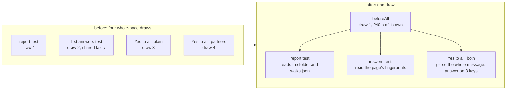

# The walks page's slowest test file draws the page once

**Where it stands — 2026-11-01 13:05 +07:** every step done; one whole `pnpm check` green. Ready to merge.

## At a glance

| | Before | After |
| --- | --- | --- |
| Whole-page draws in `cli.test.ts` | 4, about 37 s each alone | 1, about 38 s |
| The file, alone | 150.7 s | 40.1 s |
| The file on GitHub (estimate) | about 390 s (seen) | about 100 to 150 s |
| Cases held | 9 | the same 9, each seen red at its own assertion |

`app` is GitHub's critical job at 11 of its 15 minutes, and a red or timed-out `app` skips ridge's deploy.
This cuts about three draws' time from it, so each screen added later costs the file one draw's share, not
four ([open item 37](../open-items.md), findings 3 and 5, done here).

## The change

- **Which tests draw the whole page now, and how many times.** Four, each about 37 s alone: the report test
  (`report()`), the lazily shared `builtPage()` that the first answers test paid for, and the two "Yes to all"
  tests, whose `answer()` draws every screen because the block answers every key. The brief for this line
  counted three; the file's own comment in `vitest.config.ts` and the log count four, and the log of the
  baseline run shows four times of 36 to 39 s.
- **The one build.** A `beforeAll` at the file's top makes the root, runs `report()` and reads the written
  `walks.json` as a `Report`, with its 240 s as the hook's own argument. The tests read it; none draws a
  page. The cost no longer lands on whichever test runs first, and a timeout of the build is the hook's,
  so the tests after it are not run with a half-torn-down DOM (finding 3).
- **How each case still holds.**
  - *The report:* the folder, its one `walks` entry, the two lines, the sum of the tally and the words of the
    named screens are asserted on the build's own output, as before. Red: the first line's text changed in
    `cli.ts`.
  - *The answers' write, date and refusal:* the fingerprints come from the build's page, and `answer()`
    still draws the three screens it is asked about. Red: the day taken from UTC, not Vietnam's.
  - *The partners' paste:* the same, under `@p1`. Red: the label's separator changed in `take.ts`.
  - *Both "Yes to all":* the whole message is parsed with `parseBlock` (every key once, none refused,
    the human's with no `By:`, the partner's under `p1`), and `answer()` takes three of its answer lines (the
    first, the middle and the last), drawn now, so a stale fingerprint or a key the command refuses still
    fails. What is given up: `answer()` no longer draws all the screens of a block of all of them, which is
    the same code path with more keys. Red: nothing written (`taken.length > 99`), and one entry dropped in
    `blockText`.
  - *Unchanged:* the process put back, the command line's parse, the all-refused file, the unparsable file.
- **No budget change, no retry** (QA rule 6). The 240 s per test stays (Decide 48 (a)); the hook names the
  same 240 s.

## Steps

- [x] **1. This plan.** Done when: committed. Evidence: `8a8cbd7`.
- [x] **2. The file.** Done when: one `beforeAll` build; each changed case seen red at its own assertion,
  put back, and logged; coverage 100 %; `vitest.config.ts`'s comment says one draw. Evidence: `a4bafa4`;
  the reds in `logs/20261101-1250` to `-1253-report-one-build-red-*.log` (the report's first line, the
  answers' date, the partner label, nothing written, one entry dropped), each `== exit 1` at its own
  assertion; visual's coverage 100 % in the check.
- [x] **3. The measure, under the lock.** Done when: the file alone, before and after, each test's time and
  the file's from vitest's own durations. Evidence: `logs/20261101-1247-report-one-build-before.log` (file
  150.7 s; draws 38.6, 37.9, 36.5 and 36.3 s) and `-1249-report-one-build-after.log` (file 40.1 s; the
  `beforeAll` about 38 s, the nine tests 0 to 536 ms). On GitHub: its seen 390 s was about 97 s a draw, so
  the file falls to about 100 s, and by the 3.7 factor on this run's 40 s to about 150 s: 240 to 290 s off
  the `app` job's 11 min 11 s.
- [x] **4. One whole `pnpm check`.** Done when: its log reads green with its `== exit 0`. Evidence:
  `logs/20261101-1302-report-one-build-check.log`, `visual` 105.6 s (459 tests). Two earlier tries went red
  at the typecheck (`-1254`, an indexed `line` possibly undefined) and at eslint (`-1255`, two needless
  `!`), both mine and fixed before the commit.
- [x] **5. The ticks.** Done when: open item 37's findings 3 and 5 (and 7, which the same change made, and the
  test file's half of 6) are deleted from it. Evidence: item 37 now holds findings 4 and 6 and the finer budget.

Then stop.
