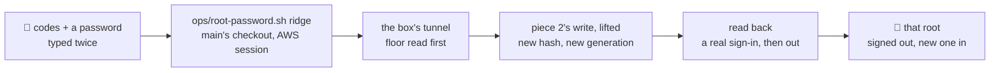

# The demo copies' root passwords, set anew on ridge from the human's terminal

**Where it stands — 2026-11-02 13:06 +0700:** steps 1 to 4 done (the review's M1 and L2 fixed, the rest parked as items 46 to 55; the recap is written). **Step 5, the merge into `main`**, is next (the orchestrator's), then the push and the human's run (steps 6 and 7). The human's step 7 is also the first time `read -s` meets a real terminal.

> **Drafted** 2026-11-02 by the machine, on `main`@`5eda430`, for the human's need of 11-02: the six demo copies'
> root passwords, shown once at `/operator` on 11-01, are lost. A door beside the console's part D (its plan on
> branch `console-root-password`, `docs/plans/2026-11-01-console-root-password.md`, rows 1 to 9, about 12 machine
> hours, not built before 11-04), never D itself. *Model files:* [`ops/operator.sh`](../../ops/operator.sh#L28-L67),
> [`ops/seed.sh`](../../ops/seed.sh#L35-L54), [`ops/lib.sh`](../../ops/lib.sh#L174), [`scripts/src/ridge.ts`](../../scripts/src/ridge.ts#L96-L103),
> [`ridge-main.ts`](../../scripts/src/ridge-main.ts#L6), [`demo/apply.ts`](../../scripts/src/demo/apply.ts#L75-L99).

## At a glance

| Who | Does | What they see |
| --- | --- | --- |
| **the human**, terminal | `bash ops/root-password.sh ridge <code>…` from `main`'s checkout | each code's company named, steps `n/5` |
| | types one new password twice, never shown | refused if the two differ or it breaks the rule: nothing changed |
| | waits about a minute | per code "set" and "signs in"; `ok   no key in this log` |
| **that root** (the human on the `-3` copies; `p1`, `p2` later) | their next click | signed out; the old password refused, the new one in |

Nothing new in the cloud, $0 a month. About 6 machine hours and 25 of the human's minutes, an estimate.

## Why a command, and which code it runs

- **The root's sign-in is one record,** `tenant.<id>.user.root` ([`records.ts`](../../shared/src/records.ts#L149-L164)):
  a scrypt hash by `hashPassword` ([`password.ts`](../../bff/src/password.ts#L21)), `passwordAt`, and a `generation`
  every client call compares ([`app.ts`](../../bff/src/app.ts#L154-L163)), so a new one ends every session.
- **No route sets it without the old one:** the root's own change asks the current password
  ([`app.ts`](../../bff/src/app.ts#L322-L339)); the root's route for a person refuses a record naming no person
  ([`staff.ts`](../../bff/src/staff.ts#L482-L508)); the first is `newPassword()` at the create
  ([`clients.ts`](../../bff/src/clients.ts#L63)); `CREDO_PEOPLE` is the local stack's alone
  ([`stack.ts`](../../scripts/src/stack.ts#L54)). Minting a root session as the seed does buys nothing: the own change
  still asks the current password.
- **So the command calls piece 2's write** (`staff.ts#L493-L507`), lifted into `bff/src/staff-records.ts` beside
  `readSignIn` and exported as `@credo/bff/staff-records`, as D's plan says it will lift it: one home for the write
  that ends sessions, and D's step 5 finds it done. No hash is written by hand.

## What it holds

- **`ops/root-password.sh ridge <code>…`**, its first comment saying about a minute plus the typing:
  1. *ridge alone, main and this commit:* any other environment, GitHub's job (operator.sh#L28) or no terminal
     (#L39) refused before any aws call; `main_synced`; HEAD a commit of `origin/main` and the tree unchanged, and
     `scripts/node_modules` there, as seed.sh#L37-L43; at least one code.
  2. *the password, twice:* `read -rs` twice from the terminal, equal, masked (`mask`, lib.sh#L154); then
     `ridge_cli root-password --check <code>…`, no connection: `passwordIsValid` ([the rule](../../shared/src/staff.ts#L28-L31))
     and each code a copy of the mapping (`copyOfCode`, [`mapping.ts`](../../scripts/src/demo/mapping.ts#L52)).
  3. *the stack and the tunnel:* `stack_load`, `app_load`, port 3196 (`ROOT_PASSWORD_LOCAL_PORT`), `box_open`.
  4. *the box read first:* `box_floor` (lib.sh#L474); `health_main_read`: ridge runs a commit of main.
  5. *each root:* `read_keys`, `bff_env_read`, `ridge_cli root-password <code>…`, the password on its stdin.
- **Refused or failed:** until the first write the script's `die` is a refusal, `== refused: <why>` and exit 2
  (walk/run.sh#L134's form), so lib.sh's guards refuse the same way; from the write on, `error:` and exit 1.
- **In node** (`runRidge`): every code's index and root record read before the first write; then per code the write
  and a read-back, a sign-in by `buildApp`'s `app.inject` with the new password (apply.ts#L81's way), then its
  sign-out. No server listens and nothing is minted: up, the act and down are one invocation; `on_exit` closes the
  tunnel at every end.
- **`ops/README.md`:** a line in the glance table and a short section beside the operator's.

## How D's rows carry over

| D's row | Here | Differs |
| --- | --- | --- |
| 1, any operator, the code typed (51) | whoever holds ridge's AWS session; the codes typed as arguments, each company named first | no operator account |
| 2, typed under piece 2's rule, or made | typed twice under the same rule; made only if Q2 says so | one way, not two |
| 3, made shown once, the root told nothing | nothing shown; the human sends it by their own channel | — |
| 4, every session ends (51) | the same, by the generation | — |
| 5, a fresh passkey touch (50 a) | an AWS session, the box and `main`'s reviewed `ops/` | **Q1** |
| 6, reads nothing of the client (51) | reads the index and the root's record; writes that record alone | a read-back session, ended |
| 7, a failure changes nothing (51) | per root: one write over its tag; a stopped run names the roots set | per root, not per run |
| 8, no record of which operator | the human's local log names the run and its codes | — |
| 9, not yet: a client's own stack and the rest | refused: ridge alone, until D ships with the human's answer to row 9 | — |

## The case table

👤 rows for the human's read ([QA](../conventions/qa.md) rule 1), each seen red once from its assertion; every package
at 100 %.

| # | | The case | Held by |
| --- | --- | --- | --- |
| 1 | 👤 | The human names demo copies by code and types one new password twice; each named root gets it, each company named before anything changes. One run a person: the two `-3` copies for the human's looks, later `p1`'s `-1` and `p2`'s `-2` | scripts, `ridge-root-password.test.ts`; `ops/test.sh` |
| 2 | 👤 | Two typings that differ, or a password that breaks piece 2's rule (8 to 128 characters, a capital, a small letter, a digit, one of `@$!%*?&`, no space at either end), are refused before the box is opened | `ops/test.sh`; scripts |
| 3 | 👤 | The password is never shown or kept: not on the screen, in the log or in a file, and the log is searched for it; the app tells the root nothing | `ops/test.sh`: the log and the stand-ins' calls searched |
| 4 | 👤 | Every session of that root ends at its next click, the human's own tab included; the old password is refused, the new one signs in, read back at the end | scripts, through the BFF's routes |
| 5 | 👤 | Nothing else of the copy is read or changed, and the seed's next morning goes on as before | scripts: the records listed before and after; a seed day after it |
| 6 | 👤 | Only the six demo copies on ridge: another code or another environment is refused, nothing changed (Q3) | `ops/test.sh`; scripts |
| 7 | 👤 | A run that stops part-way names the roots it set; one it did not reach keeps its password; the same run again ends in the same state | scripts, a store failing on a chosen write |
| 8 | 👤 | Whoever holds ridge's AWS session runs it from `main`'s reviewed checkout in a terminal; no passkey (Q1) | `ops/test.sh`: GitHub's job, no terminal, unreviewed `ops/` refused |
| 9 | 🤖 | The lifted write: read with its tag, nothing written unless `owns` (piece 2: its person, else 409; here `root: true`); hashed once; `passwordAt` now, a fresh `generation`; a 412 re-reads three times at most | BFF route, `employees.route.test.ts#L285` unchanged; unit, bff, a race |
| 10 | 🤖 | `--check` reads one line, no connection: `passwordIsValid`, each code normalised and the mapping's; else status 2 naming why | scripts |
| 11 | 🤖 | Every code's index and root record read before the first write (missing, unparsed or not a root: status 2, nothing written); a stop after a write is status 1 naming the codes set | scripts, real c-storage |
| 12 | 🤖 | After it, a root session issued before by `createSessions` is a 401 on `ROUTES.me`; the old password a 401 and the new a 200 at `ROUTES.signIn` | scripts |
| 13 | 🤖 | The tenant's records differ in `user.root` alone; the read-back's session record is gone | scripts |
| 14 | 🤖 | No line on out or err holds the password or a hash, a failed write's included | scripts, every line searched |
| 15 | 🤖 | Each refusal is `== refused:` and exit 2: another environment and GitHub's job before any aws call; no terminal; no code named; `ops/` not `origin/main`'s, HEAD not main's, a changed tree, no `node_modules`; the port taken; the box below its floor; `/health` naming no commit of main | `ops/test.sh` |
| 16 | 🤖 | The password reaches node on a pipe from bash's builtin `printf`: never argv, the environment, a here-string (bash 3.2 writes one to a file) or a file | `ops/test.sh`: `aws.calls`, `ssh.calls`, the log |
| 17 | 🤖 | Steps `n/5` with the time; the tunnel closed at every end; `== exit <n>` last | `ops/test.sh` |
| 18 | 🤖 | `ridge-main.ts` stays excluded, binding stdin too (*elsewhere:* `ops/test.sh`) | the gate |

## Steps

- [x] **1. This plan.** Who: 🤖, 11-02. Done when: committed on `ridge-root-password`, the path grep clean, no
  person named. *Evidence:* this file's commit.
- [x] **2. The human's read.** Who: 👤, about 10 minutes: rows 1 to 8 and Q1 to Q3. Done when: each kept or corrected
  here, dated. **Then stop.** *Evidence:* 2026-11-02 10:4x +07, the human: "yes to all" (via the orchestrator): rows 1 to 8
  kept as written; Q1 the ridge-only door, Q2 the password typed twice, Q3 the six demo copies only (Decide 54).
- [x] **3. Built, red first.** Who: 🤖 (`claude-sonnet-5-5`), after step 2, about 4 hours: the lift and its export;
  `root-password` in `ridge.ts`, stdin in `ridge-main.ts`; `ops/root-password.sh`, its section in `ops/test.sh`
  beside operator.sh's (#L1809); the runbook. Done when: rows 1 to 8 each seen red once; bff and scripts at 100 %,
  typecheck, eslint, knip exit 0, no warning; `bash ops/test.sh` exit 0; `shellcheck -x ops/*.sh` clean. **Then stop.**
  *Evidence:* 2026-11-02 11:32 +0700, `claude-sonnet-5-5`. Model files followed: `ops/seed.sh` and `ops/operator.sh` for
  `ops/root-password.sh`; `scripts/src/demo/apply.ts`'s driver (the BFF's own `buildApp` and `app.inject`) for
  `scripts/src/root-password.ts`, a file of its own beside `ridge.ts` (which only routes the command and the
  exit 2); `scripts/src/ridge-seed.test.ts` for `scripts/src/ridge-root-password.test.ts`; `ops/test.sh`'s
  seed section for its new section (placed between the operator's and the seed's). The lift is
  `setSignInPassword` in `bff/src/staff-records.ts`, exported as `@credo/bff/staff-records`; the person route
  calls it with `employeeId` as `owns`, the door with `root`. Rows 1 to 8 each seen red once from their own
  assertion: scripts 1, 2, 4, 5, 6, 7 by a changed line each (the write skipped, the rule check, the
  generation kept, the read-back's sign-out, the mapping check, the set-list), restored after; ops 2, 3, 6, 8 by
  the typings check, a line that logs the password, the ridge-only line and the job, terminal and
  `origin/main` guards removed, restored after. The whole check (typecheck, eslint, prettier, every package's tests at 100 %, knip) exit 0, with
  `ops/test.sh` exit 0 and `shellcheck -x ops/*.sh` clean. The pseudo-terminal path of the new `ops/test.sh`
  section (a driver that types at each prompt) could not run here (no pty in the sandbox); the section ran on
  its no-terminal path (`OPS_TEST_NO_TTY`), as the operator's does where a pty is missing.
- [x] **4. One review.** Who: 🤖, a model other than the builder's (`claude-opus-5-5`), with this table, about an
  hour with its fixes. Done when: each finding tagged `[FIXED]`, `[REJECTED]` or `[DEFERRED]` here; step 3's gate
  exit 0 again.
  *Evidence:* 2026-11-02 13:06 +0700, Opus on `d53d53b`: M1 [FIXED] (red first: the grep stand-in's argument list held the password, then
  `search_extra` on a pipe), L2 [FIXED]; L3 to L5 and I1 to I7 [DEFERRED] to open items 46 to 55; see
  [the recap](../recaps/2026-11-02-ridge-root-password.md). Plain `pnpm check` exit 0, `bash ops/test.sh` exit 0.
- [ ] **5. Into `main`.** Who: 🤖 the orchestrator, about ¼ hour. Done when: merged, conflicts named;
  `pnpm install --offline` exit 0 in `main`'s checkout.
- [ ] **6. The push**, one with the seed's change. Who: 👤, a few minutes. `main_synced` needs `ops/root-password.sh`
  on `origin/main`. `ops/**`, `scripts/**` and `bff/**` are in ci.yml's push paths ([`ci.yml`](../../.github/workflows/ci.yml#L9-L25)),
  so the push runs every gate and its deploy job releases ridge (#L213-L215), as any push to main. Done when: CI's
  deploy green.
- [ ] **7. The human's run.** Who: 👤, about 5 minutes, after step 6, not during a seed run: from `main`'s checkout,
  `bash ops/root-password.sh ridge vat-lieu-quang-tin-dat-3 phan-phoi-loc-vuong-hai-3`. They see five steps, both
  companies named, "set" and "signs in" twice, `ok   no key in this log`, `== exit 0`; 🤖 reads the log whole. Done
  when: the human's yes to "did the `-3` root sign in with the password you typed?" Later, about 3 minutes each, the
  same for `p1` (both `-1`) and `p2` (both `-2`), each with its own password.
- [x] **8. The recap.** Who: 🤖, about ½ hour. Done when: committed.

**Machine hours:** 4 + 1 + ¼ + ½, about 6. **The human's:** 10 + 3 + 5 + 6 minutes. **The four stages:** the command
is the slice; step 3 verifies it locally (real c-storage, stand-ins for aws and ssh); no screen changes, so the
visual report's stage is the gap, and the human's yes at step 7 on ridge stands for it.

## Hazards, rejected, the merge

- **A seed running meanwhile** (06:00 in Vietnam, [`seed.yml`](../../.github/workflows/seed.yml#L12), or by hand): its
  root session is refused at the next call and that copy stops red, caught up the next morning. Between runs nothing:
  the seed reads the root's generation at each day's open ([`apply.ts`](../../scripts/src/demo/apply.ts#L118-L124)).
- **A release mid-run:** a refused write leaves that root as it was; the run again sets it.
- **The password typed where a session reads:** typed only at `read -s`, never pasted into a chat or a session.
- *Rejected:* a one-off outside git, unreviewed code under the AWS session (lib.sh#L172); building D first, about 12
  hours, its squash waiting for the demo; a copy of the write in `scripts/`, a second home; seed.sh's stricter
  `/health` match, since one record kind keeps its shape across main.
- **The merge:** `main`@`5eda430`, `ridge-root-password`. Today's seed change (`seed.yml`, `apply.ts`) shares no file;
  `ops/test.sh` only if it edits the seed section, each an addition, the second to merge keeping both.

## The human's questions

1. **Is this ridge-only door acceptable beside 50 (a)?** *Recommended: yes.* Its holder already holds every key of
   ridge (the box's keys, the BFF's service), so it adds no power; the touch guards the web's door, which this one
   never opens. On a client's own stack the door is D, with its touch, the human's answer to D's row 9 and a record of
   who.
2. **How is the password chosen?** *Recommended: typed twice.* The human picks one they keep, nothing is shown, no
   file or scrollback holds it. Made and shown once on the terminal (operator.sh's way) is how these six were lost;
   made into a `secrets/` file leaves a password on disk.
3. **The six demo copies alone, or any client on ridge?** *Recommended: the six alone.* They hold invented data; any
   other client is D's.
